# Bloco 5 - Documento de Requisitos dos Incrementos 1 a 3

## Prefácio

| Versão | Data | Autor | Razão |
|---|---|---|---|
| 1.0 | 23/09/2026 | Equipe SpotMeet | Documentação dos requisitos do Incremento 1 |
| 2.0 | 20/10/2026 | Equipe SpotMeet | Incremento 2 (reuniões e lista de presença, RF24 a RF35). Revisão do Incremento 1 conforme o código atual e o retorno do professor: atores e casos de uso com pré e pós-condições, diagramas de classes com identificação da camada, diagramas de sequência com as classes e mensagens do código e requisitos não funcionais revistos |
| 2.1 | 02/11/2026 | Equipe SpotMeet | Correções do retorno de 29/10 nas reuniões (RF25 a RF35): seletores de data e hora, dia inteiro, vários dias, frequência de repetição, modalidade, anexo da pauta, motivo do cancelamento, edição durante a reunião, convites sem resposta e e-mails; tabelas meeting_series e meeting_files. E-mails em HTML e avisos novos (RF01, RF04, RF08, RF11, RF14, RF15 e RF18). Foto de perfil vista pelos outros (RF16) |
| 2.2 | 05/11/2026 | Equipe SpotMeet | Revisão conforme o código e o retorno de 29/10: login com Google no RF02, casos de uso separados por área, diagramas de classes sem pacotes, dicionário de classes com atributos, tipos, métodos, entradas e saídas, mensagens das sequências corrigidas, bibliotecas principais e planejamento de testes |
| 3.0 | 07/11/2026 | Equipe SpotMeet | Incremento 3: ata de reunião (RF37 a RF42), votação em reunião (RF43 a RF46), relatório individual (RF47), manual de utilização no aplicativo (RF48) e atualização para o Expo SDK 58 (RNF14). Ajustes reorganizados em menu, com a página Perfil (RF14 a RF18). Tabelas meeting_minutes, minutes_responses, meeting_polls e poll_votes |
| 3.1 | 08/11/2026 | Equipe SpotMeet | Correções relatadas pelo grupo nos testes do aplicativo: lista de organizações na aba Entrar, com a opção de não aparecer (RF03, RF06 e RF07; coluna organizations.listed), convite para a comissão pela própria comissão (RF11 a RF13), recusas avisadas ao presidente no aplicativo e por e-mail (RF28 e RF30), reuniões das comissões vistas pelos líderes só para leitura (RF28), pedido da digital ao abrir e saída pela tela de bloqueio (RF02), botão voltar do Android, avisos que deixam o toque passar e contador de caracteres (RNF09) |
| 3.2 | 09/11/2026 | Equipe SpotMeet | Revisão dos três incrementos: descrições dos requisitos, diagramas e dicionários conferidos contra o código; casos de uso reunidos em uma única figura; estrutura com evolução, cronograma, testes e manutenção e apêndice do levantamento |
| 3.3 | 12/11/2026 | Equipe SpotMeet | Cronograma de execução por requisito e por semana, com as horas estimadas pelo histórico de commits; diagrama de casos de uso reorganizado, com o Usuário no centro e cada área em uma coluna; diagrama de sequência do RF02 dividido em três figuras (e-mail e senha, Google e biometria); descrições dos métodos de acesso do dicionário de classes revistas; resultado dos testes automatizados do aplicativo; RF21 com a contagem de organizações pendentes corrigida (recusadas e bloqueadas não entram) |
| 3.4 | 13/11/2026 | Equipe SpotMeet | Correções relatadas pelo grupo em 12/11: status de presença escolhido direto no menu de Ajustes, salvo no toque (RF16), e exibido aos demais integrantes na página Membros (RF05); tela de bloqueio por cima do aplicativo, sem perder a tela aberta ao desbloquear (RF02 e RF36); botão voltar do Android nas abas internas da aba Organização (RNF09) |

### Glossário

| Termo | Significado |
|---|---|
| Organização | Grupo de pessoas cadastrado por um usuário e aprovado pelo administrador do sistema. É identificada por uma chave de acesso, como `#Equipe` |
| Dono, vice-líder e subdono | Papéis de liderança de uma organização (ORG_OWNER, ORG_VICE_OWNER e ORG_SUBOWNER). Os três são chamados de líderes da organização |
| Membro | Usuário vinculado a uma organização sem papel de liderança (MEMBER) |
| Comissão | Subgrupo de uma organização, com seus integrantes |
| Integrante | Usuário com vínculo ativo (ACTIVE) em uma comissão |
| Presidente da comissão | Integrante que a organização designa para agendar reuniões e gerar a lista de presença (papel COMMITTEE_ADMIN). Há um por comissão |
| Reunião | Encontro agendado pelo presidente de uma comissão, com início e término (ou dia inteiro), convidados, modalidade e, opcionalmente, local, link, pauta e anexo. Pode se repetir: cada data é uma reunião com convites próprios |
| Convite | Registro de que um integrante foi chamado para uma reunião, com a sua resposta (sem resposta, aceitou ou recusou) |
| Ata | Registro escrito pelo presidente depois da reunião, com os assuntos tratados, as decisões tomadas e observações. Os presentes aprovam ou reprovam, e vale a maioria de quem respondeu |
| Votação | Pergunta aberta pelo presidente durante a reunião, respondida com Sim, Não ou Abstenção por quem registrou entrada. O voto é nominal e não pode ser trocado |
| Lista de presença | Relação dos convidados de uma reunião com a resposta ao convite, a entrada, a saída e a situação de cada um (presente, presente com saída não registrada ou ausente) |
| Administrador do sistema | Pessoa que opera a plataforma. Usa conta ADMIN ou SYSADMIN nas funções administrativas do aplicativo; para iniciar o servidor, usa acesso ao computador que hospeda a API, antes do login |

## 1. Introdução

O SpotMeet é um aplicativo mobile, para Android e iOS, destinado a organizar equipes em organizações e comissões e a gerir as suas reuniões. O Incremento 1 entregou o cadastro de usuários, o cadastro de organizações com aprovação do administrador do sistema, o cadastro de comissões dentro das organizações, as configurações da conta do usuário e as informações do sistema para o administrador. O Incremento 2 entrega o agendamento de reuniões pelo presidente da comissão, o convite e a resposta dos integrantes, o registro de entrada e saída e a lista de presença. O Incremento 3 entrega a ata da reunião, com a aprovação dos presentes, a votação durante a reunião, o relatório individual de presença, o manual de utilização dentro do aplicativo e a atualização para o Expo SDK 58.

Este documento descreve os requisitos dos três incrementos conforme implementados no código. Os nomes de classes, métodos, rotas e tabelas citados são os mesmos do código-fonte.

### 1.1. Resumo do Sistema

| Item | Valor |
|---|---|
| Nome | SpotMeet |
| Tipo | Aplicativo mobile (Android e iOS) com servidor próprio (API REST) |
| Linguagens | Java 21 (servidor) e TypeScript 6 (aplicativo) |
| Acesso a banco de dados | Sim (PostgreSQL 18) |

### 1.2. Responsáveis por requisito

| Requisito | Requisitos funcionais | Responsável |
|---|---|---|
| Cadastro de usuário | RF01 a RF05; no Incremento 2, RF29 e RF30 (convite e resposta); no Incremento 3, RF43 a RF46 (votação) | João |
| Cadastro de organização | RF06 a RF08; no Incremento 2, RF25 a RF28 (agendar, editar, cancelar e consultar reuniões); no Incremento 3, RF47 (relatório individual) | Lavínia |
| Cadastro de comissão | RF09 a RF13; no Incremento 2, RF24 (presidente da comissão); no Incremento 3, RF37 a RF42 (ata de reunião) | Enrico |
| Configurações de usuário | RF14 a RF18 e RF36 (bloqueio biométrico); no Incremento 2, RF34 e RF35 (lista de presença); no Incremento 3, RNF14 (Expo SDK 58) e a reorganização de Ajustes | Vitor |
| Informações do sistema | RF19 a RF23; no Incremento 2, RF31 a RF33 (entrada, saída e correção de presença); no Incremento 3, RF48 (manual de utilização) | Guilherme |

### 1.3. Origem dos requisitos

Os requisitos resultam do enunciado da disciplina, dos feedbacks do professor e das decisões registradas pela equipe. O apêndice, na seção 11, apresenta o levantamento do Incremento 2 e as decisões do Incremento 3, com as respectivas datas e limitações.

## 2. Arquitetura do Sistema

O sistema segue a arquitetura cliente-servidor. O aplicativo é responsável pela interface, pela validação preliminar dos campos e pelo estado da sessão. Toda regra de negócio, validação definitiva e autorização fica no servidor, que expõe uma API REST em JSON. A Figura 1 mostra a comunicação entre as camadas e a Figura 2 mostra onde cada parte é executada.

**Figura 1 – Comunicação entre as camadas do software**

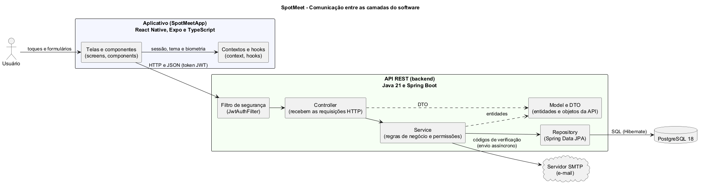

Fonte: próprio autor

O aplicativo (`SpotMeetApp/src`) é organizado em:

- **Telas** (`screens/`): uma por área do sistema (`AuthScreen`, `OrganizationScreen`, `MeetingsScreen`, `SettingsScreen` e as telas de `screens/admin/`).
- **Componentes** (`components/`): formulários, avisos, painéis e folhas reutilizados pelas telas.
- **Contextos e hooks** (`context/`, `hooks/`): sessão, tema, biometria, foto de perfil, atualização automática das telas e leitura com cancelamento.
- **Utilitários e configuração** (`utils/`, `config/`): validações, leitura das respostas da API e descoberta do endereço do servidor.

O servidor (`backend/src/main/java/com/spotmeet/backend`) é organizado em camadas:

- **Filtro de segurança** (`security/JwtAuthFilter`): valida o token JWT de cada requisição e carrega a conta.
- **Controller** (`controller/`): recebe as requisições HTTP. É implementado com o Spring Web (Spring MVC), por meio de classes anotadas com `@RestController`; o Jackson converte os objetos em JSON e o Tomcat embutido atende as requisições.
- **Service** (`service/`): aplica as regras de negócio e as verificações de permissão.
- **Repository** (`repository/`): acessa o banco de dados com Spring Data JPA e Hibernate.
- **Model** (`model/`): entidades JPA que representam as tabelas.
- **DTO** (`dto/`): objetos de entrada e saída da API, validados com Bean Validation.
- **Exceções** (`exception/GlobalExceptionHandler`): converte as exceções em respostas HTTP com mensagem em JSON.

A autenticação é feita por token JWT enviado no cabeçalho `Authorization` de cada requisição, sem sessão no servidor. No acesso pelo Google (RF02), o aplicativo obtém o ID token no Android e o servidor confere a identidade antes de emitir a sessão JWT do SpotMeet. O servidor envia e-mails por SMTP para os códigos da conta, os avisos de alteração de senha e e-mail, as decisões de acesso e moderação, os convites de organização e comissão e os convites, alterações e cancelamentos de reuniões; o envio é assíncrono, agendado para depois do commit da transação, e a resposta HTTP não espera o SMTP.

**Figura 2 – Diagrama de implantação**

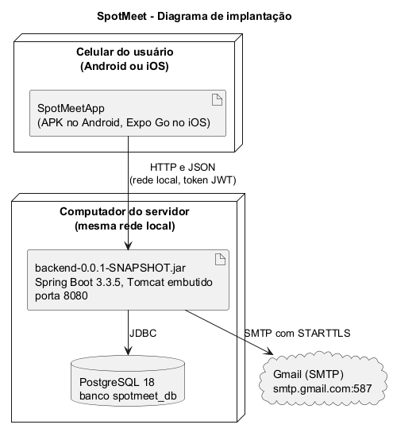

Fonte: próprio autor

### 2.1. Tecnologias e versões

A tabela reúne as principais tecnologias e bibliotecas usadas no projeto, com as versões de referência das dependências.

| Camada | Tecnologia | Versão | Uso |
|---|---|---|---|
| Servidor | Java (OpenJDK) | 21 | Linguagem |
| Servidor | Spring Boot | 3.3.5 | Base do projeto |
| Servidor | Spring Web (Spring MVC) | 6.1.14 | Criação da API REST (`@RestController`) |
| Servidor | Tomcat embutido | 10.1.31 | Servidor HTTP |
| Servidor | Spring Data JPA | 3.3.5 | Repositórios |
| Servidor | Hibernate | 6.5.3.Final | Mapeamento objeto-relacional |
| Servidor | Spring Security | 6.3.4 | Autenticação, autorização e BCrypt |
| Servidor | JJWT | 0.12.6 | Geração e validação do token JWT |
| Servidor | Hibernate Validator | 8.0.1.Final | Validação dos DTOs (Bean Validation) |
| Servidor | Jakarta Mail (Spring Mail, implementação Angus) | 2.0.3 | Envio de e-mails por SMTP |
| Servidor | Spring Boot Actuator | 3.3.5 | Saúde e identificação do servidor |
| Servidor | Driver PostgreSQL (JDBC) | 42.7.4 | Conexão com o banco |
| Servidor | Maven (Maven Wrapper) | 3.9.16 | Compilação e execução |
| Banco | PostgreSQL | 18.6 | Armazenamento dos dados |
| Aplicativo | Expo SDK | 58 (pacote expo 58.0.21) | Ferramentas de desenvolvimento, Expo Go e geração do APK |
| Aplicativo | React Native | 0.88.1 | Interface nativa |
| Aplicativo | React | 19.3.0 | Componentes |
| Aplicativo | TypeScript | 6.0.3 | Tipagem |
| Aplicativo | React Navigation | 7 (native 7.3.16, native-stack 7.18.8, bottom-tabs 7.18.16) | Navegação por pilha e por abas |
| Aplicativo | react-hook-form | 7.90.0 | Controle e validação dos formulários |
| Aplicativo | @react-native-vector-icons/ionicons | 13.1.5 | Ícones |
| Aplicativo | expo-local-authentication | 58.0.2 | Biometria opcional |
| Aplicativo | expo-secure-store | 58.0.2 | Guarda protegida da sessão, quando a biometria é ativada |
| Aplicativo | expo-image-picker e expo-image-manipulator | 58.0.10 e 58.0.16 | Escolha e preparo da foto de perfil |
| Aplicativo | @react-native-google-signin/google-signin | ^17.0.0 | Escolha nativa da conta Google no APK Android e obtenção do ID token |
| Aplicativo | @react-native-community/datetimepicker | 9.2.1 | Seletores nativos de data e hora das reuniões |
| Aplicativo | expo-document-picker | 58.0.4 | Escolha do anexo da pauta |
| Aplicativo | expo-file-system | 58.0.13 | Leitura, gravação e cache de fotos e anexos |
| Aplicativo | expo-sharing | 58.0.21 | Abertura do anexo baixado em outro aplicativo |
| Aplicativo | @react-native-async-storage/async-storage | 2.2.0 | Preferências locais e último endereço do servidor |
| Aplicativo | expo-network | 58.0.4 | Informações da rede para descobrir o servidor local |
| Aplicativo | expo-application e expo-constants | 58.1.2 e 58.0.14 | Identificação da versão instalada e configuração do aplicativo |
| Aplicativo | expo-splash-screen | 58.0.12 | Tela de abertura nativa |

O Expo permite executar o aplicativo em aparelhos reais pelo Expo Go, sem publicação nas lojas, e gerar o APK do Android. Isso não significa que todas as funções estejam disponíveis no Expo Go: o login com Google exige o módulo nativo no APK Android e um cliente Android do Google Cloud com o mesmo pacote e a assinatura SHA-1 da chave que assinou esse APK. Não está disponível no iOS nem no Expo Go; nesses ambientes, o acesso continua por e-mail e senha. O botão "Abrir no SpotMeet" dos e-mails também depende do aplicativo instalado com o esquema spotmeet. Os mínimos exigidos pelo Expo SDK 58 são Android 7.0 (API 24) e iOS 16.4; o ambiente de desenvolvimento exige Node.js 22.13 ou superior.

## 3. Requisitos Não Funcionais de Usuário

Descrevem as propriedades gerais do sistema de forma simples e concisa. São qualidades do sistema, e não funções: as funções estão nos requisitos funcionais (seções 4 e 6).

**RNF01 – Plataformas**

O aplicativo deve funcionar em celulares Android e iOS.

**RNF02 – Segurança dos dados sensíveis**

As senhas e os códigos de verificação dos usuários devem ser armazenados de forma que não possam ser lidos.

**RNF03 – Senha forte**

O sistema deve exigir senhas com letras maiúsculas, minúsculas e números.

**RNF04 – Acesso autenticado**

Os dados de usuários, organizações, comissões e reuniões devem exigir autenticação. O cadastro, o login (inclusive pelo Google) e a recuperação de conta são públicos, assim como a consulta da versão Android e a identificação e a saúde do servidor. O link público do e-mail apenas encaminha ao aplicativo, sem mostrar dados da reunião.

**RNF05 – Validade das sessões**

A sessão do usuário deve ter prazo de validade e deixar de valer quando a senha for trocada.

**RNF06 – Proteção contra tentativas repetidas**

O sistema deve bloquear temporariamente as tentativas repetidas de adivinhar senhas e códigos.

**RNF07 – Tempo de resposta**

As telas devem responder rapidamente às ações do usuário.

**RNF08 – Integridade em acessos simultâneos**

Duas pessoas que alterem o mesmo dado ao mesmo tempo não devem deixá-lo em estado inconsistente.

**RNF09 – Usabilidade**

O aplicativo deve apresentar todos os textos em português, conferir os campos exigidos pela operação antes de enviar os dados ao servidor, exibir mensagens de erro compreensíveis, mostrar quanto do limite de caracteres já foi usado nos textos longos e respeitar o botão voltar do Android em todas as telas. Rascunhos podem ser parciais quando o requisito permitir; um rascunho de ata completamente vazio deve ser recusado antes do envio.

**RNF10 – Horário das reuniões**

As datas e os horários das reuniões devem ser exibidos exatamente como foram agendados, como data e hora local, sem conversão quando muda o fuso configurado no aparelho.

**RNF11 – Preservação dos dados**

A atualização do sistema entre incrementos não deve apagar os dados já cadastrados.

**RNF12 – Execução do servidor**

O servidor deve poder ser executado em computadores com Windows ou Linux que tenham Java 21 e PostgreSQL 18.

**RNF13 – Custo zero**

Todas as tecnologias utilizadas devem ser gratuitas e não exigir assinatura.

**RNF14 – Plataforma do aplicativo atualizada**

O aplicativo deve usar o Expo SDK 58, com as versões do React Native e do React que acompanham essa versão.

## 4. Requisitos Funcionais de Usuário

Descrevem as funcionalidades do sistema de maneira simples e concisa. A Figura 3 apresenta um único diagrama dos casos de uso, organizado por área, com os dois atores dos Incrementos 1 a 3. O Usuário fica no centro: à esquerda estão as áreas usadas só por ele e, à direita, as áreas que também envolvem o Administrador do sistema, que fica na outra ponta. Cada caso aparece uma vez na figura, em ordem de código, e é detalhado, com os mesmos código e nome, na tabela da sua área (4.2 a 4.11). O rótulo [Usuário], [Administrador] ou [Ambos] identifica os participantes em cada caso, sem depender da cor ou de seguir as linhas de associação. Os papéis e as condições de acesso constam nessas tabelas.

### 4.1. Atores e papéis

O sistema tem dois atores:

| Ator | Quem é |
|---|---|
| Usuário | Qualquer pessoa que usa o aplicativo, com a conta de perfil global USER, esteja ou não com a sessão iniciada. Antes do login, realiza o cadastro, o login, a recuperação de conta e a escolha do endereço do servidor. |
| Administrador do sistema | Pessoa responsável pela operação da plataforma. Nas funções administrativas do aplicativo, usa uma conta de perfil global ADMIN ou SYSADMIN, faz login e vê as abas administrativas. Ao iniciar o processo do servidor, atua no computador que hospeda a API, antes do login no aplicativo; essa operação exige acesso ao ambiente, não uma sessão do SpotMeet. |

Os papéis dentro de uma organização (dono, vice-líder, subdono e membro) e de uma comissão (presidente e integrante), assim como ter registrado entrada em uma reunião, não são atores: são condições dos casos de uso e aparecem na pré-condição de cada um. O mesmo Usuário pode ser dono de uma organização, integrante de outra e presidente de uma comissão. Os líderes da organização (dono, vice-líder e subdono) respondem pelas comissões; o presidente de cada comissão responde pelas reuniões dela.

**Figura 3 – Diagrama de casos de uso do sistema**

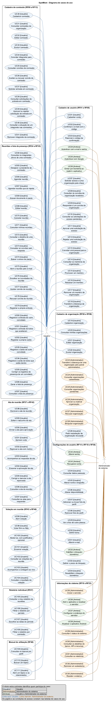

Fonte: próprio autor

### 4.2. Cadastro de Usuário

**Requisito RF01 – Cadastrar Usuário**

O sistema deve permitir que uma pessoa crie uma conta informando nome, e-mail e senha e a ative confirmando o e-mail com um código de 6 dígitos, podendo pedir um novo código; ao confirmar, a pessoa já entra no aplicativo.

**Requisito RF02 – Autenticar Usuário**

O sistema deve permitir que o usuário e o administrador do sistema entrem no aplicativo informando e-mail e senha ou escolhendo uma conta Google no APK Android compatível, criando a conta local no primeiro acesso pelo Google quando necessário. Quando a biometria estiver habilitada, deve permitir desbloquear o aplicativo com a sessão guardada e encerrar a sessão quando o token deixar de valer.

**Requisito RF03 – Solicitar Acesso à Organização**

O sistema deve permitir ao usuário solicitar acesso a uma organização aprovada informando a chave de acesso dela ou escolhendo-a na lista das organizações aprovadas que aceitam aparecer, e aceitar ou recusar os convites de organização que receber.

**Requisito RF04 – Avaliar Solicitação de Acesso**

O sistema deve permitir ao dono ou ao vice-líder da organização consultar, aprovar ou rejeitar as solicitações de acesso e convidar pessoas já cadastradas para a organização.

**Requisito RF05 – Manter Membros da Organização**

O sistema deve permitir aos líderes da organização consultar os membros, promovê-los, rebaixá-los e revogar o seu acesso, respeitando a hierarquia de cargos, e ao dono transferir a liderança a outro integrante.

**Casos de uso**

| Código | Caso de uso | Ator | Pré-condição | Pós-condição | RF |
|---|---|---|---|---|---|
| UC01 | Cadastrar conta | Usuário | Não há sessão iniciada e não existe conta verificada (email_verified = true) com o e-mail informado. | Existe em users uma conta com email_verified = false, senha em hash e código de 6 dígitos válido por 5 minutos, enviado ao e-mail; USER_REGISTERED gravada. Se a conta já era pendente, nome, senha e código foram substituídos. Em caso de falha, nada é gravado e a mensagem é exibida. | RF01 |
| UC02 | Confirmar o e-mail com o código | Usuário | Existe conta com o e-mail informado, com email_verified = false e código ainda válido; o usuário tem o código recebido; há menos de 10 falhas de verificação do mesmo e-mail nos últimos 15 minutos. | A conta fica com email_verified = true e sem código; ACCOUNT_VERIFIED gravada; o usuário recebe a sessão e vê a área principal. Em caso de falha, a conta não muda e a mensagem é exibida. | RF01 |
| UC03 | Reenviar o código de confirmação | Usuário | E-mail em formato válido. Só há novo envio se existir conta com esse e-mail e email_verified = false. | A conta pendente passa a ter um novo código com validade de 5 minutos (o anterior deixa de valer), o e-mail é enviado e VERIFICATION_RESENT é gravada; o botão fica bloqueado por 60 segundos. Para outro e-mail, nada é alterado e a resposta é a mesma. | RF01 |
| UC04 | Autenticar com e-mail e senha | Usuário; Administrador do sistema | Existe conta com o e-mail informado e email_verified = true; o usuário conhece a senha; há menos de 10 falhas de login desse e-mail nos últimos 15 minutos. | A sessão é iniciada com um token JWT (24 horas por padrão) e o usuário vê a área principal do seu perfil: Reuniões, Organização e Ajustes para USER; abas administrativas para ADMIN e SYSADMIN. Em caso de falha, nenhuma sessão é criada e a mensagem é exibida; conta pendente com a senha correta é levada à confirmação do e-mail (UC02). | RF02 |
| UC05 | Autenticar com Google | Usuário; Administrador do sistema | Usar o APK Android com o módulo nativo e com o pacote e a assinatura SHA-1 cadastrados no Google Cloud; ter conta Google e Google Play Services; servidor com ID do cliente Web configurado; aparelho e servidor com acesso à internet. Não é necessário ter conta local anterior. | A identidade Google é conferida pelo servidor e a sessão JWT do SpotMeet é iniciada. E-mail novo cria conta USER confirmada; conta local confirmada é reutilizada sem alteração; conta pendente é confirmada com substituição da senha e invalidação dos tokens anteriores. Em caso de falha ou cancelamento, nenhuma sessão é iniciada. | RF02 |
| UC06 | Entrar por biometria ao reabrir o aplicativo | Usuário; Administrador do sistema | A biometria foi habilitada neste aparelho e para este servidor; o aplicativo está bloqueado; o aparelho tem biometria ou PIN configurados. | O aplicativo é desbloqueado e a sessão guardada é restaurada, depois de o servidor confirmar o token, sem emitir novo token. Se o aplicativo só estava em segundo plano, a pessoa volta à tela em que estava, com o que tinha digitado; ao reabrir o aplicativo fechado, as telas abrem do começo. Se o servidor recusar o token, a sessão guardada é apagada e o usuário volta à tela de acesso com o aviso "Sessão encerrada". | RF02 |
| UC07 | Solicitar acesso a uma organização pela chave | Usuário | Sessão iniciada; existe organização aprovada com a chave informada, digitada ou preenchida ao tocar na organização da lista "ORGANIZAÇÕES NA LISTA"; o usuário não é o dono nem membro dela e não tem solicitação pendente para ela. | Existe em access_requests uma solicitação PENDING do usuário para a organização (nova ou reaberta) e ACCESS_REQUESTED foi gravada; o usuário ainda não é membro. Em caso de falha, nada é gravado e a mensagem é exibida. | RF03 |
| UC08 | Consultar os convites de organização recebidos | Usuário | Sessão iniciada e conta verificada. | Nenhuma alteração; o usuário vê os convites PENDING ainda dentro do prazo de 24 horas, de organizações aprovadas e às quais ainda não pertence. | RF03 |
| UC09 | Responder a um convite de organização | Usuário | Sessão iniciada; o convite é do usuário, está PENDING e dentro do prazo de 24 horas; para aceitar, a organização está aprovada e o usuário ainda não é membro. | Ao aceitar, o usuário passa a ser MEMBER da organização, o convite fica ACCEPTED, eventual solicitação pendente dele fica APPROVED e ORGANIZATION_INVITATION_ACCEPTED é gravada. Ao recusar, o convite fica REJECTED, sem vínculo, e ORGANIZATION_INVITATION_REJECTED é gravada. Em caso de falha, nada é alterado. | RF03 |
| UC10 | Consultar as solicitações de acesso pendentes | Usuário | Sessão iniciada e ser dono (ORG_OWNER) ou vice (ORG_VICE_OWNER) da organização; a API aceita também o perfil global SYSADMIN, sem uso pelo aplicativo. | Nenhuma alteração; o usuário vê os pedidos com status PENDING da organização. Sem o cargo exigido, vê a mensagem de acesso negado. | RF04 |
| UC11 | Aprovar uma solicitação de acesso | Usuário | Mesmo cargo de UC10; existe a solicitação PENDING; a organização está aprovada. | A solicitação fica APPROVED, o solicitante passa a ser MEMBER da organização e ACCESS_APPROVED é gravada. Em caso de falha, nada é alterado. | RF04 |
| UC12 | Rejeitar uma solicitação de acesso | Usuário | Mesmo cargo de UC10; existe a solicitação PENDING. | A solicitação fica REJECTED, sem vínculo, e ACCESS_REJECTED é gravada; o solicitante pode pedir de novo (UC07). Em caso de falha, nada é alterado. | RF04 |
| UC13 | Convidar uma pessoa para a organização | Usuário | Sessão iniciada e conta verificada; ser dono ou vice de organização aprovada; o convidado tem conta verificada, não pertence à organização e não tem convite pendente dentro do prazo. | Existe em organization_invitations um convite PENDING do convidado, com validade de 24 horas, e ORGANIZATION_INVITATION_SENT foi gravada; o aviso por e-mail é agendado para envio assíncrono após o commit, sem esperar o SMTP. O convidado responde pelo aplicativo. Em caso de falha, nada é gravado. | RF04 |
| UC14 | Consultar os membros da organização | Usuário | Sessão iniciada e vínculo com a organização (o aplicativo oferece a tela a dono, vice e subdono; a API aceita qualquer integrante e o SYSADMIN). | Nenhuma alteração; o usuário vê nome, e-mail, status de presença (Presente, Ausente ou Ocupado) e cargo de cada integrante. | RF05 |
| UC15 | Promover um membro | Usuário | Ser dono ou vice para promover MEMBER a ORG_SUBOWNER; ser dono para promover ORG_SUBOWNER a ORG_VICE_OWNER; o alvo é integrante e não é o dono. | O alvo tem o novo cargo em organization_members e ROLE_PROMOTED_SUBOWNER ou ROLE_PROMOTED_VICE_OWNER é gravada. Em caso de falha, nada é alterado. | RF05 |
| UC16 | Rebaixar um membro | Usuário | Ser dono para rebaixar ORG_VICE_OWNER a ORG_SUBOWNER; ser dono ou vice para rebaixar ORG_SUBOWNER a MEMBER; o alvo é integrante e não é o dono. | O alvo tem o novo cargo e ROLE_DEMOTED_SUBOWNER ou ROLE_DEMOTED_MEMBER é gravada. Em caso de falha, nada é alterado. | RF05 |
| UC17 | Remover um membro da organização | Usuário | Ser dono (remove qualquer integrante), vice (remove membro e subdono) ou subdono (remove membro); o alvo é integrante, diferente do executor e do dono. | O alvo perde o vínculo com a organização, com as comissões dela, e as suas solicitações e convites nela são excluídos; ACCESS_REVOKED é gravada. Em caso de falha, nada é removido. | RF05 |
| UC18 | Transferir a liderança da organização | Usuário | Ser o dono atual (organizations.owner_id) de uma organização aprovada; o destino é outro integrante da mesma organização; existe um único vínculo ORG_OWNER, coerente com owner_id. A API aceita também o SYSADMIN, sem uso pelo aplicativo. | O destino passa a ser o dono (ORG_OWNER e owner_id), o antigo dono passa a MEMBER e ORGANIZATION_LEADER_CHANGED é gravada. Em caso de falha, nada é alterado. | RF05 |

### 4.3. Cadastro de Organização

**Requisito RF06 – Cadastrar Organização**

O sistema deve permitir ao usuário cadastrar uma nova organização, informando o nome, a chave de acesso e se ela aparece na lista de organizações da aba "Entrar", que fica pendente até a aprovação do administrador do sistema e tem o próprio usuário como dono.

**Requisito RF07 – Manter Organização**

O sistema deve permitir ao usuário consultar as suas organizações, ao dono ou ao vice-líder editar a organização, inclusive se ela aparece na lista de organizações, ou excluí-la, ao dono pedir uma única reavaliação de uma organização recusada e ao dono, ou ao administrador do sistema com perfil SYSADMIN, transferir a liderança de uma organização aprovada para outro integrante.

**Requisito RF08 – Gerenciar Organizações**

O sistema deve permitir ao administrador do sistema consultar as organizações e aprovar, recusar, bloquear ou reativar o seu cadastro, informando um motivo na recusa e no bloqueio.

**Casos de uso**

| Código | Caso de uso | Ator | Pré-condição | Pós-condição | RF |
|---|---|---|---|---|---|
| UC19 | Cadastrar organização | Usuário | Estar autenticado (sessão válida, conta com e-mail verificado). O nome e a chave informados não coincidem, ignorando maiúsculas e espaços extras, com os de nenhuma organização existente, e o CNPJ, se informado, não pertence a outra organização. | Organização gravada com approved igual a false, status PENDING e a escolha de aparecer ou não na lista de organizações (listed), tendo o usuário como dono (ORG_OWNER), e exibida em "Minhas" com o selo "Pendente". Auditoria ORGANIZATION_CREATED. Em caso de falha, nada é gravado e a tela exibe a mensagem. | RF06 |
| UC20 | Consultar minhas organizações | Usuário | Estar autenticado. | Lista das organizações em que o usuário tem vínculo, com o selo de estado e o de papel; o dono vê o motivo de uma organização recusada ou bloqueada. Nada é alterado. | RF07 |
| UC21 | Editar organização | Usuário | Ser o dono (ORG_OWNER) ou o vice-líder (ORG_VICE_OWNER) da organização, que deve existir em qualquer estado. O novo nome e a nova chave não coincidem com os de outra organização. | Nome, chave e escolha de aparecer na lista atualizados; estado de aprovação, dono e CNPJ preservados; a chave anterior deixa de localizar a organização. Auditoria ORGANIZATION_UPDATED. Em caso de falha, nada é alterado. | RF07 |
| UC22 | Excluir organização | Usuário | Ser o dono (ORG_OWNER) ou o vice-líder (ORG_VICE_OWNER) da organização, que deve existir em qualquer estado. | Organização, comissões, vínculos, convites, solicitações de acesso e integrantes removidos; as contas permanecem. Auditoria ORGANIZATION_DELETED. Em caso de falha, nada é removido. | RF07 |
| UC23 | Transferir a liderança de uma organização pelo painel administrativo | Administrador do sistema | Ser o Administrador do sistema com perfil SYSADMIN (a transferência feita pelo próprio dono é o caso de uso UC18). A organização está aprovada e o destino é outro integrante atual da mesma organização. | O destino passa a ORG_OWNER e a owner_id; o antigo dono passa a MEMBER, mantendo o perfil global e o estado da organização. Auditoria ORGANIZATION_LEADER_CHANGED. Em caso de falha, nada é alterado. | RF07 |
| UC24 | Consultar organizações cadastradas | Administrador do sistema | Estar autenticado com perfil global ADMIN ou SYSADMIN. | Lista de todas as organizações, com o e-mail do dono e o CNPJ mascarados e as quantidades de integrantes e de comissões. Nada é alterado. | RF08 |
| UC25 | Consultar organizações pendentes | Administrador do sistema | Estar autenticado com perfil global ADMIN ou SYSADMIN. | Fila das organizações com approved igual a false e status PENDING ou nulo, incluindo as reenviadas pelo dono, com a justificativa e o motivo da recusa anterior. Nada é alterado. | RF08 |
| UC26 | Aprovar ou reativar organização | Administrador do sistema | Ser ADMIN ou SYSADMIN. A organização existe e está com approved igual a false (PENDING, REJECTED ou BLOCKED). | approved igual a true, status APPROVED e motivo apagado; a organização volta a aceitar solicitações de acesso, convites e comissões. Auditoria ADMIN_ORGANIZATION_APPROVED (fila) ou ADMIN_ORGANIZATION_STATUS_CHANGED (lista geral). Em caso de falha, nada é alterado. | RF08 |
| UC27 | Recusar organização | Administrador do sistema | Ser ADMIN ou SYSADMIN. A organização existe e está pendente (o aplicativo oferece "Recusar" na fila). O motivo tem de 3 a 500 caracteres, sem caracteres de controle. | approved igual a false, status REJECTED e motivo gravado, visível ao dono e aos administradores; se a organização já tinha sido reenviada, a recusa é definitiva. Auditoria ADMIN_ORGANIZATION_REJECTED. Em caso de falha, nada é alterado. | RF08 |
| UC28 | Bloquear organização | Administrador do sistema | Ser ADMIN ou SYSADMIN. A organização existe e está aprovada (o aplicativo oferece "Bloquear Organização" nesse estado). O motivo tem de 3 a 500 caracteres, sem caracteres de controle. | approved igual a false, status BLOCKED e motivo gravado, visível ao dono e aos administradores; integrantes e comissões existentes são mantidos. Auditoria ADMIN_ORGANIZATION_STATUS_CHANGED. Em caso de falha, nada é alterado. | RF08 |
| UC29 | Pedir reavaliação de organização recusada | Usuário | Ser o dono (owner_id) de uma organização recusada (status REJECTED) cuja reavaliação ainda não foi usada (resubmitted_at nulo). A justificativa tem de 3 a 500 caracteres, sem caracteres de controle. | Organização volta a PENDING, com a justificativa e a data do reenvio gravadas e o motivo anterior mantido, e retorna à fila de Aprovações; não pode ser reenviada outra vez. Auditoria ORGANIZATION_RESUBMITTED. Em caso de falha, nada é alterado. | RF07 |

### 4.4. Cadastro de Comissão

**Requisito RF09 – Cadastrar Comissão**

O sistema deve permitir ao dono, ao vice-líder e ao subdono de uma organização aprovada cadastrar comissões dentro dela, com nome único na organização (sem diferenciar maiúsculas, minúsculas e espaços extras) e descrição opcional.

**Requisito RF10 – Manter Comissão**

O sistema deve permitir aos integrantes da organização consultar as comissões dela, com a quantidade de integrantes ativos e de vínculos pendentes, e ao dono, ao vice-líder e ao subdono editar o nome e a descrição das comissões. O aplicativo oferece a exclusão da comissão ao dono e ao vice-líder.

**Requisito RF11 – Convidar Membro para Comissão**

O sistema deve permitir ao dono, ao vice-líder e ao subdono convidar para uma comissão os integrantes da organização que ainda não participam dela, escolhendo-os numa lista na própria comissão, e ao convidado consultar os seus convites pendentes e aceitar ou recusar cada um.

**Requisito RF12 – Solicitar Entrada em Comissão**

O sistema deve permitir ao integrante da organização solicitar a entrada em uma comissão, e ao dono, ao vice-líder e ao subdono consultar as solicitações pendentes e aprová-las ou rejeitá-las.

**Requisito RF13 – Manter Integrantes da Comissão**

O sistema deve permitir consultar a situação de um integrante em cada comissão da organização e, ao dono, ao vice-líder e ao subdono, remover o vínculo do integrante com uma comissão.

**Casos de uso**

| Código | Caso de uso | Ator | Pré-condição | Pós-condição | RF |
|---|---|---|---|---|---|
| UC30 | Cadastrar comissão | Usuário | Estar autenticado e ser dono da organização (organizations.owner_id) ou ter papel ORG_OWNER, ORG_VICE_OWNER ou ORG_SUBOWNER nela. A organização deve estar aprovada (approved = true, status APPROVED) e não pode haver outra comissão com o mesmo nome nela, sem diferenciar maiúsculas, minúsculas e espaços extras. O perfil global SYSADMIN também é aceito, apenas pela API. | Sucesso: comissão gravada em committees, sem integrantes, com o nome normalizado; auditoria COMMITTEE_CREATED; a comissão aparece na lista da organização com "0 ativos" e "0 pendentes". Falha: nada é gravado e o aplicativo exibe a mensagem do servidor. | RF09 |
| UC31 | Consultar comissões da organização | Usuário | Estar autenticado e ser integrante da organização (organization_members). O perfil global SYSADMIN também é aceito, apenas pela API. | Sucesso: lista das comissões em ordem alfabética, com os integrantes ativos e os vínculos pendentes de cada uma; nada é alterado. Falha (usuário fora da organização): nada é exibido e o aplicativo volta à aba "Minhas". | RF10 |
| UC32 | Editar comissão | Usuário | Estar autenticado e ser líder da organização (dono, ORG_VICE_OWNER ou ORG_SUBOWNER, ou SYSADMIN pela API). A comissão deve existir e o novo nome não pode pertencer a outra comissão da mesma organização. | Sucesso: nome e descrição atualizados em committees; organização e vínculos mantidos; auditoria COMMITTEE_UPDATED. Falha: nada é alterado e o aplicativo exibe a mensagem do servidor. | RF10 |
| UC33 | Excluir comissão | Usuário | Estar autenticado e ser líder da organização (o aplicativo oferece o botão ao dono e ao vice-líder; a API aceita também o subdono e o SYSADMIN). A comissão deve existir e o usuário deve confirmar no diálogo "Excluir comissão". | Sucesso: comissão e todos os seus vínculos (ativos, convites e solicitações pendentes, recusados) removidos; auditoria COMMITTEE_DELETED; a comissão some da lista. Falha ou desistência no diálogo: nada é removido. | RF10 |
| UC34 | Convidar integrante para comissão | Usuário | Estar autenticado e ser líder da organização da comissão. O convidado é escolhido na lista "Convidar integrantes" da comissão, que traz só os integrantes da organização sem vínculo ou com vínculo recusado; pela API, o convidado deve ser integrante da organização e não pode ter vínculo ACTIVE nem convite PENDING_USER_ACCEPTANCE com a comissão. | Sucesso: vínculo PENDING_USER_ACCEPTANCE (papel MEMBER, invited_by_id do líder) criado ou reaberto, se estava DECLINED; se havia PENDING_LEADER_APPROVAL, o vínculo passa direto para ACTIVE; auditoria COMMITTEE_INVITATION_SENT. Falha: nada é alterado. | RF11 |
| UC35 | Consultar convites de comissão | Usuário | Estar autenticado. | Lista dos vínculos PENDING_USER_ACCEPTANCE do usuário, de qualquer organização, com a comissão e o nome de quem convidou; nada é alterado. | RF11 |
| UC36 | Aceitar ou recusar convite de comissão | Usuário | Estar autenticado e ter vínculo PENDING_USER_ACCEPTANCE com a comissão. | Sucesso: vínculo ACTIVE (aceite) ou DECLINED (recusa), com responded_at; auditoria COMMITTEE_INVITATION_ACCEPTED ou COMMITTEE_INVITATION_DECLINED. Falha (sem convite ou já respondido): nada é alterado. | RF11 |
| UC37 | Solicitar entrada em comissão | Usuário | Estar autenticado e ser integrante da organização da comissão, sem vínculo ACTIVE nem solicitação PENDING_LEADER_APPROVAL com ela. | Sucesso: vínculo PENDING_LEADER_APPROVAL (papel MEMBER) criado ou reaberto, se estava DECLINED; se havia convite PENDING_USER_ACCEPTANCE, o vínculo passa direto para ACTIVE; auditoria COMMITTEE_JOIN_REQUESTED apenas quando o vínculo é novo. Falha: nada é alterado. | RF12 |
| UC38 | Consultar solicitações de entrada em comissão | Usuário | Estar autenticado e ser líder da organização (dono, ORG_VICE_OWNER ou ORG_SUBOWNER, ou SYSADMIN pela API). | Lista dos vínculos PENDING_LEADER_APPROVAL de todas as comissões da organização, com solicitante e comissão; nada é alterado. Falha (não é líder): nada é exibido. | RF12 |
| UC39 | Aprovar ou rejeitar solicitação de entrada em comissão | Usuário | Estar autenticado e ser líder da organização da comissão. O vínculo deve existir e estar em PENDING_LEADER_APPROVAL. | Sucesso: vínculo ACTIVE (aprovação) ou DECLINED (rejeição), com responded_at; auditoria COMMITTEE_JOIN_APPROVED ou COMMITTEE_JOIN_REJECTED. Falha (solicitação inexistente ou já respondida): nada é alterado. | RF12 |
| UC40 | Consultar a situação de um integrante nas comissões | Usuário | Estar autenticado e ser integrante da organização (ou SYSADMIN pela API). O integrante consultado deve pertencer à mesma organização. | Lista de todas as comissões da organização, em ordem alfabética, com a situação do integrante em cada uma (sem vínculo, convite aguardando aceite, solicitação pendente, ativo ou recusado); nada é alterado. Falha: a janela exibe a mensagem de erro e o botão "Tentar novamente". | RF13 |
| UC41 | Remover integrante da comissão | Usuário | Estar autenticado e ser líder da organização da comissão. O vínculo do integrante com a comissão deve existir, em qualquer situação, e o usuário deve confirmar o diálogo "Remover vínculo". | Sucesso: vínculo removido de committee_members; auditoria COMMITTEE_MEMBER_REMOVED; o integrante deixa de constar na comissão e pode ser convidado de novo (UC34) ou pedir entrada (UC37). Falha ou desistência: nada é removido. | RF13 |

### 4.5. Configurações de Usuário

**Requisito RF14 – Alterar Senha**

O sistema deve permitir ao usuário autenticado trocar a sua senha, informando a senha atual. Ao concluir, as sessões abertas da conta são encerradas e o usuário entra novamente com a nova senha.

**Requisito RF15 – Recuperar Conta**

O sistema deve permitir ao usuário que esqueceu a senha recuperar a conta por meio de um código de seis dígitos enviado ao seu e-mail, em três etapas: solicitar o código, validá-lo e definir a nova senha.

**Requisito RF16 – Alterar Dados Pessoais**

O sistema deve permitir ao usuário consultar e alterar os seus dados pessoais: nome, biografia, status de presença (Presente, Ausente ou Ocupado) e foto de perfil. O status de presença é visto pelos demais integrantes na lista de membros da organização. O e-mail é exibido apenas para leitura e é alterado pelo RF18.

**Requisito RF17 – Definir Tema**

O sistema deve permitir ao usuário escolher entre o tema claro e o tema escuro do aplicativo, com prévia imediata, e gravar a escolha para os próximos acessos.

**Requisito RF18 – Alterar E-mail**

O sistema deve permitir ao usuário trocar o seu e-mail, confirmando a posse do e-mail atual e do novo e-mail por códigos de seis dígitos.

**Requisito RF36 – Configurar Bloqueio Biométrico**

O sistema deve permitir ao usuário habilitar ou desabilitar o bloqueio do aplicativo por biometria e escolher depois de quanto tempo fora do aplicativo o desbloqueio volta a ser pedido.

**Casos de uso**

| Código | Caso de uso | Ator | Pré-condição | Pós-condição | RF |
|---|---|---|---|---|---|
| UC42 | Alterar senha | Usuário; Administrador do sistema | Ter sessão iniciada com JWT válido e e-mail verificado (o usuário comum troca na aba "Ajustes"; o administrador, que não tem essa aba, troca no cartão "Senha de acesso" da aba "Controles"); conhecer a senha atual; a conta não estar em pausa por dez falhas de senha atual nos últimos 15 minutos. | Sucesso: users.password guarda o hash da nova senha e users.tokens_valid_after o instante da troca (nenhum JWT anterior vale), PASSWORD_CHANGED consta em audit_logs, o aviso por e-mail está agendado e o aplicativo volta ao login. Falha: nada é alterado, a sessão continua e a mensagem é exibida. | RF14 |
| UC43 | Recuperar conta | Usuário; Administrador do sistema | Conhecer o e-mail de uma conta cadastrada, de qualquer perfil (inclusive ADMIN e SYSADMIN), e ter acesso à caixa desse e-mail. Não é preciso estar autenticado. | Sucesso: a senha da conta é a nova, o código é apagado, email_verified é verdadeiro, users.tokens_valid_after revoga as sessões anteriores, PASSWORD_RESET consta em audit_logs e o aplicativo volta ao login. Falha: senha e código permanecem como estavam. A solicitação do código responde igual para e-mail cadastrado e não cadastrado. | RF15 |
| UC44 | Consultar dados pessoais | Usuário | Ter sessão iniciada com perfil global USER, JWT válido e e-mail verificado. | O menu de "Ajustes" exibe a foto ou o avatar, o nome e o e-mail da conta; a página "Perfil" exibe foto ou avatar, nome, biografia, e-mail (somente leitura) e tema, e o grupo "STATUS DE PRESENÇA" do menu marca o status atual; nada é alterado. Falha: mensagem com o botão "Tentar novamente", sem liberar o formulário. | RF16 |
| UC45 | Alterar nome e biografia | Usuário | Ter sessão iniciada com perfil global USER e o perfil carregado; nome de 2 a 100 caracteres (sem espaços nas pontas) e biografia de até 500 caracteres. | users.name e users.bio estão atualizados, o nome da sessão do aplicativo é o confirmado pela API e PROFILE_UPDATED consta em audit_logs. Falha: nada é gravado e a mensagem aparece sob o campo. | RF16 |
| UC46 | Alterar disponibilidade | Usuário | Ter sessão iniciada com perfil global USER, o perfil carregado e o menu de "Ajustes" aberto (grupo "STATUS DE PRESENÇA", abaixo do grupo "CONTA"); tocar numa opção diferente da marcada. | users.availability_status guarda Presente, Ausente ou Ocupado (PRESENT, AWAY ou BUSY), gravado no toque, sem botão de salvar (a mesma requisição reenvia o tema salvo, sem mudança); PROFILE_UPDATED consta em audit_logs e os demais integrantes passam a ver o novo status na página "Membros" da organização. Falha: nada é gravado e a mensagem aparece abaixo das opções. | RF16 |
| UC47 | Adicionar ou trocar foto de perfil | Usuário | Ter sessão iniciada com perfil global USER e e-mail verificado; escolher a imagem na Galeria ou na Câmera (esta exige a permissão de câmera do aparelho) e ver a prévia. | user_profile_photos tem um registro da conta com a imagem JPEG quadrada normalizada e uma nova version, PROFILE_PHOTO_UPDATED consta em audit_logs e a tela exibe a foto. Falha: a foto anterior permanece e a mensagem é exibida. | RF16 |
| UC48 | Remover foto de perfil | Usuário | Ter sessão iniciada com perfil global USER, ter foto salva (só então o botão "Remover foto" é exibido) e confirmar a remoção. | O registro da foto deixou de existir em user_profile_photos, PROFILE_PHOTO_REMOVED consta em audit_logs e a tela exibe o avatar com as iniciais do nome. Falha: a foto permanece. | RF16 |
| UC49 | Ver a foto de outra pessoa | Usuário | Ter sessão iniciada com JWT válido e e-mail verificado e abrir uma lista de pessoas na aba "Organização" (membros, solicitações de entrada na organização ou na comissão, ou a busca de pessoas para convite). | Cada pessoa aparece com a sua foto de perfil; quem não tem foto, ou cuja foto não carregou, aparece com as iniciais do nome. Nada é alterado. | RF16 |
| UC50 | Definir tema | Usuário | Ter sessão iniciada com perfil global USER e a página "Perfil" de "Ajustes" aberta (a prévia só muda as cores do aplicativo; a gravação é feita por "Salvar Alterações"). | Prévia: o aplicativo exibe o tema escolhido sem gravar nada. Gravação: users.preferred_theme guarda LIGHT ou DARK, PROFILE_UPDATED consta em audit_logs e o tema volta nos próximos acessos. Sair do Perfil sem salvar restaura o último tema gravado. | RF17 |
| UC51 | Alterar e-mail | Usuário | Ter sessão iniciada com perfil global USER e e-mail verificado; ter acesso à caixa do e-mail atual e à do novo e-mail; o novo e-mail ser diferente do atual e não pertencer a outra conta; a conta não estar em pausa por dez falhas de código em 15 minutos. | Sucesso: users.email é o novo endereço, email_verified é verdadeiro, as colunas temporárias ficam nulas, a sessão do aplicativo usa o novo e-mail e o novo JWT (o anterior deixa de valer) e LGPD_EMAIL_CHANGED consta em audit_logs. Falha: o e-mail da conta permanece o mesmo. | RF18 |
| UC52 | Habilitar o bloqueio biométrico | Usuário; Administrador do sistema | Ter sessão iniciada, na página "Segurança" de "Ajustes" (perfil global USER) ou no convite "Deseja habilitar a biometria?" exibido depois do login (qualquer perfil), ou automaticamente no primeiro login depois de uma troca de senha com a biometria habilitada (RF14); usar o aplicativo Android ou iOS em aparelho com armazenamento seguro e biometria forte cadastrada (o Face ID não funciona no Expo Go); o servidor confirmar a sessão. | O token da sessão, o identificador do usuário e o servidor ficam guardados no armazenamento seguro do aparelho, o prazo do bloqueio fica gravado e a chave exibe "Habilitado". Em caso de falha, nada é guardado, a chave continua "Desligado" e a mensagem é exibida. | RF36 |
| UC53 | Definir o prazo do bloqueio | Usuário | Ter sessão iniciada com perfil global USER (a página "Segurança" fica no menu de "Ajustes"), o bloqueio biométrico habilitado e o aplicativo desbloqueado. | O prazo escolhido (Imediatamente, 1 minuto, 5 minutos, 1 hora, 3 horas ou 24 horas) fica gravado no aparelho e passa a valer na próxima saída do aplicativo. Em caso de falha, o prazo anterior é mantido. | RF36 |
| UC54 | Desabilitar o bloqueio biométrico | Usuário | Ter sessão iniciada com perfil global USER (a página "Segurança" fica no menu de "Ajustes"), o bloqueio biométrico habilitado e o aplicativo desbloqueado. | Depois da confirmação da biometria, a sessão guardada e a configuração do bloqueio são removidas do aparelho e a chave exibe "Desligado"; o login continua ativo. Sem a confirmação ou em caso de falha, a mensagem é exibida e o bloqueio continua habilitado. | RF36 |

### 4.6. Informações do Sistema

**Requisito RF19 – Inicializar Sistema**

O sistema deve criar o banco de dados, as tabelas e a conta do administrador do sistema quando o servidor é iniciado, e o aplicativo deve localizar o servidor na rede, permitir informar o seu endereço e avisar sobre uma versão mais nova do aplicativo Android.

**Requisito RF20 – Consultar Status do Sistema**

O sistema deve permitir ao administrador do sistema consultar o estado geral do sistema e dos subsistemas Banco de dados, Rede e Recursos, com a versão, o tempo em execução e os detalhes do banco de dados, da API e da JVM.

**Requisito RF21 – Consultar Relatórios**

O sistema deve permitir ao administrador do sistema consultar relatórios com os totais de usuários, organizações, comissões e registros de auditoria e as atividades recentes, com e-mails mascarados e detalhes sanitizados.

**Requisito RF22 – Reiniciar Subsistemas**

O sistema deve permitir ao administrador do sistema reiniciar um subsistema por vez (Banco de dados ou Recursos no aplicativo, e também Rede pela API), informando o motivo, com registro em auditoria.

**Requisito RF23 – Resetar Sistema**

O sistema deve permitir ao administrador do sistema apagar todos os dados, preservando apenas a conta do administrador que executa a ação, mediante a digitação de um texto de confirmação, e encerrar todas as sessões.

**Casos de uso**

| Código | Caso de uso | Ator | Pré-condição | Pós-condição | RF |
|---|---|---|---|---|---|
| UC55 | Iniciar o servidor | Administrador do sistema | Ter acesso ao computador do servidor; não exige sessão no aplicativo. Servidor PostgreSQL em execução e acessível pela URL de DB_URL, com usuário e senha que permitam conectar ao banco "postgres" e, se o banco ainda não existir, criar bancos. Arquivo backend/.env (ou variáveis de ambiente) com DB_PASSWORD e JWT_SECRET válidos e porta SERVER_PORT livre. | O banco e as tabelas existem e estão atualizados, sem perda de dados. A conta sysadmin@spotmeet.com existe (criada agora com perfil SYSADMIN, ou já existente e inalterada) e o servidor atende na porta SERVER_PORT. Se o banco não puder ser acessado, o servidor não conclui a inicialização e o erro fica no console. | RF19 |
| UC56 | Abrir o aplicativo e localizar o servidor | Usuário; Administrador do sistema | Aplicativo instalado e servidor em execução, alcançável pelo aparelho (mesma rede Wi-Fi para a busca automática, ou endereço informado no rodapé "Servidor"). | O endereço do servidor está definido (host salvo, variável de ambiente, servidor do Expo, host encontrado na rede ou padrão da plataforma) e a tela de login é exibida com o rodapé "Servidor: host:porta (origem)". Se nenhum servidor for encontrado, o login é exibido com "(não encontrado)" e as chamadas ao servidor falham com mensagem de conexão. | RF19 |
| UC57 | Configurar o endereço do servidor | Usuário; Administrador do sistema | Estar na tela de login, sem sessão ativa. | O host informado fica salvo no aparelho (ou o host salvo é removido por "Automático", ou o host encontrado por "Procurar na rede" passa a ser usado) e as próximas chamadas usam o novo endereço. Busca sem resultado não altera o host salvo. | RF19 |
| UC58 | Atualizar o aplicativo Android | Usuário; Administrador do sistema | APK Android de release instalado (não Expo Go, não desenvolvimento, não iOS). Servidor com APP_ANDROID_VERSION, APP_ANDROID_VERSION_CODE e APP_ANDROID_DOWNLOAD_URL válidos e versionCode maior que o instalado. | A janela "Nova versão disponível" é exibida. "Atualizar" abre a página da build no Expo no navegador e "Agora não" fecha a janela. Sem versão mais nova, 204, resposta inválida ou falha na consulta, nenhum aviso é exibido e nada é alterado no servidor. | RF19 |
| UC59 | Consultar o status do sistema | Administrador do sistema | Estar autenticado (caso de uso Autenticar, RF02) com conta de e-mail verificado e perfil global ADMIN ou SYSADMIN, com a aba "Monitoramento" aberta. Servidor em execução com o PostgreSQL acessível. | O aplicativo exibe o estado geral (Operacional ou Degradado), o estado de Banco de dados, Rede e Recursos, a versão e o tempo em execução, atualizados a cada 4 segundos. Nada é gravado. Em falha, mantém os últimos dados e exibe o aviso de erro; sem permissão (403), limpa os dados e exibe "Acesso negado pelo servidor. Esta área exige permissão administrativa." | RF20 |
| UC60 | Consultar os detalhes de banco, API e recursos | Administrador do sistema | As mesmas de Consultar o status do sistema, e ter tocado no cartão "Banco de dados" ou "Recursos" ou no botão "Detalhes da API". | A janela "Detalhes" exibe nome, versão, tamanho, latência, pool de conexões e linhas das oito tabelas do banco, ou as métricas da API, ou os recursos da JVM, lidos no momento. Campos sem medição aparecem como "Indisponível". Nada é gravado. Em falha, a janela exibe "Não foi possível consultar os detalhes. Tente novamente.". O cartão "Rede" mostra o status já recebido, sem nova consulta. | RF20 |
| UC61 | Consultar os relatórios | Administrador do sistema | Estar autenticado (RF02) com perfil global ADMIN ou SYSADMIN e a aba "Monitoramento" aberta. | O aplicativo exibe os totais de usuários, organizações, comissões e registros de auditoria e as 15 atividades mais recentes, com e-mails mascarados e detalhes sanitizados, atualizados a cada 4 segundos. Nada é gravado, nem na auditoria. Em falha, mantém os últimos dados e exibe o aviso de erro. | RF21 |
| UC62 | Reiniciar um subsistema | Administrador do sistema | Estar autenticado (RF02) com perfil global ADMIN ou SYSADMIN, na aba "Controles", com um subsistema selecionado ("Banco de dados" ou "Recursos"). Servidor em execução com o PostgreSQL acessível. | O subsistema escolhido foi reiniciado (conexões do pool renovadas e testadas, ou coleta de memória solicitada) e o registro ADMIN_SYSTEM_RESTART foi gravado com o motivo. O aplicativo fecha a janela, exibe "Solicitação aceita" e atualiza o Monitoramento. Em falha, nada é gravado em audit_logs e a janela permanece aberta com a mensagem de erro. | RF22 |
| UC63 | Resetar o sistema | Administrador do sistema | Estar autenticado (RF02) com perfil global ADMIN ou SYSADMIN, na aba "Controles". A conta que executa é a única que será preservada: qualquer outra conta, inclusive de outro administrador, será excluída. Conhecer e digitar o texto CONFIRM_FULL_RESET. | Organizações, comissões, integrantes, solicitações, convites e todas as outras contas foram excluídos, e permanecem só a conta do executor e os registros de auditoria dele (mais o novo ADMIN_SYSTEM_FULL_RESET). Todas as sessões foram invalidadas, o aplicativo volta ao login e exibe "Reset concluído". Em falha, nada é alterado, a sessão continua e a janela exibe a mensagem de erro. | RF23 |

### 4.7. Reuniões e Lista de Presença (Incremento 2)

**Requisito RF24 – Designar Presidente da Comissão**

O sistema deve permitir ao dono, ao vice-líder ou ao subdono da organização designar, entre os integrantes ativos de uma comissão, o seu presidente, e substituí-lo quando necessário.

**Requisito RF25 – Agendar Reunião**

O sistema deve permitir ao presidente da comissão agendar uma reunião, informando título, datas e horários (ou dia inteiro), frequência de repetição, modalidade, local, link, pauta, anexo da pauta e prioridade, e avisar os convidados por e-mail.

**Requisito RF26 – Editar Reunião**

O sistema deve permitir ao presidente da comissão editar os dados e a lista de convidados de uma reunião agendada ou em andamento, avisando os convidados por e-mail do que mudou; numa reunião que se repete, só a data escolhida é alterada.

**Requisito RF27 – Cancelar Reunião**

O sistema deve permitir ao presidente da comissão cancelar uma reunião que ainda não terminou, com motivo opcional enviado por e-mail aos convidados; numa reunião que se repete, só a data escolhida é cancelada.

**Requisito RF28 – Consultar Reuniões**

O sistema deve permitir aos integrantes da comissão e aos líderes da organização consultar as reuniões e baixar o anexo da pauta, e ao usuário consultar as reuniões para as quais foi convidado, com a sua resposta, os convites ainda sem resposta, as reuniões das comissões que preside, com as recusas dos convidados, e, para o dono, o vice-líder e o subdono, as reuniões de todas as comissões da organização, só para leitura.

**Requisito RF29 – Convidar Integrantes para a Reunião**

O sistema deve permitir ao presidente da comissão escolher, entre os integrantes ativos, quem é convidado para a reunião.

**Requisito RF30 – Responder Convite de Reunião**

O sistema deve permitir ao convidado aceitar ou recusar o convite, com comentário opcional na recusa, enquanto a reunião não terminar nem for cancelada, e avisar o presidente de cada recusa por e-mail; numa reunião que se repete, cada data tem a sua resposta.

**Requisito RF31 – Registrar Entrada na Reunião**

O sistema deve permitir a cada convidado registrar a própria entrada e ao presidente registrar a entrada de qualquer convidado, individualmente ou de todos que aceitaram, enquanto a reunião está em andamento.

**Requisito RF32 – Registrar Saída da Reunião**

O sistema deve permitir a cada convidado registrar a própria saída e ao presidente registrar a saída de qualquer convidado, individualmente ou de todos que estão dentro, enquanto a reunião está em andamento.

**Requisito RF33 – Corrigir Registros de Presença**

O sistema deve permitir ao presidente da comissão apagar a entrada e a saída registradas de um convidado.

**Requisito RF34 – Gerar Lista de Presença**

O sistema deve permitir ao presidente da comissão gerar a lista de presença de uma reunião que já começou e não foi cancelada.

**Requisito RF35 – Consultar Lista de Presença**

O sistema deve permitir aos integrantes da comissão e aos líderes da organização consultar a lista de presença depois de gerada.

**Casos de uso**

| Código | Caso de uso | Ator | Pré-condição | Pós-condição | RF |
|---|---|---|---|---|---|
| UC64 | Consultar os integrantes ativos de uma comissão | Usuário | Ser integrante ativo da comissão ou líder (dono, vice ou subdono) da organização | A lista dos integrantes ativos é exibida, com o presidente identificado; nada é alterado | RF24 |
| UC65 | Designar o presidente da comissão | Usuário | Ser dono, vice ou subdono da organização da comissão; o escolhido ser integrante ativo da comissão | O escolhido passa a ser o único presidente (COMMITTEE_ADMIN) e o anterior volta a integrante comum; a auditoria é registrada | RF24 |
| UC66 | Agendar reunião | Usuário | Ser o presidente (integrante ativo com papel COMMITTEE_ADMIN) de uma comissão de organização aprovada | Reunião criada com situação "Agendada" (ou "Em andamento" no dia inteiro que começa hoje) e um convite pendente para cada convidado (o presidente já aceito); o envio dos convites por e-mail é agendado para depois do commit; a auditoria é registrada | RF25 |
| UC67 | Agendar reunião que se repete | Usuário | Ser o presidente de uma comissão de organização aprovada; a reunião não durar mais que o intervalo entre as datas | Série gravada e uma reunião criada para cada data dos próximos três meses, cada uma com os seus convites; as datas seguintes são criadas com o tempo; um e-mail de convite por convidado | RF25 |
| UC68 | Anexar documento à pauta | Usuário | Ser o presidente da comissão, ao agendar ou ao editar; o arquivo ser PDF, DOC, DOCX, JPG ou PNG de até 10 MB | Arquivo gravado e ligado à reunião (ou a todas as datas da série) | RF25 |
| UC69 | Editar reunião | Usuário | Ser o presidente da comissão; a reunião estar agendada ou em andamento | Dados e convidados atualizados só nesta data; quem continua convidado mantém a resposta; os convidados recebem por e-mail o que mudou; a auditoria é registrada | RF26 |
| UC70 | Cancelar reunião | Usuário | Ser o presidente da comissão; a reunião não estar cancelada nem encerrada | Reunião com situação "Cancelada" (data e motivo gravados), só nesta data; deixa de aceitar respostas e registros; os convidados recebem o motivo por e-mail; a auditoria é registrada | RF27 |
| UC71 | Consultar minhas reuniões | Usuário | Estar autenticado; ter sido convidado a reuniões de comissões em que o vínculo continua ativo, presidir uma comissão ou ser dono, vice-líder ou subdono da organização | As reuniões do usuário são listadas com a resposta dele; o presidente vê quem recusou e o motivo; o líder vê as reuniões das comissões em que não está com o selo "Só visualização"; nada é alterado | RF28 |
| UC72 | Consultar o detalhe de uma reunião | Usuário | Ser integrante ativo da comissão ou líder da organização | Dados da reunião, frequência, anexo e participantes com a resposta são exibidos; nada é alterado | RF28 |
| UC73 | Consultar os convites sem resposta | Usuário | Estar autenticado | O número de convites aparece na aba "Reuniões" e a lista "Convites para responder" é exibida; nada é alterado | RF28 |
| UC74 | Baixar o anexo da pauta | Usuário | Ser integrante ativo da comissão ou líder da organização; a reunião ter anexo | O arquivo é baixado e aberto com um aplicativo do celular; nada é alterado no banco | RF28 |
| UC75 | Abrir a reunião pelo e-mail | Usuário | Ter recebido um e-mail de reunião; usar o aplicativo instalado (APK) | O aplicativo abre o detalhe da reunião, pedindo o login quando necessário; nada é alterado | RF28 |
| UC76 | Escolher os convidados da reunião | Usuário | Ser o presidente da comissão, ao agendar ou ao editar uma reunião | Os convidados informados (mais o presidente) ficam registrados na reunião | RF29 |
| UC77 | Aceitar convite de reunião | Usuário | Ser integrante ativo e convidado; a reunião estar agendada ou em andamento | Resposta "Aceitou" gravada com a data; comentário anterior apagado; a auditoria é registrada | RF30 |
| UC78 | Recusar convite de reunião | Usuário | Ser integrante ativo e convidado; a reunião estar agendada ou em andamento | Resposta "Recusou" gravada com a data e o comentário opcional; a auditoria é registrada; numa recusa nova, o presidente recebe o e-mail "Convite recusado" | RF30 |
| UC79 | Registrar a própria entrada | Usuário | Ser integrante ativo e convidado; a reunião estar em andamento; ainda não ter entrada registrada | Entrada gravada com o horário, tendo o próprio usuário como autor; o carimbo da lista de presença é apagado; a auditoria é registrada | RF31 |
| UC80 | Registrar a entrada de outro convidado | Usuário | Ser o presidente; a reunião estar em andamento; o convidado não ter entrada registrada | Entrada gravada com o presidente como autor; o carimbo da lista é apagado; a auditoria é registrada | RF31 |
| UC81 | Registrar a entrada de todos que aceitaram | Usuário | Ser o presidente; a reunião estar em andamento | Entrada gravada para todos que aceitaram e ainda não entraram; o carimbo da lista é apagado se houve registro; a auditoria é registrada | RF31 |
| UC82 | Registrar a própria saída | Usuário | Ser integrante ativo e convidado; a reunião estar em andamento; ter entrada e não ter saída registradas | Saída gravada com o horário, tendo o próprio usuário como autor; o carimbo da lista é apagado; a auditoria é registrada | RF32 |
| UC83 | Registrar a saída de outro convidado | Usuário | Ser o presidente; a reunião estar em andamento; o convidado ter entrada e não ter saída registradas | Saída gravada com o presidente como autor; o carimbo da lista é apagado; a auditoria é registrada | RF32 |
| UC84 | Registrar a saída de todos que estão dentro | Usuário | Ser o presidente; a reunião estar em andamento | Saída gravada para todos que entraram e ainda não saíram; o carimbo da lista é apagado se houve registro; a auditoria é registrada | RF32 |
| UC85 | Corrigir os registros de presença de um convidado | Usuário | Ser o presidente; a reunião estar em andamento ou encerrada; não existir ata enviada (sem ata ou em DRAFT) | Entrada e saída do convidado apagadas; o carimbo da lista é apagado; a auditoria é registrada | RF33 |
| UC86 | Gerar a lista de presença | Usuário | Ser o presidente; a reunião ter começado e não estar cancelada | Carimbo de geração (data e autor) gravado; a lista fica disponível para consulta; a auditoria é registrada | RF34 |
| UC87 | Consultar a lista de presença | Usuário | Ser integrante ativo da comissão ou líder da organização; a lista já ter sido gerada | A lista é exibida (presentes, ausentes, entradas, saídas e tempo na reunião); nada é alterado | RF35 |

### 4.8. Ata de Reunião (Incremento 3)

**Requisito RF37 – Escrever e Salvar Rascunho da Ata**

O sistema deve permitir ao presidente da comissão, depois que a reunião terminar, escrever a ata em três partes (assuntos tratados, decisões tomadas e observações) e salvá-la como rascunho, visível só para ele até o envio.

**Requisito RF38 – Enviar Ata para Aprovação**

O sistema deve permitir ao presidente da comissão enviar a ata para a aprovação das pessoas que registraram entrada na reunião, avisando cada uma por e-mail; a partir do envio, a presença da reunião não pode mais ser corrigida.

**Requisito RF39 – Aprovar ou Reprovar Ata**

O sistema deve permitir a cada pessoa que registrou entrada na reunião, exceto quem escreveu a ata, aprová-la ou reprová-la uma vez em cada rodada de aprovação, com motivo obrigatório na reprovação.

**Requisito RF40 – Encerrar Aprovação da Ata**

O sistema deve permitir ao presidente da comissão acompanhar as respostas e encerrar a aprovação da ata, que fica aprovada quando as aprovações superam as reprovações e reprovada no empate, na maioria contra ou sem respostas, avisando os presentes do resultado por e-mail.

**Requisito RF41 – Corrigir e Reenviar Ata**

O sistema deve permitir ao presidente da comissão corrigir a ata reprovada, com os motivos de cada reprovação à vista, e reenviá-la para uma nova rodada de aprovação, em que a contagem recomeça.

**Requisito RF42 – Consultar Ata**

O sistema deve permitir aos integrantes da comissão e aos líderes da organização consultar a situação da ata de uma reunião e, depois do envio, o seu conteúdo, com presentes e ausentes, e ao usuário consultar as atas que ainda precisa aprovar ou reprovar.

**Casos de uso**

| Código | Caso de uso | Ator | Pré-condição | Pós-condição | RF |
|---|---|---|---|---|---|
| UC88 | Escrever a ata da reunião | Usuário | Ser o presidente (integrante ativo com papel COMMITTEE_ADMIN) da comissão; a reunião estar encerrada e não cancelada; a reunião ainda não ter ata; ao menos um dos três campos preenchido | Ata criada com situação "Rascunho" (DRAFT), autor e data da alteração; só o presidente vê o texto; a auditoria é registrada | RF37 |
| UC89 | Editar o rascunho da ata | Usuário | Ser o presidente da comissão; a reunião estar encerrada; a ata estar em "Rascunho"; ao menos um dos três campos preenchido | Texto do rascunho substituído, com autor e data da alteração atualizados; a ata continua em "Rascunho"; a auditoria é registrada | RF37 |
| UC90 | Enviar a ata para aprovação | Usuário | Ser o presidente da comissão; a reunião estar encerrada; a ata não existir ou estar em "Rascunho"; "Assuntos tratados" e "Decisões tomadas" preenchidos; pelo menos uma pessoa além do presidente ter registrado entrada | Ata com situação "Em aprovação" e data de envio; o texto fica visível a quem vê a reunião; cada presente, menos o presidente, recebe o e-mail "Ata para aprovar"; a correção da presença deixa de ser aceita; a auditoria é registrada | RF38 |
| UC91 | Aprovar a ata | Usuário | Ser integrante ativo da comissão ou líder da organização e ter registrado entrada na reunião; não ser quem escreveu a ata; a ata estar "Em aprovação"; ainda não ter respondido nesta rodada | Resposta "Aprovou" gravada com a data; a contagem do presidente é atualizada; a reunião deixa de exibir o selo "Ata para aprovar"; a auditoria é registrada | RF39 |
| UC92 | Reprovar a ata com motivo | Usuário | Ser integrante ativo da comissão ou líder da organização e ter registrado entrada na reunião; não ser quem escreveu a ata; a ata estar "Em aprovação"; ainda não ter respondido nesta rodada; informar o motivo (até 300 caracteres) | Resposta "Reprovou" gravada com o motivo e a data; o presidente vê o motivo com o nome de quem reprovou; a reunião deixa de exibir o selo "Ata para aprovar"; a auditoria é registrada | RF39 |
| UC93 | Acompanhar as respostas da ata | Usuário | Ser o presidente da comissão; a ata ter sido enviada | A contagem (aprovaram, reprovaram e sem resposta) e a resposta de cada presente, com o motivo, são exibidas e atualizadas a cada 10 segundos; nada é alterado | RF40 |
| UC94 | Encerrar a aprovação da ata | Usuário | Ser o presidente da comissão; a ata estar "Em aprovação" | Ata "Aprovada", quando as aprovações superam as reprovações, ou "Reprovada", no empate, na maioria contra ou sem respostas, com a data do encerramento; cada presente recebe o e-mail "Ata aprovada" ou "Ata reprovada"; a ata aprovada não pode mais ser alterada; a auditoria é registrada | RF40 |
| UC95 | Corrigir e reenviar a ata reprovada | Usuário | Ser o presidente da comissão; a ata estar "Reprovada"; "Assuntos tratados" e "Decisões tomadas" preenchidos; pelo menos uma pessoa além do presidente ter registrado entrada | Texto corrigido gravado; as respostas da rodada anterior são apagadas; a ata volta a "Em aprovação" com nova data de envio; cada presente, menos o presidente, recebe de novo o e-mail "Ata para aprovar"; a auditoria é registrada | RF41 |
| UC96 | Consultar a ata da reunião | Usuário | Ser integrante ativo da comissão ou líder da organização; a reunião não estar cancelada | O cartão "Ata" exibe a situação e a ação permitida ao perfil; depois do envio (e, para o presidente, também no rascunho), a ata é exibida com assuntos, decisões, observações, presentes e ausentes; nada é alterado | RF42 |
| UC97 | Consultar as atas para responder | Usuário | Ser integrante ativo da comissão; ter registrado entrada numa reunião com ata "Em aprovação" que não escreveu e ainda não respondeu | O aviso "Você tem 1 ata para responder." (ou o número de atas e convites), o selo "Ata para aprovar" e a lista "ATAS PARA RESPONDER" da página "Pendências" são exibidos; nada é alterado | RF42 |

### 4.9. Votação em Reunião (Incremento 3)

**Requisito RF43 – Abrir Votação**

O sistema deve permitir ao presidente da comissão abrir, durante uma reunião em andamento, uma votação com uma pergunta e uma descrição opcional, para ser respondida pelas pessoas que registraram entrada na reunião.

**Requisito RF44 – Votar**

O sistema deve permitir a quem registrou entrada na reunião votar Sim, Não ou Abstenção numa votação aberta, uma única vez e sem troca, com justificativa opcional na abstenção.

**Requisito RF45 – Encerrar Votação**

O sistema deve permitir ao presidente da comissão encerrar uma votação aberta; a votação também se encerra sozinha quando a reunião termina.

**Requisito RF46 – Consultar Resultado da Votação**

O sistema deve permitir aos integrantes da comissão e aos líderes da organização consultar as votações da reunião: enquanto a votação está aberta, o presidente acompanha a contagem e quem votou e os demais veem o próprio voto; depois do encerramento, todos veem o resultado e o voto de cada pessoa.

**Casos de uso**

| Código | Caso de uso | Ator | Pré-condição | Pós-condição | RF |
|---|---|---|---|---|---|
| UC98 | Abrir votação | Usuário | Ser o presidente da comissão; a reunião estar em andamento | Votação gravada como aberta, com a pergunta, a descrição, quem abriu e o horário; quem registrou entrada já pode votar; a auditoria é registrada | RF43 |
| UC99 | Votar Sim ou Não | Usuário | Ser integrante ativo da comissão e ter registrado entrada na reunião; a votação estar aberta; ainda não ter votado nela | Voto nominal gravado com o horário, sem possibilidade de troca; a auditoria é registrada | RF44 |
| UC100 | Abster-se, com justificativa opcional | Usuário | Ser integrante ativo da comissão e ter registrado entrada na reunião; a votação estar aberta; ainda não ter votado nela | Abstenção gravada com o horário e, quando informada, a justificativa (até 280 caracteres), sem possibilidade de troca; a auditoria é registrada | RF44 |
| UC101 | Encerrar votação | Usuário | Ser o presidente da comissão; a votação estar aberta | Horário e autor do encerramento gravados; ninguém mais vota; o resultado nominal passa a aparecer para todos; a auditoria é registrada | RF45 |
| UC102 | Consultar as votações da reunião | Usuário | Ser integrante ativo da comissão ou líder da organização; a reunião estar em andamento ou encerrada | O cartão "Votações" lista as votações com a situação (Aberta ou Encerrada) e o resultado resumido; nada é alterado | RF46 |
| UC103 | Acompanhar a contagem ao vivo | Usuário | Ser o presidente da comissão; a votação estar aberta | A contagem de Sim, Não e Abstenção com as porcentagens, quem votou em quê e quem falta votar são exibidos; nada é alterado | RF46 |
| UC104 | Consultar o resultado da votação | Usuário | Ser integrante ativo da comissão ou líder da organização; a votação ter sido encerrada pelo presidente ou pelo fim da reunião | O resultado (Aprovada, Rejeitada, Empate ou Sem votos), a contagem com as porcentagens, o voto de cada pessoa com a justificativa e quem não votou são exibidos; nada é alterado | RF46 |

### 4.10. Relatório Individual (Incremento 3)

**Requisito RF47 – Consultar Meu Relatório de Reuniões**

O sistema deve permitir ao usuário consultar o seu relatório de reuniões: as reuniões em que registrou entrada, com a entrada, a saída e o tempo em cada uma e os totais de reuniões, horas e comissões, filtrando por período e por comissão.

**Casos de uso**

| Código | Caso de uso | Ator | Pré-condição | Pós-condição | RF |
|---|---|---|---|---|---|
| UC105 | Consultar o meu relatório de reuniões | Usuário | Ter sessão iniciada com perfil global USER e abrir o relatório pelo atalho "Meu Relatório" da aba "Reuniões" ou por "Ajustes" > "Meu Relatório de Reuniões"; Ajustes ter carregado o perfil; o servidor estar acessível. | O relatório dos "Últimos 3 meses" de todas as comissões é exibido: os totais "Reuniões", "Horas no total" e "Comissões" e as reuniões em que o usuário registrou entrada, agrupadas por mês, com a entrada, a saída e o tempo; sem reuniões, a mensagem "Você ainda não participou de nenhuma reunião neste período." é exibida. Nada é alterado. | RF47 |
| UC106 | Filtrar o relatório por período | Usuário | Estar na página "Meu Relatório". | O relatório é consultado de novo só com as reuniões que começaram no período escolhido ("Este mês", "Últimos 3 meses", "Este ano" ou "Todo o período"), com o primeiro e o último dia incluídos; "Todo o período" não tem limite de datas. Nada é alterado. | RF47 |
| UC107 | Escolher as datas do período | Usuário | Estar na página "Meu Relatório" e tocar em "Escolher as datas". | Com a data final igual ou depois da inicial, "Aplicar Período" consulta o relatório das datas escolhidas e o filtro mostra "De 1 de novembro a 7 de novembro.". Com a data final antes da inicial, a mensagem "A data final não pode ser antes da data inicial." é exibida, nada é enviado ao servidor e o período anterior continua valendo. "Cancelar" volta ao relatório sem mudar o período. | RF47 |
| UC108 | Filtrar o relatório por comissão | Usuário | Estar na página "Meu Relatório" e ter registrado entrada em reunião de pelo menos uma comissão (as opções vêm do relatório). | O relatório é consultado de novo só com as reuniões da comissão escolhida, ou de todas com "Todas as suas comissões", no período marcado. Nada é alterado. | RF47 |

### 4.11. Manual de Utilização (Incremento 3)

**Requisito RF48 – Consultar a Ajuda**

O sistema deve permitir ao usuário consultar no aplicativo o manual de utilização do SpotMeet, organizado por perfil, com busca por palavra e uma página por tópico com o passo a passo e os tópicos relacionados.

**Casos de uso**

| Código | Caso de uso | Ator | Pré-condição | Pós-condição | RF |
|---|---|---|---|---|---|
| UC109 | Consultar os tópicos por perfil | Usuário | Ter sessão iniciada com perfil global USER e abrir "Ajustes" > "Ajuda"; Ajustes ter carregado o perfil. | Os cinco perfis são exibidos com a quantidade de tópicos, com "Primeiros Passos" aberto; tocar num perfil abre a lista dos seus tópicos e fecha a anterior. Nada é gravado. | RF48 |
| UC110 | Buscar um tópico | Usuário | Estar na página "Ajuda", sem tópico aberto. | Os tópicos em que cada palavra digitada é o início de uma palavra do título, do resumo, dos passos ou do destaque, sem diferença de acentos e de maiúsculas, são listados com o perfil de cada um e a quantidade ("3 tópicos encontrados."); sem resultado, é exibido "Nenhum tópico encontrado.". Nada é gravado. | RF48 |
| UC111 | Abrir um tópico e os relacionados | Usuário | Estar na página "Ajuda", na lista de um perfil, nos resultados da busca ou em "VEJA TAMBÉM" de outro tópico. | O tópico é exibido com o perfil, o resumo, o passo a passo, o destaque (quando há) e "VEJA TAMBÉM", cujos tópicos abrem da mesma forma; "Voltar à Ajuda" ou o botão voltar do celular volta à lista. Nada é gravado. | RF48 |

## 5. Requisitos Não Funcionais de Sistema

Descrevem as propriedades gerais do sistema de forma completa, indicando as características, as métricas utilizadas e a forma de verificação. Cada requisito tem o mesmo número do requisito não funcional de usuário correspondente.

**RNF01 – Plataformas**

O aplicativo é desenvolvido com React Native 0.88.1 e Expo SDK 58, que exigem no mínimo Android 7.0 (API 24) e iOS 16.4. No Android, o aplicativo é executado pelo Expo Go ou por um APK instalável, gerado pelo EAS Build; no iOS, pelo Expo Go. O login com Google só está disponível no APK Android com o módulo nativo e com o pacote e a assinatura SHA-1 cadastrados no Google Cloud; não está disponível no iOS nem no Expo Go. O link "Abrir no SpotMeet" dos e-mails também exige o aplicativo instalado com o esquema spotmeet e não abre o aplicativo no Expo Go. O Face ID e o bloqueio biométrico completo exigem uma build própria e não funcionam no Expo Go.

Verificação: executar o aplicativo em um aparelho Android e em um iPhone reais e realizar o login com e-mail e senha; no APK Android com a assinatura cadastrada, conferir também o acesso pelo Google, e no iOS e no Expo Go, o aviso de indisponibilidade dessa opção.

**RNF02 – Segurança dos dados sensíveis**

As senhas são armazenadas apenas como hash BCrypt com fator de custo 12 (Spring Security 6), na coluna `users.password`. Os códigos de verificação de seis dígitos (cadastro, recuperação de conta e troca de e-mail) também são guardados como hash BCrypt, em colunas de 255 caracteres, e valem uma só vez. Nenhuma rota da API devolve esses hashes, e nenhuma resposta da API devolve o código em texto.

Verificação: consultar `SELECT password FROM users` e confirmar que todos os valores começam com `$2a$12$`; consultar `GET /api/users/me` e confirmar que a resposta não contém os campos `password`, `verificationToken`, `recoveryToken`, `currentEmailChangeToken` e `newEmailToken`.

**RNF03 – Senha forte**

A senha deve ter no mínimo 6 caracteres, com pelo menos uma letra minúscula, uma letra maiúscula e um dígito (expressão `^(?=.*[a-z])(?=.*[A-Z])(?=.*\d).{6,}$`). A regra é validada no aplicativo (`validators.ts`) e no servidor (Bean Validation nos DTOs de cadastro, redefinição e troca de senha).

Verificação: tentar cadastrar a senha `abc123`; o aplicativo exibe a regra não atendida, e a chamada direta a `POST /api/auth/register` responde 400.

**RNF04 – Acesso autenticado**

A autenticação usa token JWT assinado com HMAC (biblioteca JJWT 0.12.6, algoritmo escolhido pelo tamanho da chave `JWT_SECRET`), enviado no cabeçalho `Authorization: Bearer`. São públicas as rotas `/api/auth/**` (incluindo a consulta de configuração e o acesso pelo Google), `GET /api/app/android-release`, `GET /abrir/reuniao/*`, `/actuator/health` e `/actuator/info`. A página `/abrir/reuniao/*` apenas encaminha ao aplicativo, sem mostrar dados da reunião; o detalhe continua protegido. O Spring Security também libera `/error` e os despachos internos ERROR e FORWARD para o tratamento técnico das requisições, além das requisições OPTIONS de preflight do CORS; essas exceções não tornam públicas as operações de negócio. Fora dessas exceções, a ausência de autenticação válida responde HTTP 401; `/api/admin/**` exige ADMIN ou SYSADMIN e as demais rotas `/actuator/**` exigem SYSADMIN, com 403 para uma conta autenticada sem o perfil necessário. Uma falha de banco durante a consulta da conta pelo filtro JWT responde 503, não 401.

Verificação: chamar `GET /api/users/me` e `GET /api/meetings/mine` sem o cabeçalho `Authorization` e com um token inválido e confirmar a resposta 401. Executado em 20/10/2026: 401 sem token em `/api/users/me`, `/api/meetings/mine` e `/api/admin/reports`, e com token inválido em `/api/users/me`.

**RNF05 – Validade das sessões**

O token JWT vale 24 horas (`JWT_EXPIRATION_MS=86400000`, padrão em `application.properties`). A coluna `users.tokens_valid_after` guarda o instante a partir do qual os tokens são aceitos: ao trocar ou redefinir a senha, ao confirmar pelo Google uma conta ainda pendente e ao resetar o sistema, os tokens emitidos antes são recusados com HTTP 401, e o aplicativo volta ao login. Com o aplicativo em primeiro plano, a validade da sessão é consultada a cada 15 segundos.

Verificação: entrar em dois aparelhos com a mesma conta, trocar a senha em um e confirmar que o outro volta ao login em até 15 segundos.

**RNF06 – Proteção contra tentativas repetidas**

Cada finalidade (login com e-mail e senha, senha atual, código de cadastro, de recuperação e das duas etapas da troca de e-mail) tem um limite de 10 falhas em 15 minutos para a mesma identidade. O acesso pelo Google não passa por esse contador de tentativas. Ao atingi-lo, o servidor bloqueia novas tentativas por 15 minutos e responde HTTP 429, com o cabeçalho `Retry-After` e o campo `retryAfterSeconds`. O controle fica na memória do servidor (`AuthenticationAttempts`) e é zerado quando ele reinicia.

Verificação: enviar códigos de cadastro incorretos para o mesmo e-mail e confirmar HTTP 429 já na 10ª falha; a 11ª tentativa também deve responder 429 durante a pausa, mesmo com o código correto.

**RNF07 – Tempo de resposta**

Em rede local, as operações de consulta devem responder em até 1 segundo, e o login com e-mail e senha em até 2 segundos. Nesse conjunto, o login é a operação mais lenta por causa do cálculo do BCrypt. Esses valores não medem a escolha de conta nem a comunicação externa com o Google. Medido em 20/10/2026, com servidor e banco no mesmo computador e o banco quase vazio, em cinco chamadas de cada rota: `POST /api/auth/login` entre 0,27 e 0,29 s (a primeira chamada levou 0,74 s, por causa do aquecimento do servidor), `GET /api/users/me` entre 0,013 e 0,021 s (a primeira, 0,099 s) e `GET /api/meetings/mine` entre 0,015 e 0,026 s (a primeira, 0,046 s). As consultas de comissões, de organizações e do monitoramento não são paginadas; o tempo cresce com a quantidade de dados.

Verificação: medir com `curl -w "%{time_total}"` cinco chamadas de cada rota.

**RNF08 – Integridade em acessos simultâneos**

As escritas que podem ser disputadas são serializadas no banco: a criação e a edição de organizações e de comissões bloqueiam a tabela de organizações durante a transação (`LOCK TABLE organizations`, isolamento `READ_COMMITTED`); a designação do presidente bloqueia a organização (`findByIdForUpdate`); senha, códigos e foto usam o bloqueio da linha do usuário (`findByEmailForUpdate`); resposta ao convite, entrada, saída e correção de presença bloqueiam a linha do participante (`findForUpdate`); escrever, enviar, responder e encerrar a ata bloqueiam a linha da ata (`MeetingMinutesRepository.findForUpdate`); votar e encerrar uma votação bloqueiam a linha da votação (`MeetingPollRepository.findForUpdate`). Restrições de unicidade do banco (`uq_committee_member`, `uq_committee_org_name`, `uq_meeting_participant`, `uq_poll_vote`, entre outras) impedem duplicidades que escapem da verificação.

Verificação: enviar duas respostas simultâneas ao mesmo convite de reunião e duas designações simultâneas de presidente e confirmar que sobra uma única linha de participante e um único presidente por comissão.

**RNF09 – Usabilidade**

Os textos do aplicativo e as mensagens de erro do servidor são apresentados em português, sem códigos técnicos. Os formulários validam os campos obrigatórios, os formatos e os limites antes de enviar os dados, usando react-hook-form ou validação local do componente. O erro aparece junto do campo ou no aviso do formulário. No rascunho da ata, basta preencher um dos três campos; quando todos estão vazios ou contêm somente espaços, o aplicativo avisa e não envia a requisição. As ações que apagam dados ou afetam outras pessoas (exclusão de organização e de comissão, remoção de vínculo, cancelamento de reunião, geração da lista de presença, reinício e reset do sistema) pedem confirmação antes de executar.

Os textos longos (motivos de recusa, de cancelamento, de reprovação da ata e da moderação, pauta, ata, descrições, biografia, justificativas, título da reunião e pergunta da votação) mostram embaixo do campo o contador "usados/limite" (FormField com showCount), que fica vermelho ao chegar ao limite. O botão voltar do Android fecha primeiro o que está mais por dentro (folha, janela, página interna como Membros, Solicitações, Comissões, Convites e Pendências, ou a escolha de datas do relatório); na aba "Organização", as abas internas "Entrar", "Criar" e "Gerenciar" voltam para "Minhas", descartando o rascunho como o toque na aba; na raiz de uma aba que não é a primeira, volta para a primeira aba; na tela "SpotMeet bloqueado", fecha o aplicativo; na raiz da primeira aba, o aplicativo vai para o segundo plano. Os avisos de sucesso e de erro aparecem no topo, somem sozinhos em 3,5 segundos e deixam o toque passar para o que está atrás deles.

Verificação: enviar cada formulário com os campos obrigatórios vazios ou com formato inválido e confirmar, no registro de rede, que a operação não foi enviada e que o aviso aparece; tentar salvar uma ata com os três campos vazios ou somente espaços e depois com apenas um campo preenchido, confirmando bloqueio no primeiro caso e envio no segundo; acionar cada ação com confirmação e escolher "Cancelar", confirmando que nada é alterado; digitar num campo longo até o limite e conferir o contador; num Android, abrir cada página interna e cada folha e tocar no botão voltar do aparelho, conferindo que volta um nível por vez; com um aviso na tela, tocar na seta de voltar que fica embaixo dele.

**RNF10 – Horário das reuniões**

As datas e os horários de início e término das reuniões são enviados e gravados como data e hora local, sem fuso (por exemplo, `2026-10-23T14:00:00`), e exibidos pelo aplicativo sem conversão de fuso. Servidor e usuários devem operar na mesma região de fuso horário. A métrica é nenhuma diferença de horas ou minutos entre o valor enviado, o gravado e o exibido em aparelhos diferentes.

Verificação: agendar uma reunião para as 14:00 e comparar o valor enviado à API, o gravado no PostgreSQL e a exibição em dois aparelhos configurados para a região do servidor. Todos devem representar 14:00. As regras para início futuro, dia inteiro e repetição são funcionais e ficam nos RF25 e RF26.

**RNF11 – Preservação dos dados**

O esquema do banco é atualizado pelo Hibernate com `spring.jpa.hibernate.ddl-auto=update`, que cria tabelas e colunas novas sem apagar as existentes. O Incremento 2 acrescentou as tabelas `meetings` e `meeting_participants` dessa forma. Uma coluna nova obrigatória recebe um valor padrão (`@ColumnDefault`), que preenche as linhas antigas: a coluna `organizations.listed` (08/11/2026) nasce com `true`, e as organizações já cadastradas continuam na lista da aba "Entrar". O administrador do sistema só é criado na inicialização quando ainda não existe.

Verificação: cadastrar dados, parar e iniciar o servidor novamente com a versão atual do código e confirmar que os dados continuam no banco.

**RNF12 – Execução do servidor**

O servidor é um arquivo JAR executável (Spring Boot 3.3.5, Tomcat embutido na porta 8080, configurável por `SERVER_PORT`) que exige Java 21 e um PostgreSQL 18 acessível. Foi executado em Windows, com o PostgreSQL em contêiner Docker no WSL; por ser um JAR Java, não depende do sistema operacional. O banco é criado na primeira execução, se não existir. A conexão e as chaves são configuradas por variáveis de ambiente ou pelo arquivo `backend/.env`, que não faz parte do repositório.

Verificação: compilar com `./mvnw package`, executar o JAR em um computador com Java 21 e PostgreSQL 18 e consultar `GET /actuator/health`, que deve responder `UP`.

**RNF13 – Custo zero**

As principais tecnologias de desenvolvimento são gratuitas e de código aberto: Java 21 (OpenJDK, GPLv2 com Classpath Exception), Spring Boot 3.3.5 (Apache 2.0), PostgreSQL 18 (PostgreSQL License), React Native 0.88.1 (MIT), Expo SDK 58 (MIT), JJWT 0.12.6 (Apache 2.0) e react-hook-form 7.90.0 (MIT). Os fluxos usados não exigem assinatura paga. O envio de e-mail usa uma conta gratuita do Gmail, e o acesso nativo pelo Google depende de conta Google e Google Play Services; são serviços externos opcionais, não apresentados como software de código aberto.

Verificação: conferir as licenças nas páginas oficiais de cada projeto.

**RNF14 – Plataforma do aplicativo atualizada**

O aplicativo usa o Expo SDK 58: pacote `expo` 58.0.21 (fixado em `~58.0.21` no `SpotMeetApp/package.json`), React Native 0.88.1, React 19.3.0 e TypeScript 6.0.3. Os demais pacotes `expo-*` estão na linha 58, nas versões indicadas pelo `npx expo install`. A atualização não mudou os mínimos de plataforma do RNF01 (Android 7.0 e iOS 16.4). A métrica é a ausência de divergências: nenhuma dependência fora da versão esperada pelo SDK 58 e nenhum erro de tipo.

Verificação: na pasta `SpotMeetApp`, `npm ls expo react-native react` deve listar `expo@58.0.21`, `react-native@0.88.1` e `react@19.3.0`; `npx expo config --type public` deve mostrar `sdkVersion: '58.0.0'`; `npx expo-doctor` deve terminar sem problemas; e `npx tsc --noEmit`, sem erros. No aparelho Android, as informações do aplicativo instalado devem mostrar a versão 1.2.0 (campo `version` do `app.json`), definida depois da migração para o SDK 58. Executado em 31/10/2026, depois da migração: `expo-doctor` com 20 de 20 verificações sem problema e `tsc --noEmit` sem erros; em 07/11/2026, `npm ls` e `expo config` com os valores acima.

## 6. Requisitos Funcionais de Sistema

Descrevem as funcionalidades do sistema de maneira completa, sendo referência para o seu desenvolvimento. Os diagramas de classes estão separados conforme a parte do sistema que descrevem: as Figuras 4 a 10 descrevem a **API (backend)** e a Figura 11 descreve o **aplicativo (SpotMeetApp)**. Na sequência, o dicionário de classes explica o que cada classe representa e, depois, cada requisito é descrito em um formulário seguido do seu diagrama de sequência.

### 6.1. Diagramas de classes

**API (backend).** A Figura 4 mostra as entidades que representam as tabelas do banco, com os seus atributos e associações. Os atributos são privados e acessados por métodos get e set. Para separar as ligações e permitir a leitura das multiplicidades, os quadros compactos `User` marcados como `referência` repetem visualmente a mesma classe, cuja definição completa e ficha aparecem uma única vez. Esses quadros não acrescentam entidades ou tabelas ao sistema. As Figuras 5 a 10 mostram, para cada área do sistema, as classes das camadas controller (recebem as requisições), service (regras de negócio) e repository (acesso ao banco), com os nomes e tipos dos parâmetros, os tipos de retorno e as dependências entre elas. Os métodos públicos e os métodos protegidos relevantes são detalhados na primeira figura em que a classe aparece; nas demais, a classe é identificada pelo nome. As fichas contêm as declarações completas. As camadas são identificadas por estereótipos, sem quadros de pacotes no diagrama. Acessores repetitivos das entidades não são desenhados, mas constam nas fichas. Os objetos de entrada e saída (`dto`) e as classes de segurança constam no dicionário de classes.

**Figura 4 – Diagrama de classes da API: entidades**

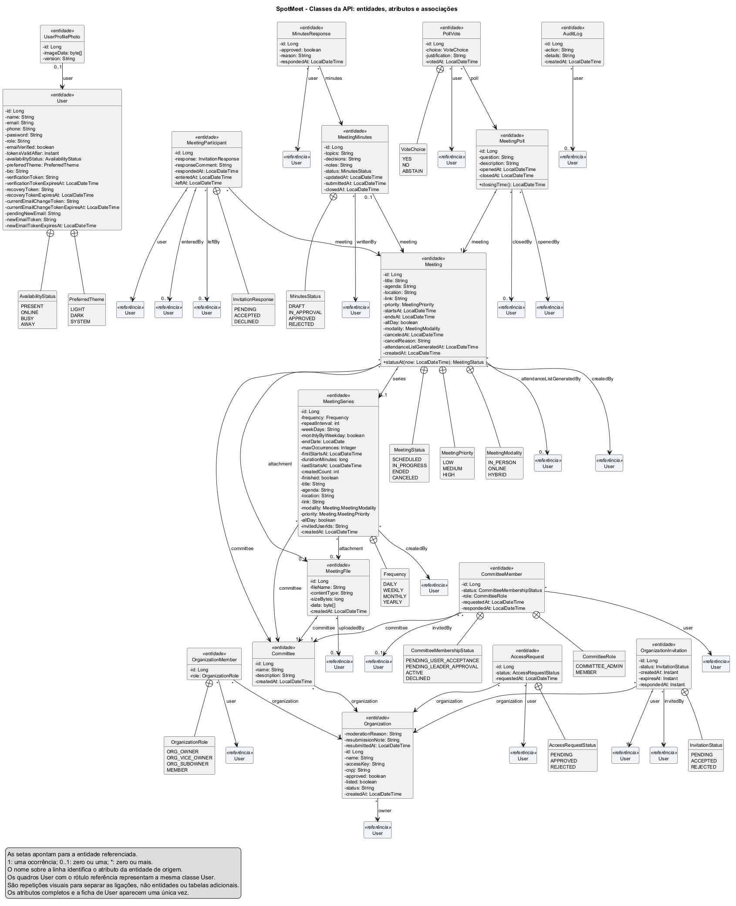

Fonte: próprio autor

**Figura 5 – Diagrama de classes da API: conta de usuário (RF01, RF02 e RF14 a RF18)**

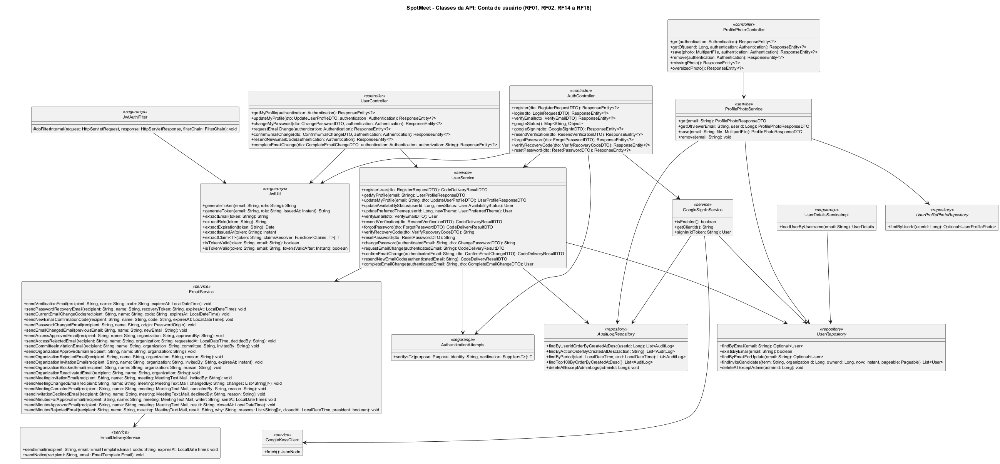

Fonte: próprio autor

**Figura 6 – Diagrama de classes da API: organização (RF03 a RF07)**

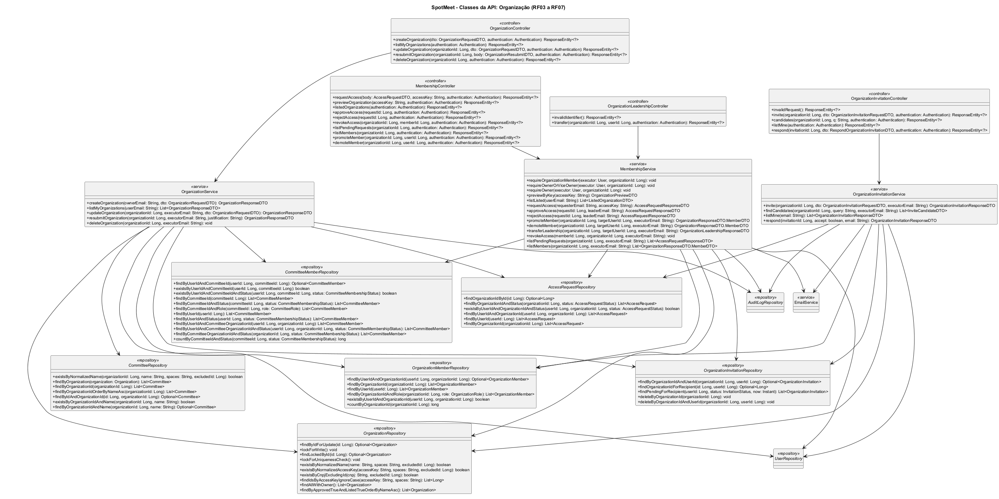

Fonte: próprio autor

**Figura 7 – Diagrama de classes da API: comissão (RF09 a RF13 e RF24)**

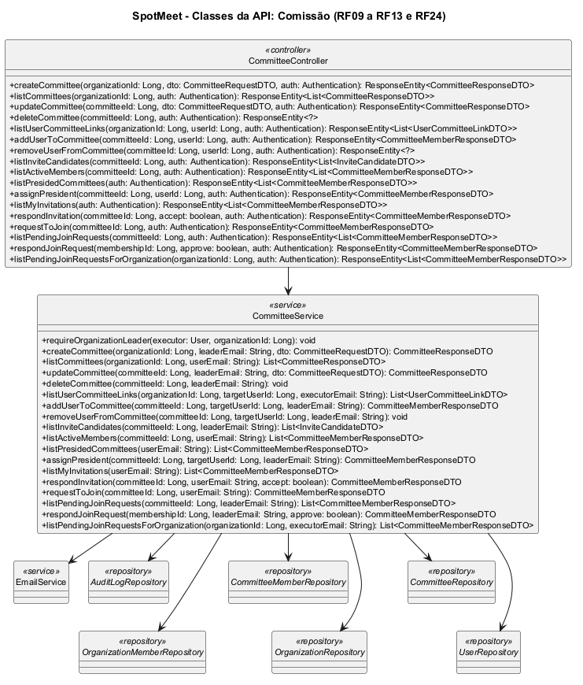

Fonte: próprio autor

**Figura 8 – Diagrama de classes da API: administração do sistema (RF08 e RF19 a RF23)**

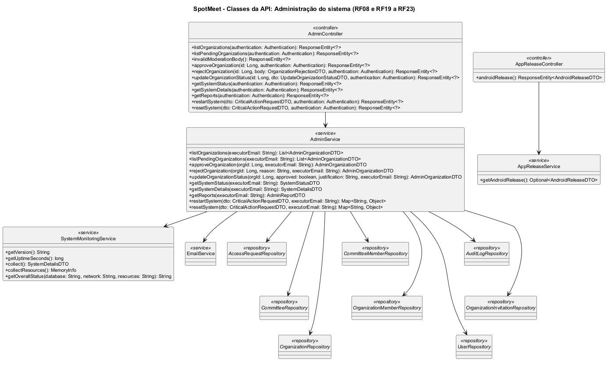

Fonte: próprio autor

**Figura 9 – Diagrama de classes da API: reuniões e presença (RF25 a RF35)**

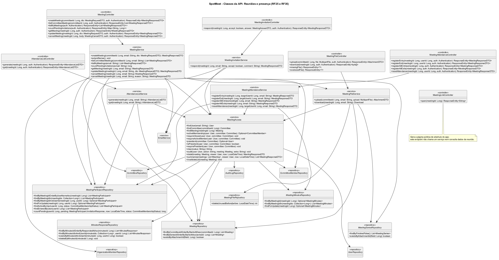

Fonte: próprio autor

**Figura 10 – Diagrama de classes da API: ata, votação e relatório individual (RF37 a RF47)**

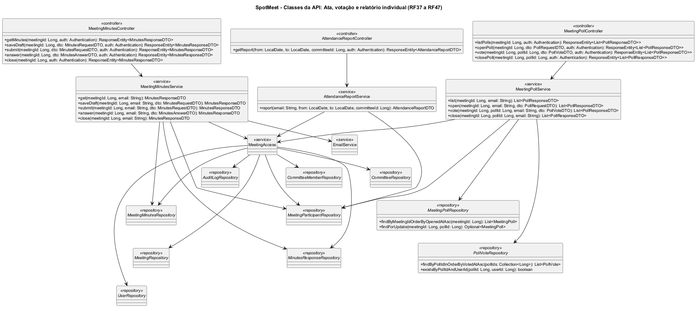

Fonte: próprio autor

**Aplicativo (SpotMeetApp).** O aplicativo é escrito em TypeScript com componentes funcionais; no diagrama, telas, componentes, contextos, hooks e módulos de estilos são unidades lógicas identificadas pelo estereótipo correspondente, não classes persistentes. A Figura 11 mostra as telas e as unidades específicas que elas importam, com a assinatura da operação de entrada e os estados e referências locais. As propriedades recebidas ficam nos parâmetros da operação, e sua estrutura é detalhada nas fichas. Dependências compartilhadas, como `AuthContext`, `ThemeContext` e componentes de formulário e aviso, foram omitidas deste recorte; cada tela usa somente as que declara em seus imports, descritos nas fichas. O arquivo raiz `App.tsx` monta os contextos, os hosts de avisos e a navegação por abas.

**Figura 11 – Diagrama de classes do aplicativo: telas e dependências específicas**

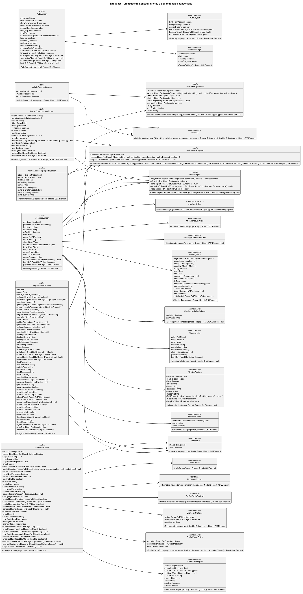

Fonte: próprio autor

### 6.2. Dicionário de classes

O índice identifica cada classe ou unidade TypeScript, sua camada, seu arquivo e sua responsabilidade. As fichas que o seguem detalham atributos e tipos, métodos ou funções, parâmetros de entrada e tipos de saída lidos do código. Os tipos internos ficam na ficha de quem os declara. Classes de bibliotecas usadas nas sequências são identificadas separadamente: não são implementadas pelo SpotMeet.

| Classe | Camada | Arquivo | O que representa |
|---|---|---|---|
| `AdminControlsScreen` | Aplicativo (tela) | [screens/admin/AdminControlsScreen.tsx](../SpotMeetApp/src/screens/admin/AdminControlsScreen.tsx#L1) | Aba "Controles": reinício de subsistema, reset total e saída da sessão administrativa. |
| `AdminMonitoringReportsScreen` | Aplicativo (tela) | [screens/admin/AdminMonitoringReportsScreen.tsx](../SpotMeetApp/src/screens/admin/AdminMonitoringReportsScreen.tsx#L1) | Aba "Monitoramento": estado geral, cartões dos subsistemas, janelas de detalhes, totais e atividades recentes. |
| `AdminOrganizationsScreen` | Aplicativo (tela) | [screens/admin/AdminOrganizationsScreen.tsx](../SpotMeetApp/src/screens/admin/AdminOrganizationsScreen.tsx#L1) | Tela do administrador (abas "Aprovações" e "Organizações"): lista, busca, filtros, detalhes, aprovação, recusa, bloqueio e transferência de liderança. |
| `AuthScreen` | Aplicativo (tela) | [screens/AuthScreen.tsx](../SpotMeetApp/src/screens/AuthScreen.tsx#L1) | Tela de acesso com e-mail e senha, login Google no APK Android, cadastro, confirmação do e-mail e recuperação de conta; valida os formulários e inicia a sessão. |
| `MeetingsScreen` | Aplicativo (tela) | [screens/MeetingsScreen.tsx](../SpotMeetApp/src/screens/MeetingsScreen.tsx#L1) | Aba "Reuniões": lista com "Acontecendo agora", filtros e convites para responder, detalhe, cancelamento com motivo, envio e download do anexo e lista de presença; envia as requisições de escrita uma de cada vez |
| `OrganizationScreen` | Aplicativo (tela) | [screens/OrganizationScreen.tsx](../SpotMeetApp/src/screens/OrganizationScreen.tsx#L1) | Tela "Organização": lista as organizações do usuário, mostra as páginas "Comissões", "Membros", "Solicitações" e "Convites", as folhas "Nova comissão" e "Editar comissão" e as janelas "Convidar para <comissão>" e "Comissões do integrante"; envia as requisições (mutate, loadDetails, loadInvitations, loadMemberLinks) e exibe os avisos. |
| `SettingsScreen` | Aplicativo (tela) | [screens/SettingsScreen.tsx](../SpotMeetApp/src/screens/SettingsScreen.tsx#L1) | Aba "Ajustes" do usuário com perfil USER, aberta num menu com as páginas Perfil (dados pessoais, tema e a folha de duas etapas da troca de e-mail), Segurança (troca de senha e biometria), Meu Relatório de Reuniões e Ajuda, e com o grupo Status de Presença (Presente, Ausente e Ocupado, salvos no toque). |
| `AdminSheet` | Aplicativo (componente) | [components/admin/AdminUi.tsx](../SpotMeetApp/src/components/admin/AdminUi.tsx#L50) | Folha inferior usada para os detalhes, para o motivo de recusa e de bloqueio e para a escolha do novo dono. |
| `AdminUi` | Aplicativo (componente) | [components/admin/AdminUi.tsx](../SpotMeetApp/src/components/admin/AdminUi.tsx#L1) | Componentes visuais do painel (cabeçalho, cartão, janela inferior, selo de estado, métrica). |
| `App` | Aplicativo (componente) | [App.tsx](../SpotMeetApp/App.tsx#L1) | Componente raiz: resolve o endereço do servidor antes de montar a navegação, escolhe as abas do administrador (Aprovações, Organizações, Monitoramento e Controles) ou do usuário comum e exibe a tela de login. |
| `AppStatusBar` | Aplicativo (componente) | [components/ui/AppStatusBar.tsx](../SpotMeetApp/src/components/ui/AppStatusBar.tsx#L1) | Barra de status do celular, com ícones claros na tela de login e no tema escuro e escuros no tema claro. |
| `AppUpdateNotice` | Aplicativo (componente) | [components/ui/AppUpdateNotice.tsx](../SpotMeetApp/src/components/ui/AppUpdateNotice.tsx#L1) | Janela "Nova versão disponível", com os botões "Atualizar" e "Agora não". |
| `AttendanceListView` | Aplicativo (componente) | [components/meetings/AttendanceListView.tsx](../SpotMeetApp/src/components/meetings/AttendanceListView.tsx#L1) | Exibição da lista de presença gerada |
| `AttendanceReport` | Aplicativo (componente) | [components/settings/AttendanceReport.tsx](../SpotMeetApp/src/components/settings/AttendanceReport.tsx#L1) | Página "Meu Relatório" de Ajustes: totais, filtros de período e de comissão, período personalizado, reuniões agrupadas por mês e mensagens de vazio e de erro |
| `AuthInputFocus` | Aplicativo (componente) | [components/auth/AuthInputFocus.ts](../SpotMeetApp/src/components/auth/AuthInputFocus.ts#L1) | Contextos das telas de acesso: rolagem até o campo em foco (useAuthInputFocus) e indicação de layout compacto (useAuthCompactLayout). |
| `AuthLayout` | Aplicativo (componente) | [components/auth/AuthLayout.tsx](../SpotMeetApp/src/components/auth/AuthLayout.tsx#L1) | Moldura das telas de acesso: faixa com a marca, título, subtítulo, cartão do formulário, indicador de etapa e botão de voltar; compacta o layout quando o teclado abre. |
| `BiometricGate` | Aplicativo (componente) | [components/auth/BiometricGate.tsx](../SpotMeetApp/src/components/auth/BiometricGate.tsx#L1) | Mostra a tela "SpotMeet bloqueado" numa janela por cima do aplicativo, sem desmontar as telas abertas depois do primeiro desbloqueio da sessão (descartadas só se a sessão muda durante o bloqueio); pede a digital ao aparecer, oferece os botões "Desbloquear" e "Usar a senha do aparelho", o link "Sair desta conta" com confirmação e o pedido "Deseja habilitar a biometria?"; o voltar do Android na tela de bloqueio fecha o aplicativo. |
| `BiometricSettings` | Aplicativo (componente) | [components/auth/BiometricSettings.tsx](../SpotMeetApp/src/components/auth/BiometricSettings.tsx#L1) | Cartão "Bloqueio biométrico" de Ajustes: chave habilitar e desabilitar e escolha do prazo |
| `ConfirmationHost` | Aplicativo (componente) | [components/ui/ConfirmationHost.tsx](../SpotMeetApp/src/components/ui/ConfirmationHost.tsx#L1) | Janela de confirmação (botão "Cancelar" e o botão da ação) de exclusões, transferências, aprovações, recusas e bloqueios. |
| `DateTimeField` | Aplicativo (componente) | [components/meetings/DateTimeField.tsx](../SpotMeetApp/src/components/meetings/DateTimeField.tsx#L1) | Campo de data ou hora que abre o seletor do celular; também exporta o PickerField, campo que abre uma escolha |
| `FormButton` | Aplicativo (componente) | [components/forms/FormButton.tsx](../SpotMeetApp/src/components/forms/FormButton.tsx#L1) | Botão dos formulários ("Criar organização", "Salvar alterações", "Cancelar") com indicação de envio. |
| `FormField` | Aplicativo (componente) | [components/forms/FormField.tsx](../SpotMeetApp/src/components/forms/FormField.tsx#L1) | Campo de formulário com rótulo, marca de obrigatório, prefixo "#" e mensagem de erro. |
| `FormScrollView` | Aplicativo (componente) | [components/forms/FormScrollView.tsx](../SpotMeetApp/src/components/forms/FormScrollView.tsx#L1) | Área rolável dos formulários que acompanha o teclado, rola até o campo em foco e mantém o rodapé com os botões. |
| `FrequencySheet` | Aplicativo (componente) | [components/meetings/FrequencySheet.tsx](../SpotMeetApp/src/components/meetings/FrequencySheet.tsx#L1) | Folhas "Frequência" e "Personalizar frequência", com o resumo da regra |
| `HelpCenter` | Aplicativo (componente) | [components/settings/HelpCenter.tsx](../SpotMeetApp/src/components/settings/HelpCenter.tsx#L1) | Página "Ajuda" de Ajustes: campo de busca, cartões dos cinco perfis com os seus tópicos, resultados da busca e página do tópico com passo a passo, destaque e "Veja também"; só texto, sem imagens |
| `InviteesSheet` | Aplicativo (componente) | [components/meetings/InviteesSheet.tsx](../SpotMeetApp/src/components/meetings/InviteesSheet.tsx#L1) | Folha "Convidados": busca, "Selecionar todos", foto ou iniciais e caixa de seleção |
| `MeetingAttendancePanel` | Aplicativo (componente) | [components/meetings/MeetingAttendancePanel.tsx](../SpotMeetApp/src/components/meetings/MeetingAttendancePanel.tsx#L1) | Cartão "Presença" (também no cartão de "Acontecendo agora"): registrar entrada e saída, em massa, e gerar ou abrir a lista |
| `MeetingForm` | Aplicativo (componente) | [components/meetings/MeetingForm.tsx](../SpotMeetApp/src/components/meetings/MeetingForm.tsx#L1) | Formulário de agendar e editar reunião: datas e horas, dia inteiro, frequência, modalidade, anexo, prioridade e convidados, com validação |
| `MeetingInvitationActions` | Aplicativo (componente) | [components/meetings/MeetingInvitationActions.tsx](../SpotMeetApp/src/components/meetings/MeetingInvitationActions.tsx#L1) | Cartão "Seu convite": aceitar ou recusar com comentário; na série, a resposta vale para a data |
| `MeetingParts` | Aplicativo (componente) | [components/meetings/MeetingParts.tsx](../SpotMeetApp/src/components/meetings/MeetingParts.tsx#L1) | Cabeçalho com a data, o título e o horário da reunião (MeetingHeader) e grade de pessoas com foto ou iniciais (PeopleGrid), usados nas páginas da ata e da votação |
| `MeetingPolls` | Aplicativo (componente) | [components/meetings/MeetingPolls.tsx](../SpotMeetApp/src/components/meetings/MeetingPolls.tsx#L1) | Cartão "Votações" do detalhe da reunião e páginas "Abrir votação" e "Votação": abrir, votar com confirmação, contagem ao vivo do presidente, encerrar e resultado nominal |
| `meetingStyles` | Aplicativo (componente) | [components/meetings/meetingStyles.tsx](../SpotMeetApp/src/components/meetings/meetingStyles.tsx#L1) | Estilos compartilhados das telas de reunião conforme o tema (useMeetingStyles) e os componentes MeetingBadge (selo colorido) e MeetingAction (botão de ação). |
| `MinutesSection` | Aplicativo (componente) | [components/meetings/MinutesSection.tsx](../SpotMeetApp/src/components/meetings/MinutesSection.tsx#L1) | Cartão "Ata" do detalhe da reunião e páginas "Escrever ata" (ou "Corrigir ata"), "Ata da reunião", "Reprovar ata" e "Aprovação da ata": escrever, salvar rascunho, enviar e reenviar, aprovar, reprovar, acompanhar e encerrar a aprovação |
| `OtpInput` | Aplicativo (componente) | [components/forms/OtpInput.tsx](../SpotMeetApp/src/components/forms/OtpInput.tsx#L1) | Campo de seis casas numéricas do código de confirmação. |
| `PasswordInput` | Aplicativo (componente) | [components/forms/PasswordInput.tsx](../SpotMeetApp/src/components/forms/PasswordInput.tsx#L1) | Campo de senha com o botão de olho para mostrar ou ocultar o texto digitado. |
| `PasswordRules` | Aplicativo (componente) | [components/forms/PasswordRules.tsx](../SpotMeetApp/src/components/forms/PasswordRules.tsx#L1) | Lista de regras da senha mostrada no cadastro. |
| `PresidentSheet` | Aplicativo (componente) | [components/meetings/PresidentSheet.tsx](../SpotMeetApp/src/components/meetings/PresidentSheet.tsx#L1) | Folha para designar o presidente da comissão |
| `ProfilePhotoEditor` | Aplicativo (componente) | [components/profile/ProfilePhotoEditor.tsx](../SpotMeetApp/src/components/profile/ProfilePhotoEditor.tsx#L1) | Exibe a foto ou o avatar e as ações Galeria, Câmera, Salvar foto, Cancelar foto e Remover foto na página Perfil; a foto tem 120 pixels e diminui ao rolar a página. |
| `ServerSettings` | Aplicativo (componente) | [components/auth/ServerSettings.tsx](../SpotMeetApp/src/components/auth/ServerSettings.tsx#L1) | Rodapé da tela de login que mostra o servidor em uso e permite informar o IP, procurar na rede ou voltar ao automático. |
| `SessionGuard` | Aplicativo (componente) | [components/auth/SessionGuard.tsx](../SpotMeetApp/src/components/auth/SessionGuard.tsx#L1) | Encerra a sessão local ao receber 401 de rota protegida e consulta GET /api/users/me a cada 15 segundos em primeiro plano. |
| `SessionNavigation` | Aplicativo (componente) | [components/auth/SessionNavigation.tsx](../SpotMeetApp/src/components/auth/SessionNavigation.tsx#L1) | Envolve a navegação com o bloqueio biométrico e guarda a tela aberta enquanto a sessão, o usuário e o servidor forem os mesmos. |
| `ToastHost` | Aplicativo (componente) | [components/ui/ToastHost.tsx](../SpotMeetApp/src/components/ui/ToastHost.tsx#L1) | Exibe os avisos no topo da tela, com cor e ícone por tipo (sucesso, erro, alerta e informação), e os esconde depois de alguns segundos. |
| `UserAvatar` | Aplicativo (componente) | [components/profile/UserAvatar.tsx](../SpotMeetApp/src/components/profile/UserAvatar.tsx#L1) | Bolinha de pessoa nas listas e no cartão do menu de Ajustes: mostra as iniciais (initials) e, quando a pessoa tem foto, a imagem lida de /api/users/{userId}/photo, guardada por 1 minuto (forgetUserPhoto descarta a cópia). |
| `AuthContext` | Aplicativo (contexto) | [context/AuthContext.tsx](../SpotMeetApp/src/context/AuthContext.tsx#L1) | Guarda a sessão em memória (token, perfil, nome, e-mail, userId) e avisa os interessados em signIn, signOut e update. |
| `BiometricContext` | Aplicativo (contexto) | [context/BiometricContext.tsx](../SpotMeetApp/src/context/BiometricContext.tsx#L1) | Estado e operações do bloqueio biométrico: habilitar, desabilitar, definir o prazo, desbloquear, confirmar a sessão no servidor, religar depois da troca de senha e não bloquear nas telas do sistema abertas para a foto |
| `ProfilePhotoContext` | Aplicativo (contexto) | [context/ProfilePhotoContext.tsx](../SpotMeetApp/src/context/ProfilePhotoContext.tsx#L1) | ProfilePhotoProvider: estado da foto e operações refresh, select, save, remove e discard contra /api/users/me/photo. |
| `ThemeContext` | Aplicativo (contexto) | [context/ThemeContext.tsx](../SpotMeetApp/src/context/ThemeContext.tsx#L1) | ThemeProvider: tema atual, cores, setTheme (prévia local) e loadThemeFromProfile. |
| `useAdminOperation` | Aplicativo (hook) | [hooks/useAdminOperation.ts](../SpotMeetApp/src/hooks/useAdminOperation.ts#L1) | Hook que envia as operações administrativas de escrita (reinício e reset), com trava contra toques repetidos e descarte de respostas de sessão antiga. |
| `useAppUpdate` | Aplicativo (hook) | [hooks/useAppUpdate.ts](../SpotMeetApp/src/hooks/useAppUpdate.ts#L1) | Hook que consulta GET /api/app/android-release, valida a resposta (com appUpdate.ts) e abre a página da build no Expo. |
| `useLiveSync` | Aplicativo (hook) | [hooks/useLiveSync.ts](../SpotMeetApp/src/hooks/useLiveSync.ts#L1) | Repete a leitura das listas a cada 15 segundos e ao receber eventos do syncBus, pausada durante edição e gravação. |
| `usePendingInvitations` | Aplicativo (hook) | [hooks/usePendingInvitations.ts](../SpotMeetApp/src/hooks/usePendingInvitations.ts#L1) | Consulta a quantidade de convites de reunião sem resposta para o selo da aba Reuniões. |
| `useRefreshRequest` | Aplicativo (hook) | [hooks/useRefreshRequest.ts](../SpotMeetApp/src/hooks/useRefreshRequest.ts#L1) | Hook que serializa as leituras do painel, com limite de 15 segundos e cancelamento ao perder o foco. |
| `api` | Aplicativo (configuração) | [config/api.ts](../SpotMeetApp/src/config/api.ts#L1) | Resolve e guarda o endereço da API (loadPersistedApiHost, needsDiscovery, setApiHost, setDiscoveredHost) e expõe API_BASE_URL. |
| `discovery` | Aplicativo (configuração) | [config/discovery.ts](../SpotMeetApp/src/config/discovery.ts#L1) | Procura o servidor na sub-rede /24 do aparelho por GET /actuator/info (discoverBackendHost, isSpotMeetBackend, clearDiscoveryCache). |
| `adminData` | Aplicativo (utilitário) | [utils/adminData.ts](../SpotMeetApp/src/utils/adminData.ts#L1) | Validação das respostas do painel (parseStatus, parseReport, parseDetails), formatação dos valores, texto dos erros HTTP e rótulos em português das ações de auditoria. |
| `alerts` | Aplicativo (utilitário) | [utils/alerts.ts](../SpotMeetApp/src/utils/alerts.ts#L1) | Mostra os avisos (toast) e os diálogos de confirmação do aplicativo. |
| `apiRequest` | Aplicativo (utilitário) | [utils/apiRequest.ts](../SpotMeetApp/src/utils/apiRequest.ts#L1) | Chamada autenticada ao servidor que devolve o corpo lido ou a mensagem de erro a exibir; usada pelo relatório, pela ata e pela votação |
| `appUpdate` | Aplicativo (utilitário) | [utils/appUpdate.ts](../SpotMeetApp/src/utils/appUpdate.ts#L1) | Regras de comparação da versão instalada com a anunciada e de validação da página da build no Expo. |
| `authLayout` | Aplicativo (utilitário) | [utils/authLayout.ts](../SpotMeetApp/src/utils/authLayout.ts#L1) | Cálculos das telas de acesso: altura da marca e modo compacto conforme a altura útil da tela e o tamanho da fonte, e quando a tela precisa rolar. |
| `biometricSession` | Aplicativo (utilitário) | [utils/biometricSession.ts](../SpotMeetApp/src/utils/biometricSession.ts#L1) | Disponibilidade da biometria, confirmação do aparelho, leitura, gravação e remoção da sessão guardada (armazenamento seguro e local) e da preferência mantida entre a troca de senha e o próximo login |
| `confirmation` | Aplicativo (utilitário) | [utils/confirmation.ts](../SpotMeetApp/src/utils/confirmation.ts#L1) | Registra a janela de confirmação (registerConfirmationHost) e envia a ela os pedidos de confirmação (requestConfirmation). |
| `googleSignIn` | Aplicativo (utilitário) | [utils/googleSignIn.ts](../SpotMeetApp/src/utils/googleSignIn.ts#L1) | Consulta a disponibilidade do Google e faz o login nativo do Android antes de solicitar a sessão ao servidor. |
| `helpTopics` | Aplicativo (utilitário) | [utils/helpTopics.ts](../SpotMeetApp/src/utils/helpTopics.ts#L1) | Texto do manual: os 23 tópicos (HELP_TOPICS), os nomes e as descrições dos cinco perfis (PROFILE_LABELS e PROFILE_HINTS) e a busca por início de palavra, sem acentos (searchTopics); a mesma fonte gera o Doc/06 |
| `leaveGuard` | Aplicativo (utilitário) | [utils/leaveGuard.ts](../SpotMeetApp/src/utils/leaveGuard.ts#L1) | Permite à tela aberta segurar a troca de aba para perguntar sobre alterações não salvas (setLeaveGuard e interceptLeave). |
| `meetingLinks` | Aplicativo (utilitário) | [utils/meetingLinks.ts](../SpotMeetApp/src/utils/meetingLinks.ts#L1) | Converte os links de reunião recebidos pelo aplicativo em pedidos de navegação. |
| `meetings` | Aplicativo (utilitário) | [utils/meetings.ts](../SpotMeetApp/src/utils/meetings.ts#L1) | Tipos, rótulos, datas em português, texto da frequência, validação de link e leitura das respostas da API |
| `minutes` | Aplicativo (utilitário) | [utils/minutes.ts](../SpotMeetApp/src/utils/minutes.ts#L1) | Tipos e rótulos da ata, limites dos campos, textos da contagem e do resultado, datas no formato da ata e leitura conferida da resposta da API |
| `moderation` | Aplicativo (utilitário) | [utils/moderation.ts](../SpotMeetApp/src/utils/moderation.ts#L1) | Valida o motivo de recusa e de bloqueio (validateModerationReason: 3 a 500 caracteres, sem caracteres de controle). |
| `organizationForms` | Aplicativo (utilitário) | [utils/organizationForms.ts](../SpotMeetApp/src/utils/organizationForms.ts#L1) | Normaliza e valida nome e chave de organização (validateOrganizationName, validateAccessKey, normalizeAccessKey) e filtra por busca (matchesSearch). |
| `polls` | Aplicativo (utilitário) | [utils/polls.ts](../SpotMeetApp/src/utils/polls.ts#L1) | Tipos da votação, rótulos Sim, Não e Abstenção, limites dos campos, porcentagens pelo maior resto, textos do resultado e leitura das respostas da API |
| `profilePhotoData` | Aplicativo (utilitário) | [utils/profilePhotoData.ts](../SpotMeetApp/src/utils/profilePhotoData.ts#L1) | Valida a resposta da foto de perfil (parseProfilePhoto): conta, versão e imagem JPEG em Base64 de até 1 MB. |
| `profilePhotoPicker` | Aplicativo (utilitário) | [utils/profilePhotoPicker.ts](../SpotMeetApp/src/utils/profilePhotoPicker.ts#L1) | pickProfilePhoto: abre a Galeria ou a Câmera e prepara o JPEG quadrado de até 512 pixels. |
| `report` | Aplicativo (utilitário) | [utils/report.ts](../SpotMeetApp/src/utils/report.ts#L1) | Tipos e rótulos do relatório, datas de cada período, formatação do tempo ("58 min" ou "7 h 58 min") e leitura da resposta da API |
| `sessionFetch` | Aplicativo (utilitário) | [utils/sessionFetch.ts](../SpotMeetApp/src/utils/sessionFetch.ts#L1) | Substitui o fetch global para detectar respostas 401 das rotas protegidas e chamar a rotina de sessão expirada. |
| `syncBus` | Aplicativo (utilitário) | [utils/syncBus.ts](../SpotMeetApp/src/utils/syncBus.ts#L1) | Barramento de eventos do próprio aparelho (ORGANIZATIONS_MUTATED, MEMBERS_MUTATED, ADMIN_ORGS_MUTATED e outros) que dispara a releitura das telas. |
| `toast` | Aplicativo (utilitário) | [utils/toast.ts](../SpotMeetApp/src/utils/toast.ts#L1) | Tipos de aviso e funções que pedem ao ToastHost para mostrar ou esconder um aviso, inclusive fora dos componentes. |
| `validators` | Aplicativo (utilitário) | [utils/validators.ts](../SpotMeetApp/src/utils/validators.ts#L1) | PASSWORD_REGEX, isValidEmail e normalizeEmail, isValidOtp e normalizeOtp, isValidName e normalizeName. |
| `AdminController` | API (controller) | [controller/AdminController.java](../backend/src/main/java/com/spotmeet/backend/controller/AdminController.java#L17) | Rotas /api/admin/organizations: consultar, aprovar, recusar e alterar o estado; exige ADMIN ou SYSADMIN e converte as exceções em 400, 403, 404 e 500. |
| `AppReleaseController` | API (controller) | [controller/AppReleaseController.java](../backend/src/main/java/com/spotmeet/backend/controller/AppReleaseController.java#L12) | Rota pública GET /api/app/android-release, que responde 200 com a versão anunciada ou 204. |
| `AttendanceListController` | API (controller) | [controller/AttendanceListController.java](../backend/src/main/java/com/spotmeet/backend/controller/AttendanceListController.java#L11) | Rotas de gerar e consultar a lista de presença |
| `AttendanceReportController` | API (controller) | [controller/AttendanceReportController.java](../backend/src/main/java/com/spotmeet/backend/controller/AttendanceReportController.java#L16) | Rota GET /api/users/me/report, com o usuário tirado do token |
| `AuthController` | API (controller) | [controller/AuthController.java](../backend/src/main/java/com/spotmeet/backend/controller/AuthController.java#L40) | Rotas públicas de autenticação: cadastro, e-mail e senha, configuração e acesso Google, confirmação e reenvio de código e recuperação de conta; emite a sessão JWT e converte falhas. |
| `CommitteeController` | API (controller) | [controller/CommitteeController.java](../backend/src/main/java/com/spotmeet/backend/controller/CommitteeController.java#L25) | Recebe as requisições das rotas de comissão, obtém o e-mail do token e chama o CommitteeService, devolvendo 200 ou 201. |
| `MeetingAttendanceController` | API (controller) | [controller/MeetingAttendanceController.java](../backend/src/main/java/com/spotmeet/backend/controller/MeetingAttendanceController.java#L13) | Rotas de entrada, saída, registro em massa e correção de presença |
| `MeetingController` | API (controller) | [controller/MeetingController.java](../backend/src/main/java/com/spotmeet/backend/controller/MeetingController.java#L21) | Rotas de agendar, editar, cancelar e consultar reuniões e de contar os convites sem resposta |
| `MeetingFileController` | API (controller) | [controller/MeetingFileController.java](../backend/src/main/java/com/spotmeet/backend/controller/MeetingFileController.java#L24) | Rotas de enviar e baixar o anexo da pauta |
| `MeetingInvitationController` | API (controller) | [controller/MeetingInvitationController.java](../backend/src/main/java/com/spotmeet/backend/controller/MeetingInvitationController.java#L13) | Rota de resposta ao convite |
| `MeetingLinkController` | API (controller) | [controller/MeetingLinkController.java](../backend/src/main/java/com/spotmeet/backend/controller/MeetingLinkController.java#L15) | Página pública dos e-mails que abre a reunião no aplicativo |
| `MeetingMinutesController` | API (controller) | [controller/MeetingMinutesController.java](../backend/src/main/java/com/spotmeet/backend/controller/MeetingMinutesController.java#L16) | Rotas de consultar a ata, salvar o rascunho, enviar ou reenviar, responder e encerrar a aprovação |
| `MeetingPollController` | API (controller) | [controller/MeetingPollController.java](../backend/src/main/java/com/spotmeet/backend/controller/MeetingPollController.java#L19) | Rotas de consultar, abrir, votar e encerrar as votações da reunião; todas respondem com a lista das votações |
| `MembershipController` | API (controller) | [controller/MembershipController.java](../backend/src/main/java/com/spotmeet/backend/controller/MembershipController.java#L25) | Rotas de solicitações de acesso, listagem de membros, promoção, rebaixamento e revogação. |
| `OrganizationController` | API (controller) | [controller/OrganizationController.java](../backend/src/main/java/com/spotmeet/backend/controller/OrganizationController.java#L20) | Rotas /api/organizations: criar, listar as minhas, editar, excluir e reenviar para avaliação; obtém o e-mail do usuário do token e converte parte das exceções em HTTP 409. |
| `OrganizationInvitationController` | API (controller) | [controller/OrganizationInvitationController.java](../backend/src/main/java/com/spotmeet/backend/controller/OrganizationInvitationController.java#L15) | Rotas de convite de organização: enviar, listar os do usuário e responder. |
| `OrganizationLeadershipController` | API (controller) | [controller/OrganizationLeadershipController.java](../backend/src/main/java/com/spotmeet/backend/controller/OrganizationLeadershipController.java#L11) | Rota POST /api/organizations/{organizationId}/members/{userId}/make-owner; converte as exceções da transferência em 400, 403, 404, 409 e 500. |
| `ProfilePhotoController` | API (controller) | [controller/ProfilePhotoController.java](../backend/src/main/java/com/spotmeet/backend/controller/ProfilePhotoController.java#L17) | Rotas GET, PUT e DELETE /api/users/me/photo e GET /api/users/{userId}/photo (foto de outra pessoa, só leitura), com conversão dos erros da foto em HTTP. |
| `UserController` | API (controller) | [controller/UserController.java](../backend/src/main/java/com/spotmeet/backend/controller/UserController.java#L25) | Rota GET /api/users/me, usada para confirmar a sessão (demais rotas no grupo de Configurações). |
| `AdminService` | API (service) | [service/AdminService.java](../backend/src/main/java/com/spotmeet/backend/service/AdminService.java#L55) | Regras administrativas das organizações: conferência do perfil, listagem com máscaras e contagens, aprovação, recusa, bloqueio, validação do motivo e auditoria. |
| `AppReleaseService` | API (service) | [service/AppReleaseService.java](../backend/src/main/java/com/spotmeet/backend/service/AppReleaseService.java#L10) | Valida, na inicialização, as propriedades spotmeet.app.android.* e devolve a versão do APK anunciada. |
| `AttendanceListService` | API (service) | [service/AttendanceListService.java](../backend/src/main/java/com/spotmeet/backend/service/AttendanceListService.java#L22) | Regras de geração e consulta da lista de presença |
| `AttendanceReportService` | API (service) | [service/AttendanceReportService.java](../backend/src/main/java/com/spotmeet/backend/service/AttendanceReportService.java#L29) | Regras do relatório: só reuniões com entrada registrada, período pelo dia de início (datas incluídas), filtro de comissão, tempo de saída menos entrada e recusa da data final antes da inicial |
| `CommitteeService` | API (service) | [service/CommitteeService.java](../backend/src/main/java/com/spotmeet/backend/service/CommitteeService.java#L38) | Regras de comissão: autorização do líder (requireOrganizationLeader), validação e unicidade do nome, estados do vínculo (convite, solicitação, ativo, recusado), contadores e auditoria. |
| `EmailDeliveryService` | API (service) | [service/EmailDeliveryService.java](../backend/src/main/java/com/spotmeet/backend/service/EmailDeliveryService.java#L15) | Envia o e-mail (HTML com texto simples alternativo) em segundo plano pelo SMTP, ou registra o código no log quando o SMTP não está configurado. |
| `EmailService` | API (service) | [service/EmailService.java](../backend/src/main/java/com/spotmeet/backend/service/EmailService.java#L28) | Prepara os e-mails da conta, da organização, da comissão e das reuniões e agenda a entrega após o commit da transação. |
| `EmailTemplate` | API (service) | [service/EmailTemplate.java](../backend/src/main/java/com/spotmeet/backend/service/EmailTemplate.java#L12) | Monta a versão em HTML e a versão em texto simples de cada e-mail a partir dos mesmos blocos, com cabeçalho só com o nome SpotMeet e os valores escapados. |
| `GoogleKeysClient` | API (service) | [service/GoogleKeysClient.java](../backend/src/main/java/com/spotmeet/backend/service/GoogleKeysClient.java#L8) | Obtém as chaves públicas usadas para conferir a assinatura do token de identidade do Google. |
| `GoogleSignInService` | API (service) | [service/GoogleSignInService.java](../backend/src/main/java/com/spotmeet/backend/service/GoogleSignInService.java#L36) | Valida o token de identidade do Google e prepara a conta usada para iniciar a sessão do SpotMeet. |
| `MeetingAccess` | API (service) | [service/MeetingAccess.java](../backend/src/main/java/com/spotmeet/backend/service/MeetingAccess.java#L28) | Componente compartilhado: busca de usuário, comissão e reunião, verificação de papel (visualizador, integrante ativo, presidente), auditoria e invalidação da lista |
| `MeetingAttendanceService` | API (service) | [service/MeetingAttendanceService.java](../backend/src/main/java/com/spotmeet/backend/service/MeetingAttendanceService.java#L26) | Regras de entrada, saída, registro em massa e correção de presença |
| `MeetingFileService` | API (service) | [service/MeetingFileService.java](../backend/src/main/java/com/spotmeet/backend/service/MeetingFileService.java#L29) | Conferência do tipo e do tamanho do anexo, gravação, download e limpeza dos arquivos sem uso |
| `MeetingInvitationService` | API (service) | [service/MeetingInvitationService.java](../backend/src/main/java/com/spotmeet/backend/service/MeetingInvitationService.java#L23) | Regras da resposta ao convite |
| `MeetingMinutesService` | API (service) | [service/MeetingMinutesService.java](../backend/src/main/java/com/spotmeet/backend/service/MeetingMinutesService.java#L34) | Regras da ata: só o presidente escreve, depois do fim da reunião; envio com o texto completo e alguém presente; uma resposta por rodada; resultado pela maioria de quem respondeu; reenvio que apaga as respostas; e-mails e auditoria |
| `MeetingPollService` | API (service) | [service/MeetingPollService.java](../backend/src/main/java/com/spotmeet/backend/service/MeetingPollService.java#L31) | Regras da votação: abertura só pelo presidente com a reunião em andamento, um voto sem troca por pessoa com entrada registrada, encerramento pelo presidente e montagem da lista conforme o perfil |
| `MeetingRecurrence` | API (service) | [service/MeetingRecurrence.java](../backend/src/main/java/com/spotmeet/backend/service/MeetingRecurrence.java#L22) | Cálculo das datas de uma regra de repetição a partir da data escolhida |
| `MeetingService` | API (service) | [service/MeetingService.java](../backend/src/main/java/com/spotmeet/backend/service/MeetingService.java#L41) | Regras de agendar (inclusive as séries), editar, cancelar e consultar reuniões, escolha dos convidados, e-mails e criação das datas seguintes a cada hora |
| `MeetingText` | API (service) | [service/MeetingText.java](../backend/src/main/java/com/spotmeet/backend/service/MeetingText.java#L22) | Textos da reunião em português para os e-mails (datas, horário, frequência, modalidade e tamanho do anexo) |
| `MembershipService` | API (service) | [service/MembershipService.java](../backend/src/main/java/com/spotmeet/backend/service/MembershipService.java#L30) | Solicitação, aprovação e rejeição de acesso; promoção, rebaixamento, revogação e transferência de liderança; regras da hierarquia. |
| `OrganizationInvitationService` | API (service) | [service/OrganizationInvitationService.java](../backend/src/main/java/com/spotmeet/backend/service/OrganizationInvitationService.java#L20) | Envio, consulta e resposta de convites de organização, com validade de 24 horas. |
| `OrganizationService` | API (service) | [service/OrganizationService.java](../backend/src/main/java/com/spotmeet/backend/service/OrganizationService.java#L40) | Regras de criação, listagem, edição, exclusão e reenvio de organizações: normalização, unicidade, permissão do dono ou vice, reavaliação única, exclusão em cascata e auditoria. |
| `ProfilePhotoService` | API (service) | [service/ProfilePhotoService.java](../backend/src/main/java/com/spotmeet/backend/service/ProfilePhotoService.java#L29) | Consulta, valida, regrava (JPEG quadrado de até 512 pixels) e remove a foto da conta autenticada; getOf lê a foto de outra conta. |
| `SystemMonitoringService` | API (service) | [service/SystemMonitoringService.java](../backend/src/main/java/com/spotmeet/backend/service/SystemMonitoringService.java#L29) | Coleta versão, tempo em execução, recursos da JVM, estado geral e os detalhes do banco e da API. |
| `UserService` | API (service) | [service/UserService.java](../backend/src/main/java/com/spotmeet/backend/service/UserService.java#L26) | Regras de troca de senha, recuperação, perfil e tema e troca de e-mail; geração, hash e validade dos códigos. |
| `AccessRequestRepository` | API (repository) | [repository/AccessRequestRepository.java](../backend/src/main/java/com/spotmeet/backend/repository/AccessRequestRepository.java#L16) | Acesso à tabela access_requests: lista e apaga as solicitações da organização excluída. |
| `AuditLogRepository` | API (repository) | [repository/AuditLogRepository.java](../backend/src/main/java/com/spotmeet/backend/repository/AuditLogRepository.java#L13) | Acesso à tabela audit_logs (save, count, findTop100ByOrderByCreatedAtDesc, deleteAllExceptAdminLogs). |
| `CommitteeMemberRepository` | API (repository) | [repository/CommitteeMemberRepository.java](../backend/src/main/java/com/spotmeet/backend/repository/CommitteeMemberRepository.java#L12) | Acesso à tabela committee_members: vínculo por usuário e comissão, listagens por status e contagens. |
| `CommitteeRepository` | API (repository) | [repository/CommitteeRepository.java](../backend/src/main/java/com/spotmeet/backend/repository/CommitteeRepository.java#L13) | Acesso à tabela committees, incluindo existsByNormalizedName (duplicidade sem diferenciar caixa e espaços extras). |
| `MeetingFileRepository` | API (repository) | [repository/MeetingFileRepository.java](../backend/src/main/java/com/spotmeet/backend/repository/MeetingFileRepository.java#L12) | Acesso à tabela meeting_files e exclusão dos arquivos sem uso |
| `MeetingMinutesRepository` | API (repository) | [repository/MeetingMinutesRepository.java](../backend/src/main/java/com/spotmeet/backend/repository/MeetingMinutesRepository.java#L15) | Acesso à tabela meeting_minutes, inclusive o bloqueio de escrita da ata (findForUpdate) e a leitura das atas de várias reuniões |
| `MeetingParticipantRepository` | API (repository) | [repository/MeetingParticipantRepository.java](../backend/src/main/java/com/spotmeet/backend/repository/MeetingParticipantRepository.java#L16) | Acesso à tabela meeting_participants, inclusive o bloqueio de escrita do participante e a contagem de convites sem resposta |
| `MeetingPollRepository` | API (repository) | [repository/MeetingPollRepository.java](../backend/src/main/java/com/spotmeet/backend/repository/MeetingPollRepository.java#L14) | Acesso à tabela meeting_polls, inclusive o bloqueio de escrita da votação que serializa os votos e o encerramento |
| `MeetingRepository` | API (repository) | [repository/MeetingRepository.java](../backend/src/main/java/com/spotmeet/backend/repository/MeetingRepository.java#L9) | Acesso à tabela meetings |
| `MeetingSeriesRepository` | API (repository) | [repository/MeetingSeriesRepository.java](../backend/src/main/java/com/spotmeet/backend/repository/MeetingSeriesRepository.java#L9) | Acesso à tabela meeting_series |
| `MinutesResponseRepository` | API (repository) | [repository/MinutesResponseRepository.java](../backend/src/main/java/com/spotmeet/backend/repository/MinutesResponseRepository.java#L13) | Acesso à tabela minutes_responses: respostas da rodada, respostas do usuário, conferência de resposta repetida e exclusão das respostas no reenvio |
| `OrganizationInvitationRepository` | API (repository) | [repository/OrganizationInvitationRepository.java](../backend/src/main/java/com/spotmeet/backend/repository/OrganizationInvitationRepository.java#L14) | Acesso à tabela organization_invitations; apaga os convites da organização excluída. |
| `OrganizationMemberRepository` | API (repository) | [repository/OrganizationMemberRepository.java](../backend/src/main/java/com/spotmeet/backend/repository/OrganizationMemberRepository.java#L11) | Acesso à tabela organization_members, para conferir o papel e a participação do usuário na organização. |
| `OrganizationRepository` | API (repository) | [repository/OrganizationRepository.java](../backend/src/main/java/com/spotmeet/backend/repository/OrganizationRepository.java#L18) | Acesso à tabela organizations: bloqueios de tabela e de linha, consultas de unicidade por nome, chave e CNPJ e listagem com o dono. |
| `PollVoteRepository` | API (repository) | [repository/PollVoteRepository.java](../backend/src/main/java/com/spotmeet/backend/repository/PollVoteRepository.java#L10) | Acesso à tabela poll_votes: votos das votações da reunião e conferência do voto já registrado |
| `UserProfilePhotoRepository` | API (repository) | [repository/UserProfilePhotoRepository.java](../backend/src/main/java/com/spotmeet/backend/repository/UserProfilePhotoRepository.java#L9) | findByUserId, save e delete da tabela user_profile_photos. |
| `UserRepository` | API (repository) | [repository/UserRepository.java](../backend/src/main/java/com/spotmeet/backend/repository/UserRepository.java#L17) | Acesso à tabela users (findByEmail e findByEmailForUpdate, com bloqueio de linha; findInviteCandidates, que busca pessoas para o convite por parte do nome ou do e-mail). |
| `AccessRequest` | API (model) | [model/AccessRequest.java](../backend/src/main/java/com/spotmeet/backend/model/AccessRequest.java#L15) | Entidade da tabela access_requests, com status PENDING, APPROVED ou REJECTED. |
| `AuditLog` | API (model) | [model/AuditLog.java](../backend/src/main/java/com/spotmeet/backend/model/AuditLog.java#L10) | Registro de auditoria (tabela audit_logs) com autor, ação, detalhes (até 1000 caracteres) e data. |
| `Committee` | API (model) | [model/Committee.java](../backend/src/main/java/com/spotmeet/backend/model/Committee.java#L19) | Comissão da organização (tabela committees): nome, descrição, organização e data de criação; nome único por organização (uq_committee_org_name). |
| `CommitteeMember` | API (model) | [model/CommitteeMember.java](../backend/src/main/java/com/spotmeet/backend/model/CommitteeMember.java#L19) | Vínculo entre usuário e comissão (tabela committee_members): status (PENDING_USER_ACCEPTANCE, PENDING_LEADER_APPROVAL, ACTIVE, DECLINED), papel, quem convidou e datas; um vínculo por usuário e comissão (uq_committee_member). |
| `Meeting` | API (model) | [model/Meeting.java](../backend/src/main/java/com/spotmeet/backend/model/Meeting.java#L18) | Reunião agendada por um presidente, com dia inteiro, modalidade, motivo do cancelamento, série e anexo; a situação é calculada pelo relógio |
| `MeetingFile` | API (model) | [model/MeetingFile.java](../backend/src/main/java/com/spotmeet/backend/model/MeetingFile.java#L15) | Arquivo anexado à pauta |
| `MeetingMinutes` | API (model) | [model/MeetingMinutes.java](../backend/src/main/java/com/spotmeet/backend/model/MeetingMinutes.java#L15) | Ata de uma reunião (uma por reunião), com assuntos, decisões, observações, situação (MinutesStatus: DRAFT, IN_APPROVAL, APPROVED ou REJECTED), autor e datas de alteração, envio e encerramento |
| `MeetingParticipant` | API (model) | [model/MeetingParticipant.java](../backend/src/main/java/com/spotmeet/backend/model/MeetingParticipant.java#L14) | Convidado de uma reunião, com a resposta e os registros de entrada e saída |
| `MeetingPoll` | API (model) | [model/MeetingPoll.java](../backend/src/main/java/com/spotmeet/backend/model/MeetingPoll.java#L15) | Votação aberta pelo presidente numa reunião, com pergunta, descrição e encerramento; fecha pelo presidente ou no fim da reunião, sem tarefa agendada (closingTime e isClosedAt) |
| `MeetingSeries` | API (model) | [model/MeetingSeries.java](../backend/src/main/java/com/spotmeet/backend/model/MeetingSeries.java#L20) | Regra de repetição de uma reunião e os dados copiados para cada nova data |
| `MinutesResponse` | API (model) | [model/MinutesResponse.java](../backend/src/main/java/com/spotmeet/backend/model/MinutesResponse.java#L13) | Resposta de uma pessoa presente à ata na rodada atual: aprovação, ou reprovação com motivo, e a data |
| `Organization` | API (model) | [model/Organization.java](../backend/src/main/java/com/spotmeet/backend/model/Organization.java#L16) | Cadastro da organização: nome, chave, CNPJ, dono, situação de análise, justificativas e opção listed que controla a exibição na lista da aba Entrar. |
| `OrganizationInvitation` | API (model) | [model/OrganizationInvitation.java](../backend/src/main/java/com/spotmeet/backend/model/OrganizationInvitation.java#L6) | Entidade da tabela organization_invitations, com status PENDING, ACCEPTED ou REJECTED e prazo. |
| `OrganizationMember` | API (model) | [model/OrganizationMember.java](../backend/src/main/java/com/spotmeet/backend/model/OrganizationMember.java#L14) | Entidade da tabela organization_members: vínculo entre usuário e organização, com o papel ORG_OWNER, ORG_VICE_OWNER, ORG_SUBOWNER ou MEMBER. |
| `PollVote` | API (model) | [model/PollVote.java](../backend/src/main/java/com/spotmeet/backend/model/PollVote.java#L13) | Voto nominal (Sim, Não ou Abstenção) de uma pessoa presente, com a justificativa opcional da abstenção; um por pessoa e votação |
| `User` | API (model) | [model/User.java](../backend/src/main/java/com/spotmeet/backend/model/User.java#L16) | Entidade da tabela users (senha, e-mail, nome, bio, disponibilidade, tema, códigos temporários e tokens_valid_after); implementa UserDetails. |
| `UserProfilePhoto` | API (model) | [model/UserProfilePhoto.java](../backend/src/main/java/com/spotmeet/backend/model/UserProfilePhoto.java#L8) | Entidade da tabela user_profile_photos (user_id único, image_data e version). |
| `AccessRequestDTO` | API (dto) | [dto/AccessRequestDTO.java](../backend/src/main/java/com/spotmeet/backend/dto/AccessRequestDTO.java#L8) | Corpo opcional do pedido de acesso, com a chave da organização. |
| `AccessRequestResponseDTO` | API (dto) | [dto/AccessRequestResponseDTO.java](../backend/src/main/java/com/spotmeet/backend/dto/AccessRequestResponseDTO.java#L14) | Dados da solicitação de acesso devolvidos ao solicitante e ao líder. |
| `AdminOrganizationDTO` | API (dto) | [dto/AdminOrganizationDTO.java](../backend/src/main/java/com/spotmeet/backend/dto/AdminOrganizationDTO.java#L12) | Resposta ao administrador, com e-mail do dono e CNPJ mascarados, motivo, justificativa e data do reenvio e totais de integrantes e de comissões. |
| `AdminReportDTO` | API (dto) | [dto/AdminReportDTO.java](../backend/src/main/java/com/spotmeet/backend/dto/AdminReportDTO.java#L10) | Resposta dos relatórios, com o tipo aninhado AuditActivityDTO. |
| `AndroidReleaseDTO` | API (dto) | [dto/AndroidReleaseDTO.java](../backend/src/main/java/com/spotmeet/backend/dto/AndroidReleaseDTO.java#L3) | Resposta da versão do APK anunciada: applicationId, version, versionCode e downloadUrl. |
| `AttendanceListDTO` | API (dto) | [dto/AttendanceListDTO.java](../backend/src/main/java/com/spotmeet/backend/dto/AttendanceListDTO.java#L14) | Lista de presença, com a situação e o tempo de cada convidado |
| `AttendanceReportDTO` | API (dto) | [dto/AttendanceReportDTO.java](../backend/src/main/java/com/spotmeet/backend/dto/AttendanceReportDTO.java#L11) | Resposta do relatório: filtros recebidos, totais calculados (reuniões, minutos só das reuniões com saída, comissões e aviso de saída não registrada), reuniões e opções de comissão |
| `AuthResponseDTO` | API (dto) | [dto/AuthResponseDTO.java](../backend/src/main/java/com/spotmeet/backend/dto/AuthResponseDTO.java#L6) | Dados da sessão devolvidos no login: token, perfil, nome, e-mail, userId e emailVerified. |
| `ChangePasswordDTO` | API (dto) | [dto/ChangePasswordDTO.java](../backend/src/main/java/com/spotmeet/backend/dto/ChangePasswordDTO.java#L9) | Entrada do RF14: currentPassword e newPassword. |
| `CodeDeliveryResultDTO` | API (dto) | [dto/CodeDeliveryResultDTO.java](../backend/src/main/java/com/spotmeet/backend/dto/CodeDeliveryResultDTO.java#L8) | Resultado interno de um pedido de código (mensagem, destino e usuário), sem o código. |
| `CommitteeMemberResponseDTO` | API (dto) | [dto/CommitteeMemberResponseDTO.java](../backend/src/main/java/com/spotmeet/backend/dto/CommitteeMemberResponseDTO.java#L12) | Saída de um vínculo, convite ou solicitação (usuário, comissão, status, papel, datas e quem convidou). |
| `CommitteeRequestDTO` | API (dto) | [dto/CommitteeRequestDTO.java](../backend/src/main/java/com/spotmeet/backend/dto/CommitteeRequestDTO.java#L8) | Entrada de criação e edição de comissão (name e description), com normalização do nome e Bean Validation. |
| `CommitteeResponseDTO` | API (dto) | [dto/CommitteeResponseDTO.java](../backend/src/main/java/com/spotmeet/backend/dto/CommitteeResponseDTO.java#L9) | Saída de comissão, com os contadores totalActiveMembers e totalPending. |
| `CompleteEmailChangeDTO` | API (dto) | [dto/CompleteEmailChangeDTO.java](../backend/src/main/java/com/spotmeet/backend/dto/CompleteEmailChangeDTO.java#L10) | Entrada da Etapa 3 do RF18: newEmailCode. |
| `ConfirmEmailChangeDTO` | API (dto) | [dto/ConfirmEmailChangeDTO.java](../backend/src/main/java/com/spotmeet/backend/dto/ConfirmEmailChangeDTO.java#L11) | Entrada da Etapa 2 do RF18: currentCode e newEmail. |
| `CriticalActionRequestDTO` | API (dto) | [dto/CriticalActionRequestDTO.java](../backend/src/main/java/com/spotmeet/backend/dto/CriticalActionRequestDTO.java#L8) | Corpo do reinício e do reset: confirmation, reason e subsystem. |
| `ForgotPasswordDTO` | API (dto) | [dto/ForgotPasswordDTO.java](../backend/src/main/java/com/spotmeet/backend/dto/ForgotPasswordDTO.java#L6) | Entrada da Solicitação do RF15: email. |
| `GoogleSignInDTO` | API (dto) | [dto/GoogleSignInDTO.java](../backend/src/main/java/com/spotmeet/backend/dto/GoogleSignInDTO.java#L7) | Recebe o token de identidade obtido pelo aplicativo no login com Google. |
| `InviteCandidateDTO` | API (dto) | [dto/InviteCandidateDTO.java](../backend/src/main/java/com/spotmeet/backend/dto/InviteCandidateDTO.java#L3) | Pessoa que pode ser convidada: encontrada na busca do convite de organização ou listada em "Convidar integrantes" da comissão (RF11); identificador, nome e e-mail. |
| `ListedOrganizationDTO` | API (dto) | [dto/ListedOrganizationDTO.java](../backend/src/main/java/com/spotmeet/backend/dto/ListedOrganizationDTO.java#L4) | Organização disponível na aba Entrar: identificador, nome, chave de acesso, nome do responsável e quantidade de integrantes. |
| `LoginRequestDTO` | API (dto) | [dto/LoginRequestDTO.java](../backend/src/main/java/com/spotmeet/backend/dto/LoginRequestDTO.java#L10) | Entrada do login: e-mail e senha. |
| `MeetingAnswerDTO` | API (dto) | [dto/MeetingAnswerDTO.java](../backend/src/main/java/com/spotmeet/backend/dto/MeetingAnswerDTO.java#L6) | Comentário opcional da resposta ao convite |
| `MeetingCancelDTO` | API (dto) | [dto/MeetingCancelDTO.java](../backend/src/main/java/com/spotmeet/backend/dto/MeetingCancelDTO.java#L6) | Motivo opcional do cancelamento |
| `MeetingRecurrenceDTO` | API (dto) | [dto/MeetingRecurrenceDTO.java](../backend/src/main/java/com/spotmeet/backend/dto/MeetingRecurrenceDTO.java#L19) | Frequência escolhida no formulário e devolvida no detalhe |
| `MeetingRequestDTO` | API (dto) | [dto/MeetingRequestDTO.java](../backend/src/main/java/com/spotmeet/backend/dto/MeetingRequestDTO.java#L23) | Dados de agendar e editar reunião, com as validações e o https:// acrescentado ao link |
| `MeetingResponseDTO` | API (dto) | [dto/MeetingResponseDTO.java](../backend/src/main/java/com/spotmeet/backend/dto/MeetingResponseDTO.java#L18) | Reunião com contadores de convites, a frequência, o anexo (AttachmentDTO) e, no detalhe, a lista de participantes |
| `MinutesAnswerDTO` | API (dto) | [dto/MinutesAnswerDTO.java](../backend/src/main/java/com/spotmeet/backend/dto/MinutesAnswerDTO.java#L7) | Resposta à ata: aprova ou reprova, com motivo de até 300 caracteres |
| `MinutesRequestDTO` | API (dto) | [dto/MinutesRequestDTO.java](../backend/src/main/java/com/spotmeet/backend/dto/MinutesRequestDTO.java#L8) | Texto da ata (assuntos, decisões e observações), com os limites de tamanho |
| `MinutesResponseDTO` | API (dto) | [dto/MinutesResponseDTO.java](../backend/src/main/java/com/spotmeet/backend/dto/MinutesResponseDTO.java#L20) | Ata como o aplicativo a exibe: situação, texto (o rascunho só para o presidente), presentes e ausentes, contagem, resposta do usuário e, para o presidente, a resposta de cada pessoa |
| `OrganizationInvitationRequestDTO` | API (dto) | [dto/OrganizationInvitationRequestDTO.java](../backend/src/main/java/com/spotmeet/backend/dto/OrganizationInvitationRequestDTO.java#L7) | Entrada do convite: e-mail do convidado. |
| `OrganizationInvitationResponseDTO` | API (dto) | [dto/OrganizationInvitationResponseDTO.java](../backend/src/main/java/com/spotmeet/backend/dto/OrganizationInvitationResponseDTO.java#L7) | Dados do convite devolvidos ao líder e ao destinatário. |
| `OrganizationLeadershipResponseDTO` | API (dto) | [dto/OrganizationLeadershipResponseDTO.java](../backend/src/main/java/com/spotmeet/backend/dto/OrganizationLeadershipResponseDTO.java#L3) | Resposta da transferência de liderança (organização, dono anterior, novo dono e os dois papéis). |
| `OrganizationPreviewDTO` | API (dto) | [dto/OrganizationPreviewDTO.java](../backend/src/main/java/com/spotmeet/backend/dto/OrganizationPreviewDTO.java#L3) | Prévia da organização pela chave: nome, chave e nome do responsável. |
| `OrganizationRejectionDTO` | API (dto) | [dto/OrganizationRejectionDTO.java](../backend/src/main/java/com/spotmeet/backend/dto/OrganizationRejectionDTO.java#L6) | Corpo da recusa (reason, de 3 a 500 caracteres). |
| `OrganizationRequestDTO` | API (dto) | [dto/OrganizationRequestDTO.java](../backend/src/main/java/com/spotmeet/backend/dto/OrganizationRequestDTO.java#L14) | Corpo de criação e de edição (name, accessKey, cnpj), com as validações e a normalização dos valores. |
| `OrganizationResponseDTO` | API (dto) | [dto/OrganizationResponseDTO.java](../backend/src/main/java/com/spotmeet/backend/dto/OrganizationResponseDTO.java#L12) | Resposta ao usuário (id, name, accessKey, ownerId, ownerName, createdAt, myRole, approved, status, moderationReason, resubmitted), sem o CNPJ; o motivo só vai ao dono e aos administradores. |
| `OrganizationResubmitDTO` | API (dto) | [dto/OrganizationResubmitDTO.java](../backend/src/main/java/com/spotmeet/backend/dto/OrganizationResubmitDTO.java#L6) | Corpo do reenvio para avaliação (justification, de 3 a 500 caracteres). |
| `PollRequestDTO` | API (dto) | [dto/PollRequestDTO.java](../backend/src/main/java/com/spotmeet/backend/dto/PollRequestDTO.java#L7) | Pergunta (até 150 caracteres) e descrição opcional (até 500) de uma nova votação, com as validações |
| `PollResponseDTO` | API (dto) | [dto/PollResponseDTO.java](../backend/src/main/java/com/spotmeet/backend/dto/PollResponseDTO.java#L19) | Votação como o aplicativo a exibe: situação, contagem e votos conforme o perfil, quem não votou e o resultado calculado (PollResult); declara os tipos internos Vote e Person |
| `PollVoteDTO` | API (dto) | [dto/PollVoteDTO.java](../backend/src/main/java/com/spotmeet/backend/dto/PollVoteDTO.java#L8) | Escolha do voto e justificativa opcional (até 280 caracteres), com as validações |
| `ProfilePhotoResponseDTO` | API (dto) | [dto/ProfilePhotoResponseDTO.java](../backend/src/main/java/com/spotmeet/backend/dto/ProfilePhotoResponseDTO.java#L3) | Saída da foto: userId, imageBase64 e version. |
| `RegisterRequestDTO` | API (dto) | [dto/RegisterRequestDTO.java](../backend/src/main/java/com/spotmeet/backend/dto/RegisterRequestDTO.java#L12) | Entrada do cadastro: nome, e-mail e senha, com as regras de validação. |
| `ResendVerificationDTO` | API (dto) | [dto/ResendVerificationDTO.java](../backend/src/main/java/com/spotmeet/backend/dto/ResendVerificationDTO.java#L6) | Entrada do reenvio do código: e-mail. |
| `ResetPasswordDTO` | API (dto) | [dto/ResetPasswordDTO.java](../backend/src/main/java/com/spotmeet/backend/dto/ResetPasswordDTO.java#L7) | Entrada da Redefinição do RF15: email, token e newPassword. |
| `RespondOrganizationInvitationDTO` | API (dto) | [dto/RespondOrganizationInvitationDTO.java](../backend/src/main/java/com/spotmeet/backend/dto/RespondOrganizationInvitationDTO.java#L5) | Entrada da resposta ao convite: aceitar ou recusar. |
| `SystemDetailsDTO` | API (dto) | [dto/SystemDetailsDTO.java](../backend/src/main/java/com/spotmeet/backend/dto/SystemDetailsDTO.java#L8) | Resposta dos detalhes de banco, API e recursos. |
| `SystemStatusDTO` | API (dto) | [dto/SystemStatusDTO.java](../backend/src/main/java/com/spotmeet/backend/dto/SystemStatusDTO.java#L8) | Resposta do status, com os tipos aninhados SubsystemInfo e MemoryInfo. |
| `UpdateOrganizationStatusDTO` | API (dto) | [dto/UpdateOrganizationStatusDTO.java](../backend/src/main/java/com/spotmeet/backend/dto/UpdateOrganizationStatusDTO.java#L8) | Corpo da alteração de estado (approved e justification). |
| `UpdateUserProfileDTO` | API (dto) | [dto/UpdateUserProfileDTO.java](../backend/src/main/java/com/spotmeet/backend/dto/UpdateUserProfileDTO.java#L8) | Entrada dos RF16 e RF17: name, bio, availabilityStatus e preferredTheme (todos opcionais). |
| `UserCommitteeLinkDTO` | API (dto) | [dto/UserCommitteeLinkDTO.java](../backend/src/main/java/com/spotmeet/backend/dto/UserCommitteeLinkDTO.java#L10) | Saída da consulta do RF13: uma comissão da organização com a situação do integrante nela. |
| `UserProfileResponseDTO` | API (dto) | [dto/UserProfileResponseDTO.java](../backend/src/main/java/com/spotmeet/backend/dto/UserProfileResponseDTO.java#L8) | Saída do perfil: id, name, email, bio, availabilityStatus, preferredTheme e role. |
| `ValidationPatterns` | API (dto) | [dto/ValidationPatterns.java](../backend/src/main/java/com/spotmeet/backend/dto/ValidationPatterns.java#L6) | Padrão da chave de acesso e normalização de espaços de nome, chave e CNPJ, compartilhados pelo DTO, pelo serviço e pelo banco. |
| `VerifyEmailDTO` | API (dto) | [dto/VerifyEmailDTO.java](../backend/src/main/java/com/spotmeet/backend/dto/VerifyEmailDTO.java#L7) | Entrada da confirmação: e-mail e código de 6 dígitos. |
| `VerifyRecoveryCodeDTO` | API (dto) | [dto/VerifyRecoveryCodeDTO.java](../backend/src/main/java/com/spotmeet/backend/dto/VerifyRecoveryCodeDTO.java#L11) | Entrada da Validação do RF15: email e token. |
| `AuthenticationAttempts` | API (segurança) | [security/AuthenticationAttempts.java](../backend/src/main/java/com/spotmeet/backend/security/AuthenticationAttempts.java#L16) | Limita as tentativas de login e de confirmação por e-mail (10 falhas em 15 minutos) e lança TooManyAttemptsException. |
| `JwtAuthFilter` | API (segurança) | [security/JwtAuthFilter.java](../backend/src/main/java/com/spotmeet/backend/security/JwtAuthFilter.java#L25) | Filtro que valida o JWT e carrega a conta (assinatura, validade, e-mail verificado e corte tokens_valid_after) em cada requisição protegida. |
| `JwtUtil` | API (segurança) | [security/JwtUtil.java](../backend/src/main/java/com/spotmeet/backend/security/JwtUtil.java#L22) | Gera e valida o JWT; extractIssuedAt e generateToken são usados na troca de e-mail. |
| `LgpdMaskUtil` | API (segurança) | [security/LgpdMaskUtil.java](../backend/src/main/java/com/spotmeet/backend/security/LgpdMaskUtil.java#L7) | Mascara e-mails (maskEmail) e remove senhas, segredos e tokens de textos (sanitizeDetails) nos relatórios. |
| `UserDetailsServiceImpl` | API (segurança) | [security/UserDetailsServiceImpl.java](../backend/src/main/java/com/spotmeet/backend/security/UserDetailsServiceImpl.java#L15) | Carrega a conta pelo e-mail para a autenticação e para o filtro de token. |
| `GlobalExceptionHandler` | API (exceção) | [exception/GlobalExceptionHandler.java](../backend/src/main/java/com/spotmeet/backend/exception/GlobalExceptionHandler.java#L32) | Converte exceções em respostas HTTP: 400 (Bean Validation e parâmetro inválido), 403 (SecurityException) e 409 (IllegalArgumentException e IllegalStateException). |
| `InvalidModerationReasonException` | API (exceção) | [exception/InvalidModerationReasonException.java](../backend/src/main/java/com/spotmeet/backend/exception/InvalidModerationReasonException.java#L3) | Exceção lançada quando o motivo de recusa ou de bloqueio é inválido; o AdminController a converte em HTTP 400. |
| `InvalidProfilePhotoException` | API (exceção) | [exception/InvalidProfilePhotoException.java](../backend/src/main/java/com/spotmeet/backend/exception/InvalidProfilePhotoException.java#L3) | Lançada quando a imagem enviada não atende às regras de formato, tamanho e dimensões. |
| `TooManyAttemptsException` | API (exceção) | [exception/TooManyAttemptsException.java](../backend/src/main/java/com/spotmeet/backend/exception/TooManyAttemptsException.java#L3) | Lançada ao atingir o limite; carrega o tempo de espera usado no 429. |
| `DatabaseCreator` | API (configuração) | [config/DatabaseCreator.java](../backend/src/main/java/com/spotmeet/backend/config/DatabaseCreator.java#L16) | Cria o banco de dados configurado quando ele não existe, antes de o pool de conexões ser aberto. |
| `EmailAsyncConfig` | API (configuração) | [config/EmailAsyncConfig.java](../backend/src/main/java/com/spotmeet/backend/config/EmailAsyncConfig.java#L12) | Define o executor emailExecutor (uma thread e fila de 20 envios). |
| `SchedulingConfig` | API (configuração) | [config/SchedulingConfig.java](../backend/src/main/java/com/spotmeet/backend/config/SchedulingConfig.java#L7) | Liga a tarefa que cria, a cada hora, as datas seguintes das reuniões que se repetem |
| `SecurityConfig` | API (configuração) | [config/SecurityConfig.java](../backend/src/main/java/com/spotmeet/backend/config/SecurityConfig.java#L39) | Define as rotas públicas, a exigência de ADMIN ou SYSADMIN em /api/admin/**, a restrição do Actuator a SYSADMIN e o PasswordEncoder BCrypt de custo 12. |
| `BackendApplication` | API (entrada) | [BackendApplication.java](../backend/src/main/java/com/spotmeet/backend/BackendApplication.java#L13) | Ponto de entrada do servidor Spring Boot. |
| `AuthenticationManager` | Biblioteca | `biblioteca Spring Security (bean configurado em config/SecurityConfig.java)` | Gerenciador do Spring Security que executa o login (provedor configurado em SecurityConfig). |
| `BCryptPasswordEncoder` | Biblioteca | `biblioteca Spring Security (bean configurado em config/SecurityConfig.java)` | Codificador de senhas e códigos, com custo 12, definido como bean em SecurityConfig. |
| `Connection` | Biblioteca | `biblioteca (JDBC)` | Conexão obtida do DataSource, usada para isValid e para as consultas fixas de detalhes do banco. |
| `DataSource` | Biblioteca | `biblioteca (HikariCP via Spring Boot), configurada por spring.datasource.*` | Pool de conexões com o PostgreSQL; usado para validar a conexão, renovar o pool e consultar o banco. |
| `GoogleSignin` | Biblioteca | `biblioteca @react-native-google-signin/google-signin` | Módulo nativo que configura o cliente Google, confere Play Services e obtém a identidade escolhida no Android. |
| `InfoEndpoint` | Biblioteca | `biblioteca (Spring Boot Actuator), configurada em application.properties` | Endpoint público GET /actuator/info, que informa app.name igual a "SpotMeet" e é usado pela busca do servidor. |
| `MeterRegistry` | Biblioteca | `biblioteca (Micrometer, via Spring Boot Actuator)` | Fonte das métricas http.server.requests e das threads do Tomcat. |
| `PasswordEncoder` | Biblioteca | `biblioteca Spring Security (bean configurado em config/SecurityConfig.java)` | BCryptPasswordEncoder com custo 12: encode e matches de senhas e dos códigos de seis dígitos. |
| `System` | Biblioteca | `biblioteca (JDK)` | Fornece System.gc(), usado no reinício de Recursos. |
| `TomcatWebServer` | Biblioteca | `biblioteca (Spring Boot)` | Servidor web embutido, do qual o reinício da Rede obtém os conectores HTTP. |

#### 6.2.1. Fichas de atributos e operações

As fichas complementam o índice. No servidor, os tipos, os atributos e as assinaturas vêm das declarações Java. No aplicativo, telas e módulos são unidades TypeScript funcionais, não classes persistentes: os estados locais, as propriedades de entrada, os tipos e as funções são identificados separadamente.

Os nomes e tipos foram lidos por análise estática, sem executar a aplicação. ReturnType<typeof função> identifica um retorno inferido pelo TypeScript quando sua expansão é extensa; não é uma interface nova do projeto. Métodos privados e funções locais aparecem para explicar as chamadas das sequências. Métodos padrão herdados de Object e propriedades herdadas de componentes de bibliotecas não são repetidos.

##### `AdminControlsScreen`

Aba "Controles": reinício de subsistema, reset total e saída da sessão administrativa.

**Camada:** Aplicativo (tela). **Arquivo:** [screens/admin/AdminControlsScreen.tsx](../SpotMeetApp/src/screens/admin/AdminControlsScreen.tsx#L1).

**Atributos ou valores mantidos pela unidade**

| Nome | Tipo | Descrição |
|---|---|---|
| `subsystem` | `Subsystem \| null` | Subsistema administrativo selecionado. |
| `modal` | `ModalMode` | Janela modal aberta. |
| `showPasswords` | `boolean` | Indicação de exibição do texto das senhas. |

**Métodos ou funções declarados**

| Método ou função | Visibilidade | Entradas | Saída | Responsabilidade |
|---|---|---|---|---|
| `AdminControlsScreen` | público | `{ navigation }: Props` (dados e callbacks de entrada de `AdminControlsScreen`, detalhados na ficha do tipo Props desta unidade) | `React.JSX.Element`: conteúdo renderizado. | Aba "Controles": reinício de subsistema, reset total e saída da sessão administrativa. |
| `clearForms` | privado | Nenhuma. | `void`: sem valor de retorno. | Limpa os campos e erros dos controles administrativos. |
| `open` | privado | `mode: ModalMode` (modo selecionado no fluxo) | `void`: sem valor de retorno. | Abre a folha da ação administrativa selecionada. |
| `close` | privado | Nenhuma. | `void`: sem valor de retorno. | Fecha a folha administrativa e limpa seus campos. |
| `endSession` | privado | Nenhuma. | `Promise<number \| undefined>`: Geração da sessão após encerrar o acesso e limpar o armazenamento; undefined quando a operação administrativa já perdeu o contexto atual. | Encerra a sessão depois da ação que exige nova autenticação. |
| `submit` | privado | `action: () => Promise<void>` (ação solicitada ou registrada na auditoria) | `Promise<void> \| undefined`: Sem valor de resultado; a função realiza a ação descrita quando suas condições de execução estão atendidas. | Valida e envia a ação administrativa escolhida, incluindo senha e justificativa quando exigidas. |
| `passwordField` | privado | `field: keyof PasswordFields` (campo do formulário) `label: string` (rótulo visível) `placeholder: string` (texto de orientação do campo vazio) | `React.JSX.Element`: conteúdo renderizado. | Renderiza o campo de senha com controle de visibilidade. |
| `logout` | privado | Nenhuma. | `void`: sem valor de retorno. | Confirma e executa a saída da conta administradora. |
| `reasonField` | privado | `form: typeof restartForm` (estado e métodos do formulário) | `React.JSX.Element`: conteúdo renderizado. | Renderiza o campo de justificativa da ação administrativa. |
| `createStyles` | módulo | `colors: ThemeColors` (paleta de cores do tema) | `ReturnType<typeof createStyles>`: Objeto de estilos dos elementos visuais desta unidade, calculados com as cores e medidas recebidas ou com o tema atual. | Monta os estilos da tela conforme a paleta de cores recebida. |

**Referências chamáveis e callbacks JSX**

São funções recebidas, aliases ou funções anônimas identificadas pela propriedade JSX. Não são novos métodos de uma classe nem implementações próprias de APIs externas. O tipo explicita as entradas e a saída.

| Nome usado | Vínculo no código | Tipo da função |
|---|---|---|
| `signOut` | `signOut` | `() => Promise<void>` |
| `getSession` | `getSession` | `() => SessionSnapshot` |
| `restart` | `restart` | `(e?: React.BaseSyntheticEvent) => Promise<void \| undefined>` |
| `reset` | `reset` | `(e?: React.BaseSyntheticEvent) => Promise<void \| undefined>` |
| `changePassword` | `changePassword` | `(e?: React.BaseSyntheticEvent) => Promise<void \| undefined>` |
| `onToggleVisibility` | `PasswordInput.onToggleVisibility` | `() => void` |
| `onBlur` | `PasswordInput.onBlur` | `Noop` |
| `onChangeText` | `PasswordInput.onChangeText` | `(value: string) => void` |
| `onBlur` | `FormField.onBlur` | `Noop` |
| `onChangeText` | `FormField.onChangeText` | `(value: string) => void` |
| `onPress` | `TouchableOpacity.onPress` | `() => void` |
| `onPress` | `AdminAction.onPress` | `() => void` |
| `onClose` | `AdminSheet.onClose` | `() => void` |
| `onPress` | `FormButton.onPress` | `() => Promise<void> \| undefined` |

###### Tipo TypeScript `Subsystem`

`Subsystem = 'DATABASE' \| 'RESOURCES'`

###### Tipo TypeScript `ModalMode`

`ModalMode = 'restart' \| 'reset' \| 'password' \| null`

###### Tipo TypeScript `ControlFields`

| Propriedade de entrada ou estrutura | Tipo | Obrigatória | Descrição |
|---|---|---|---|
| `confirmation` | `string` | Sim | Dados da confirmação solicitada. |
| `reason` | `string` | Sim | Justificativa da decisão. |

###### Tipo TypeScript `PasswordFields`

| Propriedade de entrada ou estrutura | Tipo | Obrigatória | Descrição |
|---|---|---|---|
| `currentPassword` | `string` | Sim | Senha atual usada para confirmar a alteração. |
| `newPassword` | `string` | Sim | Nova senha escolhida. |
| `confirmPassword` | `string` | Sim | Repetição da nova senha para conferência. |

###### Tipo TypeScript `Props`

| Propriedade de entrada ou estrutura | Tipo | Obrigatória | Descrição |
|---|---|---|---|
| `navigation` | `{ reset: (state: { index: number; routes: { name: string; params: { mode: string } }[] }) => void }` | Sim | Operações de navegação entre telas. |

##### `AdminMonitoringReportsScreen`

Aba "Monitoramento": estado geral, cartões dos subsistemas, janelas de detalhes, totais e atividades recentes.

**Camada:** Aplicativo (tela). **Arquivo:** [screens/admin/AdminMonitoringReportsScreen.tsx](../SpotMeetApp/src/screens/admin/AdminMonitoringReportsScreen.tsx#L1).

**Atributos ou valores mantidos pela unidade**

| Nome | Tipo | Descrição |
|---|---|---|
| `status` | `SystemStatus \| null` | Último diagnóstico recebido da API, com situação geral e dos subsistemas. |
| `report` | `AdminReport \| null` | Relatório individual de participação. |
| `loading` | `boolean` | Indicação de carregamento em andamento. |
| `refreshing` | `boolean` | Indicação de atualização manual em andamento. |
| `error` | `string` | Mensagem ou objeto da falha. |
| `selected` | `Detail \| null` | Opção selecionada. |
| `details` | `SystemDetails \| null` | Informações detalhadas da consulta. |
| `detailsLoading` | `boolean` | Indicação de carregamento de informações detalhadas da consulta. |
| `detailsError` | `string` | Mensagem de falha de informações detalhadas da consulta. |

**Métodos ou funções declarados**

| Método ou função | Visibilidade | Entradas | Saída | Responsabilidade |
|---|---|---|---|---|
| `AdminMonitoringReportsScreen` | público | Nenhuma. | `React.JSX.Element`: conteúdo renderizado. | Aba "Monitoramento": estado geral, cartões dos subsistemas, janelas de detalhes, totais e atividades recentes. |
| `deny` | privado | Nenhuma. | `void`: sem valor de retorno. | Trata a perda de permissão administrativa e impede atualização dos dados. |
| `loadData` | privado | `silent?: boolean \| undefined` (indicação de operação sem aviso visual) | `Promise<void \| undefined>`: Sem valor de resultado; a função realiza a ação descrita quando suas condições de execução estão atendidas. | Consulta situação, recursos e relatório administrativo e valida as respostas. |
| `refresh` | privado | Nenhuma. | `void`: sem valor de retorno. | Atualiza manualmente os dados de monitoramento. |
| `loadDetails` | privado | Nenhuma. | `Promise<void \| undefined>`: Sem valor de resultado; a função realiza a ação descrita quando suas condições de execução estão atendidas. | Consulta o diagnóstico detalhado do subsistema escolhido. |
| `open` | privado | `kind: Detail` (categoria da operação) | `void`: sem valor de retorno. | Abre a folha de detalhes do subsistema e inicia sua consulta. |
| `close` | privado | Nenhuma. | `void`: sem valor de retorno. | Fecha a folha de detalhes do monitoramento. |
| `ResourceDetails` | módulo | `{ resources }: { resources: ResourceInfo }` (métricas de memória e CPU do servidor a apresentar na consulta de recursos) | `React.JSX.Element`: conteúdo renderizado. | Renderiza memória, CPU, processadores e tempo de atividade do servidor. |
| `createStyles` | módulo | `colors: ThemeColors` (paleta de cores do tema) | `ReturnType<typeof createStyles>`: Objeto de estilos dos elementos visuais desta unidade, calculados com as cores e medidas recebidas ou com o tema atual. | Monta os estilos da tela conforme a paleta de cores recebida. |

**Referências chamáveis e callbacks JSX**

São funções recebidas, aliases ou funções anônimas identificadas pela propriedade JSX. Não são novos métodos de uma classe nem implementações próprias de APIs externas. O tipo explicita as entradas e a saída.

| Nome usado | Vínculo no código | Tipo da função |
|---|---|---|
| `getSession` | `getSession` | `() => SessionSnapshot` |
| `onRefresh` | `AdminHeader.onRefresh` | `() => void` |
| `onRefresh` | `RefreshControl.onRefresh` | `() => void` |
| `onPress` | `AdminAction.onPress` | `() => void` |
| `onPress` | `TouchableOpacity.onPress` | `() => void` |
| `onClose` | `AdminSheet.onClose` | `() => void` |
| `onPress` | `AdminAction.onPress` | `() => Promise<void \| undefined>` |

###### Tipo TypeScript `Detail`

`Detail = 'DATABASE' \| 'NETWORK' \| 'RESOURCES' \| 'API'`

##### `AdminOrganizationsScreen`

Tela do administrador (abas "Aprovações" e "Organizações"): lista, busca, filtros, detalhes, aprovação, recusa, bloqueio e transferência de liderança.

**Camada:** Aplicativo (tela). **Arquivo:** [screens/admin/AdminOrganizationsScreen.tsx](../SpotMeetApp/src/screens/admin/AdminOrganizationsScreen.tsx#L1).

**Atributos ou valores mantidos pela unidade**

| Nome | Tipo | Descrição |
|---|---|---|
| `organizations` | `AdminOrganization[]` | Organizações consultadas. |
| `pendingOrgs` | `AdminOrganization[]` | Organizações que aguardam análise. |
| `search` | `string` | Texto do filtro da lista. |
| `filter` | `StatusFilter` | Filtro aplicado à listagem. |
| `loading` | `boolean` | Indicação de carregamento em andamento. |
| `refreshing` | `boolean` | Indicação de atualização manual em andamento. |
| `loaded` | `boolean` | Indicação de dados já carregados. |
| `loadError` | `string` | Mensagem da falha de carregamento. |
| `selected` | `AdminOrganization \| null` | Opção selecionada. |
| `transfer` | `boolean` | Dados da transferência de liderança em andamento. |
| `moderation` | `{ org: AdminOrganization; action: "reject" \| "block"; } \| null` | Dados da decisão administrativa em edição. |
| `members` | `AdminMember[]` | Integrantes consultados. |
| `memberSearch` | `string` | Texto usado para filtrar integrantes. |
| `memberError` | `string` | Mensagem de falha de integrante da organização ou da comissão. |
| `loadingMembers` | `boolean` | Indicação de carregamento de integrantes consultados. |
| `pausedRef` | `React.RefObject<boolean>` | Referência persistente entre renderizações para indicação de sincronização temporariamente suspensa. |
| `loadedRef` | `React.RefObject<boolean>` | Referência persistente entre renderizações para indicação de dados já carregados. |

**Métodos ou funções declarados**

| Método ou função | Visibilidade | Entradas | Saída | Responsabilidade |
|---|---|---|---|---|
| `AdminOrganizationsScreen` | público | `{ route }: Props` (dados e callbacks de entrada de `AdminOrganizationsScreen`, detalhados na ficha do tipo Props desta unidade) | `React.JSX.Element`: conteúdo renderizado. | Tela do administrador (abas "Aprovações" e "Organizações"): lista, busca, filtros, detalhes, aprovação, recusa, bloqueio e transferência de liderança. |
| `cancelReads` | privado | Nenhuma. | `void`: sem valor de retorno. | Cancela as consultas administrativas pendentes. |
| `loadData` | privado | `silent?: boolean \| undefined` (indicação de operação sem aviso visual) | `Promise<void \| undefined>`: Sem valor de resultado; a função realiza a ação descrita quando suas condições de execução estão atendidas. | Consulta e valida organizações e cadastros pendentes de análise. |
| `refresh` | privado | Nenhuma. | `void`: sem valor de retorno. | Atualiza manualmente a listagem administrativa. |
| `notify` | privado | `orgId: number` (identificador da organização) | `void`: sem valor de retorno. | Comunica a mudança de organizações às outras telas que precisam atualizar os dados. |
| `deny` | privado | Nenhuma. | `void`: sem valor de retorno. | Trata a perda de permissão da conta administradora. |
| `confirmState` | privado | `org: AdminOrganization` (organização) `action: 'approve' \| 'reject' \| 'block'` (ação solicitada ou registrada na auditoria) `reason?: string` (justificativa da decisão) | `void`: sem valor de retorno. | Pede confirmação para aprovar, recusar, bloquear ou reativar a organização. |
| `changeState` | privado | `org: AdminOrganization` (organização) `action: 'approve' \| 'reject' \| 'block'` (ação solicitada ou registrada na auditoria) | `void`: sem valor de retorno. | Envia a decisão administrativa com a justificativa exigida e atualiza a listagem. |
| `closeModeration` | privado | Nenhuma. | `void`: sem valor de retorno. | Fecha o formulário de justificativa da decisão. |
| `open` | privado | `org: AdminOrganization` (organização) | `void`: sem valor de retorno. | Seleciona a organização e abre sua folha de detalhes. |
| `close` | privado | Nenhuma. | `void`: sem valor de retorno. | Fecha os detalhes da organização selecionada. |
| `loadMembers` | privado | Nenhuma. | `Promise<void \| undefined>`: Sem valor de resultado; a função realiza a ação descrita quando suas condições de execução estão atendidas. | Consulta os integrantes da organização para leitura ou transferência de liderança. |
| `leaveTransfer` | privado | Nenhuma. | `void`: sem valor de retorno. | Volta da lista de transferência para os detalhes da organização quando o botão voltar é tocado. |
| `startTransfer` | privado | Nenhuma. | `void`: sem valor de retorno. | Abre a escolha do novo dono da organização. |
| `transferTo` | privado | `member: AdminMember` (integrante da organização ou da comissão) | `void`: sem valor de retorno. | Confirma e envia a transferência de liderança ao integrante escolhido. |
| `actions` | privado | `org: AdminOrganization` (organização) | `React.JSX.Element`: conteúdo renderizado. | Renderiza as ações administrativas disponíveis para a situação da organização. |
| `createStyles` | módulo | `colors: ThemeColors` (paleta de cores do tema) | `ReturnType<typeof createStyles>`: Objeto de estilos dos elementos visuais desta unidade, calculados com as cores e medidas recebidas ou com o tema atual. | Monta os estilos da tela conforme a paleta de cores recebida. |

**Referências chamáveis e callbacks JSX**

São funções recebidas, aliases ou funções anônimas identificadas pela propriedade JSX. Não são novos métodos de uma classe nem implementações próprias de APIs externas. O tipo explicita as entradas e a saída.

| Nome usado | Vínculo no código | Tipo da função |
|---|---|---|
| `getSession` | `getSession` | `() => SessionSnapshot` |
| `submitModeration` | `submitModeration` | `(e?: React.BaseSyntheticEvent) => Promise<void \| undefined>` |
| `onPress` | `AdminAction.onPress` | `() => void` |
| `onRefresh` | `AdminHeader.onRefresh` | `() => void` |
| `onChangeText` | `FormField.onChangeText` | `(value: string) => void` |
| `onPress` | `TouchableOpacity.onPress` | `() => void` |
| `onRefresh` | `RefreshControl.onRefresh` | `() => void` |
| `onClose` | `AdminSheet.onClose` | `() => void` |
| `onBack` | `AdminSheet.onBack` | `() => void` |
| `onChangeText` | `FormField.onChangeText` | `(text: string) => void` |
| `onBlur` | `FormField.onBlur` | `Noop` |
| `onPress` | `AdminAction.onPress` | `() => undefined` |
| `onPress` | `AdminAction.onPress` | `() => Promise<void \| undefined>` |

###### Tipo TypeScript `OrganizationItem`

`OrganizationItem = AdminOrganization`

###### Tipo TypeScript `Props`

| Propriedade de entrada ou estrutura | Tipo | Obrigatória | Descrição |
|---|---|---|---|
| `route` | `{ params?: { initialTab?: 'all' \| 'pending' } }` | Sim | Rota e parâmetros da tela. |

###### Tipo TypeScript `StatusFilter`

`StatusFilter = 'ALL' \| 'APPROVED' \| 'PENDING' \| 'REJECTED' \| 'BLOCKED'`

##### `AuthScreen`

Tela de acesso com e-mail e senha, login Google no APK Android, cadastro, confirmação do e-mail e recuperação de conta; valida os formulários e inicia a sessão.

**Camada:** Aplicativo (tela). **Arquivo:** [screens/AuthScreen.tsx](../SpotMeetApp/src/screens/AuthScreen.tsx#L1).

**Atributos ou valores mantidos pela unidade**

| Nome | Tipo | Descrição |
|---|---|---|
| `mode` | `AuthMode` | Modo selecionado no fluxo. |
| `showPassword` | `boolean` | Indicação de senha visível. |
| `showNewPassword` | `boolean` | Indicação de nova senha visível. |
| `showConfirmPassword` | `boolean` | Indicação de confirmação de senha visível. |
| `resendCooldown` | `number` | Segundos restantes até permitir reenvio do código. |
| `verifyingCode` | `boolean` | Indicação de conferência do código em andamento. |
| `formError` | `string` | Mensagem de falha de estado e métodos do formulário. |
| `requestPending` | `React.RefObject<boolean>` | Indicação de envio em andamento de requisição recebida ou em andamento. |
| `loading` | `boolean` | Indicação de carregamento em andamento. |
| `resending` | `boolean` | Indicação de reenvio do código em andamento. |
| `cooldown` | `number` | Segundos restantes até permitir nova solicitação. |
| `verificationError` | `string` | Mensagem de falha da confirmação de cadastro. |
| `recoveryCodeError` | `string` | Mensagem de falha do código de recuperação. |
| `formVersion` | `React.RefObject<number>` | Versão de estado e métodos do formulário. |
| `formActive` | `React.RefObject<boolean>` | Indicação de formulário ainda ativo para aceitar a resposta. |
| `otpRequestPending` | `React.RefObject<boolean>` | Indicação de envio ou validação de código em andamento. |
| `verificationAttempt` | `React.RefObject<string \| null>` | Identificação da tentativa de confirmação de cadastro. |
| `recoveryAttempt` | `React.RefObject<string \| null>` | Identificação da tentativa de recuperação de senha. |
| `backRef` | `React.RefObject<(() => void) \| null>` | Referência à ação atual do botão voltar. |

**Métodos ou funções declarados**

| Método ou função | Visibilidade | Entradas | Saída | Responsabilidade |
|---|---|---|---|---|
| `AuthScreen` | público | `{ route, navigation }: any` (navegação e parâmetros da rota de autenticação, incluindo etapa e e-mail inicial quando fornecidos) | `React.JSX.Element`: conteúdo renderizado. | Tela de acesso com e-mail e senha, login Google no APK Android, cadastro, confirmação do e-mail e recuperação de conta; valida os formulários e inicia a sessão. |
| `setEmail` | privado | `value: string` (Endereço de e-mail da conta) | `void`: sem valor de retorno. | Altera o campo `email`: endereço de e-mail da conta. |
| `setPassword` | privado | `value: string` (Senha recebida na operação; não é um campo de resposta do perfil) | `void`: sem valor de retorno. | Altera o campo `password`: senha recebida na operação; não é um campo de resposta do perfil. |
| `setName` | privado | `value: string` (Nome de exibição) | `void`: sem valor de retorno. | Altera o campo `name`: nome de exibição. |
| `setCode` | privado | `value: string` (Código de verificação informado) | `void`: sem valor de retorno. | Altera o campo `code`: código de verificação informado. |
| `setRecoveryToken` | privado | `value: string` (Código de recuperação da senha) | `void`: sem valor de retorno. | Altera o campo `recoveryToken`: código de recuperação da senha. |
| `setNewPassword` | privado | `value: string` (Nova senha escolhida) | `void`: sem valor de retorno. | Altera o campo `newPassword`: nova senha escolhida. |
| `setConfirmPassword` | privado | `value: string` (Repetição da nova senha para conferência) | `void`: sem valor de retorno. | Altera o campo `confirmPassword`: repetição da nova senha para conferência. |
| `resetForm` | privado | Nenhuma. | `void`: sem valor de retorno. | Limpa os campos e erros da etapa de autenticação ao trocar de fluxo. |
| `goTo` | privado | `nextMode: AuthMode` (etapa de autenticação para a qual a tela deve ir) | `void`: sem valor de retorno. | Troca a etapa entre login, cadastro, confirmação e recuperação, limpando os dados que não devem persistir. |
| `fieldError` | privado | `field: keyof AuthFormValues` (campo do formulário) `message: string` (mensagem apresentada ou enviada) | `void`: sem valor de retorno. | Obtém a mensagem de validação do campo para exibi-la junto à entrada. |
| `requireValidEmail` | privado | Nenhuma. | `boolean`: True quando o e-mail é válido; false após associar a mensagem de validação ao campo. | Valida o e-mail informado antes de solicitar códigos ou autenticação. |
| `requireFields` | privado | `fields: (keyof AuthFormValues)[]` (campos do formulário) | `boolean`: True quando todos os campos exigidos pela etapa passam nas verificações; false quando algum erro impede o envio. | Valida os campos exigidos pela etapa e interrompe o envio se houver erro. |
| `applyServerErrors` | privado | `data: unknown` (corpo recebido da API, contendo mensagens de validação a associar aos campos de autenticação) `fallback: string` (valor usado quando a entrada não é válida) | `void`: sem valor de retorno. | Associa as mensagens de validação da API aos campos do formulário. |
| `enterSession` | privado | `session: AuthSession` (Dados devolvidos pela autenticação para iniciar a sessão no aplicativo) | `void`: sem valor de retorno. | Confere a resposta da autenticação e entrega usuário e token ao contexto da sessão. |
| `handleGoogle` | privado | Nenhuma. | `Promise<void>`: Conclusão assíncrona da ação descrita, sem um valor de resultado. | Inicia o login Google e trata indisponibilidade, cancelamento e falha de autenticação. |
| `handleLogin` | privado | Nenhuma. | `Promise<void>`: Conclusão assíncrona da ação descrita, sem um valor de resultado. | Valida e-mail e senha, solicita a autenticação e abre a sessão retornada pela API. |
| `handleRegister` | privado | Nenhuma. | `Promise<void>`: Conclusão assíncrona da ação descrita, sem um valor de resultado. | Valida o cadastro, envia nome, e-mail e senha e abre a etapa de confirmação do código. |
| `handleVerify` | privado | `enteredCode?: string` (código digitado pelo usuário) | `Promise<void>`: Conclusão assíncrona da ação descrita, sem um valor de resultado. | Confere o código do cadastro e inicia a sessão após a confirmação bem-sucedida. |
| `isCurrentVerification` | privado | Nenhuma. | `boolean`: True quando a tela continua montada e as gerações do formulário e da sessão permanecem iguais às capturadas na tentativa; false caso contrário. | Confere se a tela continua montada e as gerações do formulário e da sessão permanecem iguais às capturadas na tentativa. |
| `handleVerificationCodeChange` | privado | `text: string` (texto digitado ou colado no código de confirmação do cadastro) | `Promise<void> \| undefined`: Sem valor de resultado; a função realiza a ação descrita quando suas condições de execução estão atendidas. | Normaliza o código digitado e permite sua validação quando os seis dígitos estão preenchidos. |
| `handleResendVerification` | privado | Nenhuma. | `Promise<void>`: Conclusão assíncrona da ação descrita, sem um valor de resultado. | Solicita outro código de confirmação respeitando o intervalo entre envios. |
| `handleRequestRecovery` | privado | Nenhuma. | `Promise<void>`: Conclusão assíncrona da ação descrita, sem um valor de resultado. | Solicita o código de recuperação e abre a etapa de conferência sem revelar se a conta existe. |
| `handleVerifyRecoveryCode` | privado | `enteredCode?: string` (código digitado pelo usuário) | `Promise<void>`: Conclusão assíncrona da ação descrita, sem um valor de resultado. | Valida o código de recuperação e abre a escolha da nova senha. |
| `handleRecoveryCodeChange` | privado | `text: string` (texto digitado ou colado no código de recuperação da senha) | `Promise<void> \| undefined`: Sem valor de resultado; a função realiza a ação descrita quando suas condições de execução estão atendidas. | Atualiza os dígitos do código de recuperação e limpa os erros anteriores. |
| `handleResendRecoveryCode` | privado | Nenhuma. | `Promise<void>`: Conclusão assíncrona da ação descrita, sem um valor de resultado. | Renova o código de recuperação respeitando o intervalo de reenvio. |
| `handleChangeRecoveryEmail` | privado | Nenhuma. | `void`: sem valor de retorno. | Retorna à etapa de e-mail da recuperação, descartando o código anterior. |
| `returnToRecoveryCode` | privado | Nenhuma. | `void`: sem valor de retorno. | Retorna da nova senha para a conferência do código de recuperação. |
| `handleResetPassword` | privado | Nenhuma. | `Promise<void>`: Conclusão assíncrona da ação descrita, sem um valor de resultado. | Valida a nova senha e sua confirmação, conclui a recuperação e retorna ao login. |
| `renderField` | privado | `field: 'email' \| 'name' \| 'password' \| 'newPassword' \| 'confirmPassword'` (campo do formulário) `label: string` (rótulo visível) `placeholder: string` (texto de orientação do campo vazio) | `React.JSX.Element`: conteúdo renderizado. | Monta um campo do formulário com rótulo, validação e propriedades de entrada. |
| `toggle` | privado | Nenhuma. | `void`: sem valor de retorno. | Alterna a exibição do texto da senha correspondente. |
| `feedback` | privado | Nenhuma. | `React.JSX.Element \| null`: Conteúdo visual produzido pela função; null indica que não há conteúdo a mostrar. | Renderiza o aviso da etapa de autenticação. |
| `link` | privado | `label: string` (rótulo visível) `action: () => void` (ação solicitada ou registrada na auditoria) `disabled?: boolean` (indicação de ação desabilitada) | `React.JSX.Element`: conteúdo renderizado. | Renderiza um atalho textual entre etapas de autenticação. |
| `openRegister` | privado | Nenhuma. | `void`: sem valor de retorno. | Abre o cadastro e limpa os dados herdados da etapa anterior. |
| `renderLogin` | privado | Nenhuma. | `React.JSX.Element`: conteúdo renderizado. | Renderiza e-mail, senha e opções de acesso da tela de login. |
| `renderRegister` | privado | Nenhuma. | `React.JSX.Element`: conteúdo renderizado. | Renderiza o formulário de cadastro com nome, e-mail, senha e suas validações. |
| `renderVerify` | privado | Nenhuma. | `React.JSX.Element`: conteúdo renderizado. | Renderiza a confirmação do cadastro por código e a ação de reenvio. |
| `renderForgot` | privado | Nenhuma. | `React.JSX.Element`: conteúdo renderizado. | Renderiza a solicitação do código de recuperação pelo e-mail. |
| `renderOtp` | privado | Nenhuma. | `React.JSX.Element`: conteúdo renderizado. | Renderiza a conferência do código recebido para recuperação. |
| `renderReset` | privado | Nenhuma. | `React.JSX.Element`: conteúdo renderizado. | Renderiza a nova senha e sua confirmação para concluir a recuperação. |

**Referências chamáveis e callbacks JSX**

São funções recebidas, aliases ou funções anônimas identificadas pela propriedade JSX. Não são novos métodos de uma classe nem implementações próprias de APIs externas. O tipo explicita as entradas e a saída.

| Nome usado | Vínculo no código | Tipo da função |
|---|---|---|
| `signIn` | `signIn` | `(session: AuthSession) => void` |
| `getSession` | `getSession` | `() => SessionSnapshot` |
| `clearErrors` | `clearErrors` | `UseFormClearErrors<AuthFormValues>` |
| `onToggleVisibility` | `PasswordInput.onToggleVisibility` | `() => void` |
| `onPress` | `TouchableOpacity.onPress` | `() => void` |
| `backAction` | `backAction` | `(() => void) \| null` |
| `onPress` | `FormButton.onPress` | `() => Promise<void>` |
| `onPress` | `TouchableOpacity.onPress` | `() => Promise<void>` |
| `onBack` | `AuthLayout.onBack` | `() => void` |
| `onChangeText` | `OtpInput.onChangeText` | `(text: string) => Promise<void> \| undefined` |

###### Tipo TypeScript `AuthMode`

`AuthMode = 'login' \| 'register' \| 'verify' \| 'forgot' \| 'otp' \| 'reset'`

###### Tipo TypeScript `AuthFormValues`

| Propriedade de entrada ou estrutura | Tipo | Obrigatória | Descrição |
|---|---|---|---|
| `email` | `string` | Sim | Endereço de e-mail da conta. |
| `password` | `string` | Sim | Senha recebida na operação; não é um campo de resposta do perfil. |
| `name` | `string` | Sim | Nome de exibição. |
| `code` | `string` | Sim | Código de verificação informado. |
| `recoveryToken` | `string` | Sim | Código de recuperação da senha. |
| `newPassword` | `string` | Sim | Nova senha escolhida. |
| `confirmPassword` | `string` | Sim | Repetição da nova senha para conferência. |

##### `MeetingsScreen`

Aba "Reuniões": lista com "Acontecendo agora", filtros e convites para responder, detalhe, cancelamento com motivo, envio e download do anexo e lista de presença; envia as requisições de escrita uma de cada vez

**Camada:** Aplicativo (tela). **Arquivo:** [screens/MeetingsScreen.tsx](../SpotMeetApp/src/screens/MeetingsScreen.tsx#L1).

**Atributos ou valores mantidos pela unidade**

| Nome | Tipo | Descrição |
|---|---|---|
| `meetings` | `Meeting[]` | Reuniões consultadas. |
| `presided` | `PresidedCommittee[]` | Comissões presididas pelo usuário. |
| `loading` | `boolean` | Indicação de carregamento em andamento. |
| `loadError` | `string` | Mensagem da falha de carregamento. |
| `refreshing` | `boolean` | Indicação de atualização manual em andamento. |
| `filter` | `Filter` | Filtro aplicado à listagem. |
| `page` | `"list" \| "invites"` | Página interna atualmente aberta. |
| `detail` | `Meeting \| null` | Detalhe da reunião selecionada. |
| `view` | `DetailView` | Página ou recurso atualmente exibido. |
| `attendanceList` | `AttendanceList \| null` | Lista de presença gerada. |
| `form` | `FormState` | Estado e métodos do formulário. |
| `busy` | `boolean` | Indicação de operação em andamento. |
| `actionError` | `string` | Mensagem de falha de ação solicitada ou registrada na auditoria. |
| `allGuests` | `boolean` | Convidados disponíveis para seleção. |
| `cancelReason` | `string` | Motivo do cancelamento da reunião. |
| `detailRef` | `React.RefObject<Meeting \| null>` | Referência persistente entre renderizações para detalhe da reunião selecionada. |
| `busyRef` | `React.RefObject<boolean>` | Referência persistente entre renderizações para indicação de operação em andamento. |
| `pageRef` | `React.RefObject<"list" \| "invites">` | Referência persistente entre renderizações para página interna atualmente aberta. |

**Métodos ou funções declarados**

| Método ou função | Visibilidade | Entradas | Saída | Responsabilidade |
|---|---|---|---|---|
| `safeName` | módulo | `name: string` (nome de exibição) | `string`: Nome com caracteres proibidos substituídos por sublinhado, limitado a 150 caracteres; anexo se o resultado for vazio. | Substitui caracteres proibidos em nomes de arquivo, limita a 150 caracteres e usa anexo quando o nome fica vazio. |
| `attachmentsFolder` | módulo | Nenhuma. | `Directory`: Diretório anexos dentro do cache do aplicativo, criado se ainda não existir. | Obtém o diretório temporário usado nos downloads de anexos. |
| `MeetingsScreen` | público | Nenhuma. | `React.JSX.Element`: conteúdo renderizado. | Aba "Reuniões": lista com "Acontecendo agora", filtros e convites para responder, detalhe, cancelamento com motivo, envio e download do anexo e lista de presença; envia as requisições de escrita uma de cada vez |
| `loadDetail` | privado | `meetingId: number` (identificador da reunião) | `Promise<void>`: Conclusão assíncrona da ação descrita, sem um valor de resultado. | Consulta e valida o detalhe da reunião, fechando o detalhe quando a leitura falha. |
| `load` | privado | Nenhuma. | `Promise<void \| undefined>`: Sem valor de resultado; a função realiza a ação descrita quando suas condições de execução estão atendidas. | Consulta reuniões e comissões presididas e atualiza a tela somente para a sessão ainda ativa. |
| `openDetail` | privado | `meeting: Meeting` (reunião) | `void`: sem valor de retorno. | Seleciona a reunião e abre sua folha de detalhes com uma nova consulta. |
| `openById` | privado | `meetingId: number` (identificador da reunião) | `Promise<void>`: Conclusão assíncrona da ação descrita, sem um valor de resultado. | Localiza e abre a reunião solicitada por link, mantendo a autorização da API. |
| `handleRefresh` | privado | Nenhuma. | `Promise<void>`: Conclusão assíncrona da ação descrita, sem um valor de resultado. | Atualiza manualmente as listas e o detalhe aberto. |
| `send` | privado | `path: string` (caminho da requisição) `method: 'POST' \| 'PUT' \| 'DELETE'` (método HTTP) `body?: unknown` (corpo enviado na requisição) `success?: string` (mensagem opcional de sucesso apresentada depois de a API aceitar a operação) | `Promise<unknown \| undefined>`: Corpo JSON recebido no sucesso, null quando o corpo não é JSON, ou undefined se já existe envio ou ocorre falha HTTP/rede. | Envia uma operação de reunião, trata a resposta e atualiza as consultas afetadas após o sucesso. |
| `act` | privado | `path: string` (caminho da requisição) `method: 'POST' \| 'PUT' \| 'DELETE'` (método HTTP) `body?: unknown` (corpo enviado na requisição) `success?: string` (mensagem opcional de sucesso passada ao envio da operação de reunião) | `Promise<boolean>`: True quando o envio é bem-sucedido; false quando send devolve undefined. O detalhe e a lista são atualizados quando possível. | Executa a ação sobre a reunião e apresenta sua confirmação ou falha. |
| `confirm` | privado | `title: string` (título apresentado) `message: string` (mensagem apresentada ou enviada) `label: string` (rótulo visível) `action: () => void \| Promise<void>` (ação solicitada ou registrada na auditoria) `destructive?: boolean` (indicação de ação que remove dados ou vínculos) | `void`: sem valor de retorno. | Abre a confirmação antes de executar uma ação que afeta os participantes. |
| `closeDetail` | privado | Nenhuma. | `void`: sem valor de retorno. | Fecha o detalhe da reunião e limpa sua página interna. |
| `closeForm` | privado | Nenhuma. | `void`: sem valor de retorno. | Fecha o formulário de reunião, conferindo o descarte dos dados quando necessário. |
| `uploadFile` | privado | `committeeId: number` (identificador da comissão) `file: PendingFile` (arquivo da operação) | `Promise<number \| undefined>`: Identificador do anexo confirmado pela API; undefined quando há outro envio em andamento ou ocorre falha. | Envia o anexo da pauta e valida o identificador retornado antes de gravar a reunião. |
| `submitForm` | privado | `payload: MeetingPayload` (dados transportados na mensagem) | `Promise<void>`: Conclusão assíncrona da ação descrita, sem um valor de resultado. | Envia criação ou edição da reunião, associando o anexo e os convidados selecionados. |
| `showList` | privado | `meeting: Meeting` (reunião) | `Promise<void>`: Conclusão assíncrona da ação descrita, sem um valor de resultado. | Consulta e abre a lista de presença já gerada. |
| `generateList` | privado | `meeting: Meeting` (reunião) | `void`: sem valor de retorno. | Solicita confirmação, gera a lista de presença e atualiza o detalhe da reunião. |
| `downloadAttachment` | privado | `meeting: Meeting` (reunião) | `Promise<void>`: Conclusão assíncrona da ação descrita, sem um valor de resultado. | Baixa o anexo autorizado para o aparelho e abre a opção de compartilhamento. |
| `cancelMeeting` | privado | `meeting: Meeting` (reunião) | `Promise<void>`: Conclusão assíncrona da ação descrita, sem um valor de resultado. | Cancela a ocorrência de reunião escolhida. |
| `resetPerson` | privado | `meeting: Meeting` (reunião) `person: MeetingParticipant` (participante ou integrante exibido na linha) | `void`: sem valor de retorno. | Solicita a limpeza da presença do participante escolhido após confirmação. |
| `openLink` | privado | `link: string` (endereço da reunião online) | `void`: sem valor de retorno. | Confere o endereço da reunião e solicita sua abertura no aplicativo apropriado. |
| `entry` | privado | `meeting: Meeting` (reunião) `target: number` (alvo da ação ou elemento que receberá foco) | `undefined`: Sem valor de resultado; a função realiza a ação descrita quando suas condições de execução estão atendidas. | Registra a entrada do próprio usuário ou do participante escolhido pelo presidente. |
| `exit` | privado | `meeting: Meeting` (reunião) `target: number` (alvo da ação ou elemento que receberá foco) | `undefined`: Sem valor de resultado; a função realiza a ação descrita quando suas condições de execução estão atendidas. | Registra a saída do próprio usuário ou do participante escolhido pelo presidente. |
| `isOpen` | privado | `meeting: Meeting` (reunião) | `boolean`: True para reunião SCHEDULED ou IN_PROGRESS; false para encerrada ou cancelada. | Indica reunião agendada ou em andamento, excluindo encerradas e canceladas. |
| `plural` | privado | `count: number` (quantidade calculada) `one: string` (texto para uma ocorrência) `many: string` (texto para várias ocorrências) | `string`: Quantidade seguida do rótulo singular quando vale 1, ou do rótulo plural nos demais casos. | Escolhe a forma singular ou plural conforme a quantidade. |
| `viewOnly` | privado | `meeting: Meeting` (reunião) | `boolean`: True para líder que pode consultar a reunião, mas não preside a comissão nem está na lista de convidados. | Indica a reunião que o líder só visualiza: ele não preside a comissão nem foi convidado. |
| `openMinutes` | privado | `meeting: Meeting` (reunião) | `void`: sem valor de retorno. | Abre a página de ata no detalhe da reunião escolhida. |
| `statusColor` | privado | `status: MeetingStatus` (situação do registro) | `string \| undefined`: Cor de sucesso para reunião em andamento, perigo para cancelada e texto secundário para encerrada; undefined para agendada. | Escolhe a cor associada à situação da reunião. |
| `statusIcon` | privado | `status: MeetingStatus` (situação do registro) | `"ban-outline" \| "calendar-outline" \| "checkmark-done-outline" \| "radio-button-on"`: Nome do ícone correspondente à situação: calendário, transmissão, confirmação ou cancelamento. | Escolhe o ícone associado à situação da reunião. |
| `priorityColor` | privado | `priority: MeetingPriority` (prioridade da reunião) | `string`: Cor do tema correspondente à prioridade baixa, média ou alta da reunião. | Escolhe a cor associada à prioridade da reunião. |
| `endsText` | privado | `meeting: Meeting` (reunião) | `string`: Texto Dia inteiro ou indicação de horário/data de término, conforme a reunião termina hoje ou em outra data. | Monta a indicação de término exibida no cartão de reunião em andamento. |
| `meetingCard` | privado | `meeting: Meeting` (reunião) | `React.JSX.Element`: conteúdo renderizado. | Renderiza o cartão comum da reunião, com datas, prioridade, resposta e ações disponíveis. |
| `liveCard` | privado | `meeting: Meeting` (reunião) | `React.JSX.Element`: conteúdo renderizado. | Renderiza o cartão de reunião em andamento com a ação de abrir o detalhe. |
| `attendanceLocked` | privado | `meeting: Meeting` (reunião) | `boolean`: True quando a ata tem estado diferente de DRAFT e não é null; false enquanto não há ata ou ela é rascunho. | Indica se o envio da ata impede corrigir a presença. |
| `personRow` | privado | `meeting: Meeting` (reunião) `person: MeetingParticipant` (participante ou integrante exibido na linha) `president: boolean` (indica se o destinatário é o presidente) | `React.JSX.Element`: conteúdo renderizado. | Renderiza o convidado, sua resposta e os controles de presença permitidos ao presidente. |
| `info` | privado | `icon: React.ComponentProps<typeof Ionicons>['name']` (nome do ícone) `text: string` (texto informativo mostrado nos detalhes da reunião) `sub?: string \| null` (texto complementar de uma linha de informação) `onPress?: () => void` (Trata o toque no componente) | `React.JSX.Element`: conteúdo renderizado. | Monta uma linha de informação do detalhe com rótulo e valor. |
| `openPage` | privado | `page: MinutesPage \| PollPage` (página interna atualmente aberta) | `void`: sem valor de retorno. | Troca a página interna da folha de reunião para ata, votação, presença ou dados. |
| `refreshDetail` | privado | Nenhuma. | `void`: sem valor de retorno. | Atualiza o detalhe aberto e a lista após uma alteração na ata ou votação. |
| `renderDetail` | privado | `meeting: Meeting` (reunião) | `React.JSX.Element`: conteúdo renderizado. | Renderiza a página selecionada do detalhe da reunião e seus controles autorizados. |
| `renderCancel` | privado | `meeting: Meeting` (reunião) | `React.JSX.Element`: conteúdo renderizado. | Renderiza a confirmação do cancelamento e o campo de motivo. |

**Referências chamáveis e callbacks JSX**

São funções recebidas, aliases ou funções anônimas identificadas pela propriedade JSX. Não são novos métodos de uma classe nem implementações próprias de APIs externas. O tipo explicita as entradas e a saída.

| Nome usado | Vínculo no código | Tipo da função |
|---|---|---|
| `onPress` | `TouchableOpacity.onPress` | `() => void` |
| `onEntry` | `MeetingAttendancePanel.onEntry` | `(target: number) => undefined` |
| `onExit` | `MeetingAttendancePanel.onExit` | `(target: number) => undefined` |
| `onEntryAll` | `MeetingAttendancePanel.onEntryAll` | `() => undefined` |
| `onExitAll` | `MeetingAttendancePanel.onExitAll` | `() => undefined` |
| `onShowList` | `MeetingAttendancePanel.onShowList` | `() => void` |
| `onGenerateList` | `MeetingAttendancePanel.onGenerateList` | `() => void` |
| `onPress` | `FormButton.onPress` | `() => void` |
| `onPress` | `MeetingAction.onPress` | `() => undefined` |
| `onPress` | `MeetingAction.onPress` | `() => void` |
| `onPress` | `TouchableOpacity.onPress` | `() => undefined` |
| `onAccept` | `MeetingInvitationActions.onAccept` | `() => undefined` |
| `onDecline` | `MeetingInvitationActions.onDecline` | `(comment: string) => undefined` |
| `onEntryAll` | `MeetingAttendancePanel.onEntryAll` | `() => void` |
| `onExitAll` | `MeetingAttendancePanel.onExitAll` | `() => void` |
| `onShowList` | `MeetingAttendancePanel.onShowList` | `() => undefined` |
| `onPage` | `MinutesSection.onPage` | `(page: MinutesPage \| PollPage) => void` |
| `onChanged` | `MinutesSection.onChanged` | `() => void` |
| `onPage` | `MeetingPolls.onPage` | `(page: MinutesPage \| PollPage) => void` |
| `onChanged` | `MeetingPolls.onChanged` | `() => void` |
| `onChangeText` | `FormField.onChangeText` | `React.Dispatch<React.SetStateAction<string>>` |
| `onPress` | `TouchableOpacity.onPress` | `() => any` |
| `onPress` | `TouchableOpacity.onPress` | `() => Promise<void>` |
| `onRefresh` | `RefreshControl.onRefresh` | `() => Promise<void>` |
| `onPress` | `MeetingAction.onPress` | `() => Promise<void>` |
| `onRequestClose` | `Modal.onRequestClose` | `() => void` |
| `onSubmit` | `MeetingForm.onSubmit` | `(payload: MeetingPayload) => undefined` |
| `onCancel` | `MeetingForm.onCancel` | `() => void` |

###### Tipo TypeScript `Filter`

`Filter = 'all' \| 'upcoming' \| 'past'`

###### Tipo TypeScript `FormState`

`FormState = { mode: 'create' } \| { mode: 'edit'; meeting: Meeting } \| null`

###### Tipo TypeScript `DetailView`

`DetailView = 'detail' \| 'list' \| 'cancel' \| Exclude<MinutesPage, 'card'> \| Exclude<PollPage, 'card'>`

##### `OrganizationScreen`

Tela "Organização": lista as organizações do usuário, mostra as páginas "Comissões", "Membros", "Solicitações" e "Convites", as folhas "Nova comissão" e "Editar comissão" e as janelas "Convidar para <comissão>" e "Comissões do integrante"; envia as requisições (mutate, loadDetails, loadInvitations, loadMemberLinks) e exibe os avisos.

**Camada:** Aplicativo (tela). **Arquivo:** [screens/OrganizationScreen.tsx](../SpotMeetApp/src/screens/OrganizationScreen.tsx#L1).

**Atributos ou valores mantidos pela unidade**

| Nome | Tipo | Descrição |
|---|---|---|
| `tab` | `Tab` | Aba interna selecionada. |
| `page` | `Page` | Página interna atualmente aberta. |
| `myOrgs` | `MyOrganization[]` | Organizações do usuário atual. |
| `selectedOrg` | `MyOrganization \| null` | Organização selecionada. |
| `selectedOrgRef` | `React.RefObject<MyOrganization \| null>` | Referência persistente entre renderizações para organização selecionada. |
| `members` | `Member[]` | Integrantes consultados. |
| `pendingOrgRequests` | `OrganizationAccessRequest[]` | Pedidos de acesso à organização ainda pendentes. |
| `committeeJoinRequests` | `CommitteeJoinRequest[]` | Pedidos de entrada nas comissões. |
| `committees` | `Committee[]` | Comissões consultadas. |
| `myInvitations` | `PendingInvitation[]` | Convites de organização recebidos pelo usuário. |
| `organizationInvitations` | `OrganizationInvitation[]` | Convites para ingressar em organizações. |
| `myLinks` | `UserCommitteeLink[]` | Vínculos do usuário atual nas comissões. |
| `sheet` | `Sheet` | Folha de edição ou detalhe aberta. |
| `editingCommittee` | `Committee \| null` | Comissão cujo formulário está aberto para edição. |
| `presidentCommittee` | `Committee \| null` | Comissão escolhida para designação do presidente. |
| `selectedMember` | `Member \| null` | Integrante selecionado. |
| `linksModalVisible` | `boolean` | Indicação de janela de vínculos aberta. |
| `memberLinks` | `UserCommitteeLink[]` | Vínculos do integrante escolhido nas comissões. |
| `loadingLinks` | `boolean` | Indicação de consulta dos vínculos em andamento. |
| `loadingData` | `boolean` | Indica o primeiro carregamento da lista de organizações da conta. |
| `loadingDetails` | `boolean` | Indicação de carregamento de informações detalhadas da consulta. |
| `detailsLoaded` | `boolean` | Indicação de detalhe já carregado. |
| `refreshing` | `boolean` | Indicação de atualização manual em andamento. |
| `busy` | `boolean` | Indicação de operação em andamento. |
| `confirmingAction` | `boolean` | Ação aguardando confirmação. |
| `writeLock` | `React.RefObject<object \| null>` | Controle que impede alterações simultâneas na tela. |
| `confirmLock` | `React.RefObject<object \| null>` | Controle que impede duas confirmações ao mesmo tempo. |
| `refreshLock` | `React.RefObject<Promise<void> \| null>` | Controle que impede atualizações sobrepostas. |
| `hasLoaded` | `React.RefObject<boolean>` | Indicação de primeira carga concluída. |
| `loadError` | `string` | Mensagem da falha de carregamento. |
| `invitationError` | `string` | Mensagem de falha de convite de participação. |
| `detailsError` | `string` | Mensagem de falha de informações detalhadas da consulta. |
| `formError` | `string` | Mensagem de falha de estado e métodos do formulário. |
| `joinMessage` | `string` | Resultado do pedido de acesso à organização. |
| `search` | `string` | Texto do filtro da lista. |
| `memberSearch` | `string` | Texto usado para filtrar integrantes. |
| `memberRole` | `OrganizationRole \| "ALL"` | Papel do integrante. |
| `preview` | `OrganizationPreview \| null` | Dados exibidos antes de confirmar a seleção ou alteração. |
| `previewError` | `string` | Mensagem de falha de dados exibidos antes de confirmar a seleção ou alteração. |
| `previewLoading` | `boolean` | Indicação de carregamento de dados exibidos antes de confirmar a seleção ou alteração. |
| `candidates` | `InviteCandidate[]` | Pessoas elegíveis ao convite. |
| `candidatesError` | `string` | Mensagem de falha de pessoas elegíveis ao convite. |
| `candidatesLoading` | `boolean` | Indicação de carregamento de pessoas elegíveis ao convite. |
| `pickedEmail` | `React.RefObject<string>` | E-mail da pessoa escolhida para convite. |
| `inviteCommittee` | `Committee \| null` | Comissão para a qual será enviado o convite. |
| `committeeCandidates` | `InviteCandidate[] \| null` | Integrantes elegíveis ao convite para a comissão. |
| `committeeCandidatesError` | `string` | Mensagem de falha de integrantes elegíveis ao convite para a comissão. |
| `candidateSearch` | `string` | Texto de busca dos candidatos ao convite. |
| `candidateReload` | `number` | Versão usada para atualizar a busca de candidatos. |
| `createListed` | `boolean` | Opção de aparecer na lista durante a criação da organização. |
| `editListed` | `boolean` | Opção de aparecer na lista durante a edição da organização. |
| `listedOrgs` | `ListedOrganization[] \| null` | Organizações disponíveis na aba Entrar. |
| `listedError` | `string` | Mensagem de falha de indicação de que a organização aparece na lista da aba Entrar. |
| `listedSearch` | `string` | Texto de busca na lista de organizações disponíveis. |
| `syncPausedRef` | `React.RefObject<boolean>` | Referência que suspende sincronização enquanto a tela altera dados. |
| `viewRef` | `React.RefObject<string>` | Referência persistente entre renderizações para página ou recurso atualmente exibido. |
| `backRef` | `React.RefObject<() => boolean>` | Referência à ação atual do botão voltar. |

**Métodos ou funções declarados**

| Método ou função | Visibilidade | Entradas | Saída | Responsabilidade |
|---|---|---|---|---|
| `canManage` | módulo | `org: MyOrganization \| null` (organização) | `boolean`: True quando a organização existe e myRole é dono, vice-líder ou subdono; false nos demais casos. | Verifica se o papel atual permite administrar a organização. |
| `record` | módulo | `value: unknown` (valor recebido da API, antes da conferência de objeto ou identificador positivo) | `value is Record<string, unknown>`: True quando o valor é um objeto não nulo e não é vetor; false caso contrário. | Confere se o valor recebido é um objeto não nulo e não é uma lista. |
| `id` | módulo | `value: unknown` (valor recebido da API, antes da conferência de objeto ou identificador positivo) | `boolean`: True quando o identificador recebido é inteiro positivo; false caso contrário. | Confere se o identificador recebido é inteiro positivo. |
| `readList` Genéricos: `T` | módulo | `res: Response` (resposta HTTP recebida) `ids: string[]` (campos que devem conter identificadores válidos) `texts: string[]` (campos que devem conter texto válido) | `Promise<T[]>`: Vetor convertido para T após conferir todos os identificadores e textos exigidos; lança erro para estrutura inválida. | Confere a estrutura, identificadores e textos da lista recebida antes de atualizá-la na tela. |
| `errorMessage` | módulo | `res: Response` (resposta HTTP recebida) `text: string` (corpo textual da resposta HTTP de falha, que pode conter JSON com message) `fallback: string` (valor usado quando a entrada não é válida) | `string`: Mensagem da resposta quando aproveitável, aviso de sessão encerrada em HTTP 401 ou texto alternativo em falha interna/corpo inválido. | Extrai a mensagem da falha para exibição ao usuário. |
| `expiresLabel` | módulo | `value: string` (data de expiração do convite da organização recebida da API) | `string`: Texto Válido até com dia, mês e horário; Validade de 24 horas quando a data recebida é inválida. | Formata a validade do convite para apresentação. |
| `OrganizationScreen` | público | Nenhuma. | `React.JSX.Element`: conteúdo renderizado. | Tela "Organização": lista as organizações do usuário, mostra as páginas "Comissões", "Membros", "Solicitações" e "Convites", as folhas "Nova comissão" e "Editar comissão" e as janelas "Convidar para <comissão>" e "Comissões do integrante"; envia as requisições (mutate, loadDetails, loadInvitations, loadMemberLinks) e exibe os avisos. |
| `cancelReads` | privado | Nenhuma. | `void`: sem valor de retorno. | Cancela as consultas pendentes antes de trocar a organização ou executar uma alteração. |
| `currentView` | privado | Nenhuma. | `boolean`: True quando a visualização capturada continua selecionada e o contexto da leitura de organizações está ativo. | Obtém a organização e a página atuais para conferir respostas assíncronas. |
| `clearDetails` | privado | Nenhuma. | `void`: sem valor de retorno. | Limpa membros, comissões e solicitações da organização anterior. |
| `clearSelection` | privado | Nenhuma. | `void`: sem valor de retorno. | Limpa a organização selecionada e os detalhes vinculados a ela. |
| `pickListed` | privado | `org: ListedOrganization` (organização) | `void`: sem valor de retorno. | Preenche a chave com a da organização tocada na lista da aba Entrar. |
| `pickCandidate` | privado | `candidate: InviteCandidate` (pessoa elegível selecionada para convite) | `void`: sem valor de retorno. | Seleciona a pessoa pesquisada como destinatária do convite. |
| `clearDrafts` | privado | Nenhuma. | `void`: sem valor de retorno. | Descarta os campos e mensagens dos formulários de organização e comissão. |
| `selectOrganization` | privado | `org: MyOrganization` (organização) | `void`: sem valor de retorno. | Seleciona a organização e prepara a carga de seus detalhes. |
| `loadMyOrgs` | privado | `silent?: boolean \| undefined` (indicação de operação sem aviso visual) | `Promise<MyOrganization \| null \| undefined>`: Organização selecionada após carregar a lista, null quando a lista está vazia, ou undefined quando a leitura falha ou fica desatualizada. | Consulta e valida as organizações do usuário e preserva a seleção ainda existente. |
| `loadInvitations` | privado | Nenhuma. | `Promise<void \| undefined>`: Sem valor de resultado; a função realiza a ação descrita quando suas condições de execução estão atendidas. | Consulta os convites recebidos de organização e comissão. |
| `loadDetails` | privado | `org: MyOrganization` (organização) `silent?: boolean \| undefined` (indicação de operação sem aviso visual) | `Promise<void \| undefined>`: Sem valor de resultado; a função realiza a ação descrita quando suas condições de execução estão atendidas. | Consulta membros, comissões e pedidos da organização selecionada conforme a permissão atual. |
| `current` | privado | Nenhuma. | `boolean`: True quando a resposta ainda pertence à sessão, organização e operação atuais; false caso contrário. | Confere se a resposta ainda pertence à sessão, organização e operação atuais. |
| `read` | privado | `path: string` (caminho da requisição) | `Promise<Response>`: Resposta HTTP recebida do servidor. | Lê uma coleção da API e confere sua estrutura antes de atualizar a tela. |
| `refreshCurrent` | privado | Nenhuma. | `Promise<void>`: Conclusão assíncrona da ação descrita, sem um valor de resultado. | Atualiza a lista principal e os detalhes da organização selecionada. |
| `handleRefresh` | privado | Nenhuma. | `Promise<void> \| undefined`: Sem valor de resultado; a função realiza a ação descrita quando suas condições de execução estão atendidas. | Aciona a atualização manual das listas e dos convites. |
| `loadMemberLinks` | privado | `memberId: number` (identificador do integrante) | `Promise<void \| undefined>`: Sem valor de resultado; a função realiza a ação descrita quando suas condições de execução estão atendidas. | Consulta os vínculos da pessoa selecionada nas comissões da organização. |
| `mutate` | privado | `path: string` (caminho da requisição) `method: string` (método HTTP) `body: unknown` (corpo enviado na requisição) `message: string \| ((data: unknown) => string)` (mensagem apresentada ou enviada) `onSuccess?: () => void` (Atualiza a interface após a operação bem-sucedida) `form?: UseFormReturn<Fields>` (estado e métodos do formulário) | `Promise<void>`: Conclusão assíncrona da ação descrita, sem um valor de resultado. | Envia uma alteração de organização ou comissão, evitando execução duplicada e respostas de outra sessão. |
| `current` | privado | Nenhuma. | `boolean`: True quando a resposta ainda pertence à sessão, organização e operação atuais; false caso contrário. | Confere se a resposta ainda pertence à sessão, organização e operação atuais. |
| `confirm` | privado | `title: string` (título apresentado) `message: string` (mensagem apresentada ou enviada) `label: string` (rótulo visível) `action: () => void \| Promise<void>` (ação solicitada ou registrada na auditoria) `destructive?: boolean` (indicação de ação que remove dados ou vínculos) | `void`: sem valor de retorno. | Solicita confirmação antes da ação sobre organização, comissão ou integrante. |
| `finish` | privado | Nenhuma. | `void`: sem valor de retorno. | Libera o estado de operação em andamento quando a alteração corrente termina. |
| `execute` | privado | Nenhuma. | `Promise<void>`: Conclusão assíncrona da ação descrita, sem um valor de resultado. | Executa a alteração confirmada enquanto o contexto da tela continua válido. |
| `openSheet` | privado | `next: Sheet` (próximo valor ou estado do fluxo) `values?: Fields` (valores usados na seleção ou atualização) | `void`: sem valor de retorno. | Abre a folha de edição com os valores da ação selecionada. |
| `closeSheet` | privado | Nenhuma. | `void`: sem valor de retorno. | Fecha a folha e descarta os dados locais do formulário. |
| `openLinks` | privado | `member: Member` (integrante da organização ou da comissão) | `void`: sem valor de retorno. | Abre os vínculos da pessoa escolhida com as comissões. |
| `closeLinks` | privado | Nenhuma. | `void`: sem valor de retorno. | Fecha a janela de vínculos e limpa a seleção do integrante. |
| `switchTab` | privado | `next: Tab` (próximo valor ou estado do fluxo) | `void`: sem valor de retorno. | Troca a aba interna de organizações e limpa o contexto da página anterior. |
| `handleJoin` | privado | Nenhuma. | `Promise<void>`: Conclusão assíncrona da ação descrita, sem um valor de resultado. | Valida a chave e envia o pedido de entrada na organização. |
| `respondOrganizationInvitation` | privado | `invitation: OrganizationInvitation` (convite de participação) `accept: boolean` (decisão de aceitar ou recusar) | `Promise<void>`: Conclusão assíncrona da ação descrita, sem um valor de resultado. | Envia o aceite ou a recusa do convite de organização e atualiza as listas. |
| `respondCommitteeInvitation` | privado | `committeeId: number` (Identificador da comissão) `accept: boolean` (decisão de aceitar ou recusar) | `Promise<void>`: Conclusão assíncrona da ação descrita, sem um valor de resultado. | Envia o aceite ou a recusa do convite de comissão e atualiza os convites. |
| `requestCommitteeJoin` | privado | `committeeId: number` (Identificador da comissão) | `Promise<void>`: Conclusão assíncrona da ação descrita, sem um valor de resultado. | Envia o pedido de participação na comissão escolhida. |
| `changeMemberRole` | privado | `member: Member` (integrante da organização ou da comissão) `promote: boolean` (decisão de promover a vice-líder ou rebaixar a integrante) | `void`: sem valor de retorno. | Promove ou rebaixa o integrante selecionado após confirmação. |
| `transferLeadership` | privado | `member: Member` (integrante da organização ou da comissão) | `void`: sem valor de retorno. | Confirma e envia a transferência da propriedade da organização. |
| `removeMember` | privado | `member: Member` (integrante da organização ou da comissão) | `void`: sem valor de retorno. | Confirma a remoção do vínculo da pessoa com a organização. |
| `deleteOrganization` | privado | Nenhuma. | `void`: sem valor de retorno. | Confirma e solicita a exclusão da organização selecionada. |
| `editCommittee` | privado | `committee: Committee` (comissão) | `void`: sem valor de retorno. | Abre o formulário da comissão com nome e descrição atuais. |
| `warnIfNotApproved` | privado | Nenhuma. | `boolean`: True quando mostrou o aviso que impede ações na organização não aprovada; false quando não há seleção ou a organização está aprovada. | Apresenta o impedimento quando a organização ainda não foi aprovada. |
| `newCommittee` | privado | Nenhuma. | `void`: sem valor de retorno. | Abre a criação de comissão para a organização aprovada selecionada. |
| `openMember` | privado | `member: Member` (integrante da organização ou da comissão) | `void`: sem valor de retorno. | Seleciona o integrante para consultar seus dados e vínculos. |
| `openCommitteeInvite` | privado | `committee: Committee` (comissão) | `void`: sem valor de retorno. | Abre a janela Convidar para a comissão escolhida. |
| `inviteToCommittee` | privado | `committee: Committee` (comissão) `candidate: InviteCandidate` (pessoa elegível selecionada para convite) | `Promise<void>`: Conclusão assíncrona da ação descrita, sem um valor de resultado. | Envia o convite da pessoa escolhida em Convidar integrantes e recarrega a lista. |
| `deleteCommittee` | privado | `committee: Committee` (comissão) | `void`: sem valor de retorno. | Confirma e solicita a exclusão da comissão escolhida. |
| `field` | privado | `form: UseFormReturn<Fields>` (estado e métodos do formulário) `name: keyof Fields` (nome de exibição) `label: string` (rótulo visível) `placeholder: string` (texto de orientação do campo vazio) `validate?: (value: string) => true \| string` (função que valida o campo antes do envio) `multiline?: boolean` (indicação de campo com várias linhas) `icon?: IoniconsIconName` (nome do ícone) | `React.JSX.Element`: conteúdo renderizado. | Monta um campo com rótulo, controle do formulário e mensagem de validação. |
| `error` | privado | `message: string` (mensagem apresentada ou enviada) | `React.JSX.Element \| null`: Conteúdo visual produzido pela função; null indica que não há conteúdo a mostrar. | Renderiza a mensagem de falha da seção. |
| `action` | privado | `label: string` (rótulo visível) `onPress: () => void \| Promise<void>` (Trata o toque no componente) `icon: IoniconsIconName` (nome do ícone) `danger?: boolean` (indicação de apresentação de alerta grave) | `React.JSX.Element`: conteúdo renderizado. | Renderiza um botão de ação com a disponibilidade e o estilo correspondentes. |
| `listedOption` | privado | `value: boolean` (indica se a organização deve aparecer na lista pública da aba Entrar) `onChange: (next: boolean) => void` (Recebe o novo valor do campo) | `React.JSX.Element`: conteúdo renderizado. | Desenha a caixa Mostrar na lista de organizações, usada na criação e na edição. |
| `avatar` | privado | `name: string` (Nome de exibição) | `React.JSX.Element`: conteúdo renderizado. | Renderiza a foto ou as iniciais da pessoa. |
| `person` | privado | `name: string` (Nome de exibição) `userId?: number` (Identificador da conta de usuário) | `React.JSX.Element`: conteúdo renderizado. | Renderiza nome, papel e informações da pessoa na listagem. |
| `presenceOf` | privado | `member: Member` (integrante da página Membros, com o status de presença devolvido pela API) | `string[]`: Par de textos com o rótulo do status de presença e sua cor: Ausente (amarelo), Ocupado (vermelho) ou Presente (verde), este também para status nulo ou ONLINE. | Obtém o rótulo e a cor do status de presença do integrante na página Membros: Presente, Ausente ou Ocupado. |
| `status` | privado | `org: MyOrganization` (organização) | `string[]`: Par de textos com o rótulo da situação administrativa e sua cor: bloqueada, rejeitada, aprovada ou pendente. | Obtém a apresentação da situação da organização ou do vínculo. |
| `badge` | privado | `text: string` (rótulo apresentado no selo de situação ou papel) `color?: string` (cor aplicada ao elemento) | `React.JSX.Element`: conteúdo renderizado. | Renderiza um selo de situação junto ao item. |
| `empty` | privado | `text: string` (mensagem apresentada quando a seção não possui registros) | `React.JSX.Element`: conteúdo renderizado. | Renderiza a explicação de uma lista vazia. |
| `openOrganization` | privado | `org: MyOrganization` (organização) | `void`: sem valor de retorno. | Abre a visão geral da organização escolhida. |
| `back` | privado | Nenhuma. | `void`: sem valor de retorno. | Retorna da página interna para a anterior na navegação da organização. |
| `showPage` | privado | `next: Page` (próximo valor ou estado do fluxo) | `void`: sem valor de retorno. | Seleciona a página interna de membros, comissões ou pedidos. |
| `renderInvitations` | privado | Nenhuma. | `React.JSX.Element`: conteúdo renderizado. | Renderiza convites de organizações e comissões com as respostas permitidas. |
| `renderMine` | privado | Nenhuma. | `React.JSX.Element`: conteúdo renderizado. | Renderiza a lista de organizações do usuário. |
| `renderOverview` | privado | Nenhuma. | `React.JSX.Element`: conteúdo renderizado. | Renderiza o resumo da organização e os atalhos disponíveis ao papel atual. |
| `renderMembers` | privado | Nenhuma. | `React.JSX.Element`: conteúdo renderizado. | Renderiza os integrantes e suas ações de liderança e vínculo. |
| `renderRequests` | privado | Nenhuma. | `React.JSX.Element`: conteúdo renderizado. | Renderiza pedidos de acesso pendentes com aprovação e recusa. |
| `renderCommittees` | privado | Nenhuma. | `React.JSX.Element`: conteúdo renderizado. | Renderiza comissões, presidentes e ações permitidas ao usuário. |
| `renderSheet` | privado | Nenhuma. | `React.JSX.Element`: conteúdo renderizado. | Renderiza o formulário correspondente à folha de criação ou edição aberta. |
| `createStyles` | módulo | `colors: ThemeColors` (paleta de cores do tema) | `ReturnType<typeof createStyles>`: Objeto de estilos dos elementos visuais desta unidade, calculados com as cores e medidas recebidas ou com o tema atual. | Monta os estilos da tela conforme a paleta de cores recebida. |

**Referências chamáveis e callbacks JSX**

São funções recebidas, aliases ou funções anônimas identificadas pela propriedade JSX. Não são novos métodos de uma classe nem implementações próprias de APIs externas. O tipo explicita as entradas e a saída.

| Nome usado | Vínculo no código | Tipo da função |
|---|---|---|
| `getSession` | `getSession` | `() => SessionSnapshot` |
| `handleCreate` | `handleCreate` | `(e?: React.BaseSyntheticEvent) => Promise<void \| undefined>` |
| `handleSheetSave` | `handleSheetSave` | `(e?: React.BaseSyntheticEvent) => Promise<void \| undefined>` |
| `onChangeText` | `FormField.onChangeText` | `(value: string) => void` |
| `onBlur` | `FormField.onBlur` | `() => void` |
| `onPress` | `TouchableOpacity.onPress` | `() => void \| Promise<void>` |
| `onPress` | `TouchableOpacity.onPress` | `() => void` |
| `onPress` | `FormButton.onPress` | `() => Promise<void>` |
| `onPress` | `FormButton.onPress` | `(e?: React.BaseSyntheticEvent) => Promise<void \| undefined>` |
| `onPress` | `FormButton.onPress` | `() => void` |
| `onRefresh` | `RefreshControl.onRefresh` | `() => Promise<void> \| undefined` |
| `onPress` | `TouchableOpacity.onPress` | `() => Promise<void> \| undefined` |
| `onRequestClose` | `Modal.onRequestClose` | `() => void` |
| `onClose` | `PresidentSheet.onClose` | `() => void` |
| `onChanged` | `PresidentSheet.onChanged` | `() => Promise<void> \| undefined` |

###### Tipo TypeScript `OrganizationRole`

`OrganizationRole = 'ORG_OWNER' \| 'ORG_VICE_OWNER' \| 'ORG_SUBOWNER' \| 'MEMBER'`

###### Tipo TypeScript `MyOrganization`

| Propriedade de entrada ou estrutura | Tipo | Obrigatória | Descrição |
|---|---|---|---|
| `id` | `number` | Sim | Identificador do registro. |
| `name` | `string` | Sim | Nome de exibição. |
| `accessKey` | `string` | Sim | Chave pública de acesso à organização, com prefixo #. |
| `ownerId` | `number` | Sim | Identificador do dono da organização. |
| `ownerName` | `string` | Sim | Nome do dono da organização. |
| `myRole` | `OrganizationRole` | Não | Papel do usuário atual na organização. |
| `approved` | `boolean` | Não | Indicação de aprovação. |
| `status` | `string` | Não | Situação do registro. |
| `moderationReason` | `string \| null` | Não | Justificativa da decisão administrativa sobre a organização. |
| `resubmitted` | `boolean` | Não | Indicação de reenvio após uma recusa. |
| `listed` | `boolean` | Não | Indicação de que a organização aparece na lista da aba Entrar. |

###### Tipo TypeScript `Member`

| Propriedade de entrada ou estrutura | Tipo | Obrigatória | Descrição |
|---|---|---|---|
| `userId` | `number` | Sim | Identificador da conta de usuário. |
| `name` | `string` | Sim | Nome de exibição. |
| `email` | `string` | Sim | Endereço de e-mail da conta. |
| `role` | `OrganizationRole` | Sim | Papel da conta ou do vínculo. |
| `availabilityStatus` | `string` | Não | Status de presença do integrante devolvido pela API (PRESENT, AWAY, BUSY ou ONLINE), exibido abaixo do e-mail na página Membros. |

###### Tipo TypeScript `OrganizationAccessRequest`

| Propriedade de entrada ou estrutura | Tipo | Obrigatória | Descrição |
|---|---|---|---|
| `id` | `number` | Sim | Identificador do registro. |
| `userId` | `number` | Não | Identificador da conta de usuário. |
| `userName` | `string` | Sim | Nome do usuário. |
| `userEmail` | `string` | Sim | E-mail do usuário. |

###### Tipo TypeScript `CommitteeJoinRequest`

Herda as propriedades de `OrganizationAccessRequest`. As propriedades herdadas da biblioteca não são redefinidas aqui.

| Propriedade de entrada ou estrutura | Tipo | Obrigatória | Descrição |
|---|---|---|---|
| `committeeId` | `number` | Sim | Identificador da comissão. |
| `committeeName` | `string` | Sim | Nome da comissão. |

###### Tipo TypeScript `Committee`

| Propriedade de entrada ou estrutura | Tipo | Obrigatória | Descrição |
|---|---|---|---|
| `id` | `number` | Sim | Identificador do registro. |
| `name` | `string` | Sim | Nome de exibição. |
| `description` | `string \| null` | Sim | Descrição textual. |
| `totalActiveMembers` | `number` | Sim | Quantidade de integrantes ativos da comissão. |
| `totalPending` | `number` | Sim | Quantidade de vínculos da comissão ainda aguardando aceite do convidado ou aprovação da liderança. |
| `presidentName` | `string \| null` | Não | Nome do presidente da comissão. |

###### Tipo TypeScript `UserCommitteeLink`

| Propriedade de entrada ou estrutura | Tipo | Obrigatória | Descrição |
|---|---|---|---|
| `committeeId` | `number` | Sim | Identificador da comissão. |
| `committeeName` | `string` | Sim | Nome da comissão. |
| `description` | `string \| null` | Sim | Descrição textual. |
| `linked` | `boolean` | Sim | Indicação de vínculo existente. |
| `membershipStatus` | `string \| null` | Sim | Situação do vínculo com a comissão. |

###### Tipo TypeScript `PendingInvitation`

| Propriedade de entrada ou estrutura | Tipo | Obrigatória | Descrição |
|---|---|---|---|
| `id` | `number` | Sim | Identificador do registro. |
| `committeeId` | `number` | Sim | Identificador da comissão. |
| `committeeName` | `string` | Sim | Nome da comissão. |
| `organizationId` | `number` | Sim | Identificador da organização. |
| `invitedByName` | `string` | Sim | Nome de conta que enviou o convite. |

###### Tipo TypeScript `OrganizationInvitation`

| Propriedade de entrada ou estrutura | Tipo | Obrigatória | Descrição |
|---|---|---|---|
| `id` | `number` | Sim | Identificador do registro. |
| `organizationId` | `number` | Sim | Identificador da organização. |
| `organizationName` | `string` | Sim | Nome da organização. |
| `invitedByName` | `string` | Sim | Nome de conta que enviou o convite. |
| `expiresAt` | `string` | Sim | Instante de expiração. |

###### Tipo TypeScript `OrganizationPreview`

| Propriedade de entrada ou estrutura | Tipo | Obrigatória | Descrição |
|---|---|---|---|
| `name` | `string` | Sim | Nome de exibição. |
| `ownerName` | `string` | Sim | Nome do dono da organização. |

###### Tipo TypeScript `ListedOrganization`

| Propriedade de entrada ou estrutura | Tipo | Obrigatória | Descrição |
|---|---|---|---|
| `id` | `number` | Sim | Identificador do registro. |
| `name` | `string` | Sim | Nome de exibição. |
| `accessKey` | `string` | Sim | Chave pública de acesso à organização, com prefixo #. |
| `ownerName` | `string` | Sim | Nome do dono da organização. |
| `memberCount` | `number` | Sim | Quantidade de integrantes da organização. |

###### Tipo TypeScript `InviteCandidate`

| Propriedade de entrada ou estrutura | Tipo | Obrigatória | Descrição |
|---|---|---|---|
| `userId` | `number` | Não | Identificador da conta de usuário. |
| `name` | `string` | Sim | Nome de exibição. |
| `email` | `string` | Sim | Endereço de e-mail da conta. |

###### Tipo TypeScript `Tab`

`Tab = 'mine' \| 'join' \| 'create' \| 'manage' \| 'committees'`

###### Tipo TypeScript `Page`

`Page = 'overview' \| 'members' \| 'requests' \| 'committees' \| 'invitations'`

###### Tipo TypeScript `Sheet`

`Sheet = 'organization' \| 'committee' \| 'invite' \| 'committeeInvite' \| 'transfer' \| 'member' \| 'resubmit' \| null`

###### Tipo TypeScript `Fields`

| Propriedade de entrada ou estrutura | Tipo | Obrigatória | Descrição |
|---|---|---|---|
| `name` | `string` | Sim | Nome de exibição. |
| `accessKey` | `string` | Sim | Chave pública de acesso à organização, com prefixo #. |
| `description` | `string` | Sim | Descrição textual. |
| `email` | `string` | Sim | Endereço de e-mail da conta. |

##### `SettingsScreen`

Aba "Ajustes" do usuário com perfil USER, aberta num menu com as páginas Perfil (dados pessoais, tema e a folha de duas etapas da troca de e-mail), Segurança (troca de senha e biometria), Meu Relatório de Reuniões e Ajuda, e com o grupo Status de Presença (Presente, Ausente e Ocupado, salvos no toque).

**Camada:** Aplicativo (tela). **Arquivo:** [screens/SettingsScreen.tsx](../SpotMeetApp/src/screens/SettingsScreen.tsx#L1).

**Atributos ou valores mantidos pela unidade**

| Nome | Tipo | Descrição |
|---|---|---|
| `section` | `SettingsSection` | Seção de Ajustes atualmente aberta. |
| `sectionRef` | `React.RefObject<SettingsSection>` | Referência persistente entre renderizações para seção de Ajustes atualmente aberta. |
| `helpTopic` | `string \| null` | Tópico aberto na Ajuda. |
| `helpQuery` | `string` | Texto da pesquisa na Ajuda. |
| `helpProfile` | `HelpProfile \| null` | Perfil expandido na Ajuda. |
| `email` | `string` | Endereço de e-mail da conta. |
| `savedThemeRef` | `React.RefObject<ThemeType>` | Tema salvo que deve ser restaurado ao cancelar a prévia. |
| `loadedSession` | `React.RefObject<{ token: string; userId: number \| null \| undefined; } \| null>` | Sessão à qual pertence o perfil carregado. |
| `showCurrentPassword` | `boolean` | Indicação de senha atual visível. |
| `showNewPassword` | `boolean` | Indicação de nova senha visível. |
| `showConfirmPassword` | `boolean` | Indicação de confirmação de senha visível. |
| `loadingProfile` | `boolean` | Indicação de carregamento de perfil de público do manual. |
| `loadError` | `string` | Mensagem da falha de carregamento. |
| `profileError` | `string` | Mensagem de falha de perfil de público do manual. |
| `preferencesError` | `string` | Mensagem de falha ao salvar preferências. |
| `passwordError` | `string` | Mensagem de falha de senha informada. |
| `emailRequestError` | `string` | Mensagem de falha na troca de e-mail. |
| `savingSection` | `"status" \| SettingsSection \| null` | Seção de Ajustes cujo envio está em andamento. |
| `changingPassword` | `boolean` | Indicação de troca de senha em andamento. |
| `profileRequestPending` | `React.RefObject<boolean>` | Indicação de envio do perfil em andamento. |
| `passwordRequestPending` | `React.RefObject<boolean>` | Indicação de envio da senha em andamento. |
| `profileReadVersion` | `React.RefObject<number>` | Versão da leitura do perfil para ignorar respostas antigas. |
| `themePreviewTimer` | `React.RefObject<number \| null>` | Temporizador que agrupa mudanças rápidas da prévia do tema. |
| `pendingTheme` | `React.RefObject<ThemeType \| null>` | Tema cuja prévia ainda aguarda aplicação. |
| `emailModalVisible` | `boolean` | Indicação de folha de troca de e-mail aberta. |
| `emailStep` | `2 \| 1` | Etapa visível da troca de e-mail. |
| `currentCodeError` | `string` | Mensagem de falha de código enviado ao e-mail atual na primeira etapa da troca. |
| `newEmailCodeError` | `string` | Mensagem de falha de código enviado ao novo endereço na segunda etapa da troca. |
| `loadingModal` | `boolean` | Indicação de carregamento de janela modal aberta. |
| `changeCooldown` | `number` | Segundos até permitir novo código da troca de e-mail. |
| `emailFlowStep` | `React.RefObject<0 \| 2 \| 1>` | Etapa ativa da troca de e-mail usada para validar respostas. |
| `emailRequestPending` | `React.RefObject<boolean>` | Indicação de requisição da troca de e-mail em andamento. |
| `currentCodeAttempt` | `React.RefObject<string \| null>` | Controle da tentativa de código enviado ao e-mail atual na primeira etapa da troca. |
| `newEmailCodeAttempt` | `React.RefObject<string \| null>` | Controle da tentativa de código enviado ao novo endereço na segunda etapa da troca. |
| `screenActive` | `React.RefObject<boolean>` | Indicação de tela ainda ativa para aplicar resultados. |
| `unsavedRef` | `React.RefObject<{ profile: boolean; }>` | Referência à existência de alterações não salvas. |
| `askUnsavedRef` | `React.RefObject<(proceed: () => void) => boolean>` | Ação que pergunta sobre alterações não salvas. |
| `changeSectionRef` | `React.RefObject<(next: SettingsSection) => void>` | Ação atual que troca a seção de Ajustes. |
| `helpTopicRef` | `React.RefObject<string \| null>` | Referência persistente entre renderizações para tópico aberto na Ajuda. |

**Métodos ou funções declarados**

| Método ou função | Visibilidade | Entradas | Saída | Responsabilidade |
|---|---|---|---|---|
| `errorMessage` | módulo | `error: unknown` (mensagem ou objeto da falha) `fallback: string` (valor usado quando a entrada não é válida) | `string`: Mensagem aproveitável do erro recebido, ou o texto alternativo informado quando não há mensagem válida. | Extrai a mensagem da falha para exibição ao usuário. |
| `readResponse` | módulo | `response: Response` (Resposta HTTP recebida do servidor) `fallback: string` (valor usado quando a entrada não é válida) | `Promise<Record<string, unknown>>`: Objeto JSON da resposta bem-sucedida; lança erro quando a resposta HTTP falha ou o corpo não corresponde à estrutura exigida. | Lê a resposta HTTP e exige a estrutura esperada antes de atualizar o perfil. |
| `SettingsScreen` | público | `{ navigation, route }: any` (navegação e parâmetros usados para abrir as seções de Ajustes, Ajuda ou Meu Relatório) | `React.JSX.Element`: conteúdo renderizado. | Aba "Ajustes" do usuário com perfil USER, aberta num menu com as páginas Perfil (dados pessoais, tema e a folha de duas etapas da troca de e-mail), Segurança (troca de senha e biometria), Meu Relatório de Reuniões e Ajuda, e com o grupo Status de Presença (Presente, Ausente e Ocupado, salvos no toque). |
| `setCurrentCode` | privado | `value: string` (Código enviado ao e-mail atual na primeira etapa da troca) | `void`: sem valor de retorno. | Altera o campo `currentCode`: código enviado ao e-mail atual na primeira etapa da troca. |
| `setNewEmail` | privado | `value: string` (Novo endereço de e-mail solicitado) | `void`: sem valor de retorno. | Altera o campo `newEmail`: novo endereço de e-mail solicitado. |
| `setNewEmailCode` | privado | `value: string` (Código enviado ao novo endereço na segunda etapa da troca) | `void`: sem valor de retorno. | Altera o campo `newEmailCode`: código enviado ao novo endereço na segunda etapa da troca. |
| `isCurrentScreen` | privado | Nenhuma. | `boolean`: True quando a resposta ainda pertence à tela, sessão e seção atuais; false caso contrário. | Confere se a resposta ainda pertence à tela, sessão e seção atuais. |
| `cancelThemePreview` | privado | Nenhuma. | `void`: sem valor de retorno. | Cancela o temporizador e restaura o tema salvo quando a prévia é descartada. |
| `previewTheme` | privado | `value: ThemeType` (preferência de tema escolhida para pré-visualização no aplicativo) | `void`: sem valor de retorno. | Aplica a prévia do tema agrupando toques rápidos antes de renderizar. |
| `clearPasswords` | privado | Nenhuma. | `void`: sem valor de retorno. | Limpa senha atual, nova senha, confirmação e suas mensagens. |
| `loadProfile` | privado | Nenhuma. | `Promise<void>`: Conclusão assíncrona da ação descrita, sem um valor de resultado. | Consulta o perfil e atualiza os campos apenas se a sessão ainda é a mesma. |
| `discardSection` | privado | `target: SettingsSection` (alvo da ação ou elemento que receberá foco) | `void`: sem valor de retorno. | Descarta as alterações locais da seção, incluindo foto, tema e senhas quando aplicável. |
| `askUnsaved` | privado | `proceed: () => void` (ação executada quando a saída da tela é permitida) | `boolean`: True quando a saída foi interceptada por gravação ou alterações pendentes; false quando o fluxo pode continuar sem confirmação. | Pede confirmação para sair quando há alterações ainda não salvas. |
| `changeSection` | privado | `next: SettingsSection` (próximo valor ou estado do fluxo) | `void`: sem valor de retorno. | Troca a seção após conferir o descarte das alterações pendentes. |
| `switchSection` | privado | `next: SettingsSection` (próximo valor ou estado do fluxo) | `void`: sem valor de retorno. | Aplica a troca de seção e limpa os estados que não devem persistir. |
| `mapFieldErrors` | privado | `data: Record<string, unknown>` (corpo do erro de validação da API, cujas mensagens serão associadas aos campos de Ajustes) `target: 'profile' \| 'password'` (alvo da ação ou elemento que receberá foco) | `void`: sem valor de retorno. | Relaciona os erros de validação da API aos campos do perfil. |
| `handleSaveProfile` | privado | Nenhuma. | `Promise<boolean>`: True quando o perfil e eventual foto em rascunho foram confirmados; false em bloqueio, validação, perda de contexto ou falha, inclusive falha isolada da foto. | Valida e envia os dados do perfil, grava a foto pendente e atualiza a sessão. |
| `handleSaveStatus` | privado | `value: PresenceStatus` (status de presença tocado no menu de Ajustes: PRESENT, AWAY ou BUSY) | `Promise<void>`: Nenhum valor; ao concluir, o status salvo fica marcado e o aviso foi exibido, ou a mensagem de falha aparece abaixo das opções. Não envia nada se o status tocado já é o atual. | Salva na hora o status de presença tocado no menu de Ajustes, reenviando o tema salvo sem mudança, e exibe o aviso de confirmação. |
| `endSession` | privado | Nenhuma. | `Promise<number \| undefined>`: Geração da sessão após encerrar o acesso e limpar o armazenamento; undefined quando a tela já perdeu o contexto atual. | Encerra a sessão atual e retorna à tela de acesso. |
| `handleChangePassword` | privado | Nenhuma. | `Promise<void>`: Conclusão assíncrona da ação descrita, sem um valor de resultado. | Confere a identidade, envia senha atual e nova senha e encerra a sessão após a alteração. |
| `handleLogout` | privado | Nenhuma. | `void`: sem valor de retorno. | Solicita confirmação e encerra a sessão, considerando alterações locais não salvas. |
| `openEmailChangeModal` | privado | Nenhuma. | `Promise<void>`: Conclusão assíncrona da ação descrita, sem um valor de resultado. | Abre a troca de e-mail e solicita o código enviado ao endereço atual. |
| `handleResendCurrentCode` | privado | Nenhuma. | `Promise<void>`: Conclusão assíncrona da ação descrita, sem um valor de resultado. | Solicita outro código para a primeira etapa da troca de e-mail. |
| `handleAdvanceToStep2` | privado | `enteredCode?: string` (código digitado pelo usuário) | `Promise<void>`: Conclusão assíncrona da ação descrita, sem um valor de resultado. | Confere o código atual e o novo e-mail antes de avançar à confirmação do endereço novo. |
| `tryVerifyCurrentCode` | privado | `enteredCode: string` (código digitado pelo usuário) | `Promise<void> \| undefined`: Sem valor de resultado; a função realiza a ação descrita quando suas condições de execução estão atendidas. | Inicia a validação do código atual quando os dados necessários estão preenchidos. |
| `handleCurrentCodeChange` | privado | `text: string` (texto digitado no código enviado ao e-mail atual) | `Promise<void> \| undefined`: Sem valor de resultado; a função realiza a ação descrita quando suas condições de execução estão atendidas. | Normaliza o código do e-mail atual e limpa a falha anterior. |
| `handleResendNewEmailCode` | privado | Nenhuma. | `Promise<void>`: Conclusão assíncrona da ação descrita, sem um valor de resultado. | Solicita novo código para confirmar o endereço de e-mail pendente. |
| `handleCompleteEmailChange` | privado | `enteredCode?: string` (código digitado pelo usuário) | `Promise<void>`: Conclusão assíncrona da ação descrita, sem um valor de resultado. | Confere o código do endereço novo e conclui a troca, atualizando o perfil da sessão. |
| `handleNewEmailCodeChange` | privado | `text: string` (texto digitado no código enviado ao novo e-mail) | `Promise<void> \| undefined`: Sem valor de resultado; a função realiza a ação descrita quando suas condições de execução estão atendidas. | Normaliza o código do endereço novo e prepara sua validação. |
| `closeEmailChangeModal` | privado | Nenhuma. | `void`: sem valor de retorno. | Fecha a folha de troca de e-mail e limpa códigos e mensagens locais. |
| `feedback` | privado | `message: string` (mensagem apresentada ou enviada) | `React.JSX.Element \| null`: Conteúdo visual produzido pela função; null indica que não há conteúdo a mostrar. | Renderiza o aviso de sucesso ou falha da seção de Ajustes. |
| `renderPassword` | privado | `field: keyof PasswordValues` (campo do formulário) `label: string` (rótulo visível) `placeholder: string` (texto de orientação do campo vazio) | `React.JSX.Element`: conteúdo renderizado. | Renderiza os campos de senha atual, nova senha e confirmação. |
| `toggle` | privado | Nenhuma. | `void`: sem valor de retorno. | Renderiza o controle de seleção de uma preferência. |
| `renderProfile` | privado | Nenhuma. | `React.JSX.Element`: conteúdo renderizado. | Renderiza foto, nome, telefone e biografia com seus campos de edição. |
| `menuItem` | privado | `target: SettingsSection` (alvo da ação ou elemento que receberá foco) `icon: React.ComponentProps<typeof Ionicons>['name']` (nome do ícone) `title: string` (título apresentado) `subtitle: string` (subtítulo) | `React.JSX.Element`: conteúdo renderizado. | Renderiza uma entrada do menu de Ajustes com ícone e descrição. |
| `renderMenu` | privado | Nenhuma. | `React.JSX.Element`: conteúdo renderizado. | Renderiza o menu de acesso às páginas de Ajustes, relatório e Ajuda. |
| `renderSecurity` | privado | Nenhuma. | `React.JSX.Element`: conteúdo renderizado. | Renderiza troca de senha, troca de e-mail e bloqueio biométrico. |

**Referências chamáveis e callbacks JSX**

São funções recebidas, aliases ou funções anônimas identificadas pela propriedade JSX. Não são novos métodos de uma classe nem implementações próprias de APIs externas. O tipo explicita as entradas e a saída.

| Nome usado | Vínculo no código | Tipo da função |
|---|---|---|
| `signOut` | `signOut` | `() => Promise<void>` |
| `updateSession` | `updateSession` | `(partial: Partial<AuthState>) => void` |
| `getSession` | `getSession` | `() => SessionSnapshot` |
| `discardPhoto` | `discardPhoto` | `() => void` |
| `removeGuard` | `removeGuard` | `() => void` |
| `onToggleVisibility` | `PasswordInput.onToggleVisibility` | `() => void` |
| `onBlur` | `PasswordInput.onBlur` | `Noop` |
| `onChangeText` | `PasswordInput.onChangeText` | `(value: string) => void` |
| `onBlur` | `FormField.onBlur` | `Noop` |
| `onChangeText` | `FormField.onChangeText` | `(value: string) => void` |
| `onPress` | `TouchableOpacity.onPress` | `() => Promise<void>` |
| `onPress` | `TouchableOpacity.onPress` | `() => void` |
| `onPress` | `FormButton.onPress` | `() => Promise<void>` |
| `onScroll` | `FormScrollView.onScroll` | `((...args: Array<any>) => void) \| undefined` |
| `onPress` | `FormButton.onPress` | `() => void` |
| `onOpenTopic` | `HelpCenter.onOpenTopic` | `React.Dispatch<React.SetStateAction<string \| null>>` |
| `onQuery` | `HelpCenter.onQuery` | `React.Dispatch<React.SetStateAction<string>>` |
| `onOpenProfile` | `HelpCenter.onOpenProfile` | `React.Dispatch<React.SetStateAction<HelpProfile \| null>>` |
| `onRequestClose` | `Modal.onRequestClose` | `() => void` |
| `onChangeText` | `OtpInput.onChangeText` | `(text: string) => Promise<void> \| undefined` |
| `onEndEditing` | `FormField.onEndEditing` | `() => Promise<void> \| undefined` |

###### Tipo TypeScript `PresenceStatus`

`PresenceStatus = 'PRESENT' \| 'AWAY' \| 'BUSY'`

###### Tipo TypeScript `SettingsSection`

`SettingsSection = 'menu' \| 'profile' \| 'security' \| 'report' \| 'help'`

###### Tipo TypeScript `ProfileValues`

| Propriedade de entrada ou estrutura | Tipo | Obrigatória | Descrição |
|---|---|---|---|
| `name` | `string` | Sim | Nome de exibição. |
| `bio` | `string` | Sim | Biografia do perfil. |

###### Tipo TypeScript `PreferenceValues`

| Propriedade de entrada ou estrutura | Tipo | Obrigatória | Descrição |
|---|---|---|---|
| `status` | `PresenceStatus` | Sim | Disponibilidade escolhida pelo usuário para seu perfil: presente, online, ocupado ou ausente. |
| `theme` | `ThemeType` | Sim | Tema usado na renderização. |

###### Tipo TypeScript `PasswordValues`

| Propriedade de entrada ou estrutura | Tipo | Obrigatória | Descrição |
|---|---|---|---|
| `currentPassword` | `string` | Sim | Senha atual usada para confirmar a alteração. |
| `newPassword` | `string` | Sim | Nova senha escolhida. |
| `confirmPassword` | `string` | Sim | Repetição da nova senha para conferência. |

###### Tipo TypeScript `EmailValues`

| Propriedade de entrada ou estrutura | Tipo | Obrigatória | Descrição |
|---|---|---|---|
| `currentCode` | `string` | Sim | Código enviado ao e-mail atual na primeira etapa da troca. |
| `newEmail` | `string` | Sim | Novo endereço de e-mail solicitado. |
| `newEmailCode` | `string` | Sim | Código enviado ao novo endereço na segunda etapa da troca. |

##### `AdminSheet`

Folha inferior usada para os detalhes, para o motivo de recusa e de bloqueio e para a escolha do novo dono.

**Camada:** Aplicativo (componente). **Arquivo:** [components/admin/AdminUi.tsx](../SpotMeetApp/src/components/admin/AdminUi.tsx#L50).

**Atributos ou valores mantidos pela unidade**

Sem atributos de instância declarados. No aplicativo, parâmetros e propriedades são entradas, não colunas do banco.

**Métodos ou funções declarados**

| Método ou função | Visibilidade | Entradas | Saída | Responsabilidade |
|---|---|---|---|---|
| `AdminSheet` | público | `{ title, visible, onClose, onBack, disabled, children, footer }: { title: string; visible: boolean; onClose: () => void; onBack?: () => void; disabled?: boolean; children: React.ReactNode; footer?: React.ReactNode }` (título, visibilidade, ações de fechar/voltar, bloqueio e conteúdo/rodapé da janela administrativa) | `React.JSX.Element`: conteúdo renderizado. | Folha inferior usada para os detalhes, para o motivo de recusa e de bloqueio e para a escolha do novo dono. |

##### `AdminUi`

Componentes visuais do painel (cabeçalho, cartão, janela inferior, selo de estado, métrica).

**Camada:** Aplicativo (componente). **Arquivo:** [components/admin/AdminUi.tsx](../SpotMeetApp/src/components/admin/AdminUi.tsx#L1).

**Atributos ou valores mantidos pela unidade**

Sem atributos de instância declarados. No aplicativo, parâmetros e propriedades são entradas, não colunas do banco.

**Métodos ou funções declarados**

| Método ou função | Visibilidade | Entradas | Saída | Responsabilidade |
|---|---|---|---|---|
| `AdminHeader` | público | `{ title, subtitle, refreshing, onRefresh, disabled }: { title: string; subtitle: string; refreshing?: boolean; onRefresh?: () => void; disabled?: boolean }` (título, subtítulo e ação/indicadores de atualização do cabeçalho administrativo) | `React.JSX.Element`: conteúdo renderizado. | Renderiza o cabeçalho de uma página administrativa com título e conteúdo complementar. |
| `AdminCard` | público | `{ children, style }: { children: React.ReactNode; style?: ViewStyle }` (conteúdo do cartão administrativo e estilo visual opcional) | `React.JSX.Element`: conteúdo renderizado. | Renderiza um cartão de conteúdo administrativo com os estilos compartilhados. |
| `AdminAction` | público | `{ label, onPress, disabled, danger, filled, icon }: { label: string; onPress: () => void \| Promise<void>; disabled?: boolean; danger?: boolean; filled?: boolean; icon?: IoniconsIconName }` (rótulo, ação ao tocar, bloqueio, destaque destrutivo, preenchimento e ícone do botão administrativo) | `React.JSX.Element`: conteúdo renderizado. | Renderiza uma ação administrativa com ícone, texto e disponibilidade. |
| `AdminError` | público | `{ message }: { message: string }` (mensagem de erro a apresentar no painel administrativo) | `React.JSX.Element \| null`: Conteúdo visual produzido pela função; null indica que não há conteúdo a mostrar. | Renderiza uma mensagem de falha administrativa e a ação de tentar novamente quando fornecida. |
| `StatusBadge` | público | `{ value }: { value: string \| null \| undefined }` (situação do registro ou subsistema, usada para escolher rótulo e cor do selo) | `React.JSX.Element`: conteúdo renderizado. | Renderiza o selo visual correspondente à situação informada. |
| `AdminMetric` | público | `{ label, value }: { label: string; value: string }` (rótulo e valor já formatado de uma medida administrativa) | `React.JSX.Element`: conteúdo renderizado. | Renderiza uma métrica com nome, valor e indicação complementar. |
| `AdminEmpty` | público | `{ text }: { text: string }` (mensagem a apresentar no estado sem registros) | `React.JSX.Element`: conteúdo renderizado. | Renderiza o estado vazio de uma consulta administrativa. |
| `AdminSheet` | público | `{ title, visible, onClose, onBack, disabled, children, footer }: { title: string; visible: boolean; onClose: () => void; onBack?: () => void; disabled?: boolean; children: React.ReactNode; footer?: React.ReactNode }` (título, visibilidade, ações de fechar/voltar, bloqueio e conteúdo/rodapé da janela administrativa) | `React.JSX.Element`: conteúdo renderizado. | Renderiza a folha modal administrativa, com cabeçalho e fechamento. |

**Referências chamáveis e callbacks JSX**

São funções recebidas, aliases ou funções anônimas identificadas pela propriedade JSX. Não são novos métodos de uma classe nem implementações próprias de APIs externas. O tipo explicita as entradas e a saída.

| Nome usado | Vínculo no código | Tipo da função |
|---|---|---|
| `onPress` | `TouchableOpacity.onPress` | `() => void` |
| `onPress` | `TouchableOpacity.onPress` | `() => void \| Promise<void>` |
| `onRequestClose` | `Modal.onRequestClose` | `() => void` |

##### `App`

Componente raiz: resolve o endereço do servidor antes de montar a navegação, escolhe as abas do administrador (Aprovações, Organizações, Monitoramento e Controles) ou do usuário comum e exibe a tela de login.

**Camada:** Aplicativo (componente). **Arquivo:** [App.tsx](../SpotMeetApp/App.tsx#L1).

**Atributos ou valores mantidos pela unidade**

| Nome | Tipo | Descrição |
|---|---|---|
| `ready` | `boolean` | Indicação de inicialização concluída. |
| `statusText` | `string` | Descrição da situação exibida ao usuário. |

**Métodos ou funções declarados**

| Método ou função | Visibilidade | Entradas | Saída | Responsabilidade |
|---|---|---|---|---|
| `AdminTabs` | módulo | Nenhuma. | `React.JSX.Element`: conteúdo renderizado. | Monta as abas Aprovações, Organizações, Monitoramento e Controles para o administrador. |
| `UserTabs` | módulo | Nenhuma. | `React.JSX.Element`: conteúdo renderizado. | Monta as abas Reuniões, Organização e Ajustes para o usuário comum. |
| `AppTabs` | módulo | Nenhuma. | `React.JSX.Element`: conteúdo renderizado. | Seleciona a navegação por abas adequada ao perfil autenticado. |
| `MeetingLinkHandler` | módulo | Nenhuma. | `null`: Null: o componente instala o tratamento de links, sem produzir conteúdo visual próprio. | Escuta pedidos de abertura de reunião e navega quando a sessão e a navegação estão prontas. |
| `AppNavigation` | módulo | Nenhuma. | `React.JSX.Element`: conteúdo renderizado. | Seleciona o fluxo de autenticação ou a navegação protegida conforme a sessão. |
| `App` | público | Nenhuma. | `React.JSX.Element`: conteúdo renderizado. | Componente raiz: resolve o endereço do servidor antes de montar a navegação, escolhe as abas do administrador (Aprovações, Organizações, Monitoramento e Controles) ou do usuário comum e exibe a tela de login. |

##### `AppStatusBar`

Barra de status do celular, com ícones claros na tela de login e no tema escuro e escuros no tema claro.

**Camada:** Aplicativo (componente). **Arquivo:** [components/ui/AppStatusBar.tsx](../SpotMeetApp/src/components/ui/AppStatusBar.tsx#L1).

**Atributos ou valores mantidos pela unidade**

Sem atributos de instância declarados. No aplicativo, parâmetros e propriedades são entradas, não colunas do banco.

**Métodos ou funções declarados**

| Método ou função | Visibilidade | Entradas | Saída | Responsabilidade |
|---|---|---|---|---|
| `AppStatusBar` | público | Nenhuma. | `React.JSX.Element`: conteúdo renderizado. | Barra de status do celular, com ícones claros na tela de login e no tema escuro e escuros no tema claro. |

##### `AppUpdateNotice`

Janela "Nova versão disponível", com os botões "Atualizar" e "Agora não".

**Camada:** Aplicativo (componente). **Arquivo:** [components/ui/AppUpdateNotice.tsx](../SpotMeetApp/src/components/ui/AppUpdateNotice.tsx#L1).

**Atributos ou valores mantidos pela unidade**

Sem atributos de instância declarados. No aplicativo, parâmetros e propriedades são entradas, não colunas do banco.

**Métodos ou funções declarados**

| Método ou função | Visibilidade | Entradas | Saída | Responsabilidade |
|---|---|---|---|---|
| `AppUpdateNotice` | público | Nenhuma. | `React.JSX.Element`: conteúdo renderizado. | Janela "Nova versão disponível", com os botões "Atualizar" e "Agora não". |

**Referências chamáveis e callbacks JSX**

São funções recebidas, aliases ou funções anônimas identificadas pela propriedade JSX. Não são novos métodos de uma classe nem implementações próprias de APIs externas. O tipo explicita as entradas e a saída.

| Nome usado | Vínculo no código | Tipo da função |
|---|---|---|
| `onRequestClose` | `Modal.onRequestClose` | `() => void` |
| `onPress` | `FormButton.onPress` | `() => Promise<void>` |
| `onPress` | `TouchableOpacity.onPress` | `() => void` |

##### `AttendanceListView`

Exibição da lista de presença gerada

**Camada:** Aplicativo (componente). **Arquivo:** [components/meetings/AttendanceListView.tsx](../SpotMeetApp/src/components/meetings/AttendanceListView.tsx#L1).

**Atributos ou valores mantidos pela unidade**

Sem atributos de instância declarados. No aplicativo, parâmetros e propriedades são entradas, não colunas do banco.

**Métodos ou funções declarados**

| Método ou função | Visibilidade | Entradas | Saída | Responsabilidade |
|---|---|---|---|---|
| `registeredBy` | módulo | `name: string \| null` (nome de exibição) `owner: string` (conta proprietária da organização) | `string`: Complemento identificando quem registrou a presença quando difere do participante; texto vazio quando não há diferença ou nome. | Monta o texto de quem registrou a entrada ou saída do participante. |
| `AttendanceListView` | público | `{ list }: Props` (dados e callbacks de entrada de `AttendanceListView`, detalhados na ficha do tipo Props desta unidade) | `React.JSX.Element`: conteúdo renderizado. | Exibição da lista de presença gerada |
| `color` | privado | `row: AttendanceRow` (registro da linha apresentada) | `string`: Cor de perigo para ausente, sucesso para presente e alerta para saída não registrada. | Escolhe a cor da situação de presença apresentada na linha. |

###### Tipo TypeScript `Props`

| Propriedade de entrada ou estrutura | Tipo | Obrigatória | Descrição |
|---|---|---|---|
| `list` | `AttendanceList` | Sim | Lista de dados que será apresentada. |

##### `AttendanceReport`

Página "Meu Relatório" de Ajustes: totais, filtros de período e de comissão, período personalizado, reuniões agrupadas por mês e mensagens de vazio e de erro

**Camada:** Aplicativo (componente). **Arquivo:** [components/settings/AttendanceReport.tsx](../SpotMeetApp/src/components/settings/AttendanceReport.tsx#L1).

**Atributos ou valores mantidos pela unidade**

| Nome | Tipo | Descrição |
|---|---|---|
| `period` | `ReportPeriod` | Período selecionado para o relatório. |
| `committeeId` | `number \| null` | Identificador da comissão. |
| `custom` | `{ from: Date; to: Date; } \| null` | Intervalo personalizado ou regra personalizada em edição. |
| `editing` | `{ from: Date; to: Date; } \| null` | Rascunho do intervalo personalizado, com datas inicial e final, enquanto o seletor de período está aberto. |
| `customError` | `string` | Mensagem de validação da seleção personalizada. |
| `report` | `Report \| null` | Relatório individual de participação. |
| `error` | `string` | Mensagem ou objeto da falha. |
| `loading` | `boolean` | Indicação de carregamento em andamento. |
| `reload` | `number` | Contador usado para solicitar nova leitura. |

**Métodos ou funções declarados**

| Método ou função | Visibilidade | Entradas | Saída | Responsabilidade |
|---|---|---|---|---|
| `AttendanceReport` | público | `{ token }: { token: string \| null }` (token da sessão usado para consultar o relatório individual de presença) | `React.JSX.Element`: conteúdo renderizado. | Página "Meu Relatório" de Ajustes: totais, filtros de período e de comissão, período personalizado, reuniões agrupadas por mês e mensagens de vazio e de erro |
| `chip` | privado | `label: string` (rótulo visível) `selected: boolean` (indica se esta opção é a seleção atual do controle) `onPress: () => void` (Trata o toque no componente) | `React.JSX.Element`: conteúdo renderizado. | Renderiza uma opção compacta de período ou comissão para filtrar o relatório. |
| `tile` | privado | `value: string` (total já formatado que será exibido no cartão de resumo do relatório) `label: string` (rótulo visível) | `React.JSX.Element`: conteúdo renderizado. | Renderiza um total do relatório individual. |
| `apply` | privado | Nenhuma. | `void`: sem valor de retorno. | Valida as datas personalizadas e aplica o novo período da consulta. |

**Referências chamáveis e callbacks JSX**

São funções recebidas, aliases ou funções anônimas identificadas pela propriedade JSX. Não são novos métodos de uma classe nem implementações próprias de APIs externas. O tipo explicita as entradas e a saída.

| Nome usado | Vínculo no código | Tipo da função |
|---|---|---|
| `onPress` | `TouchableOpacity.onPress` | `() => void` |
| `onChange` | `DateTimeField.onChange` | `(from: Date) => void` |
| `onChange` | `DateTimeField.onChange` | `(to: Date) => void` |
| `onPress` | `FormButton.onPress` | `() => void` |

##### `AuthInputFocus`

Contextos das telas de acesso: rolagem até o campo em foco (useAuthInputFocus) e indicação de layout compacto (useAuthCompactLayout).

**Camada:** Aplicativo (componente). **Arquivo:** [components/auth/AuthInputFocus.ts](../SpotMeetApp/src/components/auth/AuthInputFocus.ts#L1).

**Atributos ou valores mantidos pela unidade**

| Nome | Tipo | Descrição |
|---|---|---|
| `AuthInputFocus` | `React.Context<(target: number) => void>` | Contexto que fornece a rolagem até o campo em foco. |
| `AuthCompactLayout` | `React.Context<boolean>` | Contexto que informa o uso do layout compacto. |

**Métodos ou funções declarados**

| Método ou função | Visibilidade | Entradas | Saída | Responsabilidade |
|---|---|---|---|---|
| `useAuthInputFocus` | público | Nenhuma. | `(target: number) => void`: Função do contexto que recebe o identificador nativo do campo e solicita sua rolagem para a área visível. | Obtém a ação de rolagem para o campo em foco no formulário de acesso. |
| `useAuthCompactLayout` | público | Nenhuma. | `boolean`: Indicador de layout compacto fornecido pelo contexto da moldura de autenticação. | Obtém a indicação de layout compacto calculada pela moldura de autenticação. |

**Referências chamáveis e callbacks JSX**

São funções recebidas, aliases ou funções anônimas identificadas pela propriedade JSX. Não são novos métodos de uma classe nem implementações próprias de APIs externas. O tipo explicita as entradas e a saída.

| Nome usado | Vínculo no código | Tipo da função |
|---|---|---|
| `AuthInputFocus` | `AuthInputFocus` | `React.Context<(target: number) => void>` |
| `AuthCompactLayout` | `AuthCompactLayout` | `React.Context<boolean>` |

##### `AuthLayout`

Moldura das telas de acesso: faixa com a marca, título, subtítulo, cartão do formulário, indicador de etapa e botão de voltar; compacta o layout quando o teclado abre.

**Camada:** Aplicativo (componente). **Arquivo:** [components/auth/AuthLayout.tsx](../SpotMeetApp/src/components/auth/AuthLayout.tsx#L1).

**Atributos ou valores mantidos pela unidade**

| Nome | Tipo | Descrição |
|---|---|---|
| `keyboardVisible` | `boolean` | Indicação de teclado aberto. |
| `viewportHeight` | `number` | Altura visível da área rolável. |
| `contentHeight` | `number` | Altura total do conteúdo. |
| `scroll` | `React.RefObject<ScrollViewInstance \| null>` | Referência à área rolável. |
| `focusedTarget` | `React.RefObject<number \| null>` | Referência ao campo que deve permanecer visível. |
| `focusTimer` | `React.RefObject<number \| null>` | Temporizador que aguarda o teclado para posicionar o campo em foco. |

**Métodos ou funções declarados**

| Método ou função | Visibilidade | Entradas | Saída | Responsabilidade |
|---|---|---|---|---|
| `AuthLayout` | público | `{ title, subtitle, cardTitle, cardSubtitle, children, variant = 'flow', step, onBack, }: AuthLayoutProps` (títulos, variante visual e conteúdo do formulário de acesso, com as ações e áreas opcionais declaradas em AuthLayoutProps) | `React.JSX.Element`: conteúdo renderizado. | Moldura das telas de acesso: faixa com a marca, título, subtítulo, cartão do formulário, indicador de etapa e botão de voltar; compacta o layout quando o teclado abre. |
| `revealInput` | privado | `target: number` (alvo da ação ou elemento que receberá foco) | `void`: sem valor de retorno. | Rola o formulário até manter o campo em foco visível acima do teclado. |

**Referências chamáveis e callbacks JSX**

São funções recebidas, aliases ou funções anônimas identificadas pela propriedade JSX. Não são novos métodos de uma classe nem implementações próprias de APIs externas. O tipo explicita as entradas e a saída.

| Nome usado | Vínculo no código | Tipo da função |
|---|---|---|
| `onLayout` | `ScrollView.onLayout` | `(event: Readonly<{ bubbles: boolean \| undefined; cancelable: boolean \| undefined; currentTarget: number \| HostInstance; defaultPrevented: boolean \| undefined; dispatchConfig: Readonly<{ registrationName: string; }>; eventPhase: number \| undefined; preventDefault: () => void; isDefaultPrevented: () => boolean; stopPropagation: () => void; isPropagationStopped: () => boolean; isTrusted: boolean \| undefined; nativeEvent: Readonly<{ layout: LayoutRectangle; }>; persist: () => void; target: (number \| undefined) \| HostInstance; timeStamp: number; type: string \| undefined; }>) => void` |
| `onContentSizeChange` | `ScrollView.onContentSizeChange` | `(_: number, size: number) => void` |
| `onPress` | `TouchableOpacity.onPress` | `() => void` |

###### Tipo TypeScript `AuthLayoutProps`

| Propriedade de entrada ou estrutura | Tipo | Obrigatória | Descrição |
|---|---|---|---|
| `title` | `string` | Sim | Título apresentado. |
| `subtitle` | `string` | Sim | Subtítulo. |
| `cardTitle` | `string` | Não | Título do cartão de formulário. |
| `cardSubtitle` | `string` | Não | Subtítulo do cartão de formulário. |
| `children` | `React.ReactNode` | Sim | Conteúdo React inserido dentro do componente. |
| `variant` | `'login' \| 'flow'` | Não | Variante visual do aviso ou botão. |
| `step` | `number` | Não | Etapa atual do fluxo apresentada no cabeçalho. |
| `onBack` | `() => void` | Não | Retorna à página anterior. |

##### `BiometricGate`

Mostra a tela "SpotMeet bloqueado" numa janela por cima do aplicativo, sem desmontar as telas abertas depois do primeiro desbloqueio da sessão (descartadas só se a sessão muda durante o bloqueio); pede a digital ao aparecer, oferece os botões "Desbloquear" e "Usar a senha do aparelho", o link "Sair desta conta" com confirmação e o pedido "Deseja habilitar a biometria?"; o voltar do Android na tela de bloqueio fecha o aplicativo.

**Camada:** Aplicativo (componente). **Arquivo:** [components/auth/BiometricGate.tsx](../SpotMeetApp/src/components/auth/BiometricGate.tsx#L1).

**Atributos ou valores mantidos pela unidade**

| Nome | Tipo | Descrição |
|---|---|---|
| `attemptedUnlock` | `React.RefObject<boolean>` | Indicação de tentativa automática de desbloqueio já iniciada. |
| `unlockedSession` | `React.RefObject<string \| null>` | Sessão (token e papel) desbloqueada por último; enquanto for a sessão atual, as telas continuam montadas sob o bloqueio. |
| `wasLocked` | `React.RefObject<boolean>` | Indica se o aplicativo estava bloqueado na renderização anterior, para perceber o desbloqueio. |
| `screensKey` | `React.RefObject<number>` | Chave das telas do aplicativo; muda quando a sessão desbloqueada é outra, para as telas abrirem do começo. |

**Métodos ou funções declarados**

| Método ou função | Visibilidade | Entradas | Saída | Responsabilidade |
|---|---|---|---|---|
| `BiometricGate` | público | `{ children }: { children: React.ReactNode }` (conteúdo do aplicativo cuja exibição depende do bloqueio biométrico) | `React.JSX.Element`: conteúdo renderizado. | Mostra a tela "SpotMeet bloqueado" numa janela por cima do aplicativo, sem desmontar as telas abertas depois do primeiro desbloqueio da sessão (descartadas só se a sessão muda durante o bloqueio); pede a digital ao aparecer, oferece os botões "Desbloquear" e "Usar a senha do aparelho", o link "Sair desta conta" com confirmação e o pedido "Deseja habilitar a biometria?"; o voltar do Android na tela de bloqueio fecha o aplicativo. |
| `signOut` | privado | Nenhuma. | `void`: sem valor de retorno. | Encerra a sessão no aplicativo. |

**Referências chamáveis e callbacks JSX**

São funções recebidas, aliases ou funções anônimas identificadas pela propriedade JSX. Não são novos métodos de uma classe nem implementações próprias de APIs externas. O tipo explicita as entradas e a saída.

| Nome usado | Vínculo no código | Tipo da função |
|---|---|---|
| `onPress` | `FormButton.onPress` | `() => Promise<void>` |
| `onPress` | `TouchableOpacity.onPress` | `() => Promise<void>` |
| `onPress` | `TouchableOpacity.onPress` | `() => void` |
| `onRequestClose` | `Modal.onRequestClose` | `() => void` |

##### `BiometricSettings`

Cartão "Bloqueio biométrico" de Ajustes: chave habilitar e desabilitar e escolha do prazo

**Camada:** Aplicativo (componente). **Arquivo:** [components/auth/BiometricSettings.tsx](../SpotMeetApp/src/components/auth/BiometricSettings.tsx#L1).

**Atributos ou valores mantidos pela unidade**

| Nome | Tipo | Descrição |
|---|---|---|
| `active` | `React.RefObject<boolean>` | Indica se o componente ainda está montado, para ignorar conclusões assíncronas após sua saída. |
| `focusedRef` | `React.RefObject<boolean>` | Referência persistente entre renderizações para indicação de campo com foco. |
| `toggling` | `boolean` | Indicação de ativação ou desativação em andamento. |

**Métodos ou funções declarados**

| Método ou função | Visibilidade | Entradas | Saída | Responsabilidade |
|---|---|---|---|---|
| `BiometricSettings` | público | `{ disabled = false }: { disabled?: boolean }` (indicador opcional que impede alterar as preferências biométricas enquanto outra gravação está em andamento) | `React.JSX.Element`: conteúdo renderizado. | Cartão "Bloqueio biométrico" de Ajustes: chave habilitar e desabilitar e escolha do prazo |
| `isCurrent` | privado | Nenhuma. | `boolean`: True quando o componente está montado e focado e se token e geração da sessão continuam iguais aos capturados; false caso contrário. | Confere se o componente está montado e focado e se token e geração da sessão continuam iguais aos capturados. |
| `toggle` | privado | Nenhuma. | `Promise<void>`: Conclusão assíncrona da ação descrita, sem um valor de resultado. | Ativa ou desativa o bloqueio biométrico, respeitando o estado da sessão e a operação em andamento. |

**Referências chamáveis e callbacks JSX**

São funções recebidas, aliases ou funções anônimas identificadas pela propriedade JSX. Não são novos métodos de uma classe nem implementações próprias de APIs externas. O tipo explicita as entradas e a saída.

| Nome usado | Vínculo no código | Tipo da função |
|---|---|---|
| `getSession` | `getSession` | `() => SessionSnapshot` |
| `onPress` | `TouchableOpacity.onPress` | `() => Promise<void>` |
| `onPress` | `TouchableOpacity.onPress` | `() => Promise<void> \| undefined` |

##### `ConfirmationHost`

Janela de confirmação (botão "Cancelar" e o botão da ação) de exclusões, transferências, aprovações, recusas e bloqueios.

**Camada:** Aplicativo (componente). **Arquivo:** [components/ui/ConfirmationHost.tsx](../SpotMeetApp/src/components/ui/ConfirmationHost.tsx#L1).

**Atributos ou valores mantidos pela unidade**

| Nome | Tipo | Descrição |
|---|---|---|
| `request` | `Confirmation \| null` | Requisição recebida ou em andamento. |
| `busy` | `boolean` | Indicação de operação em andamento. |
| `error` | `string` | Mensagem ou objeto da falha. |
| `current` | `React.RefObject<Confirmation \| null>` | Operação ou valor corrente. |
| `executing` | `React.RefObject<Confirmation \| null>` | Indicação de ação confirmada em execução. |
| `attempted` | `React.RefObject<Confirmation \| null>` | Indicação de confirmação já tentada. |
| `mounted` | `React.RefObject<boolean>` | Indicação de componente ainda montado. |

**Métodos ou funções declarados**

| Método ou função | Visibilidade | Entradas | Saída | Responsabilidade |
|---|---|---|---|---|
| `ConfirmationHost` | público | `{ active = true }: { active?: boolean }` (indicador que autoriza este componente a apresentar pedidos de confirmação) | `React.JSX.Element`: conteúdo renderizado. | Janela de confirmação (botão "Cancelar" e o botão da ação) de exclusões, transferências, aprovações, recusas e bloqueios. |
| `close` | privado | `force?: boolean` (indicação de execução mesmo quando há resultado em cache) | `void`: sem valor de retorno. | Fecha a confirmação e notifica o solicitante de seu encerramento. |
| `confirm` | privado | Nenhuma. | `Promise<void>`: Conclusão assíncrona da ação descrita, sem um valor de resultado. | Executa uma única vez a ação confirmada pelo usuário. |
| `cancel` | privado | Nenhuma. | `void`: sem valor de retorno. | Fecha a confirmação sem executar a ação principal. |
| `extra` | privado | Nenhuma. | `void`: sem valor de retorno. | Executa a ação adicional configurada na confirmação. |

**Referências chamáveis e callbacks JSX**

São funções recebidas, aliases ou funções anônimas identificadas pela propriedade JSX. Não são novos métodos de uma classe nem implementações próprias de APIs externas. O tipo explicita as entradas e a saída.

| Nome usado | Vínculo no código | Tipo da função |
|---|---|---|
| `getSession` | `getSession` | `() => SessionSnapshot` |
| `unregister` | `unregister` | `() => void` |
| `unsubscribe` | `unsubscribe` | `() => void` |
| `onRequestClose` | `Modal.onRequestClose` | `() => void` |
| `onDismiss` | `Modal.onDismiss` | `() => void` |
| `onPress` | `TouchableOpacity.onPress` | `() => void` |
| `onPress` | `TouchableOpacity.onPress` | `() => Promise<void>` |

##### `DateTimeField`

Campo de data ou hora que abre o seletor do celular; também exporta o PickerField, campo que abre uma escolha

**Camada:** Aplicativo (componente). **Arquivo:** [components/meetings/DateTimeField.tsx](../SpotMeetApp/src/components/meetings/DateTimeField.tsx#L1).

**Atributos ou valores mantidos pela unidade**

| Nome | Tipo | Descrição |
|---|---|---|
| `draft` | `Date \| null` | Foto ou formulário ainda não confirmado. |

**Métodos ou funções declarados**

| Método ou função | Visibilidade | Entradas | Saída | Responsabilidade |
|---|---|---|---|---|
| `PickerField` | público | `{ label, value, icon, onPress, disabled, error, chevron = 'down', accessibilityLabel }: FieldProps` (rótulo, texto do valor, ação para abrir o seletor e estado de bloqueio do campo de data/horário) | `React.JSX.Element`: conteúdo renderizado. | Renderiza o campo que abre o seletor nativo de data ou hora. |
| `DateTimeField` | público | `{ label, mode, value, onChange, minimumDate, disabled, error }: Props` (dados e callbacks de entrada de `DateTimeField`, detalhados na ficha do tipo Props desta unidade) | `React.JSX.Element`: conteúdo renderizado. | Campo de data ou hora que abre o seletor do celular; também exporta o PickerField, campo que abre uma escolha |
| `open` | privado | Nenhuma. | `void`: sem valor de retorno. | Abre o seletor apropriado da plataforma e aplica a data ou hora escolhida. |

**Referências chamáveis e callbacks JSX**

São funções recebidas, aliases ou funções anônimas identificadas pela propriedade JSX. Não são novos métodos de uma classe nem implementações próprias de APIs externas. O tipo explicita as entradas e a saída.

| Nome usado | Vínculo no código | Tipo da função |
|---|---|---|
| `onPress` | `TouchableOpacity.onPress` | `() => void` |
| `onPress` | `PickerField.onPress` | `() => void` |
| `onRequestClose` | `Modal.onRequestClose` | `() => void` |
| `onChange` | `DateTimePicker.onChange` | `(_: DateTimePickerEvent, date: Date \| undefined) => void` |
| `onPress` | `FormButton.onPress` | `() => void` |

###### Tipo TypeScript `FieldProps`

| Propriedade de entrada ou estrutura | Tipo | Obrigatória | Descrição |
|---|---|---|---|
| `label` | `string` | Não | Rótulo visível. |
| `value` | `string` | Sim | Data e hora selecionadas, ou seu texto editável, de acordo com o tipo declarado. |
| `icon` | `IoniconsIconName` | Não | Nome do ícone. |
| `onPress` | `() => void` | Sim | Trata o toque no componente. |
| `disabled` | `boolean` | Não | Indicação de ação desabilitada. |
| `error` | `string` | Não | Mensagem ou objeto da falha. |
| `chevron` | `'down' \| 'forward' \| null` | Não | Indicação de ícone de abertura à direita do campo. |
| `accessibilityLabel` | `string` | Não | Descrição lida pelo recurso de acessibilidade. |

###### Tipo TypeScript `Props`

| Propriedade de entrada ou estrutura | Tipo | Obrigatória | Descrição |
|---|---|---|---|
| `label` | `string` | Sim | Rótulo visível. |
| `mode` | `'date' \| 'time'` | Sim | Modo selecionado no fluxo. |
| `value` | `Date` | Sim | Data e hora selecionadas, ou seu texto editável, de acordo com o tipo declarado. |
| `onChange` | `(value: Date) => void` | Sim | Recebe o novo valor do campo. |
| `minimumDate` | `Date` | Não | Menor data permitida no seletor. |
| `disabled` | `boolean` | Não | Indicação de ação desabilitada. |
| `error` | `string` | Não | Mensagem ou objeto da falha. |

##### `FormButton`

Botão dos formulários ("Criar organização", "Salvar alterações", "Cancelar") com indicação de envio.

**Camada:** Aplicativo (componente). **Arquivo:** [components/forms/FormButton.tsx](../SpotMeetApp/src/components/forms/FormButton.tsx#L1).

**Atributos ou valores mantidos pela unidade**

Sem atributos de instância declarados. No aplicativo, parâmetros e propriedades são entradas, não colunas do banco.

**Métodos ou funções declarados**

| Método ou função | Visibilidade | Entradas | Saída | Responsabilidade |
|---|---|---|---|---|
| `FormButton` | público | `{ label, icon, onPress, disabled, loading, secondary }: FormButtonProps` (rótulo e propriedades do botão de formulário, incluindo ação, carregamento e bloqueio) | `React.JSX.Element`: conteúdo renderizado. | Botão dos formulários ("Criar organização", "Salvar alterações", "Cancelar") com indicação de envio. |

**Referências chamáveis e callbacks JSX**

São funções recebidas, aliases ou funções anônimas identificadas pela propriedade JSX. Não são novos métodos de uma classe nem implementações próprias de APIs externas. O tipo explicita as entradas e a saída.

| Nome usado | Vínculo no código | Tipo da função |
|---|---|---|
| `onPress` | `TouchableOpacity.onPress` | `(() => void \| Promise<void>) \| undefined` |

###### Tipo TypeScript `FormButtonProps`

| Propriedade de entrada ou estrutura | Tipo | Obrigatória | Descrição |
|---|---|---|---|
| `label` | `string` | Sim | Rótulo visível. |
| `icon` | `IoniconsIconName` | Não | Nome do ícone. |
| `onPress` | `() => void \| Promise<void>` | Não | Trata o toque no componente. |
| `disabled` | `boolean` | Não | Indicação de ação desabilitada. |
| `loading` | `boolean` | Não | Indicação de carregamento em andamento. |
| `secondary` | `boolean` | Não | Variante secundária do botão ou cor de destaque secundária. |

##### `FormField`

Campo de formulário com rótulo, marca de obrigatório, prefixo "#" e mensagem de erro.

**Camada:** Aplicativo (componente). **Arquivo:** [components/forms/FormField.tsx](../SpotMeetApp/src/components/forms/FormField.tsx#L1).

**Atributos ou valores mantidos pela unidade**

Sem atributos de instância declarados. No aplicativo, parâmetros e propriedades são entradas, não colunas do banco.

**Métodos ou funções declarados**

Sem operações declaradas nesta unidade.

**Referências chamáveis e callbacks JSX**

São funções recebidas, aliases ou funções anônimas identificadas pela propriedade JSX. Não são novos métodos de uma classe nem implementações próprias de APIs externas. O tipo explicita as entradas e a saída.

| Nome usado | Vínculo no código | Tipo da função |
|---|---|---|
| `FormField` | `FormField` | `React.ForwardRefExoticComponent<FormFieldProps & React.RefAttributes<_TextInputInstance>>` |
| `revealInput` | `revealInput` | `(target: number) => void` |
| `onFocus` | `TextInput.onFocus` | `(event: Readonly<{ bubbles: boolean \| undefined; cancelable: boolean \| undefined; currentTarget: number \| HostInstance; defaultPrevented: boolean \| undefined; dispatchConfig: Readonly<{ registrationName: string; }>; eventPhase: number \| undefined; preventDefault: () => void; isDefaultPrevented: () => boolean; stopPropagation: () => void; isPropagationStopped: () => boolean; isTrusted: boolean \| undefined; nativeEvent: Readonly<{ target: number; }>; persist: () => void; target: (number \| undefined) \| HostInstance; timeStamp: number; type: string \| undefined; }>) => void` |
| `onBlur` | `TextInput.onBlur` | `(event: Readonly<{ bubbles: boolean \| undefined; cancelable: boolean \| undefined; currentTarget: number \| HostInstance; defaultPrevented: boolean \| undefined; dispatchConfig: Readonly<{ registrationName: string; }>; eventPhase: number \| undefined; preventDefault: () => void; isDefaultPrevented: () => boolean; stopPropagation: () => void; isPropagationStopped: () => boolean; isTrusted: boolean \| undefined; nativeEvent: Readonly<{ target: number; }>; persist: () => void; target: (number \| undefined) \| HostInstance; timeStamp: number; type: string \| undefined; }>) => void` |

###### Tipo TypeScript `FormFieldProps`

Herda as propriedades de `TextInputProps`. As propriedades herdadas da biblioteca não são redefinidas aqui.

| Propriedade de entrada ou estrutura | Tipo | Obrigatória | Descrição |
|---|---|---|---|
| `label` | `string` | Sim | Rótulo visível. |
| `required` | `boolean` | Não | Indicação de campo obrigatório. |
| `error` | `string` | Não | Mensagem ou objeto da falha. |
| `icon` | `IoniconsIconName` | Não | Nome do ícone. |
| `prefix` | `string` | Não | Prefixo acrescentado ao texto. |
| `trailing` | `React.ReactNode` | Não | Conteúdo exibido depois do texto principal. |
| `showCount` | `boolean` | Não | Indicação de exibição do contador de caracteres. |

##### `FormScrollView`

Área rolável dos formulários que acompanha o teclado, rola até o campo em foco e mantém o rodapé com os botões.

**Camada:** Aplicativo (componente). **Arquivo:** [components/forms/FormScrollView.tsx](../SpotMeetApp/src/components/forms/FormScrollView.tsx#L1).

**Atributos ou valores mantidos pela unidade**

| Nome | Tipo | Descrição |
|---|---|---|
| `scroll` | `React.RefObject<ScrollViewInstance \| null>` | Referência à área rolável. |
| `footerScroll` | `React.RefObject<ScrollViewInstance \| null>` | Referência à rolagem do rodapé. |
| `inputScroll` | `React.RefObject<React.RefObject<ScrollViewInstance \| null>>` | Referência à rolagem dos campos. |
| `target` | `React.RefObject<number \| null>` | Alvo da ação ou elemento que receberá foco. |
| `timer` | `React.RefObject<number \| null>` | Identificador do temporizador. |

**Métodos ou funções declarados**

| Método ou função | Visibilidade | Entradas | Saída | Responsabilidade |
|---|---|---|---|---|
| `FormScrollView` | público | `{ children, footer, scrollableFooter = false, style, ...props }: FormScrollViewProps` (conteúdo e propriedades de rolagem do formulário, incluindo adaptação ao teclado) | `React.JSX.Element`: conteúdo renderizado. | Área rolável dos formulários que acompanha o teclado, rola até o campo em foco e mantém o rodapé com os botões. |
| `revealInput` | privado | `input: number` (valor de entrada a interpretar) | `void`: sem valor de retorno. | Rola o formulário até manter o campo em foco visível acima do teclado. |

###### Tipo TypeScript `FormScrollViewProps`

Herda as propriedades de `ScrollViewProps`. As propriedades herdadas da biblioteca não são redefinidas aqui.

| Propriedade de entrada ou estrutura | Tipo | Obrigatória | Descrição |
|---|---|---|---|
| `footer` | `React.ReactNode` | Não | Conteúdo do rodapé. |
| `scrollableFooter` | `boolean` | Não | Indicação de rodapé incluído na rolagem. |

##### `FrequencySheet`

Folhas "Frequência" e "Personalizar frequência", com o resumo da regra

**Camada:** Aplicativo (componente). **Arquivo:** [components/meetings/FrequencySheet.tsx](../SpotMeetApp/src/components/meetings/FrequencySheet.tsx#L1).

**Atributos ou valores mantidos pela unidade**

| Nome | Tipo | Descrição |
|---|---|---|
| `choice` | `Recurrence \| null` | Regra de repetição escolhida na folha; null indica a opção sem repetição. |
| `page` | `"list" \| "custom"` | Página interna atualmente aberta. |
| `every` | `string` | Intervalo escolhido entre repetições. |
| `frequency` | `Frequency` | Frequência de repetição. |
| `days` | `number[]` | Dias incluídos no cálculo. |
| `byWeekday` | `boolean` | Opção de repetir pela posição do dia da semana no mês. |
| `end` | `End` | Fim do intervalo. |
| `endDate` | `Date` | Data final da repetição. |
| `count` | `string` | Texto do limite de ocorrências digitado no formulário de repetição. |
| `error` | `string` | Mensagem ou objeto da falha. |

**Métodos ou funções declarados**

| Método ou função | Visibilidade | Entradas | Saída | Responsabilidade |
|---|---|---|---|---|
| `rule` | módulo | `frequency: Frequency` (Frequência de repetição) `extra?: Partial<Recurrence>` (informação adicional ou ação extra da confirmação) | `Recurrence`: Regra com intervalo 1, sem dias específicos nem término, e com os valores extras recebidos substituindo os padrões. | Monta a regra de repetição a partir das opções selecionadas na folha. |
| `sameRule` | módulo | `a: Recurrence \| null` (primeiro valor comparado) `b: Recurrence \| null` (segundo valor comparado) | `boolean`: True quando as regras comparadas têm a mesma representação; false quando diferem. | Compara a configuração atual com a regra original para detectar mudanças. |
| `FrequencySheet` | público | `{ visible, anchor, value, onDone, onClose }: Props` (dados e callbacks de entrada de `FrequencySheet`, detalhados na ficha do tipo Props desta unidade) | `React.JSX.Element`: conteúdo renderizado. | Folhas "Frequência" e "Personalizar frequência", com o resumo da regra |
| `finishCustom` | privado | Nenhuma. | `void`: sem valor de retorno. | Valida a repetição personalizada e confirma os valores escolhidos. |
| `radio` | privado | `selected: boolean` (indica se esta opção é a seleção atual do controle) | `React.JSX.Element`: conteúdo renderizado. | Renderiza uma opção de escolha única da repetição. |
| `option` | privado | `label: string` (rótulo visível) `selected: boolean` (indica se esta opção é a seleção atual do controle) `onPress: () => void` (Trata o toque no componente) `trailing?: React.ReactNode` (conteúdo exibido depois do texto principal) | `React.JSX.Element`: conteúdo renderizado. | Renderiza a opção de frequência com seu rótulo e ação. |
| `header` | privado | `subtitle: string` (subtítulo) `title: string` (título apresentado) `onBack: () => void` (Retorna à página anterior) | `React.JSX.Element`: conteúdo renderizado. | Renderiza o cabeçalho da página da configuração de repetição. |
| `footer` | privado | `onConfirm: () => void` (Executa a ação depois da confirmação) `onCancel: () => void` (Cancela a operação sem confirmar os dados) | `React.JSX.Element`: conteúdo renderizado. | Renderiza os botões de confirmação e cancelamento da repetição. |

**Referências chamáveis e callbacks JSX**

São funções recebidas, aliases ou funções anônimas identificadas pela propriedade JSX. Não são novos métodos de uma classe nem implementações próprias de APIs externas. O tipo explicita as entradas e a saída.

| Nome usado | Vínculo no código | Tipo da função |
|---|---|---|
| `onPress` | `TouchableOpacity.onPress` | `() => void` |
| `onPress` | `FormButton.onPress` | `() => void` |
| `onRequestClose` | `Modal.onRequestClose` | `() => void` |
| `onChangeText` | `TextInput.onChangeText` | `(value: string) => void` |
| `onChange` | `DateTimeField.onChange` | `(value: Date) => void` |
| `onFocus` | `TextInput.onFocus` | `() => void` |

###### Tipo TypeScript `Props`

| Propriedade de entrada ou estrutura | Tipo | Obrigatória | Descrição |
|---|---|---|---|
| `visible` | `boolean` | Sim | Indicação de conteúdo visível. |
| `anchor` | `Date` | Sim | Elemento usado como referência de posicionamento. |
| `value` | `Recurrence \| null` | Sim | Regra de repetição recebida para edição; null representa reunião sem repetição. |
| `onDone` | `(value: Recurrence \| null) => void` | Sim | Notifica a conclusão da operação. |
| `onClose` | `() => void` | Sim | Fecha a folha ou janela atual. |

###### Tipo TypeScript `End`

`End = 'never' \| 'date' \| 'count'`

##### `HelpCenter`

Página "Ajuda" de Ajustes: campo de busca, cartões dos cinco perfis com os seus tópicos, resultados da busca e página do tópico com passo a passo, destaque e "Veja também"; só texto, sem imagens

**Camada:** Aplicativo (componente). **Arquivo:** [components/settings/HelpCenter.tsx](../SpotMeetApp/src/components/settings/HelpCenter.tsx#L1).

**Atributos ou valores mantidos pela unidade**

Sem atributos de instância declarados. No aplicativo, parâmetros e propriedades são entradas, não colunas do banco.

**Métodos ou funções declarados**

| Método ou função | Visibilidade | Entradas | Saída | Responsabilidade |
|---|---|---|---|---|
| `HelpCenter` | público | `{ topicId, onOpenTopic, query, onQuery: setQuery, openProfile, onOpenProfile: setOpenProfile }: Props` (dados e callbacks de entrada de `HelpCenter`, detalhados na ficha do tipo Props desta unidade) | `React.JSX.Element`: conteúdo renderizado. | Página "Ajuda" de Ajustes: campo de busca, cartões dos cinco perfis com os seus tópicos, resultados da busca e página do tópico com passo a passo, destaque e "Veja também"; só texto, sem imagens |
| `topicRow` | privado | `topic: HelpTopic` (tópico do manual) `showProfile?: boolean` (indicação de mostrar o perfil junto ao resultado da pesquisa) | `React.JSX.Element`: conteúdo renderizado. | Renderiza um resultado ou entrada de tópico e sua ação de abertura. |

**Referências chamáveis e callbacks JSX**

São funções recebidas, aliases ou funções anônimas identificadas pela propriedade JSX. Não são novos métodos de uma classe nem implementações próprias de APIs externas. O tipo explicita as entradas e a saída.

| Nome usado | Vínculo no código | Tipo da função |
|---|---|---|
| `onPress` | `TouchableOpacity.onPress` | `() => void` |
| `onChangeText` | `TextInput.onChangeText` | `(query: string) => void` |
| `onPress` | `FormButton.onPress` | `() => void` |

###### Tipo TypeScript `Props`

| Propriedade de entrada ou estrutura | Tipo | Obrigatória | Descrição |
|---|---|---|---|
| `topicId` | `string \| null` | Sim | Identificador do tópico de ajuda. |
| `onOpenTopic` | `(topicId: string \| null) => void` | Sim | Abre o tópico de ajuda escolhido. |
| `query` | `string` | Sim | Texto usado na pesquisa. |
| `onQuery` | `(query: string) => void` | Sim | Atualiza o texto de pesquisa da Ajuda. |
| `openProfile` | `HelpProfile \| null` | Sim | Perfil expandido na Ajuda. |
| `onOpenProfile` | `(profile: HelpProfile \| null) => void` | Sim | Expande ou recolhe o perfil da Ajuda. |

##### `InviteesSheet`

Folha "Convidados": busca, "Selecionar todos", foto ou iniciais e caixa de seleção

**Camada:** Aplicativo (componente). **Arquivo:** [components/meetings/InviteesSheet.tsx](../SpotMeetApp/src/components/meetings/InviteesSheet.tsx#L1).

**Atributos ou valores mantidos pela unidade**

| Nome | Tipo | Descrição |
|---|---|---|
| `draft` | `Set<number>` | Foto ou formulário ainda não confirmado. |
| `search` | `string` | Texto do filtro da lista. |

**Métodos ou funções declarados**

| Método ou função | Visibilidade | Entradas | Saída | Responsabilidade |
|---|---|---|---|---|
| `plain` | módulo | `text: string` (nome ou termo de busca a normalizar para comparação de convidados) | `string`: Texto normalizado para comparação sem acentos e sem diferença entre maiúsculas e minúsculas. | Normaliza o texto para comparação sem diferenciar acentos e maiúsculas. |
| `InviteesSheet` | público | `{ visible, committeeName, members, selected, onDone, onClose }: Props` (dados e callbacks de entrada de `InviteesSheet`, detalhados na ficha do tipo Props desta unidade) | `React.JSX.Element`: conteúdo renderizado. | Folha "Convidados": busca, "Selecionar todos", foto ou iniciais e caixa de seleção |
| `isPresident` | privado | `row: CommitteeMemberRow` (registro da linha apresentada) | `boolean`: True quando o integrante exibido é o presidente que deve permanecer entre os convidados; false caso contrário. | Indica se o integrante exibido é o presidente que deve permanecer entre os convidados. |
| `checked` | privado | `row: CommitteeMemberRow` (registro da linha apresentada) | `boolean`: True quando a pessoa está incluída nos convidados selecionados; false caso contrário. | Indica se a pessoa está incluída nos convidados selecionados. |
| `toggle` | privado | `row: CommitteeMemberRow` (registro da linha apresentada) | `void`: sem valor de retorno. | Inclui ou retira a pessoa da seleção, preservando as restrições do presidente. |

**Referências chamáveis e callbacks JSX**

São funções recebidas, aliases ou funções anônimas identificadas pela propriedade JSX. Não são novos métodos de uma classe nem implementações próprias de APIs externas. O tipo explicita as entradas e a saída.

| Nome usado | Vínculo no código | Tipo da função |
|---|---|---|
| `onPress` | `FormButton.onPress` | `() => void` |
| `onRequestClose` | `Modal.onRequestClose` | `() => void` |
| `onPress` | `TouchableOpacity.onPress` | `() => void` |
| `onChangeText` | `FormField.onChangeText` | `React.Dispatch<React.SetStateAction<string>>` |

###### Tipo TypeScript `Props`

| Propriedade de entrada ou estrutura | Tipo | Obrigatória | Descrição |
|---|---|---|---|
| `visible` | `boolean` | Sim | Indicação de conteúdo visível. |
| `committeeName` | `string` | Sim | Nome da comissão. |
| `members` | `CommitteeMemberRow[]` | Sim | Integrantes consultados. |
| `selected` | `Set<number>` | Sim | Opção selecionada. |
| `onDone` | `(selected: Set<number>) => void` | Sim | Notifica a conclusão da operação. |
| `onClose` | `() => void` | Sim | Fecha a folha ou janela atual. |

##### `MeetingAttendancePanel`

Cartão "Presença" (também no cartão de "Acontecendo agora"): registrar entrada e saída, em massa, e gerar ou abrir a lista

**Camada:** Aplicativo (componente). **Arquivo:** [components/meetings/MeetingAttendancePanel.tsx](../SpotMeetApp/src/components/meetings/MeetingAttendancePanel.tsx#L1).

**Atributos ou valores mantidos pela unidade**

Sem atributos de instância declarados. No aplicativo, parâmetros e propriedades são entradas, não colunas do banco.

**Métodos ou funções declarados**

| Método ou função | Visibilidade | Entradas | Saída | Responsabilidade |
|---|---|---|---|---|
| `MeetingAttendancePanel` | público | `{ meeting, userId, isPresident, busy, compact, onEntry, onExit, onEntryAll, onExitAll, onShowList, onGenerateList }: Props` (dados e callbacks de entrada de `MeetingAttendancePanel`, detalhados na ficha do tipo Props desta unidade) | `React.JSX.Element \| null`: Conteúdo visual produzido pela função; null indica que não há conteúdo a mostrar. | Cartão "Presença" (também no cartão de "Acontecendo agora"): registrar entrada e saída, em massa, e gerar ou abrir a lista |
| `openList` | privado | Nenhuma. | `void`: sem valor de retorno. | Solicita a abertura da lista de presença quando ela está disponível. |

**Referências chamáveis e callbacks JSX**

São funções recebidas, aliases ou funções anônimas identificadas pela propriedade JSX. Não são novos métodos de uma classe nem implementações próprias de APIs externas. O tipo explicita as entradas e a saída.

| Nome usado | Vínculo no código | Tipo da função |
|---|---|---|
| `onPress` | `MeetingAction.onPress` | `() => void` |
| `onPress` | `TouchableOpacity.onPress` | `() => void` |

###### Tipo TypeScript `Props`

| Propriedade de entrada ou estrutura | Tipo | Obrigatória | Descrição |
|---|---|---|---|
| `meeting` | `Meeting` | Sim | Reunião. |
| `userId` | `number \| null` | Sim | Identificador da conta de usuário. |
| `isPresident` | `boolean` | Sim | Indicação de que o usuário preside a comissão. |
| `busy` | `boolean` | Sim | Indicação de operação em andamento. |
| `compact` | `boolean` | Não | Indicação de layout com menos espaçamento. |
| `onEntry` | `(userId: number) => void` | Sim | Registra a entrada do usuário na reunião. |
| `onExit` | `(userId: number) => void` | Sim | Registra a saída do usuário da reunião. |
| `onEntryAll` | `() => void` | Sim | Registra a entrada dos convidados elegíveis. |
| `onExitAll` | `() => void` | Sim | Registra a saída dos convidados elegíveis. |
| `onShowList` | `() => void` | Sim | Abre a lista de presença existente. |
| `onGenerateList` | `() => void` | Sim | Solicita a geração da lista de presença. |

##### `MeetingForm`

Formulário de agendar e editar reunião: datas e horas, dia inteiro, frequência, modalidade, anexo, prioridade e convidados, com validação

**Camada:** Aplicativo (componente). **Arquivo:** [components/meetings/MeetingForm.tsx](../SpotMeetApp/src/components/meetings/MeetingForm.tsx#L1).

**Atributos ou valores mantidos pela unidade**

| Nome | Tipo | Descrição |
|---|---|---|
| `originalStart` | `React.RefObject<number \| null>` | Horário inicial anterior à edição. |
| `committeeId` | `number \| null` | Identificador da comissão. |
| `priority` | `MeetingPriority` | Prioridade da reunião. |
| `modality` | `MeetingModality` | Modalidade presencial, online ou híbrida. |
| `allDay` | `boolean` | Indicação de reunião de dia inteiro. |
| `start` | `Date` | Início do intervalo. |
| `end` | `Date` | Fim do intervalo. |
| `recurrence` | `Recurrence \| null` | Regra de repetição. |
| `attachment` | `Attachment` | Anexo da pauta. |
| `fileError` | `string` | Mensagem de erro do anexo. |
| `members` | `CommitteeMemberRow[] \| null` | Integrantes consultados. |
| `membersError` | `string` | Mensagem de falha de integrantes consultados. |
| `invited` | `Set<number>` | Identificadores dos convidados selecionados. |
| `sheet` | `"frequency" \| "invitees" \| null` | Folha de edição ou detalhe aberta. |
| `tried` | `boolean` | Indicação de formulário cuja validação já foi solicitada. |
| `initialInvited` | `React.RefObject<Set<number>>` | Convidados existentes ao iniciar a edição. |

**Métodos ou funções declarados**

| Método ou função | Visibilidade | Entradas | Saída | Responsabilidade |
|---|---|---|---|---|
| `startOfDay` | módulo | `date: Date` (data de referência) | `Date`: Nova data no início do dia selecionado, com horário zerado. | Zera horas, minutos, segundos e milissegundos da data selecionada. |
| `withDate` | módulo | `time: Date` (hora de referência) `day: Date` (dia do mês ou da semana no cálculo) | `Date`: Nova data que combina o ano, mês e dia escolhidos com as horas e minutos já definidos. | Aplica o dia selecionado preservando o horário do campo. |
| `withTime` | módulo | `day: Date` (dia do mês ou da semana no cálculo) `time: Date` (hora de referência) | `Date`: Nova data que preserva o dia escolhido e aplica as horas e minutos recebidos. | Aplica o horário selecionado preservando a data do campo. |
| `firstName` | módulo | `name: string` (Nome de exibição) | `string`: Primeiro nome da pessoa, usado para identificação compacta no formulário. | Obtém o primeiro nome para identificação compacta do usuário. |
| `nextHour` | módulo | Nenhuma. | `Date`: Próxima hora cheia após o instante atual, com minutos, segundos e milissegundos zerados. | Calcula o próximo horário inicial sugerido para uma reunião nova. |
| `MeetingForm` | público | `{ committees, meeting, busy, error, onSubmit, onCancel }: Props` (dados e callbacks de entrada de `MeetingForm`, detalhados na ficha do tipo Props desta unidade) | `React.JSX.Element`: conteúdo renderizado. | Formulário de agendar e editar reunião: datas e horas, dia inteiro, frequência, modalidade, anexo, prioridade e convidados, com validação |
| `moveStart` | privado | `next: Date` (próximo valor ou estado do fluxo) | `void`: sem valor de retorno. | Atualiza o início e ajusta o término do formulário quando necessário. |
| `changeEndDate` | privado | `day: Date` (dia do mês ou da semana no cálculo) | `void`: sem valor de retorno. | Atualiza a data de término preservando o horário selecionado. |
| `changeEndTime` | privado | `time: Date` (hora de referência) | `void`: sem valor de retorno. | Atualiza a hora de término preservando a data selecionada. |
| `pickFile` | privado | Nenhuma. | `Promise<void>`: Conclusão assíncrona da ação descrita, sem um valor de resultado. | Abre o seletor de documento e valida nome e tamanho do anexo escolhido. |
| `input` | privado | `name: keyof Fields` (nome de exibição) `label: string` (rótulo visível) `placeholder: string` (texto de orientação do campo vazio) `rules: RegisterOptions<Fields, keyof Fields>` (regras de validação do campo) `props?: Record<string, unknown>` (propriedades adicionais do campo textual do formulário de reunião) | `React.JSX.Element`: conteúdo renderizado. | Monta o campo da reunião com controle, limite de tamanho e mensagens de validação. |
| `chips` Genéricos: `T extends string` | privado | `values: T[]` (valores usados na seleção ou atualização) `current: T` (operação ou valor corrente) `labels: Record<T, string>` (rótulos das opções de seleção) `onPick: (value: T) => void` (Recebe a opção escolhida) | `React.JSX.Element`: conteúdo renderizado. | Renderiza as opções de modalidade, prioridade ou outra escolha do formulário. |

**Referências chamáveis e callbacks JSX**

São funções recebidas, aliases ou funções anônimas identificadas pela propriedade JSX. Não são novos métodos de uma classe nem implementações próprias de APIs externas. O tipo explicita as entradas e a saída.

| Nome usado | Vínculo no código | Tipo da função |
|---|---|---|
| `handleSubmit` | `handleSubmit` | `UseFormHandleSubmit<Fields, Fields>` |
| `submit` | `submit` | `(e?: React.BaseSyntheticEvent) => Promise<void \| undefined>` |
| `onPress` | `FormButton.onPress` | `(e?: React.BaseSyntheticEvent) => Promise<void \| undefined>` |
| `onPress` | `FormButton.onPress` | `() => void` |
| `onChangeText` | `FormField.onChangeText` | `(...event: any[]) => void` |
| `onBlur` | `FormField.onBlur` | `Noop` |
| `onPress` | `TouchableOpacity.onPress` | `() => void` |
| `onChange` | `DateTimeField.onChange` | `(day: Date) => void` |
| `onChange` | `DateTimeField.onChange` | `(time: Date) => void` |
| `onPress` | `PickerField.onPress` | `() => void` |
| `onPress` | `TouchableOpacity.onPress` | `() => undefined` |
| `onDone` | `FrequencySheet.onDone` | `(value: Recurrence \| null) => void` |
| `onClose` | `FrequencySheet.onClose` | `() => void` |
| `onDone` | `InviteesSheet.onDone` | `(value: Set<number>) => void` |
| `onClose` | `InviteesSheet.onClose` | `() => void` |

###### Tipo TypeScript `PendingFile`

| Propriedade de entrada ou estrutura | Tipo | Obrigatória | Descrição |
|---|---|---|---|
| `uri` | `string` | Sim | Endereço local do arquivo. |
| `name` | `string` | Sim | Nome do arquivo de pauta escolhido no aparelho para envio. |
| `size` | `number` | Sim | Tamanho solicitado. |
| `mimeType` | `string \| null` | Sim | Tipo MIME do arquivo. |

###### Tipo TypeScript `MeetingPayload`

| Propriedade de entrada ou estrutura | Tipo | Obrigatória | Descrição |
|---|---|---|---|
| `committeeId` | `number` | Sim | Identificador da comissão. |
| `body` | `{ title: string; agenda: string \| null; location: string \| null; link: string \| null; priority: MeetingPriority; modality: MeetingModality; allDay: boolean; startsAt: string; endsAt: string; invitedUserIds: number[]; attachmentFileId: number \| null; recurrence?: Recurrence; }` | Sim | Dados do agendamento ou edição: título, pauta, local, link, prioridade, modalidade, horários, convidados, anexo e repetição opcional. |
| `upload` | `PendingFile \| null` | Sim | Arquivo escolhido para envio. |

###### Tipo TypeScript `Fields`

| Propriedade de entrada ou estrutura | Tipo | Obrigatória | Descrição |
|---|---|---|---|
| `title` | `string` | Sim | Título apresentado. |
| `location` | `string` | Sim | Local físico da reunião. |
| `link` | `string` | Sim | Endereço da reunião online. |
| `agenda` | `string` | Sim | Pauta da reunião. |

###### Tipo TypeScript `Props`

| Propriedade de entrada ou estrutura | Tipo | Obrigatória | Descrição |
|---|---|---|---|
| `committees` | `PresidedCommittee[]` | Sim | Comissões consultadas. |
| `meeting` | `Meeting \| null` | Sim | Reunião. |
| `busy` | `boolean` | Sim | Indicação de operação em andamento. |
| `error` | `string` | Sim | Mensagem ou objeto da falha. |
| `onSubmit` | `(payload: MeetingPayload) => void` | Sim | Envia os dados do formulário. |
| `onCancel` | `() => void` | Sim | Cancela a operação sem confirmar os dados. |

###### Tipo TypeScript `Attachment`

`Attachment = { kind: 'saved'; file: MeetingAttachment } \| { kind: 'new'; file: PendingFile } \| null`

##### `MeetingInvitationActions`

Cartão "Seu convite": aceitar ou recusar com comentário; na série, a resposta vale para a data

**Camada:** Aplicativo (componente). **Arquivo:** [components/meetings/MeetingInvitationActions.tsx](../SpotMeetApp/src/components/meetings/MeetingInvitationActions.tsx#L1).

**Atributos ou valores mantidos pela unidade**

| Nome | Tipo | Descrição |
|---|---|---|
| `declining` | `boolean` | Indicação de formulário de recusa aberto. |
| `comment` | `string` | Comentário que justifica a recusa do convite. |

**Métodos ou funções declarados**

| Método ou função | Visibilidade | Entradas | Saída | Responsabilidade |
|---|---|---|---|---|
| `MeetingInvitationActions` | público | `{ meeting, busy, onAccept, onDecline }: Props` (dados e callbacks de entrada de `MeetingInvitationActions`, detalhados na ficha do tipo Props desta unidade) | `React.JSX.Element \| null`: Conteúdo visual produzido pela função; null indica que não há conteúdo a mostrar. | Cartão "Seu convite": aceitar ou recusar com comentário; na série, a resposta vale para a data |

**Referências chamáveis e callbacks JSX**

São funções recebidas, aliases ou funções anônimas identificadas pela propriedade JSX. Não são novos métodos de uma classe nem implementações próprias de APIs externas. O tipo explicita as entradas e a saída.

| Nome usado | Vínculo no código | Tipo da função |
|---|---|---|
| `onChangeText` | `FormField.onChangeText` | `React.Dispatch<React.SetStateAction<string>>` |
| `onPress` | `FormButton.onPress` | `() => void` |
| `onPress` | `MeetingAction.onPress` | `() => void` |

###### Tipo TypeScript `Props`

| Propriedade de entrada ou estrutura | Tipo | Obrigatória | Descrição |
|---|---|---|---|
| `meeting` | `Meeting` | Sim | Reunião. |
| `busy` | `boolean` | Sim | Indicação de operação em andamento. |
| `onAccept` | `() => void` | Sim | Confirma a aceitação do convite. |
| `onDecline` | `(comment: string) => void` | Sim | Inicia a recusa do convite. |

##### `MeetingParts`

Cabeçalho com a data, o título e o horário da reunião (MeetingHeader) e grade de pessoas com foto ou iniciais (PeopleGrid), usados nas páginas da ata e da votação

**Camada:** Aplicativo (componente). **Arquivo:** [components/meetings/MeetingParts.tsx](../SpotMeetApp/src/components/meetings/MeetingParts.tsx#L1).

**Atributos ou valores mantidos pela unidade**

Sem atributos de instância declarados. No aplicativo, parâmetros e propriedades são entradas, não colunas do banco.

**Métodos ou funções declarados**

| Método ou função | Visibilidade | Entradas | Saída | Responsabilidade |
|---|---|---|---|---|
| `MeetingHeader` | público | `{ meeting, children }: { meeting: Meeting; children?: React.ReactNode }` (Dados da reunião recebidos da API: identificação, agenda, horários, situação, anexo, repetição e informações de participação do usuário) | `React.JSX.Element`: conteúdo renderizado. | Renderiza o cabeçalho da reunião com título e ação de voltar ou fechar. |
| `PeopleGrid` | público | `{ people }: { people: { userId: number; userName: string }[] }` (lista de identificadores e nomes das pessoas a distribuir na grade) | `React.JSX.Element`: conteúdo renderizado. | Renderiza a grade compacta de pessoas com foto ou iniciais. |

##### `MeetingPolls`

Cartão "Votações" do detalhe da reunião e páginas "Abrir votação" e "Votação": abrir, votar com confirmação, contagem ao vivo do presidente, encerrar e resultado nominal

**Camada:** Aplicativo (componente). **Arquivo:** [components/meetings/MeetingPolls.tsx](../SpotMeetApp/src/components/meetings/MeetingPolls.tsx#L1).

**Atributos ou valores mantidos pela unidade**

| Nome | Tipo | Descrição |
|---|---|---|
| `polls` | `Poll[] \| null` | Votações da reunião. |
| `busy` | `boolean` | Indicação de operação em andamento. |
| `error` | `string` | Mensagem ou objeto da falha. |
| `question` | `string` | Pergunta submetida à votação. |
| `description` | `string` | Descrição textual. |
| `questionError` | `string` | Mensagem de falha de pergunta submetida à votação. |
| `choice` | `VoteChoice \| null` | Escolha do voto: sim, não ou abstenção. |
| `justification` | `string` | Justificativa opcional da abstenção, desconsiderada nos votos sim e não. |
| `busyRef` | `React.RefObject<boolean>` | Referência persistente entre renderizações para indicação de operação em andamento. |

**Métodos ou funções declarados**

| Método ou função | Visibilidade | Entradas | Saída | Responsabilidade |
|---|---|---|---|---|
| `pollTitle` | público | `page: PollPage` (Página interna atualmente aberta) | `string`: Título em português correspondente à página interna da votação selecionada. | Escolhe o título da página interna da votação. |
| `plural` | módulo | `value: number` (quantidade que determina o uso do rótulo singular ou plural) `one: string` (texto para uma ocorrência) `many: string` (texto para várias ocorrências) | `string`: Quantidade seguida do rótulo singular quando vale 1, ou do rótulo plural nos demais casos. | Escolhe a forma singular ou plural conforme a quantidade. |
| `MeetingPolls` | público | `{ meeting, president, userId, token, page, onPage, onChanged }: Props` (dados e callbacks de entrada de `MeetingPolls`, detalhados na ficha do tipo Props desta unidade) | `React.JSX.Element \| null`: Conteúdo visual produzido pela função; null indica que não há conteúdo a mostrar. | Cartão "Votações" do detalhe da reunião e páginas "Abrir votação" e "Votação": abrir, votar com confirmação, contagem ao vivo do presidente, encerrar e resultado nominal |
| `send` | privado | `path: string` (caminho da requisição) `body: unknown` (corpo enviado na requisição) `title: string` (título apresentado) `message: string` (mensagem apresentada ou enviada) | `Promise<Poll[] \| null>`: Pergunta da votação, período de resposta, totais e resultado, com o voto do usuário atual; a ausência representa recurso não encontrado ou operação sem resultado. | Envia a operação de votação e valida a lista retornada, exibindo sucesso ou falha. |
| `choiceColor` | privado | `value: VoteChoice` (opção YES, NO ou ABSTAIN cuja cor será usada no resultado) | `string`: Cor do tema correspondente a sim, não ou abstenção. | Escolhe a cor associada à opção de voto. |
| `resultColor` | privado | `poll: Poll` (votação da reunião) | `string`: Cor do tema correspondente ao resultado da votação. | Escolhe a cor do resultado da votação. |
| `openPoll` | privado | Nenhuma. | `Promise<void>`: Conclusão assíncrona da ação descrita, sem um valor de resultado. | Valida a pergunta e envia a abertura da votação, retornando à página de acompanhamento após sucesso. |
| `bars` | privado | `label: string` (rótulo visível) | `React.JSX.Element`: conteúdo renderizado. | Renderiza as barras da contagem de votos quando o usuário pode vê-la. |
| `voteRows` | privado | `label: string` (rótulo visível) | `React.JSX.Element \| null`: Conteúdo visual produzido pela função; null indica que não há conteúdo a mostrar. | Renderiza os votos nominais disponíveis no resultado da votação. |
| `missing` | privado | `label: string` (rótulo visível) `badge: string` (selo exibido junto à informação) | `React.JSX.Element \| null`: Conteúdo visual produzido pela função; null indica que não há conteúdo a mostrar. | Renderiza os presentes que ainda não registraram voto. |
| `vote` | privado | Nenhuma. | `void`: sem valor de retorno. | Confere a opção e a justificativa da abstenção e pede confirmação antes de registrar o voto. |
| `closePoll` | privado | Nenhuma. | `void`: sem valor de retorno. | Pede confirmação com a contagem atual e solicita o encerramento da votação. |

**Referências chamáveis e callbacks JSX**

São funções recebidas, aliases ou funções anônimas identificadas pela propriedade JSX. Não são novos métodos de uma classe nem implementações próprias de APIs externas. O tipo explicita as entradas e a saída.

| Nome usado | Vínculo no código | Tipo da função |
|---|---|---|
| `onPress` | `TouchableOpacity.onPress` | `() => void` |
| `onPress` | `MeetingAction.onPress` | `() => void` |
| `onChangeText` | `FormField.onChangeText` | `(value: string) => void` |
| `onChangeText` | `FormField.onChangeText` | `React.Dispatch<React.SetStateAction<string>>` |
| `onPress` | `FormButton.onPress` | `() => Promise<void>` |
| `onPress` | `FormButton.onPress` | `() => void` |

###### Tipo TypeScript `PollPage`

`PollPage = 'card' \| 'poll-open' \| &#96;poll-${number}&#96;`

###### Tipo TypeScript `Props`

| Propriedade de entrada ou estrutura | Tipo | Obrigatória | Descrição |
|---|---|---|---|
| `meeting` | `Meeting` | Sim | Reunião. |
| `president` | `boolean` | Sim | Indica se o usuário atual preside a comissão da reunião. |
| `userId` | `number \| null` | Sim | Identificador da conta de usuário. |
| `token` | `string \| null` | Sim | Token JWT da sessão SpotMeet. |
| `page` | `PollPage` | Sim | Página interna atualmente aberta. |
| `onPage` | `(page: PollPage) => void` | Sim | Seleciona a página interna da reunião. |
| `onChanged` | `() => void` | Sim | Recarrega os dados após uma alteração concluída. |

##### `meetingStyles`

Estilos compartilhados das telas de reunião conforme o tema (useMeetingStyles) e os componentes MeetingBadge (selo colorido) e MeetingAction (botão de ação).

**Camada:** Aplicativo (componente). **Arquivo:** [components/meetings/meetingStyles.tsx](../SpotMeetApp/src/components/meetings/meetingStyles.tsx#L1).

**Atributos ou valores mantidos pela unidade**

Sem atributos de instância declarados. No aplicativo, parâmetros e propriedades são entradas, não colunas do banco.

**Métodos ou funções declarados**

| Método ou função | Visibilidade | Entradas | Saída | Responsabilidade |
|---|---|---|---|---|
| `createMeetingStyles` | público | `colors: ThemeColors` (paleta de cores do tema) | `ReturnType<typeof createMeetingStyles>`: Objeto de estilos dos elementos visuais desta unidade, calculados com as cores e medidas recebidas ou com o tema atual. | Monta os estilos compartilhados dos componentes de reunião conforme o tema. |
| `useMeetingStyles` | público | Nenhuma. | `ReturnType<typeof useMeetingStyles>`: Objeto de estilos dos elementos visuais desta unidade, calculados com as cores e medidas recebidas ou com o tema atual. | Obtém a paleta atual e fornece os estilos compartilhados de reuniões. |
| `MeetingBadge` | público | `{ text, color, icon }: BadgeProps` (texto e cor opcionais do selo exibido nas informações da reunião) | `React.JSX.Element`: conteúdo renderizado. | Renderiza um selo de situação com a cor e o texto informados. |
| `MeetingAction` | público | `{ label, icon, onPress, danger, filled, muted, disabled }: ActionProps` (rótulo, ação e estado visual do botão das operações de reunião) | `React.JSX.Element`: conteúdo renderizado. | Renderiza uma ação da reunião com ícone, rótulo e variante visual. |

**Referências chamáveis e callbacks JSX**

São funções recebidas, aliases ou funções anônimas identificadas pela propriedade JSX. Não são novos métodos de uma classe nem implementações próprias de APIs externas. O tipo explicita as entradas e a saída.

| Nome usado | Vínculo no código | Tipo da função |
|---|---|---|
| `onPress` | `TouchableOpacity.onPress` | `() => void` |

###### Tipo TypeScript `MeetingStyles`

`MeetingStyles = ReturnType<typeof createMeetingStyles>`

###### Tipo TypeScript `BadgeProps`

| Propriedade de entrada ou estrutura | Tipo | Obrigatória | Descrição |
|---|---|---|---|
| `text` | `string` | Sim | Rótulo do selo apresentado junto das informações da reunião. |
| `color` | `string` | Não | Cor aplicada ao elemento. |
| `icon` | `IoniconsIconName` | Não | Nome do ícone. |

###### Tipo TypeScript `ActionProps`

| Propriedade de entrada ou estrutura | Tipo | Obrigatória | Descrição |
|---|---|---|---|
| `label` | `string` | Sim | Rótulo visível. |
| `icon` | `IoniconsIconName` | Sim | Nome do ícone. |
| `onPress` | `() => void` | Sim | Trata o toque no componente. |
| `danger` | `boolean` | Não | Indicação de apresentação de alerta grave. |
| `filled` | `boolean` | Não | Indicação de campos da ata preenchidos ou variante visual de botão preenchido. |
| `muted` | `boolean` | Não | Cor ou variante visual de conteúdo secundário. |
| `disabled` | `boolean` | Não | Indicação de ação desabilitada. |

##### `MinutesSection`

Cartão "Ata" do detalhe da reunião e páginas "Escrever ata" (ou "Corrigir ata"), "Ata da reunião", "Reprovar ata" e "Aprovação da ata": escrever, salvar rascunho, enviar e reenviar, aprovar, reprovar, acompanhar e encerrar a aprovação

**Camada:** Aplicativo (componente). **Arquivo:** [components/meetings/MinutesSection.tsx](../SpotMeetApp/src/components/meetings/MinutesSection.tsx#L1).

**Atributos ou valores mantidos pela unidade**

| Nome | Tipo | Descrição |
|---|---|---|
| `minutes` | `Minutes \| null` | Ata da reunião. |
| `loadFailed` | `boolean` | Indicação de falha ao carregar os dados. |
| `busy` | `boolean` | Indicação de operação em andamento. |
| `error` | `string` | Mensagem ou objeto da falha. |
| `topics` | `string` | Assuntos tratados na ata. |
| `decisions` | `string` | Decisões registradas na ata. |
| `notes` | `string` | Observações adicionais da ata. |
| `reason` | `string` | Justificativa da decisão. |
| `fieldErrors` | `{ topics?: string; decisions?: string; reason?: string; }` | Mensagens de validação por campo. |
| `filled` | `React.RefObject<boolean>` | Indica que os campos de edição já foram preenchidos com a ata carregada, evitando sobrescrever a digitação ao atualizar a consulta. |
| `busyRef` | `React.RefObject<boolean>` | Referência persistente entre renderizações para indicação de operação em andamento. |

**Métodos ou funções declarados**

| Método ou função | Visibilidade | Entradas | Saída | Responsabilidade |
|---|---|---|---|---|
| `minutesTitle` | público | `page: MinutesPage` (Página interna atualmente aberta) `status: MinutesStatus \| null` (situação do registro) | `string`: Título em português correspondente à página interna da ata selecionada. | Escolhe o título da página interna da ata. |
| `MinutesSection` | público | `{ meeting, president, userId, token, page, onPage, onChanged }: Props` (dados e callbacks de entrada de `MinutesSection`, detalhados na ficha do tipo Props desta unidade) | `React.JSX.Element \| null`: Conteúdo visual produzido pela função; null indica que não há conteúdo a mostrar. | Cartão "Ata" do detalhe da reunião e páginas "Escrever ata" (ou "Corrigir ata"), "Ata da reunião", "Reprovar ata" e "Aprovação da ata": escrever, salvar rascunho, enviar e reenviar, aprovar, reprovar, acompanhar e encerrar a aprovação |
| `send` | privado | `path: string` (caminho da requisição) `method: 'POST' \| 'PUT'` (método HTTP) `body: unknown` (corpo enviado na requisição) `title: string` (título apresentado) `message: string` (mensagem apresentada ou enviada) | `Promise<Minutes \| null>`: Dados da ata, seu estado de aprovação, respostas dos participantes e totais por decisão; a ausência representa recurso não encontrado ou operação sem resultado. | Envia uma operação da ata, valida a resposta e atualiza seu conteúdo e a reunião. |
| `open` | privado | `next: MinutesPage` (próximo valor ou estado do fluxo) | `void`: sem valor de retorno. | Seleciona a página da ata e prepara os textos para leitura ou edição. |
| `sectionText` | privado | `label: string` (rótulo visível) `value: string \| null` (conteúdo da seção da ata, ou null quando não foi preenchido) `numbered?: boolean` (indicação de apresentação do texto como itens numerados) | `React.JSX.Element \| null`: Conteúdo visual produzido pela função; null indica que não há conteúdo a mostrar. | Renderiza uma seção textual da ata, com numeração quando solicitada. |
| `people` | privado | `list: Minutes` (lista de dados que será apresentada) | `React.JSX.Element`: conteúdo renderizado. | Renderiza a lista de presentes envolvidos na aprovação da ata. |
| `answerBadge` | privado | `answer: MinutesAnswer` (decisão do participante recebida ou exibida) | `React.JSX.Element`: conteúdo renderizado. | Escolhe o selo visual da aprovação, reprovação ou resposta pendente. |
| `answerRow` | privado | `answer: MinutesAnswer` (decisão do participante recebida ou exibida) | `React.JSX.Element`: conteúdo renderizado. | Renderiza a resposta da pessoa e seu motivo quando informado. |
| `validate` | privado | Nenhuma. | `boolean`: True quando assuntos e decisões contêm texto após trim; false quando algum desses campos está vazio. | Valida assuntos e decisões exigidos para enviar a ata para aprovação. |
| `submit` | privado | Nenhuma. | `Promise<void>`: Conclusão assíncrona da ação descrita, sem um valor de resultado. | Valida e envia ou reenvia a ata aos presentes para aprovação. |
| `saveDraft` | privado | Nenhuma. | `void`: sem valor de retorno. | Recusa localmente os três campos vazios e envia o rascunho parcial preenchido ao servidor. |
| `reject` | privado | Nenhuma. | `Promise<void>`: Conclusão assíncrona da ação descrita, sem um valor de resultado. | Confere o motivo da reprovação e confirma o registro dessa decisão. |
| `close` | privado | Nenhuma. | `void`: sem valor de retorno. | Pede confirmação e solicita o encerramento da aprovação da ata pelo presidente. |
| `approve` | privado | Nenhuma. | `void`: sem valor de retorno. | Pede confirmação e registra a aprovação da ata pelo usuário presente. |

**Referências chamáveis e callbacks JSX**

São funções recebidas, aliases ou funções anônimas identificadas pela propriedade JSX. Não são novos métodos de uma classe nem implementações próprias de APIs externas. O tipo explicita as entradas e a saída.

| Nome usado | Vínculo no código | Tipo da função |
|---|---|---|
| `onPress` | `MeetingAction.onPress` | `() => undefined` |
| `onPress` | `MeetingAction.onPress` | `() => void` |
| `onChangeText` | `FormField.onChangeText` | `(value: string) => void` |
| `onChangeText` | `FormField.onChangeText` | `React.Dispatch<React.SetStateAction<string>>` |
| `onPress` | `FormButton.onPress` | `() => Promise<void>` |
| `onPress` | `FormButton.onPress` | `() => void` |

###### Tipo TypeScript `MinutesPage`

`MinutesPage = 'card' \| 'minutes-write' \| 'minutes-read' \| 'minutes-reject' \| 'minutes-approval'`

###### Tipo TypeScript `Props`

| Propriedade de entrada ou estrutura | Tipo | Obrigatória | Descrição |
|---|---|---|---|
| `meeting` | `Meeting` | Sim | Reunião. |
| `president` | `boolean` | Sim | Indica se o usuário atual preside a comissão da reunião. |
| `userId` | `number \| null` | Sim | Identificador da conta de usuário. |
| `token` | `string \| null` | Sim | Token JWT da sessão SpotMeet. |
| `page` | `MinutesPage` | Sim | Página interna atualmente aberta. |
| `onPage` | `(page: MinutesPage) => void` | Sim | Seleciona a página interna da reunião. |
| `onChanged` | `() => void` | Sim | Recarrega os dados após uma alteração concluída. |

##### `OtpInput`

Campo de seis casas numéricas do código de confirmação.

**Camada:** Aplicativo (componente). **Arquivo:** [components/forms/OtpInput.tsx](../SpotMeetApp/src/components/forms/OtpInput.tsx#L1).

**Atributos ou valores mantidos pela unidade**

| Nome | Tipo | Descrição |
|---|---|---|
| `focused` | `boolean` | Indicação de campo com foco. |

**Métodos ou funções declarados**

| Método ou função | Visibilidade | Entradas | Saída | Responsabilidade |
|---|---|---|---|---|
| `OtpInput` | público | `{ label, error, hint, onFocus, onBlur, ...props }: OtpInputProps` (valor do código, callback de edição, rótulo, bloqueio e estado de erro do campo de seis dígitos) | `React.JSX.Element`: conteúdo renderizado. | Campo de seis casas numéricas do código de confirmação. |

**Referências chamáveis e callbacks JSX**

São funções recebidas, aliases ou funções anônimas identificadas pela propriedade JSX. Não são novos métodos de uma classe nem implementações próprias de APIs externas. O tipo explicita as entradas e a saída.

| Nome usado | Vínculo no código | Tipo da função |
|---|---|---|
| `revealInput` | `revealInput` | `(target: number) => void` |
| `onFocus` | `TextInput.onFocus` | `(event: Readonly<{ bubbles: boolean \| undefined; cancelable: boolean \| undefined; currentTarget: number \| HostInstance; defaultPrevented: boolean \| undefined; dispatchConfig: Readonly<{ registrationName: string; }>; eventPhase: number \| undefined; preventDefault: () => void; isDefaultPrevented: () => boolean; stopPropagation: () => void; isPropagationStopped: () => boolean; isTrusted: boolean \| undefined; nativeEvent: Readonly<{ target: number; }>; persist: () => void; target: (number \| undefined) \| HostInstance; timeStamp: number; type: string \| undefined; }>) => void` |
| `onBlur` | `TextInput.onBlur` | `(event: Readonly<{ bubbles: boolean \| undefined; cancelable: boolean \| undefined; currentTarget: number \| HostInstance; defaultPrevented: boolean \| undefined; dispatchConfig: Readonly<{ registrationName: string; }>; eventPhase: number \| undefined; preventDefault: () => void; isDefaultPrevented: () => boolean; stopPropagation: () => void; isPropagationStopped: () => boolean; isTrusted: boolean \| undefined; nativeEvent: Readonly<{ target: number; }>; persist: () => void; target: (number \| undefined) \| HostInstance; timeStamp: number; type: string \| undefined; }>) => void` |

###### Tipo TypeScript `OtpInputProps`

Herda as propriedades de `Omit<TextInputProps, 'placeholder'>`. As propriedades herdadas da biblioteca não são redefinidas aqui.

| Propriedade de entrada ou estrutura | Tipo | Obrigatória | Descrição |
|---|---|---|---|
| `label` | `string` | Sim | Rótulo visível. |
| `error` | `string` | Não | Mensagem ou objeto da falha. |
| `hint` | `string` | Não | Orientação exibida junto ao campo. |

##### `PasswordInput`

Campo de senha com o botão de olho para mostrar ou ocultar o texto digitado.

**Camada:** Aplicativo (componente). **Arquivo:** [components/forms/PasswordInput.tsx](../SpotMeetApp/src/components/forms/PasswordInput.tsx#L1).

**Atributos ou valores mantidos pela unidade**

Sem atributos de instância declarados. No aplicativo, parâmetros e propriedades são entradas, não colunas do banco.

**Métodos ou funções declarados**

Sem operações declaradas nesta unidade.

**Referências chamáveis e callbacks JSX**

São funções recebidas, aliases ou funções anônimas identificadas pela propriedade JSX. Não são novos métodos de uma classe nem implementações próprias de APIs externas. O tipo explicita as entradas e a saída.

| Nome usado | Vínculo no código | Tipo da função |
|---|---|---|
| `PasswordInput` | `PasswordInput` | `React.ForwardRefExoticComponent<PasswordInputProps & React.RefAttributes<_TextInputInstance>>` |
| `onPress` | `TouchableOpacity.onPress` | `() => void` |

###### Tipo TypeScript `PasswordInputProps`

Herda as propriedades de `Omit<FormFieldProps, 'secureTextEntry' \| 'trailing'>`. As propriedades herdadas da biblioteca não são redefinidas aqui.

| Propriedade de entrada ou estrutura | Tipo | Obrigatória | Descrição |
|---|---|---|---|
| `visible` | `boolean` | Sim | Indicação de conteúdo visível. |
| `onToggleVisibility` | `() => void` | Sim | Alterna a exibição da senha. |

##### `PasswordRules`

Lista de regras da senha mostrada no cadastro.

**Camada:** Aplicativo (componente). **Arquivo:** [components/forms/PasswordRules.tsx](../SpotMeetApp/src/components/forms/PasswordRules.tsx#L1).

**Atributos ou valores mantidos pela unidade**

Sem atributos de instância declarados. No aplicativo, parâmetros e propriedades são entradas, não colunas do banco.

**Métodos ou funções declarados**

| Método ou função | Visibilidade | Entradas | Saída | Responsabilidade |
|---|---|---|---|---|
| `PasswordRules` | público | `{ password, confirmation }: { password: string; confirmation?: string }` (senha a conferir e confirmação opcional, usadas para exibir a lista de regras atendidas) | `React.JSX.Element`: conteúdo renderizado. | Lista de regras da senha mostrada no cadastro. |

##### `PresidentSheet`

Folha para designar o presidente da comissão

**Camada:** Aplicativo (componente). **Arquivo:** [components/meetings/PresidentSheet.tsx](../SpotMeetApp/src/components/meetings/PresidentSheet.tsx#L1).

**Atributos ou valores mantidos pela unidade**

| Nome | Tipo | Descrição |
|---|---|---|
| `members` | `CommitteeMemberRow[] \| null` | Integrantes consultados. |
| `error` | `string` | Mensagem ou objeto da falha. |
| `busy` | `boolean` | Indicação de operação em andamento. |

**Métodos ou funções declarados**

| Método ou função | Visibilidade | Entradas | Saída | Responsabilidade |
|---|---|---|---|---|
| `PresidentSheet` | público | `{ committee, onClose, onChanged }: Props` (dados e callbacks de entrada de `PresidentSheet`, detalhados na ficha do tipo Props desta unidade) | `React.JSX.Element`: conteúdo renderizado. | Folha para designar o presidente da comissão |
| `load` | privado | Nenhuma. | `Promise<void>`: Conclusão assíncrona da ação descrita, sem um valor de resultado. | Consulta os integrantes ativos que podem ser designados presidentes da comissão. |
| `designate` | privado | `member: CommitteeMemberRow` (integrante da organização ou da comissão) | `void`: sem valor de retorno. | Confirma e envia a escolha do novo presidente, notificando a tela após sucesso. |

**Referências chamáveis e callbacks JSX**

São funções recebidas, aliases ou funções anônimas identificadas pela propriedade JSX. Não são novos métodos de uma classe nem implementações próprias de APIs externas. O tipo explicita as entradas e a saída.

| Nome usado | Vínculo no código | Tipo da função |
|---|---|---|
| `onRequestClose` | `Modal.onRequestClose` | `() => void` |
| `onPress` | `TouchableOpacity.onPress` | `() => void` |
| `onPress` | `MeetingAction.onPress` | `() => void` |

###### Tipo TypeScript `Props`

| Propriedade de entrada ou estrutura | Tipo | Obrigatória | Descrição |
|---|---|---|---|
| `committee` | `{ id: number; name: string } \| null` | Sim | Comissão. |
| `onClose` | `() => void` | Sim | Fecha a folha ou janela atual. |
| `onChanged` | `() => void` | Sim | Recarrega os dados após uma alteração concluída. |

##### `ProfilePhotoEditor`

Exibe a foto ou o avatar e as ações Galeria, Câmera, Salvar foto, Cancelar foto e Remover foto na página Perfil; a foto tem 120 pixels e diminui ao rolar a página.

**Camada:** Aplicativo (componente). **Arquivo:** [components/profile/ProfilePhotoEditor.tsx](../SpotMeetApp/src/components/profile/ProfilePhotoEditor.tsx#L1).

**Atributos ou valores mantidos pela unidade**

| Nome | Tipo | Descrição |
|---|---|---|
| `mounted` | `React.RefObject<boolean>` | Indicação de componente ainda montado. |
| `confirmation` | `React.RefObject<boolean>` | Dados da confirmação solicitada. |
| `failedImage` | `string \| null` | Indicação de erro ao carregar a prévia da foto. |

**Métodos ou funções declarados**

| Método ou função | Visibilidade | Entradas | Saída | Responsabilidade |
|---|---|---|---|---|
| `ProfilePhotoEditor` | público | `{ name, disabled, scrollY }: { name: string; disabled: boolean; scrollY?: Animated.Value }` (nome para o avatar, bloqueio da edição e posição de rolagem opcional da tela) | `React.JSX.Element`: conteúdo renderizado. | Exibe a foto ou o avatar e as ações Galeria, Câmera, Salvar foto, Cancelar foto e Remover foto na página Perfil; a foto tem 120 pixels e diminui ao rolar a página. |
| `current` | privado | Nenhuma. | `boolean`: True quando a ação ainda pertence à sessão e à edição atuais; false caso contrário. | Confere se a ação ainda pertence à sessão e à edição atuais. |
| `button` | privado | `label: string` (rótulo visível) `icon: IoniconsIconName` (nome do ícone) `action: () => unknown` (ação solicitada ou registrada na auditoria) `destructive?: boolean` (indicação de ação que remove dados ou vínculos) | `React.JSX.Element`: conteúdo renderizado. | Renderiza uma ação de selecionar, substituir ou remover a foto. |
| `remove` | privado | Nenhuma. | `void`: sem valor de retorno. | Confirma e solicita a remoção da foto do perfil. |

**Referências chamáveis e callbacks JSX**

São funções recebidas, aliases ou funções anônimas identificadas pela propriedade JSX. Não são novos métodos de uma classe nem implementações próprias de APIs externas. O tipo explicita as entradas e a saída.

| Nome usado | Vínculo no código | Tipo da função |
|---|---|---|
| `getSession` | `getSession` | `() => SessionSnapshot` |
| `onPress` | `TouchableOpacity.onPress` | `() => unknown` |
| `onError` | `Image.onError` | `() => void` |

##### `ServerSettings`

Rodapé da tela de login que mostra o servidor em uso e permite informar o IP, procurar na rede ou voltar ao automático.

**Camada:** Aplicativo (componente). **Arquivo:** [components/auth/ServerSettings.tsx](../SpotMeetApp/src/components/auth/ServerSettings.tsx#L1).

**Atributos ou valores mantidos pela unidade**

| Nome | Tipo | Descrição |
|---|---|---|
| `expanded` | `boolean` | Indicação de seção expandida. |
| `draft` | `string` | Foto ou formulário ainda não confirmado. |
| `scanning` | `boolean` | Indicação de busca automática do servidor em andamento. |
| `scanProgress` | `string` | Progresso da busca do servidor na rede. |

**Métodos ou funções declarados**

| Método ou função | Visibilidade | Entradas | Saída | Responsabilidade |
|---|---|---|---|---|
| `ServerSettings` | público | Nenhuma. | `React.JSX.Element`: conteúdo renderizado. | Rodapé da tela de login que mostra o servidor em uso e permite informar o IP, procurar na rede ou voltar ao automático. |
| `scan` | privado | Nenhuma. | `Promise<void>`: Conclusão assíncrona da ação descrita, sem um valor de resultado. | Procura um servidor SpotMeet na rede e apresenta o progresso da busca. |
| `save` | privado | Nenhuma. | `Promise<void>`: Conclusão assíncrona da ação descrita, sem um valor de resultado. | Valida e salva o endereço de servidor informado manualmente. |
| `reset` | privado | Nenhuma. | `Promise<void>`: Conclusão assíncrona da ação descrita, sem um valor de resultado. | Limpa o endereço manual para voltar à descoberta automática. |

**Referências chamáveis e callbacks JSX**

São funções recebidas, aliases ou funções anônimas identificadas pela propriedade JSX. Não são novos métodos de uma classe nem implementações próprias de APIs externas. O tipo explicita as entradas e a saída.

| Nome usado | Vínculo no código | Tipo da função |
|---|---|---|
| `forceRender` | `forceRender` | `React.Dispatch<React.SetStateAction<number>>` |
| `onPress` | `TouchableOpacity.onPress` | `() => void` |
| `onPress` | `TouchableOpacity.onPress` | `() => Promise<void>` |
| `onChangeText` | `TextInput.onChangeText` | `React.Dispatch<React.SetStateAction<string>>` |

##### `SessionGuard`

Encerra a sessão local ao receber 401 de rota protegida e consulta GET /api/users/me a cada 15 segundos em primeiro plano.

**Camada:** Aplicativo (componente). **Arquivo:** [components/auth/SessionGuard.tsx](../SpotMeetApp/src/components/auth/SessionGuard.tsx#L1).

**Atributos ou valores mantidos pela unidade**

| Nome | Tipo | Descrição |
|---|---|---|
| `pendingReset` | `React.RefObject<number \| null>` | Indicação de retorno ao login solicitado. |

**Métodos ou funções declarados**

| Método ou função | Visibilidade | Entradas | Saída | Responsabilidade |
|---|---|---|---|---|
| `SessionGuard` | público | `{ navigationRef }: Props` (dados e callbacks de entrada de `SessionGuard`, detalhados na ficha do tipo Props desta unidade) | `null`: Null: o componente acompanha a validade da sessão, sem produzir conteúdo visual próprio. | Encerra a sessão local ao receber 401 de rota protegida e consulta GET /api/users/me a cada 15 segundos em primeiro plano. |
| `resetToLogin` | privado | Nenhuma. | `void`: sem valor de retorno. | Limpa a navegação protegida e retorna à tela de login quando a sessão termina. |
| `checkSession` | privado | Nenhuma. | `Promise<void>`: Conclusão assíncrona da ação descrita, sem um valor de resultado. | Consulta o perfil da sessão ativa e encerra o acesso quando a API indica sessão inválida. |
| `stopChecking` | privado | Nenhuma. | `void`: sem valor de retorno. | Interrompe a checagem periódica da sessão e cancela a consulta pendente. |
| `startChecking` | privado | Nenhuma. | `void`: sem valor de retorno. | Inicia a conferência imediata e periódica da sessão em primeiro plano. |

**Referências chamáveis e callbacks JSX**

São funções recebidas, aliases ou funções anônimas identificadas pela propriedade JSX. Não são novos métodos de uma classe nem implementações próprias de APIs externas. O tipo explicita as entradas e a saída.

| Nome usado | Vínculo no código | Tipo da função |
|---|---|---|
| `getSession` | `getSession` | `() => SessionSnapshot` |
| `signOut` | `signOut` | `() => Promise<void>` |
| `removeReadyListener` | `removeReadyListener` | `() => void` |
| `restoreFetch` | `restoreFetch` | `() => void` |

###### Tipo TypeScript `Props`

| Propriedade de entrada ou estrutura | Tipo | Obrigatória | Descrição |
|---|---|---|---|
| `navigationRef` | `NavigationContainerRefWithCurrent<ParamListBase>` | Sim | Referência ao navegador do aplicativo. |

##### `SessionNavigation`

Envolve a navegação com o bloqueio biométrico e guarda a tela aberta enquanto a sessão, o usuário e o servidor forem os mesmos.

**Camada:** Aplicativo (componente). **Arquivo:** [components/auth/SessionNavigation.tsx](../SpotMeetApp/src/components/auth/SessionNavigation.tsx#L1).

**Atributos ou valores mantidos pela unidade**

| Nome | Tipo | Descrição |
|---|---|---|
| `saved` | `React.RefObject<SavedNavigation \| null>` | Estado de navegação preservado durante o bloqueio. |

**Métodos ou funções declarados**

| Método ou função | Visibilidade | Entradas | Saída | Responsabilidade |
|---|---|---|---|---|
| `SessionNavigation` | público | `{ navigationRef, children }: Props` (dados e callbacks de entrada de `SessionNavigation`, detalhados na ficha do tipo Props desta unidade) | `React.JSX.Element`: conteúdo renderizado. | Envolve a navegação com o bloqueio biométrico e guarda a tela aberta enquanto a sessão, o usuário e o servidor forem os mesmos. |
| `remember` | privado | `state: NavigationState \| undefined` (estado corrente do fluxo) | `void`: sem valor de retorno. | Guarda o estado da navegação associado à sessão atual. |

**Referências chamáveis e callbacks JSX**

São funções recebidas, aliases ou funções anônimas identificadas pela propriedade JSX. Não são novos métodos de uma classe nem implementações próprias de APIs externas. O tipo explicita as entradas e a saída.

| Nome usado | Vínculo no código | Tipo da função |
|---|---|---|
| `getSession` | `getSession` | `() => SessionSnapshot` |
| `onStateChange` | `NavigationContainer.onStateChange` | `(state: NavigationState \| undefined) => void` |

###### Tipo TypeScript `Props`

| Propriedade de entrada ou estrutura | Tipo | Obrigatória | Descrição |
|---|---|---|---|
| `navigationRef` | `NavigationContainerRefWithCurrent<ParamListBase>` | Sim | Referência ao navegador do aplicativo. |
| `children` | `React.ReactNode` | Sim | Conteúdo React inserido dentro do componente. |

###### Tipo TypeScript `SavedNavigation`

| Propriedade de entrada ou estrutura | Tipo | Obrigatória | Descrição |
|---|---|---|---|
| `token` | `string \| null` | Sim | Token JWT da sessão SpotMeet. |
| `version` | `number` | Sim | Geração da sessão à qual pertence o estado de navegação salvo. |
| `userId` | `number \| null` | Sim | Identificador da conta de usuário. |
| `role` | `string \| null` | Sim | Papel da conta ou do vínculo. |
| `apiBaseUrl` | `string` | Sim | Endereço base da API usada pela sessão. |
| `state` | `NavigationState` | Não | Estado corrente do fluxo. |

##### `ToastHost`

Exibe os avisos no topo da tela, com cor e ícone por tipo (sucesso, erro, alerta e informação), e os esconde depois de alguns segundos.

**Camada:** Aplicativo (componente). **Arquivo:** [components/ui/ToastHost.tsx](../SpotMeetApp/src/components/ui/ToastHost.tsx#L1).

**Atributos ou valores mantidos pela unidade**

| Nome | Tipo | Descrição |
|---|---|---|
| `toast` | `ToastPayload \| null` | Aviso temporário exibido no topo da tela. |
| `hideTimer` | `React.RefObject<number \| null>` | Temporizador que oculta o aviso. |
| `toastVersion` | `React.RefObject<number>` | Versão que evita ocultar um aviso novo por um temporizador antigo. |

**Métodos ou funções declarados**

| Método ou função | Visibilidade | Entradas | Saída | Responsabilidade |
|---|---|---|---|---|
| `ToastHost` | público | `{ active = true }: { active?: boolean }` (indicador que autoriza este componente a apresentar avisos do aplicativo) | `React.JSX.Element \| null`: Conteúdo visual produzido pela função; null indica que não há conteúdo a mostrar. | Exibe os avisos no topo da tela, com cor e ícone por tipo (sucesso, erro, alerta e informação), e os esconde depois de alguns segundos. |
| `hide` | privado | Nenhuma. | `void`: sem valor de retorno. | Oculta o aviso atual sem apagar um aviso mais novo. |

**Referências chamáveis e callbacks JSX**

São funções recebidas, aliases ou funções anônimas identificadas pela propriedade JSX. Não são novos métodos de uma classe nem implementações próprias de APIs externas. O tipo explicita as entradas e a saída.

| Nome usado | Vínculo no código | Tipo da função |
|---|---|---|
| `unregister` | `unregister` | `() => void` |

##### `UserAvatar`

Bolinha de pessoa nas listas e no cartão do menu de Ajustes: mostra as iniciais (initials) e, quando a pessoa tem foto, a imagem lida de /api/users/{userId}/photo, guardada por 1 minuto (forgetUserPhoto descarta a cópia).

**Camada:** Aplicativo (componente). **Arquivo:** [components/profile/UserAvatar.tsx](../SpotMeetApp/src/components/profile/UserAvatar.tsx#L1).

**Atributos ou valores mantidos pela unidade**

| Nome | Tipo | Descrição |
|---|---|---|
| `image` | `string \| null` | Imagem carregada para o avatar. |
| `failed` | `boolean` | Indicação de falha na operação ou no carregamento da imagem. |

**Métodos ou funções declarados**

| Método ou função | Visibilidade | Entradas | Saída | Responsabilidade |
|---|---|---|---|---|
| `loadPhoto` | módulo | `token: string` (token JWT da sessão SpotMeet) `userId: number` (identificador da conta de usuário) | `Promise<string \| null>`: JPEG em Base64 validado para a conta, reutilizando o cache recente; null quando não há imagem ou a consulta falha. | Consulta e valida a foto de perfil para exibir no avatar. |
| `initials` | público | `name: string` (Nome de exibição) | `string`: Até duas iniciais maiúsculas, do primeiro nome e do próximo nome que não seja conector como de ou da. | Obtém as iniciais do nome usadas quando não há foto de perfil. |
| `forgetUserPhoto` | público | `userId: number` (identificador da conta de usuário) | `void`: sem valor de retorno. | Descarta a imagem em cache da conta informada. |
| `UserAvatar` | público | `{ userId, name, style, textStyle }: UserAvatarProps` (identificação e nome da conta, foto/versão quando fornecidas e dimensões do avatar) | `React.JSX.Element`: conteúdo renderizado. | Bolinha de pessoa nas listas e no cartão do menu de Ajustes: mostra as iniciais (initials) e, quando a pessoa tem foto, a imagem lida de /api/users/{userId}/photo, guardada por 1 minuto (forgetUserPhoto descarta a cópia). |

**Referências chamáveis e callbacks JSX**

São funções recebidas, aliases ou funções anônimas identificadas pela propriedade JSX. Não são novos métodos de uma classe nem implementações próprias de APIs externas. O tipo explicita as entradas e a saída.

| Nome usado | Vínculo no código | Tipo da função |
|---|---|---|
| `onError` | `Image.onError` | `() => void` |

###### Tipo TypeScript `UserAvatarProps`

| Propriedade de entrada ou estrutura | Tipo | Obrigatória | Descrição |
|---|---|---|---|
| `userId` | `number \| null` | Não | Identificador da conta de usuário. |
| `name` | `string` | Sim | Nome de exibição. |
| `style` | `StyleProp<ViewStyle>` | Sim | Estilos adicionais de apresentação. |
| `textStyle` | `StyleProp<TextStyle>` | Sim | Estilos adicionais do texto. |

##### `AuthContext`

Guarda a sessão em memória (token, perfil, nome, e-mail, userId) e avisa os interessados em signIn, signOut e update.

**Camada:** Aplicativo (contexto). **Arquivo:** [context/AuthContext.tsx](../SpotMeetApp/src/context/AuthContext.tsx#L1).

**Atributos ou valores mantidos pela unidade**

| Nome | Tipo | Descrição |
|---|---|---|
| `auth` | `AuthState` | Estado da sessão no aplicativo: token, papel, nome, e-mail, usuário e confirmação do e-mail. |
| `authRef` | `React.RefObject<AuthState>` | Referência à sessão atual do AuthProvider, lida por operações assíncronas sem depender da renderização anterior. |
| `sessionVersion` | `React.RefObject<number>` | Versão usada para invalidar tarefas de uma sessão anterior. |
| `listeners` | `React.RefObject<Set<SessionListener>>` | Funções inscritas para receber eventos. |

**Métodos ou funções declarados**

| Método ou função | Visibilidade | Entradas | Saída | Responsabilidade |
|---|---|---|---|---|
| `AuthProvider` | público | `{ children }: { children: React.ReactNode }` (componentes filhos que terão acesso ao estado e às ações de sessão) | `React.JSX.Element`: conteúdo renderizado. | Mantém usuário, token e versão da sessão e disponibiliza ações de entrada, saída e atualização. |
| `notifySession` | privado | `reason: AuthSessionEvent['reason']` (causa da mudança de sessão: signIn, signOut ou update) | `Promise<void>`: Conclusão assíncrona da ação descrita, sem um valor de resultado. | Notifica os assinantes sobre entrada, saída ou atualização da sessão. |
| `subscribeSession` | privado | `listener: SessionListener` (função inscrita para receber eventos) | `() => void`: Função que remove o observador da sessão registrado nessa chamada. | Registra um observador dos eventos de sessão e devolve sua remoção. |
| `signIn` | privado | `session: AuthSession` (Dados devolvidos pela autenticação para iniciar a sessão no aplicativo) | `void`: sem valor de retorno. | Inicia ou substitui a sessão no aplicativo. |
| `signOut` | privado | Nenhuma. | `Promise<void>`: Conclusão assíncrona da ação descrita, sem um valor de resultado. | Encerra a sessão no aplicativo. |
| `getSession` | privado | Nenhuma. | `SessionSnapshot`: Token e geração da sessão corrente, usados para conferir se uma resposta ainda pertence à mesma sessão. | Devolve o token e a versão atuais sem depender de uma renderização anterior. |
| `updateSession` | privado | `partial: Partial<AuthState>` (campos presentes em uma atualização parcial) | `void`: sem valor de retorno. | Atualiza os dados da conta ou o token da sessão e comunica a mudança aos assinantes. |
| `useAuth` | público | Nenhuma. | `AuthContextType`: Estado e ações do contexto de autenticação local disponibilizado pelo AuthProvider. | Obtém o contexto de autenticação fornecido pelo AuthProvider. |

**Referências chamáveis e callbacks JSX**

São funções recebidas, aliases ou funções anônimas identificadas pela propriedade JSX. Não são novos métodos de uma classe nem implementações próprias de APIs externas. O tipo explicita as entradas e a saída.

| Nome usado | Vínculo no código | Tipo da função |
|---|---|---|
| `AuthContext` | `AuthContext` | `React.Context<AuthContextType \| null>` |

###### Tipo TypeScript `AuthState`

| Propriedade de entrada ou estrutura | Tipo | Obrigatória | Descrição |
|---|---|---|---|
| `token` | `string \| null` | Sim | Token JWT da sessão SpotMeet. |
| `role` | `string \| null` | Sim | Papel da conta ou do vínculo. |
| `name` | `string \| null` | Sim | Nome de exibição. |
| `email` | `string \| null` | Sim | Endereço de e-mail da conta. |
| `userId` | `number \| null` | Sim | Identificador da conta de usuário. |
| `emailVerified` | `boolean \| null` | Sim | Indicação de e-mail confirmado. |

###### Tipo TypeScript `AuthSession`

| Propriedade de entrada ou estrutura | Tipo | Obrigatória | Descrição |
|---|---|---|---|
| `token` | `string` | Sim | Token JWT da sessão SpotMeet. |
| `role` | `string` | Sim | Papel da conta ou do vínculo. |
| `name` | `string` | Sim | Nome de exibição. |
| `email` | `string \| null` | Não | Endereço de e-mail da conta. |
| `userId` | `number \| null` | Não | Identificador da conta de usuário. |
| `emailVerified` | `boolean \| null` | Não | Indicação de e-mail confirmado. |

###### Tipo TypeScript `SessionSnapshot`

| Propriedade de entrada ou estrutura | Tipo | Obrigatória | Descrição |
|---|---|---|---|
| `token` | `string \| null` | Sim | Token JWT da sessão SpotMeet. |
| `version` | `number` | Sim | Geração da sessão capturada para comparar com a sessão atual. |

###### Tipo TypeScript `AuthSessionEvent`

| Propriedade de entrada ou estrutura | Tipo | Obrigatória | Descrição |
|---|---|---|---|
| `state` | `AuthState` | Sim | Estado da sessão do aplicativo após o evento. |
| `version` | `number` | Sim | Geração da sessão após o evento; permite descartar respostas iniciadas antes da troca de conta. |
| `reason` | `'signIn' \| 'signOut' \| 'update'` | Sim | Causa da notificação de sessão: entrada (signIn), saída (signOut) ou atualização (update). |

###### Tipo TypeScript `SessionListener`

`SessionListener = (event: AuthSessionEvent) => void \| Promise<void>`

###### Tipo TypeScript `AuthContextType`

Herda as propriedades de `AuthState`. As propriedades herdadas da biblioteca não são redefinidas aqui.

| Propriedade de entrada ou estrutura | Tipo | Obrigatória | Descrição |
|---|---|---|---|
| `signIn` | `(session: AuthSession) => void` | Sim | Função disponibilizada: Inicia ou substitui a sessão no aplicativo. |
| `signOut` | `() => Promise<void>` | Sim | Função disponibilizada: Encerra a sessão no aplicativo. |
| `updateSession` | `(partial: Partial<AuthState>) => void` | Sim | Função disponibilizada: Atualiza os dados da conta ou o token da sessão e comunica a mudança aos assinantes. |
| `isAuthenticated` | `boolean` | Sim | Indicação de sessão autenticada. |
| `getSession` | `() => SessionSnapshot` | Sim | Função disponibilizada: Devolve o token e a versão atuais sem depender de uma renderização anterior. |
| `subscribeSession` | `(listener: SessionListener) => () => void` | Sim | Função disponibilizada: Registra um observador dos eventos de sessão e devolve sua remoção. |

##### `BiometricContext`

Estado e operações do bloqueio biométrico: habilitar, desabilitar, definir o prazo, desbloquear, confirmar a sessão no servidor, religar depois da troca de senha e não bloquear nas telas do sistema abertas para a foto

**Camada:** Aplicativo (contexto). **Arquivo:** [context/BiometricContext.tsx](../SpotMeetApp/src/context/BiometricContext.tsx#L1).

**Atributos ou valores mantidos pela unidade**

| Nome | Tipo | Descrição |
|---|---|---|
| `state` | `BiometricState` | Estado corrente do fluxo. |
| `stateRef` | `React.RefObject<BiometricState>` | Referência persistente entre renderizações para estado corrente do fluxo. |
| `authRef` | `React.RefObject<AuthState>` | Referência ao contexto de sessão do aplicativo usado para validar operações do cofre biométrico. |
| `mounted` | `React.RefObject<boolean>` | Indicação de componente ainda montado. |
| `epoch` | `React.RefObject<number>` | Número que invalida resultados de operações anteriores. |
| `config` | `React.RefObject<BiometricConfig \| null>` | Configuração usada pelo recurso. |
| `pending` | `React.RefObject<Operation \| null>` | Operação biométrica em andamento, quando existe, com a sessão e a geração capturadas. |
| `profileRequest` | `React.RefObject<AbortController \| null>` | Controle da requisição que confere o perfil da sessão. |
| `restoring` | `React.RefObject<boolean>` | Indicação de restauração da sessão protegida. |
| `backgroundAt` | `React.RefObject<number \| null>` | Instante em que o aplicativo foi para segundo plano. |
| `externalScreens` | `React.RefObject<number>` | Quantidade de telas externas temporariamente autorizadas. |
| `awayInExternalScreen` | `React.RefObject<boolean>` | Indicação de saída do aplicativo para câmera, galeria ou recorte. |
| `rearmPending` | `React.RefObject<boolean>` | Indicação de proteção biométrica aguardando ser rearmada. |
| `openRetry` | `React.RefObject<number \| null>` | Identificador do temporizador usado para repetir a tentativa de desbloqueio após abrir o aplicativo. |

**Métodos ou funções declarados**

| Método ou função | Visibilidade | Entradas | Saída | Responsabilidade |
|---|---|---|---|---|
| `BiometricProvider` | público | `{ children }: { children: React.ReactNode }` (componentes filhos que terão acesso ao bloqueio e às ações biométricas) | `React.JSX.Element`: conteúdo renderizado. | Coordena armazenamento da sessão, bloqueio ao sair do aplicativo e autenticação nativa para retorno ou ações sensíveis. |
| `isRenderedSession` | privado | Nenhuma. | `boolean`: True quando o token e a versão renderizados ainda pertencem à sessão atual; false caso contrário. | Confere se o token e a versão renderizados ainda pertencem à sessão atual. |
| `publish` | privado | `partial: Partial<BiometricState>` (campos presentes em uma atualização parcial) | `void`: sem valor de retorno. | Mescla os campos do estado biométrico e atualiza a interface se o provedor ainda está montado. |
| `invalidate` | privado | Nenhuma. | `void`: sem valor de retorno. | Invalida as operações biométricas anteriores e cancela a conferência de perfil em andamento. |
| `current` | privado | `operation: Operation` (operação a executar) | `boolean`: True quando a operação pertence à geração, sessão e servidor atuais; false caso contrário. | Confere se a operação pertence à geração, sessão e servidor atuais. |
| `begin` | privado | Nenhuma. | `{ epoch: number; session: SessionSnapshot; apiBaseUrl: string; } \| null`: Token e geração da sessão capturados para invalidar operações de sessões anteriores; a ausência representa recurso não encontrado ou operação sem resultado. | Reserva uma operação biométrica quando o aplicativo está disponível e não há outra pendente. |
| `finish` | privado | `operation: Operation` (operação a executar) | `void`: sem valor de retorno. | Libera a operação biométrica atual e encerra seu indicador de processamento. |
| `savedSession` | privado | `apiBaseUrl: string` (Endereço base da API usada pela sessão) | `StoredBiometricSession \| null`: Dados da sessão atual aptos a salvar no cofre, ou null quando a identidade necessária não está disponível. | Monta os dados de token, usuário e servidor que podem ser guardados com segurança. |
| `endSessionWithNotice` | privado | `message: string` (mensagem apresentada ou enviada) | `Promise<void>`: Conclusão assíncrona da ação descrita, sem um valor de resultado. | Encerra a sessão e apresenta o aviso somente se nenhuma sessão nova substituiu a encerrada. |
| `confirmSession` | privado | `session: StoredBiometricSession` (usuário, token e servidor da sessão autenticada) `operation: Operation` (operação a executar) | `Promise<{ token: string; userId: number; name: string; email: string; role: string; emailVerified: boolean; } \| null>`: Sessão confirmada com token e perfil da mesma conta; null em contexto antigo, identidade incompatível ou autorização recusada. Outras falhas HTTP lançam erro. | Consulta o perfil pelo token, confere identidade e estrutura da resposta e encerra sessões recusadas pela API. |
| `clearStored` | privado | `version: number` (identificador de versão do recurso) | `Promise<void>`: Conclusão assíncrona da ação descrita, sem um valor de resultado. | Remove a sessão guardada e avisa quando a limpeza não foi concluída. |
| `onSession` | privado | `event: AuthSessionEvent` (evento recebido pela assinatura) | `Promise<void> \| undefined`: Sem valor de resultado; a função realiza a ação descrita quando suas condições de execução estão atendidas. | Atualiza ou limpa a proteção biométrica conforme entrada, saída, troca de token ou rearme após alteração da senha. |
| `isCurrent` | privado | Nenhuma. | `boolean`: True quando montagem, geração, servidor, token e versão da sessão ainda coincidem com os valores capturados para atualizar o cofre. | Confere montagem, geração da operação, servidor, token e geração da sessão antes de atualizar o cofre biométrico. |
| `enable` | privado | Nenhuma. | `Promise<void>`: Conclusão assíncrona da ação descrita, sem um valor de resultado. | Confere disponibilidade e identidade nativa, valida a sessão na API e guarda a sessão protegida. |
| `runUnlock` | privado | `attempt: 'manual' \| 'open' \| 'retry'` (identificação da tentativa atual de autenticação) `devicePassword?: boolean` (permissão para usar a credencial do aparelho) | `Promise<void>`: Conclusão assíncrona da ação descrita, sem um valor de resultado. | Solicita autenticação nativa, confere a sessão guardada e libera a interface; admite uma repetição após cancelamento rápido do Android ao abrir. |
| `unlock` | privado | `devicePassword?: boolean` (permissão para usar a credencial do aparelho) | `Promise<void>`: Conclusão assíncrona da ação descrita, sem um valor de resultado. | Inicia o desbloqueio solicitado pelo usuário, com biometria ou credencial do aparelho. |
| `unlockOnOpen` | privado | Nenhuma. | `Promise<void>`: Conclusão assíncrona da ação descrita, sem um valor de resultado. | Pede a digital quando a tela de bloqueio aparece e repete uma vez se o Android cancelar o pedido ao abrir. |
| `disable` | privado | Nenhuma. | `Promise<void>`: Conclusão assíncrona da ação descrita, sem um valor de resultado. | Solicita autenticação nativa e remove a sessão guardada antes de desligar a proteção. |
| `setDelay` | privado | `delay: number` (Prazo configurado para exigir novamente o desbloqueio biométrico) | `Promise<void>`: Conclusão assíncrona da ação descrita, sem um valor de resultado. | Valida e salva o prazo escolhido para exigir novo desbloqueio após sair do aplicativo. |
| `returnToLogin` | privado | Nenhuma. | `Promise<void>`: Conclusão assíncrona da ação descrita, sem um valor de resultado. | Invalida a operação biométrica e encerra a sessão para voltar ao login. |
| `dismissOffer` | privado | Nenhuma. | `void`: sem valor de retorno. | Fecha a oferta de ativação biométrica quando nenhuma operação está em andamento. |
| `allowExternalScreen` | privado | Nenhuma. | `() => void`: Função que encerra uma única vez a liberação temporária registrada para uma tela nativa externa. | Marca temporariamente a abertura de câmera, galeria ou recorte e devolve a função que encerra essa exceção. |
| `keepForPasswordChange` | privado | Nenhuma. | `Promise<void>`: Conclusão assíncrona da ação descrita, sem um valor de resultado. | Guarda o usuário, servidor e prazo para rearmar a biometria no login posterior à troca de senha. |
| `confirmIdentity` | privado | Nenhuma. | `Promise<boolean>`: True na web ou com biometria desabilitada, ou após autenticação nativa bem-sucedida; false durante bloqueio/ocupação, cancelamento ou falha. | Solicita confirmação nativa quando a biometria está habilitada; recusa durante bloqueio ou outra operação. |
| `useBiometric` | público | Nenhuma. | `BiometricContextType`: Estado do bloqueio biométrico e ações para habilitar, desbloquear e liberar telas externas. | Obtém as ações e o estado de bloqueio do provedor biométrico. |

**Referências chamáveis e callbacks JSX**

São funções recebidas, aliases ou funções anônimas identificadas pela propriedade JSX. Não são novos métodos de uma classe nem implementações próprias de APIs externas. O tipo explicita as entradas e a saída.

| Nome usado | Vínculo no código | Tipo da função |
|---|---|---|
| `BiometricContext` | `BiometricContext` | `React.Context<BiometricContextType \| null>` |
| `unsubscribe` | `unsubscribe` | `() => void` |

###### Tipo TypeScript `BiometricState`

| Propriedade de entrada ou estrutura | Tipo | Obrigatória | Descrição |
|---|---|---|---|
| `ready` | `boolean` | Sim | Indicação de inicialização concluída. |
| `enabled` | `boolean` | Sim | Indicação de recurso habilitado. |
| `locked` | `boolean` | Sim | Indicação de sessão protegida pela tela de bloqueio. |
| `covered` | `boolean` | Sim | Indicação de conteúdo da sessão coberto pela proteção biométrica. |
| `offered` | `boolean` | Sim | Indicação de oferta do bloqueio biométrico após entrar. |
| `busy` | `boolean` | Sim | Indicação de operação em andamento. |
| `delay` | `number` | Sim | Prazo configurado para exigir novamente o desbloqueio biométrico. |
| `error` | `string` | Sim | Mensagem ou objeto da falha. |

###### Tipo TypeScript `BiometricContextType`

Herda as propriedades de `BiometricState`. As propriedades herdadas da biblioteca não são redefinidas aqui.

| Propriedade de entrada ou estrutura | Tipo | Obrigatória | Descrição |
|---|---|---|---|
| `enable` | `() => Promise<void>` | Sim | Função disponibilizada: Confere disponibilidade e identidade nativa, valida a sessão na API e guarda a sessão protegida. |
| `disable` | `() => Promise<void>` | Sim | Função disponibilizada: Solicita autenticação nativa e remove a sessão guardada antes de desligar a proteção. |
| `unlock` | `(devicePassword?: boolean) => Promise<void>` | Sim | Função disponibilizada: Inicia o desbloqueio solicitado pelo usuário, com biometria ou credencial do aparelho. |
| `unlockOnOpen` | `() => Promise<void>` | Sim | Função disponibilizada: Pede a digital quando a tela de bloqueio aparece e repete uma vez se o Android cancelar o pedido ao abrir. |
| `dismissOffer` | `() => void` | Sim | Função disponibilizada: Fecha a oferta de ativação biométrica quando nenhuma operação está em andamento. |
| `setDelay` | `(delay: number) => Promise<void>` | Sim | Função disponibilizada: Valida e salva o prazo escolhido para exigir novo desbloqueio após sair do aplicativo. |
| `returnToLogin` | `() => Promise<void>` | Sim | Função disponibilizada: Invalida a operação biométrica e encerra a sessão para voltar ao login. |
| `allowExternalScreen` | `() => () => void` | Sim | Função disponibilizada: Marca temporariamente a abertura de câmera, galeria ou recorte e devolve a função que encerra essa exceção. |
| `keepForPasswordChange` | `() => Promise<void>` | Sim | Função disponibilizada: Guarda o usuário, servidor e prazo para rearmar a biometria no login posterior à troca de senha. |
| `confirmIdentity` | `() => Promise<boolean>` | Sim | Função disponibilizada: Solicita confirmação nativa quando a biometria está habilitada; recusa durante bloqueio ou outra operação. |

###### Tipo TypeScript `Operation`

| Propriedade de entrada ou estrutura | Tipo | Obrigatória | Descrição |
|---|---|---|---|
| `epoch` | `number` | Sim | Número que invalida resultados de operações anteriores. |
| `session` | `SessionSnapshot` | Sim | Instantâneo com token e versão da sessão associado à operação biométrica. |
| `apiBaseUrl` | `string` | Sim | Endereço base da API usada pela sessão. |

##### `ProfilePhotoContext`

ProfilePhotoProvider: estado da foto e operações refresh, select, save, remove e discard contra /api/users/me/photo.

**Camada:** Aplicativo (contexto). **Arquivo:** [context/ProfilePhotoContext.tsx](../SpotMeetApp/src/context/ProfilePhotoContext.tsx#L1).

**Atributos ou valores mantidos pela unidade**

| Nome | Tipo | Descrição |
|---|---|---|
| `state` | `PhotoState` | Estado corrente do fluxo. |
| `stateRef` | `React.RefObject<PhotoState>` | Referência persistente entre renderizações para estado corrente do fluxo. |
| `authRef` | `React.RefObject<AuthContextType>` | Referência ao contexto de sessão do aplicativo, usada para conferir token e versão durante operações com a foto. |
| `bioRef` | `React.RefObject<BiometricContextType>` | Referência ao contexto de bloqueio biométrico, usada para conferir prontidão e liberar temporariamente câmera ou galeria. |
| `mounted` | `React.RefObject<boolean>` | Indicação de componente ainda montado. |
| `visible` | `React.RefObject<boolean>` | Indicação de conteúdo visível. |
| `pending` | `React.RefObject<Operation \| null>` | Operação de carregar, selecionar, salvar ou remover foto atualmente em andamento, vinculada ao contexto capturado. |
| `request` | `React.RefObject<AbortController \| null>` | Requisição recebida ou em andamento. |
| `nativeBusy` | `React.RefObject<boolean>` | Indicação de autenticação nativa em andamento. |
| `refreshQueued` | `React.RefObject<boolean>` | Indicação de atualização da foto aguardando outra operação terminar. |

**Métodos ou funções declarados**

| Método ou função | Visibilidade | Entradas | Saída | Responsabilidade |
|---|---|---|---|---|
| `saveErrorMessage` | módulo | `error: unknown` (mensagem ou objeto da falha) | `"A foto passou do limite de 1 MB. Escolha outra imagem." \| "O servidor não aceitou esta imagem. Escolha outra foto." \| "Não foi possível salvar a foto. Verifique a conexão e tente novamente."`: Mensagem em português específica para excesso de tamanho, imagem inválida ou falha genérica ao salvar a foto. | Traduz falhas de tamanho, conteúdo e conexão em mensagens de edição da foto. |
| `ProfilePhotoProvider` | público | `{ children }: { children: React.ReactNode }` (componentes filhos que compartilharão estado e operações da foto de perfil) | `React.JSX.Element`: conteúdo renderizado. | Mantém foto salva, rascunho e operações em andamento vinculados à sessão atual. |
| `scope` | privado | Nenhuma. | `Scope \| null`: Identificação do contexto capturado para a operação assíncrona; os campos estão na ficha do tipo; a ausência representa recurso não encontrado ou operação sem resultado. | Obtém token, versão, conta, perfil e servidor que identificam a operação de foto. |
| `same` | privado | `expected: Scope \| null` (valor esperado na conferência) | `boolean`: True quando o contexto recebido ainda corresponde à conta, token, versão, papel e servidor atuais; false caso contrário. | Confere se o contexto recebido ainda corresponde à conta, token, versão, papel e servidor atuais. |
| `unlocked` | privado | Nenhuma. | `boolean`: True quando o aplicativo está visível e a proteção biométrica permite consultar ou alterar a foto; false caso contrário. | Indica se o aplicativo está visível e a proteção biométrica permite consultar ou alterar a foto. |
| `current` | privado | `operation: Operation` (operação a executar) `native?: boolean` (indicação de operação que usa a interface nativa do aparelho) | `boolean`: True quando a operação ainda é a pendente, o componente está montado, o contexto coincide e a exigência de desbloqueio está atendida. | Confere se a operação continua ativa no mesmo contexto, incluindo a exceção de tela nativa quando solicitada. |
| `publish` | privado | `partial: Partial<PhotoState>` (campos presentes em uma atualização parcial) | `void`: sem valor de retorno. | Mescla o estado da foto e atualiza a interface enquanto o provedor estiver montado. |
| `cancelRequest` | privado | Nenhuma. | `void`: sem valor de retorno. | Cancela a requisição HTTP da foto e libera seu controle. |
| `begin` | privado | `kind: Operation['kind']` (categoria da operação) | `{ scope: Scope; kind: "remove" \| "save" \| "load" \| "select"; } \| null`: Operação reservada com contexto e tipo, ou null quando falta sessão/desbloqueio, o componente saiu ou outra operação impede o início. | Reserva uma operação de foto, recusando sessão inválida, bloqueio ou outra operação em andamento. |
| `finish` | privado | `operation: Operation` (operação a executar) | `void`: sem valor de retorno. | Libera a operação atual e executa uma atualização que tenha ficado pendente. |
| `call` | privado | `operation: Operation` (operação a executar) `method: 'GET' \| 'PUT' \| 'DELETE'` (método HTTP) `body?: FormData` (corpo enviado na requisição) | `Promise<ProfilePhotoData \| null>`: Foto validada para o usuário da operação; na remoção, foto e versão null. Retorna null se a operação ficou desatualizada e lança erro para falhas HTTP ou resposta inválida. | Executa GET, PUT ou DELETE da foto com prazo máximo, valida o resultado e ignora respostas de contexto antigo. |
| `refresh` | privado | Nenhuma. | `Promise<void>`: Conclusão assíncrona da ação descrita, sem um valor de resultado. | Consulta a foto atual ou agenda a consulta para depois da operação em andamento. |
| `select` | privado | `source: PhotoSource` (origem da imagem ou dos dados recebidos) | `Promise<void>`: Conclusão assíncrona da ação descrita, sem um valor de resultado. | Abre câmera ou galeria sob a exceção biométrica e mantém a imagem escolhida como rascunho local. |
| `save` | privado | `options?: { quiet?: boolean }` (quiet=true suprime o aviso de sucesso quando a foto é salva junto com os dados do perfil) | `Promise<boolean>`: True quando a nova foto foi confirmada e publicada no mesmo contexto; false se não há rascunho, a operação é bloqueada, falha ou fica desatualizada. | Envia o JPEG do rascunho, confirma a nova versão e libera o arquivo temporário após o sucesso. |
| `remove` | privado | Nenhuma. | `Promise<void>`: Conclusão assíncrona da ação descrita, sem um valor de resultado. | Remove a foto pelo servidor, limpa o cache do avatar e atualiza o estado local. |
| `discard` | privado | Nenhuma. | `void`: sem valor de retorno. | Libera o arquivo temporário e descarta somente o rascunho ainda não gravado. |
| `clear` | privado | Nenhuma. | `void`: sem valor de retorno. | Cancela a operação, libera o rascunho e limpa a foto ao mudar o contexto da sessão. |
| `useProfilePhoto` | público | Nenhuma. | `ProfilePhotoContextType`: Estado da foto e do rascunho, erro, carregamento e ações de consultar, selecionar, salvar, remover e descartar. | Obtém a foto atual, o rascunho e as ações do provedor de fotos. |

**Referências chamáveis e callbacks JSX**

São funções recebidas, aliases ou funções anônimas identificadas pela propriedade JSX. Não são novos métodos de uma classe nem implementações próprias de APIs externas. O tipo explicita as entradas e a saída.

| Nome usado | Vínculo no código | Tipo da função |
|---|---|---|
| `Context` | `Context` | `React.Context<ProfilePhotoContextType \| null>` |
| `endExternalScreen` | `endExternalScreen` | `() => void` |
| `unsubscribe` | `unsubscribe` | `() => void` |

###### Tipo TypeScript `Scope`

| Propriedade de entrada ou estrutura | Tipo | Obrigatória | Descrição |
|---|---|---|---|
| `token` | `string` | Sim | Token JWT da sessão SpotMeet. |
| `version` | `number` | Sim | Geração da sessão à qual pertence a operação de foto. |
| `userId` | `number` | Sim | Identificador da conta de usuário. |
| `role` | `string \| null` | Sim | Papel da conta ou do vínculo. |
| `api` | `string` | Sim | Informações ou endereço da API. |

###### Tipo TypeScript `Operation`

| Propriedade de entrada ou estrutura | Tipo | Obrigatória | Descrição |
|---|---|---|---|
| `scope` | `Scope` | Sim | Identificação da sessão e do recurso aos quais pertence a operação. |
| `kind` | `'load' \| 'select' \| 'save' \| 'remove'` | Sim | Categoria da operação. |

###### Tipo TypeScript `PhotoState`

| Propriedade de entrada ou estrutura | Tipo | Obrigatória | Descrição |
|---|---|---|---|
| `scope` | `Scope \| null` | Sim | Identificação da sessão e do recurso aos quais pertence a operação. |
| `photo` | `ProfilePhotoData \| null` | Sim | Foto de perfil. |
| `draft` | `DraftPhoto \| null` | Sim | Foto ou formulário ainda não confirmado. |
| `busy` | `Operation['kind'] \| null` | Sim | Indicação de operação em andamento. |
| `error` | `string` | Sim | Mensagem ou objeto da falha. |
| `loaded` | `boolean` | Sim | Indicação de dados já carregados. |

###### Tipo TypeScript `ProfilePhotoContextType`

Herda as propriedades de `Omit<PhotoState, 'scope'>`. As propriedades herdadas da biblioteca não são redefinidas aqui.

| Propriedade de entrada ou estrutura | Tipo | Obrigatória | Descrição |
|---|---|---|---|
| `refresh` | `() => Promise<void>` | Sim | Função disponibilizada: Consulta a foto atual ou agenda a consulta para depois da operação em andamento. |
| `select` | `(source: PhotoSource) => Promise<void>` | Sim | Função disponibilizada: Abre câmera ou galeria sob a exceção biométrica e mantém a imagem escolhida como rascunho local. |
| `save` | `(options?: { quiet?: boolean }) => Promise<boolean>` | Sim | Função disponibilizada: Envia o JPEG do rascunho, confirma a nova versão e libera o arquivo temporário após o sucesso. |
| `remove` | `() => Promise<void>` | Sim | Função disponibilizada: Remove a foto pelo servidor, limpa o cache do avatar e atualiza o estado local. |
| `discard` | `() => void` | Sim | Função disponibilizada: Libera o arquivo temporário e descarta somente o rascunho ainda não gravado. |
| `cancelRequest` | `() => void` | Sim | Função disponibilizada: Cancela a requisição HTTP da foto e libera seu controle. |

##### `ThemeContext`

ThemeProvider: tema atual, cores, setTheme (prévia local) e loadThemeFromProfile.

**Camada:** Aplicativo (contexto). **Arquivo:** [context/ThemeContext.tsx](../SpotMeetApp/src/context/ThemeContext.tsx#L1).

**Atributos ou valores mantidos pela unidade**

| Nome | Tipo | Descrição |
|---|---|---|
| `darkTheme` | `ThemeColors` | Paleta do tema escuro. |
| `lightTheme` | `ThemeColors` | Paleta do tema claro. |
| `theme` | `ThemeType` | Tema usado na renderização. |
| `themeRevision` | `React.RefObject<number>` | Versão que invalida respostas antigas de gravação do tema. |

**Métodos ou funções declarados**

| Método ou função | Visibilidade | Entradas | Saída | Responsabilidade |
|---|---|---|---|---|
| `ThemeProvider` | público | `{ children }: { children: React.ReactNode }` (componentes filhos que receberão tema, paleta e ações de alteração da aparência) | `React.JSX.Element`: conteúdo renderizado. | Mantém o tema atual e fornece paleta e ações de prévia e persistência às telas. |
| `loadThemeFromProfile` | privado | Nenhuma. | `Promise<void>`: Conclusão assíncrona da ação descrita, sem um valor de resultado. | Consulta o tema salvo no perfil e o aplica à sessão ainda atual. |
| `setTheme` | privado | `newTheme: ThemeType` (novo tema solicitado) `persistToBackend?: boolean` (indicação de que a mudança de tema deve ser enviada ao servidor) | `Promise<void>`: Conclusão assíncrona da ação descrita, sem um valor de resultado. | Aplica o tema escolhido e o grava no servidor quando a operação solicita persistência. |
| `useTheme` | público | Nenhuma. | `ThemeContextType`: Tema e paleta atuais, preferência e ações de alteração disponibilizados pelo ThemeProvider. | Obtém a paleta e as ações do tema fornecidas pelo provedor. |

**Referências chamáveis e callbacks JSX**

São funções recebidas, aliases ou funções anônimas identificadas pela propriedade JSX. Não são novos métodos de uma classe nem implementações próprias de APIs externas. O tipo explicita as entradas e a saída.

| Nome usado | Vínculo no código | Tipo da função |
|---|---|---|
| `ThemeContext` | `ThemeContext` | `React.Context<ThemeContextType \| null>` |
| `getSession` | `getSession` | `() => SessionSnapshot` |

###### Tipo TypeScript `PreferredTheme`

`PreferredTheme = 'LIGHT' \| 'DARK' \| 'SYSTEM'`

###### Tipo TypeScript `ThemeType`

`ThemeType = 'LIGHT' \| 'DARK'`

###### Tipo TypeScript `ThemeColors`

| Propriedade de entrada ou estrutura | Tipo | Obrigatória | Descrição |
|---|---|---|---|
| `background` | `string` | Sim | Cor de fundo. |
| `card` | `string` | Sim | Cor de fundo dos cartões. |
| `text` | `string` | Sim | Cor do texto principal no tema atual. |
| `subtext` | `string` | Sim | Texto complementar. |
| `inputBg` | `string` | Sim | Cor de fundo dos campos. |
| `border` | `string` | Sim | Cor das bordas. |
| `primary` | `string` | Sim | Cor principal das ações. |
| `tabBarBg` | `string` | Sim | Cor de fundo da barra de abas. |
| `tabBarBorder` | `string` | Sim | Cor da borda da barra de abas. |
| `tabBarActive` | `string` | Sim | Cor da aba selecionada. |
| `tabBarInactive` | `string` | Sim | Cor das abas não selecionadas. |
| `itemBg` | `string` | Sim | Cor de fundo de itens internos. |
| `success` | `string` | Sim | Cor usada para indicar sucesso no tema atual. |
| `warning` | `string` | Sim | Cor de alerta. |
| `danger` | `string` | Sim | Indicação de apresentação de alerta grave. |
| `isDark` | `boolean` | Sim | Indicação de tema escuro. |

###### Tipo TypeScript `ThemeContextType`

| Propriedade de entrada ou estrutura | Tipo | Obrigatória | Descrição |
|---|---|---|---|
| `theme` | `ThemeType` | Sim | Tema usado na renderização. |
| `colors` | `ThemeColors` | Sim | Paleta de cores do tema. |
| `setTheme` | `(newTheme: ThemeType, persistToBackend?: boolean) => Promise<void>` | Sim | Função disponibilizada: Aplica o tema escolhido e o grava no servidor quando a operação solicita persistência. |
| `loadThemeFromProfile` | `() => Promise<void>` | Sim | Função disponibilizada: Consulta o tema salvo no perfil e o aplica à sessão ainda atual. |

##### `useAdminOperation`

Hook que envia as operações administrativas de escrita (reinício e reset), com trava contra toques repetidos e descarte de respostas de sessão antiga.

**Camada:** Aplicativo (hook). **Arquivo:** [hooks/useAdminOperation.ts](../SpotMeetApp/src/hooks/useAdminOperation.ts#L1).

**Atributos ou valores mantidos pela unidade**

| Nome | Tipo | Descrição |
|---|---|---|
| `mounted` | `React.RefObject<boolean>` | Indicação de componente ainda montado. |
| `scope` | `React.RefObject<{ token: string \| null; role: string \| null; contextKey: string; focused: boolean; }>` | Identificação da sessão e do recurso aos quais pertence a operação. |
| `write` | `React.RefObject<object \| null>` | Operação de escrita em andamento ou indicação de bloqueio para escrita. |
| `dialog` | `React.RefObject<object \| null>` | Pedido de confirmação exibido. |
| `executingDialog` | `React.RefObject<object \| null>` | Confirmação cuja operação já está em execução. |
| `generation` | `React.RefObject<number>` | Número da geração da operação assíncrona. |
| `busy` | `boolean` | Indicação de operação em andamento. |
| `confirming` | `boolean` | Indicação de confirmação aguardando resposta. |
| `error` | `string` | Mensagem ou objeto da falha. |

**Métodos ou funções declarados**

| Método ou função | Visibilidade | Entradas | Saída | Responsabilidade |
|---|---|---|---|---|
| `useAdminOperation` | público | `contextKey: string` (identificação do contexto atual para cancelar respostas de outro recurso) `cancelReads?: () => void` (ação que cancela consultas antes de uma alteração) | `ReturnType<typeof useAdminOperation>`: Ações de executar e confirmar operações administrativas, indicadores de envio/confirmação e mensagem de erro. | Hook que envia as operações administrativas de escrita (reinício e reset), com trava contra toques repetidos e descarte de respostas de sessão antiga. |
| `isCurrent` | privado | Nenhuma. | `boolean`: True quando a tela está montada, focada e visível e papel, contexto, token, geração e servidor continuam válidos para a ação capturada. | Confere montagem, foco, visibilidade, papel de administrador, contexto, token, geração da sessão e servidor antes da ação administrativa. |
| `blocked` | privado | Nenhuma. | `boolean`: True quando a tela não pode iniciar outra ação administrativa neste momento; false caso contrário. | Indica se a tela não pode iniciar outra ação administrativa neste momento. |
| `execute` | privado | `operation: Operation` (operação a executar) | `Promise<void>`: Conclusão assíncrona da ação descrita, sem um valor de resultado. | Serializa a alteração administrativa, cancela leituras e atualiza erro e processamento somente no contexto atual. |
| `current` | privado | Nenhuma. | `boolean`: True quando a resposta ainda pertence à operação administrativa em andamento; false caso contrário. | Confere se a resposta ainda pertence à operação administrativa em andamento. |
| `confirm` | privado | `title: string` (título apresentado) `message: string` (mensagem apresentada ou enviada) `onConfirm: () => void \| Promise<void>` (Executa a ação depois da confirmação) `label?: string` (rótulo visível) `destructive?: boolean` (indicação de ação que remove dados ou vínculos) | `void`: sem valor de retorno. | Solicita confirmação e executa a ação uma única vez se o contexto da tela continuar válido. |
| `closed` | privado | Nenhuma. | `void`: sem valor de retorno. | Libera a confirmação atual quando a janela é fechada. |

**Referências chamáveis e callbacks JSX**

São funções recebidas, aliases ou funções anônimas identificadas pela propriedade JSX. Não são novos métodos de uma classe nem implementações próprias de APIs externas. O tipo explicita as entradas e a saída.

| Nome usado | Vínculo no código | Tipo da função |
|---|---|---|
| `getSession` | `getSession` | `() => SessionSnapshot` |
| `unsubscribe` | `unsubscribe` | `() => void` |

###### Tipo TypeScript `Operation`

| Propriedade de entrada ou estrutura | Tipo | Obrigatória | Descrição |
|---|---|---|---|
| `path` | `string` | Sim | Caminho da requisição. |
| `method` | `string` | Sim | Método HTTP. |
| `body` | `unknown` | Não | Corpo enviado na requisição. |
| `accept` | `(data: unknown) => boolean` | Não | Decisão de aceitar ou recusar. |
| `onSuccess` | `(data: unknown) => void \| Promise<void>` | Não | Atualiza a interface após a operação bem-sucedida. |
| `onDenied` | `() => void` | Não | Trata a falta de autorização. |

##### `useAppUpdate`

Hook que consulta GET /api/app/android-release, valida a resposta (com appUpdate.ts) e abre a página da build no Expo.

**Camada:** Aplicativo (hook). **Arquivo:** [hooks/useAppUpdate.ts](../SpotMeetApp/src/hooks/useAppUpdate.ts#L1).

**Atributos ou valores mantidos pela unidade**

| Nome | Tipo | Descrição |
|---|---|---|
| `installed` | `InstalledAndroidApp \| null` | Dados da versão instalada. |
| `offer` | `Offer \| null` | Atualização ou ativação biométrica oferecida ao usuário. |
| `foreground` | `boolean` | Indicação de aplicativo em primeiro plano. |
| `opening` | `boolean` | Indicação de abertura do endereço da atualização. |
| `error` | `string` | Mensagem ou objeto da falha. |
| `checked` | `React.RefObject<Set<string>>` | Indicação de opção marcada ou verificação já concluída. |
| `alive` | `React.RefObject<boolean>` | Indicação de efeito ainda ativo. |
| `pausedRef` | `React.RefObject<boolean>` | Referência persistente entre renderizações para indicação de sincronização temporariamente suspensa. |
| `offerRef` | `React.RefObject<Offer \| null>` | Referência persistente entre renderizações para atualização ou ativação biométrica oferecida ao usuário. |
| `linkOperation` | `React.RefObject<{ timer: ReturnType<typeof setTimeout>; } \| null>` | Controle da tentativa de abrir o endereço da atualização. |

**Métodos ou funções declarados**

| Método ou função | Visibilidade | Entradas | Saída | Responsabilidade |
|---|---|---|---|---|
| `useAppUpdate` | público | `paused: boolean` (indicação de sincronização temporariamente suspensa) | `{ release: AndroidRelease \| null; opening: boolean; error: string; dismiss: () => void; openUpdate: () => Promise<void>; }`: Versão Android disponível, estado de abertura, erro e ações de dispensar o aviso ou abrir a página de instalação. | Hook que consulta GET /api/app/android-release, valida a resposta (com appUpdate.ts) e abre a página da build no Expo. |
| `cancelLink` | privado | `updateState?: boolean` (indicação de atualizar o estado visual ao cancelar a operação) | `void`: sem valor de retorno. | Cancela o controle da abertura do endereço da atualização. |
| `cancel` | privado | Nenhuma. | `void`: sem valor de retorno. | Cancela consultas e operações de atualização pendentes. |
| `check` | privado | Nenhuma. | `Promise<void>`: Conclusão assíncrona da ação descrita, sem um valor de resultado. | Consulta a versão oferecida pela API e apresenta a atualização compatível com o aplicativo instalado. |
| `dismiss` | privado | Nenhuma. | `void`: sem valor de retorno. | Oculta a oferta de atualização atual. |
| `openUpdate` | privado | Nenhuma. | `Promise<void>`: Conclusão assíncrona da ação descrita, sem um valor de resultado. | Valida o endereço da versão oferecida e solicita sua abertura no navegador. |

###### Tipo TypeScript `Offer`

| Propriedade de entrada ou estrutura | Tipo | Obrigatória | Descrição |
|---|---|---|---|
| `api` | `string` | Sim | Informações ou endereço da API. |
| `release` | `AndroidRelease` | Sim | Versão disponível para instalação. |

##### `useLiveSync`

Repete a leitura das listas a cada 15 segundos e ao receber eventos do syncBus, pausada durante edição e gravação.

**Camada:** Aplicativo (hook). **Arquivo:** [hooks/useLiveSync.ts](../SpotMeetApp/src/hooks/useLiveSync.ts#L1).

**Atributos ou valores mantidos pela unidade**

| Nome | Tipo | Descrição |
|---|---|---|
| `onSyncRef` | `React.RefObject<(event?: SyncEvent) => void \| Promise<void>>` | Referência à função atual de sincronização. |
| `isSyncingRef` | `React.RefObject<boolean>` | Indicação persistente de sincronização em andamento. |
| `pendingRef` | `React.RefObject<true \| SyncEvent \| null>` | Referência persistente entre renderizações para quantidade ou conjunto de respostas pendentes. |
| `runnerRef` | `React.RefObject<((event?: SyncEvent, force?: boolean) => Promise<void>) \| null>` | Referência à função que inicia a sincronização. |
| `wasEnabledRef` | `React.RefObject<boolean>` | Valor anterior da habilitação da sincronização. |

**Métodos ou funções declarados**

| Método ou função | Visibilidade | Entradas | Saída | Responsabilidade |
|---|---|---|---|---|
| `useLiveSync` | público | `onSync: (event?: SyncEvent) => void \| Promise<void>` (Atualiza os dados quando ocorre sincronização) `options?: LiveSyncOptions` (intervalo de consulta em milissegundos, eventos observados e habilitação; padrões de 4 segundos, todos os eventos e ativo) | `void`: sem valor de retorno. | Repete a leitura das listas a cada 15 segundos e ao receber eventos do syncBus, pausada durante edição e gravação. |
| `runSync` | privado | `event?: SyncEvent` (evento recebido pela assinatura) `force?: boolean` (indicação de execução mesmo quando há resultado em cache) | `Promise<void>`: Conclusão assíncrona da ação descrita, sem um valor de resultado. | Executa a atualização quando o contexto está ativo, evitando sobreposição de consultas. |
| `stopTimer` | privado | Nenhuma. | `void`: sem valor de retorno. | Interrompe o temporizador de atualização periódica. |
| `startTimer` | privado | Nenhuma. | `void`: sem valor de retorno. | Inicia a atualização periódica enquanto a tela está habilitada e o aplicativo visível. |

**Referências chamáveis e callbacks JSX**

São funções recebidas, aliases ou funções anônimas identificadas pela propriedade JSX. Não são novos métodos de uma classe nem implementações próprias de APIs externas. O tipo explicita as entradas e a saída.

| Nome usado | Vínculo no código | Tipo da função |
|---|---|---|
| `unsubscribeVisibility` | `unsubscribeVisibility` | `() => void` |

###### Tipo TypeScript `LiveSyncOptions`

| Propriedade de entrada ou estrutura | Tipo | Obrigatória | Descrição |
|---|---|---|---|
| `intervalMs` | `number` | Não | Intervalo entre execuções em milissegundos. |
| `eventTypes` | `(SyncEventType \| '*')[]` | Não | Categorias de evento que solicitam atualização. |
| `enabled` | `boolean` | Não | Indicação de recurso habilitado. |

##### `usePendingInvitations`

Consulta a quantidade de convites de reunião sem resposta para o selo da aba Reuniões.

**Camada:** Aplicativo (hook). **Arquivo:** [hooks/usePendingInvitations.ts](../SpotMeetApp/src/hooks/usePendingInvitations.ts#L1).

**Atributos ou valores mantidos pela unidade**

| Nome | Tipo | Descrição |
|---|---|---|
| `count` | `number` | Número de convites de reunião pendentes retornado pela API para o usuário atual. |

**Métodos ou funções declarados**

| Método ou função | Visibilidade | Entradas | Saída | Responsabilidade |
|---|---|---|---|---|
| `usePendingInvitations` | público | Nenhuma. | `number`: Contagem atual dos convites de reunião ainda pendentes para a sessão acompanhada pelo hook. | Consulta a quantidade de convites de reunião sem resposta para o selo da aba Reuniões. |
| `load` | privado | Nenhuma. | `Promise<void>`: Conclusão assíncrona da ação descrita, sem um valor de resultado. | Consulta a quantidade de convites sem resposta para atualizar o selo da aba Reuniões. |

##### `useRefreshRequest`

Hook que serializa as leituras do painel, com limite de 15 segundos e cancelamento ao perder o foco.

**Camada:** Aplicativo (hook). **Arquivo:** [hooks/useRefreshRequest.ts](../SpotMeetApp/src/hooks/useRefreshRequest.ts#L1).

**Atributos ou valores mantidos pela unidade**

| Nome | Tipo | Descrição |
|---|---|---|
| `mounted` | `React.RefObject<boolean>` | Indicação de componente ainda montado. |
| `scope` | `React.RefObject<{ token: string \| null; contextKey: string \| number \| null; isFocused: boolean; }>` | Identificação da sessão e do recurso aos quais pertence a operação. |
| `request` | `React.RefObject<{ controller: AbortController; promise: Promise<T \| undefined>; } \| null>` | Requisição recebida ou em andamento. |

**Métodos ou funções declarados**

| Método ou função | Visibilidade | Entradas | Saída | Responsabilidade |
|---|---|---|---|---|
| `useRefreshRequest` Genéricos: `T = void` | público | `contextKey?: string \| number \| null` (identificação do contexto atual para cancelar respostas de outro recurso) | `{ run: (task: (context: RefreshContext) => Promise<T \| undefined>) => Promise<T \| undefined>; cancel: () => void; isActive: () => boolean; isCurrentScope: () => boolean; }`: Ações run/cancel e verificações isActive/isCurrentScope para leituras vinculadas à tela, sessão e servidor atuais. | Hook que serializa as leituras do painel, com limite de 15 segundos e cancelamento ao perder o foco. |
| `cancel` | privado | Nenhuma. | `void`: sem valor de retorno. | Cancela a consulta atual e invalida seu resultado. |
| `isCurrentScope` | privado | Nenhuma. | `boolean`: True quando a sessão e o recurso consultados ainda são os atuais; false caso contrário. | Confere se a sessão e o recurso consultados ainda são os atuais. |
| `isActive` | privado | Nenhuma. | `boolean`: True quando a consulta ainda pode aplicar resultados à tela; false caso contrário. | Confere se a consulta ainda pode aplicar resultados à tela. |
| `run` | privado | `task: (context: RefreshContext) => Promise<T \| undefined>` (operação a executar) | `Promise<T \| undefined>`: Resultado T da tarefa de leitura ou undefined se a execução não começa ou não produz resultado; chamadas simultâneas reutilizam a promessa ainda ativa. | Reutiliza a leitura em andamento; se a anterior já foi cancelada, aguarda seu término e inicia outra com prazo e verificações de contexto. |
| `isCurrent` | privado | Nenhuma. | `boolean`: True quando o contexto de leitura continua ativo e se o sinal de cancelamento da requisição não foi acionado; false caso contrário. | Confere se o contexto de leitura continua ativo e se o sinal de cancelamento da requisição não foi acionado. |

**Referências chamáveis e callbacks JSX**

São funções recebidas, aliases ou funções anônimas identificadas pela propriedade JSX. Não são novos métodos de uma classe nem implementações próprias de APIs externas. O tipo explicita as entradas e a saída.

| Nome usado | Vínculo no código | Tipo da função |
|---|---|---|
| `getSession` | `getSession` | `() => SessionSnapshot` |
| `unsubscribe` | `unsubscribe` | `() => void` |

###### Tipo TypeScript `RefreshContext`

| Propriedade de entrada ou estrutura | Tipo | Obrigatória | Descrição |
|---|---|---|---|
| `signal` | `AbortSignal` | Sim | Sinal para cancelar a requisição. |
| `isCurrent` | `() => boolean` | Sim | Função disponibilizada: Confere se o contexto de leitura continua ativo e se o sinal de cancelamento da requisição não foi acionado. |
| `isActive` | `() => boolean` | Sim | Função disponibilizada: Confere se a consulta ainda pode aplicar resultados à tela. |
| `isCurrentScope` | `() => boolean` | Sim | Função disponibilizada: Confere se a sessão e o recurso consultados ainda são os atuais. |

##### `api`

Resolve e guarda o endereço da API (loadPersistedApiHost, needsDiscovery, setApiHost, setDiscoveredHost) e expõe API_BASE_URL.

**Camada:** Aplicativo (configuração). **Arquivo:** [config/api.ts](../SpotMeetApp/src/config/api.ts#L1).

**Atributos ou valores mantidos pela unidade**

| Nome | Tipo | Descrição |
|---|---|---|
| `API_BASE_URL` | `string` | Endereço base utilizado nas chamadas à API. |

**Métodos ou funções declarados**

| Método ou função | Visibilidade | Entradas | Saída | Responsabilidade |
|---|---|---|---|---|
| `resolveHostFromBundle` | módulo | Nenhuma. | `string \| undefined`: Host do bundle Expo quando existe e não é localhost/127.0.0.1; undefined nos demais casos. | Extrai o endereço do computador usado pelo bundle de desenvolvimento. |
| `getAutoDetectedHost` | público | Nenhuma. | `string`: Host definido no ambiente, no bundle ou no padrão da plataforma, nessa ordem. | Obtém o endereço extraído do bundle ou do ambiente de desenvolvimento. |
| `isServedByDevServer` | público | Nenhuma. | `boolean`: True quando existe um host válido no bundle de desenvolvimento. | Indica se o endereço automático veio de um servidor de desenvolvimento do Expo. |
| `buildBaseUrl` | módulo | `host: string` (endereço do servidor) | `string`: URL formada pelo protocolo, host e porta configurados, terminada em /api. | Monta o endereço HTTP da API com host, porta e prefixo esperados. |
| `getApiHost` | público | Nenhuma. | `string`: Host em uso, priorizando escolha do usuário, ambiente, bundle, descoberta de rede e padrão da plataforma. | Obtém o host efetivamente usado pelas requisições da API. |
| `getDiscoveredHost` | público | Nenhuma. | `string \| null`: Host encontrado pela descoberta de rede, ou null quando não está definido. | Obtém o host guardado pela descoberta automática na rede local. |
| `setDiscoveredHost` | público | `host: string \| null` (endereço do servidor) | `void`: sem valor de retorno. | Guarda o servidor encontrado na rede e atualiza o endereço base usado nas chamadas. |
| `needsDiscovery` | público | Nenhuma. | `boolean`: True quando não há host escolhido, host de ambiente nem servidor do bundle de desenvolvimento. | Indica se é necessário procurar automaticamente o servidor na rede. |
| `getUserApiHost` | público | Nenhuma. | `string \| null`: Host escolhido pelo usuário, ou null quando não há substituição manual. | Obtém o endereço configurado manualmente pelo usuário. |
| `getApiPort` | público | Nenhuma. | `string`: Porta configurada para a API, com 8080 como padrão. | Obtém a porta usada para acessar o servidor da API. |
| `loadPersistedApiHost` | público | Nenhuma. | `Promise<void>`: Conclusão assíncrona da ação descrita, sem um valor de resultado. | Recupera a preferência de servidor salva no aparelho. |
| `setApiHost` | público | `input: string \| null` (valor de entrada a interpretar) | `Promise<void>`: Conclusão assíncrona da ação descrita, sem um valor de resultado. | Valida e persiste o endereço informado pelo usuário, atualizando o endereço base da API. |

##### `discovery`

Procura o servidor na sub-rede /24 do aparelho por GET /actuator/info (discoverBackendHost, isSpotMeetBackend, clearDiscoveryCache).

**Camada:** Aplicativo (configuração). **Arquivo:** [config/discovery.ts](../SpotMeetApp/src/config/discovery.ts#L1).

**Atributos ou valores mantidos pela unidade**

Sem atributos de instância declarados. No aplicativo, parâmetros e propriedades são entradas, não colunas do banco.

**Métodos ou funções declarados**

| Método ou função | Visibilidade | Entradas | Saída | Responsabilidade |
|---|---|---|---|---|
| `fetchWithTimeout` | módulo | `url: string` (endereço a consultar ou abrir) `timeoutMs: number` (limite de espera em milissegundos) | `Promise<Response>`: Resposta HTTP recebida do servidor. | Executa a consulta HTTP com cancelamento quando o tempo máximo termina. |
| `isSpotMeetBackend` | público | `host: string` (endereço do servidor) `timeoutMs?: number` (limite de espera em milissegundos) | `Promise<boolean>`: True quando a consulta de identificação ao host responde como uma API SpotMeet; false quando falha ou não corresponde. | Consulta a identificação pública da API e confere se o endereço responde como SpotMeet. |
| `getOwnIpv4` | módulo | Nenhuma. | `Promise<string \| null>`: IPv4 local do aparelho quando disponível e aceito, ou null quando a leitura não permite descobrir a rede. | Obtém o endereço IPv4 do aparelho na rede local. |
| `buildCandidates` | módulo | `ownIp: string` (IPv4 do aparelho na rede local) `preferred: string[]` (endereço preferido para começar a busca do servidor) | `string[]`: Lista de hosts candidatos sem duplicatas, priorizando os endereços conhecidos antes dos demais hosts da rede local. | Monta os endereços candidatos priorizando os hosts conhecidos e a rede local. |
| `push` | privado | `h: string` (endereço candidato do servidor) | `void`: sem valor de retorno. | Acrescenta um endereço válido à lista de candidatos, sem duplicá-lo. |
| `discoverBackendHost` | público | `onProgress?: (scanned: number, total: number) => void` (Informa o avanço da busca do servidor) | `Promise<DiscoveryResult>`: Host encontrado ou null, IPv4 local quando consultado e indicador fromCache da origem do resultado. | Procura um servidor SpotMeet acessível e informa o progresso da busca. |
| `clearDiscoveryCache` | público | Nenhuma. | `Promise<void>`: Conclusão assíncrona da ação descrita, sem um valor de resultado. | Descarta o resultado anterior da descoberta de servidor. |

###### Tipo TypeScript `DiscoveryResult`

| Propriedade de entrada ou estrutura | Tipo | Obrigatória | Descrição |
|---|---|---|---|
| `host` | `string \| null` | Sim | Endereço do servidor. |
| `ownIp` | `string \| null` | Sim | IPv4 do aparelho na rede local. |
| `fromCache` | `boolean` | Sim | Indicação de servidor encontrado pelo resultado em cache. |

##### `adminData`

Validação das respostas do painel (parseStatus, parseReport, parseDetails), formatação dos valores, texto dos erros HTTP e rótulos em português das ações de auditoria.

**Camada:** Aplicativo (utilitário). **Arquivo:** [utils/adminData.ts](../SpotMeetApp/src/utils/adminData.ts#L1).

**Atributos ou valores mantidos pela unidade**

| Nome | Tipo | Descrição |
|---|---|---|
| `AUDIT_LABELS` | `Record<string, string>` | Traduções dos códigos de auditoria para rótulos em português. |

**Métodos ou funções declarados**

| Método ou função | Visibilidade | Entradas | Saída | Responsabilidade |
|---|---|---|---|---|
| `isRecord` | público | `value: unknown` (valor ainda sem tipo confiável, que será validado ou normalizado segundo o contrato de saída desta função) | `value is Record<string, unknown>`: True quando o valor é um objeto não nulo e não é vetor; false caso contrário. | Confere se o valor é um objeto não nulo e não é uma lista. |
| `isAdminRole` | público | `role: string \| null` (papel da conta ou do vínculo) | `boolean`: True para ADMIN ou SYSADMIN; false para outros papéis e null. | Confere se o perfil recebido possui acesso administrativo. |
| `numberValue` | público | `value: unknown` (valor ainda sem tipo confiável, que será validado ou normalizado segundo o contrato de saída desta função) | `number \| null`: Número finito não negativo recebido, ou null quando o valor não atende a essas condições. | Lê um valor numérico válido de uma resposta desconhecida. |
| `textValue` | público | `value: unknown` (valor ainda sem tipo confiável, que será validado ou normalizado segundo o contrato de saída desta função) | `string \| null`: String original quando contém texto após trim; null para texto vazio ou valores de outros tipos. | Lê um campo textual de uma resposta desconhecida. |
| `recordValue` | público | `value: unknown` (valor ainda sem tipo confiável, que será validado ou normalizado segundo o contrato de saída desta função) | `Record<string, unknown>`: Objeto recebido quando não é null nem vetor; objeto vazio nos demais casos. | Lê um objeto estruturado de uma resposta desconhecida. |
| `identifier` | módulo | `value: unknown` (valor ainda sem tipo confiável, que será validado ou normalizado segundo o contrato de saída desta função) | `value is number`: True quando o valor é um número inteiro seguro maior que zero; false caso contrário. | Confere se o identificador recebido é inteiro positivo. |
| `rows` | módulo | `value: unknown` (lista recebida da API, cujos itens devem ser objetos) | `Record<string, unknown>[]`: Vetor de objetos recebido; lança erro se não for vetor ou se algum item não for um objeto aceito. | Lê e valida as linhas de uma coleção recebida. |
| `parseOrganizations` | público | `value: unknown` (resposta da consulta administrativa de organizações) | `AdminOrganization[]`: Organizações administrativas validadas, com dados mascarados, situação, motivos e contadores; dados obrigatórios inválidos geram erro. | Valida as organizações retornadas para a tela administrativa. |
| `parseMembers` | público | `value: unknown` (resposta da consulta administrativa de integrantes da organização) | `AdminMember[]`: Lista validada com identificador, nome, e-mail e papel dos integrantes; dados obrigatórios inválidos geram erro. | Valida os integrantes retornados para a organização. |
| `parseResources` | público | `value: unknown` (bloco de métricas de memória, CPU e processadores recebido da API) | `ResourceInfo`: Métricas normalizadas de memória e CPU, com null nas medidas ausentes ou inválidas. | Valida as métricas de memória, CPU e tempo de atividade. |
| `parseStatus` | público | `value: unknown` (resposta do monitoramento com situação geral e diagnósticos dos subsistemas) | `SystemStatus`: Situação geral, versão, tempo ativo, instante e diagnósticos de banco, rede e memória validados. | Valida a situação geral e dos subsistemas administrativos. |
| `subsystem` | privado | `data: Record<string, unknown>` (bloco de diagnóstico do subsistema, do qual serão lidos status e details) | `{ status: string \| null; details: string \| null; }`: Objeto com status e details como texto não vazio ou null. | Lê e valida os dados de um subsistema no diagnóstico. |
| `parseReport` | público | `value: unknown` (resposta do relatório administrativo com contagens e atividades recentes) | `AdminReport`: Contagens administrativas e atividades recentes validadas; valores numéricos inválidos ficam null. | Valida contagens e atividades recentes do relatório administrativo. |
| `parseDetails` | público | `value: unknown` (resposta de detalhes do banco, API e recursos do servidor) | `SystemDetails`: Instante, dados de banco e API e recursos normalizados; lança erro quando os blocos essenciais não são objetos. | Valida os detalhes do subsistema selecionado. |
| `formatNumber` | público | `value: unknown` (medida numérica recebida da API, validada como finita e não negativa antes da formatação) `suffix?: string` (sufixo acrescentado ao texto) | `string`: Número em português com até duas casas decimais e sufixo; Indisponível para valor inválido. | Formata o número com separadores usados em português. |
| `formatPercent` | público | `value: unknown` (percentual esperado entre 0 e 100) | `string`: Percentual entre 0 e 100 formatado com o símbolo %, ou Indisponível fora dessa faixa ou para valor inválido. | Formata a proporção como percentual legível. |
| `formatBytes` | público | `value: unknown` (tamanho em bytes, sujeito à validação numérica antes da formatação) | `string`: Tamanho formatado em MiB ou GiB, ou Indisponível para valor inválido. | Converte a quantidade de bytes em unidade legível. |
| `formatUptime` | público | `value: unknown` (tempo de execução em segundos, sujeito à validação numérica) | `string`: Tempo de execução em horas, minutos e segundos inteiros, ou Indisponível para valor inválido. | Converte o tempo de atividade em uma duração legível. |
| `formatTimestamp` | público | `value: unknown` (instante ou data e hora local recebidos da API) | `string`: Data e hora em português; data local sem fuso recebe a indicação servidor, e valor inválido recebe Horário indisponível. | Formata o instante de auditoria em data e hora. |
| `apiError` | público | `res: Response` (resposta HTTP recebida) `text: string` (corpo textual da resposta HTTP de falha, que pode conter JSON com message) | `string`: Mensagem apropriada ao status HTTP, mensagem segura extraída do corpo ou aviso genérico quando não há texto aproveitável. | Converte a falha da API em uma mensagem legível para a tela administrativa. |
| `auditLabel` | público | `action: string` (Ação solicitada ou registrada na auditoria) | `string`: Rótulo conhecido da ação de auditoria, ou Operação registrada para ação sem rótulo cadastrado. | Traduz o código da ação de auditoria para o rótulo apresentado. |

###### Tipo TypeScript `AdminOrganization`

| Propriedade de entrada ou estrutura | Tipo | Obrigatória | Descrição |
|---|---|---|---|
| `id` | `number` | Sim | Identificador do registro. |
| `name` | `string` | Sim | Nome de exibição. |
| `accessKey` | `string` | Sim | Chave pública de acesso à organização, com prefixo #. |
| `ownerId` | `number \| null` | Sim | Identificador do dono da organização. |
| `ownerName` | `string` | Sim | Nome do dono da organização. |
| `ownerEmailMasked` | `string \| null` | Sim | E-mail do dono com parte dos caracteres ocultos. |
| `cnpjMasked` | `string \| null` | Sim | CNPJ com parte dos caracteres ocultos. |
| `approved` | `boolean` | Sim | Indicação de aprovação. |
| `status` | `string` | Sim | Situação do registro. |
| `moderationReason` | `string \| null` | Sim | Justificativa da decisão administrativa sobre a organização. |
| `createdAt` | `string \| null` | Sim | Instante de criação. |
| `totalMembers` | `number \| null` | Sim | Quantidade total de integrantes consultados. |
| `totalCommittees` | `number \| null` | Sim | Quantidade total de comissões consultadas. |
| `resubmissionNote` | `string \| null` | Sim | Justificativa do responsável ao reenviar a organização. |
| `resubmittedAt` | `string \| null` | Sim | Instante de reenvio para análise. |

###### Tipo TypeScript `AdminMember`

| Propriedade de entrada ou estrutura | Tipo | Obrigatória | Descrição |
|---|---|---|---|
| `userId` | `number` | Sim | Identificador da conta de usuário. |
| `name` | `string` | Sim | Nome de exibição. |
| `email` | `string` | Sim | Endereço de e-mail da conta. |
| `role` | `string` | Sim | Papel da conta ou do vínculo. |

###### Tipo TypeScript `SubsystemInfo`

| Propriedade de entrada ou estrutura | Tipo | Obrigatória | Descrição |
|---|---|---|---|
| `status` | `string \| null` | Sim | Situação do registro. |
| `details` | `string \| null` | Sim | Informações detalhadas da consulta. |

###### Tipo TypeScript `ResourceInfo`

Herda as propriedades de `SubsystemInfo`. As propriedades herdadas da biblioteca não são redefinidas aqui.

| Propriedade de entrada ou estrutura | Tipo | Obrigatória | Descrição |
|---|---|---|---|
| `totalMb` | `number \| null` | Sim | Memória total em megabytes. |
| `usedMb` | `number \| null` | Sim | Memória usada em megabytes. |
| `freeMb` | `number \| null` | Sim | Memória livre em megabytes. |
| `maxMb` | `number \| null` | Sim | Limite de memória em megabytes. |
| `processors` | `number \| null` | Sim | Quantidade de processadores disponíveis. |
| `usagePercent` | `number \| null` | Sim | Percentual de uso. |
| `processCpuPercent` | `number \| null` | Sim | Uso de CPU do processo em porcentagem. |

###### Tipo TypeScript `SystemStatus`

| Propriedade de entrada ou estrutura | Tipo | Obrigatória | Descrição |
|---|---|---|---|
| `overallStatus` | `string` | Sim | Situação geral dos subsistemas. |
| `version` | `string \| null` | Sim | Identificador de versão do recurso. |
| `uptimeSeconds` | `number \| null` | Sim | Tempo de execução do servidor em segundos. |
| `timestamp` | `string \| null` | Sim | Data e hora do evento. |
| `database` | `SubsystemInfo` | Sim | Métricas e situação do banco de dados. |
| `network` | `SubsystemInfo` | Sim | Endereços e situação da rede do servidor. |
| `memory` | `ResourceInfo` | Sim | Métricas de memória da JVM. |

###### Tipo TypeScript `AuditActivity`

| Propriedade de entrada ou estrutura | Tipo | Obrigatória | Descrição |
|---|---|---|---|
| `id` | `number` | Sim | Identificador do registro. |
| `action` | `string` | Sim | Ação solicitada ou registrada na auditoria. |
| `executorName` | `string \| null` | Sim | Nome do executor da ação administrativa. |
| `executorEmailMasked` | `string \| null` | Sim | E-mail do executor com parte dos caracteres ocultos. |
| `sanitizedDetails` | `string \| null` | Sim | Detalhes da auditoria com dados pessoais ocultos. |
| `createdAt` | `string \| null` | Sim | Instante de criação. |

###### Tipo TypeScript `AdminReport`

| Propriedade de entrada ou estrutura | Tipo | Obrigatória | Descrição |
|---|---|---|---|
| `totalUsers` | `number \| null` | Sim | Quantidade total de contas. |
| `verifiedUsers` | `number \| null` | Sim | Quantidade de contas com e-mail confirmado. |
| `totalOrganizations` | `number \| null` | Sim | Quantidade total de organizações. |
| `approvedOrganizations` | `number \| null` | Sim | Quantidade de organizações aprovadas. |
| `pendingOrganizations` | `number \| null` | Sim | Quantidade de organizações aguardando análise. |
| `totalCommittees` | `number \| null` | Sim | Quantidade total de comissões consultadas. |
| `totalAuditLogs` | `number \| null` | Sim | Quantidade total de eventos da auditoria. |
| `usersByRole` | `Record<string, unknown>` | Sim | Quantidade de usuários agrupada por papel. |
| `recentActivities` | `AuditActivity[]` | Sim | Eventos recentes da auditoria. |
| `generatedAt` | `string \| null` | Sim | Instante de geração. |

###### Tipo TypeScript `SystemDetails`

| Propriedade de entrada ou estrutura | Tipo | Obrigatória | Descrição |
|---|---|---|---|
| `timestamp` | `string \| null` | Sim | Data e hora do evento. |
| `database` | `Record<string, unknown>` | Sim | Métricas e situação do banco de dados. |
| `api` | `Record<string, unknown>` | Sim | Informações ou endereço da API. |
| `resources` | `ResourceInfo` | Sim | Métricas dos recursos do servidor. |

##### `alerts`

Mostra os avisos (toast) e os diálogos de confirmação do aplicativo.

**Camada:** Aplicativo (utilitário). **Arquivo:** [utils/alerts.ts](../SpotMeetApp/src/utils/alerts.ts#L1).

**Atributos ou valores mantidos pela unidade**

Sem atributos de instância declarados. No aplicativo, parâmetros e propriedades são entradas, não colunas do banco.

**Métodos ou funções declarados**

| Método ou função | Visibilidade | Entradas | Saída | Responsabilidade |
|---|---|---|---|---|
| `showAlert` | público | `title: string` (título apresentado) `message: string` (mensagem apresentada ou enviada) | `void`: sem valor de retorno. | Solicita a apresentação de um aviso temporário com título e mensagem. |
| `confirmAction` | público | `title: string` (título apresentado) `message: string` (mensagem apresentada ou enviada) `onConfirm: () => void \| Promise<void>` (Executa a ação depois da confirmação) `confirmText?: string` (texto do botão de confirmar) `destructive?: boolean` (indicação de ação que remove dados ou vínculos) `onClosed?: () => void` (Notifica que a confirmação foi fechada) | `void`: sem valor de retorno. | Solicita confirmação e executa a ação somente após a decisão positiva. |

##### `apiRequest`

Chamada autenticada ao servidor que devolve o corpo lido ou a mensagem de erro a exibir; usada pelo relatório, pela ata e pela votação

**Camada:** Aplicativo (utilitário). **Arquivo:** [utils/apiRequest.ts](../SpotMeetApp/src/utils/apiRequest.ts#L1).

**Atributos ou valores mantidos pela unidade**

Sem atributos de instância declarados. No aplicativo, parâmetros e propriedades são entradas, não colunas do banco.

**Métodos ou funções declarados**

| Método ou função | Visibilidade | Entradas | Saída | Responsabilidade |
|---|---|---|---|---|
| `apiRequest` | público | `token: string \| null` (token JWT da sessão SpotMeet) `path: string` (caminho da requisição) `method?: 'GET' \| 'POST' \| 'PUT'` (método HTTP) `body?: unknown` (corpo enviado na requisição) | `Promise<ApiResult>`: No sucesso, ok=true e data com JSON ou null; na falha, ok=false, status HTTP (0 em falha de rede) e mensagem de erro. | Envia a requisição HTTP com o token e corpo opcional, convertendo sucesso e falhas para ApiResult. |

###### Tipo TypeScript `ApiResult`

`ApiResult = { ok: true; data: unknown } \| { ok: false; status: number; error: string }`

##### `appUpdate`

Regras de comparação da versão instalada com a anunciada e de validação da página da build no Expo.

**Camada:** Aplicativo (utilitário). **Arquivo:** [utils/appUpdate.ts](../SpotMeetApp/src/utils/appUpdate.ts#L1).

**Atributos ou valores mantidos pela unidade**

| Nome | Tipo | Descrição |
|---|---|---|
| `ANDROID_APPLICATION_ID` | `"com.anonymous.SpotMeetApp"` | Identificador esperado do aplicativo Android ao conferir uma atualização. |

**Métodos ou funções declarados**

| Método ou função | Visibilidade | Entradas | Saída | Responsabilidade |
|---|---|---|---|---|
| `isExpoBuildPage` | público | `value: unknown` (endereço candidato da página de instalação, ainda sem tipo confiável) | `value is string`: True quando a string corresponde ao endereço de build Expo permitido e não tem espaços externos; false caso contrário. | Confere se o endereço é uma página válida de compilação do Expo. |
| `installedAndroidApp` | público | `input: { platform: string; development: boolean; environment: string; applicationId: string \| null; version: string \| null; build: string \| null; }` (valor de entrada a interpretar) | `InstalledAndroidApp \| null`: Identificador do pacote, versão e código da instalação Android, ou null quando a plataforma/dados não permitem a comparação. | Obtém pacote, versão e número da compilação realmente instalados no Android. |
| `availableAndroidUpdate` | público | `value: unknown` (metadados da versão Android oferecida pela API, ainda sem validação de identidade, versão e link) `installed: InstalledAndroidApp` (dados da versão instalada) | `AndroidRelease \| null`: Versão válida do mesmo aplicativo com código maior e versão não regressiva, ou null quando não há atualização aceitável. | Compara a versão oferecida com o aplicativo instalado e valida seu endereço de instalação. |

###### Tipo TypeScript `InstalledAndroidApp`

| Propriedade de entrada ou estrutura | Tipo | Obrigatória | Descrição |
|---|---|---|---|
| `applicationId` | `string` | Sim | Identificador do pacote Android. |
| `version` | `string` | Sim | Identificador de versão do recurso. |
| `versionCode` | `number` | Sim | Número da compilação Android. |

###### Tipo TypeScript `AndroidRelease`

Herda as propriedades de `InstalledAndroidApp`. As propriedades herdadas da biblioteca não são redefinidas aqui.

| Propriedade de entrada ou estrutura | Tipo | Obrigatória | Descrição |
|---|---|---|---|
| `downloadUrl` | `string` | Sim | Endereço público para obter a atualização. |

##### `authLayout`

Cálculos das telas de acesso: altura da marca e modo compacto conforme a altura útil da tela e o tamanho da fonte, e quando a tela precisa rolar.

**Camada:** Aplicativo (utilitário). **Arquivo:** [utils/authLayout.ts](../SpotMeetApp/src/utils/authLayout.ts#L1).

**Atributos ou valores mantidos pela unidade**

Sem atributos de instância declarados. No aplicativo, parâmetros e propriedades são entradas, não colunas do banco.

**Métodos ou funções declarados**

| Método ou função | Visibilidade | Entradas | Saída | Responsabilidade |
|---|---|---|---|---|
| `getAuthLayoutMetrics` | público | `height: number` (altura disponível) `top: number` (distância superior) `bottom: number` (distância inferior) `fontScale?: number` (escala de fonte configurada no aparelho) | `{ compact: boolean; dense: boolean; brandHeight: number; }`: Indicadores compact/dense e altura brandHeight calculados para adaptar o formulário à área disponível. | Calcula dimensões e espaçamentos do formulário de acesso conforme a tela e a escala de fonte. |
| `shouldScrollAuth` | público | `mode: 'login' \| 'flow'` (modo selecionado no fluxo) `keyboardVisible: boolean` (indicação de teclado aberto) `contentHeight: number` (altura total do conteúdo) `viewportHeight: number` (altura visível da área rolável) | `boolean`: True fora do modo login, com teclado visível ou quando o conteúdo excede a área disponível em mais de dois pixels. | Decide se o formulário de acesso precisa rolar conforme teclado, conteúdo e altura disponível. |

##### `biometricSession`

Disponibilidade da biometria, confirmação do aparelho, leitura, gravação e remoção da sessão guardada (armazenamento seguro e local) e da preferência mantida entre a troca de senha e o próximo login

**Camada:** Aplicativo (utilitário). **Arquivo:** [utils/biometricSession.ts](../SpotMeetApp/src/utils/biometricSession.ts#L1).

**Atributos ou valores mantidos pela unidade**

| Nome | Tipo | Descrição |
|---|---|---|
| `BIOMETRIC_DELAYS` | `typeof BIOMETRIC_DELAYS` | Prazos oferecidos para exigir novamente o desbloqueio biométrico. |

**Métodos ou funções declarados**

| Método ou função | Visibilidade | Entradas | Saída | Responsabilidade |
|---|---|---|---|---|
| `enqueue` Genéricos: `T` | módulo | `operation: () => Promise<T>` (operação a executar) | `Promise<T>`: Resultado T da tarefa, cuja execução começa após a operação anterior da fila terminar. | Serializa operações no armazenamento seguro para evitar gravações fora de ordem. |
| `isBiometricDelay` | público | `value: unknown` (intervalo de bloqueio a conferir entre as opções permitidas) | `value is number`: True quando o número pertence às opções de intervalo de bloqueio oferecidas pelo aplicativo. | Confere se o prazo recebido é uma das opções de bloqueio oferecidas. |
| `needsBiometricLock` | público | `delay: number` (Prazo configurado para exigir novamente o desbloqueio biométrico) `backgroundAt: number` (instante em que o aplicativo foi para segundo plano) `now: number` (instante de referência usado no cálculo) | `boolean`: True para intervalo inválido, relógio anterior à saída ou tempo decorrido maior ou igual ao intervalo configurado. | Avalia se o tempo em segundo plano exige novo desbloqueio. |
| `parseBiometricConfig` | público | `raw: string \| null` (valor ainda não validado ou normalizado) | `BiometricConfig \| null`: Configuração biométrica validada, ou null para dados ausentes/inválidos. | Valida as preferências de habilitação e prazo do bloqueio biométrico. |
| `parseBiometricSession` | público | `raw: string \| null` (valor ainda não validado ou normalizado) `config: BiometricConfig` (configuração recebida) | `StoredBiometricSession \| null`: Sessão armazenável com token, identificação da conta e servidor validados, ou null quando os dados não são aceitos. | Valida os dados de usuário, token e servidor lidos do armazenamento seguro. |
| `getBiometricAvailability` | público | Nenhuma. | `Promise<BiometricAvailability>`: Indicador de disponibilidade e mensagem explicativa, conforme suporte da plataforma e credenciais nativas cadastradas. | Confere hardware, credenciais cadastradas e disponibilidade da autenticação nativa. |
| `unavailable` | privado | `message: string` (Mensagem apresentada ou enviada) | `{ available: boolean; message: string; }`: Objeto com available=false e a mensagem recebida para explicar a indisponibilidade. | Monta a resposta que explica por que a autenticação nativa está indisponível. |
| `authenticateBiometricDevice` | público | `enabling: boolean` (indicação de autenticação solicitada para ativar a biometria) `devicePassword?: boolean` (permissão para usar a credencial do aparelho) | `Promise<boolean>`: Indicador success devolvido pela autenticação nativa; false quando a autenticação não é concluída com sucesso. | Solicita digital, rosto ou credencial do aparelho e trata cancelamentos e indisponibilidade. |
| `readBiometricConfig` | público | Nenhuma. | `Promise<BiometricConfig \| null>`: Configuração validada do armazenamento seguro, ou null quando ausente ou não aproveitável. | Lê as preferências de bloqueio salvas no aparelho. |
| `readBiometricSession` | público | `config: BiometricConfig` (configuração recebida) | `Promise<StoredBiometricSession \| null>`: Sessão validada do armazenamento seguro, ou null quando ausente ou não aproveitável. | Lê e valida a sessão guardada no armazenamento seguro. |
| `saveBiometricSession` | público | `session: StoredBiometricSession` (usuário, token e servidor da sessão autenticada) `config: BiometricConfig` (configuração recebida) `isCurrent: () => boolean` (função que verifica se a operação ainda pertence à sessão atual) | `Promise<boolean>`: True quando configuração e sessão foram gravadas mantendo o contexto válido; false quando a versão do armazenamento ou a sessão fica desatualizada. | Grava a sessão atual no armazenamento seguro para as próximas aberturas. |
| `current` | privado | Nenhuma. | `boolean`: True quando a gravação ou remoção ainda pertence à operação válida antes de alterar o armazenamento seguro; false caso contrário. | Confere se a gravação ou remoção ainda pertence à operação válida antes de alterar o armazenamento seguro. |
| `saveBiometricRearm` | público | `rearm: BiometricRearm` (dados necessários para rearmar a proteção após troca de senha) | `Promise<void>`: Conclusão assíncrona da ação descrita, sem um valor de resultado. | Guarda os dados necessários para rearmar a proteção após a troca de senha. |
| `takeBiometricRearm` | público | Nenhuma. | `Promise<BiometricRearm \| null>`: Dados válidos do rearme pendente ou null; a leitura consome o sinal armazenado. | Lê e consome a informação de rearme pendente. |
| `clearBiometricSession` | público | Nenhuma. | `Promise<boolean>`: True quando todas as remoções de configuração e sessão terminaram com sucesso; false se alguma rejeitou. | Remove a configuração e a sessão biométrica protegida; o sinal de rearme é consumido separadamente. |

###### Tipo TypeScript `BiometricConfig`

| Propriedade de entrada ou estrutura | Tipo | Obrigatória | Descrição |
|---|---|---|---|
| `apiBaseUrl` | `string` | Sim | Endereço base da API usada pela sessão. |
| `delay` | `number` | Sim | Prazo configurado para exigir novamente o desbloqueio biométrico. |

###### Tipo TypeScript `StoredBiometricSession`

| Propriedade de entrada ou estrutura | Tipo | Obrigatória | Descrição |
|---|---|---|---|
| `token` | `string` | Sim | Token JWT da sessão SpotMeet. |
| `userId` | `number` | Sim | Identificador da conta de usuário. |
| `apiBaseUrl` | `string` | Sim | Endereço base da API usada pela sessão. |

###### Tipo TypeScript `BiometricAvailability`

| Propriedade de entrada ou estrutura | Tipo | Obrigatória | Descrição |
|---|---|---|---|
| `available` | `boolean` | Sim | Disponibilidade do recurso no aparelho. |
| `message` | `string` | Sim | Mensagem apresentada ou enviada. |

###### Tipo TypeScript `BiometricRearm`

| Propriedade de entrada ou estrutura | Tipo | Obrigatória | Descrição |
|---|---|---|---|
| `userId` | `number` | Sim | Identificador da conta de usuário. |
| `apiBaseUrl` | `string` | Sim | Endereço base da API usada pela sessão. |
| `delay` | `number` | Sim | Prazo configurado para exigir novamente o desbloqueio biométrico. |

##### `confirmation`

Registra a janela de confirmação (registerConfirmationHost) e envia a ela os pedidos de confirmação (requestConfirmation).

**Camada:** Aplicativo (utilitário). **Arquivo:** [utils/confirmation.ts](../SpotMeetApp/src/utils/confirmation.ts#L1).

**Atributos ou valores mantidos pela unidade**

Sem atributos de instância declarados. No aplicativo, parâmetros e propriedades são entradas, não colunas do banco.

**Métodos ou funções declarados**

| Método ou função | Visibilidade | Entradas | Saída | Responsabilidade |
|---|---|---|---|---|
| `registerConfirmationHost` | público | `handler: (request: Confirmation) => void` (função registrada para receber a solicitação) | `() => void`: Função que remove o apresentador de confirmação registrado por esta chamada. | Registra a função que apresenta a janela de confirmação e devolve sua remoção. |
| `requestConfirmation` | público | `request: Omit<Confirmation, 'onClosed'> & { onClosed?: () => void }` (requisição recebida ou em andamento) | `void`: sem valor de retorno. | Entrega o pedido ao host registrado ou indica que não há host disponível. |
| `onClosed` | privado | Nenhuma. | `void`: sem valor de retorno. | Conclui o pedido pendente após o fechamento da janela de confirmação. |

**Referências chamáveis e callbacks JSX**

São funções recebidas, aliases ou funções anônimas identificadas pela propriedade JSX. Não são novos métodos de uma classe nem implementações próprias de APIs externas. O tipo explicita as entradas e a saída.

| Nome usado | Vínculo no código | Tipo da função |
|---|---|---|
| `host` | `host` | `((request: Confirmation) => void) \| undefined` |

###### Tipo TypeScript `Confirmation`

| Propriedade de entrada ou estrutura | Tipo | Obrigatória | Descrição |
|---|---|---|---|
| `title` | `string` | Sim | Título apresentado. |
| `message` | `string` | Sim | Mensagem apresentada ou enviada. |
| `confirmText` | `string` | Sim | Texto do botão de confirmar. |
| `destructive` | `boolean` | Sim | Indicação de ação que remove dados ou vínculos. |
| `onConfirm` | `() => void \| Promise<void>` | Sim | Executa a ação depois da confirmação. |
| `onClosed` | `() => void` | Sim | Notifica que a confirmação foi fechada. |
| `cancelText` | `string` | Não | Texto do botão de cancelar. |
| `extraText` | `string` | Não | Texto da ação adicional. |
| `onExtra` | `() => void` | Não | Executa a ação adicional da confirmação. |

##### `googleSignIn`

Consulta a disponibilidade do Google e faz o login nativo do Android antes de solicitar a sessão ao servidor.

**Camada:** Aplicativo (utilitário). **Arquivo:** [utils/googleSignIn.ts](../SpotMeetApp/src/utils/googleSignIn.ts#L1).

**Atributos ou valores mantidos pela unidade**

Sem atributos de instância declarados. No aplicativo, parâmetros e propriedades são entradas, não colunas do banco.

**Métodos ou funções declarados**

| Método ou função | Visibilidade | Entradas | Saída | Responsabilidade |
|---|---|---|---|---|
| `loadGoogleModule` | módulo | Nenhuma. | `GoogleModule \| null`: Módulo nativo de login Google disponível na compilação, ou null quando ele não está instalado/disponível. | Carrega o módulo nativo de login Google quando ele está disponível na compilação. |
| `readServerStatus` | módulo | `apiBase: string` (endereço base da API) | `Promise<{ enabled: boolean; clientId: string }>`: Indicador enabled e clientId devolvidos pela API para configurar o login Google. | Consulta se o servidor habilitou o login com Google. |
| `signInWithGoogle` | público | Nenhuma. | `Promise<GoogleSignInResult>`: Resultado do fluxo nativo e da autenticação na API, conforme as variantes de GoogleSignInResult documentadas nesta unidade. | Obtém a identidade pelo módulo nativo do Google e solicita a sessão à API. |

###### Tipo TypeScript `GoogleSignInResult`

`GoogleSignInResult = \| { status: 'success'; session: AuthSession } \| { status: 'cancelled' } \| { status: 'unavailable'; message: string } \| { status: 'error'; message: string }`

###### Tipo TypeScript `GoogleModule`

`GoogleModule = typeof import('@react-native-google-signin/google-signin')`

##### `helpTopics`

Texto do manual: os 23 tópicos (HELP_TOPICS), os nomes e as descrições dos cinco perfis (PROFILE_LABELS e PROFILE_HINTS) e a busca por início de palavra, sem acentos (searchTopics); a mesma fonte gera o Doc/06

**Camada:** Aplicativo (utilitário). **Arquivo:** [utils/helpTopics.ts](../SpotMeetApp/src/utils/helpTopics.ts#L1).

**Atributos ou valores mantidos pela unidade**

| Nome | Tipo | Descrição |
|---|---|---|
| `PROFILE_LABELS` | `Record<HelpProfile, string>` | Nomes dos perfis usados no manual de utilização. |
| `PROFILE_HINTS` | `Record<HelpProfile, string>` | Explicações de quem pertence a cada perfil do manual. |
| `HELP_TOPICS` | `HelpTopic[]` | Conteúdo dos tópicos da Ajuda, com passos, avisos e referências relacionadas. |

**Métodos ou funções declarados**

| Método ou função | Visibilidade | Entradas | Saída | Responsabilidade |
|---|---|---|---|---|
| `fold` | módulo | `text: string` (trecho do manual ou consulta digitada a preparar para busca) | `string`: Texto preparado para busca, sem acentos nem distinção de maiúsculas e minúsculas. | Normaliza o texto da Ajuda para busca sem diferenciar acentos e maiúsculas. |
| `searchTopics` | público | `query: string` (texto usado na pesquisa) | `HelpTopic[]`: Tópicos do manual que atendem à consulta de busca na ordem definida pela fonte da ajuda. | Pesquisa título, resumo, passos e destaque dos tópicos do manual. |

###### Tipo TypeScript `HelpProfile`

`HelpProfile = 'all' \| 'member' \| 'president' \| 'owner' \| 'admin'`

###### Tipo TypeScript `HelpTopic`

| Propriedade de entrada ou estrutura | Tipo | Obrigatória | Descrição |
|---|---|---|---|
| `id` | `string` | Sim | Identificador do registro. |
| `profile` | `HelpProfile` | Sim | Perfil de público do manual. |
| `title` | `string` | Sim | Título apresentado. |
| `summary` | `string` | Sim | Resumo apresentado ao leitor. |
| `steps` | `string[]` | Sim | Passos de utilização apresentados no tópico. |
| `note` | `{ title: string; text: string }` | Não | Aviso complementar do tópico. |
| `related` | `string[]` | Sim | Identificadores dos tópicos relacionados. |

##### `leaveGuard`

Permite à tela aberta segurar a troca de aba para perguntar sobre alterações não salvas (setLeaveGuard e interceptLeave).

**Camada:** Aplicativo (utilitário). **Arquivo:** [utils/leaveGuard.ts](../SpotMeetApp/src/utils/leaveGuard.ts#L1).

**Atributos ou valores mantidos pela unidade**

Sem atributos de instância declarados. No aplicativo, parâmetros e propriedades são entradas, não colunas do banco.

**Métodos ou funções declarados**

| Método ou função | Visibilidade | Entradas | Saída | Responsabilidade |
|---|---|---|---|---|
| `setLeaveGuard` | público | `next: LeaveGuard` (próximo valor ou estado do fluxo) | `() => void`: Função que remove a proteção de saída registrada nessa chamada. | Registra a verificação de alterações não salvas antes da troca de aba. |
| `interceptLeave` | público | `proceed: () => void` (ação executada quando a saída da tela é permitida) | `boolean`: Resultado da proteção registrada, indicando se interceptou a saída; false quando não há proteção registrada. | Entrega a continuação de navegação à proteção registrada e informa se a saída foi interceptada. |

**Referências chamáveis e callbacks JSX**

São funções recebidas, aliases ou funções anônimas identificadas pela propriedade JSX. Não são novos métodos de uma classe nem implementações próprias de APIs externas. O tipo explicita as entradas e a saída.

| Nome usado | Vínculo no código | Tipo da função |
|---|---|---|
| `guard` | `guard` | `LeaveGuard \| null` |

###### Tipo TypeScript `LeaveGuard`

`LeaveGuard = (proceed: () => void) => boolean`

##### `meetingLinks`

Converte os links de reunião recebidos pelo aplicativo em pedidos de navegação.

**Camada:** Aplicativo (utilitário). **Arquivo:** [utils/meetingLinks.ts](../SpotMeetApp/src/utils/meetingLinks.ts#L1).

**Atributos ou valores mantidos pela unidade**

Sem atributos de instância declarados. No aplicativo, parâmetros e propriedades são entradas, não colunas do banco.

**Métodos ou funções declarados**

| Método ou função | Visibilidade | Entradas | Saída | Responsabilidade |
|---|---|---|---|---|
| `parseMeetingLink` | público | `url?: string \| null` (endereço a consultar ou abrir) | `number \| null`: Identificador numérico extraído do endereço spotmeet://reunioes/{id}, ou null se o padrão não corresponder. | Extrai e valida o identificador da reunião no link recebido. |
| `takePendingMeeting` | público | Nenhuma. | `number \| null`: Identificador da reunião aguardando abertura, ou null; a leitura limpa a pendência armazenada. | Consome o identificador de reunião que aguardava a sessão estar pronta. |
| `onMeetingLink` | público | `listener: (meetingId: number) => void` (função inscrita para receber eventos) | `() => void`: Função que remove somente o observador registrado por esta chamada. | Registra uma função para receber pedidos de abertura de reunião. |
| `startMeetingLinks` | público | `onOpen: () => void` (Abre o detalhe associado) | `() => void`: Função que remove a assinatura de novos eventos de URL do React Native. | Passa a observar links iniciais e recebidos enquanto o aplicativo está aberto. |
| `handle` | privado | `url?: string \| null` (endereço a consultar ou abrir) | `void`: sem valor de retorno. | Interpreta o link recebido e entrega a reunião aos assinantes ou a guarda até a navegação estar pronta. |

##### `meetings`

Tipos, rótulos, datas em português, texto da frequência, validação de link e leitura das respostas da API

**Camada:** Aplicativo (utilitário). **Arquivo:** [utils/meetings.ts](../SpotMeetApp/src/utils/meetings.ts#L1).

**Atributos ou valores mantidos pela unidade**

| Nome | Tipo | Descrição |
|---|---|---|
| `PRIORITY_LABELS` | `Record<MeetingPriority, string>` | Nomes em português das prioridades de reunião. |
| `MODALITY_LABELS` | `Record<MeetingModality, string>` | Nomes em português das modalidades de reunião. |
| `STATUS_LABELS` | `Record<MeetingStatus, string>` | Nomes em português das situações das reuniões. |
| `RESPONSE_LABELS` | `Record<InvitationResponse, string>` | Nomes em português das respostas aos convites. |
| `SITUATION_LABELS` | `Record<AttendanceSituation, string>` | Nomes apresentados para as situações da presença. |
| `MAX_ATTACHMENT_BYTES` | `number` | Limite de tamanho do anexo da pauta em bytes. |

**Métodos ou funções declarados**

| Método ou função | Visibilidade | Entradas | Saída | Responsabilidade |
|---|---|---|---|---|
| `pad` | módulo | `value: number` (número a apresentar com pelo menos dois caracteres) | `string`: Texto do número com pelo menos dois caracteres, completado com zero à esquerda. | Completa números de data e hora com zero à esquerda. |
| `capitalize` | público | `text: string` (texto formatado da reunião cuja inicial será convertida para maiúscula) | `string`: Texto recebido com o primeiro caractere em maiúscula e o restante preservado. | Coloca a inicial do texto em maiúscula para apresentação. |
| `parseLocal` | público | `value: string` (data ou data e hora locais no padrão YYYY-MM-DD ou YYYY-MM-DDTHH:mm:ss) | `Date`: Date com os componentes locais recebidos, sem deslocamento de fuso; data inválida quando o padrão não corresponde. | Interpreta a data e hora ISO como horário local, sem aplicar conversão UTC. |
| `toLocalIso` | público | `date: Date` (data de referência) | `string`: Data e hora locais no formato YYYY-MM-DDTHH:mm:00, sem indicador de fuso. | Serializa data e hora no formato ISO local usado pela API. |
| `toLocalDate` | público | `date: Date` (data de referência) | `string`: Data local no formato YYYY-MM-DD. | Serializa somente a data de calendário no formato usado pela API. |
| `sameDay` | público | `a: Date` (primeiro valor comparado) `b: Date` (segundo valor comparado) | `boolean`: True se ano, mês e dia coincidem; os horários não participam da comparação. | Compara somente ano, mês e dia das duas datas. |
| `weekdayName` | público | `date: Date` (data de referência) | `string`: Nome do dia da semana em português e em minúsculas. | Obtém o nome em português do dia da semana. |
| `formatDay` | público | `date: Date` (data de referência) | `string`: Dia da semana, dia e mês por extenso; inclui o ano somente quando difere do ano atual. | Formata a data de calendário para apresentação. |
| `formatMonthDay` | público | `date: Date` (data de referência) | `string`: Dia e mês por extenso, como 15 de dezembro. | Formata mês e dia de forma abreviada. |
| `formatClock` | público | `date: Date` (data de referência) | `string`: Horário local no formato HH:mm. | Formata as horas e minutos do horário local. |
| `dateBlock` | público | `value: string` (data e hora locais da reunião recebidas do servidor) | `{ weekday: string; day: string; month: string; }`: Objeto com weekday e month abreviados em maiúsculas e day com dois dígitos, usado no cartão da reunião. | Monta o bloco visual de dia e mês usado no cartão da reunião. |
| `meetingDates` | público | `meeting: Pick<Meeting, 'startsAt' \| 'endsAt'>` (reunião) | `string`: Data inicial por extenso; acrescenta a final quando a reunião atravessa dias. | Monta a descrição das datas inicial e final da reunião. |
| `meetingTimes` | público | `meeting: Pick<Meeting, 'startsAt' \| 'endsAt' \| 'allDay'>` (reunião) | `string`: Horário inicial e final, Dia inteiro quando aplicável, e datas curtas quando os dias diferem. | Monta a descrição do horário ou indica reunião de dia inteiro. |
| `short` | privado | `date: Date` (data de referência) | `string`: Dia e mês locais no formato DD/MM, para o intervalo de horários de uma reunião com mais de um dia. | Produz uma representação abreviada da informação de data. |
| `formatDateTime` | público | `value: string \| null` (data e hora locais no padrão enviado pela API, ou null) | `string`: Data e hora no formato DD/MM/YYYY HH:mm, ou texto vazio quando não correspondem ao padrão recebido do servidor. | Formata a data e hora local em português. |
| `formatTime` | público | `value: string \| null` (data e hora contendo o horário a extrair, ou null) | `string`: Hora no formato HH:mm, ou o marcador visual de horário indisponível quando não há correspondência. | Formata o horário local em horas e minutos. |
| `formatSize` | público | `bytes: number` (tamanho ou conteúdo em bytes) | `string`: Tamanho em KB inteiros, com mínimo de 1 KB, ou em MB com uma casa decimal e vírgula. | Converte o tamanho em bytes para uma unidade legível. |
| `validateLink` | público | `value: string` (endereço digitado no campo de link da reunião, podendo estar vazio) | `true \| string`: True para texto vazio ou endereço aceito com até 300 caracteres; mensagem de validação em português para os demais casos. | Valida o formato do link online antes do envio do formulário. |
| `isOpenableLink` | público | `value: string \| null` (endereço da reunião a verificar antes de oferecer a ação de abertura) | `value is string`: True para texto não vazio iniciado por HTTP ou HTTPS e sem espaços; false para os demais valores. | Confere se o endereço pode ser aberto como link permitido. |
| `displayLink` | público | `value: string` (URL da reunião que será exibida sem protocolo e sem o prefixo www) | `string`: Endereço sem o protocolo HTTP/HTTPS e sem o prefixo www., usado somente para exibição. | Prepara o endereço para exibição sem alterar o destino usado na abertura. |
| `formatDuration` | público | `minutes: number \| null` (duração em minutos; null indica duração indisponível) | `string`: Duração em minutos ou horas e minutos; texto vazio se a duração for null. | Converte a duração em minutos para texto de horas e minutos. |
| `male` | módulo | `weekday: number` (dia da semana JavaScript, de 0 (domingo) a 6 (sábado)) | `boolean`: True para domingo (0) ou sábado (6), cujos nomes recebem ordinal masculino; false para os outros dias. | Seleciona a concordância masculina na descrição da repetição. |
| `isoToJs` | módulo | `iso: number` (número do dia da semana na convenção ISO, de 1 (segunda) a 7 (domingo)) | `number`: Dia da semana na convenção JavaScript: domingo vira 0 e os demais números são mantidos. | Converte o dia da semana ISO para o índice usado pelo Date do JavaScript. |
| `nthWeekday` | módulo | `anchor: Date` (data de referência para determinar o ordinal do dia da semana no mês) | `string`: Ordinal e nome do dia da semana da data, com gênero correspondente e limite em última/último. | Descreve a posição do dia da semana no mês. |
| `joinNames` | módulo | `names: string[]` (nomes que compõem o texto exibido) | `string`: Nomes separados por vírgula e pela conjunção e antes do último nome. | Une os nomes selecionados com vírgula e conjunção final. |
| `recurrenceText` | público | `rule: Recurrence` (regra de repetição recebida) `anchor: Date` (elemento usado como referência de posicionamento) | `string`: Descrição da frequência e do intervalo em português, com data limite ou quantidade de ocorrências quando informadas. | Monta o resumo legível da regra de repetição da reunião. |
| `record` | módulo | `value: unknown` (valor ainda sem tipo confiável, que será validado ou normalizado segundo o contrato de saída desta função) | `value is Record<string, unknown>`: True quando o valor é um objeto não nulo e não é vetor; false caso contrário. | Confere se o valor recebido é um objeto não nulo e não é uma lista. |
| `positive` | módulo | `value: unknown` (valor ainda sem tipo confiável, que será validado ou normalizado segundo o contrato de saída desta função) | `boolean`: True quando o valor é um número inteiro seguro maior que zero; false caso contrário. | Confere se o valor recebido é um identificador inteiro positivo. |
| `text` | módulo | `value: unknown` (valor ainda sem tipo confiável, que será validado ou normalizado segundo o contrato de saída desta função) | `boolean`: True quando o valor recebido é uma string, incluindo texto vazio. | Confere se o valor recebido contém texto. |
| `maybeText` | módulo | `value: unknown` (valor ainda sem tipo confiável, que será validado ou normalizado segundo o contrato de saída desta função) | `boolean`: True para string, null ou undefined; false para valores de outros tipos. | Confere um campo textual opcional da resposta. |
| `validParticipant` | módulo | `value: unknown` (item de participação recebido da API a conferir antes de ler seus campos) | `boolean`: True quando identificador, nome, resposta e campos opcionais do participante possuem os tipos conferidos pela função. | Valida identificadores, resposta e campos de presença recebidos para um participante. |
| `validMeeting` | módulo | `value: unknown` (item de reunião recebido da API a conferir antes de usá-lo na tela) | `value is Meeting`: True quando os campos obrigatórios e opcionais conferidos satisfazem a estrutura esperada de uma reunião. | Valida os campos obrigatórios e estados da representação de reunião recebida da API. |
| `readRecurrence` | módulo | `value: unknown` (regra de repetição recebida junto com a reunião) | `Recurrence \| null`: Regra de repetição validada, ou null quando não há uma regra aproveitável na resposta. | Valida e converte a regra de repetição recebida da API. |
| `readAttachment` | módulo | `value: unknown` (representação opcional do anexo de pauta recebida da API) | `MeetingAttachment \| null`: Identificador, nome, formato e tamanho do anexo validados, ou null quando a representação é inválida/ausente. | Valida a representação do anexo da pauta. |
| `readMeeting` | público | `data: unknown` (corpo da resposta de uma reunião, com seus detalhes e informações do usuário atual) | `Meeting`: Dados da reunião recebidos da API: identificação, agenda, horários, situação, anexo, repetição e informações de participação do usuário. | Valida e converte uma reunião recebida da API. |
| `readMeetings` | público | `data: unknown` (corpo da resposta da listagem de reuniões) | `Meeting[]`: Coleção dos resultados da consulta. Dados da reunião recebidos da API: identificação, agenda, horários, situação, anexo, repetição e informações de participação do usuário. | Valida e converte a lista de reuniões recebida da API. |
| `readAttachmentResponse` | público | `data: unknown` (corpo devolvido pela API após enviar o arquivo de pauta) | `MeetingAttachment`: Anexo validado retornado pelo upload; lança erro se não houver uma representação válida. | Valida os dados retornados após o envio de um anexo. |
| `readPresided` | público | `data: unknown` (corpo da resposta com comissões presididas pelo usuário) | `PresidedCommittee[]`: Lista validada com identificador/nome das comissões presididas e identificador da organização. | Valida a lista de comissões presididas pelo usuário. |
| `readCommitteeMembers` | público | `data: unknown` (corpo da resposta com integrantes disponíveis para convite à reunião) | `CommitteeMemberRow[]`: Lista validada com identificador/nome dos integrantes e papel na comissão. | Valida a lista de integrantes ativos da comissão. |
| `readAttendanceList` | público | `data: unknown` (corpo da resposta com a lista de presença de uma reunião) | `AttendanceList`: Lista validada com reunião, geração, contadores de presença e registros individuais dos convidados. | Valida os participantes e totais da lista de presença recebida. |
| `errorText` | público | `status: number` (código de situação HTTP da resposta) `body: string` (corpo enviado na requisição) `fallback: string` (valor usado quando a entrada não é válida) | `string`: Mensagem extraída da falha HTTP quando apropriada, ou mensagem alternativa para corpo vazio, inválido ou erro interno. | Extrai uma mensagem legível da resposta de falha, usando a mensagem alternativa quando necessário. |

###### Tipo TypeScript `MeetingStatus`

`MeetingStatus = 'SCHEDULED' \| 'IN_PROGRESS' \| 'ENDED' \| 'CANCELED'`

###### Tipo TypeScript `MeetingPriority`

`MeetingPriority = 'LOW' \| 'MEDIUM' \| 'HIGH'`

###### Tipo TypeScript `MeetingModality`

`MeetingModality = 'IN_PERSON' \| 'ONLINE' \| 'HYBRID'`

###### Tipo TypeScript `InvitationResponse`

`InvitationResponse = 'PENDING' \| 'ACCEPTED' \| 'DECLINED'`

###### Tipo TypeScript `AttendanceSituation`

`AttendanceSituation = 'PRESENT' \| 'EXIT_NOT_RECORDED' \| 'ABSENT'`

###### Tipo TypeScript `Frequency`

`Frequency = 'DAILY' \| 'WEEKLY' \| 'MONTHLY' \| 'YEARLY'`

###### Tipo TypeScript `MeetingParticipant`

| Propriedade de entrada ou estrutura | Tipo | Obrigatória | Descrição |
|---|---|---|---|
| `userId` | `number` | Sim | Identificador da conta de usuário. |
| `userName` | `string` | Sim | Nome do usuário. |
| `response` | `InvitationResponse` | Sim | Resposta ao convite. |
| `responseComment` | `string \| null` | Sim | Motivo informado ao recusar o convite. |
| `enteredAt` | `string \| null` | Sim | Instante da entrada registrada na reunião. |
| `enteredByName` | `string \| null` | Sim | Nome de conta que registrou a entrada. |
| `leftAt` | `string \| null` | Sim | Instante da saída registrada da reunião. |
| `leftByName` | `string \| null` | Sim | Nome de conta que registrou a saída. |

###### Tipo TypeScript `Recurrence`

| Propriedade de entrada ou estrutura | Tipo | Obrigatória | Descrição |
|---|---|---|---|
| `frequency` | `Frequency` | Sim | Frequência de repetição. |
| `interval` | `number` | Sim | Intervalo entre execuções. |
| `weekDays` | `number[]` | Sim | Dias da semana selecionados para a repetição. |
| `monthlyByWeekday` | `boolean` | Sim | Repetição mensal pela posição do dia da semana. |
| `endDate` | `string \| null` | Sim | Data final da repetição. |
| `occurrences` | `number \| null` | Sim | Quantidade de ocorrências da série. |

###### Tipo TypeScript `MeetingAttachment`

| Propriedade de entrada ou estrutura | Tipo | Obrigatória | Descrição |
|---|---|---|---|
| `id` | `number` | Sim | Identificador do registro. |
| `fileName` | `string` | Sim | Nome do arquivo. |
| `contentType` | `string` | Sim | Tipo MIME do conteúdo. |
| `sizeBytes` | `number` | Sim | Tamanho do arquivo em bytes. |

###### Tipo TypeScript `Meeting`

| Propriedade de entrada ou estrutura | Tipo | Obrigatória | Descrição |
|---|---|---|---|
| `id` | `number` | Sim | Identificador do registro. |
| `committeeId` | `number` | Sim | Identificador da comissão. |
| `committeeName` | `string` | Sim | Nome da comissão. |
| `organizationId` | `number` | Sim | Identificador da organização. |
| `title` | `string` | Sim | Título apresentado. |
| `agenda` | `string \| null` | Sim | Pauta da reunião. |
| `location` | `string \| null` | Sim | Local físico da reunião. |
| `link` | `string \| null` | Sim | Endereço da reunião online. |
| `priority` | `MeetingPriority` | Sim | Prioridade da reunião. |
| `modality` | `MeetingModality \| null` | Sim | Modalidade presencial, online ou híbrida. |
| `allDay` | `boolean` | Sim | Indicação de reunião de dia inteiro. |
| `startsAt` | `string` | Sim | Data e hora local de início da reunião. |
| `endsAt` | `string` | Sim | Data e hora local de término da reunião. |
| `status` | `MeetingStatus` | Sim | Situação do registro. |
| `createdByUserId` | `number \| null` | Sim | Identificador da conta criadora da reunião. |
| `createdByName` | `string` | Sim | Nome de conta que criou a reunião ou série. |
| `cancelReason` | `string \| null` | Sim | Motivo do cancelamento da reunião. |
| `seriesId` | `number \| null` | Sim | Identificador da série. |
| `recurrence` | `Recurrence \| null` | Sim | Regra de repetição. |
| `attachment` | `MeetingAttachment \| null` | Sim | Anexo da pauta. |
| `attendanceListGeneratedAt` | `string \| null` | Sim | Instante de geração da lista de presença. |
| `myResponse` | `InvitationResponse \| null` | Sim | Resposta do usuário atual ao convite. |
| `myEnteredAt` | `string \| null` | Sim | Instante de entrada do usuário atual. |
| `myLeftAt` | `string \| null` | Sim | Instante de saída do usuário atual. |
| `totalInvited` | `number` | Sim | Quantidade de convidados. |
| `totalAccepted` | `number` | Sim | Quantidade de convites aceitos. |
| `totalDeclined` | `number` | Sim | Quantidade de convites recusados. |
| `totalPending` | `number` | Sim | Quantidade de convidados da reunião que ainda não responderam ao convite. |
| `participants` | `MeetingParticipant[] \| null` | Sim | Participantes da reunião. |
| `declines` | `MeetingParticipant[]` | Sim | Recusas dos convidados, com nome e motivo, exibidas ao presidente. |
| `minutesStatus` | `'DRAFT' \| 'IN_APPROVAL' \| 'APPROVED' \| 'REJECTED' \| null` | Sim | Situação da ata: rascunho, em aprovação, aprovada ou reprovada. |
| `minutesToAnswer` | `boolean` | Sim | Indicação de ata que aguarda resposta do usuário atual. |

###### Tipo TypeScript `AttendanceRow`

| Propriedade de entrada ou estrutura | Tipo | Obrigatória | Descrição |
|---|---|---|---|
| `userId` | `number` | Sim | Identificador da conta de usuário. |
| `userName` | `string` | Sim | Nome do usuário. |
| `response` | `InvitationResponse` | Sim | Resposta ao convite. |
| `responseComment` | `string \| null` | Sim | Motivo informado ao recusar o convite. |
| `enteredAt` | `string \| null` | Sim | Instante da entrada registrada na reunião. |
| `enteredByName` | `string \| null` | Sim | Nome de conta que registrou a entrada. |
| `leftAt` | `string \| null` | Sim | Instante da saída registrada da reunião. |
| `leftByName` | `string \| null` | Sim | Nome de conta que registrou a saída. |
| `durationMinutes` | `number \| null` | Sim | Duração em minutos. |
| `situation` | `AttendanceSituation` | Sim | Situação da presença calculada para o participante. |

###### Tipo TypeScript `AttendanceList`

| Propriedade de entrada ou estrutura | Tipo | Obrigatória | Descrição |
|---|---|---|---|
| `meetingId` | `number` | Sim | Identificador da reunião. |
| `title` | `string` | Sim | Título apresentado. |
| `committeeName` | `string` | Sim | Nome da comissão. |
| `startsAt` | `string` | Sim | Data e hora local de início da reunião. |
| `endsAt` | `string` | Sim | Data e hora local de término da reunião. |
| `generatedAt` | `string \| null` | Sim | Instante de geração. |
| `generatedByName` | `string \| null` | Sim | Nome de quem gerou a lista. |
| `totalInvited` | `number` | Sim | Quantidade de convidados. |
| `totalPresent` | `number` | Sim | Quantidade total de participantes com entrada registrada. |
| `totalAbsent` | `number` | Sim | Quantidade total de participantes sem entrada registrada. |
| `rows` | `AttendanceRow[]` | Sim | Linhas da lista ou do relatório. |

###### Tipo TypeScript `PresidedCommittee`

| Propriedade de entrada ou estrutura | Tipo | Obrigatória | Descrição |
|---|---|---|---|
| `committeeId` | `number` | Sim | Identificador da comissão. |
| `committeeName` | `string` | Sim | Nome da comissão. |
| `organizationId` | `number` | Sim | Identificador da organização. |

###### Tipo TypeScript `CommitteeMemberRow`

| Propriedade de entrada ou estrutura | Tipo | Obrigatória | Descrição |
|---|---|---|---|
| `userId` | `number` | Sim | Identificador da conta de usuário. |
| `userName` | `string` | Sim | Nome do usuário. |
| `role` | `'COMMITTEE_ADMIN' \| 'MEMBER'` | Sim | Papel da conta ou do vínculo. |

##### `minutes`

Tipos e rótulos da ata, limites dos campos, textos da contagem e do resultado, datas no formato da ata e leitura conferida da resposta da API

**Camada:** Aplicativo (utilitário). **Arquivo:** [utils/minutes.ts](../SpotMeetApp/src/utils/minutes.ts#L1).

**Atributos ou valores mantidos pela unidade**

| Nome | Tipo | Descrição |
|---|---|---|
| `MINUTES_LABELS` | `Record<MinutesStatus, string>` | Nomes em português dos estados da ata. |
| `MAX_TOPICS` | `4000` | Limite de caracteres dos assuntos e decisões da ata. |
| `MAX_NOTES` | `2000` | Limite de caracteres das observações da ata. |
| `MAX_REASON` | `300` | Limite de caracteres do motivo de reprovação da ata. |

**Métodos ou funções declarados**

| Método ou função | Visibilidade | Entradas | Saída | Responsabilidade |
|---|---|---|---|---|
| `formatMoment` | público | `value: string \| null` (data e hora locais do evento da ata, ou null quando ausentes) | `string`: Dia e mês por extenso seguidos do horário local; texto vazio quando o instante está ausente. | Formata o instante da ata para apresentação em português. |
| `countText` | público | `minutes: Pick<Minutes, 'totalApproved' \| 'totalRejected' \| 'totalPending'>` (ata da reunião) | `string`: Frase com quantidades de aprovações, reprovações e respostas pendentes, usando singular ou plural. | Monta o texto de quantidade de aprovações, reprovações ou pendências da ata. |
| `rejectionText` | público | `minutes: Pick<Minutes, 'totalApproved' \| 'totalRejected'>` (ata da reunião) | `string`: Explicação da reprovação: ausência de respostas, empate ou maioria contrária entre quem respondeu. | Monta a explicação da reprovação da ata, incluindo a ausência de maioria de aprovações. |
| `record` | módulo | `value: unknown` (valor ainda sem tipo confiável, que será validado ou normalizado segundo o contrato de saída desta função) | `value is Record<string, unknown>`: True quando o valor é um objeto não nulo e não é vetor; false caso contrário. | Confere se o valor recebido é um objeto não nulo e não é uma lista. |
| `positive` | módulo | `value: unknown` (valor ainda sem tipo confiável, que será validado ou normalizado segundo o contrato de saída desta função) | `boolean`: True quando o valor é um número inteiro seguro maior que zero; false caso contrário. | Confere se o valor recebido é um identificador inteiro positivo. |
| `textOrNull` | módulo | `value: unknown` (valor ainda sem tipo confiável, que será validado ou normalizado segundo o contrato de saída desta função) | `string \| null`: A string recebida, incluindo texto vazio, ou null para valores de outros tipos. | Confere um campo textual que também pode estar ausente. |
| `count` | módulo | `value: unknown` (valor ainda sem tipo confiável, que será validado ou normalizado segundo o contrato de saída desta função) | `number`: O número recebido quando é inteiro seguro não negativo; zero para qualquer outro valor. | Confere se o valor é uma contagem numérica válida. |
| `readPeople` | módulo | `value: unknown` (lista de presentes ou ausentes da ata recebida da API) | `MinutesPerson[]`: Lista de identificador e nome das pessoas com dados válidos; lista vazia se a entrada não for um vetor. | Valida a lista de pessoas presentes usada na aprovação da ata. |
| `readAnswer` | módulo | `value: unknown` (resposta individual de um participante à aprovação da ata) | `MinutesAnswer \| null`: Resposta com identificação da pessoa, decisão, motivo e instante, ou null quando identificador/nome são inválidos. | Valida uma resposta individual à aprovação da ata. |
| `readMinutes` | público | `data: unknown` (corpo da resposta com texto, situação, participantes e decisões da ata) | `Minutes`: Ata com campos normalizados, listas de presentes e ausentes, contadores e permissões de resposta; lança erro se meetingId for inválido. | Valida o conteúdo da ata, estado, respostas e permissões devolvidos pela API. |

###### Tipo TypeScript `MinutesStatus`

`MinutesStatus = 'DRAFT' \| 'IN_APPROVAL' \| 'APPROVED' \| 'REJECTED'`

###### Tipo TypeScript `MinutesPerson`

| Propriedade de entrada ou estrutura | Tipo | Obrigatória | Descrição |
|---|---|---|---|
| `userId` | `number` | Sim | Identificador da conta de usuário. |
| `userName` | `string` | Sim | Nome do usuário. |

###### Tipo TypeScript `MinutesAnswer`

| Propriedade de entrada ou estrutura | Tipo | Obrigatória | Descrição |
|---|---|---|---|
| `userId` | `number` | Sim | Identificador da conta de usuário. |
| `userName` | `string` | Sim | Nome do usuário. |
| `approved` | `boolean \| null` | Sim | True para aprovação, false para reprovação e null quando a pessoa ainda não respondeu à ata. |
| `reason` | `string \| null` | Sim | Justificativa da decisão. |
| `respondedAt` | `string \| null` | Sim | Instante em que a resposta foi registrada. |

###### Tipo TypeScript `Minutes`

| Propriedade de entrada ou estrutura | Tipo | Obrigatória | Descrição |
|---|---|---|---|
| `meetingId` | `number` | Sim | Identificador da reunião. |
| `status` | `MinutesStatus \| null` | Sim | Situação do registro. |
| `topics` | `string \| null` | Sim | Assuntos tratados na ata. |
| `decisions` | `string \| null` | Sim | Decisões registradas na ata. |
| `notes` | `string \| null` | Sim | Observações adicionais da ata. |
| `writtenByName` | `string \| null` | Sim | Nome de conta que redigiu a ata. |
| `updatedAt` | `string \| null` | Sim | Instante da última alteração. |
| `submittedAt` | `string \| null` | Sim | Instante de envio da ata para aprovação. |
| `closedAt` | `string \| null` | Sim | Instante de encerramento. |
| `present` | `MinutesPerson[]` | Sim | Participantes com entrada registrada. |
| `absent` | `MinutesPerson[]` | Sim | Participantes sem entrada registrada. |
| `totalApproved` | `number` | Sim | Quantidade de respostas favoráveis à aprovação da ata. |
| `totalRejected` | `number` | Sim | Quantidade de respostas contrárias à aprovação da ata. |
| `totalPending` | `number` | Sim | Quantidade de participantes aptos a responder à ata que ainda não enviaram sua decisão. |
| `viewerPresent` | `boolean` | Sim | Indicação de entrada registrada por quem consulta a ata. |
| `canAnswer` | `boolean` | Sim | Permissão atual para responder à ata. |
| `myAnswer` | `MinutesAnswer \| null` | Sim | Resposta do usuário atual à ata. |
| `answers` | `MinutesAnswer[] \| null` | Sim | Respostas de aprovação ou reprovação da ata. |

##### `moderation`

Valida o motivo de recusa e de bloqueio (validateModerationReason: 3 a 500 caracteres, sem caracteres de controle).

**Camada:** Aplicativo (utilitário). **Arquivo:** [utils/moderation.ts](../SpotMeetApp/src/utils/moderation.ts#L1).

**Atributos ou valores mantidos pela unidade**

Sem atributos de instância declarados. No aplicativo, parâmetros e propriedades são entradas, não colunas do banco.

**Métodos ou funções declarados**

| Método ou função | Visibilidade | Entradas | Saída | Responsabilidade |
|---|---|---|---|---|
| `validateModerationReason` | público | `value: string` (justificativa de recusa ou bloqueio digitada pelo administrador) | `true \| string`: True para justificativa aceita; mensagem em português quando falta texto ou o limite de tamanho é excedido. | Confere se a justificativa de recusa ou bloqueio foi preenchida dentro do limite. |

##### `organizationForms`

Normaliza e valida nome e chave de organização (validateOrganizationName, validateAccessKey, normalizeAccessKey) e filtra por busca (matchesSearch).

**Camada:** Aplicativo (utilitário). **Arquivo:** [utils/organizationForms.ts](../SpotMeetApp/src/utils/organizationForms.ts#L1).

**Atributos ou valores mantidos pela unidade**

| Nome | Tipo | Descrição |
|---|---|---|
| `ACCESS_KEY_PATTERN` | `RegExp` | Expressão que valida os caracteres da chave de acesso da organização. |
| `COMMITTEE_NAME_PATTERN` | `RegExp` | Expressão que valida os caracteres do nome da comissão. |

**Métodos ou funções declarados**

| Método ou função | Visibilidade | Entradas | Saída | Responsabilidade |
|---|---|---|---|---|
| `normalizeOrganizationName` | público | `value: string` (nome de organização ou comissão digitado no formulário) | `string`: Texto com sequências de espaços e separadores Unicode reduzidas a um espaço e sem espaços nas extremidades. | Remove espaços externos e agrupa espaços internos do nome da organização. |
| `validateOrganizationName` | público | `value: string` (nome da organização a conferir após normalizar espaços) | `true \| string`: True para nome normalizado não vazio com até 255 caracteres; mensagem de validação nos demais casos. | Confere conteúdo e tamanho do nome da organização antes do envio. |
| `validateAccessKey` | público | `value: string` (chave de acesso da organização digitada no formulário) | `true \| string`: True para chave normalizada com # seguido de 2 a 50 caracteres permitidos; mensagem de validação caso contrário. | Confere formato e tamanho da chave de acesso da organização. |
| `normalizeAccessKey` | público | `value: string` (chave digitada, com ou sem # inicial) | `string`: Chave aparada com um # inicial, ou texto vazio quando não existe conteúdo após retirar o # informado. | Normaliza a chave, mantendo o prefixo # usado pelo sistema. |
| `validateCommitteeName` | público | `value: string` (nome da comissão a conferir quanto a comprimento e caracteres permitidos) | `true \| string`: True para nome normalizado de 2 a 50 caracteres permitidos; mensagem de validação caso contrário. | Confere formato e tamanho do nome da comissão. |
| `matchesSearch` | público | `query: string` (texto usado na pesquisa) `values: string[]` (valores usados na seleção ou atualização) | `boolean`: True se algum texto contém a consulta normalizada, sem diferenciar maiúsculas de minúsculas. | Compara o termo pesquisado aos textos normalizados, sem diferenciar acentos e maiúsculas. |

##### `polls`

Tipos da votação, rótulos Sim, Não e Abstenção, limites dos campos, porcentagens pelo maior resto, textos do resultado e leitura das respostas da API

**Camada:** Aplicativo (utilitário). **Arquivo:** [utils/polls.ts](../SpotMeetApp/src/utils/polls.ts#L1).

**Atributos ou valores mantidos pela unidade**

| Nome | Tipo | Descrição |
|---|---|---|
| `CHOICE_LABELS` | `Record<VoteChoice, string>` | Rótulos Sim, Não e Abstenção das opções de voto. |
| `MAX_QUESTION` | `150` | Limite de caracteres da pergunta da votação. |
| `MAX_DESCRIPTION` | `500` | Limite de caracteres da descrição da votação. |
| `MAX_JUSTIFICATION` | `280` | Limite de caracteres da justificativa da abstenção. |

**Métodos ou funções declarados**

| Método ou função | Visibilidade | Entradas | Saída | Responsabilidade |
|---|---|---|---|---|
| `percentages` | público | `counts: number[]` (quantidades de votos de cada opção, na ordem em que os percentuais serão apresentados) | `number[]`: Percentuais inteiros na ordem recebida, cuja soma é 100 quando há votos; vetor de zeros quando o total é zero. | Calcula os percentuais de Sim, Não e Abstenção a partir das quantidades. |
| `plural` | módulo | `value: number` (quantidade que determina o uso do rótulo singular ou plural) `one: string` (texto para uma ocorrência) `many: string` (texto para várias ocorrências) | `string`: Quantidade seguida do rótulo singular quando vale 1, ou do rótulo plural nos demais casos. | Escolhe a forma singular ou plural conforme a quantidade. |
| `resultTitle` | público | `poll: Poll` (votação da reunião) | `string`: Título com placar de aprovação ou rejeição e abstenções, ou Empate/Sem votos conforme o resultado. | Escolhe o título do resultado da votação. |
| `resultShort` | público | `poll: Poll` (votação da reunião) | `string`: Resumo do resultado; no empate inclui o placar igual das duas opções. | Monta o resumo curto do resultado da votação. |
| `resultDetail` | público | `poll: Poll` (votação da reunião) | `string`: Frase com votos sim, não e abstenções; explica ausência de vencedor no empate ou ausência de votos. | Monta a explicação detalhada da contagem e do resultado da votação. |
| `record` | módulo | `value: unknown` (valor ainda sem tipo confiável, que será validado ou normalizado segundo o contrato de saída desta função) | `value is Record<string, unknown>`: True quando o valor é um objeto não nulo e não é vetor; false caso contrário. | Confere se o valor recebido é um objeto não nulo e não é uma lista. |
| `positive` | módulo | `value: unknown` (valor ainda sem tipo confiável, que será validado ou normalizado segundo o contrato de saída desta função) | `boolean`: True quando o valor é um número inteiro seguro maior que zero; false caso contrário. | Confere se o valor recebido é um identificador inteiro positivo. |
| `textOrNull` | módulo | `value: unknown` (valor ainda sem tipo confiável, que será validado ou normalizado segundo o contrato de saída desta função) | `string \| null`: A string recebida, incluindo texto vazio, ou null para valores de outros tipos. | Confere um campo textual que também pode estar ausente. |
| `countOrNull` | módulo | `value: unknown` (valor ainda sem tipo confiável, que será validado ou normalizado segundo o contrato de saída desta função) | `number \| null`: O número recebido quando é inteiro seguro não negativo; null para qualquer outro valor. | Confere uma contagem numérica ou a ausência permitida do valor. |
| `isChoice` | módulo | `value: unknown` (valor da escolha de voto recebido da API, a conferir como YES, NO ou ABSTAIN) | `value is VoteChoice`: True somente para YES, NO ou ABSTAIN; false para qualquer outra entrada. | Confere se o voto recebido é Sim, Não ou Abstenção. |
| `readVote` | módulo | `value: unknown` (voto individual recebido na consulta da votação) | `PollVote \| null`: Voto normalizado com pessoa, escolha, justificativa e instante, ou null quando os campos essenciais são inválidos. | Valida a representação de um voto recebido da API. |
| `readPoll` | módulo | `value: unknown` (item de votação recebido da API) | `Poll`: Votação normalizada com pergunta, encerramento, permissões, voto do usuário e resultados visíveis; lança erro para id/pergunta inválidos. | Valida uma votação, seus contadores, resultado e permissões. |
| `readPolls` | público | `data: unknown` (corpo da resposta com as votações da reunião) | `Poll[]`: Vetor de votações convertido por readPoll; lança erro se a resposta não for um vetor ou alguma votação for inválida. | Valida a lista de votações recebida da API. |

###### Tipo TypeScript `VoteChoice`

`VoteChoice = 'YES' \| 'NO' \| 'ABSTAIN'`

###### Tipo TypeScript `PollResult`

`PollResult = 'APPROVED' \| 'REJECTED' \| 'TIE' \| 'NO_VOTES'`

###### Tipo TypeScript `PollVote`

| Propriedade de entrada ou estrutura | Tipo | Obrigatória | Descrição |
|---|---|---|---|
| `userId` | `number` | Sim | Identificador da conta de usuário. |
| `userName` | `string` | Sim | Nome do usuário. |
| `choice` | `VoteChoice` | Sim | Voto registrado: YES, NO ou ABSTAIN. |
| `justification` | `string \| null` | Sim | Justificativa opcional da abstenção, desconsiderada nos votos sim e não. |
| `votedAt` | `string \| null` | Sim | Instante do voto. |

###### Tipo TypeScript `PollPerson`

| Propriedade de entrada ou estrutura | Tipo | Obrigatória | Descrição |
|---|---|---|---|
| `userId` | `number` | Sim | Identificador da conta de usuário. |
| `userName` | `string` | Sim | Nome do usuário. |

###### Tipo TypeScript `Poll`

| Propriedade de entrada ou estrutura | Tipo | Obrigatória | Descrição |
|---|---|---|---|
| `id` | `number` | Sim | Identificador do registro. |
| `question` | `string` | Sim | Pergunta submetida à votação. |
| `description` | `string \| null` | Sim | Descrição textual. |
| `openedByName` | `string` | Sim | Nome de conta que abriu a votação. |
| `openedAt` | `string` | Sim | Instante de abertura da votação. |
| `closed` | `boolean` | Sim | Indicação de votação encerrada. |
| `closedAt` | `string \| null` | Sim | Instante de encerramento. |
| `closedByName` | `string \| null` | Sim | Nome de conta que encerrou a votação. |
| `closedAutomatically` | `boolean` | Sim | Indicação de encerramento pelo término da reunião. |
| `eligible` | `number` | Sim | Quantidade de presentes habilitados a votar. |
| `totalVotes` | `number` | Sim | Quantidade total de votos registrados. |
| `canVote` | `boolean` | Sim | Permissão atual para votar. |
| `myVote` | `PollVote \| null` | Sim | Voto do usuário atual. |
| `result` | `PollResult \| null` | Sim | Resultado calculado. |
| `yes` | `number \| null` | Sim | Quantidade de votos Sim. |
| `no` | `number \| null` | Sim | Quantidade de votos Não. |
| `abstain` | `number \| null` | Sim | Quantidade de abstenções. |
| `votes` | `PollVote[] \| null` | Sim | Votos registrados. |
| `notVoted` | `PollPerson[] \| null` | Sim | Presentes que ainda não votaram. |

##### `profilePhotoData`

Valida a resposta da foto de perfil (parseProfilePhoto): conta, versão e imagem JPEG em Base64 de até 1 MB.

**Camada:** Aplicativo (utilitário). **Arquivo:** [utils/profilePhotoData.ts](../SpotMeetApp/src/utils/profilePhotoData.ts#L1).

**Atributos ou valores mantidos pela unidade**

| Nome | Tipo | Descrição |
|---|---|---|
| `MAX_PHOTO_BYTES` | `number` | Limite de tamanho da foto em bytes. |

**Métodos ou funções declarados**

| Método ou função | Visibilidade | Entradas | Saída | Responsabilidade |
|---|---|---|---|---|
| `parseProfilePhoto` | público | `value: unknown` (resposta de foto da API a conferir contra o usuário esperado) `userId: number \| null` (identificador da conta de usuário) | `ProfilePhotoData`: Dados da foto confirmados para o usuário esperado, com versão e JPEG em Base64; lança erro quando a resposta é inválida. | Valida conta, versão e imagem JPEG em Base64 da resposta da foto. |

###### Tipo TypeScript `ProfilePhotoData`

| Propriedade de entrada ou estrutura | Tipo | Obrigatória | Descrição |
|---|---|---|---|
| `userId` | `number` | Sim | Identificador da conta de usuário. |
| `imageBase64` | `string \| null` | Sim | Imagem JPEG codificada em Base64. |
| `version` | `string \| null` | Sim | Identificador de versão do recurso. |

##### `profilePhotoPicker`

pickProfilePhoto: abre a Galeria ou a Câmera e prepara o JPEG quadrado de até 512 pixels.

**Camada:** Aplicativo (utilitário). **Arquivo:** [utils/profilePhotoPicker.ts](../SpotMeetApp/src/utils/profilePhotoPicker.ts#L1).

**Atributos ou valores mantidos pela unidade**

Sem atributos de instância declarados. No aplicativo, parâmetros e propriedades são entradas, não colunas do banco.

**Métodos ou funções declarados**

| Método ou função | Visibilidade | Entradas | Saída | Responsabilidade |
|---|---|---|---|---|
| `releaseDraftPhoto` | público | `photo: DraftPhoto \| null` (foto de perfil) | `void`: sem valor de retorno. | Remove o arquivo temporário do rascunho de foto quando ele deixa de ser usado. |
| `pickProfilePhoto` | público | `source: PhotoSource` (origem da imagem ou dos dados recebidos) `isCurrent?: () => boolean` (função que verifica se a operação ainda pertence à sessão atual) | `Promise<DraftPhoto \| null>`: Rascunho da imagem selecionada e preparada em JPEG, ou null quando a seleção não produz uma foto. | Abre câmera ou galeria, permite recorte e produz o JPEG reduzido usado como rascunho da foto. |

###### Tipo TypeScript `PhotoSource`

`PhotoSource = 'camera' \| 'library'`

###### Tipo TypeScript `DraftPhoto`

| Propriedade de entrada ou estrutura | Tipo | Obrigatória | Descrição |
|---|---|---|---|
| `uri` | `string` | Sim | Endereço local do arquivo. |

##### `report`

Tipos e rótulos do relatório, datas de cada período, formatação do tempo ("58 min" ou "7 h 58 min") e leitura da resposta da API

**Camada:** Aplicativo (utilitário). **Arquivo:** [utils/report.ts](../SpotMeetApp/src/utils/report.ts#L1).

**Atributos ou valores mantidos pela unidade**

| Nome | Tipo | Descrição |
|---|---|---|
| `PERIOD_LABELS` | `Record<ReportPeriod, string>` | Rótulos dos períodos do relatório individual. |

**Métodos ou funções declarados**

| Método ou função | Visibilidade | Entradas | Saída | Responsabilidade |
|---|---|---|---|---|
| `periodRange` | público | `period: ReportPeriod` (período selecionado para o relatório) `today: Date` (data usada como referência) `custom?: { from: Date; to: Date }` (intervalo personalizado ou regra personalizada em edição) | `{ from: string \| null; to: string \| null }`: Datas from/to em formato local, ou ambas null para todo o período; o intervalo personalizado usa as datas fornecidas. | Calcula as datas inicial e final do período escolhido para o relatório. |
| `formatTotal` | público | `minutes: number` (duração total de presença, em minutos) | `string`: Duração apresentada em horas e minutos, omitindo a parcela de horas quando ela é zero. | Formata a soma de minutos de participação no relatório. |
| `record` | módulo | `value: unknown` (valor ainda sem tipo confiável, que será validado ou normalizado segundo o contrato de saída desta função) | `value is Record<string, unknown>`: True quando o valor é um objeto não nulo e não é vetor; false caso contrário. | Confere se o valor recebido é um objeto não nulo e não é uma lista. |
| `positive` | módulo | `value: unknown` (valor ainda sem tipo confiável, que será validado ou normalizado segundo o contrato de saída desta função) | `boolean`: True quando o valor é um número inteiro seguro maior que zero; false caso contrário. | Confere se o valor recebido é um identificador inteiro positivo. |
| `count` | módulo | `value: unknown` (valor ainda sem tipo confiável, que será validado ou normalizado segundo o contrato de saída desta função) | `number`: O número recebido quando é inteiro seguro não negativo; zero para qualquer outro valor. | Confere se o valor é uma contagem numérica válida. |
| `readReport` | público | `data: unknown` (resposta do relatório individual de presença, ainda sem validação estrutural) | `AttendanceReport`: Totais de reuniões, minutos e comissões, indicação de saída faltante, linhas de presença e comissões para filtro. | Valida linhas, totais e filtros do relatório individual recebido. |

###### Tipo TypeScript `ReportPeriod`

`ReportPeriod = 'month' \| 'quarter' \| 'year' \| 'all' \| 'custom'`

###### Tipo TypeScript `ReportRow`

| Propriedade de entrada ou estrutura | Tipo | Obrigatória | Descrição |
|---|---|---|---|
| `meetingId` | `number` | Sim | Identificador da reunião. |
| `title` | `string` | Sim | Título apresentado. |
| `committeeId` | `number` | Sim | Identificador da comissão. |
| `committeeName` | `string` | Sim | Nome da comissão. |
| `startsAt` | `string` | Sim | Data e hora local de início da reunião. |
| `enteredAt` | `string` | Sim | Instante da entrada registrada na reunião. |
| `leftAt` | `string \| null` | Sim | Instante da saída registrada da reunião. |
| `durationMinutes` | `number \| null` | Sim | Duração em minutos. |

###### Tipo TypeScript `ReportCommittee`

| Propriedade de entrada ou estrutura | Tipo | Obrigatória | Descrição |
|---|---|---|---|
| `committeeId` | `number` | Sim | Identificador da comissão. |
| `committeeName` | `string` | Sim | Nome da comissão. |

###### Tipo TypeScript `AttendanceReport`

| Propriedade de entrada ou estrutura | Tipo | Obrigatória | Descrição |
|---|---|---|---|
| `totalMeetings` | `number` | Sim | Quantidade total de reuniões consultadas. |
| `totalMinutes` | `number` | Sim | Soma das durações de participação em minutos. |
| `totalCommittees` | `number` | Sim | Quantidade total de comissões consultadas. |
| `missingExit` | `boolean` | Sim | Indicação de participação sem saída registrada. |
| `rows` | `ReportRow[]` | Sim | Linhas da lista ou do relatório. |
| `committees` | `ReportCommittee[]` | Sim | Comissões consultadas. |

##### `sessionFetch`

Substitui o fetch global para detectar respostas 401 das rotas protegidas e chamar a rotina de sessão expirada.

**Camada:** Aplicativo (utilitário). **Arquivo:** [utils/sessionFetch.ts](../SpotMeetApp/src/utils/sessionFetch.ts#L1).

**Atributos ou valores mantidos pela unidade**

Sem atributos de instância declarados. No aplicativo, parâmetros e propriedades são entradas, não colunas do banco.

**Métodos ou funções declarados**

| Método ou função | Visibilidade | Entradas | Saída | Responsabilidade |
|---|---|---|---|---|
| `isProtectedApiRequest` | módulo | `input: RequestInfo \| URL` (valor de entrada a interpretar) `apiBaseUrl: string` (endereço base da API usada pela sessão) | `boolean`: True para URL da mesma origem e prefixo da API, exceto /auth e seus subcaminhos; false para outras URLs ou endereço inválido. | Identifica chamadas protegidas da API cuja resposta pode invalidar a sessão. |
| `installSessionFetch` | público | `getApiBaseUrl: () => string` (função que obtém o endereço atual da API) `getSession: () => SessionSnapshot` (Token e geração da sessão capturados para invalidar operações de sessões anteriores) `onExpired: (session: SessionSnapshot) => void` (Trata a sessão expirada) | `() => void`: Função que remove a interceptação instalada e restaura o fetch anterior quando ainda corresponde à instalação atual. | Instala o observador das respostas HTTP protegidas e devolve a função de restauração. |
| `sessionFetch` | privado | `input: string \| Request \| URL` (valor de entrada a interpretar) `init: RequestInit \| undefined` (opções iniciais da requisição HTTP) | `Promise<Response>`: Resposta HTTP recebida do servidor. | Executa a chamada HTTP observada e comunica a expiração quando uma resposta protegida é HTTP 401. |

**Referências chamáveis e callbacks JSX**

São funções recebidas, aliases ou funções anônimas identificadas pela propriedade JSX. Não são novos métodos de uma classe nem implementações próprias de APIs externas. O tipo explicita as entradas e a saída.

| Nome usado | Vínculo no código | Tipo da função |
|---|---|---|
| `originalFetch` | `originalFetch` | `{ (input: RequestInfo \| URL, init?: RequestInit): Promise<Response>; (input: global.RequestInfo, init?: RequestInit): Promise<Response>; }` |

##### `syncBus`

Barramento de eventos do próprio aparelho (ORGANIZATIONS_MUTATED, MEMBERS_MUTATED, ADMIN_ORGS_MUTATED e outros) que dispara a releitura das telas.

**Camada:** Aplicativo (utilitário). **Arquivo:** [utils/syncBus.ts](../SpotMeetApp/src/utils/syncBus.ts#L1).

**Atributos ou valores mantidos pela unidade**

Sem atributos de instância declarados. No aplicativo, parâmetros e propriedades são entradas, não colunas do banco.

**Métodos ou funções declarados**

| Método ou função | Visibilidade | Entradas | Saída | Responsabilidade |
|---|---|---|---|---|
| `dispatchVisibility` | módulo | `visible: boolean` (indicação de conteúdo visível) | `void`: sem valor de retorno. | Notifica os assinantes sobre a mudança de visibilidade do aplicativo. |
| `subscribeVisibility` | público | `listener: (visible: boolean) => void` (função inscrita para receber eventos) | `() => void`: Função que retira o observador das mudanças de visibilidade registrado nessa chamada. | Registra uma função para mudanças de primeiro e segundo plano. |
| `dispatchLocal` | módulo | `event: SyncEvent` (evento recebido pela assinatura) | `void`: sem valor de retorno. | Entrega um evento de sincronização aos assinantes locais. |
| `notifySync` | público | `type: SyncEventType` (Categoria do evento ou do dado) `payload?: any` (Dados transportados na mensagem) | `void`: sem valor de retorno. | Emite o evento da alteração para as telas que precisam atualizar os dados. |
| `subscribeSync` | público | `type: SyncEventType \| '*'` (categoria do evento ou do dado) `listener: SyncListener` (função inscrita para receber eventos) | `() => void`: Função que retira o observador dos eventos de sincronização registrado nessa chamada. | Registra uma função para receber eventos das categorias informadas. |
| `isAppVisible` | público | Nenhuma. | `boolean`: True quando o aplicativo está em primeiro plano; false caso contrário. | Indica se o aplicativo está em primeiro plano. |

###### Tipo TypeScript `SyncEventType`

`SyncEventType = \| 'ORGANIZATIONS_MUTATED' \| 'MEMBERS_MUTATED' \| 'REQUESTS_MUTATED' \| 'COMMITTEES_MUTATED' \| 'MEETINGS_MUTATED' \| 'ADMIN_ORGS_MUTATED' \| 'MONITORING_REFRESH' \| 'PROFILE_MUTATED' \| 'VISIBILITY_RESTORED'`

###### Tipo TypeScript `SyncEvent`

| Propriedade de entrada ou estrutura | Tipo | Obrigatória | Descrição |
|---|---|---|---|
| `type` | `SyncEventType` | Sim | Categoria do evento ou do dado. |
| `payload` | `any` | Não | Dados transportados na mensagem. |
| `timestamp` | `number` | Sim | Data e hora do evento. |
| `originId` | `string` | Sim | Identificação de quem emitiu o evento para evitar atualização circular. |

###### Tipo TypeScript `SyncListener`

`SyncListener = (event: SyncEvent) => void`

##### `toast`

Tipos de aviso e funções que pedem ao ToastHost para mostrar ou esconder um aviso, inclusive fora dos componentes.

**Camada:** Aplicativo (utilitário). **Arquivo:** [utils/toast.ts](../SpotMeetApp/src/utils/toast.ts#L1).

**Atributos ou valores mantidos pela unidade**

Sem atributos de instância declarados. No aplicativo, parâmetros e propriedades são entradas, não colunas do banco.

**Métodos ou funções declarados**

| Método ou função | Visibilidade | Entradas | Saída | Responsabilidade |
|---|---|---|---|---|
| `registerToastHost` | público | `show: ToastHandler` (função que apresenta um aviso no componente registrado) | `() => void`: Função que remove o apresentador de avisos registrado por esta chamada. | Registra a função que apresenta avisos e devolve sua remoção. |
| `isToastHostMounted` | público | Nenhuma. | `boolean`: True quando existe um componente disponível para apresentar avisos; false caso contrário. | Indica se existe um componente disponível para apresentar avisos. |
| `inferVariant` | público | `title: string` (Título apresentado) | `ToastVariant`: Categoria visual do aviso determinada pelas palavras do título. | Escolhe o tipo visual do aviso a partir das palavras do título. |
| `showToast` | público | `title: string` (Título apresentado) `message: string` (Mensagem apresentada ou enviada) `variant?: ToastVariant` (Variante visual do aviso ou botão) | `boolean`: True quando o aviso foi encaminhado aos apresentadores registrados; false quando não existe apresentador. | Solicita a exibição do aviso no host registrado. |

###### Tipo TypeScript `ToastVariant`

`ToastVariant = 'success' \| 'error' \| 'warning' \| 'info'`

###### Tipo TypeScript `ToastPayload`

| Propriedade de entrada ou estrutura | Tipo | Obrigatória | Descrição |
|---|---|---|---|
| `id` | `number` | Sim | Identificador do registro. |
| `title` | `string` | Sim | Título apresentado. |
| `message` | `string` | Sim | Mensagem apresentada ou enviada. |
| `variant` | `ToastVariant` | Sim | Variante visual do aviso ou botão. |

###### Tipo TypeScript `ToastHandler`

`ToastHandler = (toast: ToastPayload) => void`

##### `validators`

PASSWORD_REGEX, isValidEmail e normalizeEmail, isValidOtp e normalizeOtp, isValidName e normalizeName.

**Camada:** Aplicativo (utilitário). **Arquivo:** [utils/validators.ts](../SpotMeetApp/src/utils/validators.ts#L1).

**Atributos ou valores mantidos pela unidade**

| Nome | Tipo | Descrição |
|---|---|---|
| `PASSWORD_REGEX` | `RegExp` | Expressão que exige tamanho mínimo, maiúscula, minúscula e número na senha. |
| `EMAIL_REGEX` | `RegExp` | Expressão que valida o formato aceito de endereço de e-mail. |
| `OTP_LENGTH` | `6` | Quantidade de dígitos exigida no código de verificação. |
| `OTP_REGEX` | `RegExp` | Expressão que aceita somente o código numérico completo. |
| `NAME_MIN_LENGTH` | `2` | Quantidade mínima de caracteres do nome do usuário. |
| `NAME_MAX_LENGTH` | `100` | Quantidade máxima de caracteres do nome do usuário. |

**Métodos ou funções declarados**

| Método ou função | Visibilidade | Entradas | Saída | Responsabilidade |
|---|---|---|---|---|
| `checkPasswordRules` | público | `password: string` (senha informada) | `PasswordRulesResult`: Indicadores de comprimento mínimo, maiúscula, minúscula e dígito; valid é true somente quando todos são atendidos. | Avalia tamanho, letra maiúscula, minúscula e número da senha e devolve o resultado por regra. |
| `normalizeEmail` | público | `email: string` (endereço de e-mail da conta) | `string`: Endereço sem caracteres invisíveis específicos e espaços externos, convertido para minúsculas. | Remove espaços externos do endereço de e-mail. |
| `isValidEmail` | público | `email: string` (endereço de e-mail da conta) | `boolean`: True quando o e-mail normalizado satisfaz o padrão de formato e limites; false caso contrário. | Confere o formato do endereço de e-mail aceito pelo sistema. |
| `normalizeOtp` | público | `code: string` (código de verificação informado) | `string`: Somente os primeiros seis dígitos ASCII do texto recebido. | Mantém somente os dígitos permitidos no código de verificação. |
| `isValidOtp` | público | `code: string` (código de verificação informado) | `boolean`: True somente quando o texto possui exatamente seis dígitos ASCII. | Confere se o código contém exatamente os dígitos exigidos. |
| `normalizeName` | público | `name: string` (nome de exibição) | `string`: Nome sem espaços nas extremidades, preservando os espaços internos. | Remove os espaços das extremidades do nome. |
| `isValidName` | público | `name: string` (nome de exibição) | `boolean`: True quando o nome aparado tem de 2 a 100 caracteres. | Confere conteúdo e tamanho do nome do usuário. |

###### Tipo TypeScript `PasswordRulesResult`

| Propriedade de entrada ou estrutura | Tipo | Obrigatória | Descrição |
|---|---|---|---|
| `hasMinLength` | `boolean` | Sim | Senha com o tamanho mínimo exigido. |
| `hasUppercase` | `boolean` | Sim | Senha com letra maiúscula. |
| `hasLowercase` | `boolean` | Sim | Senha com letra minúscula. |
| `hasNumber` | `boolean` | Sim | Senha com número. |
| `valid` | `boolean` | Sim | Indicação de valor válido. |

##### `AdminController`

Rotas /api/admin/organizations: consultar, aprovar, recusar e alterar o estado; exige ADMIN ou SYSADMIN e converte as exceções em 400, 403, 404 e 500.

**Camada:** API (controller). **Arquivo:** [controller/AdminController.java](../backend/src/main/java/com/spotmeet/backend/controller/AdminController.java#L17).

**Atributos ou valores mantidos pela unidade**

| Nome | Tipo | Descrição |
|---|---|---|
| `adminService` | `AdminService` | Dependência `AdminService`: Regras administrativas das organizações: conferência do perfil, listagem com máscaras e contagens, aprovação, recusa, bloqueio, validação do motivo e auditoria. |

**Métodos ou funções declarados**

| Método ou função | Visibilidade | Entradas | Saída | Responsabilidade |
|---|---|---|---|---|
| `listOrganizations` | público | `authentication: Authentication` (Identidade, credenciais e permissões da conta autenticada) | `ResponseEntity<?>`: HTTP 200 com lista de AdminOrganizationDTO de todas as organizações. Sem autenticação retorna 401 em texto; SecurityException retorna 403 em texto; outra exceção capturada retorna 500 em texto. | Recebe GET no caminho `/organizations` do controller e encaminha a operação a `adminService.listOrganizations`, devolvendo a resposta HTTP ao aplicativo. |
| `listPendingOrganizations` | público | `authentication: Authentication` (Identidade, credenciais e permissões da conta autenticada) | `ResponseEntity<?>`: HTTP 200 com lista de AdminOrganizationDTO pendentes de análise. Sem autenticação retorna 401 em texto; SecurityException retorna 403 em texto; outra exceção capturada retorna 500 em texto. | Recebe GET no caminho `/organizations/pending` do controller e encaminha a operação a `adminService.listPendingOrganizations`, devolvendo a resposta HTTP ao aplicativo. |
| `invalidModerationBody` | público | Nenhuma. | `ResponseEntity<?>`: HTTP 400 com JSON contendo message sobre dados de moderação inválidos. | Converte corpo ausente ou inválido da decisão administrativa em resposta HTTP 400. |
| `approveOrganization` | público | `id: Long` (identificador do registro) `authentication: Authentication` (Identidade, credenciais e permissões da conta autenticada) | `ResponseEntity<?>`: HTTP 200 com AdminOrganizationDTO da organização aprovada. IllegalArgumentException retorna 404 em texto. Sem autenticação retorna 401 em texto; SecurityException retorna 403 em texto; outra exceção capturada retorna 500 em texto. | Recebe POST no caminho `/organizations/{id}/approve` do controller e encaminha a operação a `adminService.approveOrganization`, devolvendo a resposta HTTP ao aplicativo. |
| `rejectOrganization` | público | `id: Long` (identificador do registro) `body: OrganizationRejectionDTO` (corpo enviado na requisição) `authentication: Authentication` (Identidade, credenciais e permissões da conta autenticada) | `ResponseEntity<?>`: HTTP 200 com AdminOrganizationDTO da organização recusada; InvalidModerationReasonException retorna 400 com JSON message; IllegalArgumentException retorna 404 em texto. Sem autenticação retorna 401 em texto; SecurityException retorna 403 em texto; outra exceção capturada retorna 500 em texto. | Recebe POST no caminho `/organizations/{id}/reject` do controller e encaminha a operação a `adminService.rejectOrganization`, devolvendo a resposta HTTP ao aplicativo. |
| `updateOrganizationStatus` | público | `id: Long` (identificador do registro) `dto: UpdateOrganizationStatusDTO` (Corpo da alteração de estado (approved e justification)) `authentication: Authentication` (Identidade, credenciais e permissões da conta autenticada) | `ResponseEntity<?>`: HTTP 200 com AdminOrganizationDTO atualizado; InvalidModerationReasonException retorna 400 com JSON message; IllegalArgumentException retorna 404 em texto. Sem autenticação retorna 401 em texto; SecurityException retorna 403 em texto; outra exceção capturada retorna 500 em texto. | Recebe PATCH no caminho `/organizations/{id}/status` do controller e encaminha a operação a `adminService.updateOrganizationStatus`, devolvendo a resposta HTTP ao aplicativo. |
| `getSystemStatus` | público | `authentication: Authentication` (Identidade, credenciais e permissões da conta autenticada) | `ResponseEntity<?>`: HTTP 200 com SystemStatusDTO, com subsistemas, memória, versão e tempo de atividade. Sem autenticação retorna 401 em texto; SecurityException retorna 403 em texto; outra exceção capturada retorna 500 em texto. | Recebe GET no caminho `/system/status` do controller e encaminha a operação a `adminService.getSystemStatus`, devolvendo a resposta HTTP ao aplicativo. |
| `getSystemDetails` | público | `authentication: Authentication` (Identidade, credenciais e permissões da conta autenticada) | `ResponseEntity<?>`: HTTP 200 com SystemDetailsDTO, com dados coletados do banco, da API e da JVM. Sem autenticação retorna 401 em texto; SecurityException retorna 403 em texto; outra exceção capturada retorna 500 em texto. | Recebe GET no caminho `/system/details` do controller e encaminha a operação a `adminService.getSystemDetails`, devolvendo a resposta HTTP ao aplicativo. |
| `getReports` | público | `authentication: Authentication` (Identidade, credenciais e permissões da conta autenticada) | `ResponseEntity<?>`: HTTP 200 com AdminReportDTO, com totais e atividades recentes. Sem autenticação retorna 401 em texto; SecurityException retorna 403 em texto; outra exceção capturada retorna 500 em texto. | Recebe GET no caminho `/reports` do controller e encaminha a operação a `adminService.getReports`, devolvendo a resposta HTTP ao aplicativo. |
| `restartSystem` | público | `dto: CriticalActionRequestDTO` (Corpo do reinício e do reset: confirmation, reason e subsystem) `authentication: Authentication` (Identidade, credenciais e permissões da conta autenticada) | `ResponseEntity<?>`: HTTP 200 com success, subsystem, message, executor e timestamp. IllegalArgumentException retorna 400 em texto. Sem autenticação retorna 401 em texto; SecurityException retorna 403 em texto; outra exceção capturada retorna 500 em texto. | Recebe POST no caminho `/system/restart` do controller e encaminha a operação a `adminService.restartSystem`, devolvendo a resposta HTTP ao aplicativo. |
| `resetSystem` | público | `dto: CriticalActionRequestDTO` (Corpo do reinício e do reset: confirmation, reason e subsystem) `authentication: Authentication` (Identidade, credenciais e permissões da conta autenticada) | `ResponseEntity<?>`: HTTP 200 com success, message, adminPreserved, reason e timestamp. IllegalArgumentException retorna 400 em texto. Sem autenticação retorna 401 em texto; SecurityException retorna 403 em texto; outra exceção capturada retorna 500 em texto. | Recebe POST no caminho `/system/reset` do controller e encaminha a operação a `adminService.resetSystem`, devolvendo a resposta HTTP ao aplicativo. |

##### `AppReleaseController`

Rota pública GET /api/app/android-release, que responde 200 com a versão anunciada ou 204.

**Camada:** API (controller). **Arquivo:** [controller/AppReleaseController.java](../backend/src/main/java/com/spotmeet/backend/controller/AppReleaseController.java#L12).

**Atributos ou valores mantidos pela unidade**

| Nome | Tipo | Descrição |
|---|---|---|
| `releases` | `AppReleaseService` | Dependência `AppReleaseService`: Valida, na inicialização, as propriedades spotmeet.app.android.* e devolve a versão do APK anunciada. |

**Métodos ou funções declarados**

| Método ou função | Visibilidade | Entradas | Saída | Responsabilidade |
|---|---|---|---|---|
| `AppReleaseController` | público | `releases: AppReleaseService` (Dependência `AppReleaseService`: Valida, na inicialização, as propriedades spotmeet.app.android.* e devolve a versão do APK anunciada) | `AppReleaseController`: Instância de `AppReleaseController` inicializada com as entradas indicadas nesta linha. | Inicializa a instância com os argumentos declarados. |
| `androidRelease` | público | Nenhuma. | `ResponseEntity<AndroidReleaseDTO>`: HTTP 200 com AndroidReleaseDTO quando há publicação Android válida; caso contrário, HTTP 204 sem corpo. Ambos usam Cache-Control: no-store. | Recebe GET no caminho `/android-release` do controller, devolvendo a resposta HTTP ao aplicativo. |

##### `AttendanceListController`

Rotas de gerar e consultar a lista de presença

**Camada:** API (controller). **Arquivo:** [controller/AttendanceListController.java](../backend/src/main/java/com/spotmeet/backend/controller/AttendanceListController.java#L11).

**Atributos ou valores mantidos pela unidade**

| Nome | Tipo | Descrição |
|---|---|---|
| `attendanceListService` | `AttendanceListService` | Dependência `AttendanceListService`: Regras de geração e consulta da lista de presença |

**Métodos ou funções declarados**

| Método ou função | Visibilidade | Entradas | Saída | Responsabilidade |
|---|---|---|---|---|
| `getEmail` | privado | `auth: Authentication` (Identidade, credenciais e permissões da conta autenticada) | `String`: E-mail extraído de Authentication. Sem autenticação ou nome, lança SecurityException; não devolve uma resposta HTTP diretamente. | Obtém o e-mail da identidade autenticada para identificar o executor nas regras do serviço. |
| `generate` | público | `meetingId: Long` (identificador da reunião) `auth: Authentication` (Identidade, credenciais e permissões da conta autenticada) | `ResponseEntity<AttendanceListDTO>`: HTTP 200 com AttendanceListDTO da lista gerada, incluindo participantes, registros de presença e carimbo da geração. | Recebe POST no caminho `/api/meetings/{meetingId}/attendance-list` do controller e encaminha a operação a `attendanceListService.generate`, devolvendo a resposta HTTP ao aplicativo. |
| `get` | público | `meetingId: Long` (identificador da reunião) `auth: Authentication` (Identidade, credenciais e permissões da conta autenticada) | `ResponseEntity<AttendanceListDTO>`: HTTP 200 com AttendanceListDTO da lista consultada. | Recebe GET no caminho `/api/meetings/{meetingId}/attendance-list` do controller e encaminha a operação a `attendanceListService.get`, devolvendo a resposta HTTP ao aplicativo. |

##### `AttendanceReportController`

Rota GET /api/users/me/report, com o usuário tirado do token

**Camada:** API (controller). **Arquivo:** [controller/AttendanceReportController.java](../backend/src/main/java/com/spotmeet/backend/controller/AttendanceReportController.java#L16).

**Atributos ou valores mantidos pela unidade**

| Nome | Tipo | Descrição |
|---|---|---|
| `reportService` | `AttendanceReportService` | Dependência `AttendanceReportService`: Regras do relatório: só reuniões com entrada registrada, período pelo dia de início (datas incluídas), filtro de comissão, tempo de saída menos entrada e recusa da data final antes da inicial |

**Métodos ou funções declarados**

| Método ou função | Visibilidade | Entradas | Saída | Responsabilidade |
|---|---|---|---|---|
| `getEmail` | privado | `auth: Authentication` (Identidade, credenciais e permissões da conta autenticada) | `String`: E-mail extraído de Authentication. Sem autenticação ou nome, lança SecurityException; não devolve uma resposta HTTP diretamente. | Obtém o e-mail da identidade autenticada para identificar o executor nas regras do serviço. |
| `getReport` | público | `from: LocalDate` (início do intervalo consultado) `to: LocalDate` (fim do intervalo consultado) `committeeId: Long` (identificador da comissão) `auth: Authentication` (Identidade, credenciais e permissões da conta autenticada) | `ResponseEntity<AttendanceReportDTO>`: HTTP 200 com AttendanceReportDTO: filtros recebidos, totais, aviso de saída ausente, linhas de participação e opções de comissão. | Recebe GET no caminho `/api/users/me/report` do controller e encaminha a operação a `reportService.report`, devolvendo a resposta HTTP ao aplicativo. |

##### `AuthController`

Rotas públicas de autenticação: cadastro, e-mail e senha, configuração e acesso Google, confirmação e reenvio de código e recuperação de conta; emite a sessão JWT e converte falhas.

**Camada:** API (controller). **Arquivo:** [controller/AuthController.java](../backend/src/main/java/com/spotmeet/backend/controller/AuthController.java#L40).

**Atributos ou valores mantidos pela unidade**

| Nome | Tipo | Descrição |
|---|---|---|
| `userService` | `UserService` | Dependência `UserService`: Regras de troca de senha, recuperação, perfil e tema e troca de e-mail; geração, hash e validade dos códigos. |
| `authenticationManager` | `AuthenticationManager` | Serviço do Spring Security que autentica e-mail e senha. |
| `jwtUtil` | `JwtUtil` | Utilitário que emite e valida tokens JWT. |
| `attempts` | `AuthenticationAttempts` | Controle das tentativas de autenticação. |
| `googleSignIn` | `GoogleSignInService` | Dependência `GoogleSignInService`: Valida o token de identidade do Google e prepara a conta usada para iniciar a sessão do SpotMeet. |

**Métodos ou funções declarados**

| Método ou função | Visibilidade | Entradas | Saída | Responsabilidade |
|---|---|---|---|---|
| `register` | público | `dto: RegisterRequestDTO` (Entrada do cadastro: nome, e-mail e senha, com as regras de validação) | `ResponseEntity<?>`: HTTP 201 com JSON success=true, message, email, name e emailVerified=false; IllegalArgumentException produz 409 com success=false e message. | Recebe POST no caminho `/register` do controller e encaminha a operação a `userService.registerUser`, devolvendo a resposta HTTP ao aplicativo. |
| `login` | público | `dto: LoginRequestDTO` (Entrada do login: e-mail e senha) | `ResponseEntity<?>`: HTTP 200 com AuthResponseDTO (token, role, name, email, userId, emailVerified); conta não confirmada produz 403 com error=EMAIL_NOT_VERIFIED, message e email; credenciais recusadas produzem 401 com error=BAD_CREDENTIALS e message. O limite de tentativas segue o tratador global de 429. | Recebe POST no caminho `/login` do controller, devolvendo a resposta HTTP ao aplicativo. |
| `verifyEmail` | público | `dto: VerifyEmailDTO` (Entrada da confirmação: e-mail e código de 6 dígitos) | `ResponseEntity<?>`: HTTP 200 com success=true, message e os campos de sessão token, role, name, email, userId e emailVerified; código recusado por IllegalArgumentException produz 400 com success=false e message. Limite de tentativas segue o tratador global de 429. | Recebe POST no caminho `/verify-email` do controller e encaminha a operação a `userService.verifyEmail`, devolvendo a resposta HTTP ao aplicativo. |
| `googleStatus` | público | Nenhuma. | `Map<String, Object>`: JSON HTTP 200 com enabled e clientId; clientId é null quando o login Google não está configurado. | Recebe GET no caminho `/google/status` do controller, devolvendo a resposta HTTP ao aplicativo. |
| `googleSignIn` | público | `dto: GoogleSignInDTO` (Recebe o token de identidade obtido pelo aplicativo no login com Google) | `ResponseEntity<?>`: HTTP 200 com AuthResponseDTO (JWT e identificação da conta); IllegalStateException produz 503 e IllegalArgumentException produz 401, ambos com success=false e message. | Recebe POST no caminho `/google` do controller, devolvendo a resposta HTTP ao aplicativo. |
| `createSession` | privado | `user: User` (conta de usuário) `issuedAt: Instant` (instante de emissão do token) | `AuthResponseDTO`: AuthResponseDTO com novo JWT, papel, nome, e-mail, identificador e confirmação do e-mail da conta. Ajusta a emissão para depois de tokensValidAfter quando necessário; não é uma resposta HTTP por si só. | Gera o JWT da conta autenticada e monta a resposta com identificador, nome, e-mail, papel e confirmação do e-mail. |
| `resendVerification` | público | `dto: ResendVerificationDTO` (Entrada do reenvio do código: e-mail) | `ResponseEntity<?>`: HTTP 200 com JSON success=true e message do pedido de reenvio; o corpo não inclui código, JWT ou confirmação da existência da conta. | Recebe POST no caminho `/resend-verification` do controller e encaminha a operação a `userService.resendVerification`, devolvendo a resposta HTTP ao aplicativo. |
| `forgotPassword` | público | `dto: ForgotPasswordDTO` (Entrada da Solicitação do RF15: email) | `ResponseEntity<?>`: HTTP 200 com JSON success=true e message genérica do pedido de recuperação, sem código ou confirmação da existência da conta. | Recebe POST no caminho `/forgot-password` do controller e encaminha a operação a `userService.forgotPassword`, devolvendo a resposta HTTP ao aplicativo. |
| `verifyRecoveryCode` | público | `dto: VerifyRecoveryCodeDTO` (Entrada da Validação do RF15: email e token) | `ResponseEntity<?>`: HTTP 200 com success=true e message após conferir o código; IllegalArgumentException produz 400 com success=false e message. O código não é consumido; limite de tentativas segue o tratador global de 429. | Recebe POST no caminho `/verify-recovery-code` do controller e encaminha a operação a `userService.verifyRecoveryCode`, devolvendo a resposta HTTP ao aplicativo. |
| `resetPassword` | público | `dto: ResetPasswordDTO` (Entrada da Redefinição do RF15: email, token e newPassword) | `ResponseEntity<?>`: HTTP 200 com success=true e message da redefinição; IllegalArgumentException produz 400 com success=false e message. Não devolve uma sessão nova; limite de tentativas segue o tratador global de 429. | Recebe POST no caminho `/reset-password` do controller e encaminha a operação a `userService.resetPassword`, devolvendo a resposta HTTP ao aplicativo. |

##### `CommitteeController`

Recebe as requisições das rotas de comissão, obtém o e-mail do token e chama o CommitteeService, devolvendo 200 ou 201.

**Camada:** API (controller). **Arquivo:** [controller/CommitteeController.java](../backend/src/main/java/com/spotmeet/backend/controller/CommitteeController.java#L25).

**Atributos ou valores mantidos pela unidade**

| Nome | Tipo | Descrição |
|---|---|---|
| `committeeService` | `CommitteeService` | Dependência `CommitteeService`: Regras de comissão: autorização do líder (requireOrganizationLeader), validação e unicidade do nome, estados do vínculo (convite, solicitação, ativo, recusado), contadores e auditoria. |

**Métodos ou funções declarados**

| Método ou função | Visibilidade | Entradas | Saída | Responsabilidade |
|---|---|---|---|---|
| `getEmail` | privado | `auth: Authentication` (Identidade, credenciais e permissões da conta autenticada) | `String`: E-mail extraído de Authentication. Sem autenticação ou nome, lança SecurityException; não devolve uma resposta HTTP diretamente. | Obtém o e-mail da identidade autenticada para identificar o executor nas regras do serviço. |
| `createCommittee` | público | `organizationId: Long` (identificador da organização) `dto: CommitteeRequestDTO` (Entrada de criação e edição de comissão (name e description), com normalização do nome e Bean Validation) `auth: Authentication` (Identidade, credenciais e permissões da conta autenticada) | `ResponseEntity<CommitteeResponseDTO>`: HTTP 201 com CommitteeResponseDTO da comissão criada. | Recebe POST no caminho `/api/organizations/{organizationId}/committees` do controller e encaminha a operação a `committeeService.createCommittee`, devolvendo a resposta HTTP ao aplicativo. |
| `listCommittees` | público | `organizationId: Long` (identificador da organização) `auth: Authentication` (Identidade, credenciais e permissões da conta autenticada) | `ResponseEntity<List<CommitteeResponseDTO>>`: HTTP 200 com lista de CommitteeResponseDTO da organização. | Recebe GET no caminho `/api/organizations/{organizationId}/committees` do controller e encaminha a operação a `committeeService.listCommittees`, devolvendo a resposta HTTP ao aplicativo. |
| `updateCommittee` | público | `committeeId: Long` (identificador da comissão) `dto: CommitteeRequestDTO` (Entrada de criação e edição de comissão (name e description), com normalização do nome e Bean Validation) `auth: Authentication` (Identidade, credenciais e permissões da conta autenticada) | `ResponseEntity<CommitteeResponseDTO>`: HTTP 200 com CommitteeResponseDTO da comissão atualizada. | Recebe PUT no caminho `/api/committees/{committeeId}` do controller e encaminha a operação a `committeeService.updateCommittee`, devolvendo a resposta HTTP ao aplicativo. |
| `deleteCommittee` | público | `committeeId: Long` (identificador da comissão) `auth: Authentication` (Identidade, credenciais e permissões da conta autenticada) | `ResponseEntity<?>`: HTTP 200 com mensagem de texto confirmando a exclusão da comissão. | Recebe DELETE no caminho `/api/committees/{committeeId}` do controller e encaminha a operação a `committeeService.deleteCommittee`, devolvendo a resposta HTTP ao aplicativo. |
| `listUserCommitteeLinks` | público | `organizationId: Long` (identificador da organização) `userId: Long` (identificador da conta de usuário) `auth: Authentication` (Identidade, credenciais e permissões da conta autenticada) | `ResponseEntity<List<UserCommitteeLinkDTO>>`: HTTP 200 com lista de UserCommitteeLinkDTO, uma entrada por comissão consultada e a situação do usuário nela. | Recebe GET no caminho `/api/organizations/{organizationId}/members/{userId}/committees` do controller e encaminha a operação a `committeeService.listUserCommitteeLinks`, devolvendo a resposta HTTP ao aplicativo. |
| `addUserToCommittee` | público | `committeeId: Long` (identificador da comissão) `userId: Long` (identificador da conta de usuário) `auth: Authentication` (Identidade, credenciais e permissões da conta autenticada) | `ResponseEntity<CommitteeMemberResponseDTO>`: HTTP 201 com CommitteeMemberResponseDTO do convite criado ou renovado, ou do pedido de entrada aprovado diretamente. | Recebe POST no caminho `/api/committees/{committeeId}/members/{userId}` do controller e encaminha a operação a `committeeService.addUserToCommittee`, devolvendo a resposta HTTP ao aplicativo. |
| `removeUserFromCommittee` | público | `committeeId: Long` (identificador da comissão) `userId: Long` (identificador da conta de usuário) `auth: Authentication` (Identidade, credenciais e permissões da conta autenticada) | `ResponseEntity<?>`: HTTP 200 com mensagem de texto confirmando a revogação do acesso à comissão. | Recebe DELETE no caminho `/api/committees/{committeeId}/members/{userId}` do controller e encaminha a operação a `committeeService.removeUserFromCommittee`, devolvendo a resposta HTTP ao aplicativo. |
| `listInviteCandidates` | público | `committeeId: Long` (identificador da comissão) `auth: Authentication` (Identidade, credenciais e permissões da conta autenticada) | `ResponseEntity<List<InviteCandidateDTO>>`: HTTP 200 com lista de InviteCandidateDTO das pessoas elegíveis ao convite. | Recebe GET no caminho `/api/committees/{committeeId}/invitations/candidates` do controller e encaminha a operação a `committeeService.listInviteCandidates`, devolvendo a resposta HTTP ao aplicativo. |
| `listActiveMembers` | público | `committeeId: Long` (identificador da comissão) `auth: Authentication` (Identidade, credenciais e permissões da conta autenticada) | `ResponseEntity<List<CommitteeMemberResponseDTO>>`: HTTP 200 com lista de CommitteeMemberResponseDTO dos vínculos ativos. | Recebe GET no caminho `/api/committees/{committeeId}/members` do controller e encaminha a operação a `committeeService.listActiveMembers`, devolvendo a resposta HTTP ao aplicativo. |
| `listPresidedCommittees` | público | `auth: Authentication` (Identidade, credenciais e permissões da conta autenticada) | `ResponseEntity<List<CommitteeMemberResponseDTO>>`: HTTP 200 com lista de CommitteeMemberResponseDTO dos vínculos em que o solicitante é presidente. | Recebe GET no caminho `/api/committees/presided` do controller e encaminha a operação a `committeeService.listPresidedCommittees`, devolvendo a resposta HTTP ao aplicativo. |
| `assignPresident` | público | `committeeId: Long` (identificador da comissão) `userId: Long` (identificador da conta de usuário) `auth: Authentication` (Identidade, credenciais e permissões da conta autenticada) | `ResponseEntity<CommitteeMemberResponseDTO>`: HTTP 200 com CommitteeMemberResponseDTO do vínculo designado presidente. | Recebe PUT no caminho `/api/committees/{committeeId}/president/{userId}` do controller e encaminha a operação a `committeeService.assignPresident`, devolvendo a resposta HTTP ao aplicativo. |
| `listMyInvitations` | público | `auth: Authentication` (Identidade, credenciais e permissões da conta autenticada) | `ResponseEntity<List<CommitteeMemberResponseDTO>>`: HTTP 200 com lista de CommitteeMemberResponseDTO dos convites pendentes do solicitante. | Recebe GET no caminho `/api/committees/invitations` do controller e encaminha a operação a `committeeService.listMyInvitations`, devolvendo a resposta HTTP ao aplicativo. |
| `respondInvitation` | público | `committeeId: Long` (identificador da comissão) `accept: boolean` (decisão de aceitar ou recusar) `auth: Authentication` (Identidade, credenciais e permissões da conta autenticada) | `ResponseEntity<CommitteeMemberResponseDTO>`: HTTP 200 com CommitteeMemberResponseDTO após aceitar ou recusar o convite. | Recebe POST no caminho `/api/committees/{committeeId}/invitations/respond` do controller e encaminha a operação a `committeeService.respondInvitation`, devolvendo a resposta HTTP ao aplicativo. |
| `requestToJoin` | público | `committeeId: Long` (identificador da comissão) `auth: Authentication` (Identidade, credenciais e permissões da conta autenticada) | `ResponseEntity<CommitteeMemberResponseDTO>`: HTTP 201 com CommitteeMemberResponseDTO do pedido de participação. | Recebe POST no caminho `/api/committees/{committeeId}/join-requests` do controller e encaminha a operação a `committeeService.requestToJoin`, devolvendo a resposta HTTP ao aplicativo. |
| `listPendingJoinRequests` | público | `committeeId: Long` (identificador da comissão) `auth: Authentication` (Identidade, credenciais e permissões da conta autenticada) | `ResponseEntity<List<CommitteeMemberResponseDTO>>`: HTTP 200 com lista de CommitteeMemberResponseDTO dos pedidos pendentes da comissão. | Recebe GET no caminho `/api/committees/{committeeId}/join-requests` do controller e encaminha a operação a `committeeService.listPendingJoinRequests`, devolvendo a resposta HTTP ao aplicativo. |
| `respondJoinRequest` | público | `membershipId: Long` (identificador do vínculo) `approve: boolean` (decisão de aprovar ou reprovar) `auth: Authentication` (Identidade, credenciais e permissões da conta autenticada) | `ResponseEntity<CommitteeMemberResponseDTO>`: HTTP 200 com CommitteeMemberResponseDTO do pedido aprovado ou recusado. | Recebe POST no caminho `/api/committees/join-requests/{membershipId}/respond` do controller e encaminha a operação a `committeeService.respondJoinRequest`, devolvendo a resposta HTTP ao aplicativo. |
| `listPendingJoinRequestsForOrganization` | público | `organizationId: Long` (identificador da organização) `auth: Authentication` (Identidade, credenciais e permissões da conta autenticada) | `ResponseEntity<List<CommitteeMemberResponseDTO>>`: HTTP 200 com lista de CommitteeMemberResponseDTO dos pedidos pendentes nas comissões da organização. | Recebe GET no caminho `/api/organizations/{organizationId}/committees/join-requests` do controller e encaminha a operação a `committeeService.listPendingJoinRequestsForOrganization`, devolvendo a resposta HTTP ao aplicativo. |

##### `MeetingAttendanceController`

Rotas de entrada, saída, registro em massa e correção de presença

**Camada:** API (controller). **Arquivo:** [controller/MeetingAttendanceController.java](../backend/src/main/java/com/spotmeet/backend/controller/MeetingAttendanceController.java#L13).

**Atributos ou valores mantidos pela unidade**

| Nome | Tipo | Descrição |
|---|---|---|
| `attendanceService` | `MeetingAttendanceService` | Dependência `MeetingAttendanceService`: Regras de entrada, saída, registro em massa e correção de presença |

**Métodos ou funções declarados**

| Método ou função | Visibilidade | Entradas | Saída | Responsabilidade |
|---|---|---|---|---|
| `getEmail` | privado | `auth: Authentication` (Identidade, credenciais e permissões da conta autenticada) | `String`: E-mail extraído de Authentication. Sem autenticação ou nome, lança SecurityException; não devolve uma resposta HTTP diretamente. | Obtém o e-mail da identidade autenticada para identificar o executor nas regras do serviço. |
| `registerEntry` | público | `meetingId: Long` (identificador da reunião) `userId: Long` (identificador da conta de usuário) `auth: Authentication` (Identidade, credenciais e permissões da conta autenticada) | `ResponseEntity<MeetingResponseDTO>`: HTTP 200 com MeetingResponseDTO atualizado após entrada individual. | Recebe POST no caminho `/api/meetings/{meetingId}/participants/{userId}/entry` do controller e encaminha a operação a `attendanceService.registerEntry`, devolvendo a resposta HTTP ao aplicativo. |
| `registerExit` | público | `meetingId: Long` (identificador da reunião) `userId: Long` (identificador da conta de usuário) `auth: Authentication` (Identidade, credenciais e permissões da conta autenticada) | `ResponseEntity<MeetingResponseDTO>`: HTTP 200 com MeetingResponseDTO atualizado após saída individual. | Recebe POST no caminho `/api/meetings/{meetingId}/participants/{userId}/exit` do controller e encaminha a operação a `attendanceService.registerExit`, devolvendo a resposta HTTP ao aplicativo. |
| `registerAllEntries` | público | `meetingId: Long` (identificador da reunião) `auth: Authentication` (Identidade, credenciais e permissões da conta autenticada) | `ResponseEntity<MeetingResponseDTO>`: HTTP 200 com MeetingResponseDTO atualizado após registro coletivo de entradas. | Recebe POST no caminho `/api/meetings/{meetingId}/attendance/entries` do controller e encaminha a operação a `attendanceService.registerAllEntries`, devolvendo a resposta HTTP ao aplicativo. |
| `registerAllExits` | público | `meetingId: Long` (identificador da reunião) `auth: Authentication` (Identidade, credenciais e permissões da conta autenticada) | `ResponseEntity<MeetingResponseDTO>`: HTTP 200 com MeetingResponseDTO atualizado após registro coletivo de saídas. | Recebe POST no caminho `/api/meetings/{meetingId}/attendance/exits` do controller e encaminha a operação a `attendanceService.registerAllExits`, devolvendo a resposta HTTP ao aplicativo. |
| `resetAttendance` | público | `meetingId: Long` (identificador da reunião) `userId: Long` (identificador da conta de usuário) `auth: Authentication` (Identidade, credenciais e permissões da conta autenticada) | `ResponseEntity<MeetingResponseDTO>`: HTTP 200 com MeetingResponseDTO atualizado após limpeza da entrada e saída do participante. | Recebe DELETE no caminho `/api/meetings/{meetingId}/participants/{userId}/attendance` do controller e encaminha a operação a `attendanceService.resetAttendance`, devolvendo a resposta HTTP ao aplicativo. |

##### `MeetingController`

Rotas de agendar, editar, cancelar e consultar reuniões e de contar os convites sem resposta

**Camada:** API (controller). **Arquivo:** [controller/MeetingController.java](../backend/src/main/java/com/spotmeet/backend/controller/MeetingController.java#L21).

**Atributos ou valores mantidos pela unidade**

| Nome | Tipo | Descrição |
|---|---|---|
| `meetingService` | `MeetingService` | Dependência `MeetingService`: Regras de agendar (inclusive as séries), editar, cancelar e consultar reuniões, escolha dos convidados, e-mails e criação das datas seguintes a cada hora |

**Métodos ou funções declarados**

| Método ou função | Visibilidade | Entradas | Saída | Responsabilidade |
|---|---|---|---|---|
| `getEmail` | privado | `auth: Authentication` (Identidade, credenciais e permissões da conta autenticada) | `String`: E-mail extraído de Authentication. Sem autenticação ou nome, lança SecurityException; não devolve uma resposta HTTP diretamente. | Obtém o e-mail da identidade autenticada para identificar o executor nas regras do serviço. |
| `createMeeting` | público | `committeeId: Long` (identificador da comissão) `dto: MeetingRequestDTO` (Dados de agendar e editar reunião, com as validações e o https:// acrescentado ao link) `auth: Authentication` (Identidade, credenciais e permissões da conta autenticada) | `ResponseEntity<MeetingResponseDTO>`: HTTP 201 com MeetingResponseDTO da reunião criada, ou da primeira ocorrência quando o pedido cria uma série. | Recebe POST no caminho `/api/committees/{committeeId}/meetings` do controller e encaminha a operação a `meetingService.createMeeting`, devolvendo a resposta HTTP ao aplicativo. |
| `listCommitteeMeetings` | público | `committeeId: Long` (identificador da comissão) `auth: Authentication` (Identidade, credenciais e permissões da conta autenticada) | `ResponseEntity<List<MeetingResponseDTO>>`: HTTP 200 com lista de MeetingResponseDTO das reuniões da comissão visíveis ao solicitante. | Recebe GET no caminho `/api/committees/{committeeId}/meetings` do controller e encaminha a operação a `meetingService.listCommitteeMeetings`, devolvendo a resposta HTTP ao aplicativo. |
| `listMyMeetings` | público | `auth: Authentication` (Identidade, credenciais e permissões da conta autenticada) | `ResponseEntity<List<MeetingResponseDTO>>`: HTTP 200 com lista de MeetingResponseDTO das reuniões acessíveis ao solicitante. | Recebe GET no caminho `/api/meetings/mine` do controller e encaminha a operação a `meetingService.listMyMeetings`, devolvendo a resposta HTTP ao aplicativo. |
| `countPendingInvitations` | público | `auth: Authentication` (Identidade, credenciais e permissões da conta autenticada) | `ResponseEntity<Map<String, Long>>`: HTTP 200 com JSON count contendo a quantidade de convites ainda sem resposta em reuniões não terminadas nem canceladas. | Recebe GET no caminho `/api/meetings/invitations/pending` do controller e encaminha a operação a `meetingService.countPendingInvitations`, devolvendo a resposta HTTP ao aplicativo. |
| `getMeeting` | público | `meetingId: Long` (identificador da reunião) `auth: Authentication` (Identidade, credenciais e permissões da conta autenticada) | `ResponseEntity<MeetingResponseDTO>`: HTTP 200 com MeetingResponseDTO detalhado, incluindo participantes e dados visíveis ao solicitante. | Recebe GET no caminho `/api/meetings/{meetingId}` do controller e encaminha a operação a `meetingService.getMeeting`, devolvendo a resposta HTTP ao aplicativo. |
| `updateMeeting` | público | `meetingId: Long` (identificador da reunião) `dto: MeetingRequestDTO` (Dados de agendar e editar reunião, com as validações e o https:// acrescentado ao link) `auth: Authentication` (Identidade, credenciais e permissões da conta autenticada) | `ResponseEntity<MeetingResponseDTO>`: HTTP 200 com MeetingResponseDTO da ocorrência atualizada. | Recebe PUT no caminho `/api/meetings/{meetingId}` do controller e encaminha a operação a `meetingService.updateMeeting`, devolvendo a resposta HTTP ao aplicativo. |
| `cancelMeeting` | público | `meetingId: Long` (identificador da reunião) `body: MeetingCancelDTO` (corpo enviado na requisição) `auth: Authentication` (Identidade, credenciais e permissões da conta autenticada) | `ResponseEntity<MeetingResponseDTO>`: HTTP 200 com MeetingResponseDTO da reunião cancelada. | Recebe POST no caminho `/api/meetings/{meetingId}/cancel` do controller e encaminha a operação a `meetingService.cancelMeeting`, devolvendo a resposta HTTP ao aplicativo. |

##### `MeetingFileController`

Rotas de enviar e baixar o anexo da pauta

**Camada:** API (controller). **Arquivo:** [controller/MeetingFileController.java](../backend/src/main/java/com/spotmeet/backend/controller/MeetingFileController.java#L24).

**Atributos ou valores mantidos pela unidade**

| Nome | Tipo | Descrição |
|---|---|---|
| `fileService` | `MeetingFileService` | Dependência `MeetingFileService`: Conferência do tipo e do tamanho do anexo, gravação, download e limpeza dos arquivos sem uso |

**Métodos ou funções declarados**

| Método ou função | Visibilidade | Entradas | Saída | Responsabilidade |
|---|---|---|---|---|
| `getEmail` | privado | `auth: Authentication` (Identidade, credenciais e permissões da conta autenticada) | `String`: E-mail extraído de Authentication. Sem autenticação ou nome, lança SecurityException; não devolve uma resposta HTTP diretamente. | Obtém o e-mail da identidade autenticada para identificar o executor nas regras do serviço. |
| `upload` | público | `committeeId: Long` (identificador da comissão) `file: MultipartFile` (arquivo da operação) `auth: Authentication` (Identidade, credenciais e permissões da conta autenticada) | `ResponseEntity<AttachmentDTO>`: HTTP 201 com MeetingResponseDTO.AttachmentDTO (metadados do anexo armazenado); não devolve os bytes do arquivo. | Recebe POST no caminho `/api/committees/{committeeId}/meeting-files` do controller e encaminha a operação a `fileService.upload`, devolvendo a resposta HTTP ao aplicativo. |
| `download` | público | `meetingId: Long` (identificador da reunião) `auth: Authentication` (Identidade, credenciais e permissões da conta autenticada) | `ResponseEntity<byte[]>`: HTTP 200 com bytes do anexo, Content-Type do arquivo, Content-Disposition: attachment com nome UTF-8, Cache-Control: no-store e X-Content-Type-Options: nosniff. | Recebe GET no caminho `/api/meetings/{meetingId}/attachment` do controller e encaminha a operação a `fileService.download`, devolvendo a resposta HTTP ao aplicativo. |
| `missingFile` | público | Nenhuma. | `ResponseEntity<?>`: HTTP 400 com JSON message solicitando a seleção de um arquivo. | Devolve HTTP 400 quando a requisição não contém o arquivo obrigatório. |
| `oversizedFile` | público | Nenhuma. | `ResponseEntity<?>`: HTTP 413 com JSON message informando o limite de 10 MB do anexo. | Devolve HTTP 413 quando o envio excede o limite multipart. |

##### `MeetingInvitationController`

Rota de resposta ao convite

**Camada:** API (controller). **Arquivo:** [controller/MeetingInvitationController.java](../backend/src/main/java/com/spotmeet/backend/controller/MeetingInvitationController.java#L13).

**Atributos ou valores mantidos pela unidade**

| Nome | Tipo | Descrição |
|---|---|---|
| `invitationService` | `MeetingInvitationService` | Dependência `MeetingInvitationService`: Regras da resposta ao convite |

**Métodos ou funções declarados**

| Método ou função | Visibilidade | Entradas | Saída | Responsabilidade |
|---|---|---|---|---|
| `respond` | público | `meetingId: Long` (identificador da reunião) `accept: boolean` (decisão de aceitar ou recusar) `answer: MeetingAnswerDTO` (decisão do participante recebida ou exibida) `auth: Authentication` (Identidade, credenciais e permissões da conta autenticada) | `ResponseEntity<MeetingResponseDTO>`: HTTP 200 com MeetingResponseDTO após aceitar ou recusar o convite. Sem Authentication/nome, lança SecurityException para o tratador global. | Recebe POST no caminho `/api/meetings/{meetingId}/respond` do controller e encaminha a operação a `invitationService.respond`, devolvendo a resposta HTTP ao aplicativo. |

##### `MeetingLinkController`

Página pública dos e-mails que abre a reunião no aplicativo

**Camada:** API (controller). **Arquivo:** [controller/MeetingLinkController.java](../backend/src/main/java/com/spotmeet/backend/controller/MeetingLinkController.java#L15).

**Atributos ou valores mantidos pela unidade**

Sem atributos de instância declarados. No aplicativo, parâmetros e propriedades são entradas, não colunas do banco.

**Métodos ou funções declarados**

| Método ou função | Visibilidade | Entradas | Saída | Responsabilidade |
|---|---|---|---|---|
| `open` | público | `meetingId: Long` (identificador da reunião) | `ResponseEntity<String>`: HTTP 200 com página text/html que contém botão e script para abrir spotmeet://reunioes/{meetingId}; não é redirecionamento HTTP 3xx nem contém dados da reunião. Envia Cache-Control: no-store e X-Content-Type-Options: nosniff. | Recebe GET no caminho `/abrir/reuniao/{meetingId}` do controller, devolvendo a resposta HTTP ao aplicativo. |

##### `MeetingMinutesController`

Rotas de consultar a ata, salvar o rascunho, enviar ou reenviar, responder e encerrar a aprovação

**Camada:** API (controller). **Arquivo:** [controller/MeetingMinutesController.java](../backend/src/main/java/com/spotmeet/backend/controller/MeetingMinutesController.java#L16).

**Atributos ou valores mantidos pela unidade**

| Nome | Tipo | Descrição |
|---|---|---|
| `minutesService` | `MeetingMinutesService` | Dependência `MeetingMinutesService`: Regras da ata: só o presidente escreve, depois do fim da reunião; envio com o texto completo e alguém presente; uma resposta por rodada; resultado pela maioria de quem respondeu; reenvio que apaga as respostas; e-mails e auditoria |

**Métodos ou funções declarados**

| Método ou função | Visibilidade | Entradas | Saída | Responsabilidade |
|---|---|---|---|---|
| `getEmail` | privado | `auth: Authentication` (Identidade, credenciais e permissões da conta autenticada) | `String`: E-mail extraído de Authentication. Sem autenticação ou nome, lança SecurityException; não devolve uma resposta HTTP diretamente. | Obtém o e-mail da identidade autenticada para identificar o executor nas regras do serviço. |
| `getMinutes` | público | `meetingId: Long` (identificador da reunião) `auth: Authentication` (Identidade, credenciais e permissões da conta autenticada) | `ResponseEntity<MinutesResponseDTO>`: HTTP 200 com MinutesResponseDTO contendo a representação visível da ata, inclusive quando ainda não existe, respeitando a visibilidade do solicitante. | Recebe GET no caminho `/api/meetings/{meetingId}/minutes` do controller e encaminha a operação a `minutesService.get`, devolvendo a resposta HTTP ao aplicativo. |
| `saveDraft` | público | `meetingId: Long` (identificador da reunião) `dto: MinutesRequestDTO` (Texto da ata (assuntos, decisões e observações), com os limites de tamanho) `auth: Authentication` (Identidade, credenciais e permissões da conta autenticada) | `ResponseEntity<MinutesResponseDTO>`: HTTP 200 com MinutesResponseDTO contendo o rascunho salvo, respeitando a visibilidade do solicitante. | Recebe PUT no caminho `/api/meetings/{meetingId}/minutes` do controller e encaminha a operação a `minutesService.saveDraft`, devolvendo a resposta HTTP ao aplicativo. |
| `submit` | público | `meetingId: Long` (identificador da reunião) `dto: MinutesRequestDTO` (Texto da ata (assuntos, decisões e observações), com os limites de tamanho) `auth: Authentication` (Identidade, credenciais e permissões da conta autenticada) | `ResponseEntity<MinutesResponseDTO>`: HTTP 200 com MinutesResponseDTO contendo a ata enviada ou reenviada para aprovação, respeitando a visibilidade do solicitante. | Recebe POST no caminho `/api/meetings/{meetingId}/minutes/submit` do controller e encaminha a operação a `minutesService.submit`, devolvendo a resposta HTTP ao aplicativo. |
| `answer` | público | `meetingId: Long` (identificador da reunião) `dto: MinutesAnswerDTO` (Resposta à ata: aprova ou reprova, com motivo de até 300 caracteres) `auth: Authentication` (Identidade, credenciais e permissões da conta autenticada) | `ResponseEntity<MinutesResponseDTO>`: HTTP 200 com MinutesResponseDTO contendo a ata após a resposta registrada, respeitando a visibilidade do solicitante. | Recebe POST no caminho `/api/meetings/{meetingId}/minutes/answer` do controller e encaminha a operação a `minutesService.answer`, devolvendo a resposta HTTP ao aplicativo. |
| `close` | público | `meetingId: Long` (identificador da reunião) `auth: Authentication` (Identidade, credenciais e permissões da conta autenticada) | `ResponseEntity<MinutesResponseDTO>`: HTTP 200 com MinutesResponseDTO contendo a ata com aprovação encerrada, respeitando a visibilidade do solicitante. | Recebe POST no caminho `/api/meetings/{meetingId}/minutes/close` do controller e encaminha a operação a `minutesService.close`, devolvendo a resposta HTTP ao aplicativo. |

##### `MeetingPollController`

Rotas de consultar, abrir, votar e encerrar as votações da reunião; todas respondem com a lista das votações

**Camada:** API (controller). **Arquivo:** [controller/MeetingPollController.java](../backend/src/main/java/com/spotmeet/backend/controller/MeetingPollController.java#L19).

**Atributos ou valores mantidos pela unidade**

| Nome | Tipo | Descrição |
|---|---|---|
| `pollService` | `MeetingPollService` | Dependência `MeetingPollService`: Regras da votação: abertura só pelo presidente com a reunião em andamento, um voto sem troca por pessoa com entrada registrada, encerramento pelo presidente e montagem da lista conforme o perfil |

**Métodos ou funções declarados**

| Método ou função | Visibilidade | Entradas | Saída | Responsabilidade |
|---|---|---|---|---|
| `getEmail` | privado | `auth: Authentication` (Identidade, credenciais e permissões da conta autenticada) | `String`: E-mail extraído de Authentication. Sem autenticação ou nome, lança SecurityException; não devolve uma resposta HTTP diretamente. | Obtém o e-mail da identidade autenticada para identificar o executor nas regras do serviço. |
| `listPolls` | público | `meetingId: Long` (identificador da reunião) `auth: Authentication` (Identidade, credenciais e permissões da conta autenticada) | `ResponseEntity<List<PollResponseDTO>>`: HTTP 200 com lista de PollResponseDTO da reunião, com contagem e votos conforme a visibilidade do solicitante. | Recebe GET no caminho `/api/meetings/{meetingId}/polls` do controller e encaminha a operação a `pollService.list`, devolvendo a resposta HTTP ao aplicativo. |
| `openPoll` | público | `meetingId: Long` (identificador da reunião) `dto: PollRequestDTO` (Pergunta (até 150 caracteres) e descrição opcional (até 500) de uma nova votação, com as validações) `auth: Authentication` (Identidade, credenciais e permissões da conta autenticada) | `ResponseEntity<List<PollResponseDTO>>`: HTTP 201 com a lista atualizada de PollResponseDTO da reunião, incluindo a votação aberta; o corpo não é apenas a nova votação. | Recebe POST no caminho `/api/meetings/{meetingId}/polls` do controller e encaminha a operação a `pollService.open`, devolvendo a resposta HTTP ao aplicativo. |
| `vote` | público | `meetingId: Long` (identificador da reunião) `pollId: Long` (identificador da votação) `dto: PollVoteDTO` (Escolha do voto e justificativa opcional (até 280 caracteres), com as validações) `auth: Authentication` (Identidade, credenciais e permissões da conta autenticada) | `ResponseEntity<List<PollResponseDTO>>`: HTTP 200 com a lista atualizada de PollResponseDTO da reunião após o voto. | Recebe POST no caminho `/api/meetings/{meetingId}/polls/{pollId}/vote` do controller e encaminha a operação a `pollService.vote`, devolvendo a resposta HTTP ao aplicativo. |
| `closePoll` | público | `meetingId: Long` (identificador da reunião) `pollId: Long` (identificador da votação) `auth: Authentication` (Identidade, credenciais e permissões da conta autenticada) | `ResponseEntity<List<PollResponseDTO>>`: HTTP 200 com a lista atualizada de PollResponseDTO da reunião após o encerramento. | Recebe POST no caminho `/api/meetings/{meetingId}/polls/{pollId}/close` do controller e encaminha a operação a `pollService.close`, devolvendo a resposta HTTP ao aplicativo. |

##### `MembershipController`

Rotas de solicitações de acesso, listagem de membros, promoção, rebaixamento e revogação.

**Camada:** API (controller). **Arquivo:** [controller/MembershipController.java](../backend/src/main/java/com/spotmeet/backend/controller/MembershipController.java#L25).

**Atributos ou valores mantidos pela unidade**

| Nome | Tipo | Descrição |
|---|---|---|
| `membershipService` | `MembershipService` | Dependência `MembershipService`: Solicitação, aprovação e rejeição de acesso; promoção, rebaixamento, revogação e transferência de liderança; regras da hierarquia. |

**Métodos ou funções declarados**

| Método ou função | Visibilidade | Entradas | Saída | Responsabilidade |
|---|---|---|---|---|
| `requestAccess` | público | `body: AccessRequestDTO` (corpo enviado na requisição) `accessKey: String` (chave pública de acesso à organização, com prefixo #) `authentication: Authentication` (Identidade, credenciais e permissões da conta autenticada) | `ResponseEntity<?>`: HTTP 201 com AccessRequestResponseDTO; retorna JSON message em 401 sem autenticação, 400 por chave ausente, 404 por IllegalArgumentException ou 409 por IllegalStateException. | Recebe POST no caminho `/api/access-requests` do controller e encaminha a operação a `membershipService.requestAccess`, devolvendo a resposta HTTP ao aplicativo. |
| `previewOrganization` | público | `accessKey: String` (chave pública de acesso à organização, com prefixo #) `authentication: Authentication` (Identidade, credenciais e permissões da conta autenticada) | `ResponseEntity<?>`: HTTP 200 com OrganizationPreviewDTO; retorna JSON message em 401 sem autenticação, 404 por IllegalArgumentException ou 409 por IllegalStateException. | Recebe GET no caminho `/api/organizations/preview` do controller e encaminha a operação a `membershipService.previewByKey`, devolvendo a resposta HTTP ao aplicativo. |
| `listedOrganizations` | público | `authentication: Authentication` (Identidade, credenciais e permissões da conta autenticada) | `ResponseEntity<?>`: HTTP 200 com lista de ListedOrganizationDTO; sem autenticação retorna 401 com JSON message. | Recebe GET no caminho `/api/organizations/listed` do controller e encaminha a operação a `membershipService.listListed`, devolvendo a resposta HTTP ao aplicativo. |
| `approveAccess` | público | `requestId: Long` (identificador do pedido de acesso) `authentication: Authentication` (Identidade, credenciais e permissões da conta autenticada) | `ResponseEntity<?>`: HTTP 200 com AccessRequestResponseDTO aprovado. Falhas capturadas retornam texto: 401 sem autenticação, 403 por SecurityException, 404 por IllegalArgumentException e 409 por IllegalStateException. | Recebe POST no caminho `/api/access-requests/{requestId}/approve` do controller e encaminha a operação a `membershipService.approveAccess`, devolvendo a resposta HTTP ao aplicativo. |
| `rejectAccess` | público | `requestId: Long` (identificador do pedido de acesso) `authentication: Authentication` (Identidade, credenciais e permissões da conta autenticada) | `ResponseEntity<?>`: HTTP 200 com AccessRequestResponseDTO recusado. Falhas capturadas retornam texto: 401 sem autenticação, 403 por SecurityException, 404 por IllegalArgumentException e 409 por IllegalStateException. | Recebe POST no caminho `/api/access-requests/{requestId}/reject` do controller e encaminha a operação a `membershipService.rejectAccess`, devolvendo a resposta HTTP ao aplicativo. |
| `revokeAccess` | público | `organizationId: Long` (identificador da organização) `memberId: Long` (identificador do integrante) `authentication: Authentication` (Identidade, credenciais e permissões da conta autenticada) | `ResponseEntity<?>`: HTTP 200 com mensagem de texto confirmando a revogação do acesso; 401 sem autenticação, 403 por SecurityException e 400 por IllegalArgumentException, todos em texto. | Recebe DELETE no caminho `/api/organizations/{organizationId}/members/{memberId}` do controller e encaminha a operação a `membershipService.revokeAccess`, devolvendo a resposta HTTP ao aplicativo. |
| `listPendingRequests` | público | `organizationId: Long` (identificador da organização) `authentication: Authentication` (Identidade, credenciais e permissões da conta autenticada) | `ResponseEntity<?>`: HTTP 200 com lista de AccessRequestResponseDTO; 401 sem autenticação e 403 por SecurityException, ambos em texto. Demais exceções seguem o tratador global. | Recebe GET no caminho `/api/organizations/{organizationId}/access-requests` do controller e encaminha a operação a `membershipService.listPendingRequests`, devolvendo a resposta HTTP ao aplicativo. |
| `listMembers` | público | `organizationId: Long` (identificador da organização) `authentication: Authentication` (Identidade, credenciais e permissões da conta autenticada) | `ResponseEntity<?>`: HTTP 200 com lista de OrganizationResponseDTO.MemberDTO; 401 sem autenticação e 403 por SecurityException, ambos em texto. Demais exceções seguem o tratador global. | Recebe GET no caminho `/api/organizations/{organizationId}/members` do controller e encaminha a operação a `membershipService.listMembers`, devolvendo a resposta HTTP ao aplicativo. |
| `promoteMember` | público | `organizationId: Long` (identificador da organização) `userId: Long` (identificador da conta de usuário) `authentication: Authentication` (Identidade, credenciais e permissões da conta autenticada) | `ResponseEntity<?>`: HTTP 200 com OrganizationResponseDTO.MemberDTO do integrante promovido. Falhas capturadas retornam texto: 401 sem autenticação, 403 por SecurityException, 404 por IllegalArgumentException e 409 por IllegalStateException. | Recebe POST no caminho `/api/organizations/{organizationId}/members/{userId}/promote` do controller e encaminha a operação a `membershipService.promoteMember`, devolvendo a resposta HTTP ao aplicativo. |
| `demoteMember` | público | `organizationId: Long` (identificador da organização) `userId: Long` (identificador da conta de usuário) `authentication: Authentication` (Identidade, credenciais e permissões da conta autenticada) | `ResponseEntity<?>`: HTTP 200 com OrganizationResponseDTO.MemberDTO do integrante rebaixado. Falhas capturadas retornam texto: 401 sem autenticação, 403 por SecurityException, 404 por IllegalArgumentException e 409 por IllegalStateException. | Recebe POST no caminho `/api/organizations/{organizationId}/members/{userId}/demote` do controller e encaminha a operação a `membershipService.demoteMember`, devolvendo a resposta HTTP ao aplicativo. |

##### `OrganizationController`

Rotas /api/organizations: criar, listar as minhas, editar, excluir e reenviar para avaliação; obtém o e-mail do usuário do token e converte parte das exceções em HTTP 409.

**Camada:** API (controller). **Arquivo:** [controller/OrganizationController.java](../backend/src/main/java/com/spotmeet/backend/controller/OrganizationController.java#L20).

**Atributos ou valores mantidos pela unidade**

| Nome | Tipo | Descrição |
|---|---|---|
| `organizationService` | `OrganizationService` | Dependência `OrganizationService`: Regras de criação, listagem, edição, exclusão e reenvio de organizações: normalização, unicidade, permissão do dono ou vice, reavaliação única, exclusão em cascata e auditoria. |

**Métodos ou funções declarados**

| Método ou função | Visibilidade | Entradas | Saída | Responsabilidade |
|---|---|---|---|---|
| `createOrganization` | público | `dto: OrganizationRequestDTO` (Corpo de criação e de edição (name, accessKey, cnpj), com as validações e a normalização dos valores) `authentication: Authentication` (Identidade, credenciais e permissões da conta autenticada) | `ResponseEntity<?>`: HTTP 201 com OrganizationResponseDTO; sem autenticação retorna 401 em texto; IllegalArgumentException capturada retorna 409 em texto. | Recebe POST no caminho base do controller e encaminha a operação a `organizationService.createOrganization`, devolvendo a resposta HTTP ao aplicativo. |
| `listMyOrganizations` | público | `authentication: Authentication` (Identidade, credenciais e permissões da conta autenticada) | `ResponseEntity<?>`: HTTP 200 com lista de OrganizationResponseDTO; sem autenticação retorna 401 em texto. | Recebe GET no caminho `/mine` do controller e encaminha a operação a `organizationService.listMyOrganizations`, devolvendo a resposta HTTP ao aplicativo. |
| `updateOrganization` | público | `organizationId: Long` (identificador da organização) `dto: OrganizationRequestDTO` (Corpo de criação e de edição (name, accessKey, cnpj), com as validações e a normalização dos valores) `authentication: Authentication` (Identidade, credenciais e permissões da conta autenticada) | `ResponseEntity<?>`: HTTP 200 com OrganizationResponseDTO atualizado; sem autenticação retorna 401 em texto; IllegalArgumentException capturada retorna 409 em texto. | Recebe PUT no caminho `/{organizationId}` do controller e encaminha a operação a `organizationService.updateOrganization`, devolvendo a resposta HTTP ao aplicativo. |
| `resubmitOrganization` | público | `organizationId: Long` (identificador da organização) `body: OrganizationResubmitDTO` (corpo enviado na requisição) `authentication: Authentication` (Identidade, credenciais e permissões da conta autenticada) | `ResponseEntity<?>`: HTTP 200 com OrganizationResponseDTO reenviado para análise; sem autenticação retorna 401 em texto. Exceções do serviço seguem o tratador global. | Recebe POST no caminho `/{organizationId}/resubmit` do controller e encaminha a operação a `organizationService.resubmitOrganization`, devolvendo a resposta HTTP ao aplicativo. |
| `deleteOrganization` | público | `organizationId: Long` (identificador da organização) `authentication: Authentication` (Identidade, credenciais e permissões da conta autenticada) | `ResponseEntity<?>`: HTTP 200 com mensagem de texto confirmando a exclusão da organização; sem autenticação retorna 401 em texto. | Recebe DELETE no caminho `/{organizationId}` do controller e encaminha a operação a `organizationService.deleteOrganization`, devolvendo a resposta HTTP ao aplicativo. |

##### `OrganizationInvitationController`

Rotas de convite de organização: enviar, listar os do usuário e responder.

**Camada:** API (controller). **Arquivo:** [controller/OrganizationInvitationController.java](../backend/src/main/java/com/spotmeet/backend/controller/OrganizationInvitationController.java#L15).

**Atributos ou valores mantidos pela unidade**

| Nome | Tipo | Descrição |
|---|---|---|
| `invitationService` | `OrganizationInvitationService` | Dependência `OrganizationInvitationService`: Envio, consulta e resposta de convites de organização, com validade de 24 horas. |

**Métodos ou funções declarados**

| Método ou função | Visibilidade | Entradas | Saída | Responsabilidade |
|---|---|---|---|---|
| `invalidRequest` | público | Nenhuma. | `ResponseEntity<?>`: HTTP 400 com mensagem de texto sobre dados do convite inválidos, para corpo ilegível ou identificador com tipo inválido. | Devolve HTTP 400 para corpo ou parâmetros inválidos do convite. |
| `invite` | público | `organizationId: Long` (identificador da organização) `dto: OrganizationInvitationRequestDTO` (Entrada do convite: e-mail do convidado) `authentication: Authentication` (Identidade, credenciais e permissões da conta autenticada) | `ResponseEntity<?>`: HTTP 201 com OrganizationInvitationResponseDTO do convite. Sem autenticação retorna 401; SecurityException, 403; IllegalArgumentException, 404; IllegalStateException, 409; outra exceção, 500. Esses corpos de erro são texto. | Recebe POST no caminho `/api/organizations/{organizationId}/invitations` do controller e encaminha a operação a `invitationService.invite`, devolvendo a resposta HTTP ao aplicativo. |
| `candidates` | público | `organizationId: Long` (identificador da organização) `q: String` (termo de busca por nome ou e-mail) `authentication: Authentication` (Identidade, credenciais e permissões da conta autenticada) | `ResponseEntity<?>`: HTTP 200 com lista de InviteCandidateDTO. Sem autenticação retorna 401; SecurityException, 403; IllegalArgumentException, 404; IllegalStateException, 409; outra exceção, 500. Esses corpos de erro são texto. | Recebe GET no caminho `/api/organizations/{organizationId}/invitations/candidates` do controller e encaminha a operação a `invitationService.findCandidates`, devolvendo a resposta HTTP ao aplicativo. |
| `listMine` | público | `authentication: Authentication` (Identidade, credenciais e permissões da conta autenticada) | `ResponseEntity<?>`: HTTP 200 com lista de OrganizationInvitationResponseDTO; sem autenticação retorna 401, SecurityException retorna 403 e outra exceção retorna 500, todos em texto. | Recebe GET no caminho `/api/organization-invitations/mine` do controller e encaminha a operação a `invitationService.listMine`, devolvendo a resposta HTTP ao aplicativo. |
| `respond` | público | `invitationId: Long` (identificador do convite) `dto: RespondOrganizationInvitationDTO` (Entrada da resposta ao convite: aceitar ou recusar) `authentication: Authentication` (Identidade, credenciais e permissões da conta autenticada) | `ResponseEntity<?>`: HTTP 200 com OrganizationInvitationResponseDTO após aceite ou recusa. Sem autenticação retorna 401; SecurityException, 403; IllegalArgumentException, 404; IllegalStateException, 409; outra exceção, 500. Esses corpos de erro são texto. | Recebe POST no caminho `/api/organization-invitations/{invitationId}/respond` do controller e encaminha a operação a `invitationService.respond`, devolvendo a resposta HTTP ao aplicativo. |

##### `OrganizationLeadershipController`

Rota POST /api/organizations/{organizationId}/members/{userId}/make-owner; converte as exceções da transferência em 400, 403, 404, 409 e 500.

**Camada:** API (controller). **Arquivo:** [controller/OrganizationLeadershipController.java](../backend/src/main/java/com/spotmeet/backend/controller/OrganizationLeadershipController.java#L11).

**Atributos ou valores mantidos pela unidade**

| Nome | Tipo | Descrição |
|---|---|---|
| `membershipService` | `MembershipService` | Dependência `MembershipService`: Solicitação, aprovação e rejeição de acesso; promoção, rebaixamento, revogação e transferência de liderança; regras da hierarquia. |

**Métodos ou funções declarados**

| Método ou função | Visibilidade | Entradas | Saída | Responsabilidade |
|---|---|---|---|---|
| `invalidIdentifier` | público | Nenhuma. | `ResponseEntity<?>`: HTTP 400 com mensagem de texto sobre identificadores da transferência inválidos, para parâmetro com tipo incompatível. | Devolve HTTP 400 quando o identificador recebido na transferência é inválido. |
| `transfer` | público | `organizationId: Long` (identificador da organização) `userId: Long` (identificador da conta de usuário) `authentication: Authentication` (Identidade, credenciais e permissões da conta autenticada) | `ResponseEntity<?>`: HTTP 200 com OrganizationLeadershipResponseDTO; identificador não positivo retorna 400 em texto. Sem autenticação retorna 401; SecurityException, 403; IllegalArgumentException, 404; IllegalStateException, 409; outra exceção, 500. Esses corpos de erro são texto. | Recebe POST no caminho `/api/organizations/{organizationId}/members/{userId}/make-owner` do controller e encaminha a operação a `membershipService.transferLeadership`, devolvendo a resposta HTTP ao aplicativo. |

##### `ProfilePhotoController`

Rotas GET, PUT e DELETE /api/users/me/photo e GET /api/users/{userId}/photo (foto de outra pessoa, só leitura), com conversão dos erros da foto em HTTP.

**Camada:** API (controller). **Arquivo:** [controller/ProfilePhotoController.java](../backend/src/main/java/com/spotmeet/backend/controller/ProfilePhotoController.java#L17).

**Atributos ou valores mantidos pela unidade**

| Nome | Tipo | Descrição |
|---|---|---|
| `photos` | `ProfilePhotoService` | Dependência `ProfilePhotoService`: Consulta, valida, regrava (JPEG quadrado de até 512 pixels) e remove a foto da conta autenticada; getOf lê a foto de outra conta. |

**Métodos ou funções declarados**

| Método ou função | Visibilidade | Entradas | Saída | Responsabilidade |
|---|---|---|---|---|
| `ProfilePhotoController` | público | `photos: ProfilePhotoService` (Dependência `ProfilePhotoService`: Consulta, valida, regrava (JPEG quadrado de até 512 pixels) e remove a foto da conta autenticada; getOf lê a foto de outra conta) | `ProfilePhotoController`: Instância de `ProfilePhotoController` inicializada com as entradas indicadas nesta linha. | Inicializa a instância com os argumentos declarados. |
| `get` | público | `authentication: Authentication` (Identidade, credenciais e permissões da conta autenticada) | `ResponseEntity<?>`: HTTP 200 com ProfilePhotoResponseDTO (userId, imageBase64, version); sem foto, imagem e versão são null. Cache-Control: no-store. Em respond, ausência de autenticação ou SecurityException produz 401, InvalidProfilePhotoException produz 400 e outra exceção produz 503, sempre com JSON message e Cache-Control: no-store. | Consulta a foto do próprio usuário e devolve JPEG em Base64, versão e identificador da conta. |
| `getOf` | público | `userId: Long` (identificador da conta de usuário) `authentication: Authentication` (Identidade, credenciais e permissões da conta autenticada) | `ResponseEntity<?>`: HTTP 200 com ProfilePhotoResponseDTO do userId solicitado; sem foto, imagem e versão são null. Cache-Control: no-store. Em respond, ausência de autenticação ou SecurityException produz 401, InvalidProfilePhotoException produz 400 e outra exceção produz 503, sempre com JSON message e Cache-Control: no-store. | Recebe GET no caminho `/{userId}/photo` do controller, devolvendo a resposta HTTP ao aplicativo. |
| `save` | público | `photo: MultipartFile` (foto de perfil) `authentication: Authentication` (Identidade, credenciais e permissões da conta autenticada) | `ResponseEntity<?>`: HTTP 200 com ProfilePhotoResponseDTO da foto salva e sua nova versão. Cache-Control: no-store. Em respond, ausência de autenticação ou SecurityException produz 401, InvalidProfilePhotoException produz 400 e outra exceção produz 503, sempre com JSON message e Cache-Control: no-store. | Recebe o arquivo multipart e solicita a gravação da foto do usuário autenticado. |
| `remove` | público | `authentication: Authentication` (Identidade, credenciais e permissões da conta autenticada) | `ResponseEntity<?>`: HTTP 204 sem corpo após a remoção, inclusive quando não há foto, com Cache-Control: no-store. Em respond, ausência de autenticação ou SecurityException produz 401, InvalidProfilePhotoException produz 400 e outra exceção produz 503, sempre com JSON message e Cache-Control: no-store. | Remove a foto do usuário autenticado e devolve HTTP 204 sem corpo. |
| `respond` | privado | `authentication: Authentication` (Identidade, credenciais e permissões da conta autenticada) `operation: Supplier<ResponseEntity<?>>` (operação a executar) | `ResponseEntity<?>`: Preserva o status e o corpo retornados pela operação, acrescentando Cache-Control: no-store. Pode preservar 204 com corpo nulo. Em respond, ausência de autenticação ou SecurityException produz 401, InvalidProfilePhotoException produz 400 e outra exceção produz 503, sempre com JSON message e Cache-Control: no-store. | Executa a operação de foto, impede cache da resposta e converte foto inválida em HTTP 400, falta de autenticação em HTTP 401 e outra falha em HTTP 503. |
| `missingPhoto` | público | Nenhuma. | `ResponseEntity<?>`: HTTP 400 com JSON message informando que é preciso selecionar a foto; Cache-Control: no-store. | Responde HTTP 400 quando o envio não contém a parte obrigatória da foto. |
| `oversizedPhoto` | público | Nenhuma. | `ResponseEntity<?>`: HTTP 413 com JSON message e Cache-Control: no-store quando o limite multipart do servidor é ultrapassado. A mensagem menciona 1 MB, mas o limite de 1 MB da imagem no serviço gera 400. | Responde HTTP 413 quando o envio ultrapassa o limite multipart do servidor. |
| `error` | privado | `status: HttpStatus` (código de situação HTTP da resposta) `message: String` (mensagem apresentada ou enviada) | `ResponseEntity<?>`: ResponseEntity com o status recebido, JSON contendo somente message e Cache-Control: no-store. | Monta a resposta HTTP de erro com a mensagem exibida pelo aplicativo. |

##### `UserController`

Rota GET /api/users/me, usada para confirmar a sessão (demais rotas no grupo de Configurações).

**Camada:** API (controller). **Arquivo:** [controller/UserController.java](../backend/src/main/java/com/spotmeet/backend/controller/UserController.java#L25).

**Atributos ou valores mantidos pela unidade**

| Nome | Tipo | Descrição |
|---|---|---|
| `userService` | `UserService` | Dependência `UserService`: Regras de troca de senha, recuperação, perfil e tema e troca de e-mail; geração, hash e validade dos códigos. |
| `jwtUtil` | `JwtUtil` | Utilitário que emite e valida tokens JWT. |

**Métodos ou funções declarados**

| Método ou função | Visibilidade | Entradas | Saída | Responsabilidade |
|---|---|---|---|---|
| `getMyProfile` | público | `authentication: Authentication` (Identidade, credenciais e permissões da conta autenticada) | `ResponseEntity<?>`: HTTP 200 com UserProfileResponseDTO; sem autenticação retorna 401 em texto, conta não encontrada pelo serviço retorna 404 em texto e outra exceção retorna 500 em texto. | Recebe GET no caminho `/me` do controller e encaminha a operação a `userService.getMyProfile`, devolvendo a resposta HTTP ao aplicativo. |
| `updateMyProfile` | público | `dto: UpdateUserProfileDTO` (Entrada dos RF16 e RF17: name, bio, availabilityStatus e preferredTheme (todos opcionais)) `authentication: Authentication` (Identidade, credenciais e permissões da conta autenticada) | `ResponseEntity<?>`: HTTP 200 com UserProfileResponseDTO atualizado; sem autenticação retorna 401 em texto, IllegalArgumentException retorna 400 em texto e outra exceção retorna 500 em texto. Falhas de @Valid seguem a resposta 400 com errors do tratador global. | Recebe PUT no caminho `/me` do controller e encaminha a operação a `userService.updateMyProfile`, devolvendo a resposta HTTP ao aplicativo. |
| `changeMyPassword` | público | `dto: ChangePasswordDTO` (Entrada do RF14: currentPassword e newPassword) `authentication: Authentication` (Identidade, credenciais e permissões da conta autenticada) | `ResponseEntity<?>`: HTTP 200 com success=true e message; sem autenticação retorna 401 em texto. IllegalArgumentException produz 400 e outra exceção produz 500, com success=false e message. TooManyAttemptsException é relançada para a resposta global 429. | Recebe PUT no caminho `/me/password` do controller e encaminha a operação a `userService.changePassword`, devolvendo a resposta HTTP ao aplicativo. |
| `requestEmailChange` | público | `authentication: Authentication` (Identidade, credenciais e permissões da conta autenticada) | `ResponseEntity<?>`: HTTP 200 com success=true, message e currentEmail; sem autenticação retorna 401 em texto. IllegalArgumentException produz 400 e outra exceção produz 500, com success=false e message. | Recebe POST no caminho `/me/email-change/request` do controller e encaminha a operação a `userService.requestEmailChange`, devolvendo a resposta HTTP ao aplicativo. |
| `confirmEmailChange` | público | `dto: ConfirmEmailChangeDTO` (Entrada da Etapa 2 do RF18: currentCode e newEmail) `authentication: Authentication` (Identidade, credenciais e permissões da conta autenticada) | `ResponseEntity<?>`: HTTP 200 com success=true, message e newEmail da segunda etapa; sem autenticação retorna 401 em texto. IllegalArgumentException produz 400 e outra exceção produz 500, com success=false e message. Limite de tentativas segue o tratador global 429. | Recebe POST no caminho `/me/email-change/confirm` do controller e encaminha a operação a `userService.confirmEmailChange`, devolvendo a resposta HTTP ao aplicativo. |
| `resendNewEmailCode` | público | `authentication: Authentication` (Identidade, credenciais e permissões da conta autenticada) | `ResponseEntity<?>`: HTTP 200 com success=true, message e newEmail; sem autenticação retorna 401 em texto; IllegalArgumentException retorna 400 com success=false e message. Demais exceções não são capturadas neste método. | Recebe POST no caminho `/me/email-change/resend-new` do controller e encaminha a operação a `userService.resendNewEmailCode`, devolvendo a resposta HTTP ao aplicativo. |
| `completeEmailChange` | público | `dto: CompleteEmailChangeDTO` (Entrada da Etapa 3 do RF18: newEmailCode) `authentication: Authentication` (Identidade, credenciais e permissões da conta autenticada) `authorization: String` (valor do cabeçalho de autorização) | `ResponseEntity<?>`: HTTP 200 com success=true, message, newEmail e novo token, preservando a emissão da sessão anterior; autenticação/cabeçalho ausente, emissão ausente ou JWT inválido produz 401 em texto. IllegalArgumentException produz 400 e outra exceção produz 500, com success=false e message. Limite de tentativas segue o tratador global 429. | Recebe POST no caminho `/me/email-change/complete` do controller e encaminha a operação a `userService.completeEmailChange`, devolvendo a resposta HTTP ao aplicativo. |

##### `AdminService`

Regras administrativas das organizações: conferência do perfil, listagem com máscaras e contagens, aprovação, recusa, bloqueio, validação do motivo e auditoria.

**Camada:** API (service). **Arquivo:** [service/AdminService.java](../backend/src/main/java/com/spotmeet/backend/service/AdminService.java#L55).

**Atributos ou valores mantidos pela unidade**

| Nome | Tipo | Descrição |
|---|---|---|
| `log` | `Logger` | Registrador de eventos e falhas do servidor. |
| `organizationRepo` | `OrganizationRepository` | Dependência `OrganizationRepository`: Acesso à tabela organizations: bloqueios de tabela e de linha, consultas de unicidade por nome, chave e CNPJ e listagem com o dono. |
| `userRepo` | `UserRepository` | Dependência `UserRepository`: Acesso à tabela users (findByEmail e findByEmailForUpdate, com bloqueio de linha; findInviteCandidates, que busca pessoas para o convite por parte do nome ou do e-mail). |
| `organizationMemberRepo` | `OrganizationMemberRepository` | Dependência `OrganizationMemberRepository`: Acesso à tabela organization_members, para conferir o papel e a participação do usuário na organização. |
| `committeeRepo` | `CommitteeRepository` | Dependência `CommitteeRepository`: Acesso à tabela committees, incluindo existsByNormalizedName (duplicidade sem diferenciar caixa e espaços extras). |
| `auditLogRepo` | `AuditLogRepository` | Dependência `AuditLogRepository`: Acesso à tabela audit_logs (save, count, findTop100ByOrderByCreatedAtDesc, deleteAllExceptAdminLogs). |
| `committeeMemberRepo` | `CommitteeMemberRepository` | Dependência `CommitteeMemberRepository`: Acesso à tabela committee_members: vínculo por usuário e comissão, listagens por status e contagens. |
| `accessRequestRepo` | `AccessRequestRepository` | Dependência `AccessRequestRepository`: Acesso à tabela access_requests: lista e apaga as solicitações da organização excluída. |
| `invitationRepo` | `OrganizationInvitationRepository` | Dependência `OrganizationInvitationRepository`: Acesso à tabela organization_invitations; apaga os convites da organização excluída. |
| `dataSource` | `DataSource` | Fonte de conexões com o banco de dados. |
| `monitoringService` | `SystemMonitoringService` | Dependência `SystemMonitoringService`: Coleta versão, tempo em execução, recursos da JVM, estado geral e os detalhes do banco e da API. |
| `emailService` | `EmailService` | Dependência `EmailService`: Prepara os e-mails da conta, da organização, da comissão e das reuniões e agenda a entrega após o commit da transação. |
| `context` | `ApplicationContext` | Contexto do servidor ou da operação em andamento. |
| `lastNetworkRestart` | `LocalDateTime` | Instante da última tentativa de reinício da rede. |
| `serverPort` | `String` | Porta HTTP do servidor. |

**Métodos ou funções declarados**

| Método ou função | Visibilidade | Entradas | Saída | Responsabilidade |
|---|---|---|---|---|
| `validateSysAdmin` | privado | `executorEmail: String` (e-mail de quem executa a operação) | `User`: Conta de papel ADMIN ou SYSADMIN; lockUser controla o bloqueio da consulta para escrita. Lança exceção se a conta não existir ou não tiver um desses papéis. | Confere se a conta executora possui permissão administrativa para a operação. |
| `validateSysAdmin` | privado | `executorEmail: String` (e-mail de quem executa a operação) `lockUser: boolean` (indicação de bloqueio da conta durante a operação) | `User`: Conta de papel ADMIN ou SYSADMIN; lockUser controla o bloqueio da consulta para escrita. Lança exceção se a conta não existir ou não tiver um desses papéis. | Confere se a conta executora possui permissão administrativa para a operação. |
| `toDTO` | privado | `org: Organization` (organização) | `AdminOrganizationDTO`: DTO administrativo da organização, com totais de membros/comissões e e-mail do dono/CNPJ mascarados. | Monta os dados administrativos da organização, incluindo contagens e dados pessoais mascarados. |
| `listOrganizations` | público | `executorEmail: String` (e-mail de quem executa a operação) | `List<AdminOrganizationDTO>`: Lista de todas as organizações em DTOs administrativos com dados pessoais mascarados. | Lista as organizações para consulta administrativa. |
| `listPendingOrganizations` | público | `executorEmail: String` (e-mail de quem executa a operação) | `List<AdminOrganizationDTO>`: Lista das organizações pendentes de análise, em DTOs administrativos. | Lista os cadastros de organização que aguardam análise administrativa. |
| `approveOrganization` | público | `orgId: Long` (identificador da organização) `executorEmail: String` (e-mail de quem executa a operação) | `AdminOrganizationDTO`: DTO administrativo da organização aprovada. | Aprova a organização após conferir o administrador e notifica o responsável. |
| `rejectOrganization` | público | `orgId: Long` (identificador da organização) `reason: String` (justificativa da decisão) `executorEmail: String` (e-mail de quem executa a operação) | `AdminOrganizationDTO`: DTO administrativo da organização recusada, com o motivo registrado. | Recusa o cadastro com justificativa obrigatória e notifica o responsável. |
| `updateOrganizationStatus` | público | `orgId: Long` (identificador da organização) `approved: boolean` (indicação de aprovação) `justification: String` (motivo administrativo informado para a mudança de situação da organização) `executorEmail: String` (e-mail de quem executa a operação) | `AdminOrganizationDTO`: DTO administrativo da organização após alterar sua aprovação ou bloqueio. | Altera a situação administrativa entre aprovada e bloqueada, exigindo justificativa quando aplicável. |
| `notifyStatusChange` | privado | `org: Organization` (organização) `previousStatus: String` (situação anterior à alteração) `wasApproved: boolean` (indicação de aprovação antes da alteração) `reason: String` (justificativa da decisão) | `void`: sem valor de retorno. | Seleciona e agenda o aviso correspondente à mudança da situação da organização. |
| `validateModerationReason` | privado | `reason: String` (justificativa da decisão) | `String`: Justificativa sem espaços nas extremidades e dentro dos limites aceitos; lança exceção se inválida. | Normaliza e valida a justificativa de recusa ou bloqueio. |
| `getSystemStatus` | público | `executorEmail: String` (e-mail de quem executa a operação) | `SystemStatusDTO`: Situação resumida do sistema: versão, tempo em execução, banco, rede, recursos e situação geral. | Reúne a situação dos subsistemas para a tela de Monitoramento. |
| `getSystemDetails` | público | `executorEmail: String` (e-mail de quem executa a operação) | `SystemDetailsDTO`: Detalhes atuais do banco, API e recursos coletados pelo monitoramento. | Reúne diagnóstico detalhado de banco, conexões, requisições HTTP e recursos para a consulta administrativa. |
| `buildNetworkInfo` | privado | Nenhuma. | `SubsystemInfo`: Situação da porta HTTP e descrição dos endereços/reinício de rede; falha no teste retorna objeto com FAILURE, não null. | Monta o diagnóstico da rede com endereços, porta HTTP e resultado da verificação de conexão. |
| `listNetworkAddresses` | privado | Nenhuma. | `List<String>`: Lista de endereços IPv4 das interfaces ativas elegíveis; pode ficar vazia quando não há endereços ou a leitura falha. | Enumera os endereços das interfaces de rede ativas do servidor. |
| `getReports` | público | `executorEmail: String` (e-mail de quem executa a operação) | `AdminReportDTO`: Totais administrativos e até cem atividades recentes, com dados pessoais mascarados e instante da geração. | Monta contagens de usuários, organizações, comissões e auditoria, com dados pessoais mascarados. |
| `restartSystem` | público | `dto: CriticalActionRequestDTO` (Corpo do reinício e do reset: confirmation, reason e subsystem) `executorEmail: String` (e-mail de quem executa a operação) | `Map<String, Object>`: Mapa com success=true, subsystem, message, executor e timestamp do reinício solicitado. | Encaminha a ação administrativa ao subsistema solicitado e registra a operação. |
| `restartDatabase` | privado | Nenhuma. | `String`: Mensagem de sucesso após renovar conexões e testar o banco; falha é lançada como exceção. | Renova as conexões do pool e verifica o acesso ao banco, sem reiniciar o processo PostgreSQL. |
| `restartNetwork` | privado | Nenhuma. | `String`: Mensagem de que o reinício do conector foi agendado; o texto não confirma que a reabertura assíncrona já terminou. | Fecha e reabre os conectores HTTP do servidor e registra o instante da tentativa. |
| `reopenConnectors` | privado | `connectors: Connector[]` (conectores HTTP do Tomcat) | `void`: sem valor de retorno. | Reabre os conectores do Tomcat após o intervalo usado no reinício da rede. |
| `startConnector` | privado | `connector: Connector` (conector HTTP do Tomcat) | `void`: sem valor de retorno. | Inicia o conector HTTP e trata eventual falha da abertura. |
| `restartResources` | privado | Nenhuma. | `String`: Mensagem com a diferença não negativa entre o uso de memória medido antes/depois e o uso final em MB. | Solicita coleta de lixo da JVM e atualiza as métricas dos recursos. |
| `resetSystem` | público | `dto: CriticalActionRequestDTO` (Corpo do reinício e do reset: confirmation, reason e subsystem) `executorEmail: String` (e-mail de quem executa a operação) | `Map<String, Object>`: Mapa com success=true, message, adminPreserved, reason e timestamp do reset. | Limpa os dados do sistema preservando a conta administradora executora e registra o reset. |

##### `AppReleaseService`

Valida, na inicialização, as propriedades spotmeet.app.android.* e devolve a versão do APK anunciada.

**Camada:** API (service). **Arquivo:** [service/AppReleaseService.java](../backend/src/main/java/com/spotmeet/backend/service/AppReleaseService.java#L10).

**Atributos ou valores mantidos pela unidade**

| Nome | Tipo | Descrição |
|---|---|---|
| `APPLICATION_ID` | `String` | Identificador do pacote Android publicado pelo servidor. |
| `VERSION` | `Pattern` | Versão disponibilizada para atualização. |
| `BUILD_PAGE` | `Pattern` | Endereço da página da compilação disponibilizada para instalação. |
| `release` | `Optional<AndroidReleaseDTO>` | Versão disponível para instalação. |

**Métodos ou funções declarados**

| Método ou função | Visibilidade | Entradas | Saída | Responsabilidade |
|---|---|---|---|---|
| `AppReleaseService` | público | `version: String` (identificador de versão do recurso) `versionCode: String` (número da compilação Android) `downloadUrl: String` (endereço público para obter a atualização) | `AppReleaseService`: Instância de `AppReleaseService` inicializada com as entradas indicadas nesta linha. | Inicializa a instância com os argumentos declarados. |
| `getAndroidRelease` | público | Nenhuma. | `Optional<AndroidReleaseDTO>`: Optional com os metadados da versão Android configurada e validada; vazio se não houver configuração válida. | Obtém a versão Android configurada, deixando o resultado ausente quando não há oferta válida. |
| `configuredRelease` | privado | `version: String` (identificador de versão do recurso) `versionCode: String` (número da compilação Android) `downloadUrl: String` (endereço público para obter a atualização) | `Optional<AndroidReleaseDTO>`: Optional com applicationId, versão, código e URL de download; vazio para configuração ausente ou fora dos formatos/limites aceitos. | Monta a versão Android disponibilizada pelo servidor a partir dos valores configurados. |

##### `AttendanceListService`

Regras de geração e consulta da lista de presença

**Camada:** API (service). **Arquivo:** [service/AttendanceListService.java](../backend/src/main/java/com/spotmeet/backend/service/AttendanceListService.java#L22).

**Atributos ou valores mantidos pela unidade**

| Nome | Tipo | Descrição |
|---|---|---|
| `meetingRepo` | `MeetingRepository` | Dependência `MeetingRepository`: Acesso à tabela meetings |
| `participantRepo` | `MeetingParticipantRepository` | Dependência `MeetingParticipantRepository`: Acesso à tabela meeting_participants, inclusive o bloqueio de escrita do participante e a contagem de convites sem resposta |
| `access` | `MeetingAccess` | Serviço compartilhado de acesso, autorização e representação de reuniões. |

**Métodos ou funções declarados**

| Método ou função | Visibilidade | Entradas | Saída | Responsabilidade |
|---|---|---|---|---|
| `generate` | público | `meetingId: Long` (identificador da reunião) `email: String` (endereço de e-mail da conta) | `AttendanceListDTO`: Lista de presença gerada com dados da reunião, responsável, data de geração, linhas dos convidados e totais. | Gera a lista pelo presidente, grava instante e responsável pela geração e registra auditoria. |
| `get` | público | `meetingId: Long` (identificador da reunião) `email: String` (endereço de e-mail da conta) | `AttendanceListDTO`: Lista de presença calculada com os registros atuais e os dados da última geração; lança exceção se ainda não tiver sido gerada. | Confere o acesso à reunião e devolve a lista de presença já gerada. |

##### `AttendanceReportService`

Regras do relatório: só reuniões com entrada registrada, período pelo dia de início (datas incluídas), filtro de comissão, tempo de saída menos entrada e recusa da data final antes da inicial

**Camada:** API (service). **Arquivo:** [service/AttendanceReportService.java](../backend/src/main/java/com/spotmeet/backend/service/AttendanceReportService.java#L29).

**Atributos ou valores mantidos pela unidade**

| Nome | Tipo | Descrição |
|---|---|---|
| `participantRepo` | `MeetingParticipantRepository` | Dependência `MeetingParticipantRepository`: Acesso à tabela meeting_participants, inclusive o bloqueio de escrita do participante e a contagem de convites sem resposta |
| `access` | `MeetingAccess` | Serviço compartilhado de acesso, autorização e representação de reuniões. |

**Métodos ou funções declarados**

| Método ou função | Visibilidade | Entradas | Saída | Responsabilidade |
|---|---|---|---|---|
| `report` | público | `email: String` (endereço de e-mail da conta) `from: LocalDate` (início do intervalo consultado) `to: LocalDate` (fim do intervalo consultado) `committeeId: Long` (identificador da comissão) | `AttendanceReportDTO`: Relatório do próprio usuário com linhas de reuniões em que registrou entrada, filtros de período/comissão, totais e opções de comissão. Minutos e saída ficam null na linha sem saída registrada; as linhas podem estar vazias. | Seleciona participações do usuário com entrada registrada, aplica período e comissão e calcula durações e totais. |

##### `CommitteeService`

Regras de comissão: autorização do líder (requireOrganizationLeader), validação e unicidade do nome, estados do vínculo (convite, solicitação, ativo, recusado), contadores e auditoria.

**Camada:** API (service). **Arquivo:** [service/CommitteeService.java](../backend/src/main/java/com/spotmeet/backend/service/CommitteeService.java#L38).

**Atributos ou valores mantidos pela unidade**

| Nome | Tipo | Descrição |
|---|---|---|
| `committeeRepo` | `CommitteeRepository` | Dependência `CommitteeRepository`: Acesso à tabela committees, incluindo existsByNormalizedName (duplicidade sem diferenciar caixa e espaços extras). |
| `committeeMemberRepo` | `CommitteeMemberRepository` | Dependência `CommitteeMemberRepository`: Acesso à tabela committee_members: vínculo por usuário e comissão, listagens por status e contagens. |
| `organizationRepo` | `OrganizationRepository` | Dependência `OrganizationRepository`: Acesso à tabela organizations: bloqueios de tabela e de linha, consultas de unicidade por nome, chave e CNPJ e listagem com o dono. |
| `organizationMemberRepo` | `OrganizationMemberRepository` | Dependência `OrganizationMemberRepository`: Acesso à tabela organization_members, para conferir o papel e a participação do usuário na organização. |
| `userRepo` | `UserRepository` | Dependência `UserRepository`: Acesso à tabela users (findByEmail e findByEmailForUpdate, com bloqueio de linha; findInviteCandidates, que busca pessoas para o convite por parte do nome ou do e-mail). |
| `auditLogRepo` | `AuditLogRepository` | Dependência `AuditLogRepository`: Acesso à tabela audit_logs (save, count, findTop100ByOrderByCreatedAtDesc, deleteAllExceptAdminLogs). |
| `emailService` | `EmailService` | Dependência `EmailService`: Prepara os e-mails da conta, da organização, da comissão e das reuniões e agenda a entrega após o commit da transação. |

**Métodos ou funções declarados**

| Método ou função | Visibilidade | Entradas | Saída | Responsabilidade |
|---|---|---|---|---|
| `findUserByEmail` | privado | `email: String` (endereço de e-mail da conta) | `User`: Conta localizada pelo e-mail; lança exceção se não existir. | Obtém a conta que executa a operação pelo e-mail autenticado. |
| `requireOrganizationLeader` | público | `executor: User` (conta que executa a operação) `organizationId: Long` (identificador da organização) | `void`: sem valor de retorno. | Aceita SYSADMIN, dono da organização ou vínculo de dono, vice-líder ou subdono; rejeita os demais executores. |
| `createCommittee` | público | `organizationId: Long` (identificador da organização) `leaderEmail: String` (e-mail do líder que executa a operação) `dto: CommitteeRequestDTO` (Entrada de criação e edição de comissão (name e description), com normalização do nome e Bean Validation) | `CommitteeResponseDTO`: DTO da comissão salva, inicialmente com zero integrantes ativos e zero pendências. | Cria uma comissão na organização após conferir liderança, nome e ausência de duplicidade. |
| `listCommittees` | público | `organizationId: Long` (identificador da organização) `userEmail: String` (e-mail do usuário) | `List<CommitteeResponseDTO>`: DTOs das comissões da organização por nome crescente, com totais de ativos/pendentes e nome do presidente ativo quando houver. | Lista as comissões da organização para um usuário autorizado, incluindo o presidente. |
| `updateCommittee` | público | `committeeId: Long` (identificador da comissão) `leaderEmail: String` (e-mail do líder que executa a operação) `dto: CommitteeRequestDTO` (Entrada de criação e edição de comissão (name e description), com normalização do nome e Bean Validation) | `CommitteeResponseDTO`: DTO da comissão atualizada, com totais de integrantes ativos e pendentes. | Altera nome e descrição da comissão após conferir liderança e disponibilidade do nome. |
| `validateName` | privado | `name: String` (nome de exibição) | `String`: Nome com espaços normalizados, validado entre 2 e 50 caracteres permitidos; lança exceção se inválido. | Normaliza o nome da comissão e rejeita tamanho ou conteúdo inválido. |
| `checkNameAvailability` | privado | `organizationId: Long` (identificador da organização) `name: String` (nome de exibição) `excludedId: Long` (identificador ignorado na busca de duplicidade por ser o registro em edição) | `void`: sem valor de retorno. | Verifica se outra comissão da organização já usa o nome normalizado. |
| `deleteCommittee` | público | `committeeId: Long` (identificador da comissão) `leaderEmail: String` (e-mail do líder que executa a operação) | `void`: sem valor de retorno. | Exclui a comissão após conferir liderança e registra a remoção na auditoria. |
| `listUserCommitteeLinks` | público | `organizationId: Long` (identificador da organização) `targetUserId: Long` (identificador do usuário afetado pela operação) `executorEmail: String` (e-mail de quem executa a operação) | `List<UserCommitteeLinkDTO>`: Lista das comissões da organização e da situação de vínculo do usuário consultado em cada uma, inclusive quando não há vínculo. | Lista cada comissão da organização com a situação do usuário escolhido, inclusive as sem vínculo, marcadas com linked=false. |
| `addUserToCommittee` | público | `committeeId: Long` (identificador da comissão) `targetUserId: Long` (identificador do usuário afetado pela operação) `leaderEmail: String` (e-mail do líder que executa a operação) | `CommitteeMemberResponseDTO`: DTO do vínculo salvo como convite ao integrante, com dados do usuário, comissão, papel e situação. | Convida um integrante da organização; bloqueia vínculo ativo ou convite aguardando aceite, aprova diretamente pedido aguardando liderança e permite novo convite após recusa. |
| `removeUserFromCommittee` | público | `committeeId: Long` (identificador da comissão) `targetUserId: Long` (identificador do usuário afetado pela operação) `leaderEmail: String` (e-mail do líder que executa a operação) | `void`: sem valor de retorno. | Confere a liderança da organização e remove o vínculo indicado da comissão, inclusive quando esse vínculo é o de presidente. |
| `listInviteCandidates` | público | `committeeId: Long` (identificador da comissão) `leaderEmail: String` (e-mail do líder que executa a operação) | `List<InviteCandidateDTO>`: Pessoas da organização sem vínculo ativo ou pendente impeditivo na comissão, ordenadas por nome, com id, nome e e-mail. | Lista integrantes ativos da organização sem vínculo impeditivo na comissão, incluindo quem recusou convite anterior. |
| `listActiveMembers` | público | `committeeId: Long` (identificador da comissão) `userEmail: String` (e-mail do usuário) | `List<CommitteeMemberResponseDTO>`: DTOs dos vínculos ACTIVE da comissão; lista vazia se não houver. | Lista os integrantes ativos da comissão para uma consulta autorizada. |
| `listPresidedCommittees` | público | `userEmail: String` (e-mail do usuário) | `List<CommitteeMemberResponseDTO>`: DTOs dos vínculos ativos do usuário com papel COMMITTEE_ADMIN. | Lista as comissões nas quais a conta possui vínculo ativo de presidente. |
| `assignPresident` | público | `committeeId: Long` (identificador da comissão) `targetUserId: Long` (identificador do usuário afetado pela operação) `leaderEmail: String` (e-mail do líder que executa a operação) | `CommitteeMemberResponseDTO`: DTO do vínculo que passou a presidir a comissão, ou do vínculo já presidente quando não é necessária mudança. | Designa o integrante ativo escolhido como presidente, substituindo o anterior e preservando um único presidente. |
| `listMyInvitations` | público | `userEmail: String` (e-mail do usuário) | `List<CommitteeMemberResponseDTO>`: DTOs dos convites do usuário em PENDING_USER_ACCEPTANCE; lista vazia se não houver. | Lista convites pendentes de comissão para o usuário autenticado. |
| `respondInvitation` | público | `committeeId: Long` (identificador da comissão) `userEmail: String` (e-mail do usuário) `accept: boolean` (decisão de aceitar ou recusar) | `CommitteeMemberResponseDTO`: DTO do vínculo após aceitar ou recusar o convite, com situação e data da resposta atualizadas. | Registra aceite ou recusa do convite de comissão pelo destinatário. |
| `requestToJoin` | público | `committeeId: Long` (identificador da comissão) `userEmail: String` (e-mail do usuário) | `CommitteeMemberResponseDTO`: DTO do vínculo criado ou reaberto como solicitação; se já havia convite pendente para o usuário, corresponde ao vínculo aceito. | Cria o pedido de participação de um integrante elegível; se já há convite aguardando seu aceite, aceita esse convite e ativa o vínculo diretamente. |
| `listPendingJoinRequests` | público | `committeeId: Long` (identificador da comissão) `leaderEmail: String` (e-mail do líder que executa a operação) | `List<CommitteeMemberResponseDTO>`: DTOs dos vínculos da comissão em PENDING_LEADER_APPROVAL. | Lista os pedidos pendentes de uma comissão para a liderança autorizada. |
| `respondJoinRequest` | público | `membershipId: Long` (identificador do vínculo) `leaderEmail: String` (e-mail do líder que executa a operação) `approve: boolean` (decisão de aprovar ou reprovar) | `CommitteeMemberResponseDTO`: DTO do vínculo após a aprovação ou recusa da solicitação pelo líder. | Aprova ou recusa o pedido de entrada na comissão, registrando o vínculo e a decisão. |
| `listPendingJoinRequestsForOrganization` | público | `organizationId: Long` (identificador da organização) `executorEmail: String` (e-mail de quem executa a operação) | `List<CommitteeMemberResponseDTO>`: DTOs dos vínculos em PENDING_LEADER_APPROVAL de todas as comissões da organização. | Reúne os pedidos de entrada pendentes das comissões da organização. |

##### `EmailDeliveryService`

Envia o e-mail (HTML com texto simples alternativo) em segundo plano pelo SMTP, ou registra o código no log quando o SMTP não está configurado.

**Camada:** API (service). **Arquivo:** [service/EmailDeliveryService.java](../backend/src/main/java/com/spotmeet/backend/service/EmailDeliveryService.java#L15).

**Atributos ou valores mantidos pela unidade**

| Nome | Tipo | Descrição |
|---|---|---|
| `log` | `Logger` | Registrador de eventos e falhas do servidor. |
| `mailSender` | `JavaMailSender` | Cliente SMTP configurado pelo Spring Mail. |
| `sender` | `String` | Remetente do e-mail. |
| `smtpPassword` | `String` | Credencial do servidor SMTP. |

**Métodos ou funções declarados**

| Método ou função | Visibilidade | Entradas | Saída | Responsabilidade |
|---|---|---|---|---|
| `sendEmail` | público | `recipient: String` (destinatário do e-mail) `email: EmailTemplate.Email` (Mensagem com assunto, texto simples e HTML) `code: String` (código de verificação informado) `expiresAt: LocalDateTime` (instante de expiração) | `void`: sem valor de retorno. | Entrega o e-mail com código ou registra somente o código de QA quando o SMTP está desabilitado. |
| `sendNotice` | público | `recipient: String` (destinatário do e-mail) `email: EmailTemplate.Email` (Mensagem com assunto, texto simples e HTML) | `void`: sem valor de retorno. | Entrega um aviso sem código quando há SMTP configurado. |
| `sendMessage` | privado | `recipient: String` (destinatário do e-mail) `email: EmailTemplate.Email` (Mensagem com assunto, texto simples e HTML) | `void`: sem valor de retorno. | Cria uma mensagem MIME com versões em texto e HTML e solicita sua entrega ao servidor SMTP. |

##### `EmailService`

Prepara os e-mails da conta, da organização, da comissão e das reuniões e agenda a entrega após o commit da transação.

**Camada:** API (service). **Arquivo:** [service/EmailService.java](../backend/src/main/java/com/spotmeet/backend/service/EmailService.java#L28).

**Atributos ou valores mantidos pela unidade**

| Nome | Tipo | Descrição |
|---|---|---|
| `log` | `Logger` | Registrador de eventos e falhas do servidor. |
| `PT_BR` | `Locale` | Localidade brasileira usada para formatar os textos e datas. |
| `DAY` | `DateTimeFormatter` | Formato da data de calendário nos avisos. |
| `MOMENT` | `DateTimeFormatter` | Formato de data e hora do evento nos avisos. |
| `DAY_TIME` | `DateTimeFormatter` | Formato de dia e horário nos e-mails. |
| `SECURITY` | `String` | Orientação de segurança incluída nos avisos da conta. |
| `PRIVACY` | `String` | Orientação de privacidade incluída nos e-mails. |
| `TEAM` | `String` | Identificação da equipe usada na assinatura do e-mail. |
| `NOT_SCHEDULED` | `String` | Texto usado quando o envio de e-mail não pode ser agendado. |
| `deliveryService` | `EmailDeliveryService` | Dependência `EmailDeliveryService`: Envia o e-mail (HTML com texto simples alternativo) em segundo plano pelo SMTP, ou registra o código no log quando o SMTP não está configurado. |

**Métodos ou funções declarados**

| Método ou função | Visibilidade | Entradas | Saída | Responsabilidade |
|---|---|---|---|---|
| `sendVerificationEmail` | público | `recipient: String` (destinatário do e-mail) `name: String` (nome de exibição) `code: String` (código de verificação informado) `expiresAt: LocalDateTime` (instante de expiração) | `void`: sem valor de retorno. | Monta e agenda, após a confirmação da transação, o e-mail de confirmação do cadastro com código de seis dígitos. |
| `sendPasswordRecoveryEmail` | público | `recipient: String` (destinatário do e-mail) `name: String` (nome de exibição) `recoveryToken: String` (código de recuperação da senha) `expiresAt: LocalDateTime` (instante de expiração) | `void`: sem valor de retorno. | Monta e agenda, após a confirmação da transação, o e-mail de recuperação de senha com código de seis dígitos. |
| `sendCurrentEmailChangeCode` | público | `recipient: String` (destinatário do e-mail) `name: String` (nome de exibição) `code: String` (código de verificação informado) `expiresAt: LocalDateTime` (instante de expiração) | `void`: sem valor de retorno. | Monta e agenda, após a confirmação da transação, o e-mail de primeira etapa da troca de e-mail, ao endereço atual. |
| `sendNewEmailConfirmationCode` | público | `recipient: String` (destinatário do e-mail) `name: String` (nome de exibição) `code: String` (código de verificação informado) `expiresAt: LocalDateTime` (instante de expiração) | `void`: sem valor de retorno. | Monta e agenda, após a confirmação da transação, o e-mail de confirmação do endereço de e-mail novo. |
| `sendPasswordChangedEmail` | público | `recipient: String` (destinatário do e-mail) `name: String` (nome de exibição) `origin: PasswordOrigin` (origem da operação ou do aviso) | `void`: sem valor de retorno. | Monta e agenda, após a confirmação da transação, o e-mail de aviso de senha alterada. |
| `sendEmailChangedEmail` | público | `previousEmail: String` (endereço de e-mail anterior) `name: String` (nome de exibição) `newEmail: String` (novo endereço de e-mail solicitado) | `void`: sem valor de retorno. | Monta e agenda, após a confirmação da transação, o e-mail de aviso de e-mail alterado. |
| `sendAccessApprovedEmail` | público | `recipient: String` (destinatário do e-mail) `name: String` (nome de exibição) `organization: String` (organização) `approvedBy: String` (nome de quem aprovou o pedido) | `void`: sem valor de retorno. | Monta e agenda, após a confirmação da transação, o e-mail de aprovação do pedido de acesso à organização. |
| `sendAccessRejectedEmail` | público | `recipient: String` (destinatário do e-mail) `name: String` (nome de exibição) `organization: String` (organização) `requestedAt: LocalDateTime` (instante do pedido) `decidedBy: String` (nome de quem tomou a decisão sobre o pedido) | `void`: sem valor de retorno. | Monta e agenda, após a confirmação da transação, o e-mail de recusa do pedido de acesso à organização. |
| `sendCommitteeInvitationEmail` | público | `recipient: String` (destinatário do e-mail) `name: String` (nome de exibição) `organization: String` (organização) `committee: String` (comissão) `invitedBy: String` (conta que enviou o convite) | `void`: sem valor de retorno. | Monta e agenda, após a confirmação da transação, o e-mail de convite para participar da comissão. |
| `sendOrganizationApprovedEmail` | público | `recipient: String` (destinatário do e-mail) `name: String` (nome de exibição) `organization: String` (organização) | `void`: sem valor de retorno. | Monta e agenda, após a confirmação da transação, o e-mail de aprovação administrativa da organização. |
| `sendOrganizationRejectedEmail` | público | `recipient: String` (destinatário do e-mail) `name: String` (nome de exibição) `organization: String` (organização) `reason: String` (justificativa da decisão) | `void`: sem valor de retorno. | Monta e agenda, após a confirmação da transação, o e-mail de recusa administrativa da organização e seu motivo. |
| `sendOrganizationInvitationEmail` | público | `recipient: String` (destinatário do e-mail) `name: String` (nome de exibição) `organization: String` (organização) `invitedBy: String` (conta que enviou o convite) `expiresAt: Instant` (instante de expiração) | `void`: sem valor de retorno. | Monta e agenda, após a confirmação da transação, o e-mail de convite para ingressar na organização. |
| `sendOrganizationBlockedEmail` | público | `recipient: String` (destinatário do e-mail) `name: String` (nome de exibição) `organization: String` (organização) `reason: String` (justificativa da decisão) | `void`: sem valor de retorno. | Monta e agenda, após a confirmação da transação, o e-mail de bloqueio administrativo da organização e seu motivo. |
| `sendOrganizationReactivatedEmail` | público | `recipient: String` (destinatário do e-mail) `name: String` (nome de exibição) `organization: String` (organização) | `void`: sem valor de retorno. | Monta e agenda, após a confirmação da transação, o e-mail de reativação da organização. |
| `sendMeetingInvitationEmail` | público | `recipient: String` (destinatário do e-mail) `name: String` (nome de exibição) `meeting: MeetingText.Mail` (reunião) `invitedBy: String` (conta que enviou o convite) | `void`: sem valor de retorno. | Monta e agenda, após a confirmação da transação, o e-mail de convocação para a reunião com horários, pauta e link do aplicativo. |
| `sendMeetingChangedEmail` | público | `recipient: String` (destinatário do e-mail) `name: String` (nome de exibição) `meeting: MeetingText.Mail` (reunião) `changedBy: String` (nome de quem alterou a reunião) `changes: List<String[]>` (alterações anteriores e atuais que compõem o aviso) | `void`: sem valor de retorno. | Monta e agenda, após a confirmação da transação, o e-mail de alterações dos dados da reunião. |
| `sendMeetingCanceledEmail` | público | `recipient: String` (destinatário do e-mail) `name: String` (nome de exibição) `meeting: MeetingText.Mail` (reunião) `canceledBy: String` (nome de quem cancelou a reunião) `reason: String` (justificativa da decisão) | `void`: sem valor de retorno. | Monta e agenda, após a confirmação da transação, o e-mail de cancelamento da reunião. |
| `sendInvitationDeclinedEmail` | público | `recipient: String` (destinatário do e-mail) `name: String` (nome de exibição) `meeting: MeetingText.Mail` (reunião) `declinedBy: String` (nome de quem recusou o convite) `reason: String` (justificativa da decisão) | `void`: sem valor de retorno. | Monta e agenda, após a confirmação da transação, o e-mail de recusa do convite de reunião, destinado ao presidente. |
| `sendMinutesForApprovalEmail` | público | `recipient: String` (destinatário do e-mail) `name: String` (nome de exibição) `meeting: MeetingText.Mail` (reunião) `writer: String` (nome de quem redigiu a ata) `sentAt: LocalDateTime` (instante de envio) | `void`: sem valor de retorno. | Monta e agenda, após a confirmação da transação, o e-mail de ata disponível para aprovação pelos presentes. |
| `sendMinutesApprovedEmail` | público | `recipient: String` (destinatário do e-mail) `name: String` (nome de exibição) `meeting: MeetingText.Mail` (reunião) `result: String` (resultado calculado) `closedAt: LocalDateTime` (instante de encerramento) | `void`: sem valor de retorno. | Monta e agenda, após a confirmação da transação, o e-mail de resultado de aprovação da ata. |
| `sendMinutesRejectedEmail` | público | `recipient: String` (destinatário do e-mail) `name: String` (nome de exibição) `meeting: MeetingText.Mail` (reunião) `result: String` (resultado calculado) `why: String` (explicação do resultado da aprovação) `reasons: List<String[]>` (motivos informados nas reprovações) `closedAt: LocalDateTime` (instante de encerramento) `president: boolean` (indica se o destinatário é o presidente) | `void`: sem valor de retorno. | Monta e agenda, após a confirmação da transação, o e-mail de resultado de reprovação da ata. |
| `cancelDetails` | privado, estático | `meeting: MeetingText.Mail` (reunião) | `String[]`: Vetor de pares rótulo/valor com data e horário da reunião, incluindo local quando informado. | Monta os detalhes do cancelamento da reunião para o e-mail. |
| `committeeFooter` | privado, estático | `meeting: MeetingText.Mail` (reunião) | `String`: Frase de rodapé que explica o vínculo do destinatário com a comissão. | Monta o rodapé que identifica a organização e a comissão da reunião. |
| `now` | privado, estático | Nenhuma. | `String`: Data/hora local atual formatada para os e-mails, com inicial maiúscula. | Formata o instante atual usado no aviso. |
| `format` | privado, estático | `formatter: DateTimeFormatter` (formatador aplicado à data e hora) `value: LocalDateTime` (data e hora locais a apresentar no aviso por e-mail) | `String`: Data/hora formatada pelo formatador recebido, com a primeira letra maiúscula. | Formata uma data e hora para leitura no e-mail. |
| `sendCodeAfterCommit` | privado | `recipient: String` (destinatário do e-mail) `email: Email` (endereço de e-mail da conta) `code: String` (código de verificação informado) `expiresAt: LocalDateTime` (instante de expiração) | `void`: sem valor de retorno. | Agenda o e-mail com código somente após a confirmação da transação. |
| `sendNoticeAfterCommit` | privado | `recipient: String` (destinatário do e-mail) `email: Email` (endereço de e-mail da conta) `rejectionMessage: String` (mensagem registrada quando a tarefa de envio não pode ser agendada) | `void`: sem valor de retorno. | Agenda um aviso sem código somente após a confirmação da transação. |
| `afterCommit` | privado | `send: Runnable` (tarefa responsável por enviar o e-mail) `rejectionMessage: String` (mensagem registrada quando a tarefa de envio não pode ser agendada) | `void`: sem valor de retorno. | Registra a tarefa para depois do commit ou a executa quando não há sincronização transacional ativa. |

###### Tipo interno `EmailService.PasswordOrigin`

Tipo interno declarado em `EmailService`.

**Camada:** API (service). **Arquivo:** [service/EmailService.java](../backend/src/main/java/com/spotmeet/backend/service/EmailService.java#L44).

**Atributos ou valores mantidos pela unidade**

| Nome | Tipo | Descrição |
|---|---|---|
| `APP` | `PasswordOrigin` | Troca de senha feita nas configurações da conta. |
| `RECOVERY` | `PasswordOrigin` | Troca de senha concluída pelo fluxo de recuperação. |

**Métodos ou funções declarados**

Sem operações declaradas nesta unidade.

##### `EmailTemplate`

Monta a versão em HTML e a versão em texto simples de cada e-mail a partir dos mesmos blocos, com cabeçalho só com o nome SpotMeet e os valores escapados.

**Camada:** API (service). **Arquivo:** [service/EmailTemplate.java](../backend/src/main/java/com/spotmeet/backend/service/EmailTemplate.java#L12).

**Atributos ou valores mantidos pela unidade**

| Nome | Tipo | Descrição |
|---|---|---|
| `ACCOUNT_FOOTER` | `String` | Rodapé dos e-mails referentes à conta. |
| `MEMBER_FOOTER` | `String` | Rodapé dos e-mails enviados a integrantes. |
| `FONT` | `String` | Família de fonte utilizada no HTML dos e-mails. |
| `TEXT` | `String` | Cor principal do texto do e-mail. |
| `MUTED` | `String` | Cor dos textos secundários do e-mail. |
| `LINE` | `String` | Cor das divisórias do e-mail. |
| `PANEL` | `String` | Cor de fundo dos quadros de informação do e-mail. |
| `WARNING` | `String` | Cor do quadro de alerta do e-mail. |
| `WARNING_TEXT` | `String` | Cor do texto dos alertas do e-mail. |
| `subject` | `String` | Assunto do e-mail. |
| `preheader` | `String` | Resumo exibido pelo cliente de e-mail. |
| `html` | `StringBuilder` | Blocos HTML do corpo do e-mail em construção, antes de receber a página e o rodapé. |
| `text` | `StringBuilder` | Corpo em texto simples do e-mail em construção, acumulado no StringBuilder. |

**Métodos ou funções declarados**

| Método ou função | Visibilidade | Entradas | Saída | Responsabilidade |
|---|---|---|---|---|
| `EmailTemplate` | pacote | `subject: String` (Assunto do e-mail) `preheader: String` (Resumo exibido pelo cliente de e-mail) `name: String` (nome do destinatário usado na saudação do e-mail) `intro: String` (texto inicial da mensagem de e-mail) | `EmailTemplate`: Instância de `EmailTemplate` inicializada com as entradas indicadas nesta linha. | Inicializa a instância com os argumentos declarados. |
| `badge` | pacote | `label: String` (rótulo visível) `tone: Tone` (tom visual do elemento) | `EmailTemplate`: A mesma instância do construtor, após acrescentar o selo ao HTML; a versão em texto não recebe esse selo. | Acrescenta ao HTML um selo de sucesso ou alerta com o rótulo informado. |
| `heading` | pacote | `title: String` (título apresentado) | `EmailTemplate`: A mesma instância do construtor, após acrescentar o título às versões HTML e texto. | Acrescenta o título principal às versões HTML e texto do e-mail. |
| `code` | pacote | `label: String` (rótulo visível) `code: String` (código de verificação informado) | `EmailTemplate`: A mesma instância do construtor, após acrescentar o código, seu rótulo e o aviso de validade às versões HTML e texto. | Acrescenta o código de seis dígitos e a orientação de validade às versões HTML e texto. |
| `details` | pacote | `labelsAndValues: String...` (sequência com quantidade par de textos: rótulo seguido de valor de cada detalhe do e-mail) | `EmailTemplate`: A mesma instância do construtor, após acrescentar os pares de rótulo/valor às versões HTML e texto. | Acrescenta os pares de rótulo e valor à tabela de detalhes e à versão em texto. |
| `reason` | pacote | `reason: String` (justificativa da decisão) | `EmailTemplate`: A mesma instância do construtor, após acrescentar o motivo às versões HTML e texto. | Destaca a justificativa da decisão antes dos demais detalhes da mensagem. |
| `emailChange` | pacote | `oldEmail: String` (endereço de e-mail substituído) `newEmail: String` (novo endereço de e-mail solicitado) | `EmailTemplate`: A mesma instância do construtor, após acrescentar a comparação do e-mail anterior com o novo. | Acrescenta a comparação entre o endereço de e-mail anterior e o novo. |
| `changes` | pacote | `rows: List<String[]>` (triplas com rótulo, valor anterior e valor novo de cada alteração a mostrar no e-mail) | `EmailTemplate`: A mesma instância do construtor, após acrescentar as comparações de valores anteriores e novos às versões HTML e texto. | Acrescenta rótulo, valor anterior e valor novo de cada alteração, destacando a substituição no HTML. |
| `section` | pacote | `label: String` (rótulo visível) | `EmailTemplate`: A mesma instância do construtor, após acrescentar o rótulo da seção às versões HTML e texto. | Acrescenta o título de uma seção às versões HTML e texto. |
| `button` | pacote | `label: String` (rótulo visível) `url: String` (endereço a consultar ou abrir) | `EmailTemplate`: A mesma instância do construtor; acrescenta o botão/link apenas para uma URL HTTP(S) válida e permanece inalterada para URL ausente ou inválida. | Acrescenta um botão e seu endereço ao e-mail somente quando a URL HTTP ou HTTPS é válida. |
| `note` | pacote | `title: String` (título apresentado) `body: String` (texto que compõe o parágrafo ou quadro do e-mail, acrescentado ao HTML com escape e à versão em texto simples) | `EmailTemplate`: A mesma instância do construtor, após acrescentar um quadro de nota e seu equivalente em texto. | Acrescenta um quadro informativo com título e texto. |
| `warning` | pacote | `title: String` (título apresentado) `body: String` (texto que compõe o parágrafo ou quadro do e-mail, acrescentado ao HTML com escape e à versão em texto simples) | `EmailTemplate`: A mesma instância do construtor, após acrescentar um quadro de aviso e seu equivalente em texto. | Acrescenta um quadro de alerta com título e texto. |
| `paragraph` | pacote | `body: String` (texto que compõe o parágrafo ou quadro do e-mail, acrescentado ao HTML com escape e à versão em texto simples) | `EmailTemplate`: A mesma instância do construtor, após acrescentar o parágrafo às versões HTML e texto. | Acrescenta um parágrafo escapado ao HTML e seu equivalente em texto simples. |
| `build` | pacote | `footer: String` (motivo do recebimento do e-mail, acrescentado ao rodapé) `signature: String` (assinatura acrescentada ao rodapé das duas versões do e-mail) | `Email`: Novo registro Email com assunto, corpo em texto simples e página HTML completa, incluindo rodapé e assinatura; não envia o e-mail. | Finaliza a página HTML e o texto simples com rodapé e assinatura e devolve a mensagem montada. |
| `box` | privado | `background: String` (cor de fundo) `titleColor: String` (cor do título) `title: String` (título apresentado) `body: String` (texto que compõe o parágrafo ou quadro do e-mail, acrescentado ao HTML com escape e à versão em texto simples) | `EmailTemplate`: A mesma instância do construtor, após acrescentar o quadro com título/corpo e seu equivalente em texto. | Monta o quadro de informação ou alerta nas cores informadas e acrescenta seu texto à versão simples. |
| `table` | privado, estático | Nenhuma. | `String`: Trecho HTML que abre uma tabela de apresentação com largura de 100%; a sobrecarga recebe os atributos extras a incluir. | Produz a abertura de uma tabela de apresentação do HTML com os estilos recebidos. |
| `table` | privado, estático | `style: String` (atributo de estilo acrescentado à abertura da tabela HTML) | `String`: Trecho HTML que abre uma tabela de apresentação com largura de 100%; a sobrecarga recebe os atributos extras a incluir. | Produz a abertura de uma tabela de apresentação do HTML com os estilos recebidos. |
| `space` | privado, estático | `height: int` (altura em pixels do espaço vertical entre os blocos HTML) | `String`: Trecho HTML de espaçamento vertical com a altura recebida em pixels. | Produz um espaçamento vertical da altura informada no HTML. |
| `font` | privado, estático | `weight: int` (peso numérico da fonte na declaração CSS) `size: int` (tamanho da fonte em pixels) `lineHeight: int` (altura da linha em pixels) `color: String` (cor aplicada ao elemento) | `String`: Declarações CSS de fonte, tamanho, altura de linha e cor com os valores recebidos. | Monta a declaração CSS de peso, tamanho, altura da linha e cor da fonte. |
| `e` | privado, estático | `value: String` (texto inserido no HTML do e-mail, que precisa ter caracteres especiais escapados) | `String`: Texto escapado para HTML em UTF-8; texto vazio para entrada null. | Escapa caracteres HTML do valor recebido, convertendo null em texto vazio. |
| `oneLine` | pacote, estático | `value: String` (assunto do e-mail antes de remover quebras de linha e tabulações) | `String`: Texto com quebras de linha/tabulações substituídas por espaços e extremidades aparadas; texto vazio para entrada null. | Remove quebras de linha e tabulações do assunto, mantendo-o em uma única linha. |

###### Tipo interno `EmailTemplate.Email`

Mensagem pronta com assunto, corpo em texto simples e corpo HTML.

**Camada:** API (service). **Arquivo:** [service/EmailTemplate.java](../backend/src/main/java/com/spotmeet/backend/service/EmailTemplate.java#L14).

**Atributos ou valores mantidos pela unidade**

| Nome | Tipo | Descrição |
|---|---|---|
| `subject` | `String` | Assunto do e-mail, normalizado para uma única linha. |
| `text` | `String` | Versão final do e-mail em texto simples, sem marcação HTML. |
| `html` | `String` | Página HTML final do e-mail, com cabeçalho, blocos, assinatura e rodapé. |

**Métodos ou funções declarados**

| Método ou função | Visibilidade | Entradas | Saída | Responsabilidade |
|---|---|---|---|---|
| `subject` | público | Nenhuma. | `String`: Assunto do e-mail, normalizado para uma única linha. | Devolve Assunto do e-mail, normalizado para uma única linha. |
| `text` | público | Nenhuma. | `String`: Versão final do e-mail em texto simples, sem marcação HTML. | Devolve Versão final do e-mail em texto simples, sem marcação HTML. |
| `html` | público | Nenhuma. | `String`: Página HTML final do e-mail, com cabeçalho, blocos, assinatura e rodapé. | Devolve Página HTML final do e-mail, com cabeçalho, blocos, assinatura e rodapé. |

O Java também fornece o construtor canônico, equals, hashCode e toString do record. A ficha enumera os acessores e as operações próprias, sem repetir os métodos padrão de Object.

###### Tipo interno `EmailTemplate.Tone`

Tipo interno declarado em `EmailTemplate`.

**Camada:** API (service). **Arquivo:** [service/EmailTemplate.java](../backend/src/main/java/com/spotmeet/backend/service/EmailTemplate.java#L16).

**Atributos ou valores mantidos pela unidade**

| Nome | Tipo | Descrição |
|---|---|---|
| `SUCCESS` | `Tone` | Cores de selo de sucesso no e-mail. |
| `DANGER` | `Tone` | Cores de selo de alerta ou recusa no e-mail. |
| `background` | `String` | Cor de fundo. |
| `color` | `String` | Cor aplicada ao elemento. |

**Métodos ou funções declarados**

| Método ou função | Visibilidade | Entradas | Saída | Responsabilidade |
|---|---|---|---|---|
| `Tone` | pacote | `background: String` (Cor de fundo) `color: String` (Cor aplicada ao elemento) | `Tone`: Instância de `Tone` inicializada com as entradas indicadas nesta linha. | Inicializa a instância com os argumentos declarados. |

##### `GoogleKeysClient`

Obtém as chaves públicas usadas para conferir a assinatura do token de identidade do Google.

**Camada:** API (service). **Arquivo:** [service/GoogleKeysClient.java](../backend/src/main/java/com/spotmeet/backend/service/GoogleKeysClient.java#L8).

**Atributos ou valores mantidos pela unidade**

| Nome | Tipo | Descrição |
|---|---|---|
| `KEYS_URL` | `String` | Endereço público das chaves de assinatura do Google. |
| `http` | `RestClient` | Configuração das regras de segurança HTTP. |

**Métodos ou funções declarados**

| Método ou função | Visibilidade | Entradas | Saída | Responsabilidade |
|---|---|---|---|---|
| `fetch` | público | Nenhuma. | `JsonNode`: Árvore JSON com as chaves públicas do Google; pode ser null se a resposta não tiver corpo. Falhas HTTP são propagadas. | Consulta as chaves públicas de assinatura do Google e converte a resposta para a estrutura usada na validação do token. |

##### `GoogleSignInService`

Valida o token de identidade do Google e prepara a conta usada para iniciar a sessão do SpotMeet.

**Camada:** API (service). **Arquivo:** [service/GoogleSignInService.java](../backend/src/main/java/com/spotmeet/backend/service/GoogleSignInService.java#L36).

**Atributos ou valores mantidos pela unidade**

| Nome | Tipo | Descrição |
|---|---|---|
| `KEY_LIFETIME` | `Duration` | Prazo de validade do cache de chaves públicas do Google. |
| `KEY_RETRY` | `Duration` | Intervalo mínimo entre renovações das chaves do Google. |
| `FAILURE` | `String` | Mensagem genérica de falha da autenticação Google. |
| `clientId` | `String` | Identificador público do cliente Google autorizado. |
| `keysClient` | `GoogleKeysClient` | Dependência `GoogleKeysClient`: Obtém as chaves públicas usadas para conferir a assinatura do token de identidade do Google. |
| `userRepo` | `UserRepository` | Dependência `UserRepository`: Acesso à tabela users (findByEmail e findByEmailForUpdate, com bloqueio de linha; findInviteCandidates, que busca pessoas para o convite por parte do nome ou do e-mail). |
| `auditLogRepo` | `AuditLogRepository` | Dependência `AuditLogRepository`: Acesso à tabela audit_logs (save, count, findTop100ByOrderByCreatedAtDesc, deleteAllExceptAdminLogs). |
| `passwordEncoder` | `PasswordEncoder` | Codificador BCrypt usado para armazenar e conferir senhas e códigos. |
| `mapper` | `ObjectMapper` | Conversor entre JSON e estruturas Java. |
| `random` | `SecureRandom` | Gerador de aleatoriedade criptográfica. |
| `keys` | `Map<String, PublicKey>` | Chaves públicas do Google em cache. |
| `keysLoadedAt` | `Instant` | Instante da última carga das chaves públicas. |

**Métodos ou funções declarados**

| Método ou função | Visibilidade | Entradas | Saída | Responsabilidade |
|---|---|---|---|---|
| `isEnabled` | público | Nenhuma. | `boolean`: True quando o clientId configurado não está em branco; false caso contrário. | Indica se há um identificador de cliente Google configurado. |
| `getClientId` | público | Nenhuma. | `String`: Identificador do cliente Google configurado; texto vazio indica recurso desabilitado. | Retorna o campo `clientId`: identificador público do cliente Google autorizado. |
| `signIn` | público | `idToken: String` (token de identidade fornecido pelo Google) | `User`: Conta local correspondente à identidade Google validada, existente ou criada/confirmada durante o acesso; não é o JWT da sessão. | Valida a identidade Google e retorna a conta local; a sessão JWT é emitida pelo AuthController. |
| `verify` | privado | `idToken: String` (token de identidade fornecido pelo Google) | `Claims`: Claims do token Google após validar assinatura, emissor, público e e-mail confirmado; lança exceção se a validação falhar. | Confere assinatura, emissor, público, validade e e-mail confirmado do token de identidade Google. |
| `keyFor` | privado | `kid: String` (identificador da chave pública de assinatura do Google) | `PublicKey`: Chave pública correspondente ao kid, usando o cache renovável; null quando o identificador não estiver no conjunto de chaves. | Obtém a chave pública indicada pelo token, renovando o cache quando necessário. |
| `findOrCreateUser` | privado | `email: String` (endereço de e-mail da conta) `googleName: String` (nome informado pela conta Google) | `User`: Conta local existente ou recém-criada; uma conta pendente é confirmada e salva antes de retornar. | Localiza a conta, criando-a ou confirmando a pendente quando necessário; neste caso redefine a senha local, atualiza o corte de tokens e registra auditoria. |
| `displayName` | privado | `googleName: String` (nome informado pela conta Google) `email: String` (endereço de e-mail da conta) | `String`: Nome normalizado e limitado a cem caracteres; se faltar nome, utiliza a parte do e-mail anterior ao @. | Escolhe e normaliza o nome da conta Google para o cadastro local. |
| `randomSecret` | privado | Nenhuma. | `String`: Texto Base64 URL sem preenchimento que representa 32 bytes aleatórios. | Gera um segredo aleatório para a senha local de uma conta criada pelo Google. |

##### `MeetingAccess`

Componente compartilhado: busca de usuário, comissão e reunião, verificação de papel (visualizador, integrante ativo, presidente), auditoria e invalidação da lista

**Camada:** API (service). **Arquivo:** [service/MeetingAccess.java](../backend/src/main/java/com/spotmeet/backend/service/MeetingAccess.java#L28).

**Atributos ou valores mantidos pela unidade**

| Nome | Tipo | Descrição |
|---|---|---|
| `meetingRepo` | `MeetingRepository` | Dependência `MeetingRepository`: Acesso à tabela meetings |
| `participantRepo` | `MeetingParticipantRepository` | Dependência `MeetingParticipantRepository`: Acesso à tabela meeting_participants, inclusive o bloqueio de escrita do participante e a contagem de convites sem resposta |
| `committeeRepo` | `CommitteeRepository` | Dependência `CommitteeRepository`: Acesso à tabela committees, incluindo existsByNormalizedName (duplicidade sem diferenciar caixa e espaços extras). |
| `committeeMemberRepo` | `CommitteeMemberRepository` | Dependência `CommitteeMemberRepository`: Acesso à tabela committee_members: vínculo por usuário e comissão, listagens por status e contagens. |
| `userRepo` | `UserRepository` | Dependência `UserRepository`: Acesso à tabela users (findByEmail e findByEmailForUpdate, com bloqueio de linha; findInviteCandidates, que busca pessoas para o convite por parte do nome ou do e-mail). |
| `auditLogRepo` | `AuditLogRepository` | Dependência `AuditLogRepository`: Acesso à tabela audit_logs (save, count, findTop100ByOrderByCreatedAtDesc, deleteAllExceptAdminLogs). |
| `committeeService` | `CommitteeService` | Dependência `CommitteeService`: Regras de comissão: autorização do líder (requireOrganizationLeader), validação e unicidade do nome, estados do vínculo (convite, solicitação, ativo, recusado), contadores e auditoria. |
| `minutesRepo` | `MeetingMinutesRepository` | Dependência `MeetingMinutesRepository`: Acesso à tabela meeting_minutes, inclusive o bloqueio de escrita da ata (findForUpdate) e a leitura das atas de várias reuniões |
| `responseRepo` | `MinutesResponseRepository` | Dependência `MinutesResponseRepository`: Acesso à tabela minutes_responses: respostas da rodada, respostas do usuário, conferência de resposta repetida e exclusão das respostas no reenvio |

**Métodos ou funções declarados**

| Método ou função | Visibilidade | Entradas | Saída | Responsabilidade |
|---|---|---|---|---|
| `findUser` | público | `email: String` (endereço de e-mail da conta) | `User`: Conta correspondente ao e-mail; lança exceção se não for encontrada. | Localiza a conta pelo e-mail autenticado ou recusa o acesso. |
| `findCommittee` | público | `committeeId: Long` (identificador da comissão) | `Committee`: Comissão do identificador informado; lança exceção se não existir. | Obtém a comissão pelo identificador ou informa que não existe. |
| `findMeeting` | público | `meetingId: Long` (identificador da reunião) | `Meeting`: Reunião do identificador informado; lança exceção se não existir. | Obtém a reunião pelo identificador ou informa que não existe. |
| `activeMembership` | público | `user: User` (conta de usuário) `committee: Committee` (comissão) | `Optional<CommitteeMember>`: Optional com o vínculo do usuário somente quando está ACTIVE; vazio se não existir ou não estiver ativo. | Consulta o vínculo ativo da conta com a comissão. |
| `isOrganizationLeader` | privado | `user: User` (conta de usuário) `committee: Committee` (comissão) | `boolean`: True se a validação de liderança da organização permitir a operação; false se ela lançar SecurityException. | Verifica se a conta é dona ou vice-líder da organização. |
| `requireViewer` | público | `user: User` (conta de usuário) `committee: Committee` (comissão) | `void`: sem valor de retorno. | Exige vínculo ativo com a comissão ou autorização de liderança da organização para consultar a reunião. |
| `requireActiveMember` | público | `user: User` (conta de usuário) `committee: Committee` (comissão) | `void`: sem valor de retorno. | Exige vínculo ativo do usuário com a comissão. |
| `president` | público | `committee: Committee` (comissão) | `Optional<User>`: Optional com o primeiro usuário de vínculo ACTIVE e papel COMMITTEE_ADMIN encontrado na comissão; vazio se não houver. | Obtém o presidente ativo da comissão, se houver. |
| `isPresident` | público | `user: User` (conta de usuário) `committee: Committee` (comissão) | `boolean`: True quando o usuário tem vínculo ativo com papel COMMITTEE_ADMIN nessa comissão; false caso contrário. | Verifica se a conta possui vínculo ativo de presidente na comissão. |
| `requirePresident` | público | `user: User` (conta de usuário) `committee: Committee` (comissão) | `void`: sem valor de retorno. | Recusa a operação quando a conta não é presidente ativo da comissão. |
| `clean` | público | `value: String` (campo textual opcional da reunião, normalizado para null se ficar vazio) | `String`: Texto sem espaços nas extremidades; null se a entrada for null ou ficar vazia. | Remove espaços das pontas e transforma texto vazio em null. |
| `audit` | público | `user: User` (conta de usuário) `action: String` (ação solicitada ou registrada na auditoria) `meeting: Meeting` (reunião) `extra: String` (informação adicional ou ação extra da confirmação) | `void`: sem valor de retorno. | Registra a ação no log de auditoria. |
| `detail` | público | `meeting: Meeting` (reunião) `viewer: User` (usuário que consulta os dados) `now: LocalDateTime` (instante de referência usado no cálculo) | `MeetingResponseDTO`: Detalhe da reunião para o observador, com participantes, situação da ata e indicação de resposta pendente. | Monta o detalhe autorizado da reunião, incluindo participantes, recusas e situação da ata. |
| `summaries` | público | `meetings: List<Meeting>` (reuniões consultadas) `viewer: User` (usuário que consulta os dados) `now: LocalDateTime` (instante de referência usado no cálculo) | `List<MeetingResponseDTO>`: Lista de resumos das reuniões recebidas, adaptados ao observador, sem a lista completa de participantes; vazia para entrada vazia. | Monta os resumos das reuniões com consultas agrupadas de participantes e atas. |
| `summarize` | privado | `meetings: List<Meeting>` (reuniões consultadas) `viewer: User` (usuário que consulta os dados) `now: LocalDateTime` (instante de referência usado no cálculo) `includeParticipants: boolean` (indicação de inclusão dos participantes no detalhe) | `List<MeetingResponseDTO>`: Lista de reuniões com contagens, resposta do observador e situação da ata; includeParticipants controla a inclusão dos participantes. A entrada vazia produz lista vazia. | Combina reunião, participantes, atas e respostas nos dados visíveis ao usuário. |
| `invalidateList` | público | `meeting: Meeting` (reunião) | `void`: sem valor de retorno. | Limpa os carimbos de geração da lista quando a presença muda. |

##### `MeetingAttendanceService`

Regras de entrada, saída, registro em massa e correção de presença

**Camada:** API (service). **Arquivo:** [service/MeetingAttendanceService.java](../backend/src/main/java/com/spotmeet/backend/service/MeetingAttendanceService.java#L26).

**Atributos ou valores mantidos pela unidade**

| Nome | Tipo | Descrição |
|---|---|---|
| `participantRepo` | `MeetingParticipantRepository` | Dependência `MeetingParticipantRepository`: Acesso à tabela meeting_participants, inclusive o bloqueio de escrita do participante e a contagem de convites sem resposta |
| `minutesRepo` | `MeetingMinutesRepository` | Dependência `MeetingMinutesRepository`: Acesso à tabela meeting_minutes, inclusive o bloqueio de escrita da ata (findForUpdate) e a leitura das atas de várias reuniões |
| `access` | `MeetingAccess` | Serviço compartilhado de acesso, autorização e representação de reuniões. |

**Métodos ou funções declarados**

| Método ou função | Visibilidade | Entradas | Saída | Responsabilidade |
|---|---|---|---|---|
| `requireInProgress` | privado | `meeting: Meeting` (reunião) `now: LocalDateTime` (instante de referência usado no cálculo) | `void`: sem valor de retorno. | Exige reunião em andamento para registrar entrada ou saída. |
| `lockParticipantForRecord` | privado | `meeting: Meeting` (reunião) `actor: User` (conta que registra a presença) `targetUserId: Long` (identificador do usuário afetado pela operação) `now: LocalDateTime` (instante de referência usado no cálculo) | `MeetingParticipant`: Registro de participação do destinatário, bloqueado para escrita após as validações; lança exceção se ele não foi convidado. | Confere autorização sobre o participante e bloqueia seu registro durante a alteração. |
| `registerEntry` | público | `meetingId: Long` (identificador da reunião) `targetUserId: Long` (identificador do usuário afetado pela operação) `email: String` (endereço de e-mail da conta) | `MeetingResponseDTO`: Detalhe atualizado da reunião, com a entrada do participante e o autor do registro. | Registra uma entrada individual, pela própria pessoa ou pelo presidente, e invalida a lista de presença. |
| `registerExit` | público | `meetingId: Long` (identificador da reunião) `targetUserId: Long` (identificador do usuário afetado pela operação) `email: String` (endereço de e-mail da conta) | `MeetingResponseDTO`: Detalhe atualizado da reunião, com a saída do participante e o autor do registro. | Registra uma saída individual após a entrada, pela própria pessoa ou pelo presidente, e invalida a lista. |
| `registerAllEntries` | público | `meetingId: Long` (identificador da reunião) `email: String` (endereço de e-mail da conta) | `MeetingResponseDTO`: Detalhe atualizado da reunião após registrar as entradas dos convidados elegíveis. | Registra pelo presidente as entradas ainda ausentes; altera o carimbo da lista somente se houver mudança. |
| `registerAllExits` | público | `meetingId: Long` (identificador da reunião) `email: String` (endereço de e-mail da conta) | `MeetingResponseDTO`: Detalhe atualizado da reunião após registrar as saídas dos participantes que estavam dentro. | Registra pelo presidente as saídas elegíveis; altera o carimbo da lista somente se houver mudança. |
| `resetAttendance` | público | `meetingId: Long` (identificador da reunião) `targetUserId: Long` (identificador do usuário afetado pela operação) `email: String` (endereço de e-mail da conta) | `MeetingResponseDTO`: Detalhe atualizado da reunião após limpar entrada, saída e responsáveis pelos registros do participante. | Limpa entrada e saída pelo presidente, recusando a correção se a ata já foi enviada. |

##### `MeetingFileService`

Conferência do tipo e do tamanho do anexo, gravação, download e limpeza dos arquivos sem uso

**Camada:** API (service). **Arquivo:** [service/MeetingFileService.java](../backend/src/main/java/com/spotmeet/backend/service/MeetingFileService.java#L29).

**Atributos ou valores mantidos pela unidade**

| Nome | Tipo | Descrição |
|---|---|---|
| `MAX_BYTES` | `int` | Limite de bytes aceitos pelo serviço de arquivo ou foto. |
| `INVALID` | `String` | Mensagem de arquivo inválido. |
| `fileRepo` | `MeetingFileRepository` | Dependência `MeetingFileRepository`: Acesso à tabela meeting_files e exclusão dos arquivos sem uso |
| `meetingRepo` | `MeetingRepository` | Dependência `MeetingRepository`: Acesso à tabela meetings |
| `seriesRepo` | `MeetingSeriesRepository` | Dependência `MeetingSeriesRepository`: Acesso à tabela meeting_series |
| `access` | `MeetingAccess` | Serviço compartilhado de acesso, autorização e representação de reuniões. |

**Métodos ou funções declarados**

| Método ou função | Visibilidade | Entradas | Saída | Responsabilidade |
|---|---|---|---|---|
| `upload` | público | `committeeId: Long` (identificador da comissão) `email: String` (endereço de e-mail da conta) `upload: MultipartFile` (arquivo escolhido para envio) | `AttachmentDTO`: Metadados do anexo salvo: id, nome, tipo de conteúdo e tamanho em bytes; não contém os bytes do arquivo. | Confere o presidente da comissão, tamanho e conteúdo do anexo; remove órfãos antigos e grava o arquivo no banco. |
| `download` | público | `meetingId: Long` (identificador da reunião) `email: String` (endereço de e-mail da conta) | `Download`: Registro Download com nome, tipo de conteúdo e bytes do anexo da reunião; lança exceção se a reunião não tiver anexo. | Confere a autorização de leitura e devolve o arquivo anexado à reunião. |
| `resolve` | pacote | `fileId: Long` (identificador do arquivo) `committee: Committee` (comissão) `president: User` (conta do presidente da comissão) `current: MeetingFile` (operação ou valor corrente) | `MeetingFile`: Anexo validado para a comissão e o presidente; preserva a referência atual quando o id coincide. Retorna null quando fileId é null. | Obtém o anexo escolhido e confere se pertence à comissão da reunião. |
| `deleteIfUnused` | pacote | `file: MeetingFile` (arquivo da operação) | `void`: sem valor de retorno. | Remove o anexo apenas quando nenhuma reunião nem série o referencia. |
| `read` | privado | `upload: MultipartFile` (arquivo escolhido para envio) | `byte[]`: Bytes não vazios do arquivo recebido, dentro do limite permitido; lança exceção para ausência, excesso de tamanho ou falha de leitura. | Lê os bytes do envio multipart e transforma falhas de leitura em erro de validação. |
| `detect` | privado, estático | `data: byte[]` (bytes reais do arquivo enviado, usados para conferir assinatura e formato do anexo) | `Kind`: Par MIME/extensão reconhecido pela assinatura do arquivo (PDF, JPEG, PNG, DOC ou DOCX); lança exceção se não reconhecer um tipo permitido. | Identifica o formato permitido pelo conteúdo real do arquivo. |
| `startsWith` | privado, estático | `data: byte[]` (bytes reais do arquivo enviado, usados para conferir assinatura e formato do anexo) `prefix: int...` (prefixo acrescentado ao texto) | `boolean`: True quando os bytes iniciais coincidem com todo o prefixo recebido; false para arquivo curto ou qualquer byte diferente. | Compara a assinatura inicial dos bytes com a sequência esperada. |
| `isWordDocument` | privado, estático | `data: byte[]` (bytes reais do arquivo enviado, usados para conferir assinatura e formato do anexo) | `boolean`: True se o ZIP contém word/document.xml; false se não contiver ou não puder ser lido como ZIP. | Confere a estrutura ZIP esperada de um documento Word. |
| `cleanName` | privado, estático | `original: String` (valor original antes da normalização) `extension: String` (extensão inferida para o arquivo) | `String`: Nome de arquivo sanitizado com extensão coerente e no máximo 150 caracteres, preservando .jpeg quando aplicável. | Remove caminhos e caracteres inadequados do nome do anexo. |

###### Tipo interno `MeetingFileService.Download`

Tipo interno declarado em `MeetingFileService`.

**Camada:** API (service). **Arquivo:** [service/MeetingFileService.java](../backend/src/main/java/com/spotmeet/backend/service/MeetingFileService.java#L35).

**Atributos ou valores mantidos pela unidade**

| Nome | Tipo | Descrição |
|---|---|---|
| `fileName` | `String` | Nome do arquivo. |
| `contentType` | `String` | Tipo MIME do conteúdo. |
| `data` | `byte[]` | Bytes do arquivo de pauta autorizado para download. |

**Métodos ou funções declarados**

| Método ou função | Visibilidade | Entradas | Saída | Responsabilidade |
|---|---|---|---|---|
| `fileName` | público | Nenhuma. | `String`: Nome do arquivo. | Devolve Nome do arquivo. |
| `contentType` | público | Nenhuma. | `String`: Tipo MIME do conteúdo. | Devolve Tipo MIME do conteúdo. |
| `data` | público | Nenhuma. | `byte[]`: Bytes do arquivo de pauta autorizado para download. | Devolve Bytes do arquivo de pauta autorizado para download. |

O Java também fornece o construtor canônico, equals, hashCode e toString do record. A ficha enumera os acessores e as operações próprias, sem repetir os métodos padrão de Object.

###### Tipo interno `MeetingFileService.Kind`

Tipo interno declarado em `MeetingFileService`.

**Camada:** API (service). **Arquivo:** [service/MeetingFileService.java](../backend/src/main/java/com/spotmeet/backend/service/MeetingFileService.java#L37).

**Atributos ou valores mantidos pela unidade**

| Nome | Tipo | Descrição |
|---|---|---|
| `contentType` | `String` | Tipo MIME do conteúdo. |
| `extension` | `String` | Extensão inferida para o arquivo. |

**Métodos ou funções declarados**

| Método ou função | Visibilidade | Entradas | Saída | Responsabilidade |
|---|---|---|---|---|
| `contentType` | público | Nenhuma. | `String`: Tipo MIME do conteúdo. | Devolve Tipo MIME do conteúdo. |
| `extension` | público | Nenhuma. | `String`: Extensão inferida para o arquivo. | Devolve Extensão inferida para o arquivo. |

O Java também fornece o construtor canônico, equals, hashCode e toString do record. A ficha enumera os acessores e as operações próprias, sem repetir os métodos padrão de Object.

##### `MeetingInvitationService`

Regras da resposta ao convite

**Camada:** API (service). **Arquivo:** [service/MeetingInvitationService.java](../backend/src/main/java/com/spotmeet/backend/service/MeetingInvitationService.java#L23).

**Atributos ou valores mantidos pela unidade**

| Nome | Tipo | Descrição |
|---|---|---|
| `participantRepo` | `MeetingParticipantRepository` | Dependência `MeetingParticipantRepository`: Acesso à tabela meeting_participants, inclusive o bloqueio de escrita do participante e a contagem de convites sem resposta |
| `access` | `MeetingAccess` | Serviço compartilhado de acesso, autorização e representação de reuniões. |
| `emailService` | `EmailService` | Dependência `EmailService`: Prepara os e-mails da conta, da organização, da comissão e das reuniões e agenda a entrega após o commit da transação. |

**Métodos ou funções declarados**

| Método ou função | Visibilidade | Entradas | Saída | Responsabilidade |
|---|---|---|---|---|
| `respond` | público | `meetingId: Long` (identificador da reunião) `email: String` (endereço de e-mail da conta) `accept: boolean` (decisão de aceitar ou recusar) `comment: String` (comentário que justifica a recusa do convite) | `MeetingResponseDTO`: Detalhe atualizado da reunião para o convidado, com a resposta ao convite e o comentário salvo quando aplicável. | Registra a decisão de aceitar ou recusar o convite. |

##### `MeetingMinutesService`

Regras da ata: só o presidente escreve, depois do fim da reunião; envio com o texto completo e alguém presente; uma resposta por rodada; resultado pela maioria de quem respondeu; reenvio que apaga as respostas; e-mails e auditoria

**Camada:** API (service). **Arquivo:** [service/MeetingMinutesService.java](../backend/src/main/java/com/spotmeet/backend/service/MeetingMinutesService.java#L34).

**Atributos ou valores mantidos pela unidade**

| Nome | Tipo | Descrição |
|---|---|---|
| `minutesRepo` | `MeetingMinutesRepository` | Dependência `MeetingMinutesRepository`: Acesso à tabela meeting_minutes, inclusive o bloqueio de escrita da ata (findForUpdate) e a leitura das atas de várias reuniões |
| `responseRepo` | `MinutesResponseRepository` | Dependência `MinutesResponseRepository`: Acesso à tabela minutes_responses: respostas da rodada, respostas do usuário, conferência de resposta repetida e exclusão das respostas no reenvio |
| `participantRepo` | `MeetingParticipantRepository` | Dependência `MeetingParticipantRepository`: Acesso à tabela meeting_participants, inclusive o bloqueio de escrita do participante e a contagem de convites sem resposta |
| `emailService` | `EmailService` | Dependência `EmailService`: Prepara os e-mails da conta, da organização, da comissão e das reuniões e agenda a entrega após o commit da transação. |
| `access` | `MeetingAccess` | Serviço compartilhado de acesso, autorização e representação de reuniões. |

**Métodos ou funções declarados**

| Método ou função | Visibilidade | Entradas | Saída | Responsabilidade |
|---|---|---|---|---|
| `requireEnded` | privado | `meeting: Meeting` (reunião) `now: LocalDateTime` (instante de referência usado no cálculo) | `void`: sem valor de retorno. | Recusa a operação se a reunião ainda não terminou ou foi cancelada. |
| `applyText` | privado | `minutes: MeetingMinutes` (ata da reunião) `dto: MinutesRequestDTO` (Texto da ata (assuntos, decisões e observações), com os limites de tamanho) | `void`: sem valor de retorno. | Remove espaços das pontas e aplica assuntos, decisões e observações à ata, convertendo textos vazios em null. |
| `view` | privado | `meeting: Meeting` (reunião) `viewer: User` (usuário que consulta os dados) | `MinutesResponseDTO`: Representação da ata e das presenças para o observador; sem ata cadastrada, devolve o DTO com meetingId e listas de presença, não null. Rascunho e respostas individuais seguem a visibilidade do DTO. | Monta a ata visível ao solicitante com participantes, respostas e permissão de responder. |
| `presentPeople` | privado | `meeting: Meeting` (reunião) | `List<User>`: Lista de usuários que registraram entrada na reunião, ordenada pelo nome no resultado da consulta; pode ser vazia. | Obtém as contas dos convidados com entrada registrada na reunião. |
| `get` | público | `meetingId: Long` (identificador da reunião) `email: String` (endereço de e-mail da conta) | `MinutesResponseDTO`: Representação da ata para o usuário autorizado, incluindo a ausência de ata como DTO com dados de presença. | Confere o acesso à reunião e devolve a ata conforme a visibilidade do solicitante. |
| `saveDraft` | público | `meetingId: Long` (identificador da reunião) `email: String` (endereço de e-mail da conta) `dto: MinutesRequestDTO` (Texto da ata (assuntos, decisões e observações), com os limites de tamanho) | `MinutesResponseDTO`: Representação do rascunho salvo, vista pelo presidente. | Permite ao presidente salvar uma ata ainda em rascunho após o término da reunião; rejeita os três textos vazios. |
| `submit` | público | `meetingId: Long` (identificador da reunião) `email: String` (endereço de e-mail da conta) `dto: MinutesRequestDTO` (Texto da ata (assuntos, decisões e observações), com os limites de tamanho) | `MinutesResponseDTO`: Representação da ata enviada ou reenviada em IN_APPROVAL, com a nova rodada de respostas. | Envia ou reenvia a ata para aprovação após validar os textos e os presentes; limpa respostas anteriores, registra auditoria e avisa por e-mail. |
| `answer` | público | `meetingId: Long` (identificador da reunião) `email: String` (endereço de e-mail da conta) `dto: MinutesAnswerDTO` (Resposta à ata: aprova ou reprova, com motivo de até 300 caracteres) | `MinutesResponseDTO`: Representação da ata para o participante após salvar sua aprovação ou reprovação. | Registra uma única aprovação ou reprovação de um presente, exigindo motivo na reprovação e ata ainda em aprovação. |
| `close` | público | `meetingId: Long` (identificador da reunião) `email: String` (endereço de e-mail da conta) | `MinutesResponseDTO`: Representação da ata após encerrar a rodada, com situação APPROVED ou REJECTED e data de encerramento. | Encerra a aprovação pelo presidente; aprova quando as aprovações superam as reprovações recebidas, sem contar respostas pendentes, e envia o resultado por e-mail. |
| `resultText` | pacote, estático | `approvals: long` (quantidade de aprovações da ata) `rejections: long` (quantidade de reprovações da ata) `pending: long` (quantidade de participantes aptos que ainda não responderam à ata) | `String`: Frase em português com as quantidades de aprovações, reprovações e pessoas sem resposta, com singular/plural ajustado. | Monta o resumo das quantidades de aprovações, reprovações e respostas pendentes. |

##### `MeetingPollService`

Regras da votação: abertura só pelo presidente com a reunião em andamento, um voto sem troca por pessoa com entrada registrada, encerramento pelo presidente e montagem da lista conforme o perfil

**Camada:** API (service). **Arquivo:** [service/MeetingPollService.java](../backend/src/main/java/com/spotmeet/backend/service/MeetingPollService.java#L31).

**Atributos ou valores mantidos pela unidade**

| Nome | Tipo | Descrição |
|---|---|---|
| `pollRepo` | `MeetingPollRepository` | Dependência `MeetingPollRepository`: Acesso à tabela meeting_polls, inclusive o bloqueio de escrita da votação que serializa os votos e o encerramento |
| `voteRepo` | `PollVoteRepository` | Dependência `PollVoteRepository`: Acesso à tabela poll_votes: votos das votações da reunião e conferência do voto já registrado |
| `participantRepo` | `MeetingParticipantRepository` | Dependência `MeetingParticipantRepository`: Acesso à tabela meeting_participants, inclusive o bloqueio de escrita do participante e a contagem de convites sem resposta |
| `access` | `MeetingAccess` | Serviço compartilhado de acesso, autorização e representação de reuniões. |

**Métodos ou funções declarados**

| Método ou função | Visibilidade | Entradas | Saída | Responsabilidade |
|---|---|---|---|---|
| `view` | privado | `meeting: Meeting` (reunião) `viewer: User` (usuário que consulta os dados) `now: LocalDateTime` (instante de referência usado no cálculo) | `List<PollResponseDTO>`: Lista das votações da reunião por abertura crescente, com voto do observador, elegibilidade e resultados conforme sua permissão; vazia se não houver votações. | Monta as votações com visibilidade da contagem, resultado nominal e permissão de voto adequada ao solicitante. |
| `list` | público | `meetingId: Long` (identificador da reunião) `email: String` (endereço de e-mail da conta) | `List<PollResponseDTO>`: Lista das votações da reunião adaptadas ao usuário autorizado, incluindo situação de encerramento calculada no momento da consulta. | Confere o acesso à reunião e lista suas votações na ordem de abertura. |
| `open` | público | `meetingId: Long` (identificador da reunião) `email: String` (endereço de e-mail da conta) `dto: PollRequestDTO` (Pergunta (até 150 caracteres) e descrição opcional (até 500) de uma nova votação, com as validações) | `List<PollResponseDTO>`: Lista atualizada de todas as votações da reunião, incluindo a votação recém-criada. | Abre uma votação pelo presidente durante a reunião, validando pergunta e horários, e registra auditoria. |
| `vote` | público | `meetingId: Long` (identificador da reunião) `pollId: Long` (identificador da votação) `email: String` (endereço de e-mail da conta) `dto: PollVoteDTO` (Escolha do voto e justificativa opcional (até 280 caracteres), com as validações) | `List<PollResponseDTO>`: Lista atualizada de todas as votações da reunião, com o voto recém-registrado do usuário. | Registra um único voto de um participante com entrada registrada enquanto a votação está aberta; conserva a justificativa opcional somente na abstenção. |
| `close` | público | `meetingId: Long` (identificador da reunião) `pollId: Long` (identificador da votação) `email: String` (endereço de e-mail da conta) | `List<PollResponseDTO>`: Lista atualizada de todas as votações da reunião, incluindo o resultado da votação encerrada pelo presidente. | Encerra a votação pelo presidente e registra quem a encerrou e o resultado. |

##### `MeetingRecurrence`

Cálculo das datas de uma regra de repetição a partir da data escolhida

**Camada:** API (service). **Arquivo:** [service/MeetingRecurrence.java](../backend/src/main/java/com/spotmeet/backend/service/MeetingRecurrence.java#L22).

**Atributos ou valores mantidos pela unidade**

Sem atributos de instância declarados. No aplicativo, parâmetros e propriedades são entradas, não colunas do banco.

**Métodos ou funções declarados**

| Método ou função | Visibilidade | Entradas | Saída | Responsabilidade |
|---|---|---|---|---|
| `MeetingRecurrence` | privado | Nenhuma. | `MeetingRecurrence`: Instância de `MeetingRecurrence` inicializada com as entradas indicadas nesta linha. | Inicializa a instância com os argumentos declarados. |
| `weekDays` | pacote, estático | `value: String` (dias da semana serializados na regra persistida da série) | `Set<DayOfWeek>`: Conjunto de dias da semana convertidos dos números separados por vírgula; conjunto vazio para null ou texto em branco. | Converte os dias da semana persistidos em texto no conjunto de inteiros usado para gerar ocorrências. |
| `weekDaysText` | pacote, estático | `days: Set<DayOfWeek>` (dias incluídos no cálculo) | `String`: Números ISO dos dias da semana em ordem crescente, separados por vírgula; texto vazio para conjunto vazio. | Ordena os dias da semana e os serializa no formato armazenado pela série. |
| `window` | pacote, estático | `series: MeetingSeries` (série de repetição da reunião) `after: LocalDate` (valor posterior) `until: LocalDate` (data limite da geração de ocorrências) | `Window`: Registro Window com as datas da regra posteriores a after e até until, e exhausted indicando que o limite de ocorrências ou a data final foi alcançado. | Calcula o limite de geração antecipada das ocorrências, respeitando a data final da série. |
| `firstDate` | pacote, estático | `series: MeetingSeries` (série de repetição da reunião) `limit: LocalDate` (limite da consulta ou geração) | `LocalDate`: Primeira data válida da regra até o limite informado; null se nenhuma ocorrer nessa janela. | Obtém a data inicial da série para avaliar os intervalos de repetição. |
| `matches` | privado, estático | `series: MeetingSeries` (série de repetição da reunião) `anchor: LocalDate` (elemento usado como referência de posicionamento) `days: Set<DayOfWeek>` (dias incluídos no cálculo) `day: LocalDate` (dia do mês ou da semana no cálculo) | `boolean`: True se a data corresponde à frequência, intervalo e regra de dias da série; false caso contrário. | Verifica se uma data pertence à repetição diária, semanal, mensal ou anual definida na série. |
| `weekStart` | privado, estático | `day: LocalDate` (dia do mês ou da semana no cálculo) | `LocalDate`: Domingo que inicia a semana da data recebida; devolve a própria data se ela já for domingo. | Encontra a segunda-feira da semana usada como base da repetição semanal. |
| `weekOfMonth` | pacote, estático | `day: LocalDate` (dia do mês ou da semana no cálculo) | `int`: Número de 1 a 5 obtido pela divisão do dia do mês em blocos de sete dias. | Calcula a posição ordinal do dia da semana no mês. |
| `sameWeekOfMonth` | privado, estático | `anchor: LocalDate` (elemento usado como referência de posicionamento) `day: LocalDate` (dia do mês ou da semana no cálculo) | `boolean`: True quando as datas ocupam o mesmo bloco semanal do mês; uma quinta ocorrência na âncora é interpretada como a última ocorrência do mês. | Confere se a data tem a mesma posição do dia da semana da ocorrência inicial. |

###### Tipo interno `MeetingRecurrence.Window`

Tipo interno declarado em `MeetingRecurrence`.

**Camada:** API (service). **Arquivo:** [service/MeetingRecurrence.java](../backend/src/main/java/com/spotmeet/backend/service/MeetingRecurrence.java#L25).

**Atributos ou valores mantidos pela unidade**

| Nome | Tipo | Descrição |
|---|---|---|
| `dates` | `List<LocalDate>` | Datas calculadas para as ocorrências da série. |
| `exhausted` | `boolean` | Indicação de que o limite da repetição foi alcançado. |

**Métodos ou funções declarados**

| Método ou função | Visibilidade | Entradas | Saída | Responsabilidade |
|---|---|---|---|---|
| `dates` | público | Nenhuma. | `List<LocalDate>`: Datas calculadas para as ocorrências da série. | Devolve Datas calculadas para as ocorrências da série. |
| `exhausted` | público | Nenhuma. | `boolean`: Indicação de que o limite da repetição foi alcançado. | Devolve Indicação de que o limite da repetição foi alcançado. |

O Java também fornece o construtor canônico, equals, hashCode e toString do record. A ficha enumera os acessores e as operações próprias, sem repetir os métodos padrão de Object.

##### `MeetingService`

Regras de agendar (inclusive as séries), editar, cancelar e consultar reuniões, escolha dos convidados, e-mails e criação das datas seguintes a cada hora

**Camada:** API (service). **Arquivo:** [service/MeetingService.java](../backend/src/main/java/com/spotmeet/backend/service/MeetingService.java#L41).

**Atributos ou valores mantidos pela unidade**

| Nome | Tipo | Descrição |
|---|---|---|
| `SERIES_MONTHS` | `int` | Quantidade de meses de ocorrências geradas antecipadamente. |
| `OVERLAP` | `String` | Mensagem de sobreposição entre ocorrências da série. |
| `EMPTY` | `String` | Mensagem para regra de repetição sem ocorrência válida. |
| `meetingRepo` | `MeetingRepository` | Dependência `MeetingRepository`: Acesso à tabela meetings |
| `participantRepo` | `MeetingParticipantRepository` | Dependência `MeetingParticipantRepository`: Acesso à tabela meeting_participants, inclusive o bloqueio de escrita do participante e a contagem de convites sem resposta |
| `committeeMemberRepo` | `CommitteeMemberRepository` | Dependência `CommitteeMemberRepository`: Acesso à tabela committee_members: vínculo por usuário e comissão, listagens por status e contagens. |
| `organizationMemberRepo` | `OrganizationMemberRepository` | Dependência `OrganizationMemberRepository`: Acesso à tabela organization_members, para conferir o papel e a participação do usuário na organização. |
| `committeeRepo` | `CommitteeRepository` | Dependência `CommitteeRepository`: Acesso à tabela committees, incluindo existsByNormalizedName (duplicidade sem diferenciar caixa e espaços extras). |
| `seriesRepo` | `MeetingSeriesRepository` | Dependência `MeetingSeriesRepository`: Acesso à tabela meeting_series |
| `fileService` | `MeetingFileService` | Dependência `MeetingFileService`: Conferência do tipo e do tamanho do anexo, gravação, download e limpeza dos arquivos sem uso |
| `emailService` | `EmailService` | Dependência `EmailService`: Prepara os e-mails da conta, da organização, da comissão e das reuniões e agenda a entrega após o commit da transação. |
| `access` | `MeetingAccess` | Serviço compartilhado de acesso, autorização e representação de reuniões. |

**Métodos ou funções declarados**

| Método ou função | Visibilidade | Entradas | Saída | Responsabilidade |
|---|---|---|---|---|
| `range` | privado | `dto: MeetingRequestDTO` (Dados de agendar e editar reunião, com as validações e o https:// acrescentado ao link) | `Range`: Par início/fim recebido; para dia inteiro, início às 00:00 e fim às 23:59:59 das datas informadas. | Valida o intervalo de início e término, normalizando as reuniões de dia inteiro. |
| `requireFutureStart` | privado | `dto: MeetingRequestDTO` (Dados de agendar e editar reunião, com as validações e o https:// acrescentado ao link) `now: LocalDateTime` (instante de referência usado no cálculo) | `void`: sem valor de retorno. | Exige início futuro para reunião comum ou data não anterior a hoje para reunião de dia inteiro. |
| `activeMembers` | privado | `committeeId: Long` (identificador da comissão) | `Map<Long, User>`: Mapa que associa cada id de integrante ativo da comissão à sua entidade User. | Indexa por usuário os integrantes ativos da comissão. |
| `resolveInvitees` | privado | `committeeId: Long` (identificador da comissão) `president: User` (conta do presidente da comissão) `selected: List<Long>` (identificadores escolhidos para convite; null seleciona todos os integrantes ativos da comissão) | `Map<Long, User>`: Mapa id → User dos convidados válidos, incluindo o presidente; selected null seleciona todos os integrantes ativos. | Valida os identificadores dos convidados contra os integrantes ativos e inclui o presidente. |
| `modality` | privado, estático | `dto: MeetingRequestDTO` (Dados de agendar e editar reunião, com as validações e o https:// acrescentado ao link) | `MeetingModality`: Modalidade informada; se ausente, HYBRID quando há local e link, ONLINE quando há somente link e IN_PERSON nos demais casos. | Confere os campos obrigatórios de local e link conforme a modalidade. |
| `applyFields` | privado | `meeting: Meeting` (reunião) `dto: MeetingRequestDTO` (Dados de agendar e editar reunião, com as validações e o https:// acrescentado ao link) `range: Range` (intervalo entre início e término) | `void`: sem valor de retorno. | Copia os campos editáveis do pedido para a reunião, normalizando textos e horários. |
| `invite` | privado | `meeting: Meeting` (reunião) `invitees: Collection<User>` (contas selecionadas como convidadas) `accepted: Set<Long>` (indicação de resposta inicial aceita para o participante) `now: LocalDateTime` (instante de referência usado no cálculo) | `List<MeetingParticipant>`: Lista dos registros de participação criados e salvos para os convidados recebidos, com aceite do presidente quando aplicável. | Cria os registros de participação; o presidente entra com convite aceito e os demais ficam pendentes. |
| `appLink` | pacote, estático | `meetingId: Long` (identificador da reunião) | `String`: URL absoluta da página que abre a reunião no app; null quando não há uma requisição HTTP corrente. | Monta o endereço do servidor que abre a reunião no aplicativo. |
| `emailInvitations` | privado | `meeting: Meeting` (reunião) `guests: Collection<User>` (convidados que receberão o aviso) `sender: User` (remetente do e-mail) | `void`: sem valor de retorno. | Envia o aviso de convocação aos convidados da reunião. |
| `createMeeting` | público | `committeeId: Long` (identificador da comissão) `email: String` (endereço de e-mail da conta) `dto: MeetingRequestDTO` (Dados de agendar e editar reunião, com as validações e o https:// acrescentado ao link) | `MeetingResponseDTO`: Detalhe da reunião criada; quando há recorrência, corresponde à primeira reunião criada na série. | Confere presidente, organização aprovada, horários, anexo e convidados; cria a reunião ou a série e agenda os e-mails. |
| `createSeries` | privado | `committee: Committee` (comissão) `president: User` (conta do presidente da comissão) `dto: MeetingRequestDTO` (Dados de agendar e editar reunião, com as validações e o https:// acrescentado ao link) `invitees: Map<Long, User>` (contas selecionadas como convidadas) `attachment: MeetingFile` (anexo da pauta) `now: LocalDateTime` (instante de referência usado no cálculo) | `MeetingResponseDTO`: Detalhe da primeira ocorrência criada para a série, visto pelo presidente. | Grava a regra de repetição e cria as ocorrências da janela inicial. |
| `applyRule` | privado | `series: MeetingSeries` (série de repetição da reunião) `rule: MeetingRecurrenceDTO` (regra de repetição recebida) `firstDay: LocalDate` (primeiro dia considerado) | `void`: sem valor de retorno. | Valida e grava frequência, intervalo, dias selecionados e limite da repetição. |
| `extend` | privado | `series: MeetingSeries` (série de repetição da reunião) `now: LocalDateTime` (instante de referência usado no cálculo) `strict: boolean` (indicação de rejeitar a regra sem ocorrência válida, em vez de apenas encerrar a expansão) | `List<Meeting>`: Lista somente das novas ocorrências criadas na janela processada; pode ser vazia. | Cria as próximas ocorrências da série até o limite da janela, mantendo o término de dia inteiro em 23:59:59. |
| `fromSeries` | privado, estático | `series: MeetingSeries` (série de repetição da reunião) `start: LocalDateTime` (início do intervalo) `end: LocalDateTime` (fim do intervalo) | `Meeting`: Nova entidade Meeting preenchida com os dados da série e os horários recebidos; este método não a salva. | Monta uma ocorrência com os dados e horários calculados a partir da série. |
| `seriesInvitees` | privado | `series: MeetingSeries` (série de repetição da reunião) | `Map<Long, User>`: Mapa id → User dos convidados da série que continuam ativos, incluindo os presidentes ativos da comissão. | Recupera os convidados ainda ativos para as novas ocorrências da série. |
| `presidents` | privado | `committeeId: Long` (identificador da comissão) | `Set<Long>`: Conjunto de ids dos integrantes ativos com papel COMMITTEE_ADMIN na comissão; vazio se não houver. | Identifica as comissões presididas ativamente pela conta solicitante. |
| `extendSeries` | público | Nenhuma. | `void`: sem valor de retorno. | Amplia as séries abertas, criando as próximas ocorrências e seus convites. |
| `listCommitteeMeetings` | público | `committeeId: Long` (identificador da comissão) `email: String` (endereço de e-mail da conta) | `List<MeetingResponseDTO>`: Resumos das reuniões da comissão, do início mais recente para o mais antigo, adaptados ao observador; lista vazia se não houver reuniões. | Confere acesso à comissão e lista suas reuniões, com os dados visíveis ao solicitante. |
| `listMyMeetings` | público | `email: String` (endereço de e-mail da conta) | `List<MeetingResponseDTO>`: Resumos sem duplicações dos convites do usuário em comissões nas quais está ativo, das comissões que preside e das comissões de organizações onde é dono, vice ou subdono; ordenados por início decrescente. A liderança da organização dá acesso de leitura, sem conceder o papel de presidente. | Lista reuniões convidadas, presididas ou visíveis por liderança da organização e monta seus resumos. |
| `countPendingInvitations` | público | `email: String` (endereço de e-mail da conta) | `long`: Quantidade de convites PENDING do usuário para reuniões não canceladas e ainda não encerradas em comissões nas quais continua ativo; zero se não houver. | Conta convites ainda sem resposta em reuniões que não terminaram nem foram canceladas. |
| `getMeeting` | público | `meetingId: Long` (identificador da reunião) `email: String` (endereço de e-mail da conta) | `MeetingResponseDTO`: Detalhe atual da reunião para o usuário autorizado, incluindo participantes e situação da ata. | Localiza a reunião e a conta, exige autorização de consulta e monta os detalhes da reunião para esse usuário. |
| `updateMeeting` | público | `meetingId: Long` (identificador da reunião) `email: String` (endereço de e-mail da conta) `dto: MeetingRequestDTO` (Dados de agendar e editar reunião, com as validações e o https:// acrescentado ao link) | `MeetingResponseDTO`: Detalhe da reunião depois da atualização e da sincronização dos convidados. | Altera a ocorrência pelo presidente, preservando registros de presença e validando convidados, horários e anexo. |
| `syncInvitees` | privado | `meeting: Meeting` (reunião) `invitees: Map<Long, User>` (contas selecionadas como convidadas) | `List<User>`: Lista somente dos usuários acrescentados aos convidados; não inclui os que já estavam convidados. | Acrescenta novos convidados e remove os retirados, recusando a remoção de quem já registrou entrada. |
| `emailChanges` | privado | `meeting: Meeting` (reunião) `before: MeetingText.Mail` (valor anterior) `added: List<User>` (convidados acrescentados durante a edição) `president: User` (conta do presidente da comissão) | `void`: sem valor de retorno. | Monta as diferenças entre os dados anteriores e atuais e envia os avisos de alteração. |
| `compare` | privado, estático | `changes: List<String[]>` (alterações anteriores e atuais que compõem o aviso) `label: String` (rótulo visível) `before: String` (valor anterior) `after: String` (valor posterior) | `void`: sem valor de retorno. | Acrescenta uma diferença ao aviso quando o valor exibido mudou. |
| `cancelMeeting` | público | `meetingId: Long` (identificador da reunião) `email: String` (endereço de e-mail da conta) | `MeetingResponseDTO`: Detalhe da reunião após o cancelamento, com situação CANCELED, data do cancelamento e motivo quando informado. | Cancela a reunião permitida ao presidente, grava motivo e instante e avisa os convidados. |
| `cancelMeeting` | público | `meetingId: Long` (identificador da reunião) `email: String` (endereço de e-mail da conta) `reason: String` (justificativa da decisão) | `MeetingResponseDTO`: Detalhe da reunião após o cancelamento, com situação CANCELED, data do cancelamento e motivo quando informado. | Cancela a reunião permitida ao presidente, grava motivo e instante e avisa os convidados. |

###### Tipo interno `MeetingService.Range`

Tipo interno declarado em `MeetingService`.

**Camada:** API (service). **Arquivo:** [service/MeetingService.java](../backend/src/main/java/com/spotmeet/backend/service/MeetingService.java#L48).

**Atributos ou valores mantidos pela unidade**

| Nome | Tipo | Descrição |
|---|---|---|
| `start` | `LocalDateTime` | Início do intervalo. |
| `end` | `LocalDateTime` | Fim do intervalo. |

**Métodos ou funções declarados**

| Método ou função | Visibilidade | Entradas | Saída | Responsabilidade |
|---|---|---|---|---|
| `start` | público | Nenhuma. | `LocalDateTime`: Início do intervalo. | Devolve Início do intervalo. |
| `end` | público | Nenhuma. | `LocalDateTime`: Fim do intervalo. | Devolve Fim do intervalo. |

O Java também fornece o construtor canônico, equals, hashCode e toString do record. A ficha enumera os acessores e as operações próprias, sem repetir os métodos padrão de Object.

##### `MeetingText`

Textos da reunião em português para os e-mails (datas, horário, frequência, modalidade e tamanho do anexo)

**Camada:** API (service). **Arquivo:** [service/MeetingText.java](../backend/src/main/java/com/spotmeet/backend/service/MeetingText.java#L22).

**Atributos ou valores mantidos pela unidade**

| Nome | Tipo | Descrição |
|---|---|---|
| `PT_BR` | `Locale` | Localidade brasileira usada para formatar os textos e datas. |
| `MONTH_DAY` | `DateTimeFormatter` | Formato de dia e mês nas descrições de reunião. |
| `TIME` | `DateTimeFormatter` | Formato do horário sem data. |
| `SHORT` | `DateTimeFormatter` | Formato abreviado de data e hora. |
| `WEEKDAYS` | `String[]` | Nomes dos dias da semana em português. |
| `ORDINALS` | `String[]` | Ordinais usados para descrever a posição semanal no mês. |
| `ORDINALS_MALE` | `String[]` | Ordinais no masculino usados nas descrições de repetição. |

**Métodos ou funções declarados**

| Método ou função | Visibilidade | Entradas | Saída | Responsabilidade |
|---|---|---|---|---|
| `MeetingText` | privado | Nenhuma. | `MeetingText`: Instância de `MeetingText` inicializada com as entradas indicadas nesta linha. | Inicializa a instância com os argumentos declarados. |
| `mail` | pacote, estático | `meeting: Meeting` (reunião) `appLink: String` (endereço que abre a reunião no aplicativo) | `Mail`: Registro Mail com os textos de título, comissão, datas, horários, modalidade, pauta, local, links e anexo para o e-mail; frequência e anexo são null quando ausentes. | Monta os dados textuais da reunião usados nos e-mails de convite, alteração e cancelamento. |
| `weekday` | pacote, estático | `day: DayOfWeek` (dia do mês ou da semana no cálculo) | `String`: Nome do dia da semana em português, conforme a tabela WEEKDAYS. | Obtém o nome em português do dia da semana informado. |
| `day` | pacote, estático | `date: LocalDate` (data de referência) | `String`: Data com dia da semana e nome do mês em português; acrescenta o ano quando diferente do ano atual. | Formata a data local para apresentação nos avisos de reunião. |
| `dates` | pacote, estático | `meeting: Meeting` (reunião) | `String`: Data única ou intervalo de datas da reunião, com a primeira letra maiúscula. | Monta a descrição das datas da reunião, evitando repetir a data quando ocorre em um único dia. |
| `times` | pacote, estático | `meeting: Meeting` (reunião) | `String`: Texto Dia inteiro ou intervalo de horários; inclui as datas abreviadas quando início e fim pertencem a dias diferentes. | Monta o intervalo de horários ou indica reunião de dia inteiro. |
| `when` | pacote, estático | `meeting: Meeting` (reunião) | `String`: Data inicial e horário usados no assunto do e-mail; usa dia inteiro para reuniões dessa modalidade de horário. | Combina datas e horários na descrição do período da reunião. |
| `modality` | pacote, estático | `modality: MeetingModality` (modalidade presencial, online ou híbrida) | `String`: Texto Presencial, Online ou Híbrida; null se a modalidade for null. | Traduz a modalidade e acrescenta local ou link quando aplicável. |
| `size` | pacote, estático | `bytes: long` (tamanho ou conteúdo em bytes) | `String`: Tamanho formatado em KB inteiros (mínimo 1 KB) ou em MB com uma casa decimal. | Converte o tamanho do anexo em uma unidade legível. |
| `recurrence` | pacote, estático | `series: MeetingSeries` (série de repetição da reunião) | `String`: Descrição em português da frequência, intervalo, dias e limite da série. | Monta a descrição da frequência, intervalo e limites da repetição. |
| `male` | privado, estático | `day: DayOfWeek` (dia do mês ou da semana no cálculo) | `boolean`: True para sábado ou domingo, cujos nomes usam concordância masculina; false para os demais dias. | Seleciona a concordância masculina na descrição da repetição. |
| `nthWeekday` | privado, estático | `anchor: LocalDate` (elemento usado como referência de posicionamento) | `String`: Ordinal e dia da semana da âncora em português; a quinta ocorrência é descrita como a última. | Descreve a posição do dia da semana no mês. |
| `everyWeekday` | privado, estático | `days: Set<DayOfWeek>` (dias incluídos no cálculo) | `String`: Texto todo se todos os dias recebidos forem masculinos; toda caso contrário. | Monta a indicação de repetição em cada dia da semana escolhido. |
| `onDays` | privado, estático | `days: Set<DayOfWeek>` (dias incluídos no cálculo) | `String`: Texto no se todos os dias recebidos forem masculinos; na caso contrário. | Monta a descrição dos dias da semana definidos na regra. |
| `joinDays` | privado, estático | `days: Set<DayOfWeek>` (dias incluídos no cálculo) | `String`: Nomes dos dias em ordem semanal, separados por vírgulas e pela conjunção e antes do último. | Une os dias selecionados com separadores e conjunção em português. |
| `capitalize` | pacote, estático | `text: String` (texto formatado da reunião cuja primeira letra será convertida para maiúscula) | `String`: Texto com a primeira letra maiúscula; preserva null e texto vazio. | Coloca a inicial do texto em maiúscula para apresentação. |

###### Tipo interno `MeetingText.Mail`

Dados da reunião já formatados em português para compor os e-mails.

**Camada:** API (service). **Arquivo:** [service/MeetingText.java](../backend/src/main/java/com/spotmeet/backend/service/MeetingText.java#L25).

**Atributos ou valores mantidos pela unidade**

| Nome | Tipo | Descrição |
|---|---|---|
| `title` | `String` | Título apresentado. |
| `committee` | `String` | Comissão. |
| `date` | `String` | Data de referência. |
| `time` | `String` | Hora de referência. |
| `frequency` | `String` | Frequência de repetição. |
| `modality` | `String` | Modalidade presencial, online ou híbrida. |
| `location` | `String` | Local físico da reunião. |
| `link` | `String` | Endereço da reunião online. |
| `agenda` | `String` | Pauta da reunião. |
| `attachment` | `String` | Anexo da pauta. |
| `appLink` | `String` | Endereço que abre a reunião no aplicativo. |
| `when` | `String` | Descrição das datas e horários da reunião. |

**Métodos ou funções declarados**

| Método ou função | Visibilidade | Entradas | Saída | Responsabilidade |
|---|---|---|---|---|
| `details` | pacote | Nenhuma. | `String[]`: Vetor de pares rótulo/valor para comissão, data e horário, acrescido somente dos dados opcionais presentes (frequência, modalidade, local, link, pauta e anexo). | Monta os pares de rótulo e valor dos detalhes da reunião, incluindo somente os dados opcionais presentes. |
| `title` | público | Nenhuma. | `String`: Título apresentado. | Devolve Título apresentado. |
| `committee` | público | Nenhuma. | `String`: Comissão. | Devolve Comissão. |
| `date` | público | Nenhuma. | `String`: Data de referência. | Devolve Data de referência. |
| `time` | público | Nenhuma. | `String`: Hora de referência. | Devolve Hora de referência. |
| `frequency` | público | Nenhuma. | `String`: Frequência de repetição. | Devolve Frequência de repetição. |
| `modality` | público | Nenhuma. | `String`: Modalidade presencial, online ou híbrida. | Devolve Modalidade presencial, online ou híbrida. |
| `location` | público | Nenhuma. | `String`: Local físico da reunião. | Devolve Local físico da reunião. |
| `link` | público | Nenhuma. | `String`: Endereço da reunião online. | Devolve Endereço da reunião online. |
| `agenda` | público | Nenhuma. | `String`: Pauta da reunião. | Devolve Pauta da reunião. |
| `attachment` | público | Nenhuma. | `String`: Anexo da pauta. | Devolve Anexo da pauta. |
| `appLink` | público | Nenhuma. | `String`: Endereço que abre a reunião no aplicativo. | Devolve Endereço que abre a reunião no aplicativo. |
| `when` | público | Nenhuma. | `String`: Descrição das datas e horários da reunião. | Devolve Descrição das datas e horários da reunião. |

O Java também fornece o construtor canônico, equals, hashCode e toString do record. A ficha enumera os acessores e as operações próprias, sem repetir os métodos padrão de Object.

##### `MembershipService`

Solicitação, aprovação e rejeição de acesso; promoção, rebaixamento, revogação e transferência de liderança; regras da hierarquia.

**Camada:** API (service). **Arquivo:** [service/MembershipService.java](../backend/src/main/java/com/spotmeet/backend/service/MembershipService.java#L30).

**Atributos ou valores mantidos pela unidade**

| Nome | Tipo | Descrição |
|---|---|---|
| `accessRequestRepo` | `AccessRequestRepository` | Dependência `AccessRequestRepository`: Acesso à tabela access_requests: lista e apaga as solicitações da organização excluída. |
| `organizationRepo` | `OrganizationRepository` | Dependência `OrganizationRepository`: Acesso à tabela organizations: bloqueios de tabela e de linha, consultas de unicidade por nome, chave e CNPJ e listagem com o dono. |
| `userRepo` | `UserRepository` | Dependência `UserRepository`: Acesso à tabela users (findByEmail e findByEmailForUpdate, com bloqueio de linha; findInviteCandidates, que busca pessoas para o convite por parte do nome ou do e-mail). |
| `organizationMemberRepo` | `OrganizationMemberRepository` | Dependência `OrganizationMemberRepository`: Acesso à tabela organization_members, para conferir o papel e a participação do usuário na organização. |
| `invitationRepo` | `OrganizationInvitationRepository` | Dependência `OrganizationInvitationRepository`: Acesso à tabela organization_invitations; apaga os convites da organização excluída. |
| `committeeMemberRepo` | `CommitteeMemberRepository` | Dependência `CommitteeMemberRepository`: Acesso à tabela committee_members: vínculo por usuário e comissão, listagens por status e contagens. |
| `auditLogRepo` | `AuditLogRepository` | Dependência `AuditLogRepository`: Acesso à tabela audit_logs (save, count, findTop100ByOrderByCreatedAtDesc, deleteAllExceptAdminLogs). |
| `emailService` | `EmailService` | Dependência `EmailService`: Prepara os e-mails da conta, da organização, da comissão e das reuniões e agenda a entrega após o commit da transação. |

**Métodos ou funções declarados**

| Método ou função | Visibilidade | Entradas | Saída | Responsabilidade |
|---|---|---|---|---|
| `findUserByEmail` | privado | `email: String` (endereço de e-mail da conta) | `User`: Conta localizada pelo e-mail; lança exceção se não existir. | Localiza a conta pelo e-mail autenticado. |
| `requireOrganizationMember` | público | `executor: User` (conta que executa a operação) `organizationId: Long` (identificador da organização) | `void`: sem valor de retorno. | Aceita SYSADMIN, dono associado diretamente à organização ou usuário com vínculo na organização; rejeita os demais. |
| `requireOwnerOrViceOwner` | público | `executor: User` (conta que executa a operação) `organizationId: Long` (identificador da organização) | `void`: sem valor de retorno. | Aceita SYSADMIN, dono associado diretamente à organização ou vínculo de dono/vice-líder; rejeita os demais. |
| `requireOwner` | público | `executor: User` (conta que executa a operação) `organizationId: Long` (identificador da organização) | `void`: sem valor de retorno. | Aceita SYSADMIN, dono associado diretamente à organização ou vínculo com papel de dono; rejeita os demais. |
| `findApprovedByKey` | privado | `accessKey: String` (chave pública de acesso à organização, com prefixo #) `forUpdate: boolean` (indicação de consulta protegida por bloqueio de escrita) | `Organization`: Única organização aprovada correspondente à chave normalizada; lança exceção para ausência, ambiguidade ou falta de aprovação. | Localiza pela chave uma organização aprovada, recusando chaves inexistentes ou indisponíveis. |
| `previewByKey` | público | `accessKey: String` (chave pública de acesso à organização, com prefixo #) | `OrganizationPreviewDTO`: Prévia com nome, chave e nome do responsável da organização aprovada; responsável ausente aparece como Não informado. | Retorna nome, chave e responsável da organização aprovada antes do pedido de acesso. |
| `listListed` | público | `userEmail: String` (e-mail do usuário) | `List<ListedOrganizationDTO>`: Organizações aprovadas e visíveis às quais o usuário ainda não pertence, ordenadas por nome, com chave, responsável e total de membros. | Lista organizações aprovadas e visíveis, excluindo as que já possuem vínculo com o usuário. |
| `requestAccess` | público | `requesterEmail: String` (e-mail de quem solicita acesso) `accessKey: String` (chave pública de acesso à organização, com prefixo #) | `AccessRequestResponseDTO`: DTO da solicitação criada ou reaberta em PENDING, com dados da pessoa e organização. | Cria um pedido de acesso à organização pela chave, impedindo vínculo ou pedido pendente repetido. |
| `approveAccess` | público | `requestId: Long` (identificador do pedido de acesso) `leaderEmail: String` (e-mail do líder que executa a operação) | `AccessRequestResponseDTO`: DTO da solicitação após aprovação e criação do vínculo na organização. | Aprova o pedido pela liderança, cria o vínculo de integrante e agenda aviso por e-mail. |
| `rejectAccess` | público | `requestId: Long` (identificador do pedido de acesso) `leaderEmail: String` (e-mail do líder que executa a operação) | `AccessRequestResponseDTO`: DTO da solicitação após recusa. | Recusa o pedido pela liderança e agenda aviso por e-mail ao solicitante. |
| `promoteMember` | público | `organizationId: Long` (identificador da organização) `targetUserId: Long` (identificador do usuário afetado pela operação) `executorEmail: String` (e-mail de quem executa a operação) | `OrganizationResponseDTO.MemberDTO`: DTO do membro com id, nome, e-mail e papel resultante da promoção. | Eleva membro a subdono por ação do dono, vice-líder ou SYSADMIN; eleva subdono a vice-líder por ação do dono ou SYSADMIN. |
| `demoteMember` | público | `organizationId: Long` (identificador da organização) `targetUserId: Long` (identificador do usuário afetado pela operação) `executorEmail: String` (e-mail de quem executa a operação) | `OrganizationResponseDTO.MemberDTO`: DTO do membro com id, nome, e-mail e papel resultante do rebaixamento. | Rebaixa vice-líder a subdono por ação do dono ou SYSADMIN; rebaixa subdono a membro por ação do dono, vice-líder ou SYSADMIN. |
| `transferLeadership` | público | `organizationId: Long` (identificador da organização) `targetUserId: Long` (identificador do usuário afetado pela operação) `executorEmail: String` (e-mail de quem executa a operação) | `OrganizationLeadershipResponseDTO`: DTO com id da organização, dono anterior, novo dono e papéis de ambos após a transferência. | Transfere a propriedade da organização a um integrante e ajusta os papéis dos dois envolvidos. |
| `revokeAccess` | público | `memberId: Long` (identificador do integrante) `organizationId: Long` (identificador da organização) `executorEmail: String` (e-mail de quem executa a operação) | `void`: sem valor de retorno. | Remove o vínculo do integrante e seus acessos associados, respeitando as restrições de liderança. |
| `listPendingRequests` | público | `organizationId: Long` (identificador da organização) `executorEmail: String` (e-mail de quem executa a operação) | `List<AccessRequestResponseDTO>`: DTOs das solicitações PENDING da organização; lista vazia se não houver. | Lista pedidos de acesso pendentes para a liderança da organização. |
| `listMembers` | público | `organizationId: Long` (identificador da organização) `executorEmail: String` (e-mail de quem executa a operação) | `List<OrganizationResponseDTO.MemberDTO>`: DTOs dos membros da organização, com id, nome, e-mail e papel. | Lista os integrantes da organização e seus papéis. |

##### `OrganizationInvitationService`

Envio, consulta e resposta de convites de organização, com validade de 24 horas.

**Camada:** API (service). **Arquivo:** [service/OrganizationInvitationService.java](../backend/src/main/java/com/spotmeet/backend/service/OrganizationInvitationService.java#L20).

**Atributos ou valores mantidos pela unidade**

| Nome | Tipo | Descrição |
|---|---|---|
| `MIN_SEARCH_LENGTH` | `int` | Quantidade mínima de caracteres para pesquisar candidatos ao convite. |
| `MAX_SEARCH_RESULTS` | `int` | Quantidade máxima de candidatos retornados em uma pesquisa. |
| `invitationRepo` | `OrganizationInvitationRepository` | Dependência `OrganizationInvitationRepository`: Acesso à tabela organization_invitations; apaga os convites da organização excluída. |
| `organizationRepo` | `OrganizationRepository` | Dependência `OrganizationRepository`: Acesso à tabela organizations: bloqueios de tabela e de linha, consultas de unicidade por nome, chave e CNPJ e listagem com o dono. |
| `memberRepo` | `OrganizationMemberRepository` | Dependência `OrganizationMemberRepository`: Acesso à tabela organization_members, para conferir o papel e a participação do usuário na organização. |
| `userRepo` | `UserRepository` | Dependência `UserRepository`: Acesso à tabela users (findByEmail e findByEmailForUpdate, com bloqueio de linha; findInviteCandidates, que busca pessoas para o convite por parte do nome ou do e-mail). |
| `accessRequestRepo` | `AccessRequestRepository` | Dependência `AccessRequestRepository`: Acesso à tabela access_requests: lista e apaga as solicitações da organização excluída. |
| `auditLogRepo` | `AuditLogRepository` | Dependência `AuditLogRepository`: Acesso à tabela audit_logs (save, count, findTop100ByOrderByCreatedAtDesc, deleteAllExceptAdminLogs). |
| `emailService` | `EmailService` | Dependência `EmailService`: Prepara os e-mails da conta, da organização, da comissão e das reuniões e agenda a entrega após o commit da transação. |

**Métodos ou funções declarados**

| Método ou função | Visibilidade | Entradas | Saída | Responsabilidade |
|---|---|---|---|---|
| `authenticatedUser` | privado | `email: String` (endereço de e-mail da conta) | `User`: Conta correspondente ao e-mail, com confirmação concluída; lança SecurityException se ausente ou não confirmada. | Resolve a conta do executor pelo e-mail autenticado. |
| `requireOwnerOrVice` | privado | `executor: User` (conta que executa a operação) `organization: Organization` (organização) | `void`: sem valor de retorno. | Exige dono ou vice-líder para convidar integrantes da organização. |
| `invite` | público | `organizationId: Long` (identificador da organização) `dto: OrganizationInvitationRequestDTO` (Entrada do convite: e-mail do convidado) `executorEmail: String` (e-mail de quem executa a operação) | `OrganizationInvitationResponseDTO`: DTO do convite salvo, com organização, destinatário, autor, situação e validade. | Cria ou renova um convite válido para a organização aprovada e agenda o e-mail ao destinatário. |
| `findCandidates` | público | `organizationId: Long` (identificador da organização) `query: String` (texto usado na pesquisa) `executorEmail: String` (e-mail de quem executa a operação) | `List<InviteCandidateDTO>`: Até dez pessoas elegíveis, com id, nome e e-mail; lista vazia se o termo tiver menos de três caracteres ou não houver candidatas. | Pesquisa contas elegíveis ao convite, excluindo integrantes e convites impeditivos. |
| `listMine` | público | `email: String` (endereço de e-mail da conta) | `List<OrganizationInvitationResponseDTO>`: Convites pendentes não expirados do destinatário, para organizações aprovadas das quais ainda não é membro, por criação decrescente. | Lista convites pendentes e ainda válidos destinados à conta autenticada. |
| `respond` | público | `invitationId: Long` (identificador do convite) `accept: boolean` (decisão de aceitar ou recusar) `email: String` (endereço de e-mail da conta) | `OrganizationInvitationResponseDTO`: DTO do convite salvo após aceitar ou recusar, com situação e instante da resposta. | Confere destinatário e validade do convite e registra aceite com vínculo ou recusa. |

##### `OrganizationService`

Regras de criação, listagem, edição, exclusão e reenvio de organizações: normalização, unicidade, permissão do dono ou vice, reavaliação única, exclusão em cascata e auditoria.

**Camada:** API (service). **Arquivo:** [service/OrganizationService.java](../backend/src/main/java/com/spotmeet/backend/service/OrganizationService.java#L40).

**Atributos ou valores mantidos pela unidade**

| Nome | Tipo | Descrição |
|---|---|---|
| `organizationRepo` | `OrganizationRepository` | Dependência `OrganizationRepository`: Acesso à tabela organizations: bloqueios de tabela e de linha, consultas de unicidade por nome, chave e CNPJ e listagem com o dono. |
| `userRepo` | `UserRepository` | Dependência `UserRepository`: Acesso à tabela users (findByEmail e findByEmailForUpdate, com bloqueio de linha; findInviteCandidates, que busca pessoas para o convite por parte do nome ou do e-mail). |
| `organizationMemberRepo` | `OrganizationMemberRepository` | Dependência `OrganizationMemberRepository`: Acesso à tabela organization_members, para conferir o papel e a participação do usuário na organização. |
| `committeeRepo` | `CommitteeRepository` | Dependência `CommitteeRepository`: Acesso à tabela committees, incluindo existsByNormalizedName (duplicidade sem diferenciar caixa e espaços extras). |
| `committeeMemberRepo` | `CommitteeMemberRepository` | Dependência `CommitteeMemberRepository`: Acesso à tabela committee_members: vínculo por usuário e comissão, listagens por status e contagens. |
| `accessRequestRepo` | `AccessRequestRepository` | Dependência `AccessRequestRepository`: Acesso à tabela access_requests: lista e apaga as solicitações da organização excluída. |
| `invitationRepo` | `OrganizationInvitationRepository` | Dependência `OrganizationInvitationRepository`: Acesso à tabela organization_invitations; apaga os convites da organização excluída. |
| `auditLogRepo` | `AuditLogRepository` | Dependência `AuditLogRepository`: Acesso à tabela audit_logs (save, count, findTop100ByOrderByCreatedAtDesc, deleteAllExceptAdminLogs). |

**Métodos ou funções declarados**

| Método ou função | Visibilidade | Entradas | Saída | Responsabilidade |
|---|---|---|---|---|
| `createOrganization` | público | `ownerEmail: String` (e-mail do dono da organização) `dto: OrganizationRequestDTO` (Corpo de criação e de edição (name, accessKey, cnpj), com as validações e a normalização dos valores) | `OrganizationResponseDTO`: DTO da organização criada, preparado para o dono que a cadastrou. | Cria a organização e o vínculo de dono, após validar nome, chave e CNPJ, com situação inicial de análise. |
| `listMyOrganizations` | público | `userEmail: String` (e-mail do usuário) | `List<OrganizationResponseDTO>`: DTOs das organizações às quais a conta pertence, com seu papel em cada vínculo e informações permitidas ao observador. | Lista as organizações às quais o usuário está vinculado, com seu papel e informações visíveis. |
| `updateOrganization` | público | `organizationId: Long` (identificador da organização) `executorEmail: String` (e-mail de quem executa a operação) `dto: OrganizationRequestDTO` (Corpo de criação e de edição (name, accessKey, cnpj), com as validações e a normalização dos valores) | `OrganizationResponseDTO`: DTO da organização salva com os dados atualizados e a visibilidade permitida ao executor. | Altera nome, chave, CNPJ e visibilidade da organização após conferir liderança e unicidade. |
| `resubmitOrganization` | público | `organizationId: Long` (identificador da organização) `executorEmail: String` (e-mail de quem executa a operação) `justification: String` (justificativa opcional da abstenção, desconsiderada nos votos sim e não) | `OrganizationResponseDTO`: DTO da organização reenviada à análise, com situação e indicação de reenvio atualizadas. | Reenvia a organização recusada para análise com a justificativa do responsável. |
| `checkAvailability` | privado | `name: String` (nome de exibição) `accessKey: String` (chave pública de acesso à organização, com prefixo #) `cnpj: String` (CNPJ da organização, quando informado) `excludedId: Long` (identificador ignorado na busca de duplicidade por ser o registro em edição) | `void`: sem valor de retorno. | Confere se nome, chave e CNPJ já pertencem a outra organização, sob o bloqueio de escrita. |
| `normalizeCnpj` | privado | `value: String` (CNPJ informado no cadastro ou edição, que será normalizado para conferência de duplicidade) | `String`: CNPJ com os caracteres de espaço das extremidades normalizados; null para valor ausente ou vazio. | Remove espaços das extremidades do CNPJ e converte valor vazio em null. |
| `requireOwnerOrViceOwner` | privado | `executor: User` (conta que executa a operação) `org: Organization` (organização) | `void`: sem valor de retorno. | Confere se o executor pode administrar a organização como dono, vice-líder ou administrador autorizado. |
| `deleteOrganization` | público | `organizationId: Long` (identificador da organização) `executorEmail: String` (e-mail de quem executa a operação) | `void`: sem valor de retorno. | Confere a autoridade do executor, remove os vínculos e registros associados, exclui a organização e registra a ação. |

##### `ProfilePhotoService`

Consulta, valida, regrava (JPEG quadrado de até 512 pixels) e remove a foto da conta autenticada; getOf lê a foto de outra conta.

**Camada:** API (service). **Arquivo:** [service/ProfilePhotoService.java](../backend/src/main/java/com/spotmeet/backend/service/ProfilePhotoService.java#L29).

**Atributos ou valores mantidos pela unidade**

| Nome | Tipo | Descrição |
|---|---|---|
| `MAX_BYTES` | `int` | Limite de bytes aceitos pelo serviço de arquivo ou foto. |
| `users` | `UserRepository` | Dependência `UserRepository`: Acesso à tabela users (findByEmail e findByEmailForUpdate, com bloqueio de linha; findInviteCandidates, que busca pessoas para o convite por parte do nome ou do e-mail). |
| `photos` | `UserProfilePhotoRepository` | Dependência `UserProfilePhotoRepository`: findByUserId, save e delete da tabela user_profile_photos. |
| `audit` | `AuditLogRepository` | Dependência `AuditLogRepository`: Acesso à tabela audit_logs (save, count, findTop100ByOrderByCreatedAtDesc, deleteAllExceptAdminLogs). |

**Métodos ou funções declarados**

| Método ou função | Visibilidade | Entradas | Saída | Responsabilidade |
|---|---|---|---|---|
| `ProfilePhotoService` | público | `users: UserRepository` (Dependência `UserRepository`: Acesso à tabela users (findByEmail e findByEmailForUpdate, com bloqueio de linha; findInviteCandidates, que busca pessoas para o convite por parte do nome ou do e-mail)) `photos: UserProfilePhotoRepository` (Dependência `UserProfilePhotoRepository`: findByUserId, save e delete da tabela user_profile_photos) `audit: AuditLogRepository` (Dependência `AuditLogRepository`: Acesso à tabela audit_logs (save, count, findTop100ByOrderByCreatedAtDesc, deleteAllExceptAdminLogs)) | `ProfilePhotoService`: Instância de `ProfilePhotoService` inicializada com as entradas indicadas nesta linha. | Inicializa a instância com os argumentos declarados. |
| `get` | público | `email: String` (endereço de e-mail da conta) | `ProfilePhotoResponseDTO`: DTO da foto do próprio usuário, com id da conta, JPEG em Base64 e versão; foto e versão são null quando não há foto. | Consulta a foto da conta autorizada, devolvendo versão e imagem quando existente. |
| `getOf` | público | `viewerEmail: String` (e-mail de quem consulta) `userId: Long` (identificador da conta de usuário) | `ProfilePhotoResponseDTO`: DTO da foto do id consultado, com JPEG em Base64 e versão; foto e versão são null se não houver registro de foto. | Exige uma conta autenticada com e-mail confirmado e consulta a foto do identificador solicitado. |
| `save` | público | `email: String` (endereço de e-mail da conta) `file: MultipartFile` (arquivo da operação) | `ProfilePhotoResponseDTO`: DTO da foto salva, com id da conta, JPEG normalizado em Base64 e nova versão. | Valida tamanho e conteúdo da imagem, normaliza para JPEG e grava uma nova versão da foto. |
| `remove` | público | `email: String` (endereço de e-mail da conta) | `void`: sem valor de retorno. | Remove a foto da conta autenticada e registra auditoria. |
| `currentUser` | privado | `email: String` (endereço de e-mail da conta) `write: boolean` (operação de escrita em andamento ou indicação de bloqueio para escrita) | `User`: Conta autenticada e confirmada; a consulta é bloqueada para escrita quando write é true. Lança exceção se não encontrar a conta elegível. | Localiza a conta autenticada com e-mail confirmado; usa bloqueio de escrita somente quando solicitado. |
| `response` | privado | `userId: Long` (identificador da conta de usuário) `photo: UserProfilePhoto` (foto de perfil) | `ProfilePhotoResponseDTO`: DTO com userId e imagem JPEG em Base64/versão; ambos os dados da foto ficam null quando photo é null. | Monta a resposta da foto com identificação da conta, versão e imagem em Base64, quando houver. |
| `normalizeImage` | privado | `file: MultipartFile` (arquivo da operação) | `byte[]`: Bytes de um novo JPEG sem os metadados e conteúdo anexado do arquivo original; lança exceção se a imagem não puder ser validada ou ultrapassar o limite. | Rejeita arquivo acima do limite, formato inválido, imagem não quadrada ou acima de 512 pixels; decodifica e regrava a imagem aceita em JPEG. |

##### `SystemMonitoringService`

Coleta versão, tempo em execução, recursos da JVM, estado geral e os detalhes do banco e da API.

**Camada:** API (service). **Arquivo:** [service/SystemMonitoringService.java](../backend/src/main/java/com/spotmeet/backend/service/SystemMonitoringService.java#L29).

**Atributos ou valores mantidos pela unidade**

| Nome | Tipo | Descrição |
|---|---|---|
| `TABLES` | `List<String>` | Tabelas consideradas nas contagens administrativas. |
| `MONITORING_ROUTES` | `Set<String>` | Rotas cujas métricas são reunidas no monitoramento. |
| `DATABASE_SUMMARY_SQL` | `String` | Consulta parametrizada do resumo de tamanho e uso do banco. |
| `dataSource` | `DataSource` | Fonte de conexões com o banco de dados. |
| `meterRegistry` | `MeterRegistry` | Registro de métricas da aplicação. |
| `version` | `String` | Identificador de versão do recurso. |
| `memoryBean` | `MemoryMXBean` | Acesso às métricas de memória da JVM. |
| `operatingSystemBean` | `OperatingSystemMXBean` | Acesso às métricas do processo e do sistema operacional. |

**Métodos ou funções declarados**

| Método ou função | Visibilidade | Entradas | Saída | Responsabilidade |
|---|---|---|---|---|
| `getVersion` | público | Nenhuma. | `String`: Versão configurada, ou unknown se estiver ausente, vazia ou ainda contiver o marcador de filtragem do build. | Retorna o campo `version`: identificador de versão do recurso. |
| `getUptimeSeconds` | público | Nenhuma. | `long`: Tempo de execução da JVM em segundos inteiros. | Lê o tempo de execução da JVM e converte milissegundos em segundos inteiros. |
| `collect` | público | Nenhuma. | `SystemDetailsDTO`: DTO com os detalhes do banco, API e memória e o instante de coleta. | Reúne as métricas de banco, API e recursos usadas no diagnóstico administrativo. |
| `collectResources` | público | Nenhuma. | `MemoryInfo`: Métricas do heap em MB, percentual de uso, CPU e situação. Sem limite do heap, máximo/percentual permanecem null e a situação é WARNING; CPU indisponível também retorna null, independentemente dessa situação. | Lê memória, processadores, CPU e tempo de execução da JVM. |
| `getOverallStatus` | público | `database: String` (métricas e situação do banco de dados) `network: String` (endereços e situação da rede do servidor) `resources: String` (métricas dos recursos do servidor) | `String`: OPERATIONAL quando todos os subsistemas recebidos estão ONLINE ou ACTIVE; DEGRADED nos demais casos. | Resume os estados do banco, rede e recursos como operacional ou degradado. |
| `processCpuPercent` | privado | Nenhuma. | `Double`: Percentual de uso de CPU do processo entre 0 e 100; null se a plataforma ou a amostragem não fornecer valor válido. | Converte o uso de CPU do processo em percentual, tratando medições indisponíveis. |
| `databaseDetails` | privado | Nenhuma. | `DatabaseDetails`: Detalhes da conexão, tempo da consulta, tamanho, contagens e pool quando disponíveis; falhas preservam o objeto e deixam métricas indisponíveis null. | Consulta tamanho e contagens do banco e acrescenta as informações do pool de conexões. |
| `connectionPool` | privado | Nenhuma. | `ConnectionPool`: Métricas do pool Hikari; null quando o DataSource não o expõe, o pool está ausente ou a coleta falha. | Lê os contadores disponíveis do pool Hikari. |
| `apiDetails` | privado | Nenhuma. | `ApiDetails`: Informações da JVM/API, totais de requisições e erros, tempo médio, até três rotas mais usadas e métricas de requisições ativas/threads quando disponíveis. | Obtém os contadores das requisições e as informações de funcionamento da API. |
| `gaugeCount` | privado | `name: String` (nome de exibição) | `Integer`: Soma inteira dos gauges do nome recebido; null se não houver gauges, houver valor inválido/negativo ou a soma ultrapassar Integer.MAX_VALUE. | Lê uma medida do registro de métricas, usando o valor padrão quando não estiver disponível. |

##### `UserService`

Regras de troca de senha, recuperação, perfil e tema e troca de e-mail; geração, hash e validade dos códigos.

**Camada:** API (service). **Arquivo:** [service/UserService.java](../backend/src/main/java/com/spotmeet/backend/service/UserService.java#L26).

**Atributos ou valores mantidos pela unidade**

| Nome | Tipo | Descrição |
|---|---|---|
| `CODE_EXPIRATION_MINUTES` | `long` | Validade dos códigos temporários, em minutos. |
| `DUMMY_CODE_HASH` | `String` | Hash de comparação usado para não encurtar o caminho de contas inexistentes. |
| `userRepo` | `UserRepository` | Dependência `UserRepository`: Acesso à tabela users (findByEmail e findByEmailForUpdate, com bloqueio de linha; findInviteCandidates, que busca pessoas para o convite por parte do nome ou do e-mail). |
| `passwordEncoder` | `PasswordEncoder` | Codificador BCrypt usado para armazenar e conferir senhas e códigos. |
| `auditLogRepo` | `AuditLogRepository` | Dependência `AuditLogRepository`: Acesso à tabela audit_logs (save, count, findTop100ByOrderByCreatedAtDesc, deleteAllExceptAdminLogs). |
| `emailService` | `EmailService` | Dependência `EmailService`: Prepara os e-mails da conta, da organização, da comissão e das reuniões e agenda a entrega após o commit da transação. |
| `attempts` | `AuthenticationAttempts` | Controle das tentativas de autenticação. |
| `secureRandom` | `SecureRandom` | Gerador de aleatoriedade criptográfica dos códigos. |

**Métodos ou funções declarados**

| Método ou função | Visibilidade | Entradas | Saída | Responsabilidade |
|---|---|---|---|---|
| `registerUser` | público | `dto: RegisterRequestDTO` (Entrada do cadastro: nome, e-mail e senha, com as regras de validação) | `CodeDeliveryResultDTO`: Resultado do pedido de confirmação, contendo a conta criada ou pendente atualizada, endereço de destino e mensagem de envio; não contém uma sessão JWT. | Valida o cadastro, cria ou atualiza a conta pendente e envia um código de confirmação com validade limitada. |
| `getMyProfile` | público | `email: String` (endereço de e-mail da conta) | `UserProfileResponseDTO`: Perfil da conta encontrada pelo e-mail, sem senha, códigos de confirmação ou tokens. | Obtém a representação pública do perfil da conta autenticada. |
| `updateMyProfile` | público | `email: String` (endereço de e-mail da conta) `dto: UpdateUserProfileDTO` (Entrada dos RF16 e RF17: name, bio, availabilityStatus e preferredTheme (todos opcionais)) | `UserProfileResponseDTO`: Perfil após salvar nome, biografia, disponibilidade e tema, sem dados secretos da conta. | Atualiza nome, biografia, disponibilidade e tema preferido da conta e registra auditoria. |
| `updateAvailabilityStatus` | público | `userId: Long` (identificador da conta de usuário) `newStatus: User.AvailabilityStatus` (novo status de presença ou situação administrativa) | `User`: Entidade User salva com a nova disponibilidade. | Localiza a conta pelo identificador e salva a disponibilidade recebida. |
| `updatePreferredTheme` | público | `userId: Long` (identificador da conta de usuário) `newTheme: User.PreferredTheme` (novo tema solicitado) | `User`: Entidade User salva com a nova preferência de tema. | Localiza a conta pelo identificador e salva o tema recebido. |
| `verifyEmail` | público | `dto: VerifyEmailDTO` (Entrada da confirmação: e-mail e código de 6 dígitos) | `User`: Conta com e-mail confirmado e código de confirmação consumido; a sessão é criada no controller. | Confere o código do cadastro, confirma o e-mail e invalida o código usado. |
| `resendVerification` | público | `dto: ResendVerificationDTO` (Entrada do reenvio do código: e-mail) | `CodeDeliveryResultDTO`: Resultado do pedido de reenvio; pode conter apenas a mensagem genérica quando a conta não deve ser revelada. | Renova o código de confirmação para a conta pendente elegível, mantendo resposta externa genérica. |
| `forgotPassword` | público | `dto: ForgotPasswordDTO` (Entrada da Solicitação do RF15: email) | `CodeDeliveryResultDTO`: Resultado do pedido de recuperação; pode conter apenas a mensagem genérica quando a conta não deve ser revelada. | Prepara um código de recuperação quando a conta é elegível e mantém a resposta genérica para não revelar seu cadastro. |
| `resolveRecoveryToken` | privado | `email: String` (endereço de e-mail da conta) `token: String` (código de recuperação recebido, que será comparado ao hash salvo para a conta) | `User`: Conta cujo código de recuperação foi validado pelo controle de tentativas; lança exceção para código inválido ou expirado. | Localiza e confere o código de recuperação, respeitando validade e bloqueio de tentativas. |
| `validateRecoveryToken` | privado | `email: String` (endereço de e-mail da conta) `token: String` (código de recuperação recebido, sujeito à validade e ao controle de tentativas) | `User`: Conta localizada cujo código de recuperação confere e ainda é válido; não retorna null para ausência. | Valida o código de recuperação sem alterar a senha. |
| `verifyRecoveryCode` | público | `dto: VerifyRecoveryCodeDTO` (Entrada da Validação do RF15: email e token) | `String`: Mensagem de confirmação de que o código foi validado e a nova senha pode ser informada. | Confere o código da etapa de recuperação antes da escolha da nova senha. |
| `resetPassword` | público | `dto: ResetPasswordDTO` (Entrada da Redefinição do RF15: email, token e newPassword) | `String`: Mensagem de sucesso da redefinição da senha; não é uma nova senha ou token de sessão. | Confere o código de recuperação, grava o hash da senha recebida, revoga sessões anteriores e invalida o código. |
| `changePassword` | público | `authenticatedEmail: String` (e-mail da conta autenticada) `dto: ChangePasswordDTO` (Entrada do RF14: currentPassword e newPassword) | `String`: Mensagem de sucesso da alteração da senha. | Confere a senha atual, grava o novo hash e atualiza o corte de sessões, avisando a conta por e-mail. |
| `requestEmailChange` | público | `authenticatedEmail: String` (e-mail da conta autenticada) | `CodeDeliveryResultDTO`: Resultado do pedido do código enviado ao endereço atual, com conta, destino e mensagem. | Inicia a troca de e-mail, enviando o código de confirmação ao endereço atual. |
| `confirmEmailChange` | público | `authenticatedEmail: String` (e-mail da conta autenticada) `dto: ConfirmEmailChangeDTO` (Entrada da Etapa 2 do RF18: currentCode e newEmail) | `CodeDeliveryResultDTO`: Resultado do pedido do código de ativação enviado ao novo endereço autorizado, com conta, destino e mensagem. | Confere o código atual e a disponibilidade do novo endereço e envia o código da segunda etapa. |
| `resendNewEmailCode` | público | `authenticatedEmail: String` (e-mail da conta autenticada) | `CodeDeliveryResultDTO`: Resultado do reenvio ao endereço novo pendente, com conta, destino e mensagem. | Renova o código de confirmação do endereço de e-mail pendente. |
| `completeEmailChange` | público | `authenticatedEmail: String` (e-mail da conta autenticada) `dto: CompleteEmailChangeDTO` (Entrada da Etapa 3 do RF18: newEmailCode) | `User`: Conta salva com o novo e-mail e os campos temporários da troca limpos. | Confere o código enviado ao novo endereço e conclui a troca de e-mail, limpando os dados temporários. |
| `findCodeUser` | privado | `email: String` (endereço de e-mail da conta) `invalidMessage: String` (mensagem apresentada quando o código não é aceito) | `User`: Conta localizada pelo e-mail normalizado e bloqueada para escrita; lança exceção em vez de retornar null se não existir. | Localiza a conta para a operação de código, sempre com bloqueio de escrita durante a transação. |
| `matchesCode` | privado | `code: String` (código de verificação informado) `hash: String` (hash usado para conferir o valor informado) | `boolean`: True quando o código tem o formato OTP exigido, o hash parece BCrypt e a comparação confere; false caso contrário. | Confere o código recebido contra seu hash BCrypt, sem aceitar código ausente. |
| `isExpired` | privado | `expiresAt: LocalDateTime` (instante de expiração) | `boolean`: True quando a validade está ausente ou é anterior ou igual ao momento atual; false quando ainda está no futuro. | Indica se a validade do código terminou ou não foi definida. |
| `generateCode` | privado | `previousHash: String` (hash anterior usado na comparação) | `String`: Código aleatório de seis dígitos, com zeros à esquerda, diferente do valor anterior ou do código representado pelo hash anterior. | Gera um código numérico de seis dígitos para confirmação da conta. |
| `deliveryResult` | privado | `user: User` (conta de usuário) `destination: String` (destino mascarado usado na resposta sobre o envio do código) | `CodeDeliveryResultDTO`: Resultado com a conta, endereço de destino e mensagem genérica de envio; não contém o código em texto simples. | Monta a resposta genérica sobre o envio de código, sem devolver códigos ou hashes pela API. |

##### `AccessRequestRepository`

Acesso à tabela access_requests: lista e apaga as solicitações da organização excluída.

**Camada:** API (repository). **Arquivo:** [repository/AccessRequestRepository.java](../backend/src/main/java/com/spotmeet/backend/repository/AccessRequestRepository.java#L16).

**Atributos ou valores mantidos pela unidade**

Sem atributos de instância declarados. No aplicativo, parâmetros e propriedades são entradas, não colunas do banco.

**Métodos ou funções declarados**

| Método ou função | Visibilidade | Entradas | Saída | Responsabilidade |
|---|---|---|---|---|
| `findOrganizationIdById` | público | `id: Long` (identificador do registro) | `Optional<Long>`: Optional contendo o id da organização à qual pertence a solicitação informada; vazio quando não há correspondência. | Obtém o identificador da organização à qual pertence o pedido de acesso. |
| `findByOrganizationIdAndStatus` | público | `organizationId: Long` (identificador da organização) `status: AccessRequestStatus` (situação do registro) | `List<AccessRequest>`: Lista de solicitações da organização na situação recebida; vazia quando não há correspondências. | Consulta registros de `AccessRequest`, filtrando por `ganizationId`, situação do registro. |
| `existsByUserIdAndOrganizationIdAndStatus` | público | `userId: Long` (identificador da conta de usuário) `organizationId: Long` (identificador da organização) `status: AccessRequestStatus` (situação do registro) | `boolean`: True quando existe solicitação dessa pessoa para a organização na situação recebida; false caso contrário. | Verifica a existência de registros de `AccessRequest`, filtrando por identificador da conta de usuário, `ganizationId`, situação do registro. |
| `findByUserIdAndOrganizationId` | público | `userId: Long` (identificador da conta de usuário) `organizationId: Long` (identificador da organização) | `List<AccessRequest>`: Lista de solicitações da pessoa para a organização recebida; vazia quando não há correspondências. | Consulta registros de `AccessRequest`, filtrando por identificador da conta de usuário, `ganizationId`. |
| `findByUserId` | público | `userId: Long` (identificador da conta de usuário) | `List<AccessRequest>`: Lista de solicitações da pessoa recebida; vazia quando não há correspondências. | Consulta registros de `AccessRequest`, filtrando por identificador da conta de usuário. |
| `findByOrganizationId` | público | `organizationId: Long` (identificador da organização) | `List<AccessRequest>`: Lista de solicitações da organização recebida; vazia quando não há correspondências. | Consulta registros de `AccessRequest`, filtrando por `ganizationId`. |

**Operações herdadas usadas nas sequências**

A interface herda as operações do Spring Data JPA. T é `AccessRequest`, ID é `Long` e S é um subtipo de T. Não são métodos reimplementados pelo serviço.

| Operação herdada | Entradas | Saída |
|---|---|---|
| `save` | `entity: S`: instância de `AccessRequest` a inserir ou atualizar. | `S`: entidade persistida, incluindo o identificador atribuído quando aplicável. |
| `saveAll` | `entities: Iterable<S>`: conjunto de entidades a inserir ou atualizar. | `List<S>`: entidades resultantes da persistência. |
| `findById` | `id: Long`: identificador de `AccessRequest` procurado. | `Optional<AccessRequest>`: entidade encontrada, ou Optional vazio quando não existe. |
| `delete` | `entity: AccessRequest`: entidade cujo registro será removido. | `void`: sem valor de retorno; remove o registro indicado. |
| `deleteAll` | `entities: Iterable<? extends AccessRequest>`: entidades a remover; sem argumento, abrange todos os registros dessa entidade. | `void`: sem valor de retorno após a exclusão solicitada. |
| `deleteAllInBatch` | Nenhuma entrada: abrange todos os registros de `AccessRequest`. | `void`: sem valor de retorno; executa a exclusão em lote. |

##### `AuditLogRepository`

Acesso à tabela audit_logs (save, count, findTop100ByOrderByCreatedAtDesc, deleteAllExceptAdminLogs).

**Camada:** API (repository). **Arquivo:** [repository/AuditLogRepository.java](../backend/src/main/java/com/spotmeet/backend/repository/AuditLogRepository.java#L13).

**Atributos ou valores mantidos pela unidade**

Sem atributos de instância declarados. No aplicativo, parâmetros e propriedades são entradas, não colunas do banco.

**Métodos ou funções declarados**

| Método ou função | Visibilidade | Entradas | Saída | Responsabilidade |
|---|---|---|---|---|
| `findByUserIdOrderByCreatedAtDesc` | público | `userId: Long` (identificador da conta de usuário) | `List<AuditLog>`: Lista de registros de auditoria da pessoa, do mais recente para o mais antigo; vazia quando não há correspondências. | Consulta registros de `AuditLog`, filtrando por identificador da conta de usuário; ordena por instante de criação em ordem decrescente. |
| `findByActionOrderByCreatedAtDesc` | público | `action: String` (ação solicitada ou registrada na auditoria) | `List<AuditLog>`: Lista de registros da ação recebida, do mais recente para o mais antigo; vazia quando não há correspondências. | Consulta registros de `AuditLog`, filtrando por ação solicitada ou registrada na auditoria; ordena por instante de criação em ordem decrescente. |
| `findByPeriod` | público | `start: LocalDateTime` (início do intervalo) `end: LocalDateTime` (fim do intervalo) | `List<AuditLog>`: Lista de registros entre início e fim inclusivos, por criação decrescente; vazia quando não há correspondências. | Consulta eventos de auditoria dentro do intervalo de datas informado. |
| `findTop100ByOrderByCreatedAtDesc` | público | Nenhuma. | `List<AuditLog>`: Lista de até cem registros de auditoria mais recentes; vazia quando não há correspondências. | Consulta os cem eventos de auditoria mais recentes. |
| `deleteAllExceptAdminLogs` | público | `adminId: Long` (identificador do administrador preservado pelo reset) | `void`: sem valor de retorno. | Exclui os registros de auditoria não preservados para o administrador executor do reset. |

**Operações herdadas usadas nas sequências**

A interface herda as operações do Spring Data JPA. T é `AuditLog`, ID é `Long` e S é um subtipo de T. Não são métodos reimplementados pelo serviço.

| Operação herdada | Entradas | Saída |
|---|---|---|
| `save` | `entity: S`: instância de `AuditLog` a inserir ou atualizar. | `S`: entidade persistida, incluindo o identificador atribuído quando aplicável. |
| `saveAll` | `entities: Iterable<S>`: conjunto de entidades a inserir ou atualizar. | `List<S>`: entidades resultantes da persistência. |
| `findById` | `id: Long`: identificador de `AuditLog` procurado. | `Optional<AuditLog>`: entidade encontrada, ou Optional vazio quando não existe. |
| `delete` | `entity: AuditLog`: entidade cujo registro será removido. | `void`: sem valor de retorno; remove o registro indicado. |
| `deleteAll` | `entities: Iterable<? extends AuditLog>`: entidades a remover; sem argumento, abrange todos os registros dessa entidade. | `void`: sem valor de retorno após a exclusão solicitada. |
| `deleteAllInBatch` | Nenhuma entrada: abrange todos os registros de `AuditLog`. | `void`: sem valor de retorno; executa a exclusão em lote. |

##### `CommitteeMemberRepository`

Acesso à tabela committee_members: vínculo por usuário e comissão, listagens por status e contagens.

**Camada:** API (repository). **Arquivo:** [repository/CommitteeMemberRepository.java](../backend/src/main/java/com/spotmeet/backend/repository/CommitteeMemberRepository.java#L12).

**Atributos ou valores mantidos pela unidade**

Sem atributos de instância declarados. No aplicativo, parâmetros e propriedades são entradas, não colunas do banco.

**Métodos ou funções declarados**

| Método ou função | Visibilidade | Entradas | Saída | Responsabilidade |
|---|---|---|---|---|
| `findByUserIdAndCommitteeId` | público | `userId: Long` (identificador da conta de usuário) `committeeId: Long` (identificador da comissão) | `Optional<CommitteeMember>`: Optional contendo o vínculo da pessoa na comissão recebida; vazio quando não há correspondência. | Consulta registros de `CommitteeMember`, filtrando por identificador da conta de usuário, identificador da comissão. |
| `existsByUserIdAndCommitteeId` | público | `userId: Long` (identificador da conta de usuário) `committeeId: Long` (identificador da comissão) | `boolean`: True quando existe vínculo da pessoa na comissão, em qualquer situação; false caso contrário. | Verifica a existência de registros de `CommitteeMember`, filtrando por identificador da conta de usuário, identificador da comissão. |
| `existsByUserIdAndCommitteeIdAndStatus` | público | `userId: Long` (identificador da conta de usuário) `committeeId: Long` (identificador da comissão) `status: CommitteeMembershipStatus` (situação do registro) | `boolean`: True quando existe vínculo da pessoa na comissão e situação recebidas; false caso contrário. | Verifica a existência de registros de `CommitteeMember`, filtrando por identificador da conta de usuário, identificador da comissão, situação do registro. |
| `findByCommitteeId` | público | `committeeId: Long` (identificador da comissão) | `List<CommitteeMember>`: Lista de vínculos da comissão, em qualquer situação; vazia quando não há correspondências. | Consulta registros de `CommitteeMember`, filtrando por identificador da comissão. |
| `findByCommitteeIdAndStatus` | público | `committeeId: Long` (identificador da comissão) `status: CommitteeMembershipStatus` (situação do registro) | `List<CommitteeMember>`: Lista de vínculos da comissão na situação recebida; vazia quando não há correspondências. | Consulta registros de `CommitteeMember`, filtrando por identificador da comissão, situação do registro. |
| `findByCommitteeIdAndRole` | público | `committeeId: Long` (identificador da comissão) `role: CommitteeRole` (papel da conta ou do vínculo) | `List<CommitteeMember>`: Lista de vínculos da comissão com o papel recebido, sem filtro adicional de situação; vazia quando não há correspondências. | Consulta registros de `CommitteeMember`, filtrando por identificador da comissão, papel da conta ou do vínculo. |
| `findByUserId` | público | `userId: Long` (identificador da conta de usuário) | `List<CommitteeMember>`: Lista de vínculos da pessoa em comissões; vazia quando não há correspondências. | Consulta registros de `CommitteeMember`, filtrando por identificador da conta de usuário. |
| `findByUserIdAndStatus` | público | `userId: Long` (identificador da conta de usuário) `status: CommitteeMembershipStatus` (situação do registro) | `List<CommitteeMember>`: Lista de vínculos da pessoa na situação recebida; vazia quando não há correspondências. | Consulta registros de `CommitteeMember`, filtrando por identificador da conta de usuário, situação do registro. |
| `findByUserIdAndCommitteeOrganizationId` | público | `userId: Long` (identificador da conta de usuário) `organizationId: Long` (identificador da organização) | `List<CommitteeMember>`: Lista de vínculos da pessoa em comissões da organização recebida; vazia quando não há correspondências. | Consulta registros de `CommitteeMember`, filtrando por identificador da conta de usuário, comissão, `ganizationId`. |
| `findByUserIdAndCommitteeOrganizationIdAndStatus` | público | `userId: Long` (identificador da conta de usuário) `organizationId: Long` (identificador da organização) `status: CommitteeMembershipStatus` (situação do registro) | `List<CommitteeMember>`: Lista de vínculos da pessoa na situação recebida, em comissões da organização; vazia quando não há correspondências. | Consulta registros de `CommitteeMember`, filtrando por identificador da conta de usuário, comissão, `ganizationId`, situação do registro. |
| `findByCommitteeOrganizationIdAndStatus` | público | `organizationId: Long` (identificador da organização) `status: CommitteeMembershipStatus` (situação do registro) | `List<CommitteeMember>`: Lista de vínculos na situação recebida em comissões da organização; vazia quando não há correspondências. | Consulta registros de `CommitteeMember`, filtrando por comissão, `ganizationId`, situação do registro. |
| `countByCommitteeIdAndStatus` | público | `committeeId: Long` (identificador da comissão) `status: CommitteeMembershipStatus` (situação do registro) | `long`: Quantidade de vínculos da comissão na situação recebida; zero quando não há correspondências. | Conta registros de `CommitteeMember`, filtrando por identificador da comissão, situação do registro. |

**Operações herdadas usadas nas sequências**

A interface herda as operações do Spring Data JPA. T é `CommitteeMember`, ID é `Long` e S é um subtipo de T. Não são métodos reimplementados pelo serviço.

| Operação herdada | Entradas | Saída |
|---|---|---|
| `save` | `entity: S`: instância de `CommitteeMember` a inserir ou atualizar. | `S`: entidade persistida, incluindo o identificador atribuído quando aplicável. |
| `saveAll` | `entities: Iterable<S>`: conjunto de entidades a inserir ou atualizar. | `List<S>`: entidades resultantes da persistência. |
| `findById` | `id: Long`: identificador de `CommitteeMember` procurado. | `Optional<CommitteeMember>`: entidade encontrada, ou Optional vazio quando não existe. |
| `delete` | `entity: CommitteeMember`: entidade cujo registro será removido. | `void`: sem valor de retorno; remove o registro indicado. |
| `deleteAll` | `entities: Iterable<? extends CommitteeMember>`: entidades a remover; sem argumento, abrange todos os registros dessa entidade. | `void`: sem valor de retorno após a exclusão solicitada. |
| `deleteAllInBatch` | Nenhuma entrada: abrange todos os registros de `CommitteeMember`. | `void`: sem valor de retorno; executa a exclusão em lote. |

##### `CommitteeRepository`

Acesso à tabela committees, incluindo existsByNormalizedName (duplicidade sem diferenciar caixa e espaços extras).

**Camada:** API (repository). **Arquivo:** [repository/CommitteeRepository.java](../backend/src/main/java/com/spotmeet/backend/repository/CommitteeRepository.java#L13).

**Atributos ou valores mantidos pela unidade**

Sem atributos de instância declarados. No aplicativo, parâmetros e propriedades são entradas, não colunas do banco.

**Métodos ou funções declarados**

| Método ou função | Visibilidade | Entradas | Saída | Responsabilidade |
|---|---|---|---|---|
| `existsByNormalizedName` | público | `organizationId: Long` (identificador da organização) `name: String` (nome de exibição) `spaces: String` (expressão usada para normalizar espaços na consulta) `excludedId: Long` (identificador ignorado na busca de duplicidade por ser o registro em edição) | `boolean`: True quando existe outra comissão da organização com o mesmo nome normalizado, desconsiderando maiúsculas e o id excluído quando informado; false caso contrário. | Confere duplicidade do nome normalizado, no escopo definido pelos parâmetros da consulta. |
| `findByOrganization` | público | `organization: Organization` (organização) | `List<Committee>`: Lista de comissões associadas à entidade de organização recebida; vazia quando não há correspondências. | Consulta registros de `Committee`, filtrando por `ganization`. |
| `findByOrganizationId` | público | `organizationId: Long` (identificador da organização) | `List<Committee>`: Lista de comissões da organização recebida; vazia quando não há correspondências. | Consulta registros de `Committee`, filtrando por `ganizationId`. |
| `findByOrganizationIdOrderByNameAsc` | público | `organizationId: Long` (identificador da organização) | `List<Committee>`: Lista de comissões da organização em ordem crescente de nome; vazia quando não há correspondências. | Consulta registros de `Committee`, filtrando por `ganizationId`; ordena por nome de exibição em ordem crescente. |
| `findByIdAndOrganizationId` | público | `id: Long` (identificador do registro) `organizationId: Long` (identificador da organização) | `Optional<Committee>`: Optional contendo a comissão cujo id e organização correspondem aos parâmetros; vazio quando não há correspondência. | Consulta registros de `Committee`, filtrando por identificador do registro, `ganizationId`. |
| `existsByOrganizationIdAndName` | público | `organizationId: Long` (identificador da organização) `name: String` (nome de exibição) | `boolean`: True quando existe comissão com nome e organização correspondentes aos parâmetros; false caso contrário. | Verifica a existência de registros de `Committee`, filtrando por `ganizationId`, nome de exibição. |
| `findByOrganizationIdAndName` | público | `organizationId: Long` (identificador da organização) `name: String` (nome de exibição) | `Optional<Committee>`: Optional contendo a comissão com nome e organização correspondentes aos parâmetros; vazio quando não há correspondência. | Consulta registros de `Committee`, filtrando por `ganizationId`, nome de exibição. |

**Operações herdadas usadas nas sequências**

A interface herda as operações do Spring Data JPA. T é `Committee`, ID é `Long` e S é um subtipo de T. Não são métodos reimplementados pelo serviço.

| Operação herdada | Entradas | Saída |
|---|---|---|
| `save` | `entity: S`: instância de `Committee` a inserir ou atualizar. | `S`: entidade persistida, incluindo o identificador atribuído quando aplicável. |
| `saveAll` | `entities: Iterable<S>`: conjunto de entidades a inserir ou atualizar. | `List<S>`: entidades resultantes da persistência. |
| `findById` | `id: Long`: identificador de `Committee` procurado. | `Optional<Committee>`: entidade encontrada, ou Optional vazio quando não existe. |
| `delete` | `entity: Committee`: entidade cujo registro será removido. | `void`: sem valor de retorno; remove o registro indicado. |
| `deleteAll` | `entities: Iterable<? extends Committee>`: entidades a remover; sem argumento, abrange todos os registros dessa entidade. | `void`: sem valor de retorno após a exclusão solicitada. |
| `deleteAllInBatch` | Nenhuma entrada: abrange todos os registros de `Committee`. | `void`: sem valor de retorno; executa a exclusão em lote. |

##### `MeetingFileRepository`

Acesso à tabela meeting_files e exclusão dos arquivos sem uso

**Camada:** API (repository). **Arquivo:** [repository/MeetingFileRepository.java](../backend/src/main/java/com/spotmeet/backend/repository/MeetingFileRepository.java#L12).

**Atributos ou valores mantidos pela unidade**

Sem atributos de instância declarados. No aplicativo, parâmetros e propriedades são entradas, não colunas do banco.

**Métodos ou funções declarados**

| Método ou função | Visibilidade | Entradas | Saída | Responsabilidade |
|---|---|---|---|---|
| `deleteUnusedBefore` | público | `before: LocalDateTime` (valor anterior) | `int`: Quantidade de arquivos apagados, criados antes do limite e sem referência de reunião ou série; zero quando nenhum foi apagado. | Exclui anexos anteriores ao instante informado que não são usados por reunião nem por série. |

**Operações herdadas usadas nas sequências**

A interface herda as operações do Spring Data JPA. T é `MeetingFile`, ID é `Long` e S é um subtipo de T. Não são métodos reimplementados pelo serviço.

| Operação herdada | Entradas | Saída |
|---|---|---|
| `save` | `entity: S`: instância de `MeetingFile` a inserir ou atualizar. | `S`: entidade persistida, incluindo o identificador atribuído quando aplicável. |
| `saveAll` | `entities: Iterable<S>`: conjunto de entidades a inserir ou atualizar. | `List<S>`: entidades resultantes da persistência. |
| `findById` | `id: Long`: identificador de `MeetingFile` procurado. | `Optional<MeetingFile>`: entidade encontrada, ou Optional vazio quando não existe. |
| `delete` | `entity: MeetingFile`: entidade cujo registro será removido. | `void`: sem valor de retorno; remove o registro indicado. |
| `deleteAll` | `entities: Iterable<? extends MeetingFile>`: entidades a remover; sem argumento, abrange todos os registros dessa entidade. | `void`: sem valor de retorno após a exclusão solicitada. |
| `deleteAllInBatch` | Nenhuma entrada: abrange todos os registros de `MeetingFile`. | `void`: sem valor de retorno; executa a exclusão em lote. |

##### `MeetingMinutesRepository`

Acesso à tabela meeting_minutes, inclusive o bloqueio de escrita da ata (findForUpdate) e a leitura das atas de várias reuniões

**Camada:** API (repository). **Arquivo:** [repository/MeetingMinutesRepository.java](../backend/src/main/java/com/spotmeet/backend/repository/MeetingMinutesRepository.java#L15).

**Atributos ou valores mantidos pela unidade**

Sem atributos de instância declarados. No aplicativo, parâmetros e propriedades são entradas, não colunas do banco.

**Métodos ou funções declarados**

| Método ou função | Visibilidade | Entradas | Saída | Responsabilidade |
|---|---|---|---|---|
| `findByMeetingId` | público | `meetingId: Long` (identificador da reunião) | `Optional<MeetingMinutes>`: Optional contendo a ata da reunião recebida; vazio quando não há correspondência. | Consulta registros de `MeetingMinutes`, filtrando por identificador da reunião. |
| `findByMeetingIdIn` | público | `meetingIds: Collection<Long>` (identificadores das reuniões consultadas) | `List<MeetingMinutes>`: Lista de atas das reuniões cujos ids foram recebidos; vazia quando não há correspondências. | Consulta registros de `MeetingMinutes`, filtrando por identificador da reunião. |
| `findForUpdate` | público | `meetingId: Long` (identificador da reunião) | `Optional<MeetingMinutes>`: Optional contendo a ata da reunião, bloqueada para escrita; vazio quando não há correspondência. | Consulta o registro pelos identificadores informados e mantém bloqueio de escrita durante a transação. |

**Operações herdadas usadas nas sequências**

A interface herda as operações do Spring Data JPA. T é `MeetingMinutes`, ID é `Long` e S é um subtipo de T. Não são métodos reimplementados pelo serviço.

| Operação herdada | Entradas | Saída |
|---|---|---|
| `save` | `entity: S`: instância de `MeetingMinutes` a inserir ou atualizar. | `S`: entidade persistida, incluindo o identificador atribuído quando aplicável. |
| `saveAll` | `entities: Iterable<S>`: conjunto de entidades a inserir ou atualizar. | `List<S>`: entidades resultantes da persistência. |
| `findById` | `id: Long`: identificador de `MeetingMinutes` procurado. | `Optional<MeetingMinutes>`: entidade encontrada, ou Optional vazio quando não existe. |
| `delete` | `entity: MeetingMinutes`: entidade cujo registro será removido. | `void`: sem valor de retorno; remove o registro indicado. |
| `deleteAll` | `entities: Iterable<? extends MeetingMinutes>`: entidades a remover; sem argumento, abrange todos os registros dessa entidade. | `void`: sem valor de retorno após a exclusão solicitada. |
| `deleteAllInBatch` | Nenhuma entrada: abrange todos os registros de `MeetingMinutes`. | `void`: sem valor de retorno; executa a exclusão em lote. |

##### `MeetingParticipantRepository`

Acesso à tabela meeting_participants, inclusive o bloqueio de escrita do participante e a contagem de convites sem resposta

**Camada:** API (repository). **Arquivo:** [repository/MeetingParticipantRepository.java](../backend/src/main/java/com/spotmeet/backend/repository/MeetingParticipantRepository.java#L16).

**Atributos ou valores mantidos pela unidade**

Sem atributos de instância declarados. No aplicativo, parâmetros e propriedades são entradas, não colunas do banco.

**Métodos ou funções declarados**

| Método ou função | Visibilidade | Entradas | Saída | Responsabilidade |
|---|---|---|---|---|
| `findByMeetingIdOrderByUserNameAsc` | público | `meetingId: Long` (identificador da reunião) | `List<MeetingParticipant>`: Lista de registros de participação da reunião, por nome da pessoa crescente; vazia quando não há correspondências. | Consulta registros de `MeetingParticipant`, filtrando por identificador da reunião; ordena por nome do usuário em ordem crescente. |
| `findByMeetingIdIn` | público | `meetingIds: Collection<Long>` (identificadores das reuniões consultadas) | `List<MeetingParticipant>`: Lista de registros de participação das reuniões recebidas; vazia quando não há correspondências. | Consulta registros de `MeetingParticipant`, filtrando por identificador da reunião. |
| `findByMeetingIdAndUserId` | público | `meetingId: Long` (identificador da reunião) `userId: Long` (identificador da conta de usuário) | `Optional<MeetingParticipant>`: Optional contendo o registro de participação da pessoa na reunião; vazio quando não há correspondência. | Consulta registros de `MeetingParticipant`, filtrando por identificador da reunião, identificador da conta de usuário. |
| `findForUpdate` | público | `meetingId: Long` (identificador da reunião) `userId: Long` (identificador da conta de usuário) | `Optional<MeetingParticipant>`: Optional contendo o registro de participação da pessoa na reunião, bloqueado para escrita; vazio quando não há correspondência. | Consulta o registro pelos identificadores informados e mantém bloqueio de escrita durante a transação. |
| `findActiveByUser` | público | `userId: Long` (identificador da conta de usuário) `status: CommitteeMembershipStatus` (situação do registro) | `List<MeetingParticipant>`: Lista de convites da pessoa em comissões onde seu vínculo está na situação recebida, por início de reunião decrescente; vazia quando não há correspondências. | Consulta participações do usuário em reuniões ativas, para montar sua lista de reuniões. |
| `findEnteredByUser` | público | `userId: Long` (identificador da conta de usuário) | `List<MeetingParticipant>`: Lista de participações da pessoa com entrada registrada, por início de reunião decrescente; vazia quando não há correspondências. | Consulta participações do usuário com entrada registrada para o relatório individual. |
| `countPending` | público | `userId: Long` (identificador da conta de usuário) `pending: MeetingParticipant.InvitationResponse` (valor da resposta de convite que será contado como pendente) `now: LocalDateTime` (instante de referência usado no cálculo) `status: CommitteeMembershipStatus` (situação do registro) | `long`: Quantidade de convites da pessoa na resposta recebida, para reuniões não canceladas com fim posterior a now, em comissões onde seu vínculo tem a situação recebida; zero quando não há correspondências. | Conta convites sem resposta do usuário em reuniões ainda disponíveis. |

**Operações herdadas usadas nas sequências**

A interface herda as operações do Spring Data JPA. T é `MeetingParticipant`, ID é `Long` e S é um subtipo de T. Não são métodos reimplementados pelo serviço.

| Operação herdada | Entradas | Saída |
|---|---|---|
| `save` | `entity: S`: instância de `MeetingParticipant` a inserir ou atualizar. | `S`: entidade persistida, incluindo o identificador atribuído quando aplicável. |
| `saveAll` | `entities: Iterable<S>`: conjunto de entidades a inserir ou atualizar. | `List<S>`: entidades resultantes da persistência. |
| `findById` | `id: Long`: identificador de `MeetingParticipant` procurado. | `Optional<MeetingParticipant>`: entidade encontrada, ou Optional vazio quando não existe. |
| `delete` | `entity: MeetingParticipant`: entidade cujo registro será removido. | `void`: sem valor de retorno; remove o registro indicado. |
| `deleteAll` | `entities: Iterable<? extends MeetingParticipant>`: entidades a remover; sem argumento, abrange todos os registros dessa entidade. | `void`: sem valor de retorno após a exclusão solicitada. |
| `deleteAllInBatch` | Nenhuma entrada: abrange todos os registros de `MeetingParticipant`. | `void`: sem valor de retorno; executa a exclusão em lote. |

##### `MeetingPollRepository`

Acesso à tabela meeting_polls, inclusive o bloqueio de escrita da votação que serializa os votos e o encerramento

**Camada:** API (repository). **Arquivo:** [repository/MeetingPollRepository.java](../backend/src/main/java/com/spotmeet/backend/repository/MeetingPollRepository.java#L14).

**Atributos ou valores mantidos pela unidade**

Sem atributos de instância declarados. No aplicativo, parâmetros e propriedades são entradas, não colunas do banco.

**Métodos ou funções declarados**

| Método ou função | Visibilidade | Entradas | Saída | Responsabilidade |
|---|---|---|---|---|
| `findByMeetingIdOrderByOpenedAtAsc` | público | `meetingId: Long` (identificador da reunião) | `List<MeetingPoll>`: Lista de votações da reunião por abertura crescente; vazia quando não há correspondências. | Consulta registros de `MeetingPoll`, filtrando por identificador da reunião; ordena por instante de abertura da votação em ordem crescente. |
| `findForUpdate` | público | `meetingId: Long` (identificador da reunião) `pollId: Long` (identificador da votação) | `Optional<MeetingPoll>`: Optional contendo a votação cujos ids de votação e reunião correspondem aos parâmetros, bloqueada para escrita; vazio quando não há correspondência. | Consulta o registro pelos identificadores informados e mantém bloqueio de escrita durante a transação. |

**Operações herdadas usadas nas sequências**

A interface herda as operações do Spring Data JPA. T é `MeetingPoll`, ID é `Long` e S é um subtipo de T. Não são métodos reimplementados pelo serviço.

| Operação herdada | Entradas | Saída |
|---|---|---|
| `save` | `entity: S`: instância de `MeetingPoll` a inserir ou atualizar. | `S`: entidade persistida, incluindo o identificador atribuído quando aplicável. |
| `saveAll` | `entities: Iterable<S>`: conjunto de entidades a inserir ou atualizar. | `List<S>`: entidades resultantes da persistência. |
| `findById` | `id: Long`: identificador de `MeetingPoll` procurado. | `Optional<MeetingPoll>`: entidade encontrada, ou Optional vazio quando não existe. |
| `delete` | `entity: MeetingPoll`: entidade cujo registro será removido. | `void`: sem valor de retorno; remove o registro indicado. |
| `deleteAll` | `entities: Iterable<? extends MeetingPoll>`: entidades a remover; sem argumento, abrange todos os registros dessa entidade. | `void`: sem valor de retorno após a exclusão solicitada. |
| `deleteAllInBatch` | Nenhuma entrada: abrange todos os registros de `MeetingPoll`. | `void`: sem valor de retorno; executa a exclusão em lote. |

##### `MeetingRepository`

Acesso à tabela meetings

**Camada:** API (repository). **Arquivo:** [repository/MeetingRepository.java](../backend/src/main/java/com/spotmeet/backend/repository/MeetingRepository.java#L9).

**Atributos ou valores mantidos pela unidade**

Sem atributos de instância declarados. No aplicativo, parâmetros e propriedades são entradas, não colunas do banco.

**Métodos ou funções declarados**

| Método ou função | Visibilidade | Entradas | Saída | Responsabilidade |
|---|---|---|---|---|
| `findByCommitteeIdOrderByStartsAtDesc` | público | `committeeId: Long` (identificador da comissão) | `List<Meeting>`: Lista de reuniões da comissão, por início decrescente; vazia quando não há correspondências. | Consulta registros de `Meeting`, filtrando por identificador da comissão; ordena por data e hora local de início da reunião em ordem decrescente. |
| `findBySeriesIdOrderByStartsAtAsc` | público | `seriesId: Long` (identificador da série) | `List<Meeting>`: Lista de reuniões da série, por início crescente; vazia quando não há correspondências. | Consulta registros de `Meeting`, filtrando por identificador da série; ordena por data e hora local de início da reunião em ordem crescente. |
| `existsByAttachmentId` | público | `fileId: Long` (identificador do arquivo) | `boolean`: True quando existe reunião que utiliza o anexo recebido; false caso contrário. | Verifica a existência de registros de `Meeting`, filtrando por identificador de anexo da pauta. |

**Operações herdadas usadas nas sequências**

A interface herda as operações do Spring Data JPA. T é `Meeting`, ID é `Long` e S é um subtipo de T. Não são métodos reimplementados pelo serviço.

| Operação herdada | Entradas | Saída |
|---|---|---|
| `save` | `entity: S`: instância de `Meeting` a inserir ou atualizar. | `S`: entidade persistida, incluindo o identificador atribuído quando aplicável. |
| `saveAll` | `entities: Iterable<S>`: conjunto de entidades a inserir ou atualizar. | `List<S>`: entidades resultantes da persistência. |
| `findById` | `id: Long`: identificador de `Meeting` procurado. | `Optional<Meeting>`: entidade encontrada, ou Optional vazio quando não existe. |
| `delete` | `entity: Meeting`: entidade cujo registro será removido. | `void`: sem valor de retorno; remove o registro indicado. |
| `deleteAll` | `entities: Iterable<? extends Meeting>`: entidades a remover; sem argumento, abrange todos os registros dessa entidade. | `void`: sem valor de retorno após a exclusão solicitada. |
| `deleteAllInBatch` | Nenhuma entrada: abrange todos os registros de `Meeting`. | `void`: sem valor de retorno; executa a exclusão em lote. |

##### `MeetingSeriesRepository`

Acesso à tabela meeting_series

**Camada:** API (repository). **Arquivo:** [repository/MeetingSeriesRepository.java](../backend/src/main/java/com/spotmeet/backend/repository/MeetingSeriesRepository.java#L9).

**Atributos ou valores mantidos pela unidade**

Sem atributos de instância declarados. No aplicativo, parâmetros e propriedades são entradas, não colunas do banco.

**Métodos ou funções declarados**

| Método ou função | Visibilidade | Entradas | Saída | Responsabilidade |
|---|---|---|---|---|
| `findByFinishedFalse` | público | Nenhuma. | `List<MeetingSeries>`: Lista de séries ainda não marcadas como concluídas; vazia quando não há correspondências. | Consulta séries de reunião que ainda não foram finalizadas. |
| `existsByAttachmentId` | público | `fileId: Long` (identificador do arquivo) | `boolean`: True quando existe série que utiliza o anexo recebido; false caso contrário. | Verifica a existência de registros de `MeetingSeries`, filtrando por identificador de anexo da pauta. |

**Operações herdadas usadas nas sequências**

A interface herda as operações do Spring Data JPA. T é `MeetingSeries`, ID é `Long` e S é um subtipo de T. Não são métodos reimplementados pelo serviço.

| Operação herdada | Entradas | Saída |
|---|---|---|
| `save` | `entity: S`: instância de `MeetingSeries` a inserir ou atualizar. | `S`: entidade persistida, incluindo o identificador atribuído quando aplicável. |
| `saveAll` | `entities: Iterable<S>`: conjunto de entidades a inserir ou atualizar. | `List<S>`: entidades resultantes da persistência. |
| `findById` | `id: Long`: identificador de `MeetingSeries` procurado. | `Optional<MeetingSeries>`: entidade encontrada, ou Optional vazio quando não existe. |
| `delete` | `entity: MeetingSeries`: entidade cujo registro será removido. | `void`: sem valor de retorno; remove o registro indicado. |
| `deleteAll` | `entities: Iterable<? extends MeetingSeries>`: entidades a remover; sem argumento, abrange todos os registros dessa entidade. | `void`: sem valor de retorno após a exclusão solicitada. |
| `deleteAllInBatch` | Nenhuma entrada: abrange todos os registros de `MeetingSeries`. | `void`: sem valor de retorno; executa a exclusão em lote. |

##### `MinutesResponseRepository`

Acesso à tabela minutes_responses: respostas da rodada, respostas do usuário, conferência de resposta repetida e exclusão das respostas no reenvio

**Camada:** API (repository). **Arquivo:** [repository/MinutesResponseRepository.java](../backend/src/main/java/com/spotmeet/backend/repository/MinutesResponseRepository.java#L13).

**Atributos ou valores mantidos pela unidade**

Sem atributos de instância declarados. No aplicativo, parâmetros e propriedades são entradas, não colunas do banco.

**Métodos ou funções declarados**

| Método ou função | Visibilidade | Entradas | Saída | Responsabilidade |
|---|---|---|---|---|
| `findByMinutesIdOrderByRespondedAtAsc` | público | `minutesId: Long` (identificador da ata) | `List<MinutesResponse>`: Lista de respostas à ata, por instante de resposta crescente; vazia quando não há correspondências. | Consulta registros de `MinutesResponse`, filtrando por identificador da ata; ordena por instante em que a resposta foi registrada em ordem crescente. |
| `findByMinutesIdInAndUserId` | público | `minutesIds: Collection<Long>` (identificadores das atas) `userId: Long` (identificador da conta de usuário) | `List<MinutesResponse>`: Lista de respostas da pessoa às atas recebidas; vazia quando não há correspondências. | Consulta registros de `MinutesResponse`, filtrando por identificador da ata, identificador da conta de usuário. |
| `existsByMinutesIdAndUserId` | público | `minutesId: Long` (identificador da ata) `userId: Long` (identificador da conta de usuário) | `boolean`: True quando existe resposta da pessoa à ata recebida; false caso contrário. | Verifica a existência de registros de `MinutesResponse`, filtrando por identificador da ata, identificador da conta de usuário. |
| `deleteByMinutesId` | público | `minutesId: Long` (identificador da ata) | `void`: sem valor de retorno. | Remove registros de `MinutesResponse`, filtrando por identificador da ata. |

**Operações herdadas usadas nas sequências**

A interface herda as operações do Spring Data JPA. T é `MinutesResponse`, ID é `Long` e S é um subtipo de T. Não são métodos reimplementados pelo serviço.

| Operação herdada | Entradas | Saída |
|---|---|---|
| `save` | `entity: S`: instância de `MinutesResponse` a inserir ou atualizar. | `S`: entidade persistida, incluindo o identificador atribuído quando aplicável. |
| `saveAll` | `entities: Iterable<S>`: conjunto de entidades a inserir ou atualizar. | `List<S>`: entidades resultantes da persistência. |
| `findById` | `id: Long`: identificador de `MinutesResponse` procurado. | `Optional<MinutesResponse>`: entidade encontrada, ou Optional vazio quando não existe. |
| `delete` | `entity: MinutesResponse`: entidade cujo registro será removido. | `void`: sem valor de retorno; remove o registro indicado. |
| `deleteAll` | `entities: Iterable<? extends MinutesResponse>`: entidades a remover; sem argumento, abrange todos os registros dessa entidade. | `void`: sem valor de retorno após a exclusão solicitada. |
| `deleteAllInBatch` | Nenhuma entrada: abrange todos os registros de `MinutesResponse`. | `void`: sem valor de retorno; executa a exclusão em lote. |

##### `OrganizationInvitationRepository`

Acesso à tabela organization_invitations; apaga os convites da organização excluída.

**Camada:** API (repository). **Arquivo:** [repository/OrganizationInvitationRepository.java](../backend/src/main/java/com/spotmeet/backend/repository/OrganizationInvitationRepository.java#L14).

**Atributos ou valores mantidos pela unidade**

Sem atributos de instância declarados. No aplicativo, parâmetros e propriedades são entradas, não colunas do banco.

**Métodos ou funções declarados**

| Método ou função | Visibilidade | Entradas | Saída | Responsabilidade |
|---|---|---|---|---|
| `findByOrganizationIdAndUserId` | público | `organizationId: Long` (identificador da organização) `userId: Long` (identificador da conta de usuário) | `Optional<OrganizationInvitation>`: Optional contendo o convite da organização para a pessoa recebida, independentemente da situação; vazio quando não há correspondência. | Consulta registros de `OrganizationInvitation`, filtrando por `ganizationId`, identificador da conta de usuário. |
| `findOrganizationIdForRecipient` | público | `id: Long` (identificador do registro) `userId: Long` (identificador da conta de usuário) | `Optional<Long>`: Optional contendo o id da organização do convite quando ele pertence ao destinatário recebido; vazio quando não há correspondência. | Obtém a organização do convite somente quando o usuário informado é seu destinatário. |
| `findPendingForRecipient` | público | `userId: Long` (identificador da conta de usuário) `status: InvitationStatus` (situação do registro) `now: Instant` (instante de referência usado no cálculo) | `List<OrganizationInvitation>`: Lista de convites do destinatário na situação recebida, ainda válidos, de organizações aprovadas às quais ele não pertence, por criação e id decrescentes; vazia quando não há correspondências. | Consulta os convites pendentes destinados ao usuário informado. |
| `deleteByOrganizationId` | público | `organizationId: Long` (identificador da organização) | `void`: sem valor de retorno. | Remove registros de `OrganizationInvitation`, filtrando por `ganizationId`. |
| `deleteByOrganizationIdAndUserId` | público | `organizationId: Long` (identificador da organização) `userId: Long` (identificador da conta de usuário) | `void`: sem valor de retorno. | Remove registros de `OrganizationInvitation`, filtrando por `ganizationId`, identificador da conta de usuário. |

**Operações herdadas usadas nas sequências**

A interface herda as operações do Spring Data JPA. T é `OrganizationInvitation`, ID é `Long` e S é um subtipo de T. Não são métodos reimplementados pelo serviço.

| Operação herdada | Entradas | Saída |
|---|---|---|
| `save` | `entity: S`: instância de `OrganizationInvitation` a inserir ou atualizar. | `S`: entidade persistida, incluindo o identificador atribuído quando aplicável. |
| `saveAll` | `entities: Iterable<S>`: conjunto de entidades a inserir ou atualizar. | `List<S>`: entidades resultantes da persistência. |
| `findById` | `id: Long`: identificador de `OrganizationInvitation` procurado. | `Optional<OrganizationInvitation>`: entidade encontrada, ou Optional vazio quando não existe. |
| `delete` | `entity: OrganizationInvitation`: entidade cujo registro será removido. | `void`: sem valor de retorno; remove o registro indicado. |
| `deleteAll` | `entities: Iterable<? extends OrganizationInvitation>`: entidades a remover; sem argumento, abrange todos os registros dessa entidade. | `void`: sem valor de retorno após a exclusão solicitada. |
| `deleteAllInBatch` | Nenhuma entrada: abrange todos os registros de `OrganizationInvitation`. | `void`: sem valor de retorno; executa a exclusão em lote. |

##### `OrganizationMemberRepository`

Acesso à tabela organization_members, para conferir o papel e a participação do usuário na organização.

**Camada:** API (repository). **Arquivo:** [repository/OrganizationMemberRepository.java](../backend/src/main/java/com/spotmeet/backend/repository/OrganizationMemberRepository.java#L11).

**Atributos ou valores mantidos pela unidade**

Sem atributos de instância declarados. No aplicativo, parâmetros e propriedades são entradas, não colunas do banco.

**Métodos ou funções declarados**

| Método ou função | Visibilidade | Entradas | Saída | Responsabilidade |
|---|---|---|---|---|
| `findByUserIdAndOrganizationId` | público | `userId: Long` (identificador da conta de usuário) `organizationId: Long` (identificador da organização) | `Optional<OrganizationMember>`: Optional contendo o vínculo da pessoa na organização recebida; vazio quando não há correspondência. | Consulta registros de `OrganizationMember`, filtrando por identificador da conta de usuário, `ganizationId`. |
| `findByOrganizationId` | público | `organizationId: Long` (identificador da organização) | `List<OrganizationMember>`: Lista de vínculos de membros da organização recebida; vazia quando não há correspondências. | Consulta registros de `OrganizationMember`, filtrando por `ganizationId`. |
| `findByUserId` | público | `userId: Long` (identificador da conta de usuário) | `List<OrganizationMember>`: Lista de vínculos da pessoa nas organizações; vazia quando não há correspondências. | Consulta registros de `OrganizationMember`, filtrando por identificador da conta de usuário. |
| `findByOrganizationIdAndRole` | público | `organizationId: Long` (identificador da organização) `role: OrganizationRole` (papel da conta ou do vínculo) | `List<OrganizationMember>`: Lista de vínculos da organização com o papel recebido; vazia quando não há correspondências. | Consulta registros de `OrganizationMember`, filtrando por `ganizationId`, papel da conta ou do vínculo. |
| `existsByUserIdAndOrganizationId` | público | `userId: Long` (identificador da conta de usuário) `organizationId: Long` (identificador da organização) | `boolean`: True quando existe vínculo da pessoa na organização recebida; false caso contrário. | Verifica a existência de registros de `OrganizationMember`, filtrando por identificador da conta de usuário, `ganizationId`. |
| `countByOrganizationId` | público | `organizationId: Long` (identificador da organização) | `long`: Quantidade de vínculos de membros da organização recebida; zero quando não há correspondências. | Conta registros de `OrganizationMember`, filtrando por `ganizationId`. |

**Operações herdadas usadas nas sequências**

A interface herda as operações do Spring Data JPA. T é `OrganizationMember`, ID é `Long` e S é um subtipo de T. Não são métodos reimplementados pelo serviço.

| Operação herdada | Entradas | Saída |
|---|---|---|
| `save` | `entity: S`: instância de `OrganizationMember` a inserir ou atualizar. | `S`: entidade persistida, incluindo o identificador atribuído quando aplicável. |
| `saveAll` | `entities: Iterable<S>`: conjunto de entidades a inserir ou atualizar. | `List<S>`: entidades resultantes da persistência. |
| `findById` | `id: Long`: identificador de `OrganizationMember` procurado. | `Optional<OrganizationMember>`: entidade encontrada, ou Optional vazio quando não existe. |
| `delete` | `entity: OrganizationMember`: entidade cujo registro será removido. | `void`: sem valor de retorno; remove o registro indicado. |
| `deleteAll` | `entities: Iterable<? extends OrganizationMember>`: entidades a remover; sem argumento, abrange todos os registros dessa entidade. | `void`: sem valor de retorno após a exclusão solicitada. |
| `deleteAllInBatch` | Nenhuma entrada: abrange todos os registros de `OrganizationMember`. | `void`: sem valor de retorno; executa a exclusão em lote. |

##### `OrganizationRepository`

Acesso à tabela organizations: bloqueios de tabela e de linha, consultas de unicidade por nome, chave e CNPJ e listagem com o dono.

**Camada:** API (repository). **Arquivo:** [repository/OrganizationRepository.java](../backend/src/main/java/com/spotmeet/backend/repository/OrganizationRepository.java#L18).

**Atributos ou valores mantidos pela unidade**

Sem atributos de instância declarados. No aplicativo, parâmetros e propriedades são entradas, não colunas do banco.

**Métodos ou funções declarados**

| Método ou função | Visibilidade | Entradas | Saída | Responsabilidade |
|---|---|---|---|---|
| `findByIdForUpdate` | público | `id: Long` (identificador do registro) | `Optional<Organization>`: Optional contendo a organização do id recebido, após reservar acesso de escrita e bloquear a linha; vazio quando não há correspondência. | Consulta a organização pelo identificador com bloqueio de escrita durante a transação. |
| `lockForWrite` | público | Nenhuma. | `void`: sem valor de retorno. | Obtém bloqueio de escrita na tabela de organizações para serializar alterações concorrentes. |
| `findLockedById` | público | `id: Long` (identificador do registro) | `Optional<Organization>`: Optional contendo a organização do id recebido, bloqueada para escrita; vazio quando não há correspondência. | Consulta a organização pelo identificador durante a operação protegida pelo bloqueio. |
| `lockForUniquenessCheck` | público | Nenhuma. | `void`: sem valor de retorno. | Obtém bloqueio na tabela de organizações antes de conferir nome, chave ou CNPJ duplicados. |
| `existsByNormalizedName` | público | `name: String` (nome de exibição) `spaces: String` (expressão usada para normalizar espaços na consulta) `excludedId: Long` (identificador ignorado na busca de duplicidade por ser o registro em edição) | `boolean`: True quando existe organização com o mesmo nome normalizado, desconsiderando maiúsculas e o id excluído quando informado; false caso contrário. | Confere duplicidade do nome normalizado, no escopo definido pelos parâmetros da consulta. |
| `existsByNormalizedAccessKey` | público | `accessKey: String` (chave pública de acesso à organização, com prefixo #) `spaces: String` (expressão usada para normalizar espaços na consulta) `excludedId: Long` (identificador ignorado na busca de duplicidade por ser o registro em edição) | `boolean`: True quando existe organização com a mesma chave normalizada, desconsiderando maiúsculas e o id excluído quando informado; false caso contrário. | Confere duplicidade da chave de acesso normalizada, desconsiderando a organização em edição. |
| `existsByCnpjExcludingId` | público | `cnpj: String` (CNPJ da organização, quando informado) `excludedId: Long` (identificador ignorado na busca de duplicidade por ser o registro em edição) | `boolean`: True quando existe organização com o CNPJ recebido, desconsiderando o id excluído quando informado; false caso contrário. | Confere se outra organização já utiliza o CNPJ informado, desconsiderando o identificador da edição. |
| `findIdsByAccessKeyIgnoreCase` | público | `accessKey: String` (chave pública de acesso à organização, com prefixo #) `spaces: String` (expressão usada para normalizar espaços na consulta) | `List<Long>`: Lista de até dois ids de organizações cuja chave normalizada coincide, por id crescente, permitindo detectar chave ambígua; vazia quando não há correspondências. | Obtém os identificadores das organizações com a chave informada, sem distinguir maiúsculas. |
| `findAllWithOwner` | público | Nenhuma. | `List<Organization>`: Lista de organizações com o dono carregado na mesma consulta; vazia quando não há correspondências. | Consulta organizações carregando também sua conta proprietária. |
| `findByApprovedTrueAndListedTrueOrderByNameAsc` | público | Nenhuma. | `List<Organization>`: Lista de organizações aprovadas e visíveis, por nome crescente; vazia quando não há correspondências. | Lista organizações aprovadas e visíveis na aba Entrar, ordenadas pelo nome. |

**Operações herdadas usadas nas sequências**

A interface herda as operações do Spring Data JPA. T é `Organization`, ID é `Long` e S é um subtipo de T. Não são métodos reimplementados pelo serviço.

| Operação herdada | Entradas | Saída |
|---|---|---|
| `save` | `entity: S`: instância de `Organization` a inserir ou atualizar. | `S`: entidade persistida, incluindo o identificador atribuído quando aplicável. |
| `saveAll` | `entities: Iterable<S>`: conjunto de entidades a inserir ou atualizar. | `List<S>`: entidades resultantes da persistência. |
| `findById` | `id: Long`: identificador de `Organization` procurado. | `Optional<Organization>`: entidade encontrada, ou Optional vazio quando não existe. |
| `delete` | `entity: Organization`: entidade cujo registro será removido. | `void`: sem valor de retorno; remove o registro indicado. |
| `deleteAll` | `entities: Iterable<? extends Organization>`: entidades a remover; sem argumento, abrange todos os registros dessa entidade. | `void`: sem valor de retorno após a exclusão solicitada. |
| `deleteAllInBatch` | Nenhuma entrada: abrange todos os registros de `Organization`. | `void`: sem valor de retorno; executa a exclusão em lote. |

##### `PollVoteRepository`

Acesso à tabela poll_votes: votos das votações da reunião e conferência do voto já registrado

**Camada:** API (repository). **Arquivo:** [repository/PollVoteRepository.java](../backend/src/main/java/com/spotmeet/backend/repository/PollVoteRepository.java#L10).

**Atributos ou valores mantidos pela unidade**

Sem atributos de instância declarados. No aplicativo, parâmetros e propriedades são entradas, não colunas do banco.

**Métodos ou funções declarados**

| Método ou função | Visibilidade | Entradas | Saída | Responsabilidade |
|---|---|---|---|---|
| `findByPollIdInOrderByVotedAtAsc` | público | `pollIds: Collection<Long>` (identificadores das votações) | `List<PollVote>`: Lista de votos das votações recebidas, por instante de voto crescente; vazia quando não há correspondências. | Consulta registros de `PollVote`, filtrando por identificador da votação; ordena por instante do voto em ordem crescente. |
| `existsByPollIdAndUserId` | público | `pollId: Long` (identificador da votação) `userId: Long` (identificador da conta de usuário) | `boolean`: True quando existe voto da pessoa na votação recebida; false caso contrário. | Verifica a existência de registros de `PollVote`, filtrando por identificador da votação, identificador da conta de usuário. |

**Operações herdadas usadas nas sequências**

A interface herda as operações do Spring Data JPA. T é `PollVote`, ID é `Long` e S é um subtipo de T. Não são métodos reimplementados pelo serviço.

| Operação herdada | Entradas | Saída |
|---|---|---|
| `save` | `entity: S`: instância de `PollVote` a inserir ou atualizar. | `S`: entidade persistida, incluindo o identificador atribuído quando aplicável. |
| `saveAll` | `entities: Iterable<S>`: conjunto de entidades a inserir ou atualizar. | `List<S>`: entidades resultantes da persistência. |
| `findById` | `id: Long`: identificador de `PollVote` procurado. | `Optional<PollVote>`: entidade encontrada, ou Optional vazio quando não existe. |
| `delete` | `entity: PollVote`: entidade cujo registro será removido. | `void`: sem valor de retorno; remove o registro indicado. |
| `deleteAll` | `entities: Iterable<? extends PollVote>`: entidades a remover; sem argumento, abrange todos os registros dessa entidade. | `void`: sem valor de retorno após a exclusão solicitada. |
| `deleteAllInBatch` | Nenhuma entrada: abrange todos os registros de `PollVote`. | `void`: sem valor de retorno; executa a exclusão em lote. |

##### `UserProfilePhotoRepository`

findByUserId, save e delete da tabela user_profile_photos.

**Camada:** API (repository). **Arquivo:** [repository/UserProfilePhotoRepository.java](../backend/src/main/java/com/spotmeet/backend/repository/UserProfilePhotoRepository.java#L9).

**Atributos ou valores mantidos pela unidade**

Sem atributos de instância declarados. No aplicativo, parâmetros e propriedades são entradas, não colunas do banco.

**Métodos ou funções declarados**

| Método ou função | Visibilidade | Entradas | Saída | Responsabilidade |
|---|---|---|---|---|
| `findByUserId` | público | `userId: Long` (identificador da conta de usuário) | `Optional<UserProfilePhoto>`: Optional contendo a foto associada ao id da pessoa recebida; vazio quando não há correspondência. | Consulta registros de `UserProfilePhoto`, filtrando por identificador da conta de usuário. |

**Operações herdadas usadas nas sequências**

A interface herda as operações do Spring Data JPA. T é `UserProfilePhoto`, ID é `Long` e S é um subtipo de T. Não são métodos reimplementados pelo serviço.

| Operação herdada | Entradas | Saída |
|---|---|---|
| `save` | `entity: S`: instância de `UserProfilePhoto` a inserir ou atualizar. | `S`: entidade persistida, incluindo o identificador atribuído quando aplicável. |
| `saveAll` | `entities: Iterable<S>`: conjunto de entidades a inserir ou atualizar. | `List<S>`: entidades resultantes da persistência. |
| `findById` | `id: Long`: identificador de `UserProfilePhoto` procurado. | `Optional<UserProfilePhoto>`: entidade encontrada, ou Optional vazio quando não existe. |
| `delete` | `entity: UserProfilePhoto`: entidade cujo registro será removido. | `void`: sem valor de retorno; remove o registro indicado. |
| `deleteAll` | `entities: Iterable<? extends UserProfilePhoto>`: entidades a remover; sem argumento, abrange todos os registros dessa entidade. | `void`: sem valor de retorno após a exclusão solicitada. |
| `deleteAllInBatch` | Nenhuma entrada: abrange todos os registros de `UserProfilePhoto`. | `void`: sem valor de retorno; executa a exclusão em lote. |

##### `UserRepository`

Acesso à tabela users (findByEmail e findByEmailForUpdate, com bloqueio de linha; findInviteCandidates, que busca pessoas para o convite por parte do nome ou do e-mail).

**Camada:** API (repository). **Arquivo:** [repository/UserRepository.java](../backend/src/main/java/com/spotmeet/backend/repository/UserRepository.java#L17).

**Atributos ou valores mantidos pela unidade**

Sem atributos de instância declarados. No aplicativo, parâmetros e propriedades são entradas, não colunas do banco.

**Métodos ou funções declarados**

| Método ou função | Visibilidade | Entradas | Saída | Responsabilidade |
|---|---|---|---|---|
| `findByEmail` | público | `email: String` (endereço de e-mail da conta) | `Optional<User>`: Optional contendo a conta do e-mail recebido; vazio quando não há correspondência. | Consulta registros de `User`, filtrando por endereço de e-mail da conta. |
| `existsByEmail` | público | `email: String` (endereço de e-mail da conta) | `boolean`: True quando existe conta com o e-mail recebido; false caso contrário. | Verifica a existência de registros de `User`, filtrando por endereço de e-mail da conta. |
| `findByEmailForUpdate` | público | `email: String` (endereço de e-mail da conta) | `Optional<User>`: Optional contendo a conta do e-mail recebido, bloqueada para escrita; vazio quando não há correspondência. | Consulta a conta pelo e-mail com bloqueio de escrita durante a transação. |
| `findInviteCandidates` | público | `term: String` (texto de pesquisa por nome ou e-mail) `organizationId: Long` (identificador da organização) `ownerId: Long` (identificador do dono da organização) `now: Instant` (instante de referência usado no cálculo) `pageable: Pageable` (limite e ordenação dos resultados da pesquisa) | `List<User>`: Lista de contas USER confirmadas cujo nome/e-mail contém o termo, excluindo dono, membros e convidados com convite pendente válido; ordenadas por nome/e-mail e limitadas pela paginação; vazia quando não há correspondências. | Pesquisa contas elegíveis ao convite para a organização, usando nome ou e-mail. |
| `deleteAllExceptAdmin` | público | `adminId: Long` (identificador do administrador preservado pelo reset) | `void`: sem valor de retorno. | Exclui todas as contas exceto a do administrador preservado no reset. |

**Operações herdadas usadas nas sequências**

A interface herda as operações do Spring Data JPA. T é `User`, ID é `Long` e S é um subtipo de T. Não são métodos reimplementados pelo serviço.

| Operação herdada | Entradas | Saída |
|---|---|---|
| `save` | `entity: S`: instância de `User` a inserir ou atualizar. | `S`: entidade persistida, incluindo o identificador atribuído quando aplicável. |
| `saveAll` | `entities: Iterable<S>`: conjunto de entidades a inserir ou atualizar. | `List<S>`: entidades resultantes da persistência. |
| `findById` | `id: Long`: identificador de `User` procurado. | `Optional<User>`: entidade encontrada, ou Optional vazio quando não existe. |
| `delete` | `entity: User`: entidade cujo registro será removido. | `void`: sem valor de retorno; remove o registro indicado. |
| `deleteAll` | `entities: Iterable<? extends User>`: entidades a remover; sem argumento, abrange todos os registros dessa entidade. | `void`: sem valor de retorno após a exclusão solicitada. |
| `deleteAllInBatch` | Nenhuma entrada: abrange todos os registros de `User`. | `void`: sem valor de retorno; executa a exclusão em lote. |

##### `AccessRequest`

Entidade da tabela access_requests, com status PENDING, APPROVED ou REJECTED.

**Camada:** API (model). **Arquivo:** [model/AccessRequest.java](../backend/src/main/java/com/spotmeet/backend/model/AccessRequest.java#L15).

**Atributos ou valores mantidos pela unidade**

| Nome | Tipo | Descrição |
|---|---|---|
| `id` | `Long` | Identificador único. |
| `user` | `User` | Quem solicitou o acesso. |
| `organization` | `Organization` | Organização alvo. |
| `status` | `AccessRequestStatus` | `PENDING`, `APPROVED` ou `REJECTED`. Padrão `PENDING`. |
| `requestedAt` | `LocalDateTime` | Data da solicitação. |

**Métodos ou funções declarados**

| Método ou função | Visibilidade | Entradas | Saída | Responsabilidade |
|---|---|---|---|---|
| `AccessRequest` | público | Nenhuma. | `AccessRequest`: Instância de `AccessRequest` inicializada com as entradas indicadas nesta linha. | Inicializa a instância com os argumentos declarados. |
| `onCreate` | protegido | Nenhuma. | `void`: sem valor de retorno. | Inicializa os campos do registro no callback @PrePersist, antes da inserção. |
| `getId` | público | Nenhuma. | `Long`: Identificador único. | Retorna o campo `id`: identificador único. |
| `setId` | público | `id: Long` (Identificador único) | `void`: sem valor de retorno. | Altera o campo `id`: identificador único. |
| `getUser` | público | Nenhuma. | `User`: Quem solicitou o acesso. | Retorna o campo `user`: quem solicitou o acesso. |
| `setUser` | público | `user: User` (Quem solicitou o acesso) | `void`: sem valor de retorno. | Altera o campo `user`: quem solicitou o acesso. |
| `getOrganization` | público | Nenhuma. | `Organization`: Organização alvo. | Retorna o campo `organization`: organização alvo. |
| `setOrganization` | público | `organization: Organization` (Organização alvo) | `void`: sem valor de retorno. | Altera o campo `organization`: organização alvo. |
| `getStatus` | público | Nenhuma. | `AccessRequestStatus`: `PENDING`, `APPROVED` ou `REJECTED`. Padrão `PENDING`. | Retorna o campo `status`: `PENDING`, `APPROVED` ou `REJECTED`. Padrão `PENDING`. |
| `setStatus` | público | `status: AccessRequestStatus` (`PENDING`, `APPROVED` ou `REJECTED`. Padrão `PENDING`) | `void`: sem valor de retorno. | Altera o campo `status`: `PENDING`, `APPROVED` ou `REJECTED`. Padrão `PENDING`. |
| `getRequestedAt` | público | Nenhuma. | `LocalDateTime`: Data da solicitação. | Retorna o campo `requestedAt`: data da solicitação. |
| `setRequestedAt` | público | `requestedAt: LocalDateTime` (Data da solicitação) | `void`: sem valor de retorno. | Altera o campo `requestedAt`: data da solicitação. |

###### Tipo interno `AccessRequest.AccessRequestStatus`

Tipo interno declarado em `AccessRequest`.

**Camada:** API (model). **Arquivo:** [model/AccessRequest.java](../backend/src/main/java/com/spotmeet/backend/model/AccessRequest.java#L54).

**Atributos ou valores mantidos pela unidade**

| Nome | Tipo | Descrição |
|---|---|---|
| `PENDING` | `AccessRequestStatus` | Pedido de acesso aguardando decisão da liderança. |
| `APPROVED` | `AccessRequestStatus` | Pedido de acesso aprovado. |
| `REJECTED` | `AccessRequestStatus` | Pedido de acesso recusado. |

**Métodos ou funções declarados**

Sem operações declaradas nesta unidade.

##### `AuditLog`

Registro de auditoria (tabela audit_logs) com autor, ação, detalhes (até 1000 caracteres) e data.

**Camada:** API (model). **Arquivo:** [model/AuditLog.java](../backend/src/main/java/com/spotmeet/backend/model/AuditLog.java#L10).

**Atributos ou valores mantidos pela unidade**

| Nome | Tipo | Descrição |
|---|---|---|
| `id` | `Long` | Identificador único. |
| `user` | `User` | Quem executou a ação. |
| `action` | `String` | Código da ação (ex.: `USER_REGISTERED`, `ORGANIZATION_CREATED`, `ADMIN_SYSTEM_FULL_RESET`). |
| `details` | `String` | Texto livre com o detalhe da ação, sem dados sensíveis. |
| `createdAt` | `LocalDateTime` | Data e hora da ação. |

**Métodos ou funções declarados**

| Método ou função | Visibilidade | Entradas | Saída | Responsabilidade |
|---|---|---|---|---|
| `AuditLog` | público | Nenhuma. | `AuditLog`: Instância de `AuditLog` inicializada com as entradas indicadas nesta linha. | Inicializa a instância com os argumentos declarados. |
| `AuditLog` | público | `user: User` (Quem executou a ação) `action: String` (Código da ação (ex.: `USER_REGISTERED`, `ORGANIZATION_CREATED`, `ADMIN_SYSTEM_FULL_RESET`)) | `AuditLog`: Instância de `AuditLog` inicializada com as entradas indicadas nesta linha. | Inicializa a instância com os argumentos declarados. |
| `AuditLog` | público | `user: User` (Quem executou a ação) `action: String` (Código da ação (ex.: `USER_REGISTERED`, `ORGANIZATION_CREATED`, `ADMIN_SYSTEM_FULL_RESET`)) `details: String` (Texto livre com o detalhe da ação, sem dados sensíveis) | `AuditLog`: Instância de `AuditLog` inicializada com as entradas indicadas nesta linha. | Inicializa a instância com os argumentos declarados. |
| `onCreate` | protegido | Nenhuma. | `void`: sem valor de retorno. | Inicializa os campos do registro no callback @PrePersist, antes da inserção. |
| `getId` | público | Nenhuma. | `Long`: Identificador único. | Retorna o campo `id`: identificador único. |
| `getUser` | público | Nenhuma. | `User`: Quem executou a ação. | Retorna o campo `user`: quem executou a ação. |
| `setUser` | público | `user: User` (Quem executou a ação) | `void`: sem valor de retorno. | Altera o campo `user`: quem executou a ação. |
| `getAction` | público | Nenhuma. | `String`: Código da ação (ex.: `USER_REGISTERED`, `ORGANIZATION_CREATED`, `ADMIN_SYSTEM_FULL_RESET`). | Retorna o campo `action`: código da ação (ex.: `USER_REGISTERED`, `ORGANIZATION_CREATED`, `ADMIN_SYSTEM_FULL_RESET`). |
| `setAction` | público | `action: String` (Código da ação (ex.: `USER_REGISTERED`, `ORGANIZATION_CREATED`, `ADMIN_SYSTEM_FULL_RESET`)) | `void`: sem valor de retorno. | Altera o campo `action`: código da ação (ex.: `USER_REGISTERED`, `ORGANIZATION_CREATED`, `ADMIN_SYSTEM_FULL_RESET`). |
| `getDetails` | público | Nenhuma. | `String`: Texto livre com o detalhe da ação, sem dados sensíveis. | Retorna o campo `details`: texto livre com o detalhe da ação, sem dados sensíveis. |
| `setDetails` | público | `details: String` (Texto livre com o detalhe da ação, sem dados sensíveis) | `void`: sem valor de retorno. | Altera o campo `details`: texto livre com o detalhe da ação, sem dados sensíveis. |
| `getCreatedAt` | público | Nenhuma. | `LocalDateTime`: Data e hora da ação. | Retorna o campo `createdAt`: data e hora da ação. |

##### `Committee`

Comissão da organização (tabela committees): nome, descrição, organização e data de criação; nome único por organização (uq_committee_org_name).

**Camada:** API (model). **Arquivo:** [model/Committee.java](../backend/src/main/java/com/spotmeet/backend/model/Committee.java#L19).

**Atributos ou valores mantidos pela unidade**

| Nome | Tipo | Descrição |
|---|---|---|
| `id` | `Long` | Identificador único. |
| `name` | `String` | Nome da comissão, único dentro da organização. |
| `description` | `String` | Descrição opcional. |
| `organization` | `Organization` | Organização à qual pertence. |
| `createdAt` | `LocalDateTime` | Data de criação, preenchida pelo Java ao salvar. |

**Métodos ou funções declarados**

| Método ou função | Visibilidade | Entradas | Saída | Responsabilidade |
|---|---|---|---|---|
| `Committee` | público | Nenhuma. | `Committee`: Instância de `Committee` inicializada com as entradas indicadas nesta linha. | Inicializa a instância com os argumentos declarados. |
| `Committee` | público | `name: String` (Nome da comissão, único dentro da organização) `description: String` (Descrição opcional) `organization: Organization` (Organização à qual pertence) | `Committee`: Instância de `Committee` inicializada com as entradas indicadas nesta linha. | Inicializa a instância com os argumentos declarados. |
| `onCreate` | protegido | Nenhuma. | `void`: sem valor de retorno. | Inicializa os campos do registro no callback @PrePersist, antes da inserção. |
| `getId` | público | Nenhuma. | `Long`: Identificador único. | Retorna o campo `id`: identificador único. |
| `setId` | público | `id: Long` (Identificador único) | `void`: sem valor de retorno. | Altera o campo `id`: identificador único. |
| `getName` | público | Nenhuma. | `String`: Nome da comissão, único dentro da organização. | Retorna o campo `name`: nome da comissão, único dentro da organização. |
| `setName` | público | `name: String` (Nome da comissão, único dentro da organização) | `void`: sem valor de retorno. | Altera o campo `name`: nome da comissão, único dentro da organização. |
| `getDescription` | público | Nenhuma. | `String`: Descrição opcional. | Retorna o campo `description`: descrição opcional. |
| `setDescription` | público | `description: String` (Descrição opcional) | `void`: sem valor de retorno. | Altera o campo `description`: descrição opcional. |
| `getOrganization` | público | Nenhuma. | `Organization`: Organização à qual pertence. | Retorna o campo `organization`: organização à qual pertence. |
| `setOrganization` | público | `organization: Organization` (Organização à qual pertence) | `void`: sem valor de retorno. | Altera o campo `organization`: organização à qual pertence. |
| `getCreatedAt` | público | Nenhuma. | `LocalDateTime`: Data de criação, preenchida pelo Java ao salvar. | Retorna o campo `createdAt`: data de criação, preenchida pelo Java ao salvar. |
| `setCreatedAt` | público | `createdAt: LocalDateTime` (Data de criação, preenchida pelo Java ao salvar) | `void`: sem valor de retorno. | Altera o campo `createdAt`: data de criação, preenchida pelo Java ao salvar. |

##### `CommitteeMember`

Vínculo entre usuário e comissão (tabela committee_members): status (PENDING_USER_ACCEPTANCE, PENDING_LEADER_APPROVAL, ACTIVE, DECLINED), papel, quem convidou e datas; um vínculo por usuário e comissão (uq_committee_member).

**Camada:** API (model). **Arquivo:** [model/CommitteeMember.java](../backend/src/main/java/com/spotmeet/backend/model/CommitteeMember.java#L19).

**Atributos ou valores mantidos pela unidade**

| Nome | Tipo | Descrição |
|---|---|---|
| `id` | `Long` | Identificador único. |
| `user` | `User` | Integrante. |
| `committee` | `Committee` | Comissão. |
| `status` | `CommitteeMembershipStatus` | `PENDING_USER_ACCEPTANCE` (convite pendente), `PENDING_LEADER_APPROVAL` (solicitação pendente), `ACTIVE` ou `DECLINED`. Padrão `PENDING_USER_ACCEPTANCE`. |
| `role` | `CommitteeRole` | `COMMITTEE_ADMIN` (presidente da comissão, no máximo um por comissão) ou `MEMBER`. Padrão `MEMBER`, definido no Java. |
| `invitedBy` | `User` | Quem convidou; nulo quando o vínculo nasceu de uma solicitação do próprio membro. |
| `requestedAt` | `LocalDateTime` | Data do convite ou da solicitação. |
| `respondedAt` | `LocalDateTime` | Data em que o convite/solicitação foi respondido. |

**Métodos ou funções declarados**

| Método ou função | Visibilidade | Entradas | Saída | Responsabilidade |
|---|---|---|---|---|
| `CommitteeMember` | público | Nenhuma. | `CommitteeMember`: Instância de `CommitteeMember` inicializada com as entradas indicadas nesta linha. | Inicializa a instância com os argumentos declarados. |
| `CommitteeMember` | público | `user: User` (Integrante) `committee: Committee` (Comissão) `status: CommitteeMembershipStatus` (`PENDING_USER_ACCEPTANCE` (convite pendente), `PENDING_LEADER_APPROVAL` (solicitação pendente), `ACTIVE` ou `DECLINED`. Padrão `PENDING_USER_ACCEPTANCE`) `role: CommitteeRole` (`COMMITTEE_ADMIN` (presidente da comissão, no máximo um por comissão) ou `MEMBER`. Padrão `MEMBER`, definido no Java) `invitedBy: User` (Quem convidou; nulo quando o vínculo nasceu de uma solicitação do próprio membro) | `CommitteeMember`: Instância de `CommitteeMember` inicializada com as entradas indicadas nesta linha. | Inicializa a instância com os argumentos declarados. |
| `onCreate` | protegido | Nenhuma. | `void`: sem valor de retorno. | Inicializa os campos do registro no callback @PrePersist, antes da inserção. |
| `getId` | público | Nenhuma. | `Long`: Identificador único. | Retorna o campo `id`: identificador único. |
| `setId` | público | `id: Long` (Identificador único) | `void`: sem valor de retorno. | Altera o campo `id`: identificador único. |
| `getUser` | público | Nenhuma. | `User`: Integrante. | Retorna o campo `user`: integrante. |
| `setUser` | público | `user: User` (Integrante) | `void`: sem valor de retorno. | Altera o campo `user`: integrante. |
| `getCommittee` | público | Nenhuma. | `Committee`: Comissão. | Retorna o campo `committee`: comissão. |
| `setCommittee` | público | `committee: Committee` (Comissão) | `void`: sem valor de retorno. | Altera o campo `committee`: comissão. |
| `getStatus` | público | Nenhuma. | `CommitteeMembershipStatus`: `PENDING_USER_ACCEPTANCE` (convite pendente), `PENDING_LEADER_APPROVAL` (solicitação pendente), `ACTIVE` ou `DECLINED`. Padrão `PENDING_USER_ACCEPTANCE`. | Retorna o campo `status`: `PENDING_USER_ACCEPTANCE` (convite pendente), `PENDING_LEADER_APPROVAL` (solicitação pendente), `ACTIVE` ou `DECLINED`. Padrão `PENDING_USER_ACCEPTANCE`. |
| `setStatus` | público | `status: CommitteeMembershipStatus` (`PENDING_USER_ACCEPTANCE` (convite pendente), `PENDING_LEADER_APPROVAL` (solicitação pendente), `ACTIVE` ou `DECLINED`. Padrão `PENDING_USER_ACCEPTANCE`) | `void`: sem valor de retorno. | Altera o campo `status`: `PENDING_USER_ACCEPTANCE` (convite pendente), `PENDING_LEADER_APPROVAL` (solicitação pendente), `ACTIVE` ou `DECLINED`. Padrão `PENDING_USER_ACCEPTANCE`. |
| `getRole` | público | Nenhuma. | `CommitteeRole`: `COMMITTEE_ADMIN` (presidente da comissão, no máximo um por comissão) ou `MEMBER`. Padrão `MEMBER`, definido no Java. | Retorna o campo `role`: `COMMITTEE_ADMIN` (presidente da comissão, no máximo um por comissão) ou `MEMBER`. Padrão `MEMBER`, definido no Java. |
| `setRole` | público | `role: CommitteeRole` (`COMMITTEE_ADMIN` (presidente da comissão, no máximo um por comissão) ou `MEMBER`. Padrão `MEMBER`, definido no Java) | `void`: sem valor de retorno. | Altera o campo `role`: `COMMITTEE_ADMIN` (presidente da comissão, no máximo um por comissão) ou `MEMBER`. Padrão `MEMBER`, definido no Java. |
| `getInvitedBy` | público | Nenhuma. | `User`: Quem convidou; nulo quando o vínculo nasceu de uma solicitação do próprio membro. | Retorna o campo `invitedBy`: quem convidou; nulo quando o vínculo nasceu de uma solicitação do próprio membro. |
| `setInvitedBy` | público | `invitedBy: User` (Quem convidou; nulo quando o vínculo nasceu de uma solicitação do próprio membro) | `void`: sem valor de retorno. | Altera o campo `invitedBy`: quem convidou; nulo quando o vínculo nasceu de uma solicitação do próprio membro. |
| `getRequestedAt` | público | Nenhuma. | `LocalDateTime`: Data do convite ou da solicitação. | Retorna o campo `requestedAt`: data do convite ou da solicitação. |
| `setRequestedAt` | público | `requestedAt: LocalDateTime` (Data do convite ou da solicitação) | `void`: sem valor de retorno. | Altera o campo `requestedAt`: data do convite ou da solicitação. |
| `getRespondedAt` | público | Nenhuma. | `LocalDateTime`: Data em que o convite/solicitação foi respondido. | Retorna o campo `respondedAt`: data em que o convite/solicitação foi respondido. |
| `setRespondedAt` | público | `respondedAt: LocalDateTime` (Data em que o convite/solicitação foi respondido) | `void`: sem valor de retorno. | Altera o campo `respondedAt`: data em que o convite/solicitação foi respondido. |

###### Tipo interno `CommitteeMember.CommitteeMembershipStatus`

Tipo interno declarado em `CommitteeMember`.

**Camada:** API (model). **Arquivo:** [model/CommitteeMember.java](../backend/src/main/java/com/spotmeet/backend/model/CommitteeMember.java#L75).

**Atributos ou valores mantidos pela unidade**

| Nome | Tipo | Descrição |
|---|---|---|
| `PENDING_USER_ACCEPTANCE` | `CommitteeMembershipStatus` | Convite aguardando aceite da pessoa convidada. |
| `PENDING_LEADER_APPROVAL` | `CommitteeMembershipStatus` | Entrada aguardando aprovação da liderança. |
| `ACTIVE` | `CommitteeMembershipStatus` | Vínculo ativo com a comissão. |
| `DECLINED` | `CommitteeMembershipStatus` | Convite ou solicitação recusado. |

**Métodos ou funções declarados**

Sem operações declaradas nesta unidade.

###### Tipo interno `CommitteeMember.CommitteeRole`

Tipo interno declarado em `CommitteeMember`.

**Camada:** API (model). **Arquivo:** [model/CommitteeMember.java](../backend/src/main/java/com/spotmeet/backend/model/CommitteeMember.java#L82).

**Atributos ou valores mantidos pela unidade**

| Nome | Tipo | Descrição |
|---|---|---|
| `COMMITTEE_ADMIN` | `CommitteeRole` | Presidente da comissão. |
| `MEMBER` | `CommitteeRole` | Integrante da comissão sem o papel de presidente. |

**Métodos ou funções declarados**

Sem operações declaradas nesta unidade.

##### `Meeting`

Reunião agendada por um presidente, com dia inteiro, modalidade, motivo do cancelamento, série e anexo; a situação é calculada pelo relógio

**Camada:** API (model). **Arquivo:** [model/Meeting.java](../backend/src/main/java/com/spotmeet/backend/model/Meeting.java#L18).

**Atributos ou valores mantidos pela unidade**

| Nome | Tipo | Descrição |
|---|---|---|
| `id` | `Long` | Identificador único, gerado automaticamente. |
| `committee` | `Committee` | Comissão da reunião. |
| `title` | `String` | Título da reunião, de 2 a 100 caracteres. |
| `agenda` | `String` | Pauta da reunião, opcional. |
| `location` | `String` | Local da reunião, opcional. Vazio na reunião online. |
| `link` | `String` | Link da reunião online, opcional; o servidor acrescenta https:// quando o endereço vem sem ele. Vazio na reunião presencial. |
| `priority` | `MeetingPriority` | `LOW`, `MEDIUM` ou `HIGH`. Padrão `MEDIUM`, definido no Java. |
| `startsAt` | `LocalDateTime` | Data e hora de início, sem fuso (horário do servidor); no agendamento deve ser futura. Em reunião de dia inteiro, 00:00 da data inicial, que pode ser hoje. |
| `endsAt` | `LocalDateTime` | Data e hora de término, sem fuso (horário do servidor); deve ser depois do início. Em dia inteiro, 23:59:59 da data final, também nas datas de uma série. |
| `allDay` | `boolean` | Verdadeiro quando a reunião ocupa os dias inteiros, das 00:00 da data inicial às 23:59 da data final. Padrão falso, definido no banco. |
| `modality` | `MeetingModality` | Modalidade: `IN_PERSON` (presencial), `ONLINE` ou `HYBRID` (híbrida). Nulo nas reuniões criadas antes da modalidade existir. |
| `canceledAt` | `LocalDateTime` | Data e hora do cancelamento; nulo enquanto a reunião não foi cancelada. |
| `cancelReason` | `String` | Motivo opcional do cancelamento, de até 300 caracteres, enviado no e-mail aos convidados. |
| `series` | `MeetingSeries` | Série de repetição que criou a reunião; nulo na reunião que não se repete. |
| `attachment` | `MeetingFile` | Arquivo anexado à pauta; nulo quando não há anexo. |
| `attendanceListGeneratedAt` | `LocalDateTime` | Data e hora em que o presidente gerou a lista de presença; nulo quando a lista não foi gerada ou foi invalidada por uma alteração de presença. |
| `attendanceListGeneratedBy` | `User` | Presidente que gerou a lista de presença; nulo quando não há lista gerada. |
| `createdBy` | `User` | Presidente que agendou a reunião. |
| `createdAt` | `LocalDateTime` | Data e hora de criação, preenchida pelo Java ao salvar. |

**Métodos ou funções declarados**

| Método ou função | Visibilidade | Entradas | Saída | Responsabilidade |
|---|---|---|---|---|
| `Meeting` | público | Nenhuma. | `Meeting`: Instância de `Meeting` inicializada com as entradas indicadas nesta linha. | Inicializa a instância com os argumentos declarados. |
| `onCreate` | protegido | Nenhuma. | `void`: sem valor de retorno. | Inicializa os campos do registro no callback @PrePersist, antes da inserção. |
| `statusAt` | público | `now: LocalDateTime` (instante de referência usado no cálculo) | `MeetingStatus`: CANCELED se há cancelamento; SCHEDULED antes do início; ENDED depois do fim; IN_PROGRESS no intervalo, inclusive nos instantes exatos de início e fim. | Calcula a situação da reunião no instante informado. |
| `getId` | público | Nenhuma. | `Long`: Identificador único, gerado automaticamente. | Retorna o campo `id`: identificador único, gerado automaticamente. |
| `setId` | público | `id: Long` (Identificador único, gerado automaticamente) | `void`: sem valor de retorno. | Altera o campo `id`: identificador único, gerado automaticamente. |
| `getCommittee` | público | Nenhuma. | `Committee`: Comissão da reunião. | Retorna o campo `committee`: comissão da reunião. |
| `setCommittee` | público | `committee: Committee` (Comissão da reunião) | `void`: sem valor de retorno. | Altera o campo `committee`: comissão da reunião. |
| `getTitle` | público | Nenhuma. | `String`: Título da reunião, de 2 a 100 caracteres. | Retorna o campo `title`: título da reunião, de 2 a 100 caracteres. |
| `setTitle` | público | `title: String` (Título da reunião, de 2 a 100 caracteres) | `void`: sem valor de retorno. | Altera o campo `title`: título da reunião, de 2 a 100 caracteres. |
| `getAgenda` | público | Nenhuma. | `String`: Pauta da reunião, opcional. | Retorna o campo `agenda`: pauta da reunião, opcional. |
| `setAgenda` | público | `agenda: String` (Pauta da reunião, opcional) | `void`: sem valor de retorno. | Altera o campo `agenda`: pauta da reunião, opcional. |
| `getLocation` | público | Nenhuma. | `String`: Local da reunião, opcional. Vazio na reunião online. | Retorna o campo `location`: local da reunião, opcional. Vazio na reunião online. |
| `setLocation` | público | `location: String` (Local da reunião, opcional. Vazio na reunião online) | `void`: sem valor de retorno. | Altera o campo `location`: local da reunião, opcional. Vazio na reunião online. |
| `getLink` | público | Nenhuma. | `String`: Link da reunião online, opcional; o servidor acrescenta https:// quando o endereço vem sem ele. Vazio na reunião presencial. | Retorna o campo `link`: link da reunião online, opcional; o servidor acrescenta https:// quando o endereço vem sem ele. Vazio na reunião presencial. |
| `setLink` | público | `link: String` (Link da reunião online, opcional; o servidor acrescenta https:// quando o endereço vem sem ele. Vazio na reunião presencial) | `void`: sem valor de retorno. | Altera o campo `link`: link da reunião online, opcional; o servidor acrescenta https:// quando o endereço vem sem ele. Vazio na reunião presencial. |
| `getPriority` | público | Nenhuma. | `MeetingPriority`: `LOW`, `MEDIUM` ou `HIGH`. Padrão `MEDIUM`, definido no Java. | Retorna o campo `priority`: `LOW`, `MEDIUM` ou `HIGH`. Padrão `MEDIUM`, definido no Java. |
| `setPriority` | público | `priority: MeetingPriority` (`LOW`, `MEDIUM` ou `HIGH`. Padrão `MEDIUM`, definido no Java) | `void`: sem valor de retorno. | Altera o campo `priority`: `LOW`, `MEDIUM` ou `HIGH`. Padrão `MEDIUM`, definido no Java. |
| `getStartsAt` | público | Nenhuma. | `LocalDateTime`: Data e hora de início, sem fuso (horário do servidor); no agendamento deve ser futura. Em reunião de dia inteiro, 00:00 da data inicial, que pode ser hoje. | Retorna o campo `startsAt`: data e hora de início, sem fuso (horário do servidor); no agendamento deve ser futura. Em reunião de dia inteiro, 00:00 da data inicial, que pode ser hoje. |
| `setStartsAt` | público | `startsAt: LocalDateTime` (Data e hora de início, sem fuso (horário do servidor); no agendamento deve ser futura. Em reunião de dia inteiro, 00:00 da data inicial, que pode ser hoje) | `void`: sem valor de retorno. | Altera o campo `startsAt`: data e hora de início, sem fuso (horário do servidor); no agendamento deve ser futura. Em reunião de dia inteiro, 00:00 da data inicial, que pode ser hoje. |
| `getEndsAt` | público | Nenhuma. | `LocalDateTime`: Data e hora de término, sem fuso (horário do servidor); deve ser depois do início. Em dia inteiro, 23:59:59 da data final, também nas datas de uma série. | Retorna o campo `endsAt`: data e hora de término, sem fuso (horário do servidor); deve ser depois do início. Em dia inteiro, 23:59:59 da data final, também nas datas de uma série. |
| `setEndsAt` | público | `endsAt: LocalDateTime` (Data e hora de término, sem fuso (horário do servidor); deve ser depois do início. Em dia inteiro, 23:59:59 da data final, também nas datas de uma série) | `void`: sem valor de retorno. | Altera o campo `endsAt`: data e hora de término, sem fuso (horário do servidor); deve ser depois do início. Em dia inteiro, 23:59:59 da data final, também nas datas de uma série. |
| `isAllDay` | público | Nenhuma. | `boolean`: Verdadeiro quando a reunião ocupa os dias inteiros, das 00:00 da data inicial às 23:59 da data final. Padrão falso, definido no banco. | Retorna o indicador `allDay`: verdadeiro quando a reunião ocupa os dias inteiros, das 00:00 da data inicial às 23:59 da data final. Padrão falso, definido no banco. |
| `setAllDay` | público | `allDay: boolean` (Verdadeiro quando a reunião ocupa os dias inteiros, das 00:00 da data inicial às 23:59 da data final. Padrão falso, definido no banco) | `void`: sem valor de retorno. | Altera o campo `allDay`: verdadeiro quando a reunião ocupa os dias inteiros, das 00:00 da data inicial às 23:59 da data final. Padrão falso, definido no banco. |
| `getModality` | público | Nenhuma. | `MeetingModality`: Modalidade: `IN_PERSON` (presencial), `ONLINE` ou `HYBRID` (híbrida). Nulo nas reuniões criadas antes da modalidade existir. | Retorna o campo `modality`: modalidade: `IN_PERSON` (presencial), `ONLINE` ou `HYBRID` (híbrida). Nulo nas reuniões criadas antes da modalidade existir. |
| `setModality` | público | `modality: MeetingModality` (Modalidade: `IN_PERSON` (presencial), `ONLINE` ou `HYBRID` (híbrida). Nulo nas reuniões criadas antes da modalidade existir) | `void`: sem valor de retorno. | Altera o campo `modality`: modalidade: `IN_PERSON` (presencial), `ONLINE` ou `HYBRID` (híbrida). Nulo nas reuniões criadas antes da modalidade existir. |
| `getCancelReason` | público | Nenhuma. | `String`: Motivo opcional do cancelamento, de até 300 caracteres, enviado no e-mail aos convidados. | Retorna o campo `cancelReason`: motivo opcional do cancelamento, de até 300 caracteres, enviado no e-mail aos convidados. |
| `setCancelReason` | público | `cancelReason: String` (Motivo opcional do cancelamento, de até 300 caracteres, enviado no e-mail aos convidados) | `void`: sem valor de retorno. | Altera o campo `cancelReason`: motivo opcional do cancelamento, de até 300 caracteres, enviado no e-mail aos convidados. |
| `getSeries` | público | Nenhuma. | `MeetingSeries`: Série de repetição que criou a reunião; nulo na reunião que não se repete. | Retorna o campo `series`: série de repetição que criou a reunião; nulo na reunião que não se repete. |
| `setSeries` | público | `series: MeetingSeries` (Série de repetição que criou a reunião; nulo na reunião que não se repete) | `void`: sem valor de retorno. | Altera o campo `series`: série de repetição que criou a reunião; nulo na reunião que não se repete. |
| `getAttachment` | público | Nenhuma. | `MeetingFile`: Arquivo anexado à pauta; nulo quando não há anexo. | Retorna o campo `attachment`: arquivo anexado à pauta; nulo quando não há anexo. |
| `setAttachment` | público | `attachment: MeetingFile` (Arquivo anexado à pauta; nulo quando não há anexo) | `void`: sem valor de retorno. | Altera o campo `attachment`: arquivo anexado à pauta; nulo quando não há anexo. |
| `getCanceledAt` | público | Nenhuma. | `LocalDateTime`: Data e hora do cancelamento; nulo enquanto a reunião não foi cancelada. | Retorna o campo `canceledAt`: data e hora do cancelamento; nulo enquanto a reunião não foi cancelada. |
| `setCanceledAt` | público | `canceledAt: LocalDateTime` (Data e hora do cancelamento; nulo enquanto a reunião não foi cancelada) | `void`: sem valor de retorno. | Altera o campo `canceledAt`: data e hora do cancelamento; nulo enquanto a reunião não foi cancelada. |
| `getAttendanceListGeneratedAt` | público | Nenhuma. | `LocalDateTime`: Data e hora em que o presidente gerou a lista de presença; nulo quando a lista não foi gerada ou foi invalidada por uma alteração de presença. | Retorna o campo `attendanceListGeneratedAt`: data e hora em que o presidente gerou a lista de presença; nulo quando a lista não foi gerada ou foi invalidada por uma alteração de presença. |
| `setAttendanceListGeneratedAt` | público | `value: LocalDateTime` (Data e hora em que o presidente gerou a lista de presença; nulo quando a lista não foi gerada ou foi invalidada por uma alteração de presença) | `void`: sem valor de retorno. | Altera o campo `attendanceListGeneratedAt`: data e hora em que o presidente gerou a lista de presença; nulo quando a lista não foi gerada ou foi invalidada por uma alteração de presença. |
| `getAttendanceListGeneratedBy` | público | Nenhuma. | `User`: Presidente que gerou a lista de presença; nulo quando não há lista gerada. | Retorna o campo `attendanceListGeneratedBy`: presidente que gerou a lista de presença; nulo quando não há lista gerada. |
| `setAttendanceListGeneratedBy` | público | `user: User` (Presidente que gerou a lista de presença; nulo quando não há lista gerada) | `void`: sem valor de retorno. | Altera o campo `attendanceListGeneratedBy`: presidente que gerou a lista de presença; nulo quando não há lista gerada. |
| `getCreatedBy` | público | Nenhuma. | `User`: Presidente que agendou a reunião. | Retorna o campo `createdBy`: presidente que agendou a reunião. |
| `setCreatedBy` | público | `createdBy: User` (Presidente que agendou a reunião) | `void`: sem valor de retorno. | Altera o campo `createdBy`: presidente que agendou a reunião. |
| `getCreatedAt` | público | Nenhuma. | `LocalDateTime`: Data e hora de criação, preenchida pelo Java ao salvar. | Retorna o campo `createdAt`: data e hora de criação, preenchida pelo Java ao salvar. |
| `setCreatedAt` | público | `createdAt: LocalDateTime` (Data e hora de criação, preenchida pelo Java ao salvar) | `void`: sem valor de retorno. | Altera o campo `createdAt`: data e hora de criação, preenchida pelo Java ao salvar. |

###### Tipo interno `Meeting.MeetingStatus`

Tipo interno declarado em `Meeting`.

**Camada:** API (model). **Arquivo:** [model/Meeting.java](../backend/src/main/java/com/spotmeet/backend/model/Meeting.java#L22).

**Atributos ou valores mantidos pela unidade**

| Nome | Tipo | Descrição |
|---|---|---|
| `SCHEDULED` | `MeetingStatus` | Reunião agendada cujo horário de início ainda não chegou. |
| `IN_PROGRESS` | `MeetingStatus` | Reunião em andamento, do início até o instante de término, inclusive. |
| `ENDED` | `MeetingStatus` | Reunião cujo horário atual é posterior ao término. |
| `CANCELED` | `MeetingStatus` | Reunião cancelada pelo presidente. |

**Métodos ou funções declarados**

Sem operações declaradas nesta unidade.

###### Tipo interno `Meeting.MeetingPriority`

Tipo interno declarado em `Meeting`.

**Camada:** API (model). **Arquivo:** [model/Meeting.java](../backend/src/main/java/com/spotmeet/backend/model/Meeting.java#L29).

**Atributos ou valores mantidos pela unidade**

| Nome | Tipo | Descrição |
|---|---|---|
| `LOW` | `MeetingPriority` | Prioridade baixa. |
| `MEDIUM` | `MeetingPriority` | Prioridade média. |
| `HIGH` | `MeetingPriority` | Prioridade alta. |

**Métodos ou funções declarados**

Sem operações declaradas nesta unidade.

###### Tipo interno `Meeting.MeetingModality`

Tipo interno declarado em `Meeting`.

**Camada:** API (model). **Arquivo:** [model/Meeting.java](../backend/src/main/java/com/spotmeet/backend/model/Meeting.java#L35).

**Atributos ou valores mantidos pela unidade**

| Nome | Tipo | Descrição |
|---|---|---|
| `IN_PERSON` | `MeetingModality` | Reunião presencial. |
| `ONLINE` | `MeetingModality` | Reunião online. |
| `HYBRID` | `MeetingModality` | Reunião com participação presencial e online. |

**Métodos ou funções declarados**

Sem operações declaradas nesta unidade.

##### `MeetingFile`

Arquivo anexado à pauta

**Camada:** API (model). **Arquivo:** [model/MeetingFile.java](../backend/src/main/java/com/spotmeet/backend/model/MeetingFile.java#L15).

**Atributos ou valores mantidos pela unidade**

| Nome | Tipo | Descrição |
|---|---|---|
| `id` | `Long` | Identificador único, gerado automaticamente. |
| `committee` | `Committee` | Comissão em que o arquivo foi enviado. |
| `uploadedBy` | `User` | Presidente que enviou o arquivo; nulo se a conta for excluída. |
| `fileName` | `String` | Nome do arquivo, sem pastas, com a extensão do tipo real, de até 150 caracteres. |
| `contentType` | `String` | Tipo do conteúdo conferido pelo começo do arquivo: application/pdf, application/msword, o tipo do DOCX, image/jpeg ou image/png. |
| `sizeBytes` | `long` | Tamanho do arquivo em bytes, até 10 MB. |
| `data` | `byte[]` | Conteúdo do arquivo. |
| `createdAt` | `LocalDateTime` | Data e hora do envio; arquivos que nenhuma reunião usa são apagados depois de um dia. |

**Métodos ou funções declarados**

| Método ou função | Visibilidade | Entradas | Saída | Responsabilidade |
|---|---|---|---|---|
| `MeetingFile` | público | Nenhuma. | `MeetingFile`: Instância de `MeetingFile` inicializada com as entradas indicadas nesta linha. | Inicializa a instância com os argumentos declarados. |
| `onCreate` | protegido | Nenhuma. | `void`: sem valor de retorno. | Inicializa os campos do registro no callback @PrePersist, antes da inserção. |
| `getId` | público | Nenhuma. | `Long`: Identificador único, gerado automaticamente. | Retorna o campo `id`: identificador único, gerado automaticamente. |
| `setId` | público | `id: Long` (Identificador único, gerado automaticamente) | `void`: sem valor de retorno. | Altera o campo `id`: identificador único, gerado automaticamente. |
| `getCommittee` | público | Nenhuma. | `Committee`: Comissão em que o arquivo foi enviado. | Retorna o campo `committee`: comissão em que o arquivo foi enviado. |
| `setCommittee` | público | `committee: Committee` (Comissão em que o arquivo foi enviado) | `void`: sem valor de retorno. | Altera o campo `committee`: comissão em que o arquivo foi enviado. |
| `getUploadedBy` | público | Nenhuma. | `User`: Presidente que enviou o arquivo; nulo se a conta for excluída. | Retorna o campo `uploadedBy`: presidente que enviou o arquivo; nulo se a conta for excluída. |
| `setUploadedBy` | público | `uploadedBy: User` (Presidente que enviou o arquivo; nulo se a conta for excluída) | `void`: sem valor de retorno. | Altera o campo `uploadedBy`: presidente que enviou o arquivo; nulo se a conta for excluída. |
| `getFileName` | público | Nenhuma. | `String`: Nome do arquivo, sem pastas, com a extensão do tipo real, de até 150 caracteres. | Retorna o campo `fileName`: nome do arquivo, sem pastas, com a extensão do tipo real, de até 150 caracteres. |
| `setFileName` | público | `fileName: String` (Nome do arquivo, sem pastas, com a extensão do tipo real, de até 150 caracteres) | `void`: sem valor de retorno. | Altera o campo `fileName`: nome do arquivo, sem pastas, com a extensão do tipo real, de até 150 caracteres. |
| `getContentType` | público | Nenhuma. | `String`: Tipo do conteúdo conferido pelo começo do arquivo: application/pdf, application/msword, o tipo do DOCX, image/jpeg ou image/png. | Retorna o campo `contentType`: tipo do conteúdo conferido pelo começo do arquivo: application/pdf, application/msword, o tipo do DOCX, image/jpeg ou image/png. |
| `setContentType` | público | `contentType: String` (Tipo do conteúdo conferido pelo começo do arquivo: application/pdf, application/msword, o tipo do DOCX, image/jpeg ou image/png) | `void`: sem valor de retorno. | Altera o campo `contentType`: tipo do conteúdo conferido pelo começo do arquivo: application/pdf, application/msword, o tipo do DOCX, image/jpeg ou image/png. |
| `getSizeBytes` | público | Nenhuma. | `long`: Tamanho do arquivo em bytes, até 10 MB. | Retorna o campo `sizeBytes`: tamanho do arquivo em bytes, até 10 MB. |
| `setSizeBytes` | público | `sizeBytes: long` (Tamanho do arquivo em bytes, até 10 MB) | `void`: sem valor de retorno. | Altera o campo `sizeBytes`: tamanho do arquivo em bytes, até 10 MB. |
| `getData` | público | Nenhuma. | `byte[]`: Conteúdo do arquivo. | Retorna o campo `data`: conteúdo do arquivo. |
| `setData` | público | `data: byte[]` (Conteúdo do arquivo) | `void`: sem valor de retorno. | Altera o campo `data`: conteúdo do arquivo. |
| `getCreatedAt` | público | Nenhuma. | `LocalDateTime`: Data e hora do envio; arquivos que nenhuma reunião usa são apagados depois de um dia. | Retorna o campo `createdAt`: data e hora do envio; arquivos que nenhuma reunião usa são apagados depois de um dia. |
| `setCreatedAt` | público | `createdAt: LocalDateTime` (Data e hora do envio; arquivos que nenhuma reunião usa são apagados depois de um dia) | `void`: sem valor de retorno. | Altera o campo `createdAt`: data e hora do envio; arquivos que nenhuma reunião usa são apagados depois de um dia. |

##### `MeetingMinutes`

Ata de uma reunião (uma por reunião), com assuntos, decisões, observações, situação (MinutesStatus: DRAFT, IN_APPROVAL, APPROVED ou REJECTED), autor e datas de alteração, envio e encerramento

**Camada:** API (model). **Arquivo:** [model/MeetingMinutes.java](../backend/src/main/java/com/spotmeet/backend/model/MeetingMinutes.java#L15).

**Atributos ou valores mantidos pela unidade**

| Nome | Tipo | Descrição |
|---|---|---|
| `id` | `Long` | Identificador único, gerado automaticamente. |
| `meeting` | `Meeting` | Reunião da ata; cada reunião tem no máximo uma ata. |
| `topics` | `String` | Assuntos tratados, de até 4000 caracteres; obrigatório para enviar, opcional no rascunho. |
| `decisions` | `String` | Decisões tomadas, de até 4000 caracteres; obrigatório para enviar, opcional no rascunho. |
| `notes` | `String` | Observações opcionais, de até 2000 caracteres. |
| `status` | `MinutesStatus` | Situação da ata: DRAFT, IN_APPROVAL, APPROVED ou REJECTED. |
| `writtenBy` | `User` | Presidente que escreveu ou enviou a ata por último; não responde à própria ata. |
| `updatedAt` | `LocalDateTime` | Data e hora da última gravação do texto (rascunho ou envio). |
| `submittedAt` | `LocalDateTime` | Data e hora do último envio para aprovação; nulo enquanto a ata é só rascunho. |
| `closedAt` | `LocalDateTime` | Data e hora em que o presidente encerrou a aprovação; nulo enquanto a ata está em rascunho ou em aprovação. |

**Métodos ou funções declarados**

| Método ou função | Visibilidade | Entradas | Saída | Responsabilidade |
|---|---|---|---|---|
| `MeetingMinutes` | público | Nenhuma. | `MeetingMinutes`: Instância de `MeetingMinutes` inicializada com as entradas indicadas nesta linha. | Inicializa a instância com os argumentos declarados. |
| `MeetingMinutes` | público | `meeting: Meeting` (Reunião da ata; cada reunião tem no máximo uma ata) `writtenBy: User` (Presidente que escreveu ou enviou a ata por último; não responde à própria ata) | `MeetingMinutes`: Instância de `MeetingMinutes` inicializada com as entradas indicadas nesta linha. | Inicializa a instância com os argumentos declarados. |
| `getId` | público | Nenhuma. | `Long`: Identificador único, gerado automaticamente. | Retorna o campo `id`: identificador único, gerado automaticamente. |
| `setId` | público | `id: Long` (Identificador único, gerado automaticamente) | `void`: sem valor de retorno. | Altera o campo `id`: identificador único, gerado automaticamente. |
| `getMeeting` | público | Nenhuma. | `Meeting`: Reunião da ata; cada reunião tem no máximo uma ata. | Retorna o campo `meeting`: reunião da ata; cada reunião tem no máximo uma ata. |
| `setMeeting` | público | `meeting: Meeting` (Reunião da ata; cada reunião tem no máximo uma ata) | `void`: sem valor de retorno. | Altera o campo `meeting`: reunião da ata; cada reunião tem no máximo uma ata. |
| `getTopics` | público | Nenhuma. | `String`: Assuntos tratados, de até 4000 caracteres; obrigatório para enviar, opcional no rascunho. | Retorna o campo `topics`: assuntos tratados, de até 4000 caracteres; obrigatório para enviar, opcional no rascunho. |
| `setTopics` | público | `topics: String` (Assuntos tratados, de até 4000 caracteres; obrigatório para enviar, opcional no rascunho) | `void`: sem valor de retorno. | Altera o campo `topics`: assuntos tratados, de até 4000 caracteres; obrigatório para enviar, opcional no rascunho. |
| `getDecisions` | público | Nenhuma. | `String`: Decisões tomadas, de até 4000 caracteres; obrigatório para enviar, opcional no rascunho. | Retorna o campo `decisions`: decisões tomadas, de até 4000 caracteres; obrigatório para enviar, opcional no rascunho. |
| `setDecisions` | público | `decisions: String` (Decisões tomadas, de até 4000 caracteres; obrigatório para enviar, opcional no rascunho) | `void`: sem valor de retorno. | Altera o campo `decisions`: decisões tomadas, de até 4000 caracteres; obrigatório para enviar, opcional no rascunho. |
| `getNotes` | público | Nenhuma. | `String`: Observações opcionais, de até 2000 caracteres. | Retorna o campo `notes`: observações opcionais, de até 2000 caracteres. |
| `setNotes` | público | `notes: String` (Observações opcionais, de até 2000 caracteres) | `void`: sem valor de retorno. | Altera o campo `notes`: observações opcionais, de até 2000 caracteres. |
| `getStatus` | público | Nenhuma. | `MinutesStatus`: Situação da ata: DRAFT, IN_APPROVAL, APPROVED ou REJECTED. | Retorna o campo `status`: situação da ata: DRAFT, IN_APPROVAL, APPROVED ou REJECTED. |
| `setStatus` | público | `status: MinutesStatus` (Situação da ata: DRAFT, IN_APPROVAL, APPROVED ou REJECTED) | `void`: sem valor de retorno. | Altera o campo `status`: situação da ata: DRAFT, IN_APPROVAL, APPROVED ou REJECTED. |
| `getWrittenBy` | público | Nenhuma. | `User`: Presidente que escreveu ou enviou a ata por último; não responde à própria ata. | Retorna o campo `writtenBy`: presidente que escreveu ou enviou a ata por último; não responde à própria ata. |
| `setWrittenBy` | público | `writtenBy: User` (Presidente que escreveu ou enviou a ata por último; não responde à própria ata) | `void`: sem valor de retorno. | Altera o campo `writtenBy`: presidente que escreveu ou enviou a ata por último; não responde à própria ata. |
| `getUpdatedAt` | público | Nenhuma. | `LocalDateTime`: Data e hora da última gravação do texto (rascunho ou envio). | Retorna o campo `updatedAt`: data e hora da última gravação do texto (rascunho ou envio). |
| `setUpdatedAt` | público | `updatedAt: LocalDateTime` (Data e hora da última gravação do texto (rascunho ou envio)) | `void`: sem valor de retorno. | Altera o campo `updatedAt`: data e hora da última gravação do texto (rascunho ou envio). |
| `getSubmittedAt` | público | Nenhuma. | `LocalDateTime`: Data e hora do último envio para aprovação; nulo enquanto a ata é só rascunho. | Retorna o campo `submittedAt`: data e hora do último envio para aprovação; nulo enquanto a ata é só rascunho. |
| `setSubmittedAt` | público | `submittedAt: LocalDateTime` (Data e hora do último envio para aprovação; nulo enquanto a ata é só rascunho) | `void`: sem valor de retorno. | Altera o campo `submittedAt`: data e hora do último envio para aprovação; nulo enquanto a ata é só rascunho. |
| `getClosedAt` | público | Nenhuma. | `LocalDateTime`: Data e hora em que o presidente encerrou a aprovação; nulo enquanto a ata está em rascunho ou em aprovação. | Retorna o campo `closedAt`: data e hora em que o presidente encerrou a aprovação; nulo enquanto a ata está em rascunho ou em aprovação. |
| `setClosedAt` | público | `closedAt: LocalDateTime` (Data e hora em que o presidente encerrou a aprovação; nulo enquanto a ata está em rascunho ou em aprovação) | `void`: sem valor de retorno. | Altera o campo `closedAt`: data e hora em que o presidente encerrou a aprovação; nulo enquanto a ata está em rascunho ou em aprovação. |

###### Tipo interno `MeetingMinutes.MinutesStatus`

Tipo interno declarado em `MeetingMinutes`.

**Camada:** API (model). **Arquivo:** [model/MeetingMinutes.java](../backend/src/main/java/com/spotmeet/backend/model/MeetingMinutes.java#L19).

**Atributos ou valores mantidos pela unidade**

| Nome | Tipo | Descrição |
|---|---|---|
| `DRAFT` | `MinutesStatus` | Ata em rascunho, editável pelo presidente. |
| `IN_APPROVAL` | `MinutesStatus` | Ata enviada para decisão dos participantes aptos. |
| `APPROVED` | `MinutesStatus` | Ata encerrada com mais aprovações que reprovações recebidas. |
| `REJECTED` | `MinutesStatus` | Ata encerrada sem superar o número de reprovações recebidas. |

**Métodos ou funções declarados**

Sem operações declaradas nesta unidade.

##### `MeetingParticipant`

Convidado de uma reunião, com a resposta e os registros de entrada e saída

**Camada:** API (model). **Arquivo:** [model/MeetingParticipant.java](../backend/src/main/java/com/spotmeet/backend/model/MeetingParticipant.java#L14).

**Atributos ou valores mantidos pela unidade**

| Nome | Tipo | Descrição |
|---|---|---|
| `id` | `Long` | Identificador único, gerado automaticamente. |
| `meeting` | `Meeting` | Reunião do convite. |
| `user` | `User` | Usuário convidado. |
| `response` | `InvitationResponse` | `PENDING` (sem resposta), `ACCEPTED` ou `DECLINED`. Padrão `PENDING`, definido no Java; o presidente entra como `ACCEPTED` ao agendar. |
| `responseComment` | `String` | Comentário opcional da recusa, de até 200 caracteres; apagado quando o convite é aceito. |
| `respondedAt` | `LocalDateTime` | Data e hora da resposta ao convite; nulo enquanto o convite está sem resposta. |
| `enteredAt` | `LocalDateTime` | Data e hora da entrada na reunião; nulo enquanto não registrada. |
| `enteredBy` | `User` | Quem registrou a entrada (a própria pessoa ou o presidente). |
| `leftAt` | `LocalDateTime` | Data e hora da saída da reunião; nulo enquanto não registrada. |
| `leftBy` | `User` | Quem registrou a saída (a própria pessoa ou o presidente). |

**Métodos ou funções declarados**

| Método ou função | Visibilidade | Entradas | Saída | Responsabilidade |
|---|---|---|---|---|
| `MeetingParticipant` | público | Nenhuma. | `MeetingParticipant`: Instância de `MeetingParticipant` inicializada com as entradas indicadas nesta linha. | Inicializa a instância com os argumentos declarados. |
| `MeetingParticipant` | público | `meeting: Meeting` (Reunião do convite) `user: User` (Usuário convidado) | `MeetingParticipant`: Instância de `MeetingParticipant` inicializada com as entradas indicadas nesta linha. | Inicializa a instância com os argumentos declarados. |
| `getId` | público | Nenhuma. | `Long`: Identificador único, gerado automaticamente. | Retorna o campo `id`: identificador único, gerado automaticamente. |
| `setId` | público | `id: Long` (Identificador único, gerado automaticamente) | `void`: sem valor de retorno. | Altera o campo `id`: identificador único, gerado automaticamente. |
| `getMeeting` | público | Nenhuma. | `Meeting`: Reunião do convite. | Retorna o campo `meeting`: reunião do convite. |
| `setMeeting` | público | `meeting: Meeting` (Reunião do convite) | `void`: sem valor de retorno. | Altera o campo `meeting`: reunião do convite. |
| `getUser` | público | Nenhuma. | `User`: Usuário convidado. | Retorna o campo `user`: usuário convidado. |
| `setUser` | público | `user: User` (Usuário convidado) | `void`: sem valor de retorno. | Altera o campo `user`: usuário convidado. |
| `getResponse` | público | Nenhuma. | `InvitationResponse`: `PENDING` (sem resposta), `ACCEPTED` ou `DECLINED`. Padrão `PENDING`, definido no Java; o presidente entra como `ACCEPTED` ao agendar. | Retorna o campo `response`: `PENDING` (sem resposta), `ACCEPTED` ou `DECLINED`. Padrão `PENDING`, definido no Java; o presidente entra como `ACCEPTED` ao agendar. |
| `setResponse` | público | `response: InvitationResponse` (`PENDING` (sem resposta), `ACCEPTED` ou `DECLINED`. Padrão `PENDING`, definido no Java; o presidente entra como `ACCEPTED` ao agendar) | `void`: sem valor de retorno. | Altera o campo `response`: `PENDING` (sem resposta), `ACCEPTED` ou `DECLINED`. Padrão `PENDING`, definido no Java; o presidente entra como `ACCEPTED` ao agendar. |
| `getResponseComment` | público | Nenhuma. | `String`: Comentário opcional da recusa, de até 200 caracteres; apagado quando o convite é aceito. | Retorna o campo `responseComment`: comentário opcional da recusa, de até 200 caracteres; apagado quando o convite é aceito. |
| `setResponseComment` | público | `responseComment: String` (Comentário opcional da recusa, de até 200 caracteres; apagado quando o convite é aceito) | `void`: sem valor de retorno. | Altera o campo `responseComment`: comentário opcional da recusa, de até 200 caracteres; apagado quando o convite é aceito. |
| `getRespondedAt` | público | Nenhuma. | `LocalDateTime`: Data e hora da resposta ao convite; nulo enquanto o convite está sem resposta. | Retorna o campo `respondedAt`: data e hora da resposta ao convite; nulo enquanto o convite está sem resposta. |
| `setRespondedAt` | público | `respondedAt: LocalDateTime` (Data e hora da resposta ao convite; nulo enquanto o convite está sem resposta) | `void`: sem valor de retorno. | Altera o campo `respondedAt`: data e hora da resposta ao convite; nulo enquanto o convite está sem resposta. |
| `getEnteredAt` | público | Nenhuma. | `LocalDateTime`: Data e hora da entrada na reunião; nulo enquanto não registrada. | Retorna o campo `enteredAt`: data e hora da entrada na reunião; nulo enquanto não registrada. |
| `setEnteredAt` | público | `enteredAt: LocalDateTime` (Data e hora da entrada na reunião; nulo enquanto não registrada) | `void`: sem valor de retorno. | Altera o campo `enteredAt`: data e hora da entrada na reunião; nulo enquanto não registrada. |
| `getEnteredBy` | público | Nenhuma. | `User`: Quem registrou a entrada (a própria pessoa ou o presidente). | Retorna o campo `enteredBy`: quem registrou a entrada (a própria pessoa ou o presidente). |
| `setEnteredBy` | público | `enteredBy: User` (Quem registrou a entrada (a própria pessoa ou o presidente)) | `void`: sem valor de retorno. | Altera o campo `enteredBy`: quem registrou a entrada (a própria pessoa ou o presidente). |
| `getLeftAt` | público | Nenhuma. | `LocalDateTime`: Data e hora da saída da reunião; nulo enquanto não registrada. | Retorna o campo `leftAt`: data e hora da saída da reunião; nulo enquanto não registrada. |
| `setLeftAt` | público | `leftAt: LocalDateTime` (Data e hora da saída da reunião; nulo enquanto não registrada) | `void`: sem valor de retorno. | Altera o campo `leftAt`: data e hora da saída da reunião; nulo enquanto não registrada. |
| `getLeftBy` | público | Nenhuma. | `User`: Quem registrou a saída (a própria pessoa ou o presidente). | Retorna o campo `leftBy`: quem registrou a saída (a própria pessoa ou o presidente). |
| `setLeftBy` | público | `leftBy: User` (Quem registrou a saída (a própria pessoa ou o presidente)) | `void`: sem valor de retorno. | Altera o campo `leftBy`: quem registrou a saída (a própria pessoa ou o presidente). |

###### Tipo interno `MeetingParticipant.InvitationResponse`

Tipo interno declarado em `MeetingParticipant`.

**Camada:** API (model). **Arquivo:** [model/MeetingParticipant.java](../backend/src/main/java/com/spotmeet/backend/model/MeetingParticipant.java#L21).

**Atributos ou valores mantidos pela unidade**

| Nome | Tipo | Descrição |
|---|---|---|
| `PENDING` | `InvitationResponse` | Convite da reunião ainda sem resposta. |
| `ACCEPTED` | `InvitationResponse` | Convite da reunião aceito. |
| `DECLINED` | `InvitationResponse` | Convite da reunião recusado. |

**Métodos ou funções declarados**

Sem operações declaradas nesta unidade.

##### `MeetingPoll`

Votação aberta pelo presidente numa reunião, com pergunta, descrição e encerramento; fecha pelo presidente ou no fim da reunião, sem tarefa agendada (closingTime e isClosedAt)

**Camada:** API (model). **Arquivo:** [model/MeetingPoll.java](../backend/src/main/java/com/spotmeet/backend/model/MeetingPoll.java#L15).

**Atributos ou valores mantidos pela unidade**

| Nome | Tipo | Descrição |
|---|---|---|
| `id` | `Long` | Identificador único, gerado automaticamente. |
| `meeting` | `Meeting` | Reunião em que a votação foi aberta. |
| `question` | `String` | Pergunta da votação, de até 150 caracteres. |
| `description` | `String` | Descrição opcional, de até 500 caracteres. |
| `openedBy` | `User` | Presidente que abriu a votação. |
| `openedAt` | `LocalDateTime` | Data e hora da abertura, com a reunião em andamento. |
| `closedAt` | `LocalDateTime` | Data e hora em que o presidente encerrou a votação; nulo quando ela está aberta ou fechou sozinha no término da reunião. |
| `closedBy` | `User` | Presidente que encerrou a votação; nulo quando ela está aberta ou fechou sozinha no término da reunião. |

**Métodos ou funções declarados**

| Método ou função | Visibilidade | Entradas | Saída | Responsabilidade |
|---|---|---|---|---|
| `MeetingPoll` | público | Nenhuma. | `MeetingPoll`: Instância de `MeetingPoll` inicializada com as entradas indicadas nesta linha. | Inicializa a instância com os argumentos declarados. |
| `MeetingPoll` | público | `meeting: Meeting` (Reunião em que a votação foi aberta) `question: String` (Pergunta da votação, de até 150 caracteres) `description: String` (Descrição opcional, de até 500 caracteres) `openedBy: User` (Presidente que abriu a votação) `openedAt: LocalDateTime` (Data e hora da abertura, com a reunião em andamento) | `MeetingPoll`: Instância de `MeetingPoll` inicializada com as entradas indicadas nesta linha. | Inicializa a instância com os argumentos declarados. |
| `closingTime` | público | Nenhuma. | `LocalDateTime`: Horário do encerramento manual; na ausência, o cancelamento anterior ao fim da reunião ou o horário final da reunião. | Obtém o encerramento efetivo da votação, incluindo o término da reunião. |
| `isClosedAt` | público | `now: LocalDateTime` (instante de referência usado no cálculo) | `boolean`: True se houve encerramento manual ou se a reunião está ENDED/CANCELED no instante recebido; false caso contrário. | Confere se a votação está encerrada no instante informado. |
| `getId` | público | Nenhuma. | `Long`: Identificador único, gerado automaticamente. | Retorna o campo `id`: identificador único, gerado automaticamente. |
| `setId` | público | `id: Long` (Identificador único, gerado automaticamente) | `void`: sem valor de retorno. | Altera o campo `id`: identificador único, gerado automaticamente. |
| `getMeeting` | público | Nenhuma. | `Meeting`: Reunião em que a votação foi aberta. | Retorna o campo `meeting`: reunião em que a votação foi aberta. |
| `setMeeting` | público | `meeting: Meeting` (Reunião em que a votação foi aberta) | `void`: sem valor de retorno. | Altera o campo `meeting`: reunião em que a votação foi aberta. |
| `getQuestion` | público | Nenhuma. | `String`: Pergunta da votação, de até 150 caracteres. | Retorna o campo `question`: pergunta da votação, de até 150 caracteres. |
| `setQuestion` | público | `question: String` (Pergunta da votação, de até 150 caracteres) | `void`: sem valor de retorno. | Altera o campo `question`: pergunta da votação, de até 150 caracteres. |
| `getDescription` | público | Nenhuma. | `String`: Descrição opcional, de até 500 caracteres. | Retorna o campo `description`: descrição opcional, de até 500 caracteres. |
| `setDescription` | público | `description: String` (Descrição opcional, de até 500 caracteres) | `void`: sem valor de retorno. | Altera o campo `description`: descrição opcional, de até 500 caracteres. |
| `getOpenedBy` | público | Nenhuma. | `User`: Presidente que abriu a votação. | Retorna o campo `openedBy`: presidente que abriu a votação. |
| `setOpenedBy` | público | `openedBy: User` (Presidente que abriu a votação) | `void`: sem valor de retorno. | Altera o campo `openedBy`: presidente que abriu a votação. |
| `getOpenedAt` | público | Nenhuma. | `LocalDateTime`: Data e hora da abertura, com a reunião em andamento. | Retorna o campo `openedAt`: data e hora da abertura, com a reunião em andamento. |
| `setOpenedAt` | público | `openedAt: LocalDateTime` (Data e hora da abertura, com a reunião em andamento) | `void`: sem valor de retorno. | Altera o campo `openedAt`: data e hora da abertura, com a reunião em andamento. |
| `getClosedAt` | público | Nenhuma. | `LocalDateTime`: Data e hora em que o presidente encerrou a votação; nulo quando ela está aberta ou fechou sozinha no término da reunião. | Retorna o campo `closedAt`: data e hora em que o presidente encerrou a votação; nulo quando ela está aberta ou fechou sozinha no término da reunião. |
| `setClosedAt` | público | `closedAt: LocalDateTime` (Data e hora em que o presidente encerrou a votação; nulo quando ela está aberta ou fechou sozinha no término da reunião) | `void`: sem valor de retorno. | Altera o campo `closedAt`: data e hora em que o presidente encerrou a votação; nulo quando ela está aberta ou fechou sozinha no término da reunião. |
| `getClosedBy` | público | Nenhuma. | `User`: Presidente que encerrou a votação; nulo quando ela está aberta ou fechou sozinha no término da reunião. | Retorna o campo `closedBy`: presidente que encerrou a votação; nulo quando ela está aberta ou fechou sozinha no término da reunião. |
| `setClosedBy` | público | `closedBy: User` (Presidente que encerrou a votação; nulo quando ela está aberta ou fechou sozinha no término da reunião) | `void`: sem valor de retorno. | Altera o campo `closedBy`: presidente que encerrou a votação; nulo quando ela está aberta ou fechou sozinha no término da reunião. |

##### `MeetingSeries`

Regra de repetição de uma reunião e os dados copiados para cada nova data

**Camada:** API (model). **Arquivo:** [model/MeetingSeries.java](../backend/src/main/java/com/spotmeet/backend/model/MeetingSeries.java#L20).

**Atributos ou valores mantidos pela unidade**

| Nome | Tipo | Descrição |
|---|---|---|
| `id` | `Long` | Identificador único, gerado automaticamente. |
| `committee` | `Committee` | Comissão da série. |
| `createdBy` | `User` | Presidente que agendou a série. |
| `frequency` | `Frequency` | `DAILY` (dias), `WEEKLY` (semanas), `MONTHLY` (meses) ou `YEARLY` (anos). |
| `repeatInterval` | `int` | Repetir a cada quantas unidades da frequência, de 1 a 99. |
| `weekDays` | `String` | Dias da semana da regra semanal, de 1 (segunda) a 7 (domingo), separados por vírgula; nulo nas outras frequências. |
| `monthlyByWeekday` | `boolean` | Na regra mensal, verdadeiro repete no mesmo dia da semana do mês (toda primeira segunda) e falso no mesmo dia do mês (todo dia 2). Padrão falso. |
| `endDate` | `LocalDate` | Último dia em que a reunião se repete; nulo quando termina após um número de vezes ou nunca. |
| `maxOccurrences` | `Integer` | Quantas vezes a reunião acontece, de 1 a 365; nulo quando termina em uma data ou nunca. |
| `firstStartsAt` | `LocalDateTime` | Data e hora escolhidas no agendamento; as datas da regra são contadas a partir delas. |
| `durationMinutes` | `long` | Duração de cada reunião da série, em minutos. |
| `lastStartsAt` | `LocalDateTime` | Início da última reunião já criada; o servidor continua a partir dela. |
| `createdCount` | `int` | Quantas reuniões da série já foram criadas. |
| `finished` | `boolean` | Verdadeiro quando a regra não tem mais datas a criar. Padrão falso. |
| `title` | `String` | Título copiado para cada nova data, de 2 a 100 caracteres. |
| `agenda` | `String` | Pauta copiada para cada nova data, opcional. |
| `location` | `String` | Local copiado para cada nova data, opcional. |
| `link` | `String` | Link copiado para cada nova data, opcional. |
| `modality` | `Meeting.MeetingModality` | Modalidade copiada para cada nova data: `IN_PERSON`, `ONLINE` ou `HYBRID`. |
| `priority` | `Meeting.MeetingPriority` | Prioridade copiada para cada nova data: `LOW`, `MEDIUM` ou `HIGH`. |
| `allDay` | `boolean` | Verdadeiro quando cada reunião da série ocupa os dias inteiros. Padrão falso. |
| `attachment` | `MeetingFile` | Arquivo anexado à pauta, compartilhado pelas datas da série; nulo quando não há anexo. |
| `invitedUserIds` | `String` | Identificadores dos convidados persistidos em CSV; os acessores convertem para Set<Long>. |
| `createdAt` | `LocalDateTime` | Data e hora de criação, preenchida pelo Java ao salvar. |

**Métodos ou funções declarados**

| Método ou função | Visibilidade | Entradas | Saída | Responsabilidade |
|---|---|---|---|---|
| `MeetingSeries` | público | Nenhuma. | `MeetingSeries`: Instância de `MeetingSeries` inicializada com as entradas indicadas nesta linha. | Inicializa a instância com os argumentos declarados. |
| `onCreate` | protegido | Nenhuma. | `void`: sem valor de retorno. | Inicializa os campos do registro no callback @PrePersist, antes da inserção. |
| `getId` | público | Nenhuma. | `Long`: Identificador único, gerado automaticamente. | Retorna o campo `id`: identificador único, gerado automaticamente. |
| `setId` | público | `id: Long` (Identificador único, gerado automaticamente) | `void`: sem valor de retorno. | Altera o campo `id`: identificador único, gerado automaticamente. |
| `getCommittee` | público | Nenhuma. | `Committee`: Comissão da série. | Retorna o campo `committee`: comissão da série. |
| `setCommittee` | público | `committee: Committee` (Comissão da série) | `void`: sem valor de retorno. | Altera o campo `committee`: comissão da série. |
| `getCreatedBy` | público | Nenhuma. | `User`: Presidente que agendou a série. | Retorna o campo `createdBy`: presidente que agendou a série. |
| `setCreatedBy` | público | `createdBy: User` (Presidente que agendou a série) | `void`: sem valor de retorno. | Altera o campo `createdBy`: presidente que agendou a série. |
| `getFrequency` | público | Nenhuma. | `Frequency`: `DAILY` (dias), `WEEKLY` (semanas), `MONTHLY` (meses) ou `YEARLY` (anos). | Retorna o campo `frequency`: `DAILY` (dias), `WEEKLY` (semanas), `MONTHLY` (meses) ou `YEARLY` (anos). |
| `setFrequency` | público | `frequency: Frequency` (`DAILY` (dias), `WEEKLY` (semanas), `MONTHLY` (meses) ou `YEARLY` (anos)) | `void`: sem valor de retorno. | Altera o campo `frequency`: `DAILY` (dias), `WEEKLY` (semanas), `MONTHLY` (meses) ou `YEARLY` (anos). |
| `getRepeatInterval` | público | Nenhuma. | `int`: Repetir a cada quantas unidades da frequência, de 1 a 99. | Retorna o campo `repeatInterval`: repetir a cada quantas unidades da frequência, de 1 a 99. |
| `setRepeatInterval` | público | `repeatInterval: int` (Repetir a cada quantas unidades da frequência, de 1 a 99) | `void`: sem valor de retorno. | Altera o campo `repeatInterval`: repetir a cada quantas unidades da frequência, de 1 a 99. |
| `getWeekDays` | público | Nenhuma. | `String`: Dias da semana da regra semanal, de 1 (segunda) a 7 (domingo), separados por vírgula; nulo nas outras frequências. | Retorna o campo `weekDays`: dias da semana da regra semanal, de 1 (segunda) a 7 (domingo), separados por vírgula; nulo nas outras frequências. |
| `setWeekDays` | público | `weekDays: String` (Dias da semana da regra semanal, de 1 (segunda) a 7 (domingo), separados por vírgula; nulo nas outras frequências) | `void`: sem valor de retorno. | Altera o campo `weekDays`: dias da semana da regra semanal, de 1 (segunda) a 7 (domingo), separados por vírgula; nulo nas outras frequências. |
| `isMonthlyByWeekday` | público | Nenhuma. | `boolean`: Na regra mensal, verdadeiro repete no mesmo dia da semana do mês (toda primeira segunda) e falso no mesmo dia do mês (todo dia 2). Padrão falso. | Retorna o indicador `monthlyByWeekday`: na regra mensal, verdadeiro repete no mesmo dia da semana do mês (toda primeira segunda) e falso no mesmo dia do mês (todo dia 2). Padrão falso. |
| `setMonthlyByWeekday` | público | `monthlyByWeekday: boolean` (Na regra mensal, verdadeiro repete no mesmo dia da semana do mês (toda primeira segunda) e falso no mesmo dia do mês (todo dia 2). Padrão falso) | `void`: sem valor de retorno. | Altera o campo `monthlyByWeekday`: na regra mensal, verdadeiro repete no mesmo dia da semana do mês (toda primeira segunda) e falso no mesmo dia do mês (todo dia 2). Padrão falso. |
| `getEndDate` | público | Nenhuma. | `LocalDate`: Último dia em que a reunião se repete; nulo quando termina após um número de vezes ou nunca. | Retorna o campo `endDate`: último dia em que a reunião se repete; nulo quando termina após um número de vezes ou nunca. |
| `setEndDate` | público | `endDate: LocalDate` (Último dia em que a reunião se repete; nulo quando termina após um número de vezes ou nunca) | `void`: sem valor de retorno. | Altera o campo `endDate`: último dia em que a reunião se repete; nulo quando termina após um número de vezes ou nunca. |
| `getMaxOccurrences` | público | Nenhuma. | `Integer`: Quantas vezes a reunião acontece, de 1 a 365; nulo quando termina em uma data ou nunca. | Retorna o campo `maxOccurrences`: quantas vezes a reunião acontece, de 1 a 365; nulo quando termina em uma data ou nunca. |
| `setMaxOccurrences` | público | `maxOccurrences: Integer` (Quantas vezes a reunião acontece, de 1 a 365; nulo quando termina em uma data ou nunca) | `void`: sem valor de retorno. | Altera o campo `maxOccurrences`: quantas vezes a reunião acontece, de 1 a 365; nulo quando termina em uma data ou nunca. |
| `getFirstStartsAt` | público | Nenhuma. | `LocalDateTime`: Data e hora escolhidas no agendamento; as datas da regra são contadas a partir delas. | Retorna o campo `firstStartsAt`: data e hora escolhidas no agendamento; as datas da regra são contadas a partir delas. |
| `setFirstStartsAt` | público | `firstStartsAt: LocalDateTime` (Data e hora escolhidas no agendamento; as datas da regra são contadas a partir delas) | `void`: sem valor de retorno. | Altera o campo `firstStartsAt`: data e hora escolhidas no agendamento; as datas da regra são contadas a partir delas. |
| `getDurationMinutes` | público | Nenhuma. | `long`: Duração de cada reunião da série, em minutos. | Retorna o campo `durationMinutes`: duração de cada reunião da série, em minutos. |
| `setDurationMinutes` | público | `durationMinutes: long` (Duração de cada reunião da série, em minutos) | `void`: sem valor de retorno. | Altera o campo `durationMinutes`: duração de cada reunião da série, em minutos. |
| `getLastStartsAt` | público | Nenhuma. | `LocalDateTime`: Início da última reunião já criada; o servidor continua a partir dela. | Retorna o campo `lastStartsAt`: início da última reunião já criada; o servidor continua a partir dela. |
| `setLastStartsAt` | público | `lastStartsAt: LocalDateTime` (Início da última reunião já criada; o servidor continua a partir dela) | `void`: sem valor de retorno. | Altera o campo `lastStartsAt`: início da última reunião já criada; o servidor continua a partir dela. |
| `getCreatedCount` | público | Nenhuma. | `int`: Quantas reuniões da série já foram criadas. | Retorna o campo `createdCount`: quantas reuniões da série já foram criadas. |
| `setCreatedCount` | público | `createdCount: int` (Quantas reuniões da série já foram criadas) | `void`: sem valor de retorno. | Altera o campo `createdCount`: quantas reuniões da série já foram criadas. |
| `isFinished` | público | Nenhuma. | `boolean`: Verdadeiro quando a regra não tem mais datas a criar. Padrão falso. | Retorna o indicador `finished`: verdadeiro quando a regra não tem mais datas a criar. Padrão falso. |
| `setFinished` | público | `finished: boolean` (Verdadeiro quando a regra não tem mais datas a criar. Padrão falso) | `void`: sem valor de retorno. | Altera o campo `finished`: verdadeiro quando a regra não tem mais datas a criar. Padrão falso. |
| `getTitle` | público | Nenhuma. | `String`: Título copiado para cada nova data, de 2 a 100 caracteres. | Retorna o campo `title`: título copiado para cada nova data, de 2 a 100 caracteres. |
| `setTitle` | público | `title: String` (Título copiado para cada nova data, de 2 a 100 caracteres) | `void`: sem valor de retorno. | Altera o campo `title`: título copiado para cada nova data, de 2 a 100 caracteres. |
| `getAgenda` | público | Nenhuma. | `String`: Pauta copiada para cada nova data, opcional. | Retorna o campo `agenda`: pauta copiada para cada nova data, opcional. |
| `setAgenda` | público | `agenda: String` (Pauta copiada para cada nova data, opcional) | `void`: sem valor de retorno. | Altera o campo `agenda`: pauta copiada para cada nova data, opcional. |
| `getLocation` | público | Nenhuma. | `String`: Local copiado para cada nova data, opcional. | Retorna o campo `location`: local copiado para cada nova data, opcional. |
| `setLocation` | público | `location: String` (Local copiado para cada nova data, opcional) | `void`: sem valor de retorno. | Altera o campo `location`: local copiado para cada nova data, opcional. |
| `getLink` | público | Nenhuma. | `String`: Link copiado para cada nova data, opcional. | Retorna o campo `link`: link copiado para cada nova data, opcional. |
| `setLink` | público | `link: String` (Link copiado para cada nova data, opcional) | `void`: sem valor de retorno. | Altera o campo `link`: link copiado para cada nova data, opcional. |
| `getModality` | público | Nenhuma. | `Meeting.MeetingModality`: Modalidade copiada para cada nova data: `IN_PERSON`, `ONLINE` ou `HYBRID`. | Retorna o campo `modality`: modalidade copiada para cada nova data: `IN_PERSON`, `ONLINE` ou `HYBRID`. |
| `setModality` | público | `modality: Meeting.MeetingModality` (Modalidade copiada para cada nova data: `IN_PERSON`, `ONLINE` ou `HYBRID`) | `void`: sem valor de retorno. | Altera o campo `modality`: modalidade copiada para cada nova data: `IN_PERSON`, `ONLINE` ou `HYBRID`. |
| `getPriority` | público | Nenhuma. | `Meeting.MeetingPriority`: Prioridade copiada para cada nova data: `LOW`, `MEDIUM` ou `HIGH`. | Retorna o campo `priority`: prioridade copiada para cada nova data: `LOW`, `MEDIUM` ou `HIGH`. |
| `setPriority` | público | `priority: Meeting.MeetingPriority` (Prioridade copiada para cada nova data: `LOW`, `MEDIUM` ou `HIGH`) | `void`: sem valor de retorno. | Altera o campo `priority`: prioridade copiada para cada nova data: `LOW`, `MEDIUM` ou `HIGH`. |
| `isAllDay` | público | Nenhuma. | `boolean`: Verdadeiro quando cada reunião da série ocupa os dias inteiros. Padrão falso. | Retorna o indicador `allDay`: verdadeiro quando cada reunião da série ocupa os dias inteiros. Padrão falso. |
| `setAllDay` | público | `allDay: boolean` (Verdadeiro quando cada reunião da série ocupa os dias inteiros. Padrão falso) | `void`: sem valor de retorno. | Altera o campo `allDay`: verdadeiro quando cada reunião da série ocupa os dias inteiros. Padrão falso. |
| `getAttachment` | público | Nenhuma. | `MeetingFile`: Arquivo anexado à pauta, compartilhado pelas datas da série; nulo quando não há anexo. | Retorna o campo `attachment`: arquivo anexado à pauta, compartilhado pelas datas da série; nulo quando não há anexo. |
| `setAttachment` | público | `attachment: MeetingFile` (Arquivo anexado à pauta, compartilhado pelas datas da série; nulo quando não há anexo) | `void`: sem valor de retorno. | Altera o campo `attachment`: arquivo anexado à pauta, compartilhado pelas datas da série; nulo quando não há anexo. |
| `getInvitedUserIds` | público | Nenhuma. | `Set<Long>`: Conjunto de ids Long convertido do CSV persistido, preservando a ordem e removendo duplicatas; vazio quando o texto está ausente ou em branco. | Retorna o campo `invitedUserIds`: identificadores dos convidados persistidos em CSV; os acessores convertem para Set<Long>. |
| `setInvitedUserIds` | público | `ids: Set<Long>` (Identificadores dos convidados persistidos em CSV; os acessores convertem para Set<Long>) | `void`: sem valor de retorno. | Altera o campo `invitedUserIds`: identificadores dos convidados persistidos em CSV; os acessores convertem para Set<Long>. |
| `getCreatedAt` | público | Nenhuma. | `LocalDateTime`: Data e hora de criação, preenchida pelo Java ao salvar. | Retorna o campo `createdAt`: data e hora de criação, preenchida pelo Java ao salvar. |
| `setCreatedAt` | público | `createdAt: LocalDateTime` (Data e hora de criação, preenchida pelo Java ao salvar) | `void`: sem valor de retorno. | Altera o campo `createdAt`: data e hora de criação, preenchida pelo Java ao salvar. |

###### Tipo interno `MeetingSeries.Frequency`

Tipo interno declarado em `MeetingSeries`.

**Camada:** API (model). **Arquivo:** [model/MeetingSeries.java](../backend/src/main/java/com/spotmeet/backend/model/MeetingSeries.java#L24).

**Atributos ou valores mantidos pela unidade**

| Nome | Tipo | Descrição |
|---|---|---|
| `DAILY` | `Frequency` | Repetição a cada intervalo de dias. |
| `WEEKLY` | `Frequency` | Repetição a cada intervalo de semanas nos dias escolhidos. |
| `MONTHLY` | `Frequency` | Repetição a cada intervalo de meses. |
| `YEARLY` | `Frequency` | Repetição a cada intervalo de anos. |

**Métodos ou funções declarados**

Sem operações declaradas nesta unidade.

##### `MinutesResponse`

Resposta de uma pessoa presente à ata na rodada atual: aprovação, ou reprovação com motivo, e a data

**Camada:** API (model). **Arquivo:** [model/MinutesResponse.java](../backend/src/main/java/com/spotmeet/backend/model/MinutesResponse.java#L13).

**Atributos ou valores mantidos pela unidade**

| Nome | Tipo | Descrição |
|---|---|---|
| `id` | `Long` | Identificador único, gerado automaticamente. |
| `minutes` | `MeetingMinutes` | Ata respondida. |
| `user` | `User` | Pessoa presente que respondeu. |
| `approved` | `boolean` | Decisão do participante: true aprova a ata e false reprova. |
| `reason` | `String` | Motivo da reprovação, de até 300 caracteres; obrigatório ao reprovar e nulo ao aprovar. |
| `respondedAt` | `LocalDateTime` | Data e hora da resposta. |

**Métodos ou funções declarados**

| Método ou função | Visibilidade | Entradas | Saída | Responsabilidade |
|---|---|---|---|---|
| `MinutesResponse` | público | Nenhuma. | `MinutesResponse`: Instância de `MinutesResponse` inicializada com as entradas indicadas nesta linha. | Inicializa a instância com os argumentos declarados. |
| `MinutesResponse` | público | `minutes: MeetingMinutes` (Ata respondida) `user: User` (Pessoa presente que respondeu) `approved: boolean` (Decisão do participante: true aprova a ata e false reprova) `reason: String` (Motivo da reprovação, de até 300 caracteres; obrigatório ao reprovar e nulo ao aprovar) `respondedAt: LocalDateTime` (Data e hora da resposta) | `MinutesResponse`: Instância de `MinutesResponse` inicializada com as entradas indicadas nesta linha. | Inicializa a instância com os argumentos declarados. |
| `getId` | público | Nenhuma. | `Long`: Identificador único, gerado automaticamente. | Retorna o campo `id`: identificador único, gerado automaticamente. |
| `setId` | público | `id: Long` (Identificador único, gerado automaticamente) | `void`: sem valor de retorno. | Altera o campo `id`: identificador único, gerado automaticamente. |
| `getMinutes` | público | Nenhuma. | `MeetingMinutes`: Ata respondida. | Retorna o campo `minutes`: ata respondida. |
| `setMinutes` | público | `minutes: MeetingMinutes` (Ata respondida) | `void`: sem valor de retorno. | Altera o campo `minutes`: ata respondida. |
| `getUser` | público | Nenhuma. | `User`: Pessoa presente que respondeu. | Retorna o campo `user`: pessoa presente que respondeu. |
| `setUser` | público | `user: User` (Pessoa presente que respondeu) | `void`: sem valor de retorno. | Altera o campo `user`: pessoa presente que respondeu. |
| `isApproved` | público | Nenhuma. | `boolean`: Decisão do participante: true aprova a ata e false reprova. | Retorna o indicador `approved`: decisão do participante: true aprova a ata e false reprova. |
| `setApproved` | público | `approved: boolean` (Decisão do participante: true aprova a ata e false reprova) | `void`: sem valor de retorno. | Altera o campo `approved`: decisão do participante: true aprova a ata e false reprova. |
| `getReason` | público | Nenhuma. | `String`: Motivo da reprovação, de até 300 caracteres; obrigatório ao reprovar e nulo ao aprovar. | Retorna o campo `reason`: motivo da reprovação, de até 300 caracteres; obrigatório ao reprovar e nulo ao aprovar. |
| `setReason` | público | `reason: String` (Motivo da reprovação, de até 300 caracteres; obrigatório ao reprovar e nulo ao aprovar) | `void`: sem valor de retorno. | Altera o campo `reason`: motivo da reprovação, de até 300 caracteres; obrigatório ao reprovar e nulo ao aprovar. |
| `getRespondedAt` | público | Nenhuma. | `LocalDateTime`: Data e hora da resposta. | Retorna o campo `respondedAt`: data e hora da resposta. |
| `setRespondedAt` | público | `respondedAt: LocalDateTime` (Data e hora da resposta) | `void`: sem valor de retorno. | Altera o campo `respondedAt`: data e hora da resposta. |

##### `Organization`

Cadastro da organização: nome, chave, CNPJ, dono, situação de análise, justificativas e opção listed que controla a exibição na lista da aba Entrar.

**Camada:** API (model). **Arquivo:** [model/Organization.java](../backend/src/main/java/com/spotmeet/backend/model/Organization.java#L16).

**Atributos ou valores mantidos pela unidade**

| Nome | Tipo | Descrição |
|---|---|---|
| `moderationReason` | `String` | Motivo informado pelo administrador do sistema ao rejeitar ou bloquear a organização (3 a 500 caracteres); é apagado quando a organização é aprovada ou reativada. |
| `resubmissionNote` | `String` | Justificativa escrita pelo dono ao reenviar para avaliação uma organização recusada (3 a 500 caracteres). Nula enquanto a reavaliação não foi pedida; é mantida depois da nova decisão do administrador. |
| `resubmittedAt` | `LocalDateTime` | Data e hora em que o dono pediu a reavaliação. Nula enquanto não foi pedida; preenchida, impede um novo reenvio, pois a reavaliação só pode ser usada uma vez. |
| `id` | `Long` | Identificador único. |
| `name` | `String` | Nome da organização. |
| `accessKey` | `String` | Chave de acesso, formato `#Nome`, usada para solicitar entrada. |
| `owner` | `User` | Dono atual da organização (quem a criou ou quem recebeu a liderança por transferência). |
| `cnpj` | `String` | CNPJ, opcional; se informado, não pode repetir. |
| `approved` | `boolean` | Aprovada pelo SysAdmin. Padrão `false`. |
| `listed` | `boolean` | Indica se a organização aparece na lista da aba Entrar depois de aprovada. Verdadeiro por padrão; o dono ou o vice-líder pode desligar para uma organização privada, que só é encontrada pela chave. |
| `status` | `String` | `PENDING`, `APPROVED`, `REJECTED` ou `BLOCKED`. Padrão `PENDING`, definido no Java (a coluna não tem `NOT NULL`). |
| `createdAt` | `LocalDateTime` | Data de criação. |

**Métodos ou funções declarados**

| Método ou função | Visibilidade | Entradas | Saída | Responsabilidade |
|---|---|---|---|---|
| `getModerationReason` | público | Nenhuma. | `String`: Motivo informado pelo administrador do sistema ao rejeitar ou bloquear a organização (3 a 500 caracteres); é apagado quando a organização é aprovada ou reativada. | Retorna o campo `moderationReason`: motivo informado pelo administrador do sistema ao rejeitar ou bloquear a organização (3 a 500 caracteres); é apagado quando a organização é aprovada ou reativada. |
| `setModerationReason` | público | `moderationReason: String` (Motivo informado pelo administrador do sistema ao rejeitar ou bloquear a organização (3 a 500 caracteres); é apagado quando a organização é aprovada ou reativada) | `void`: sem valor de retorno. | Altera o campo `moderationReason`: motivo informado pelo administrador do sistema ao rejeitar ou bloquear a organização (3 a 500 caracteres); é apagado quando a organização é aprovada ou reativada. |
| `getResubmissionNote` | público | Nenhuma. | `String`: Justificativa escrita pelo dono ao reenviar para avaliação uma organização recusada (3 a 500 caracteres). Nula enquanto a reavaliação não foi pedida; é mantida depois da nova decisão do administrador. | Retorna o campo `resubmissionNote`: justificativa escrita pelo dono ao reenviar para avaliação uma organização recusada (3 a 500 caracteres). Nula enquanto a reavaliação não foi pedida; é mantida depois da nova decisão do administrador. |
| `setResubmissionNote` | público | `resubmissionNote: String` (Justificativa escrita pelo dono ao reenviar para avaliação uma organização recusada (3 a 500 caracteres). Nula enquanto a reavaliação não foi pedida; é mantida depois da nova decisão do administrador) | `void`: sem valor de retorno. | Altera o campo `resubmissionNote`: justificativa escrita pelo dono ao reenviar para avaliação uma organização recusada (3 a 500 caracteres). Nula enquanto a reavaliação não foi pedida; é mantida depois da nova decisão do administrador. |
| `getResubmittedAt` | público | Nenhuma. | `LocalDateTime`: Data e hora em que o dono pediu a reavaliação. Nula enquanto não foi pedida; preenchida, impede um novo reenvio, pois a reavaliação só pode ser usada uma vez. | Retorna o campo `resubmittedAt`: data e hora em que o dono pediu a reavaliação. Nula enquanto não foi pedida; preenchida, impede um novo reenvio, pois a reavaliação só pode ser usada uma vez. |
| `setResubmittedAt` | público | `resubmittedAt: LocalDateTime` (Data e hora em que o dono pediu a reavaliação. Nula enquanto não foi pedida; preenchida, impede um novo reenvio, pois a reavaliação só pode ser usada uma vez) | `void`: sem valor de retorno. | Altera o campo `resubmittedAt`: data e hora em que o dono pediu a reavaliação. Nula enquanto não foi pedida; preenchida, impede um novo reenvio, pois a reavaliação só pode ser usada uma vez. |
| `Organization` | público | Nenhuma. | `Organization`: Instância de `Organization` inicializada com as entradas indicadas nesta linha. | Inicializa a instância com os argumentos declarados. |
| `onCreate` | protegido | Nenhuma. | `void`: sem valor de retorno. | Inicializa os campos do registro no callback @PrePersist, antes da inserção. |
| `getId` | público | Nenhuma. | `Long`: Identificador único. | Retorna o campo `id`: identificador único. |
| `setId` | público | `id: Long` (Identificador único) | `void`: sem valor de retorno. | Altera o campo `id`: identificador único. |
| `getName` | público | Nenhuma. | `String`: Nome da organização. | Retorna o campo `name`: nome da organização. |
| `setName` | público | `name: String` (Nome da organização) | `void`: sem valor de retorno. | Altera o campo `name`: nome da organização. |
| `getAccessKey` | público | Nenhuma. | `String`: Chave de acesso, formato `#Nome`, usada para solicitar entrada. | Retorna o campo `accessKey`: chave de acesso, formato `#Nome`, usada para solicitar entrada. |
| `setAccessKey` | público | `accessKey: String` (Chave de acesso, formato `#Nome`, usada para solicitar entrada) | `void`: sem valor de retorno. | Altera o campo `accessKey`: chave de acesso, formato `#Nome`, usada para solicitar entrada. |
| `getOwner` | público | Nenhuma. | `User`: Dono atual da organização (quem a criou ou quem recebeu a liderança por transferência). | Retorna o campo `owner`: dono atual da organização (quem a criou ou quem recebeu a liderança por transferência). |
| `setOwner` | público | `owner: User` (Dono atual da organização (quem a criou ou quem recebeu a liderança por transferência)) | `void`: sem valor de retorno. | Altera o campo `owner`: dono atual da organização (quem a criou ou quem recebeu a liderança por transferência). |
| `getCnpj` | público | Nenhuma. | `String`: CNPJ, opcional; se informado, não pode repetir. | Retorna o campo `cnpj`: CNPJ, opcional; se informado, não pode repetir. |
| `setCnpj` | público | `cnpj: String` (CNPJ, opcional; se informado, não pode repetir) | `void`: sem valor de retorno. | Altera o campo `cnpj`: CNPJ, opcional; se informado, não pode repetir. |
| `isApproved` | público | Nenhuma. | `boolean`: Aprovada pelo SysAdmin. Padrão `false`. | Retorna o indicador `approved`: aprovada pelo SysAdmin. Padrão `false`. |
| `setApproved` | público | `approved: boolean` (Aprovada pelo SysAdmin. Padrão `false`) | `void`: sem valor de retorno. | Altera o campo `approved`: aprovada pelo SysAdmin. Padrão `false`. |
| `isListed` | público | Nenhuma. | `boolean`: Indica se a organização aparece na lista da aba Entrar depois de aprovada. Verdadeiro por padrão; o dono ou o vice-líder pode desligar para uma organização privada, que só é encontrada pela chave. | Retorna o indicador `listed`: indica se a organização aparece na lista da aba Entrar depois de aprovada. Verdadeiro por padrão; o dono ou o vice-líder pode desligar para uma organização privada, que só é encontrada pela chave. |
| `setListed` | público | `listed: boolean` (Indica se a organização aparece na lista da aba Entrar depois de aprovada. Verdadeiro por padrão; o dono ou o vice-líder pode desligar para uma organização privada, que só é encontrada pela chave) | `void`: sem valor de retorno. | Altera o campo `listed`: indica se a organização aparece na lista da aba Entrar depois de aprovada. Verdadeiro por padrão; o dono ou o vice-líder pode desligar para uma organização privada, que só é encontrada pela chave. |
| `getStatus` | público | Nenhuma. | `String`: `PENDING`, `APPROVED`, `REJECTED` ou `BLOCKED`. Padrão `PENDING`, definido no Java (a coluna não tem `NOT NULL`). | Retorna o campo `status`: `PENDING`, `APPROVED`, `REJECTED` ou `BLOCKED`. Padrão `PENDING`, definido no Java (a coluna não tem `NOT NULL`). |
| `setStatus` | público | `status: String` (`PENDING`, `APPROVED`, `REJECTED` ou `BLOCKED`. Padrão `PENDING`, definido no Java (a coluna não tem `NOT NULL`)) | `void`: sem valor de retorno. | Altera o campo `status`: `PENDING`, `APPROVED`, `REJECTED` ou `BLOCKED`. Padrão `PENDING`, definido no Java (a coluna não tem `NOT NULL`). |
| `getCreatedAt` | público | Nenhuma. | `LocalDateTime`: Data de criação. | Retorna o campo `createdAt`: data de criação. |

##### `OrganizationInvitation`

Entidade da tabela organization_invitations, com status PENDING, ACCEPTED ou REJECTED e prazo.

**Camada:** API (model). **Arquivo:** [model/OrganizationInvitation.java](../backend/src/main/java/com/spotmeet/backend/model/OrganizationInvitation.java#L6).

**Atributos ou valores mantidos pela unidade**

| Nome | Tipo | Descrição |
|---|---|---|
| `id` | `Long` | Identificador único, gerado automaticamente. |
| `organization` | `Organization` | Organização para a qual o usuário foi convidado. |
| `user` | `User` | Usuário convidado. |
| `invitedBy` | `User` | Líder que enviou o convite. |
| `status` | `InvitationStatus` | `PENDING`, `ACCEPTED` ou `REJECTED`. Padrão `PENDING`, definido no Java. |
| `createdAt` | `Instant` | Data e hora (com fuso) do convite. |
| `expiresAt` | `Instant` | Data e hora (com fuso) em que o convite expira, 24 horas depois de criado. |
| `respondedAt` | `Instant` | Data e hora (com fuso) da resposta; nulo enquanto o convite está pendente. |

**Métodos ou funções declarados**

| Método ou função | Visibilidade | Entradas | Saída | Responsabilidade |
|---|---|---|---|---|
| `getId` | público | Nenhuma. | `Long`: Identificador único, gerado automaticamente. | Retorna o campo `id`: identificador único, gerado automaticamente. |
| `setId` | público | `id: Long` (Identificador único, gerado automaticamente) | `void`: sem valor de retorno. | Altera o campo `id`: identificador único, gerado automaticamente. |
| `getOrganization` | público | Nenhuma. | `Organization`: Organização para a qual o usuário foi convidado. | Retorna o campo `organization`: organização para a qual o usuário foi convidado. |
| `setOrganization` | público | `organization: Organization` (Organização para a qual o usuário foi convidado) | `void`: sem valor de retorno. | Altera o campo `organization`: organização para a qual o usuário foi convidado. |
| `getUser` | público | Nenhuma. | `User`: Usuário convidado. | Retorna o campo `user`: usuário convidado. |
| `setUser` | público | `user: User` (Usuário convidado) | `void`: sem valor de retorno. | Altera o campo `user`: usuário convidado. |
| `getInvitedBy` | público | Nenhuma. | `User`: Líder que enviou o convite. | Retorna o campo `invitedBy`: líder que enviou o convite. |
| `setInvitedBy` | público | `invitedBy: User` (Líder que enviou o convite) | `void`: sem valor de retorno. | Altera o campo `invitedBy`: líder que enviou o convite. |
| `getStatus` | público | Nenhuma. | `InvitationStatus`: `PENDING`, `ACCEPTED` ou `REJECTED`. Padrão `PENDING`, definido no Java. | Retorna o campo `status`: `PENDING`, `ACCEPTED` ou `REJECTED`. Padrão `PENDING`, definido no Java. |
| `setStatus` | público | `status: InvitationStatus` (`PENDING`, `ACCEPTED` ou `REJECTED`. Padrão `PENDING`, definido no Java) | `void`: sem valor de retorno. | Altera o campo `status`: `PENDING`, `ACCEPTED` ou `REJECTED`. Padrão `PENDING`, definido no Java. |
| `getCreatedAt` | público | Nenhuma. | `Instant`: Data e hora (com fuso) do convite. | Retorna o campo `createdAt`: data e hora (com fuso) do convite. |
| `setCreatedAt` | público | `createdAt: Instant` (Data e hora (com fuso) do convite) | `void`: sem valor de retorno. | Altera o campo `createdAt`: data e hora (com fuso) do convite. |
| `getExpiresAt` | público | Nenhuma. | `Instant`: Data e hora (com fuso) em que o convite expira, 24 horas depois de criado. | Retorna o campo `expiresAt`: data e hora (com fuso) em que o convite expira, 24 horas depois de criado. |
| `setExpiresAt` | público | `expiresAt: Instant` (Data e hora (com fuso) em que o convite expira, 24 horas depois de criado) | `void`: sem valor de retorno. | Altera o campo `expiresAt`: data e hora (com fuso) em que o convite expira, 24 horas depois de criado. |
| `getRespondedAt` | público | Nenhuma. | `Instant`: Data e hora (com fuso) da resposta; nulo enquanto o convite está pendente. | Retorna o campo `respondedAt`: data e hora (com fuso) da resposta; nulo enquanto o convite está pendente. |
| `setRespondedAt` | público | `respondedAt: Instant` (Data e hora (com fuso) da resposta; nulo enquanto o convite está pendente) | `void`: sem valor de retorno. | Altera o campo `respondedAt`: data e hora (com fuso) da resposta; nulo enquanto o convite está pendente. |

###### Tipo interno `OrganizationInvitation.InvitationStatus`

Tipo interno declarado em `OrganizationInvitation`.

**Camada:** API (model). **Arquivo:** [model/OrganizationInvitation.java](../backend/src/main/java/com/spotmeet/backend/model/OrganizationInvitation.java#L39).

**Atributos ou valores mantidos pela unidade**

| Nome | Tipo | Descrição |
|---|---|---|
| `PENDING` | `InvitationStatus` | Convite para a organização aguardando decisão. |
| `ACCEPTED` | `InvitationStatus` | Convite para a organização aceito. |
| `REJECTED` | `InvitationStatus` | Convite para a organização recusado. |

**Métodos ou funções declarados**

Sem operações declaradas nesta unidade.

##### `OrganizationMember`

Entidade da tabela organization_members: vínculo entre usuário e organização, com o papel ORG_OWNER, ORG_VICE_OWNER, ORG_SUBOWNER ou MEMBER.

**Camada:** API (model). **Arquivo:** [model/OrganizationMember.java](../backend/src/main/java/com/spotmeet/backend/model/OrganizationMember.java#L14).

**Atributos ou valores mantidos pela unidade**

| Nome | Tipo | Descrição |
|---|---|---|
| `id` | `Long` | Identificador único. |
| `user` | `User` | Membro. |
| `organization` | `Organization` | Organização. |
| `role` | `OrganizationRole` | `ORG_OWNER`, `ORG_VICE_OWNER`, `ORG_SUBOWNER` ou `MEMBER`. Padrão `MEMBER`. |

**Métodos ou funções declarados**

| Método ou função | Visibilidade | Entradas | Saída | Responsabilidade |
|---|---|---|---|---|
| `OrganizationMember` | público | Nenhuma. | `OrganizationMember`: Instância de `OrganizationMember` inicializada com as entradas indicadas nesta linha. | Inicializa a instância com os argumentos declarados. |
| `getId` | público | Nenhuma. | `Long`: Identificador único. | Retorna o campo `id`: identificador único. |
| `setId` | público | `id: Long` (Identificador único) | `void`: sem valor de retorno. | Altera o campo `id`: identificador único. |
| `getUser` | público | Nenhuma. | `User`: Membro. | Retorna o campo `user`: membro. |
| `setUser` | público | `user: User` (Membro) | `void`: sem valor de retorno. | Altera o campo `user`: membro. |
| `getOrganization` | público | Nenhuma. | `Organization`: Organização. | Retorna o campo `organization`: organização. |
| `setOrganization` | público | `organization: Organization` (Organização) | `void`: sem valor de retorno. | Altera o campo `organization`: organização. |
| `getRole` | público | Nenhuma. | `OrganizationRole`: `ORG_OWNER`, `ORG_VICE_OWNER`, `ORG_SUBOWNER` ou `MEMBER`. Padrão `MEMBER`. | Retorna o campo `role`: `ORG_OWNER`, `ORG_VICE_OWNER`, `ORG_SUBOWNER` ou `MEMBER`. Padrão `MEMBER`. |
| `setRole` | público | `role: OrganizationRole` (`ORG_OWNER`, `ORG_VICE_OWNER`, `ORG_SUBOWNER` ou `MEMBER`. Padrão `MEMBER`) | `void`: sem valor de retorno. | Altera o campo `role`: `ORG_OWNER`, `ORG_VICE_OWNER`, `ORG_SUBOWNER` ou `MEMBER`. Padrão `MEMBER`. |

###### Tipo interno `OrganizationMember.OrganizationRole`

Tipo interno declarado em `OrganizationMember`.

**Camada:** API (model). **Arquivo:** [model/OrganizationMember.java](../backend/src/main/java/com/spotmeet/backend/model/OrganizationMember.java#L39).

**Atributos ou valores mantidos pela unidade**

| Nome | Tipo | Descrição |
|---|---|---|
| `ORG_OWNER` | `OrganizationRole` | Dono da organização. |
| `ORG_VICE_OWNER` | `OrganizationRole` | Vice-líder da organização. |
| `ORG_SUBOWNER` | `OrganizationRole` | Subdono da organização. |
| `MEMBER` | `OrganizationRole` | Integrante da organização sem papel de liderança. |

**Métodos ou funções declarados**

Sem operações declaradas nesta unidade.

##### `PollVote`

Voto nominal (Sim, Não ou Abstenção) de uma pessoa presente, com a justificativa opcional da abstenção; um por pessoa e votação

**Camada:** API (model). **Arquivo:** [model/PollVote.java](../backend/src/main/java/com/spotmeet/backend/model/PollVote.java#L13).

**Atributos ou valores mantidos pela unidade**

| Nome | Tipo | Descrição |
|---|---|---|
| `id` | `Long` | Identificador único, gerado automaticamente. |
| `poll` | `MeetingPoll` | Votação do voto. |
| `user` | `User` | Pessoa presente que votou. |
| `choice` | `VoteChoice` | Voto registrado: YES, NO ou ABSTAIN. |
| `justification` | `String` | Justificativa opcional, de até 280 caracteres; só é gravada na abstenção. |
| `votedAt` | `LocalDateTime` | Data e hora do voto. |

**Métodos ou funções declarados**

| Método ou função | Visibilidade | Entradas | Saída | Responsabilidade |
|---|---|---|---|---|
| `PollVote` | público | Nenhuma. | `PollVote`: Instância de `PollVote` inicializada com as entradas indicadas nesta linha. | Inicializa a instância com os argumentos declarados. |
| `PollVote` | público | `poll: MeetingPoll` (Votação do voto) `user: User` (Pessoa presente que votou) `choice: VoteChoice` (Voto registrado: YES, NO ou ABSTAIN) `justification: String` (Justificativa opcional, de até 280 caracteres; só é gravada na abstenção) `votedAt: LocalDateTime` (Data e hora do voto) | `PollVote`: Instância de `PollVote` inicializada com as entradas indicadas nesta linha. | Inicializa a instância com os argumentos declarados. |
| `getId` | público | Nenhuma. | `Long`: Identificador único, gerado automaticamente. | Retorna o campo `id`: identificador único, gerado automaticamente. |
| `setId` | público | `id: Long` (Identificador único, gerado automaticamente) | `void`: sem valor de retorno. | Altera o campo `id`: identificador único, gerado automaticamente. |
| `getPoll` | público | Nenhuma. | `MeetingPoll`: Votação do voto. | Retorna o campo `poll`: votação do voto. |
| `setPoll` | público | `poll: MeetingPoll` (Votação do voto) | `void`: sem valor de retorno. | Altera o campo `poll`: votação do voto. |
| `getUser` | público | Nenhuma. | `User`: Pessoa presente que votou. | Retorna o campo `user`: pessoa presente que votou. |
| `setUser` | público | `user: User` (Pessoa presente que votou) | `void`: sem valor de retorno. | Altera o campo `user`: pessoa presente que votou. |
| `getChoice` | público | Nenhuma. | `VoteChoice`: Voto registrado: YES, NO ou ABSTAIN. | Retorna o campo `choice`: voto registrado: YES, NO ou ABSTAIN. |
| `setChoice` | público | `choice: VoteChoice` (Voto registrado: YES, NO ou ABSTAIN) | `void`: sem valor de retorno. | Altera o campo `choice`: voto registrado: YES, NO ou ABSTAIN. |
| `getJustification` | público | Nenhuma. | `String`: Justificativa opcional, de até 280 caracteres; só é gravada na abstenção. | Retorna o campo `justification`: justificativa opcional, de até 280 caracteres; só é gravada na abstenção. |
| `setJustification` | público | `justification: String` (Justificativa opcional, de até 280 caracteres; só é gravada na abstenção) | `void`: sem valor de retorno. | Altera o campo `justification`: justificativa opcional, de até 280 caracteres; só é gravada na abstenção. |
| `getVotedAt` | público | Nenhuma. | `LocalDateTime`: Data e hora do voto. | Retorna o campo `votedAt`: data e hora do voto. |
| `setVotedAt` | público | `votedAt: LocalDateTime` (Data e hora do voto) | `void`: sem valor de retorno. | Altera o campo `votedAt`: data e hora do voto. |

###### Tipo interno `PollVote.VoteChoice`

Tipo interno declarado em `PollVote`.

**Camada:** API (model). **Arquivo:** [model/PollVote.java](../backend/src/main/java/com/spotmeet/backend/model/PollVote.java#L20).

**Atributos ou valores mantidos pela unidade**

| Nome | Tipo | Descrição |
|---|---|---|
| `YES` | `VoteChoice` | Voto favorável à pergunta. |
| `NO` | `VoteChoice` | Voto contrário à pergunta. |
| `ABSTAIN` | `VoteChoice` | Abstenção, com justificativa opcional. |

**Métodos ou funções declarados**

Sem operações declaradas nesta unidade.

##### `User`

Entidade da tabela users (senha, e-mail, nome, bio, disponibilidade, tema, códigos temporários e tokens_valid_after); implementa UserDetails.

**Camada:** API (model). **Arquivo:** [model/User.java](../backend/src/main/java/com/spotmeet/backend/model/User.java#L16).

**Atributos ou valores mantidos pela unidade**

| Nome | Tipo | Descrição |
|---|---|---|
| `id` | `Long` | Identificador único, gerado automaticamente. |
| `name` | `String` | Nome completo do usuário. |
| `email` | `String` | E-mail, usado como identificador de login. |
| `phone` | `String` | Telefone de contato. |
| `password` | `String` | Hash BCrypt da senha da conta. |
| `role` | `String` | `USER`, `ADMIN` ou `SYSADMIN`. Padrão `USER`. |
| `emailVerified` | `boolean` | Indica se o e-mail foi confirmado por OTP. Padrão `false`. |
| `tokensValidAfter` | `Instant` | Instante a partir do qual os tokens de acesso são aceitos; os emitidos antes dele são recusados. É atualizado quando a senha é trocada ou redefinida, quando uma conta ainda não verificada é cadastrada de novo e quando o administrador reseta o sistema. Nulo enquanto nunca foi atualizado. |
| `availabilityStatus` | `AvailabilityStatus` | `PRESENT`, `ONLINE`, `BUSY` ou `AWAY`. Padrão `PRESENT`. |
| `preferredTheme` | `PreferredTheme` | `LIGHT`, `DARK` ou `SYSTEM`. Padrão `DARK`. |
| `bio` | `String` | Biografia curta do usuário. |
| `verificationToken` | `String` | Hash BCrypt do código de 6 dígitos de verificação de cadastro; o código em si não é guardado. |
| `verificationTokenExpiresAt` | `LocalDateTime` | Validade do código de verificação de cadastro (5 minutos). |
| `recoveryToken` | `String` | Hash BCrypt do código de recuperação de senha. |
| `recoveryTokenExpiresAt` | `LocalDateTime` | Validade do código de recuperação (5 minutos). |
| `currentEmailChangeToken` | `String` | Hash BCrypt do código da primeira etapa da troca de e-mail. |
| `currentEmailChangeTokenExpiresAt` | `LocalDateTime` | Validade do código da etapa 1 (5 minutos). |
| `pendingNewEmail` | `String` | Novo e-mail aguardando confirmação na troca em duas etapas. |
| `newEmailToken` | `String` | Hash BCrypt do código enviado ao endereço novo. |
| `newEmailTokenExpiresAt` | `LocalDateTime` | Validade do código da etapa 2 (5 minutos). |

**Métodos ou funções declarados**

| Método ou função | Visibilidade | Entradas | Saída | Responsabilidade |
|---|---|---|---|---|
| `User` | público | Nenhuma. | `User`: Instância de `User` inicializada com as entradas indicadas nesta linha. | Inicializa a instância com os argumentos declarados. |
| `getAuthorities` | público | Nenhuma. | `Collection<? extends GrantedAuthority>`: Coleção com uma autoridade Spring Security formada por ROLE_ e o papel global da conta. | Converte o papel da conta na permissão usada pelo Spring Security. |
| `getPassword` | público | Nenhuma. | `String`: Hash BCrypt da senha da conta. | Retorna o campo `password`: hash BCrypt da senha da conta. |
| `getUsername` | público | Nenhuma. | `String`: E-mail da conta, usado como nome de usuário pelo Spring Security. | Devolve o e-mail da conta como identificador de autenticação. |
| `isAccountNonExpired` | público | Nenhuma. | `boolean`: Sempre true; a entidade não aplica expiração da conta por esse método. | Indica que a conta não possui expiração automática por data. |
| `isAccountNonLocked` | público | Nenhuma. | `boolean`: Sempre true; a entidade não aplica bloqueio da conta por esse método. | Indica que o modelo da conta não aplica bloqueio permanente de login por este atributo. |
| `isCredentialsNonExpired` | público | Nenhuma. | `boolean`: Sempre true; a entidade não aplica expiração de credenciais por esse método. | Indica que a senha não possui expiração automática por data. |
| `isEnabled` | público | Nenhuma. | `boolean`: Valor de emailVerified: true quando o e-mail está confirmado e false enquanto estiver pendente. | Indica se o e-mail da conta foi confirmado para permitir autenticação. |
| `getId` | público | Nenhuma. | `Long`: Identificador único, gerado automaticamente. | Retorna o campo `id`: identificador único, gerado automaticamente. |
| `setId` | público | `id: Long` (Identificador único, gerado automaticamente) | `void`: sem valor de retorno. | Altera o campo `id`: identificador único, gerado automaticamente. |
| `getName` | público | Nenhuma. | `String`: Nome completo do usuário. | Retorna o campo `name`: nome completo do usuário. |
| `setName` | público | `name: String` (Nome completo do usuário) | `void`: sem valor de retorno. | Altera o campo `name`: nome completo do usuário. |
| `getEmail` | público | Nenhuma. | `String`: E-mail, usado como identificador de login. | Retorna o campo `email`: e-mail, usado como identificador de login. |
| `setEmail` | público | `email: String` (E-mail, usado como identificador de login) | `void`: sem valor de retorno. | Altera o campo `email`: e-mail, usado como identificador de login. |
| `getPhone` | público | Nenhuma. | `String`: Telefone de contato. | Retorna o campo `phone`: telefone de contato. |
| `setPhone` | público | `phone: String` (Telefone de contato) | `void`: sem valor de retorno. | Altera o campo `phone`: telefone de contato. |
| `setPassword` | público | `password: String` (Hash BCrypt da senha da conta) | `void`: sem valor de retorno. | Altera o campo `password`: hash BCrypt da senha da conta. |
| `getRole` | público | Nenhuma. | `String`: `USER`, `ADMIN` ou `SYSADMIN`. Padrão `USER`. | Retorna o campo `role`: `USER`, `ADMIN` ou `SYSADMIN`. Padrão `USER`. |
| `setRole` | público | `role: String` (`USER`, `ADMIN` ou `SYSADMIN`. Padrão `USER`) | `void`: sem valor de retorno. | Altera o campo `role`: `USER`, `ADMIN` ou `SYSADMIN`. Padrão `USER`. |
| `isEmailVerified` | público | Nenhuma. | `boolean`: Indica se o e-mail foi confirmado por OTP. Padrão `false`. | Retorna o indicador `emailVerified`: indica se o e-mail foi confirmado por OTP. Padrão `false`. |
| `setEmailVerified` | público | `emailVerified: boolean` (Indica se o e-mail foi confirmado por OTP. Padrão `false`) | `void`: sem valor de retorno. | Altera o campo `emailVerified`: indica se o e-mail foi confirmado por OTP. Padrão `false`. |
| `getTokensValidAfter` | público | Nenhuma. | `Instant`: Instante a partir do qual os tokens de acesso são aceitos; os emitidos antes dele são recusados. É atualizado quando a senha é trocada ou redefinida, quando uma conta ainda não verificada é cadastrada de novo e quando o administrador reseta o sistema. Nulo enquanto nunca foi atualizado. | Retorna o campo `tokensValidAfter`: instante a partir do qual os tokens de acesso são aceitos; os emitidos antes dele são recusados. É atualizado quando a senha é trocada ou redefinida, quando uma conta ainda não verificada é cadastrada de novo e quando o administrador reseta o sistema. Nulo enquanto nunca foi atualizado. |
| `setTokensValidAfter` | público | `tokensValidAfter: Instant` (Instante a partir do qual os tokens de acesso são aceitos; os emitidos antes dele são recusados. É atualizado quando a senha é trocada ou redefinida, quando uma conta ainda não verificada é cadastrada de novo e quando o administrador reseta o sistema. Nulo enquanto nunca foi atualizado) | `void`: sem valor de retorno. | Altera o campo `tokensValidAfter`: instante a partir do qual os tokens de acesso são aceitos; os emitidos antes dele são recusados. É atualizado quando a senha é trocada ou redefinida, quando uma conta ainda não verificada é cadastrada de novo e quando o administrador reseta o sistema. Nulo enquanto nunca foi atualizado. |
| `getAvailabilityStatus` | público | Nenhuma. | `AvailabilityStatus`: `PRESENT`, `ONLINE`, `BUSY` ou `AWAY`. Padrão `PRESENT`. | Retorna o campo `availabilityStatus`: `PRESENT`, `ONLINE`, `BUSY` ou `AWAY`. Padrão `PRESENT`. |
| `setAvailabilityStatus` | público | `availabilityStatus: AvailabilityStatus` (`PRESENT`, `ONLINE`, `BUSY` ou `AWAY`. Padrão `PRESENT`) | `void`: sem valor de retorno. | Altera o campo `availabilityStatus`: `PRESENT`, `ONLINE`, `BUSY` ou `AWAY`. Padrão `PRESENT`. |
| `getPreferredTheme` | público | Nenhuma. | `PreferredTheme`: `LIGHT`, `DARK` ou `SYSTEM`. Padrão `DARK`. | Retorna o campo `preferredTheme`: `LIGHT`, `DARK` ou `SYSTEM`. Padrão `DARK`. |
| `setPreferredTheme` | público | `preferredTheme: PreferredTheme` (`LIGHT`, `DARK` ou `SYSTEM`. Padrão `DARK`) | `void`: sem valor de retorno. | Altera o campo `preferredTheme`: `LIGHT`, `DARK` ou `SYSTEM`. Padrão `DARK`. |
| `getVerificationToken` | público | Nenhuma. | `String`: Hash BCrypt do código de 6 dígitos de verificação de cadastro; o código em si não é guardado. | Retorna o campo `verificationToken`: hash BCrypt do código de 6 dígitos de verificação de cadastro; o código em si não é guardado. |
| `setVerificationToken` | público | `verificationToken: String` (Hash BCrypt do código de 6 dígitos de verificação de cadastro; o código em si não é guardado) | `void`: sem valor de retorno. | Altera o campo `verificationToken`: hash BCrypt do código de 6 dígitos de verificação de cadastro; o código em si não é guardado. |
| `getBio` | público | Nenhuma. | `String`: Biografia curta do usuário. | Retorna o campo `bio`: biografia curta do usuário. |
| `setBio` | público | `bio: String` (Biografia curta do usuário) | `void`: sem valor de retorno. | Altera o campo `bio`: biografia curta do usuário. |
| `getVerificationTokenExpiresAt` | público | Nenhuma. | `LocalDateTime`: Validade do código de verificação de cadastro (5 minutos). | Retorna o campo `verificationTokenExpiresAt`: validade do código de verificação de cadastro (5 minutos). |
| `setVerificationTokenExpiresAt` | público | `verificationTokenExpiresAt: LocalDateTime` (Validade do código de verificação de cadastro (5 minutos)) | `void`: sem valor de retorno. | Altera o campo `verificationTokenExpiresAt`: validade do código de verificação de cadastro (5 minutos). |
| `getRecoveryToken` | público | Nenhuma. | `String`: Hash BCrypt do código de recuperação de senha. | Retorna o campo `recoveryToken`: hash BCrypt do código de recuperação de senha. |
| `setRecoveryToken` | público | `recoveryToken: String` (Hash BCrypt do código de recuperação de senha) | `void`: sem valor de retorno. | Altera o campo `recoveryToken`: hash BCrypt do código de recuperação de senha. |
| `getRecoveryTokenExpiresAt` | público | Nenhuma. | `LocalDateTime`: Validade do código de recuperação (5 minutos). | Retorna o campo `recoveryTokenExpiresAt`: validade do código de recuperação (5 minutos). |
| `setRecoveryTokenExpiresAt` | público | `recoveryTokenExpiresAt: LocalDateTime` (Validade do código de recuperação (5 minutos)) | `void`: sem valor de retorno. | Altera o campo `recoveryTokenExpiresAt`: validade do código de recuperação (5 minutos). |
| `getCurrentEmailChangeToken` | público | Nenhuma. | `String`: Hash BCrypt do código da primeira etapa da troca de e-mail. | Retorna o campo `currentEmailChangeToken`: hash BCrypt do código da primeira etapa da troca de e-mail. |
| `setCurrentEmailChangeToken` | público | `currentEmailChangeToken: String` (Hash BCrypt do código da primeira etapa da troca de e-mail) | `void`: sem valor de retorno. | Altera o campo `currentEmailChangeToken`: hash BCrypt do código da primeira etapa da troca de e-mail. |
| `getCurrentEmailChangeTokenExpiresAt` | público | Nenhuma. | `LocalDateTime`: Validade do código da etapa 1 (5 minutos). | Retorna o campo `currentEmailChangeTokenExpiresAt`: validade do código da etapa 1 (5 minutos). |
| `setCurrentEmailChangeTokenExpiresAt` | público | `currentEmailChangeTokenExpiresAt: LocalDateTime` (Validade do código da etapa 1 (5 minutos)) | `void`: sem valor de retorno. | Altera o campo `currentEmailChangeTokenExpiresAt`: validade do código da etapa 1 (5 minutos). |
| `getPendingNewEmail` | público | Nenhuma. | `String`: Novo e-mail aguardando confirmação na troca em duas etapas. | Retorna o campo `pendingNewEmail`: novo e-mail aguardando confirmação na troca em duas etapas. |
| `setPendingNewEmail` | público | `pendingNewEmail: String` (Novo e-mail aguardando confirmação na troca em duas etapas) | `void`: sem valor de retorno. | Altera o campo `pendingNewEmail`: novo e-mail aguardando confirmação na troca em duas etapas. |
| `getNewEmailToken` | público | Nenhuma. | `String`: Hash BCrypt do código enviado ao endereço novo. | Retorna o campo `newEmailToken`: hash BCrypt do código enviado ao endereço novo. |
| `setNewEmailToken` | público | `newEmailToken: String` (Hash BCrypt do código enviado ao endereço novo) | `void`: sem valor de retorno. | Altera o campo `newEmailToken`: hash BCrypt do código enviado ao endereço novo. |
| `getNewEmailTokenExpiresAt` | público | Nenhuma. | `LocalDateTime`: Validade do código da etapa 2 (5 minutos). | Retorna o campo `newEmailTokenExpiresAt`: validade do código da etapa 2 (5 minutos). |
| `setNewEmailTokenExpiresAt` | público | `newEmailTokenExpiresAt: LocalDateTime` (Validade do código da etapa 2 (5 minutos)) | `void`: sem valor de retorno. | Altera o campo `newEmailTokenExpiresAt`: validade do código da etapa 2 (5 minutos). |

###### Tipo interno `User.AvailabilityStatus`

Tipo interno declarado em `User`.

**Camada:** API (model). **Arquivo:** [model/User.java](../backend/src/main/java/com/spotmeet/backend/model/User.java#L106).

**Atributos ou valores mantidos pela unidade**

| Nome | Tipo | Descrição |
|---|---|---|
| `PRESENT` | `AvailabilityStatus` | Presença indicada no perfil pelo usuário. |
| `ONLINE` | `AvailabilityStatus` | Disponibilidade online indicada pelo usuário. |
| `BUSY` | `AvailabilityStatus` | Usuário informa estar ocupado. |
| `AWAY` | `AvailabilityStatus` | Usuário informa estar ausente. |

**Métodos ou funções declarados**

Sem operações declaradas nesta unidade.

###### Tipo interno `User.PreferredTheme`

Tipo interno declarado em `User`.

**Camada:** API (model). **Arquivo:** [model/User.java](../backend/src/main/java/com/spotmeet/backend/model/User.java#L110).

**Atributos ou valores mantidos pela unidade**

| Nome | Tipo | Descrição |
|---|---|---|
| `LIGHT` | `PreferredTheme` | Preferência pelo tema claro. |
| `DARK` | `PreferredTheme` | Preferência pelo tema escuro. |
| `SYSTEM` | `PreferredTheme` | Valor aceito pela API, previsto para acompanhar o sistema; não é uma opção funcional do aplicativo atual. |

**Métodos ou funções declarados**

Sem operações declaradas nesta unidade.

##### `UserProfilePhoto`

Entidade da tabela user_profile_photos (user_id único, image_data e version).

**Camada:** API (model). **Arquivo:** [model/UserProfilePhoto.java](../backend/src/main/java/com/spotmeet/backend/model/UserProfilePhoto.java#L8).

**Atributos ou valores mantidos pela unidade**

| Nome | Tipo | Descrição |
|---|---|---|
| `id` | `Long` | Identificador único, gerado automaticamente. |
| `user` | `User` | Usuário dono da foto (uma por usuário). |
| `imageData` | `byte[]` | Bytes da imagem JPEG, de até 512 x 512 pixels e 1 MB, gerada pelo servidor a partir do arquivo enviado. |
| `version` | `String` | Identificador (UUID) da versão da foto, trocado a cada envio, usado para atualizar o cache do aplicativo. |

**Métodos ou funções declarados**

| Método ou função | Visibilidade | Entradas | Saída | Responsabilidade |
|---|---|---|---|---|
| `getId` | público | Nenhuma. | `Long`: Identificador único, gerado automaticamente. | Retorna o campo `id`: identificador único, gerado automaticamente. |
| `getUserId` | público | Nenhuma. | `Long`: Id da conta associada à foto, obtido pela referência user. | Obtém o identificador da conta associada à foto. |
| `getUser` | público | Nenhuma. | `User`: Usuário dono da foto (uma por usuário). | Retorna o campo `user`: usuário dono da foto (uma por usuário). |
| `setUser` | público | `user: User` (Usuário dono da foto (uma por usuário)) | `void`: sem valor de retorno. | Altera o campo `user`: usuário dono da foto (uma por usuário). |
| `getImageData` | público | Nenhuma. | `byte[]`: Bytes da imagem JPEG, de até 512 x 512 pixels e 1 MB, gerada pelo servidor a partir do arquivo enviado. | Retorna o campo `imageData`: bytes da imagem JPEG, de até 512 x 512 pixels e 1 MB, gerada pelo servidor a partir do arquivo enviado. |
| `setImageData` | público | `imageData: byte[]` (Bytes da imagem JPEG, de até 512 x 512 pixels e 1 MB, gerada pelo servidor a partir do arquivo enviado) | `void`: sem valor de retorno. | Altera o campo `imageData`: bytes da imagem JPEG, de até 512 x 512 pixels e 1 MB, gerada pelo servidor a partir do arquivo enviado. |
| `getVersion` | público | Nenhuma. | `String`: Identificador (UUID) da versão da foto, trocado a cada envio, usado para atualizar o cache do aplicativo. | Retorna o campo `version`: identificador (UUID) da versão da foto, trocado a cada envio, usado para atualizar o cache do aplicativo. |
| `setVersion` | público | `version: String` (Identificador (UUID) da versão da foto, trocado a cada envio, usado para atualizar o cache do aplicativo) | `void`: sem valor de retorno. | Altera o campo `version`: identificador (UUID) da versão da foto, trocado a cada envio, usado para atualizar o cache do aplicativo. |

##### `AccessRequestDTO`

Corpo opcional do pedido de acesso, com a chave da organização.

**Camada:** API (dto). **Arquivo:** [dto/AccessRequestDTO.java](../backend/src/main/java/com/spotmeet/backend/dto/AccessRequestDTO.java#L8).

**Atributos ou valores mantidos pela unidade**

| Nome | Tipo | Descrição |
|---|---|---|
| `accessKey` | `String` | Chave pública de acesso à organização, com prefixo #. |

**Métodos ou funções declarados**

| Método ou função | Visibilidade | Entradas | Saída | Responsabilidade |
|---|---|---|---|---|
| `AccessRequestDTO` | público | Nenhuma. | `AccessRequestDTO`: Instância de `AccessRequestDTO` inicializada com as entradas indicadas nesta linha. | Inicializa a instância com os argumentos declarados. |
| `AccessRequestDTO` | público | `accessKey: String` (Chave pública de acesso à organização, com prefixo #) | `AccessRequestDTO`: Instância de `AccessRequestDTO` inicializada com as entradas indicadas nesta linha. | Inicializa a instância com os argumentos declarados. |
| `getAccessKey` | público | Nenhuma. | `String`: Chave pública de acesso à organização, com prefixo #. | Retorna o campo `accessKey`: chave pública de acesso à organização, com prefixo #. |
| `setAccessKey` | público | `accessKey: String` (Chave pública de acesso à organização, com prefixo #) | `void`: sem valor de retorno. | Altera o campo `accessKey`: chave pública de acesso à organização, com prefixo #. |

##### `AccessRequestResponseDTO`

Dados da solicitação de acesso devolvidos ao solicitante e ao líder.

**Camada:** API (dto). **Arquivo:** [dto/AccessRequestResponseDTO.java](../backend/src/main/java/com/spotmeet/backend/dto/AccessRequestResponseDTO.java#L14).

**Atributos ou valores mantidos pela unidade**

| Nome | Tipo | Descrição |
|---|---|---|
| `id` | `Long` | Identificador do registro. |
| `userId` | `Long` | Identificador da conta de usuário. |
| `userName` | `String` | Nome do usuário. |
| `userEmail` | `String` | E-mail do usuário. |
| `organizationId` | `Long` | Identificador da organização. |
| `organizationName` | `String` | Nome da organização. |
| `organizationAccessKey` | `String` | Chave de acesso da organização. |
| `status` | `AccessRequestStatus` | Situação do registro. |
| `requestedAt` | `LocalDateTime` | Instante do pedido. |

**Métodos ou funções declarados**

| Método ou função | Visibilidade | Entradas | Saída | Responsabilidade |
|---|---|---|---|---|
| `AccessRequestResponseDTO` | público | Nenhuma. | `AccessRequestResponseDTO`: Instância de `AccessRequestResponseDTO` inicializada com as entradas indicadas nesta linha. | Inicializa a instância com os argumentos declarados. |
| `fromEntity` | público, estático | `r: AccessRequest` (Entidade da tabela access_requests, com status PENDING, APPROVED ou REJECTED) | `AccessRequestResponseDTO`: Novo DTO com id/situação/data da solicitação, id/nome/e-mail da pessoa e id/nome/chave da organização. | Monta o objeto de resposta a partir da entidade recebida. |
| `getId` | público | Nenhuma. | `Long`: Identificador do registro. | Retorna o campo `id`: identificador do registro. |
| `getUserId` | público | Nenhuma. | `Long`: Identificador da conta de usuário. | Retorna o campo `userId`: identificador da conta de usuário. |
| `getUserName` | público | Nenhuma. | `String`: Nome do usuário. | Retorna o campo `userName`: nome do usuário. |
| `getUserEmail` | público | Nenhuma. | `String`: E-mail do usuário. | Retorna o campo `userEmail`: e-mail do usuário. |
| `getOrganizationId` | público | Nenhuma. | `Long`: Identificador da organização. | Retorna o campo `organizationId`: identificador da organização. |
| `getOrganizationName` | público | Nenhuma. | `String`: Nome da organização. | Retorna o campo `organizationName`: nome da organização. |
| `getOrganizationAccessKey` | público | Nenhuma. | `String`: Chave de acesso da organização. | Retorna o campo `organizationAccessKey`: chave de acesso da organização. |
| `getStatus` | público | Nenhuma. | `AccessRequestStatus`: Situação do registro. | Retorna o campo `status`: situação do registro. |
| `getRequestedAt` | público | Nenhuma. | `LocalDateTime`: Instante do pedido. | Retorna o campo `requestedAt`: instante do pedido. |

##### `AdminOrganizationDTO`

Resposta ao administrador, com e-mail do dono e CNPJ mascarados, motivo, justificativa e data do reenvio e totais de integrantes e de comissões.

**Camada:** API (dto). **Arquivo:** [dto/AdminOrganizationDTO.java](../backend/src/main/java/com/spotmeet/backend/dto/AdminOrganizationDTO.java#L12).

**Atributos ou valores mantidos pela unidade**

| Nome | Tipo | Descrição |
|---|---|---|
| `id` | `Long` | Identificador do registro. |
| `name` | `String` | Nome de exibição. |
| `accessKey` | `String` | Chave pública de acesso à organização, com prefixo #. |
| `ownerId` | `Long` | Identificador do dono da organização. |
| `ownerName` | `String` | Nome do dono da organização. |
| `ownerEmailMasked` | `String` | E-mail do dono com parte dos caracteres ocultos. |
| `cnpjMasked` | `String` | CNPJ com parte dos caracteres ocultos. |
| `approved` | `boolean` | Indicação de aprovação. |
| `status` | `String` | Situação do registro. |
| `moderationReason` | `String` | Justificativa da decisão administrativa sobre a organização. |
| `resubmissionNote` | `String` | Justificativa do responsável ao reenviar a organização. |
| `resubmittedAt` | `LocalDateTime` | Instante de reenvio para análise. |
| `createdAt` | `LocalDateTime` | Instante de criação. |
| `totalMembers` | `int` | Quantidade total de integrantes consultados. |
| `totalCommittees` | `int` | Quantidade total de comissões consultadas. |

**Métodos ou funções declarados**

| Método ou função | Visibilidade | Entradas | Saída | Responsabilidade |
|---|---|---|---|---|
| `getModerationReason` | público | Nenhuma. | `String`: Justificativa da decisão administrativa sobre a organização. | Retorna o campo `moderationReason`: justificativa da decisão administrativa sobre a organização. |
| `setModerationReason` | público | `moderationReason: String` (Justificativa da decisão administrativa sobre a organização) | `void`: sem valor de retorno. | Altera o campo `moderationReason`: justificativa da decisão administrativa sobre a organização. |
| `getResubmissionNote` | público | Nenhuma. | `String`: Justificativa do responsável ao reenviar a organização. | Retorna o campo `resubmissionNote`: justificativa do responsável ao reenviar a organização. |
| `setResubmissionNote` | público | `resubmissionNote: String` (Justificativa do responsável ao reenviar a organização) | `void`: sem valor de retorno. | Altera o campo `resubmissionNote`: justificativa do responsável ao reenviar a organização. |
| `getResubmittedAt` | público | Nenhuma. | `LocalDateTime`: Instante de reenvio para análise. | Retorna o campo `resubmittedAt`: instante de reenvio para análise. |
| `setResubmittedAt` | público | `resubmittedAt: LocalDateTime` (Instante de reenvio para análise) | `void`: sem valor de retorno. | Altera o campo `resubmittedAt`: instante de reenvio para análise. |
| `AdminOrganizationDTO` | público | Nenhuma. | `AdminOrganizationDTO`: Instância de `AdminOrganizationDTO` inicializada com as entradas indicadas nesta linha. | Inicializa a instância com os argumentos declarados. |
| `AdminOrganizationDTO` | público | `id: Long` (Identificador do registro) `name: String` (Nome de exibição) `accessKey: String` (Chave pública de acesso à organização, com prefixo #) `ownerId: Long` (Identificador do dono da organização) `ownerName: String` (Nome do dono da organização) `ownerEmailMasked: String` (E-mail do dono com parte dos caracteres ocultos) `cnpjMasked: String` (CNPJ com parte dos caracteres ocultos) `approved: boolean` (Indicação de aprovação) `status: String` (Situação do registro) `createdAt: LocalDateTime` (Instante de criação) `totalMembers: int` (Quantidade total de integrantes consultados) `totalCommittees: int` (Quantidade total de comissões consultadas) | `AdminOrganizationDTO`: Instância de `AdminOrganizationDTO` inicializada com as entradas indicadas nesta linha. | Inicializa a instância com os argumentos declarados. |
| `getId` | público | Nenhuma. | `Long`: Identificador do registro. | Retorna o campo `id`: identificador do registro. |
| `setId` | público | `id: Long` (Identificador do registro) | `void`: sem valor de retorno. | Altera o campo `id`: identificador do registro. |
| `getName` | público | Nenhuma. | `String`: Nome de exibição. | Retorna o campo `name`: nome de exibição. |
| `setName` | público | `name: String` (Nome de exibição) | `void`: sem valor de retorno. | Altera o campo `name`: nome de exibição. |
| `getAccessKey` | público | Nenhuma. | `String`: Chave pública de acesso à organização, com prefixo #. | Retorna o campo `accessKey`: chave pública de acesso à organização, com prefixo #. |
| `setAccessKey` | público | `accessKey: String` (Chave pública de acesso à organização, com prefixo #) | `void`: sem valor de retorno. | Altera o campo `accessKey`: chave pública de acesso à organização, com prefixo #. |
| `getOwnerId` | público | Nenhuma. | `Long`: Identificador do dono da organização. | Retorna o campo `ownerId`: identificador do dono da organização. |
| `setOwnerId` | público | `ownerId: Long` (Identificador do dono da organização) | `void`: sem valor de retorno. | Altera o campo `ownerId`: identificador do dono da organização. |
| `getOwnerName` | público | Nenhuma. | `String`: Nome do dono da organização. | Retorna o campo `ownerName`: nome do dono da organização. |
| `setOwnerName` | público | `ownerName: String` (Nome do dono da organização) | `void`: sem valor de retorno. | Altera o campo `ownerName`: nome do dono da organização. |
| `getOwnerEmailMasked` | público | Nenhuma. | `String`: E-mail do dono com parte dos caracteres ocultos. | Retorna o campo `ownerEmailMasked`: e-mail do dono com parte dos caracteres ocultos. |
| `setOwnerEmailMasked` | público | `ownerEmailMasked: String` (E-mail do dono com parte dos caracteres ocultos) | `void`: sem valor de retorno. | Altera o campo `ownerEmailMasked`: e-mail do dono com parte dos caracteres ocultos. |
| `getCnpjMasked` | público | Nenhuma. | `String`: CNPJ com parte dos caracteres ocultos. | Retorna o campo `cnpjMasked`: CNPJ com parte dos caracteres ocultos. |
| `setCnpjMasked` | público | `cnpjMasked: String` (CNPJ com parte dos caracteres ocultos) | `void`: sem valor de retorno. | Altera o campo `cnpjMasked`: CNPJ com parte dos caracteres ocultos. |
| `isApproved` | público | Nenhuma. | `boolean`: Indicação de aprovação. | Retorna o indicador `approved`: indicação de aprovação. |
| `setApproved` | público | `approved: boolean` (Indicação de aprovação) | `void`: sem valor de retorno. | Altera o campo `approved`: indicação de aprovação. |
| `getStatus` | público | Nenhuma. | `String`: Situação do registro. | Retorna o campo `status`: situação do registro. |
| `setStatus` | público | `status: String` (Situação do registro) | `void`: sem valor de retorno. | Altera o campo `status`: situação do registro. |
| `getCreatedAt` | público | Nenhuma. | `LocalDateTime`: Instante de criação. | Retorna o campo `createdAt`: instante de criação. |
| `setCreatedAt` | público | `createdAt: LocalDateTime` (Instante de criação) | `void`: sem valor de retorno. | Altera o campo `createdAt`: instante de criação. |
| `getTotalMembers` | público | Nenhuma. | `int`: Quantidade total de integrantes consultados. | Retorna o campo `totalMembers`: quantidade total de integrantes consultados. |
| `setTotalMembers` | público | `totalMembers: int` (Quantidade total de integrantes consultados) | `void`: sem valor de retorno. | Altera o campo `totalMembers`: quantidade total de integrantes consultados. |
| `getTotalCommittees` | público | Nenhuma. | `int`: Quantidade total de comissões consultadas. | Retorna o campo `totalCommittees`: quantidade total de comissões consultadas. |
| `setTotalCommittees` | público | `totalCommittees: int` (Quantidade total de comissões consultadas) | `void`: sem valor de retorno. | Altera o campo `totalCommittees`: quantidade total de comissões consultadas. |

##### `AdminReportDTO`

Resposta dos relatórios, com o tipo aninhado AuditActivityDTO.

**Camada:** API (dto). **Arquivo:** [dto/AdminReportDTO.java](../backend/src/main/java/com/spotmeet/backend/dto/AdminReportDTO.java#L10).

**Atributos ou valores mantidos pela unidade**

| Nome | Tipo | Descrição |
|---|---|---|
| `totalUsers` | `long` | Quantidade total de contas. |
| `verifiedUsers` | `long` | Quantidade de contas com e-mail confirmado. |
| `usersByRole` | `Map<String, Long>` | Quantidade de usuários agrupada por papel. |
| `totalOrganizations` | `long` | Quantidade total de organizações. |
| `approvedOrganizations` | `long` | Quantidade de organizações aprovadas. |
| `pendingOrganizations` | `long` | Quantidade de organizações aguardando análise. |
| `totalCommittees` | `long` | Quantidade total de comissões consultadas. |
| `totalAuditLogs` | `long` | Quantidade total de eventos da auditoria. |
| `recentActivities` | `List<AuditActivityDTO>` | Eventos recentes da auditoria. |
| `generatedAt` | `LocalDateTime` | Instante de geração. |

**Métodos ou funções declarados**

| Método ou função | Visibilidade | Entradas | Saída | Responsabilidade |
|---|---|---|---|---|
| `AdminReportDTO` | público | Nenhuma. | `AdminReportDTO`: Instância de `AdminReportDTO` inicializada com as entradas indicadas nesta linha. | Inicializa a instância com os argumentos declarados. |
| `getTotalUsers` | público | Nenhuma. | `long`: Quantidade total de contas. | Retorna o campo `totalUsers`: quantidade total de contas. |
| `setTotalUsers` | público | `totalUsers: long` (Quantidade total de contas) | `void`: sem valor de retorno. | Altera o campo `totalUsers`: quantidade total de contas. |
| `getVerifiedUsers` | público | Nenhuma. | `long`: Quantidade de contas com e-mail confirmado. | Retorna o campo `verifiedUsers`: quantidade de contas com e-mail confirmado. |
| `setVerifiedUsers` | público | `verifiedUsers: long` (Quantidade de contas com e-mail confirmado) | `void`: sem valor de retorno. | Altera o campo `verifiedUsers`: quantidade de contas com e-mail confirmado. |
| `getUsersByRole` | público | Nenhuma. | `Map<String, Long>`: Quantidade de usuários agrupada por papel. | Retorna o campo `usersByRole`: quantidade de usuários agrupada por papel. |
| `setUsersByRole` | público | `usersByRole: Map<String, Long>` (Quantidade de usuários agrupada por papel) | `void`: sem valor de retorno. | Altera o campo `usersByRole`: quantidade de usuários agrupada por papel. |
| `getTotalOrganizations` | público | Nenhuma. | `long`: Quantidade total de organizações. | Retorna o campo `totalOrganizations`: quantidade total de organizações. |
| `setTotalOrganizations` | público | `totalOrganizations: long` (Quantidade total de organizações) | `void`: sem valor de retorno. | Altera o campo `totalOrganizations`: quantidade total de organizações. |
| `getApprovedOrganizations` | público | Nenhuma. | `long`: Quantidade de organizações aprovadas. | Retorna o campo `approvedOrganizations`: quantidade de organizações aprovadas. |
| `setApprovedOrganizations` | público | `approvedOrganizations: long` (Quantidade de organizações aprovadas) | `void`: sem valor de retorno. | Altera o campo `approvedOrganizations`: quantidade de organizações aprovadas. |
| `getPendingOrganizations` | público | Nenhuma. | `long`: Quantidade de organizações aguardando análise. | Retorna o campo `pendingOrganizations`: quantidade de organizações aguardando análise. |
| `setPendingOrganizations` | público | `pendingOrganizations: long` (Quantidade de organizações aguardando análise) | `void`: sem valor de retorno. | Altera o campo `pendingOrganizations`: quantidade de organizações aguardando análise. |
| `getTotalCommittees` | público | Nenhuma. | `long`: Quantidade total de comissões consultadas. | Retorna o campo `totalCommittees`: quantidade total de comissões consultadas. |
| `setTotalCommittees` | público | `totalCommittees: long` (Quantidade total de comissões consultadas) | `void`: sem valor de retorno. | Altera o campo `totalCommittees`: quantidade total de comissões consultadas. |
| `getTotalAuditLogs` | público | Nenhuma. | `long`: Quantidade total de eventos da auditoria. | Retorna o campo `totalAuditLogs`: quantidade total de eventos da auditoria. |
| `setTotalAuditLogs` | público | `totalAuditLogs: long` (Quantidade total de eventos da auditoria) | `void`: sem valor de retorno. | Altera o campo `totalAuditLogs`: quantidade total de eventos da auditoria. |
| `getRecentActivities` | público | Nenhuma. | `List<AuditActivityDTO>`: Eventos recentes da auditoria. | Retorna o campo `recentActivities`: eventos recentes da auditoria. |
| `setRecentActivities` | público | `recentActivities: List<AuditActivityDTO>` (Eventos recentes da auditoria) | `void`: sem valor de retorno. | Altera o campo `recentActivities`: eventos recentes da auditoria. |
| `getGeneratedAt` | público | Nenhuma. | `LocalDateTime`: Instante de geração. | Retorna o campo `generatedAt`: instante de geração. |
| `setGeneratedAt` | público | `generatedAt: LocalDateTime` (Instante de geração) | `void`: sem valor de retorno. | Altera o campo `generatedAt`: instante de geração. |

###### Tipo interno `AdminReportDTO.AuditActivityDTO`

Tipo interno declarado em `AdminReportDTO`.

**Camada:** API (dto). **Arquivo:** [dto/AdminReportDTO.java](../backend/src/main/java/com/spotmeet/backend/dto/AdminReportDTO.java#L28).

**Atributos ou valores mantidos pela unidade**

| Nome | Tipo | Descrição |
|---|---|---|
| `id` | `Long` | Identificador do registro. |
| `action` | `String` | Ação solicitada ou registrada na auditoria. |
| `executorName` | `String` | Nome do executor da ação administrativa. |
| `executorEmailMasked` | `String` | E-mail do executor com parte dos caracteres ocultos. |
| `sanitizedDetails` | `String` | Detalhes da auditoria com dados pessoais ocultos. |
| `createdAt` | `LocalDateTime` | Instante de criação. |

**Métodos ou funções declarados**

| Método ou função | Visibilidade | Entradas | Saída | Responsabilidade |
|---|---|---|---|---|
| `AuditActivityDTO` | público | Nenhuma. | `AuditActivityDTO`: Instância de `AuditActivityDTO` inicializada com as entradas indicadas nesta linha. | Inicializa a instância com os argumentos declarados. |
| `AuditActivityDTO` | público | `id: Long` (Identificador do registro) `action: String` (Ação solicitada ou registrada na auditoria) `executorName: String` (Nome do executor da ação administrativa) `executorEmailMasked: String` (E-mail do executor com parte dos caracteres ocultos) `sanitizedDetails: String` (Detalhes da auditoria com dados pessoais ocultos) `createdAt: LocalDateTime` (Instante de criação) | `AuditActivityDTO`: Instância de `AuditActivityDTO` inicializada com as entradas indicadas nesta linha. | Inicializa a instância com os argumentos declarados. |
| `getId` | público | Nenhuma. | `Long`: Identificador do registro. | Retorna o campo `id`: identificador do registro. |
| `setId` | público | `id: Long` (Identificador do registro) | `void`: sem valor de retorno. | Altera o campo `id`: identificador do registro. |
| `getAction` | público | Nenhuma. | `String`: Ação solicitada ou registrada na auditoria. | Retorna o campo `action`: ação solicitada ou registrada na auditoria. |
| `setAction` | público | `action: String` (Ação solicitada ou registrada na auditoria) | `void`: sem valor de retorno. | Altera o campo `action`: ação solicitada ou registrada na auditoria. |
| `getExecutorName` | público | Nenhuma. | `String`: Nome do executor da ação administrativa. | Retorna o campo `executorName`: nome do executor da ação administrativa. |
| `setExecutorName` | público | `executorName: String` (Nome do executor da ação administrativa) | `void`: sem valor de retorno. | Altera o campo `executorName`: nome do executor da ação administrativa. |
| `getExecutorEmailMasked` | público | Nenhuma. | `String`: E-mail do executor com parte dos caracteres ocultos. | Retorna o campo `executorEmailMasked`: e-mail do executor com parte dos caracteres ocultos. |
| `setExecutorEmailMasked` | público | `executorEmailMasked: String` (E-mail do executor com parte dos caracteres ocultos) | `void`: sem valor de retorno. | Altera o campo `executorEmailMasked`: e-mail do executor com parte dos caracteres ocultos. |
| `getSanitizedDetails` | público | Nenhuma. | `String`: Detalhes da auditoria com dados pessoais ocultos. | Retorna o campo `sanitizedDetails`: detalhes da auditoria com dados pessoais ocultos. |
| `setSanitizedDetails` | público | `sanitizedDetails: String` (Detalhes da auditoria com dados pessoais ocultos) | `void`: sem valor de retorno. | Altera o campo `sanitizedDetails`: detalhes da auditoria com dados pessoais ocultos. |
| `getCreatedAt` | público | Nenhuma. | `LocalDateTime`: Instante de criação. | Retorna o campo `createdAt`: instante de criação. |
| `setCreatedAt` | público | `createdAt: LocalDateTime` (Instante de criação) | `void`: sem valor de retorno. | Altera o campo `createdAt`: instante de criação. |

##### `AndroidReleaseDTO`

Resposta da versão do APK anunciada: applicationId, version, versionCode e downloadUrl.

**Camada:** API (dto). **Arquivo:** [dto/AndroidReleaseDTO.java](../backend/src/main/java/com/spotmeet/backend/dto/AndroidReleaseDTO.java#L3).

**Atributos ou valores mantidos pela unidade**

| Nome | Tipo | Descrição |
|---|---|---|
| `applicationId` | `String` | Identificador do pacote Android. |
| `version` | `String` | Identificador de versão do recurso. |
| `versionCode` | `int` | Número da compilação Android. |
| `downloadUrl` | `String` | Endereço público para obter a atualização. |

**Métodos ou funções declarados**

| Método ou função | Visibilidade | Entradas | Saída | Responsabilidade |
|---|---|---|---|---|
| `applicationId` | público | Nenhuma. | `String`: Identificador do pacote Android. | Devolve Identificador do pacote Android. |
| `version` | público | Nenhuma. | `String`: Identificador de versão do recurso. | Devolve Identificador de versão do recurso. |
| `versionCode` | público | Nenhuma. | `int`: Número da compilação Android. | Devolve Número da compilação Android. |
| `downloadUrl` | público | Nenhuma. | `String`: Endereço público para obter a atualização. | Devolve Endereço público para obter a atualização. |

O Java também fornece o construtor canônico, equals, hashCode e toString do record. A ficha enumera os acessores e as operações próprias, sem repetir os métodos padrão de Object.

##### `AttendanceListDTO`

Lista de presença, com a situação e o tempo de cada convidado

**Camada:** API (dto). **Arquivo:** [dto/AttendanceListDTO.java](../backend/src/main/java/com/spotmeet/backend/dto/AttendanceListDTO.java#L14).

**Atributos ou valores mantidos pela unidade**

| Nome | Tipo | Descrição |
|---|---|---|
| `meetingId` | `Long` | Identificador da reunião. |
| `title` | `String` | Título apresentado. |
| `committeeName` | `String` | Nome da comissão. |
| `startsAt` | `LocalDateTime` | Data e hora local de início da reunião. |
| `endsAt` | `LocalDateTime` | Data e hora local de término da reunião. |
| `generatedAt` | `LocalDateTime` | Instante de geração. |
| `generatedByName` | `String` | Nome de quem gerou a lista. |
| `totalInvited` | `int` | Quantidade de convidados. |
| `totalPresent` | `int` | Quantidade total de participantes com entrada registrada. |
| `totalAbsent` | `int` | Quantidade total de participantes sem entrada registrada. |
| `rows` | `List<Row>` | Linhas da lista ou do relatório. |

**Métodos ou funções declarados**

| Método ou função | Visibilidade | Entradas | Saída | Responsabilidade |
|---|---|---|---|---|
| `AttendanceListDTO` | público | Nenhuma. | `AttendanceListDTO`: Instância de `AttendanceListDTO` inicializada com as entradas indicadas nesta linha. | Inicializa a instância com os argumentos declarados. |
| `from` | público, estático | `meeting: Meeting` (reunião) `participants: List<MeetingParticipant>` (participantes da reunião) `now: LocalDateTime` (instante de referência usado no cálculo) | `AttendanceListDTO`: Novo DTO com reunião, dados da geração, linhas dos convidados e totais de convidados/presentes/ausentes; a situação das linhas considera se a reunião já terminou. | Monta o objeto de resposta a partir dos dados recebidos. |
| `getMeetingId` | público | Nenhuma. | `Long`: Identificador da reunião. | Retorna o campo `meetingId`: identificador da reunião. |
| `getTitle` | público | Nenhuma. | `String`: Título apresentado. | Retorna o campo `title`: título apresentado. |
| `getCommitteeName` | público | Nenhuma. | `String`: Nome da comissão. | Retorna o campo `committeeName`: nome da comissão. |
| `getStartsAt` | público | Nenhuma. | `LocalDateTime`: Data e hora local de início da reunião. | Retorna o campo `startsAt`: data e hora local de início da reunião. |
| `getEndsAt` | público | Nenhuma. | `LocalDateTime`: Data e hora local de término da reunião. | Retorna o campo `endsAt`: data e hora local de término da reunião. |
| `getGeneratedAt` | público | Nenhuma. | `LocalDateTime`: Instante de geração. | Retorna o campo `generatedAt`: instante de geração. |
| `getGeneratedByName` | público | Nenhuma. | `String`: Nome de quem gerou a lista. | Retorna o campo `generatedByName`: nome de quem gerou a lista. |
| `getTotalInvited` | público | Nenhuma. | `int`: Quantidade de convidados. | Retorna o campo `totalInvited`: quantidade de convidados. |
| `getTotalPresent` | público | Nenhuma. | `int`: Quantidade total de participantes com entrada registrada. | Retorna o campo `totalPresent`: quantidade total de participantes com entrada registrada. |
| `getTotalAbsent` | público | Nenhuma. | `int`: Quantidade total de participantes sem entrada registrada. | Retorna o campo `totalAbsent`: quantidade total de participantes sem entrada registrada. |
| `getRows` | público | Nenhuma. | `List<Row>`: Linhas da lista ou do relatório. | Retorna o campo `rows`: linhas da lista ou do relatório. |

###### Tipo interno `AttendanceListDTO.Situation`

Tipo interno declarado em `AttendanceListDTO`.

**Camada:** API (dto). **Arquivo:** [dto/AttendanceListDTO.java](../backend/src/main/java/com/spotmeet/backend/dto/AttendanceListDTO.java#L16).

**Atributos ou valores mantidos pela unidade**

| Nome | Tipo | Descrição |
|---|---|---|
| `PRESENT` | `Situation` | Entrada registrada, com saída registrada ou reunião ainda não encerrada. |
| `EXIT_NOT_RECORDED` | `Situation` | Entrada registrada e reunião encerrada, mas sem registro de saída. |
| `ABSENT` | `Situation` | Entrada não registrada na reunião. |

**Métodos ou funções declarados**

Sem operações declaradas nesta unidade.

###### Tipo interno `AttendanceListDTO.Row`

Tipo interno declarado em `AttendanceListDTO`.

**Camada:** API (dto). **Arquivo:** [dto/AttendanceListDTO.java](../backend/src/main/java/com/spotmeet/backend/dto/AttendanceListDTO.java#L22).

**Atributos ou valores mantidos pela unidade**

| Nome | Tipo | Descrição |
|---|---|---|
| `userId` | `Long` | Identificador da conta de usuário. |
| `userName` | `String` | Nome do usuário. |
| `response` | `InvitationResponse` | Resposta ao convite. |
| `responseComment` | `String` | Motivo informado ao recusar o convite. |
| `enteredAt` | `LocalDateTime` | Instante da entrada registrada na reunião. |
| `enteredByName` | `String` | Nome de conta que registrou a entrada. |
| `leftAt` | `LocalDateTime` | Instante da saída registrada da reunião. |
| `leftByName` | `String` | Nome de conta que registrou a saída. |
| `durationMinutes` | `Long` | Duração em minutos. |
| `situation` | `Situation` | Situação da presença calculada para o participante. |

**Métodos ou funções declarados**

| Método ou função | Visibilidade | Entradas | Saída | Responsabilidade |
|---|---|---|---|---|
| `Row` | pacote | `p: MeetingParticipant` (Convidado de uma reunião, com a resposta e os registros de entrada e saída) `meetingEnded: boolean` (indicação de reunião já encerrada) | `Row`: Instância de `Row` inicializada com as entradas indicadas nesta linha. | Inicializa a instância com os argumentos declarados. |
| `getUserId` | público | Nenhuma. | `Long`: Identificador da conta de usuário. | Retorna o campo `userId`: identificador da conta de usuário. |
| `getUserName` | público | Nenhuma. | `String`: Nome do usuário. | Retorna o campo `userName`: nome do usuário. |
| `getResponse` | público | Nenhuma. | `InvitationResponse`: Resposta ao convite. | Retorna o campo `response`: resposta ao convite. |
| `getResponseComment` | público | Nenhuma. | `String`: Motivo informado ao recusar o convite. | Retorna o campo `responseComment`: motivo informado ao recusar o convite. |
| `getEnteredAt` | público | Nenhuma. | `LocalDateTime`: Instante da entrada registrada na reunião. | Retorna o campo `enteredAt`: instante da entrada registrada na reunião. |
| `getEnteredByName` | público | Nenhuma. | `String`: Nome de conta que registrou a entrada. | Retorna o campo `enteredByName`: nome de conta que registrou a entrada. |
| `getLeftAt` | público | Nenhuma. | `LocalDateTime`: Instante da saída registrada da reunião. | Retorna o campo `leftAt`: instante da saída registrada da reunião. |
| `getLeftByName` | público | Nenhuma. | `String`: Nome de conta que registrou a saída. | Retorna o campo `leftByName`: nome de conta que registrou a saída. |
| `getDurationMinutes` | público | Nenhuma. | `Long`: Duração em minutos. | Retorna o campo `durationMinutes`: duração em minutos. |
| `getSituation` | público | Nenhuma. | `Situation`: Situação da presença calculada para o participante. | Retorna o campo `situation`: situação da presença calculada para o participante. |

##### `AttendanceReportDTO`

Resposta do relatório: filtros recebidos, totais calculados (reuniões, minutos só das reuniões com saída, comissões e aviso de saída não registrada), reuniões e opções de comissão

**Camada:** API (dto). **Arquivo:** [dto/AttendanceReportDTO.java](../backend/src/main/java/com/spotmeet/backend/dto/AttendanceReportDTO.java#L11).

**Atributos ou valores mantidos pela unidade**

| Nome | Tipo | Descrição |
|---|---|---|
| `from` | `LocalDate` | Início do intervalo consultado. |
| `to` | `LocalDate` | Fim do intervalo consultado. |
| `committeeId` | `Long` | Identificador da comissão. |
| `totalMeetings` | `int` | Quantidade total de reuniões consultadas. |
| `totalMinutes` | `long` | Soma das durações de participação em minutos. |
| `totalCommittees` | `int` | Quantidade total de comissões consultadas. |
| `missingExit` | `boolean` | Indicação de participação sem saída registrada. |
| `rows` | `List<Row>` | Linhas da lista ou do relatório. |
| `committees` | `List<CommitteeOption>` | Comissões consultadas. |

**Métodos ou funções declarados**

| Método ou função | Visibilidade | Entradas | Saída | Responsabilidade |
|---|---|---|---|---|
| `AttendanceReportDTO` | público | `from: LocalDate` (Início do intervalo consultado) `to: LocalDate` (Fim do intervalo consultado) `committeeId: Long` (Identificador da comissão) `rows: List<Row>` (Linhas da lista ou do relatório) `committees: List<CommitteeOption>` (Comissões consultadas) | `AttendanceReportDTO`: Instância de `AttendanceReportDTO` inicializada com as entradas indicadas nesta linha. | Inicializa a instância com os argumentos declarados. |
| `getFrom` | público | Nenhuma. | `LocalDate`: Início do intervalo consultado. | Retorna o campo `from`: início do intervalo consultado. |
| `getTo` | público | Nenhuma. | `LocalDate`: Fim do intervalo consultado. | Retorna o campo `to`: fim do intervalo consultado. |
| `getCommitteeId` | público | Nenhuma. | `Long`: Identificador da comissão. | Retorna o campo `committeeId`: identificador da comissão. |
| `getTotalMeetings` | público | Nenhuma. | `int`: Quantidade total de reuniões consultadas. | Retorna o campo `totalMeetings`: quantidade total de reuniões consultadas. |
| `getTotalMinutes` | público | Nenhuma. | `long`: Soma das durações de participação em minutos. | Retorna o campo `totalMinutes`: soma das durações de participação em minutos. |
| `getTotalCommittees` | público | Nenhuma. | `int`: Quantidade total de comissões consultadas. | Retorna o campo `totalCommittees`: quantidade total de comissões consultadas. |
| `isMissingExit` | público | Nenhuma. | `boolean`: Indicação de participação sem saída registrada. | Retorna o indicador `missingExit`: indicação de participação sem saída registrada. |
| `getRows` | público | Nenhuma. | `List<Row>`: Linhas da lista ou do relatório. | Retorna o campo `rows`: linhas da lista ou do relatório. |
| `getCommittees` | público | Nenhuma. | `List<CommitteeOption>`: Comissões consultadas. | Retorna o campo `committees`: comissões consultadas. |

###### Tipo interno `AttendanceReportDTO.Row`

Tipo interno declarado em `AttendanceReportDTO`.

**Camada:** API (dto). **Arquivo:** [dto/AttendanceReportDTO.java](../backend/src/main/java/com/spotmeet/backend/dto/AttendanceReportDTO.java#L13).

**Atributos ou valores mantidos pela unidade**

| Nome | Tipo | Descrição |
|---|---|---|
| `meetingId` | `Long` | Identificador da reunião. |
| `title` | `String` | Título apresentado. |
| `committeeId` | `Long` | Identificador da comissão. |
| `committeeName` | `String` | Nome da comissão. |
| `startsAt` | `LocalDateTime` | Data e hora local de início da reunião. |
| `enteredAt` | `LocalDateTime` | Instante da entrada registrada na reunião. |
| `leftAt` | `LocalDateTime` | Instante da saída registrada da reunião. |
| `durationMinutes` | `Long` | Duração em minutos. |

**Métodos ou funções declarados**

| Método ou função | Visibilidade | Entradas | Saída | Responsabilidade |
|---|---|---|---|---|
| `meetingId` | público | Nenhuma. | `Long`: Identificador da reunião. | Devolve Identificador da reunião. |
| `title` | público | Nenhuma. | `String`: Título apresentado. | Devolve Título apresentado. |
| `committeeId` | público | Nenhuma. | `Long`: Identificador da comissão. | Devolve Identificador da comissão. |
| `committeeName` | público | Nenhuma. | `String`: Nome da comissão. | Devolve Nome da comissão. |
| `startsAt` | público | Nenhuma. | `LocalDateTime`: Data e hora local de início da reunião. | Devolve Data e hora local de início da reunião. |
| `enteredAt` | público | Nenhuma. | `LocalDateTime`: Instante da entrada registrada na reunião. | Devolve Instante da entrada registrada na reunião. |
| `leftAt` | público | Nenhuma. | `LocalDateTime`: Instante da saída registrada da reunião. | Devolve Instante da saída registrada da reunião. |
| `durationMinutes` | público | Nenhuma. | `Long`: Duração em minutos. | Devolve Duração em minutos. |

O Java também fornece o construtor canônico, equals, hashCode e toString do record. A ficha enumera os acessores e as operações próprias, sem repetir os métodos padrão de Object.

###### Tipo interno `AttendanceReportDTO.CommitteeOption`

Tipo interno declarado em `AttendanceReportDTO`.

**Camada:** API (dto). **Arquivo:** [dto/AttendanceReportDTO.java](../backend/src/main/java/com/spotmeet/backend/dto/AttendanceReportDTO.java#L16).

**Atributos ou valores mantidos pela unidade**

| Nome | Tipo | Descrição |
|---|---|---|
| `committeeId` | `Long` | Identificador da comissão. |
| `committeeName` | `String` | Nome da comissão. |

**Métodos ou funções declarados**

| Método ou função | Visibilidade | Entradas | Saída | Responsabilidade |
|---|---|---|---|---|
| `committeeId` | público | Nenhuma. | `Long`: Identificador da comissão. | Devolve Identificador da comissão. |
| `committeeName` | público | Nenhuma. | `String`: Nome da comissão. | Devolve Nome da comissão. |

O Java também fornece o construtor canônico, equals, hashCode e toString do record. A ficha enumera os acessores e as operações próprias, sem repetir os métodos padrão de Object.

##### `AuthResponseDTO`

Dados da sessão devolvidos no login: token, perfil, nome, e-mail, userId e emailVerified.

**Camada:** API (dto). **Arquivo:** [dto/AuthResponseDTO.java](../backend/src/main/java/com/spotmeet/backend/dto/AuthResponseDTO.java#L6).

**Atributos ou valores mantidos pela unidade**

| Nome | Tipo | Descrição |
|---|---|---|
| `token` | `String` | Token JWT da sessão SpotMeet. |
| `role` | `String` | Papel da conta ou do vínculo. |
| `name` | `String` | Nome de exibição. |
| `email` | `String` | Endereço de e-mail da conta. |
| `userId` | `Long` | Identificador da conta de usuário. |
| `emailVerified` | `boolean` | Indicação de e-mail confirmado. |

**Métodos ou funções declarados**

| Método ou função | Visibilidade | Entradas | Saída | Responsabilidade |
|---|---|---|---|---|
| `AuthResponseDTO` | público | `token: String` (Token JWT da sessão SpotMeet) `role: String` (Papel da conta ou do vínculo) `name: String` (Nome de exibição) `email: String` (Endereço de e-mail da conta) `userId: Long` (Identificador da conta de usuário) `emailVerified: boolean` (Indicação de e-mail confirmado) | `AuthResponseDTO`: Instância de `AuthResponseDTO` inicializada com as entradas indicadas nesta linha. | Inicializa a instância com os argumentos declarados. |
| `getToken` | público | Nenhuma. | `String`: Token JWT da sessão SpotMeet. | Retorna o campo `token`: token JWT da sessão SpotMeet. |
| `getRole` | público | Nenhuma. | `String`: Papel da conta ou do vínculo. | Retorna o campo `role`: papel da conta ou do vínculo. |
| `getName` | público | Nenhuma. | `String`: Nome de exibição. | Retorna o campo `name`: nome de exibição. |
| `getEmail` | público | Nenhuma. | `String`: Endereço de e-mail da conta. | Retorna o campo `email`: endereço de e-mail da conta. |
| `getUserId` | público | Nenhuma. | `Long`: Identificador da conta de usuário. | Retorna o campo `userId`: identificador da conta de usuário. |
| `isEmailVerified` | público | Nenhuma. | `boolean`: Indicação de e-mail confirmado. | Retorna o indicador `emailVerified`: indicação de e-mail confirmado. |

##### `ChangePasswordDTO`

Entrada do RF14: currentPassword e newPassword.

**Camada:** API (dto). **Arquivo:** [dto/ChangePasswordDTO.java](../backend/src/main/java/com/spotmeet/backend/dto/ChangePasswordDTO.java#L9).

**Atributos ou valores mantidos pela unidade**

| Nome | Tipo | Descrição |
|---|---|---|
| `currentPassword` | `String` | Senha atual usada para confirmar a alteração. |
| `newPassword` | `String` | Nova senha escolhida. |

**Métodos ou funções declarados**

| Método ou função | Visibilidade | Entradas | Saída | Responsabilidade |
|---|---|---|---|---|
| `ChangePasswordDTO` | público | Nenhuma. | `ChangePasswordDTO`: Instância de `ChangePasswordDTO` inicializada com as entradas indicadas nesta linha. | Inicializa a instância com os argumentos declarados. |
| `ChangePasswordDTO` | público | `currentPassword: String` (Senha atual usada para confirmar a alteração) `newPassword: String` (Nova senha escolhida) | `ChangePasswordDTO`: Instância de `ChangePasswordDTO` inicializada com as entradas indicadas nesta linha. | Inicializa a instância com os argumentos declarados. |
| `getCurrentPassword` | público | Nenhuma. | `String`: Senha atual usada para confirmar a alteração. | Retorna o campo `currentPassword`: senha atual usada para confirmar a alteração. |
| `setCurrentPassword` | público | `currentPassword: String` (Senha atual usada para confirmar a alteração) | `void`: sem valor de retorno. | Altera o campo `currentPassword`: senha atual usada para confirmar a alteração. |
| `getNewPassword` | público | Nenhuma. | `String`: Nova senha escolhida. | Retorna o campo `newPassword`: nova senha escolhida. |
| `setNewPassword` | público | `newPassword: String` (Nova senha escolhida) | `void`: sem valor de retorno. | Altera o campo `newPassword`: nova senha escolhida. |

##### `CodeDeliveryResultDTO`

Resultado interno de um pedido de código (mensagem, destino e usuário), sem o código.

**Camada:** API (dto). **Arquivo:** [dto/CodeDeliveryResultDTO.java](../backend/src/main/java/com/spotmeet/backend/dto/CodeDeliveryResultDTO.java#L8).

**Atributos ou valores mantidos pela unidade**

| Nome | Tipo | Descrição |
|---|---|---|
| `user` | `User` | Conta de usuário. |
| `destination` | `String` | Destino mascarado usado na resposta sobre o envio do código. |
| `message` | `String` | Mensagem apresentada ou enviada. |

**Métodos ou funções declarados**

| Método ou função | Visibilidade | Entradas | Saída | Responsabilidade |
|---|---|---|---|---|
| `CodeDeliveryResultDTO` | público | Nenhuma. | `CodeDeliveryResultDTO`: Instância de `CodeDeliveryResultDTO` inicializada com as entradas indicadas nesta linha. | Inicializa a instância com os argumentos declarados. |
| `getUser` | público | Nenhuma. | `User`: Conta de usuário. | Retorna o campo `user`: conta de usuário. |
| `setUser` | público | `user: User` (Conta de usuário) | `void`: sem valor de retorno. | Altera o campo `user`: conta de usuário. |
| `CodeDeliveryResultDTO` | público | `message: String` (Mensagem apresentada ou enviada) | `CodeDeliveryResultDTO`: Instância de `CodeDeliveryResultDTO` inicializada com as entradas indicadas nesta linha. | Inicializa a instância com os argumentos declarados. |
| `getDestination` | público | Nenhuma. | `String`: Destino mascarado usado na resposta sobre o envio do código. | Retorna o campo `destination`: destino mascarado usado na resposta sobre o envio do código. |
| `setDestination` | público | `destination: String` (Destino mascarado usado na resposta sobre o envio do código) | `void`: sem valor de retorno. | Altera o campo `destination`: destino mascarado usado na resposta sobre o envio do código. |
| `getMessage` | público | Nenhuma. | `String`: Mensagem apresentada ou enviada. | Retorna o campo `message`: mensagem apresentada ou enviada. |
| `setMessage` | público | `message: String` (Mensagem apresentada ou enviada) | `void`: sem valor de retorno. | Altera o campo `message`: mensagem apresentada ou enviada. |

##### `CommitteeMemberResponseDTO`

Saída de um vínculo, convite ou solicitação (usuário, comissão, status, papel, datas e quem convidou).

**Camada:** API (dto). **Arquivo:** [dto/CommitteeMemberResponseDTO.java](../backend/src/main/java/com/spotmeet/backend/dto/CommitteeMemberResponseDTO.java#L12).

**Atributos ou valores mantidos pela unidade**

| Nome | Tipo | Descrição |
|---|---|---|
| `id` | `Long` | Identificador do registro. |
| `userId` | `Long` | Identificador da conta de usuário. |
| `userName` | `String` | Nome do usuário. |
| `userEmail` | `String` | E-mail do usuário. |
| `committeeId` | `Long` | Identificador da comissão. |
| `committeeName` | `String` | Nome da comissão. |
| `organizationId` | `Long` | Identificador da organização. |
| `status` | `CommitteeMembershipStatus` | Situação do registro. |
| `role` | `CommitteeRole` | Papel da conta ou do vínculo. |
| `requestedAt` | `LocalDateTime` | Instante do pedido. |
| `respondedAt` | `LocalDateTime` | Instante em que a resposta foi registrada. |
| `invitedByName` | `String` | Nome de conta que enviou o convite. |

**Métodos ou funções declarados**

| Método ou função | Visibilidade | Entradas | Saída | Responsabilidade |
|---|---|---|---|---|
| `CommitteeMemberResponseDTO` | público | Nenhuma. | `CommitteeMemberResponseDTO`: Instância de `CommitteeMemberResponseDTO` inicializada com as entradas indicadas nesta linha. | Inicializa a instância com os argumentos declarados. |
| `fromEntity` | público, estático | `cm: CommitteeMember` (Vínculo entre usuário e comissão (tabela committee_members): status (PENDING_USER_ACCEPTANCE, PENDING_LEADER_APPROVAL, ACTIVE, DECLINED), papel, quem convidou e datas; um vínculo por usuário e comissão (uq_committee_member)) | `CommitteeMemberResponseDTO`: Novo DTO do vínculo com pessoa, comissão, organização, situação, papel e datas; nome de quem convidou fica null se não houver autor. | Monta o objeto de resposta a partir da entidade recebida. |
| `getId` | público | Nenhuma. | `Long`: Identificador do registro. | Retorna o campo `id`: identificador do registro. |
| `getUserId` | público | Nenhuma. | `Long`: Identificador da conta de usuário. | Retorna o campo `userId`: identificador da conta de usuário. |
| `getUserName` | público | Nenhuma. | `String`: Nome do usuário. | Retorna o campo `userName`: nome do usuário. |
| `getUserEmail` | público | Nenhuma. | `String`: E-mail do usuário. | Retorna o campo `userEmail`: e-mail do usuário. |
| `getCommitteeId` | público | Nenhuma. | `Long`: Identificador da comissão. | Retorna o campo `committeeId`: identificador da comissão. |
| `getCommitteeName` | público | Nenhuma. | `String`: Nome da comissão. | Retorna o campo `committeeName`: nome da comissão. |
| `getOrganizationId` | público | Nenhuma. | `Long`: Identificador da organização. | Retorna o campo `organizationId`: identificador da organização. |
| `getStatus` | público | Nenhuma. | `CommitteeMembershipStatus`: Situação do registro. | Retorna o campo `status`: situação do registro. |
| `getRole` | público | Nenhuma. | `CommitteeRole`: Papel da conta ou do vínculo. | Retorna o campo `role`: papel da conta ou do vínculo. |
| `getRequestedAt` | público | Nenhuma. | `LocalDateTime`: Instante do pedido. | Retorna o campo `requestedAt`: instante do pedido. |
| `getRespondedAt` | público | Nenhuma. | `LocalDateTime`: Instante em que a resposta foi registrada. | Retorna o campo `respondedAt`: instante em que a resposta foi registrada. |
| `getInvitedByName` | público | Nenhuma. | `String`: Nome de conta que enviou o convite. | Retorna o campo `invitedByName`: nome de conta que enviou o convite. |

##### `CommitteeRequestDTO`

Entrada de criação e edição de comissão (name e description), com normalização do nome e Bean Validation.

**Camada:** API (dto). **Arquivo:** [dto/CommitteeRequestDTO.java](../backend/src/main/java/com/spotmeet/backend/dto/CommitteeRequestDTO.java#L8).

**Atributos ou valores mantidos pela unidade**

| Nome | Tipo | Descrição |
|---|---|---|
| `name` | `String` | Nome de exibição. |
| `description` | `String` | Descrição textual. |

**Métodos ou funções declarados**

| Método ou função | Visibilidade | Entradas | Saída | Responsabilidade |
|---|---|---|---|---|
| `CommitteeRequestDTO` | público | Nenhuma. | `CommitteeRequestDTO`: Instância de `CommitteeRequestDTO` inicializada com as entradas indicadas nesta linha. | Inicializa a instância com os argumentos declarados. |
| `CommitteeRequestDTO` | público | `name: String` (Nome de exibição) `description: String` (Descrição textual) | `CommitteeRequestDTO`: Instância de `CommitteeRequestDTO` inicializada com as entradas indicadas nesta linha. | Inicializa a instância com os argumentos declarados. |
| `getName` | público | Nenhuma. | `String`: Nome de exibição. | Retorna o campo `name`: nome de exibição. |
| `setName` | público | `name: String` (Nome de exibição) | `void`: sem valor de retorno. | Altera o campo `name`: nome de exibição. |
| `getDescription` | público | Nenhuma. | `String`: Descrição textual. | Retorna o campo `description`: descrição textual. |
| `setDescription` | público | `description: String` (Descrição textual) | `void`: sem valor de retorno. | Altera o campo `description`: descrição textual. |

##### `CommitteeResponseDTO`

Saída de comissão, com os contadores totalActiveMembers e totalPending.

**Camada:** API (dto). **Arquivo:** [dto/CommitteeResponseDTO.java](../backend/src/main/java/com/spotmeet/backend/dto/CommitteeResponseDTO.java#L9).

**Atributos ou valores mantidos pela unidade**

| Nome | Tipo | Descrição |
|---|---|---|
| `id` | `Long` | Identificador do registro. |
| `name` | `String` | Nome de exibição. |
| `description` | `String` | Descrição textual. |
| `organizationId` | `Long` | Identificador da organização. |
| `organizationName` | `String` | Nome da organização. |
| `totalActiveMembers` | `long` | Quantidade de integrantes ativos da comissão. |
| `totalPending` | `long` | Quantidade de vínculos da comissão ainda aguardando aceite do convidado ou aprovação da liderança. |
| `createdAt` | `LocalDateTime` | Instante de criação. |
| `presidentName` | `String` | Nome do presidente da comissão. |

**Métodos ou funções declarados**

| Método ou função | Visibilidade | Entradas | Saída | Responsabilidade |
|---|---|---|---|---|
| `CommitteeResponseDTO` | público | Nenhuma. | `CommitteeResponseDTO`: Instância de `CommitteeResponseDTO` inicializada com as entradas indicadas nesta linha. | Inicializa a instância com os argumentos declarados. |
| `withPresident` | público | `name: String` (Nome de exibição) | `CommitteeResponseDTO`: A mesma instância do DTO, com presidentName substituído pelo valor recebido, inclusive null. | Acrescenta a identificação do presidente à representação da comissão. |
| `fromEntity` | público, estático | `c: Committee` (Comissão da organização (tabela committees): nome, descrição, organização e data de criação; nome único por organização (uq_committee_org_name)) `totalActive: long` (quantidade de integrantes ativos) `totalPending: long` (Quantidade de vínculos da comissão ainda aguardando aceite do convidado ou aprovação da liderança) | `CommitteeResponseDTO`: Novo DTO com dados da comissão/organização e os totais de ativos e pendentes recebidos; o nome do presidente não é preenchido por esta fábrica. | Monta o objeto de resposta a partir da entidade recebida. |
| `getId` | público | Nenhuma. | `Long`: Identificador do registro. | Retorna o campo `id`: identificador do registro. |
| `getName` | público | Nenhuma. | `String`: Nome de exibição. | Retorna o campo `name`: nome de exibição. |
| `getDescription` | público | Nenhuma. | `String`: Descrição textual. | Retorna o campo `description`: descrição textual. |
| `getOrganizationId` | público | Nenhuma. | `Long`: Identificador da organização. | Retorna o campo `organizationId`: identificador da organização. |
| `getOrganizationName` | público | Nenhuma. | `String`: Nome da organização. | Retorna o campo `organizationName`: nome da organização. |
| `getTotalActiveMembers` | público | Nenhuma. | `long`: Quantidade de integrantes ativos da comissão. | Retorna o campo `totalActiveMembers`: quantidade de integrantes ativos da comissão. |
| `getTotalPending` | público | Nenhuma. | `long`: Quantidade de vínculos da comissão ainda aguardando aceite do convidado ou aprovação da liderança. | Retorna o campo `totalPending`: quantidade de vínculos da comissão ainda aguardando aceite do convidado ou aprovação da liderança. |
| `getCreatedAt` | público | Nenhuma. | `LocalDateTime`: Instante de criação. | Retorna o campo `createdAt`: instante de criação. |
| `getPresidentName` | público | Nenhuma. | `String`: Nome do presidente da comissão. | Retorna o campo `presidentName`: nome do presidente da comissão. |

##### `CompleteEmailChangeDTO`

Entrada da Etapa 3 do RF18: newEmailCode.

**Camada:** API (dto). **Arquivo:** [dto/CompleteEmailChangeDTO.java](../backend/src/main/java/com/spotmeet/backend/dto/CompleteEmailChangeDTO.java#L10).

**Atributos ou valores mantidos pela unidade**

| Nome | Tipo | Descrição |
|---|---|---|
| `newEmailCode` | `String` | Código enviado ao novo endereço na segunda etapa da troca. |

**Métodos ou funções declarados**

| Método ou função | Visibilidade | Entradas | Saída | Responsabilidade |
|---|---|---|---|---|
| `CompleteEmailChangeDTO` | público | Nenhuma. | `CompleteEmailChangeDTO`: Instância de `CompleteEmailChangeDTO` inicializada com as entradas indicadas nesta linha. | Inicializa a instância com os argumentos declarados. |
| `CompleteEmailChangeDTO` | público | `newEmailCode: String` (Código enviado ao novo endereço na segunda etapa da troca) | `CompleteEmailChangeDTO`: Instância de `CompleteEmailChangeDTO` inicializada com as entradas indicadas nesta linha. | Inicializa a instância com os argumentos declarados. |
| `getNewEmailCode` | público | Nenhuma. | `String`: Código enviado ao novo endereço na segunda etapa da troca. | Retorna o campo `newEmailCode`: código enviado ao novo endereço na segunda etapa da troca. |
| `setNewEmailCode` | público | `newEmailCode: String` (Código enviado ao novo endereço na segunda etapa da troca) | `void`: sem valor de retorno. | Altera o campo `newEmailCode`: código enviado ao novo endereço na segunda etapa da troca. |

##### `ConfirmEmailChangeDTO`

Entrada da Etapa 2 do RF18: currentCode e newEmail.

**Camada:** API (dto). **Arquivo:** [dto/ConfirmEmailChangeDTO.java](../backend/src/main/java/com/spotmeet/backend/dto/ConfirmEmailChangeDTO.java#L11).

**Atributos ou valores mantidos pela unidade**

| Nome | Tipo | Descrição |
|---|---|---|
| `currentCode` | `String` | Código enviado ao e-mail atual na primeira etapa da troca. |
| `newEmail` | `String` | Novo endereço de e-mail solicitado. |

**Métodos ou funções declarados**

| Método ou função | Visibilidade | Entradas | Saída | Responsabilidade |
|---|---|---|---|---|
| `ConfirmEmailChangeDTO` | público | Nenhuma. | `ConfirmEmailChangeDTO`: Instância de `ConfirmEmailChangeDTO` inicializada com as entradas indicadas nesta linha. | Inicializa a instância com os argumentos declarados. |
| `ConfirmEmailChangeDTO` | público | `currentCode: String` (Código enviado ao e-mail atual na primeira etapa da troca) `newEmail: String` (Novo endereço de e-mail solicitado) | `ConfirmEmailChangeDTO`: Instância de `ConfirmEmailChangeDTO` inicializada com as entradas indicadas nesta linha. | Inicializa a instância com os argumentos declarados. |
| `getCurrentCode` | público | Nenhuma. | `String`: Código enviado ao e-mail atual na primeira etapa da troca. | Retorna o campo `currentCode`: código enviado ao e-mail atual na primeira etapa da troca. |
| `setCurrentCode` | público | `currentCode: String` (Código enviado ao e-mail atual na primeira etapa da troca) | `void`: sem valor de retorno. | Altera o campo `currentCode`: código enviado ao e-mail atual na primeira etapa da troca. |
| `getNewEmail` | público | Nenhuma. | `String`: Novo endereço de e-mail solicitado. | Retorna o campo `newEmail`: novo endereço de e-mail solicitado. |
| `setNewEmail` | público | `newEmail: String` (Novo endereço de e-mail solicitado) | `void`: sem valor de retorno. | Altera o campo `newEmail`: novo endereço de e-mail solicitado. |

##### `CriticalActionRequestDTO`

Corpo do reinício e do reset: confirmation, reason e subsystem.

**Camada:** API (dto). **Arquivo:** [dto/CriticalActionRequestDTO.java](../backend/src/main/java/com/spotmeet/backend/dto/CriticalActionRequestDTO.java#L8).

**Atributos ou valores mantidos pela unidade**

| Nome | Tipo | Descrição |
|---|---|---|
| `confirmation` | `String` | Dados da confirmação solicitada. |
| `reason` | `String` | Justificativa da decisão. |
| `subsystem` | `String` | Subsistema administrativo selecionado. |

**Métodos ou funções declarados**

| Método ou função | Visibilidade | Entradas | Saída | Responsabilidade |
|---|---|---|---|---|
| `CriticalActionRequestDTO` | público | Nenhuma. | `CriticalActionRequestDTO`: Instância de `CriticalActionRequestDTO` inicializada com as entradas indicadas nesta linha. | Inicializa a instância com os argumentos declarados. |
| `CriticalActionRequestDTO` | público | `confirmation: String` (Dados da confirmação solicitada) `reason: String` (Justificativa da decisão) | `CriticalActionRequestDTO`: Instância de `CriticalActionRequestDTO` inicializada com as entradas indicadas nesta linha. | Inicializa a instância com os argumentos declarados. |
| `getConfirmation` | público | Nenhuma. | `String`: Dados da confirmação solicitada. | Retorna o campo `confirmation`: dados da confirmação solicitada. |
| `setConfirmation` | público | `confirmation: String` (Dados da confirmação solicitada) | `void`: sem valor de retorno. | Altera o campo `confirmation`: dados da confirmação solicitada. |
| `getReason` | público | Nenhuma. | `String`: Justificativa da decisão. | Retorna o campo `reason`: justificativa da decisão. |
| `setReason` | público | `reason: String` (Justificativa da decisão) | `void`: sem valor de retorno. | Altera o campo `reason`: justificativa da decisão. |
| `getSubsystem` | público | Nenhuma. | `String`: Subsistema administrativo selecionado. | Retorna o campo `subsystem`: subsistema administrativo selecionado. |
| `setSubsystem` | público | `subsystem: String` (Subsistema administrativo selecionado) | `void`: sem valor de retorno. | Altera o campo `subsystem`: subsistema administrativo selecionado. |

##### `ForgotPasswordDTO`

Entrada da Solicitação do RF15: email.

**Camada:** API (dto). **Arquivo:** [dto/ForgotPasswordDTO.java](../backend/src/main/java/com/spotmeet/backend/dto/ForgotPasswordDTO.java#L6).

**Atributos ou valores mantidos pela unidade**

| Nome | Tipo | Descrição |
|---|---|---|
| `email` | `String` | Endereço de e-mail da conta. |

**Métodos ou funções declarados**

| Método ou função | Visibilidade | Entradas | Saída | Responsabilidade |
|---|---|---|---|---|
| `ForgotPasswordDTO` | público | Nenhuma. | `ForgotPasswordDTO`: Instância de `ForgotPasswordDTO` inicializada com as entradas indicadas nesta linha. | Inicializa a instância com os argumentos declarados. |
| `ForgotPasswordDTO` | público | `email: String` (Endereço de e-mail da conta) | `ForgotPasswordDTO`: Instância de `ForgotPasswordDTO` inicializada com as entradas indicadas nesta linha. | Inicializa a instância com os argumentos declarados. |
| `getEmail` | público | Nenhuma. | `String`: Endereço de e-mail da conta. | Retorna o campo `email`: endereço de e-mail da conta. |
| `setEmail` | público | `email: String` (Endereço de e-mail da conta) | `void`: sem valor de retorno. | Altera o campo `email`: endereço de e-mail da conta. |

##### `GoogleSignInDTO`

Recebe o token de identidade obtido pelo aplicativo no login com Google.

**Camada:** API (dto). **Arquivo:** [dto/GoogleSignInDTO.java](../backend/src/main/java/com/spotmeet/backend/dto/GoogleSignInDTO.java#L7).

**Atributos ou valores mantidos pela unidade**

| Nome | Tipo | Descrição |
|---|---|---|
| `idToken` | `String` | Token de identidade fornecido pelo Google. |

**Métodos ou funções declarados**

| Método ou função | Visibilidade | Entradas | Saída | Responsabilidade |
|---|---|---|---|---|
| `getIdToken` | público | Nenhuma. | `String`: Token de identidade fornecido pelo Google. | Retorna o campo `idToken`: token de identidade fornecido pelo Google. |
| `setIdToken` | público | `idToken: String` (Token de identidade fornecido pelo Google) | `void`: sem valor de retorno. | Altera o campo `idToken`: token de identidade fornecido pelo Google. |

##### `InviteCandidateDTO`

Pessoa que pode ser convidada: encontrada na busca do convite de organização ou listada em "Convidar integrantes" da comissão (RF11); identificador, nome e e-mail.

**Camada:** API (dto). **Arquivo:** [dto/InviteCandidateDTO.java](../backend/src/main/java/com/spotmeet/backend/dto/InviteCandidateDTO.java#L3).

**Atributos ou valores mantidos pela unidade**

| Nome | Tipo | Descrição |
|---|---|---|
| `userId` | `Long` | Identificador da conta de usuário. |
| `name` | `String` | Nome de exibição. |
| `email` | `String` | Endereço de e-mail da conta. |

**Métodos ou funções declarados**

| Método ou função | Visibilidade | Entradas | Saída | Responsabilidade |
|---|---|---|---|---|
| `userId` | público | Nenhuma. | `Long`: Identificador da conta de usuário. | Devolve Identificador da conta de usuário. |
| `name` | público | Nenhuma. | `String`: Nome de exibição. | Devolve Nome de exibição. |
| `email` | público | Nenhuma. | `String`: Endereço de e-mail da conta. | Devolve Endereço de e-mail da conta. |

O Java também fornece o construtor canônico, equals, hashCode e toString do record. A ficha enumera os acessores e as operações próprias, sem repetir os métodos padrão de Object.

##### `ListedOrganizationDTO`

Organização disponível na aba Entrar: identificador, nome, chave de acesso, nome do responsável e quantidade de integrantes.

**Camada:** API (dto). **Arquivo:** [dto/ListedOrganizationDTO.java](../backend/src/main/java/com/spotmeet/backend/dto/ListedOrganizationDTO.java#L4).

**Atributos ou valores mantidos pela unidade**

| Nome | Tipo | Descrição |
|---|---|---|
| `id` | `Long` | Identificador do registro. |
| `name` | `String` | Nome de exibição. |
| `accessKey` | `String` | Chave pública de acesso à organização, com prefixo #. |
| `ownerName` | `String` | Nome do dono da organização. |
| `memberCount` | `long` | Quantidade de integrantes da organização. |

**Métodos ou funções declarados**

| Método ou função | Visibilidade | Entradas | Saída | Responsabilidade |
|---|---|---|---|---|
| `id` | público | Nenhuma. | `Long`: Identificador do registro. | Devolve Identificador do registro. |
| `name` | público | Nenhuma. | `String`: Nome de exibição. | Devolve Nome de exibição. |
| `accessKey` | público | Nenhuma. | `String`: Chave pública de acesso à organização, com prefixo #. | Devolve Chave pública de acesso à organização, com prefixo #. |
| `ownerName` | público | Nenhuma. | `String`: Nome do dono da organização. | Devolve Nome do dono da organização. |
| `memberCount` | público | Nenhuma. | `long`: Quantidade de integrantes da organização. | Devolve Quantidade de integrantes da organização. |

O Java também fornece o construtor canônico, equals, hashCode e toString do record. A ficha enumera os acessores e as operações próprias, sem repetir os métodos padrão de Object.

##### `LoginRequestDTO`

Entrada do login: e-mail e senha.

**Camada:** API (dto). **Arquivo:** [dto/LoginRequestDTO.java](../backend/src/main/java/com/spotmeet/backend/dto/LoginRequestDTO.java#L10).

**Atributos ou valores mantidos pela unidade**

| Nome | Tipo | Descrição |
|---|---|---|
| `email` | `String` | Endereço de e-mail da conta. |
| `password` | `String` | Senha recebida na operação; não é um campo de resposta do perfil. |

**Métodos ou funções declarados**

| Método ou função | Visibilidade | Entradas | Saída | Responsabilidade |
|---|---|---|---|---|
| `LoginRequestDTO` | público | Nenhuma. | `LoginRequestDTO`: Instância de `LoginRequestDTO` inicializada com as entradas indicadas nesta linha. | Inicializa a instância com os argumentos declarados. |
| `getEmail` | público | Nenhuma. | `String`: Endereço de e-mail da conta. | Retorna o campo `email`: endereço de e-mail da conta. |
| `setEmail` | público | `email: String` (Endereço de e-mail da conta) | `void`: sem valor de retorno. | Altera o campo `email`: endereço de e-mail da conta. |
| `getPassword` | público | Nenhuma. | `String`: Senha recebida na operação; não é um campo de resposta do perfil. | Retorna o campo `password`: senha recebida na operação; não é um campo de resposta do perfil. |
| `setPassword` | público | `password: String` (Senha recebida na operação; não é um campo de resposta do perfil) | `void`: sem valor de retorno. | Altera o campo `password`: senha recebida na operação; não é um campo de resposta do perfil. |

##### `MeetingAnswerDTO`

Comentário opcional da resposta ao convite

**Camada:** API (dto). **Arquivo:** [dto/MeetingAnswerDTO.java](../backend/src/main/java/com/spotmeet/backend/dto/MeetingAnswerDTO.java#L6).

**Atributos ou valores mantidos pela unidade**

| Nome | Tipo | Descrição |
|---|---|---|
| `comment` | `String` | Comentário que justifica a recusa do convite. |

**Métodos ou funções declarados**

| Método ou função | Visibilidade | Entradas | Saída | Responsabilidade |
|---|---|---|---|---|
| `MeetingAnswerDTO` | público | Nenhuma. | `MeetingAnswerDTO`: Instância de `MeetingAnswerDTO` inicializada com as entradas indicadas nesta linha. | Inicializa a instância com os argumentos declarados. |
| `getComment` | público | Nenhuma. | `String`: Comentário que justifica a recusa do convite. | Retorna o campo `comment`: comentário que justifica a recusa do convite. |
| `setComment` | público | `comment: String` (Comentário que justifica a recusa do convite) | `void`: sem valor de retorno. | Altera o campo `comment`: comentário que justifica a recusa do convite. |

##### `MeetingCancelDTO`

Motivo opcional do cancelamento

**Camada:** API (dto). **Arquivo:** [dto/MeetingCancelDTO.java](../backend/src/main/java/com/spotmeet/backend/dto/MeetingCancelDTO.java#L6).

**Atributos ou valores mantidos pela unidade**

| Nome | Tipo | Descrição |
|---|---|---|
| `reason` | `String` | Justificativa da decisão. |

**Métodos ou funções declarados**

| Método ou função | Visibilidade | Entradas | Saída | Responsabilidade |
|---|---|---|---|---|
| `MeetingCancelDTO` | público | Nenhuma. | `MeetingCancelDTO`: Instância de `MeetingCancelDTO` inicializada com as entradas indicadas nesta linha. | Inicializa a instância com os argumentos declarados. |
| `getReason` | público | Nenhuma. | `String`: Justificativa da decisão. | Retorna o campo `reason`: justificativa da decisão. |
| `setReason` | público | `reason: String` (Justificativa da decisão) | `void`: sem valor de retorno. | Altera o campo `reason`: justificativa da decisão. |

##### `MeetingRecurrenceDTO`

Frequência escolhida no formulário e devolvida no detalhe

**Camada:** API (dto). **Arquivo:** [dto/MeetingRecurrenceDTO.java](../backend/src/main/java/com/spotmeet/backend/dto/MeetingRecurrenceDTO.java#L19).

**Atributos ou valores mantidos pela unidade**

| Nome | Tipo | Descrição |
|---|---|---|
| `frequency` | `Frequency` | Frequência de repetição. |
| `interval` | `Integer` | Intervalo entre execuções. |
| `weekDays` | `List<@Min(value = 1, message = "Dia da semana inv\u00e1lido.") @Max(value = 7, message = "Dia da semana inv\u00e1lido.") Integer>` | Dias da semana selecionados para a repetição. |
| `monthlyByWeekday` | `Boolean` | Repetição mensal pela posição do dia da semana. |
| `endDate` | `LocalDate` | Data final da repetição. |
| `occurrences` | `Integer` | Quantidade de ocorrências da série. |

**Métodos ou funções declarados**

| Método ou função | Visibilidade | Entradas | Saída | Responsabilidade |
|---|---|---|---|---|
| `MeetingRecurrenceDTO` | público | Nenhuma. | `MeetingRecurrenceDTO`: Instância de `MeetingRecurrenceDTO` inicializada com as entradas indicadas nesta linha. | Inicializa a instância com os argumentos declarados. |
| `from` | público, estático | `series: MeetingSeries` (série de repetição da reunião) | `MeetingRecurrenceDTO`: Novo DTO da regra de recorrência com frequência, intervalo, dias ISO, regra mensal e limite por data ou quantidade; dias vazios produzem lista vazia, e limites ausentes permanecem null. | Monta o objeto de resposta a partir dos dados recebidos. |
| `getFrequency` | público | Nenhuma. | `Frequency`: Frequência de repetição. | Retorna o campo `frequency`: frequência de repetição. |
| `setFrequency` | público | `frequency: Frequency` (Frequência de repetição) | `void`: sem valor de retorno. | Altera o campo `frequency`: frequência de repetição. |
| `getInterval` | público | Nenhuma. | `Integer`: Intervalo entre execuções. | Retorna o campo `interval`: intervalo entre execuções. |
| `setInterval` | público | `interval: Integer` (Intervalo entre execuções) | `void`: sem valor de retorno. | Altera o campo `interval`: intervalo entre execuções. |
| `getWeekDays` | público | Nenhuma. | `List<Integer>`: Dias da semana selecionados para a repetição. | Retorna o campo `weekDays`: dias da semana selecionados para a repetição. |
| `setWeekDays` | público | `weekDays: List<Integer>` (Dias da semana selecionados para a repetição) | `void`: sem valor de retorno. | Altera o campo `weekDays`: dias da semana selecionados para a repetição. |
| `getMonthlyByWeekday` | público | Nenhuma. | `Boolean`: Repetição mensal pela posição do dia da semana. | Retorna o campo `monthlyByWeekday`: repetição mensal pela posição do dia da semana. |
| `setMonthlyByWeekday` | público | `monthlyByWeekday: Boolean` (Repetição mensal pela posição do dia da semana) | `void`: sem valor de retorno. | Altera o campo `monthlyByWeekday`: repetição mensal pela posição do dia da semana. |
| `getEndDate` | público | Nenhuma. | `LocalDate`: Data final da repetição. | Retorna o campo `endDate`: data final da repetição. |
| `setEndDate` | público | `endDate: LocalDate` (Data final da repetição) | `void`: sem valor de retorno. | Altera o campo `endDate`: data final da repetição. |
| `getOccurrences` | público | Nenhuma. | `Integer`: Quantidade de ocorrências da série. | Retorna o campo `occurrences`: quantidade de ocorrências da série. |
| `setOccurrences` | público | `occurrences: Integer` (Quantidade de ocorrências da série) | `void`: sem valor de retorno. | Altera o campo `occurrences`: quantidade de ocorrências da série. |

##### `MeetingRequestDTO`

Dados de agendar e editar reunião, com as validações e o https:// acrescentado ao link

**Camada:** API (dto). **Arquivo:** [dto/MeetingRequestDTO.java](../backend/src/main/java/com/spotmeet/backend/dto/MeetingRequestDTO.java#L23).

**Atributos ou valores mantidos pela unidade**

| Nome | Tipo | Descrição |
|---|---|---|
| `LINK_PATTERN` | `String` | Expressão que aceita o endereço online da reunião. |
| `title` | `String` | Título apresentado. |
| `agenda` | `String` | Pauta da reunião. |
| `location` | `String` | Local físico da reunião. |
| `link` | `String` | Endereço da reunião online. |
| `priority` | `MeetingPriority` | Prioridade da reunião. |
| `modality` | `MeetingModality` | Modalidade presencial, online ou híbrida. |
| `allDay` | `Boolean` | Indicação de reunião de dia inteiro. |
| `invitedUserIds` | `List<Long>` | Identificadores dos usuários convidados. |
| `startsAt` | `LocalDateTime` | Data e hora local de início da reunião. |
| `endsAt` | `LocalDateTime` | Data e hora local de término da reunião. |
| `attachmentFileId` | `Long` | Identificador do anexo da pauta. |
| `recurrence` | `MeetingRecurrenceDTO` | Regra de repetição. |

**Métodos ou funções declarados**

| Método ou função | Visibilidade | Entradas | Saída | Responsabilidade |
|---|---|---|---|---|
| `MeetingRequestDTO` | público | Nenhuma. | `MeetingRequestDTO`: Instância de `MeetingRequestDTO` inicializada com as entradas indicadas nesta linha. | Inicializa a instância com os argumentos declarados. |
| `isEndAfterStart` | público | Nenhuma. | `boolean`: True para horários ausentes (validados separadamente); com ambos presentes, exige fim depois do início, ou data final não anterior à inicial quando é dia inteiro. | Confere se o término informado é posterior ao início para a validação do corpo da requisição. |
| `getTitle` | público | Nenhuma. | `String`: Título apresentado. | Retorna o campo `title`: título apresentado. |
| `setTitle` | público | `title: String` (Título apresentado) | `void`: sem valor de retorno. | Altera o campo `title`: título apresentado. |
| `getAgenda` | público | Nenhuma. | `String`: Pauta da reunião. | Retorna o campo `agenda`: pauta da reunião. |
| `setAgenda` | público | `agenda: String` (Pauta da reunião) | `void`: sem valor de retorno. | Altera o campo `agenda`: pauta da reunião. |
| `getLocation` | público | Nenhuma. | `String`: Local físico da reunião. | Retorna o campo `location`: local físico da reunião. |
| `setLocation` | público | `location: String` (Local físico da reunião) | `void`: sem valor de retorno. | Altera o campo `location`: local físico da reunião. |
| `getLink` | público | Nenhuma. | `String`: Endereço da reunião online. | Retorna o campo `link`: endereço da reunião online. |
| `setLink` | público | `link: String` (Endereço da reunião online) | `void`: sem valor de retorno. | Altera o campo `link`: endereço da reunião online. |
| `getPriority` | público | Nenhuma. | `MeetingPriority`: Prioridade da reunião. | Retorna o campo `priority`: prioridade da reunião. |
| `setPriority` | público | `priority: MeetingPriority` (Prioridade da reunião) | `void`: sem valor de retorno. | Altera o campo `priority`: prioridade da reunião. |
| `getModality` | público | Nenhuma. | `MeetingModality`: Modalidade presencial, online ou híbrida. | Retorna o campo `modality`: modalidade presencial, online ou híbrida. |
| `setModality` | público | `modality: MeetingModality` (Modalidade presencial, online ou híbrida) | `void`: sem valor de retorno. | Altera o campo `modality`: modalidade presencial, online ou híbrida. |
| `wholeDay` | público | Nenhuma. | `boolean`: True somente quando allDay é Boolean.TRUE; false para false ou null. | Interpreta o campo allDay, tratando ausência como false. |
| `getAllDay` | público | Nenhuma. | `Boolean`: Indicação de reunião de dia inteiro. | Retorna o campo `allDay`: indicação de reunião de dia inteiro. |
| `setAllDay` | público | `allDay: Boolean` (Indicação de reunião de dia inteiro) | `void`: sem valor de retorno. | Altera o campo `allDay`: indicação de reunião de dia inteiro. |
| `getInvitedUserIds` | público | Nenhuma. | `List<Long>`: Identificadores dos usuários convidados. | Retorna o campo `invitedUserIds`: identificadores dos usuários convidados. |
| `setInvitedUserIds` | público | `invitedUserIds: List<Long>` (Identificadores dos usuários convidados) | `void`: sem valor de retorno. | Altera o campo `invitedUserIds`: identificadores dos usuários convidados. |
| `getStartsAt` | público | Nenhuma. | `LocalDateTime`: Data e hora local de início da reunião. | Retorna o campo `startsAt`: data e hora local de início da reunião. |
| `setStartsAt` | público | `startsAt: LocalDateTime` (Data e hora local de início da reunião) | `void`: sem valor de retorno. | Altera o campo `startsAt`: data e hora local de início da reunião. |
| `getEndsAt` | público | Nenhuma. | `LocalDateTime`: Data e hora local de término da reunião. | Retorna o campo `endsAt`: data e hora local de término da reunião. |
| `setEndsAt` | público | `endsAt: LocalDateTime` (Data e hora local de término da reunião) | `void`: sem valor de retorno. | Altera o campo `endsAt`: data e hora local de término da reunião. |
| `getAttachmentFileId` | público | Nenhuma. | `Long`: Identificador do anexo da pauta. | Retorna o campo `attachmentFileId`: identificador do anexo da pauta. |
| `setAttachmentFileId` | público | `attachmentFileId: Long` (Identificador do anexo da pauta) | `void`: sem valor de retorno. | Altera o campo `attachmentFileId`: identificador do anexo da pauta. |
| `getRecurrence` | público | Nenhuma. | `MeetingRecurrenceDTO`: Regra de repetição. | Retorna o campo `recurrence`: regra de repetição. |
| `setRecurrence` | público | `recurrence: MeetingRecurrenceDTO` (Regra de repetição) | `void`: sem valor de retorno. | Altera o campo `recurrence`: regra de repetição. |

##### `MeetingResponseDTO`

Reunião com contadores de convites, a frequência, o anexo (AttachmentDTO) e, no detalhe, a lista de participantes

**Camada:** API (dto). **Arquivo:** [dto/MeetingResponseDTO.java](../backend/src/main/java/com/spotmeet/backend/dto/MeetingResponseDTO.java#L18).

**Atributos ou valores mantidos pela unidade**

| Nome | Tipo | Descrição |
|---|---|---|
| `id` | `Long` | Identificador do registro. |
| `committeeId` | `Long` | Identificador da comissão. |
| `committeeName` | `String` | Nome da comissão. |
| `organizationId` | `Long` | Identificador da organização. |
| `title` | `String` | Título apresentado. |
| `agenda` | `String` | Pauta da reunião. |
| `location` | `String` | Local físico da reunião. |
| `link` | `String` | Endereço da reunião online. |
| `priority` | `MeetingPriority` | Prioridade da reunião. |
| `startsAt` | `LocalDateTime` | Data e hora local de início da reunião. |
| `endsAt` | `LocalDateTime` | Data e hora local de término da reunião. |
| `allDay` | `boolean` | Indicação de reunião de dia inteiro. |
| `modality` | `MeetingModality` | Modalidade presencial, online ou híbrida. |
| `status` | `MeetingStatus` | Situação do registro. |
| `createdByUserId` | `Long` | Identificador da conta criadora da reunião. |
| `createdByName` | `String` | Nome de conta que criou a reunião ou série. |
| `canceledAt` | `LocalDateTime` | Instante de cancelamento. |
| `cancelReason` | `String` | Motivo do cancelamento da reunião. |
| `seriesId` | `Long` | Identificador da série. |
| `recurrence` | `MeetingRecurrenceDTO` | Regra de repetição. |
| `attachment` | `AttachmentDTO` | Anexo da pauta. |
| `attendanceListGeneratedAt` | `LocalDateTime` | Instante de geração da lista de presença. |
| `myResponse` | `InvitationResponse` | Resposta do usuário atual ao convite. |
| `myEnteredAt` | `LocalDateTime` | Instante de entrada do usuário atual. |
| `myLeftAt` | `LocalDateTime` | Instante de saída do usuário atual. |
| `totalInvited` | `int` | Quantidade de convidados. |
| `totalAccepted` | `int` | Quantidade de convites aceitos. |
| `totalDeclined` | `int` | Quantidade de convites recusados. |
| `totalPending` | `int` | Quantidade de convidados da reunião que ainda não responderam ao convite. |
| `participants` | `List<ParticipantDTO>` | Participantes da reunião. |
| `declines` | `List<ParticipantDTO>` | Recusas dos convidados, com nome e motivo, exibidas ao presidente. |
| `minutesStatus` | `MinutesStatus` | Situação da ata: rascunho, em aprovação, aprovada ou reprovada. |
| `minutesToAnswer` | `boolean` | Indicação de ata que aguarda resposta do usuário atual. |

**Métodos ou funções declarados**

| Método ou função | Visibilidade | Entradas | Saída | Responsabilidade |
|---|---|---|---|---|
| `MeetingResponseDTO` | público | Nenhuma. | `MeetingResponseDTO`: Instância de `MeetingResponseDTO` inicializada com as entradas indicadas nesta linha. | Inicializa a instância com os argumentos declarados. |
| `from` | público, estático | `meeting: Meeting` (reunião) `participants: List<MeetingParticipant>` (participantes da reunião) `viewerId: Long` (identificador de quem consulta) `includeParticipants: boolean` (indicação de inclusão dos participantes no detalhe) `now: LocalDateTime` (instante de referência usado no cálculo) | `MeetingResponseDTO`: Novo DTO com dados da reunião, situação no instante recebido, contagens de respostas e dados do próprio observador. Série/anexo permanecem null quando ausentes; a lista completa de participantes só é preenchida se includeParticipants for true. | Monta o objeto de resposta a partir dos dados recebidos. |
| `getId` | público | Nenhuma. | `Long`: Identificador do registro. | Retorna o campo `id`: identificador do registro. |
| `getCommitteeId` | público | Nenhuma. | `Long`: Identificador da comissão. | Retorna o campo `committeeId`: identificador da comissão. |
| `getCommitteeName` | público | Nenhuma. | `String`: Nome da comissão. | Retorna o campo `committeeName`: nome da comissão. |
| `getOrganizationId` | público | Nenhuma. | `Long`: Identificador da organização. | Retorna o campo `organizationId`: identificador da organização. |
| `getTitle` | público | Nenhuma. | `String`: Título apresentado. | Retorna o campo `title`: título apresentado. |
| `getAgenda` | público | Nenhuma. | `String`: Pauta da reunião. | Retorna o campo `agenda`: pauta da reunião. |
| `getLocation` | público | Nenhuma. | `String`: Local físico da reunião. | Retorna o campo `location`: local físico da reunião. |
| `getLink` | público | Nenhuma. | `String`: Endereço da reunião online. | Retorna o campo `link`: endereço da reunião online. |
| `getPriority` | público | Nenhuma. | `MeetingPriority`: Prioridade da reunião. | Retorna o campo `priority`: prioridade da reunião. |
| `getStartsAt` | público | Nenhuma. | `LocalDateTime`: Data e hora local de início da reunião. | Retorna o campo `startsAt`: data e hora local de início da reunião. |
| `getEndsAt` | público | Nenhuma. | `LocalDateTime`: Data e hora local de término da reunião. | Retorna o campo `endsAt`: data e hora local de término da reunião. |
| `isAllDay` | público | Nenhuma. | `boolean`: Indicação de reunião de dia inteiro. | Retorna o indicador `allDay`: indicação de reunião de dia inteiro. |
| `getModality` | público | Nenhuma. | `MeetingModality`: Modalidade presencial, online ou híbrida. | Retorna o campo `modality`: modalidade presencial, online ou híbrida. |
| `getStatus` | público | Nenhuma. | `MeetingStatus`: Situação do registro. | Retorna o campo `status`: situação do registro. |
| `getCreatedByUserId` | público | Nenhuma. | `Long`: Identificador da conta criadora da reunião. | Retorna o campo `createdByUserId`: identificador da conta criadora da reunião. |
| `getCreatedByName` | público | Nenhuma. | `String`: Nome de conta que criou a reunião ou série. | Retorna o campo `createdByName`: nome de conta que criou a reunião ou série. |
| `getCanceledAt` | público | Nenhuma. | `LocalDateTime`: Instante de cancelamento. | Retorna o campo `canceledAt`: instante de cancelamento. |
| `getCancelReason` | público | Nenhuma. | `String`: Motivo do cancelamento da reunião. | Retorna o campo `cancelReason`: motivo do cancelamento da reunião. |
| `getSeriesId` | público | Nenhuma. | `Long`: Identificador da série. | Retorna o campo `seriesId`: identificador da série. |
| `getRecurrence` | público | Nenhuma. | `MeetingRecurrenceDTO`: Regra de repetição. | Retorna o campo `recurrence`: regra de repetição. |
| `getAttachment` | público | Nenhuma. | `AttachmentDTO`: Anexo da pauta. | Retorna o campo `attachment`: anexo da pauta. |
| `getAttendanceListGeneratedAt` | público | Nenhuma. | `LocalDateTime`: Instante de geração da lista de presença. | Retorna o campo `attendanceListGeneratedAt`: instante de geração da lista de presença. |
| `getMyResponse` | público | Nenhuma. | `InvitationResponse`: Resposta do usuário atual ao convite. | Retorna o campo `myResponse`: resposta do usuário atual ao convite. |
| `getMyEnteredAt` | público | Nenhuma. | `LocalDateTime`: Instante de entrada do usuário atual. | Retorna o campo `myEnteredAt`: instante de entrada do usuário atual. |
| `getMyLeftAt` | público | Nenhuma. | `LocalDateTime`: Instante de saída do usuário atual. | Retorna o campo `myLeftAt`: instante de saída do usuário atual. |
| `getTotalInvited` | público | Nenhuma. | `int`: Quantidade de convidados. | Retorna o campo `totalInvited`: quantidade de convidados. |
| `getTotalAccepted` | público | Nenhuma. | `int`: Quantidade de convites aceitos. | Retorna o campo `totalAccepted`: quantidade de convites aceitos. |
| `getTotalDeclined` | público | Nenhuma. | `int`: Quantidade de convites recusados. | Retorna o campo `totalDeclined`: quantidade de convites recusados. |
| `getTotalPending` | público | Nenhuma. | `int`: Quantidade de convidados da reunião que ainda não responderam ao convite. | Retorna o campo `totalPending`: quantidade de convidados da reunião que ainda não responderam ao convite. |
| `getParticipants` | público | Nenhuma. | `List<ParticipantDTO>`: Participantes da reunião. | Retorna o campo `participants`: participantes da reunião. |
| `getDeclines` | público | Nenhuma. | `List<ParticipantDTO>`: Recusas dos convidados, com nome e motivo, exibidas ao presidente. | Retorna o campo `declines`: recusas dos convidados, com nome e motivo, exibidas ao presidente. |
| `getMinutesStatus` | público | Nenhuma. | `MinutesStatus`: Situação da ata: rascunho, em aprovação, aprovada ou reprovada. | Retorna o campo `minutesStatus`: situação da ata: rascunho, em aprovação, aprovada ou reprovada. |
| `isMinutesToAnswer` | público | Nenhuma. | `boolean`: Indicação de ata que aguarda resposta do usuário atual. | Retorna o indicador `minutesToAnswer`: indicação de ata que aguarda resposta do usuário atual. |
| `withDeclines` | público | `declined: List<MeetingParticipant>` (convidados que recusaram o convite) | `MeetingResponseDTO`: A mesma instância do DTO, com declines substituído pelos participantes recebidos convertidos em ParticipantDTO. | Acrescenta ao resumo os convidados que recusaram, com o motivo; usado só para o presidente. |
| `withMinutes` | público | `status: MinutesStatus` (situação do registro) `toAnswer: boolean` (indicação de ata pendente de resposta do usuário) | `MeetingResponseDTO`: A mesma instância do DTO, com situação da ata e indicação de resposta pendente substituídas pelos valores recebidos. | Acrescenta a situação da ata e a indicação de resposta pendente ao resumo da reunião. |

###### Tipo interno `MeetingResponseDTO.ParticipantDTO`

Tipo interno declarado em `MeetingResponseDTO`.

**Camada:** API (dto). **Arquivo:** [dto/MeetingResponseDTO.java](../backend/src/main/java/com/spotmeet/backend/dto/MeetingResponseDTO.java#L20).

**Atributos ou valores mantidos pela unidade**

| Nome | Tipo | Descrição |
|---|---|---|
| `userId` | `Long` | Identificador da conta de usuário. |
| `userName` | `String` | Nome do usuário. |
| `response` | `InvitationResponse` | Resposta ao convite. |
| `responseComment` | `String` | Motivo informado ao recusar o convite. |
| `respondedAt` | `LocalDateTime` | Instante em que a resposta foi registrada. |
| `enteredAt` | `LocalDateTime` | Instante da entrada registrada na reunião. |
| `enteredByName` | `String` | Nome de conta que registrou a entrada. |
| `leftAt` | `LocalDateTime` | Instante da saída registrada da reunião. |
| `leftByName` | `String` | Nome de conta que registrou a saída. |

**Métodos ou funções declarados**

| Método ou função | Visibilidade | Entradas | Saída | Responsabilidade |
|---|---|---|---|---|
| `ParticipantDTO` | público | `p: MeetingParticipant` (Convidado de uma reunião, com a resposta e os registros de entrada e saída) | `ParticipantDTO`: Instância de `ParticipantDTO` inicializada com as entradas indicadas nesta linha. | Inicializa a instância com os argumentos declarados. |
| `getUserId` | público | Nenhuma. | `Long`: Identificador da conta de usuário. | Retorna o campo `userId`: identificador da conta de usuário. |
| `getUserName` | público | Nenhuma. | `String`: Nome do usuário. | Retorna o campo `userName`: nome do usuário. |
| `getResponse` | público | Nenhuma. | `InvitationResponse`: Resposta ao convite. | Retorna o campo `response`: resposta ao convite. |
| `getResponseComment` | público | Nenhuma. | `String`: Motivo informado ao recusar o convite. | Retorna o campo `responseComment`: motivo informado ao recusar o convite. |
| `getRespondedAt` | público | Nenhuma. | `LocalDateTime`: Instante em que a resposta foi registrada. | Retorna o campo `respondedAt`: instante em que a resposta foi registrada. |
| `getEnteredAt` | público | Nenhuma. | `LocalDateTime`: Instante da entrada registrada na reunião. | Retorna o campo `enteredAt`: instante da entrada registrada na reunião. |
| `getEnteredByName` | público | Nenhuma. | `String`: Nome de conta que registrou a entrada. | Retorna o campo `enteredByName`: nome de conta que registrou a entrada. |
| `getLeftAt` | público | Nenhuma. | `LocalDateTime`: Instante da saída registrada da reunião. | Retorna o campo `leftAt`: instante da saída registrada da reunião. |
| `getLeftByName` | público | Nenhuma. | `String`: Nome de conta que registrou a saída. | Retorna o campo `leftByName`: nome de conta que registrou a saída. |

###### Tipo interno `MeetingResponseDTO.AttachmentDTO`

Tipo interno declarado em `MeetingResponseDTO`.

**Camada:** API (dto). **Arquivo:** [dto/MeetingResponseDTO.java](../backend/src/main/java/com/spotmeet/backend/dto/MeetingResponseDTO.java#L55).

**Atributos ou valores mantidos pela unidade**

| Nome | Tipo | Descrição |
|---|---|---|
| `id` | `Long` | Identificador do registro. |
| `fileName` | `String` | Nome do arquivo. |
| `contentType` | `String` | Tipo MIME do conteúdo. |
| `sizeBytes` | `long` | Tamanho do arquivo em bytes. |

**Métodos ou funções declarados**

| Método ou função | Visibilidade | Entradas | Saída | Responsabilidade |
|---|---|---|---|---|
| `from` | pacote, estático | `file: MeetingFile` (arquivo da operação) | `AttachmentDTO`: Metadados id/nome/MIME/tamanho do arquivo recebido; null se o arquivo for null. | Monta o objeto de resposta a partir dos dados recebidos. |
| `id` | público | Nenhuma. | `Long`: Identificador do registro. | Devolve Identificador do registro. |
| `fileName` | público | Nenhuma. | `String`: Nome do arquivo. | Devolve Nome do arquivo. |
| `contentType` | público | Nenhuma. | `String`: Tipo MIME do conteúdo. | Devolve Tipo MIME do conteúdo. |
| `sizeBytes` | público | Nenhuma. | `long`: Tamanho do arquivo em bytes. | Devolve Tamanho do arquivo em bytes. |

O Java também fornece o construtor canônico, equals, hashCode e toString do record. A ficha enumera os acessores e as operações próprias, sem repetir os métodos padrão de Object.

##### `MinutesAnswerDTO`

Resposta à ata: aprova ou reprova, com motivo de até 300 caracteres

**Camada:** API (dto). **Arquivo:** [dto/MinutesAnswerDTO.java](../backend/src/main/java/com/spotmeet/backend/dto/MinutesAnswerDTO.java#L7).

**Atributos ou valores mantidos pela unidade**

| Nome | Tipo | Descrição |
|---|---|---|
| `approved` | `Boolean` | Decisão informada sobre a ata: true aprova e false reprova. |
| `reason` | `String` | Justificativa da decisão. |

**Métodos ou funções declarados**

| Método ou função | Visibilidade | Entradas | Saída | Responsabilidade |
|---|---|---|---|---|
| `MinutesAnswerDTO` | público | Nenhuma. | `MinutesAnswerDTO`: Instância de `MinutesAnswerDTO` inicializada com as entradas indicadas nesta linha. | Inicializa a instância com os argumentos declarados. |
| `getApproved` | público | Nenhuma. | `Boolean`: Decisão informada sobre a ata: true aprova e false reprova. | Retorna o campo `approved`: decisão informada sobre a ata: true aprova e false reprova. |
| `setApproved` | público | `approved: Boolean` (Decisão informada sobre a ata: true aprova e false reprova) | `void`: sem valor de retorno. | Altera o campo `approved`: decisão informada sobre a ata: true aprova e false reprova. |
| `getReason` | público | Nenhuma. | `String`: Justificativa da decisão. | Retorna o campo `reason`: justificativa da decisão. |
| `setReason` | público | `reason: String` (Justificativa da decisão) | `void`: sem valor de retorno. | Altera o campo `reason`: justificativa da decisão. |

##### `MinutesRequestDTO`

Texto da ata (assuntos, decisões e observações), com os limites de tamanho

**Camada:** API (dto). **Arquivo:** [dto/MinutesRequestDTO.java](../backend/src/main/java/com/spotmeet/backend/dto/MinutesRequestDTO.java#L8).

**Atributos ou valores mantidos pela unidade**

| Nome | Tipo | Descrição |
|---|---|---|
| `topics` | `String` | Assuntos tratados na ata. |
| `decisions` | `String` | Decisões registradas na ata. |
| `notes` | `String` | Observações adicionais da ata. |

**Métodos ou funções declarados**

| Método ou função | Visibilidade | Entradas | Saída | Responsabilidade |
|---|---|---|---|---|
| `MinutesRequestDTO` | público | Nenhuma. | `MinutesRequestDTO`: Instância de `MinutesRequestDTO` inicializada com as entradas indicadas nesta linha. | Inicializa a instância com os argumentos declarados. |
| `getTopics` | público | Nenhuma. | `String`: Assuntos tratados na ata. | Retorna o campo `topics`: assuntos tratados na ata. |
| `setTopics` | público | `topics: String` (Assuntos tratados na ata) | `void`: sem valor de retorno. | Altera o campo `topics`: assuntos tratados na ata. |
| `getDecisions` | público | Nenhuma. | `String`: Decisões registradas na ata. | Retorna o campo `decisions`: decisões registradas na ata. |
| `setDecisions` | público | `decisions: String` (Decisões registradas na ata) | `void`: sem valor de retorno. | Altera o campo `decisions`: decisões registradas na ata. |
| `getNotes` | público | Nenhuma. | `String`: Observações adicionais da ata. | Retorna o campo `notes`: observações adicionais da ata. |
| `setNotes` | público | `notes: String` (Observações adicionais da ata) | `void`: sem valor de retorno. | Altera o campo `notes`: observações adicionais da ata. |

##### `MinutesResponseDTO`

Ata como o aplicativo a exibe: situação, texto (o rascunho só para o presidente), presentes e ausentes, contagem, resposta do usuário e, para o presidente, a resposta de cada pessoa

**Camada:** API (dto). **Arquivo:** [dto/MinutesResponseDTO.java](../backend/src/main/java/com/spotmeet/backend/dto/MinutesResponseDTO.java#L20).

**Atributos ou valores mantidos pela unidade**

| Nome | Tipo | Descrição |
|---|---|---|
| `meetingId` | `Long` | Identificador da reunião. |
| `status` | `MinutesStatus` | Situação do registro. |
| `topics` | `String` | Assuntos tratados na ata. |
| `decisions` | `String` | Decisões registradas na ata. |
| `notes` | `String` | Observações adicionais da ata. |
| `writtenByName` | `String` | Nome de conta que redigiu a ata. |
| `updatedAt` | `LocalDateTime` | Instante da última alteração. |
| `submittedAt` | `LocalDateTime` | Instante de envio da ata para aprovação. |
| `closedAt` | `LocalDateTime` | Instante de encerramento. |
| `present` | `List<Person>` | Participantes com entrada registrada. |
| `absent` | `List<Person>` | Participantes sem entrada registrada. |
| `totalApproved` | `int` | Quantidade de respostas favoráveis à aprovação da ata. |
| `totalRejected` | `int` | Quantidade de respostas contrárias à aprovação da ata. |
| `totalPending` | `int` | Quantidade de participantes aptos a responder à ata que ainda não enviaram sua decisão. |
| `viewerPresent` | `boolean` | Indicação de entrada registrada por quem consulta a ata. |
| `canAnswer` | `boolean` | Permissão atual para responder à ata. |
| `myAnswer` | `Answer` | Resposta do usuário atual à ata. |
| `answers` | `List<Answer>` | Respostas de aprovação ou reprovação da ata. |

**Métodos ou funções declarados**

| Método ou função | Visibilidade | Entradas | Saída | Responsabilidade |
|---|---|---|---|---|
| `MinutesResponseDTO` | público | Nenhuma. | `MinutesResponseDTO`: Instância de `MinutesResponseDTO` inicializada com as entradas indicadas nesta linha. | Inicializa a instância com os argumentos declarados. |
| `from` | público, estático | `meetingId: Long` (Identificador da reunião) `minutes: MeetingMinutes` (ata da reunião) `participants: List<MeetingParticipant>` (participantes da reunião) `responses: List<MinutesResponse>` (respostas registradas para a ata) `viewerId: Long` (identificador de quem consulta) `president: boolean` (indica se o destinatário é o presidente) | `MinutesResponseDTO`: Novo DTO com presentes/ausentes e permissões do observador. Sem ata, mantém os dados de presença e situação null; rascunho só revela texto ao presidente. Após envio, inclui totais e a resposta do observador; a lista individual de respostas é preenchida somente para o presidente. | Monta o objeto de resposta a partir dos dados recebidos. |
| `getMeetingId` | público | Nenhuma. | `Long`: Identificador da reunião. | Retorna o campo `meetingId`: identificador da reunião. |
| `getStatus` | público | Nenhuma. | `MinutesStatus`: Situação do registro. | Retorna o campo `status`: situação do registro. |
| `getTopics` | público | Nenhuma. | `String`: Assuntos tratados na ata. | Retorna o campo `topics`: assuntos tratados na ata. |
| `getDecisions` | público | Nenhuma. | `String`: Decisões registradas na ata. | Retorna o campo `decisions`: decisões registradas na ata. |
| `getNotes` | público | Nenhuma. | `String`: Observações adicionais da ata. | Retorna o campo `notes`: observações adicionais da ata. |
| `getWrittenByName` | público | Nenhuma. | `String`: Nome de conta que redigiu a ata. | Retorna o campo `writtenByName`: nome de conta que redigiu a ata. |
| `getUpdatedAt` | público | Nenhuma. | `LocalDateTime`: Instante da última alteração. | Retorna o campo `updatedAt`: instante da última alteração. |
| `getSubmittedAt` | público | Nenhuma. | `LocalDateTime`: Instante de envio da ata para aprovação. | Retorna o campo `submittedAt`: instante de envio da ata para aprovação. |
| `getClosedAt` | público | Nenhuma. | `LocalDateTime`: Instante de encerramento. | Retorna o campo `closedAt`: instante de encerramento. |
| `getPresent` | público | Nenhuma. | `List<Person>`: Participantes com entrada registrada. | Retorna o campo `present`: participantes com entrada registrada. |
| `getAbsent` | público | Nenhuma. | `List<Person>`: Participantes sem entrada registrada. | Retorna o campo `absent`: participantes sem entrada registrada. |
| `getTotalApproved` | público | Nenhuma. | `int`: Quantidade de respostas favoráveis à aprovação da ata. | Retorna o campo `totalApproved`: quantidade de respostas favoráveis à aprovação da ata. |
| `getTotalRejected` | público | Nenhuma. | `int`: Quantidade de respostas contrárias à aprovação da ata. | Retorna o campo `totalRejected`: quantidade de respostas contrárias à aprovação da ata. |
| `getTotalPending` | público | Nenhuma. | `int`: Quantidade de participantes aptos a responder à ata que ainda não enviaram sua decisão. | Retorna o campo `totalPending`: quantidade de participantes aptos a responder à ata que ainda não enviaram sua decisão. |
| `isViewerPresent` | público | Nenhuma. | `boolean`: Indicação de entrada registrada por quem consulta a ata. | Retorna o indicador `viewerPresent`: indicação de entrada registrada por quem consulta a ata. |
| `isCanAnswer` | público | Nenhuma. | `boolean`: Permissão atual para responder à ata. | Retorna o indicador `canAnswer`: permissão atual para responder à ata. |
| `getMyAnswer` | público | Nenhuma. | `Answer`: Resposta do usuário atual à ata. | Retorna o campo `myAnswer`: resposta do usuário atual à ata. |
| `getAnswers` | público | Nenhuma. | `List<Answer>`: Respostas de aprovação ou reprovação da ata. | Retorna o campo `answers`: respostas de aprovação ou reprovação da ata. |

###### Tipo interno `MinutesResponseDTO.Person`

Tipo interno declarado em `MinutesResponseDTO`.

**Camada:** API (dto). **Arquivo:** [dto/MinutesResponseDTO.java](../backend/src/main/java/com/spotmeet/backend/dto/MinutesResponseDTO.java#L22).

**Atributos ou valores mantidos pela unidade**

| Nome | Tipo | Descrição |
|---|---|---|
| `userId` | `Long` | Identificador da conta de usuário. |
| `userName` | `String` | Nome do usuário. |

**Métodos ou funções declarados**

| Método ou função | Visibilidade | Entradas | Saída | Responsabilidade |
|---|---|---|---|---|
| `userId` | público | Nenhuma. | `Long`: Identificador da conta de usuário. | Devolve Identificador da conta de usuário. |
| `userName` | público | Nenhuma. | `String`: Nome do usuário. | Devolve Nome do usuário. |

O Java também fornece o construtor canônico, equals, hashCode e toString do record. A ficha enumera os acessores e as operações próprias, sem repetir os métodos padrão de Object.

###### Tipo interno `MinutesResponseDTO.Answer`

Tipo interno declarado em `MinutesResponseDTO`.

**Camada:** API (dto). **Arquivo:** [dto/MinutesResponseDTO.java](../backend/src/main/java/com/spotmeet/backend/dto/MinutesResponseDTO.java#L25).

**Atributos ou valores mantidos pela unidade**

| Nome | Tipo | Descrição |
|---|---|---|
| `userId` | `Long` | Identificador da conta de usuário. |
| `userName` | `String` | Nome do usuário. |
| `approved` | `Boolean` | True para aprovação, false para reprovação e null quando a pessoa ainda não respondeu à ata. |
| `reason` | `String` | Justificativa da decisão. |
| `respondedAt` | `LocalDateTime` | Instante em que a resposta foi registrada. |

**Métodos ou funções declarados**

| Método ou função | Visibilidade | Entradas | Saída | Responsabilidade |
|---|---|---|---|---|
| `userId` | público | Nenhuma. | `Long`: Identificador da conta de usuário. | Devolve Identificador da conta de usuário. |
| `userName` | público | Nenhuma. | `String`: Nome do usuário. | Devolve Nome do usuário. |
| `approved` | público | Nenhuma. | `Boolean`: True para aprovação, false para reprovação e null quando a pessoa ainda não respondeu à ata. | Devolve True para aprovação, false para reprovação e null quando a pessoa ainda não respondeu à ata. |
| `reason` | público | Nenhuma. | `String`: Justificativa da decisão. | Devolve Justificativa da decisão. |
| `respondedAt` | público | Nenhuma. | `LocalDateTime`: Instante em que a resposta foi registrada. | Devolve Instante em que a resposta foi registrada. |

O Java também fornece o construtor canônico, equals, hashCode e toString do record. A ficha enumera os acessores e as operações próprias, sem repetir os métodos padrão de Object.

##### `OrganizationInvitationRequestDTO`

Entrada do convite: e-mail do convidado.

**Camada:** API (dto). **Arquivo:** [dto/OrganizationInvitationRequestDTO.java](../backend/src/main/java/com/spotmeet/backend/dto/OrganizationInvitationRequestDTO.java#L7).

**Atributos ou valores mantidos pela unidade**

| Nome | Tipo | Descrição |
|---|---|---|
| `email` | `String` | Endereço de e-mail da conta. |

**Métodos ou funções declarados**

| Método ou função | Visibilidade | Entradas | Saída | Responsabilidade |
|---|---|---|---|---|
| `getEmail` | público | Nenhuma. | `String`: Endereço de e-mail da conta. | Retorna o campo `email`: endereço de e-mail da conta. |
| `setEmail` | público | `email: String` (Endereço de e-mail da conta) | `void`: sem valor de retorno. | Altera o campo `email`: endereço de e-mail da conta. |

##### `OrganizationInvitationResponseDTO`

Dados do convite devolvidos ao líder e ao destinatário.

**Camada:** API (dto). **Arquivo:** [dto/OrganizationInvitationResponseDTO.java](../backend/src/main/java/com/spotmeet/backend/dto/OrganizationInvitationResponseDTO.java#L7).

**Atributos ou valores mantidos pela unidade**

| Nome | Tipo | Descrição |
|---|---|---|
| `id` | `Long` | Identificador do registro. |
| `organizationId` | `Long` | Identificador da organização. |
| `organizationName` | `String` | Nome da organização. |
| `userId` | `Long` | Identificador da conta de usuário. |
| `invitedById` | `Long` | Identificador de conta que enviou o convite. |
| `invitedByName` | `String` | Nome de conta que enviou o convite. |
| `status` | `InvitationStatus` | Situação do registro. |
| `createdAt` | `Instant` | Instante de criação. |
| `expiresAt` | `Instant` | Instante de expiração. |
| `respondedAt` | `Instant` | Instante em que a resposta foi registrada. |

**Métodos ou funções declarados**

| Método ou função | Visibilidade | Entradas | Saída | Responsabilidade |
|---|---|---|---|---|
| `fromEntity` | público, estático | `invitation: OrganizationInvitation` (convite de participação) | `OrganizationInvitationResponseDTO`: Novo DTO com os identificadores da organização, destinatário e autor, nomes de organização/autor, situação e instantes de criação, expiração e resposta; resposta pode estar ausente. | Monta o objeto de resposta a partir da entidade recebida. |
| `getId` | público | Nenhuma. | `Long`: Identificador do registro. | Retorna o campo `id`: identificador do registro. |
| `getOrganizationId` | público | Nenhuma. | `Long`: Identificador da organização. | Retorna o campo `organizationId`: identificador da organização. |
| `getOrganizationName` | público | Nenhuma. | `String`: Nome da organização. | Retorna o campo `organizationName`: nome da organização. |
| `getUserId` | público | Nenhuma. | `Long`: Identificador da conta de usuário. | Retorna o campo `userId`: identificador da conta de usuário. |
| `getInvitedById` | público | Nenhuma. | `Long`: Identificador de conta que enviou o convite. | Retorna o campo `invitedById`: identificador de conta que enviou o convite. |
| `getInvitedByName` | público | Nenhuma. | `String`: Nome de conta que enviou o convite. | Retorna o campo `invitedByName`: nome de conta que enviou o convite. |
| `getStatus` | público | Nenhuma. | `InvitationStatus`: Situação do registro. | Retorna o campo `status`: situação do registro. |
| `getCreatedAt` | público | Nenhuma. | `Instant`: Instante de criação. | Retorna o campo `createdAt`: instante de criação. |
| `getExpiresAt` | público | Nenhuma. | `Instant`: Instante de expiração. | Retorna o campo `expiresAt`: instante de expiração. |
| `getRespondedAt` | público | Nenhuma. | `Instant`: Instante em que a resposta foi registrada. | Retorna o campo `respondedAt`: instante em que a resposta foi registrada. |

##### `OrganizationLeadershipResponseDTO`

Resposta da transferência de liderança (organização, dono anterior, novo dono e os dois papéis).

**Camada:** API (dto). **Arquivo:** [dto/OrganizationLeadershipResponseDTO.java](../backend/src/main/java/com/spotmeet/backend/dto/OrganizationLeadershipResponseDTO.java#L3).

**Atributos ou valores mantidos pela unidade**

| Nome | Tipo | Descrição |
|---|---|---|
| `organizationId` | `Long` | Identificador da organização. |
| `previousOwnerId` | `Long` | Identificador do dono anterior. |
| `ownerId` | `Long` | Identificador do dono da organização. |
| `previousOwnerRole` | `String` | Papel atribuído ao dono anterior. |
| `ownerRole` | `String` | Papel do dono após a transferência. |

**Métodos ou funções declarados**

| Método ou função | Visibilidade | Entradas | Saída | Responsabilidade |
|---|---|---|---|---|
| `OrganizationLeadershipResponseDTO` | público | `organizationId: Long` (Identificador da organização) `previousOwnerId: Long` (Identificador do dono anterior) `ownerId: Long` (Identificador do dono da organização) `previousOwnerRole: String` (Papel atribuído ao dono anterior) `ownerRole: String` (Papel do dono após a transferência) | `OrganizationLeadershipResponseDTO`: Instância de `OrganizationLeadershipResponseDTO` inicializada com as entradas indicadas nesta linha. | Inicializa a instância com os argumentos declarados. |
| `getOrganizationId` | público | Nenhuma. | `Long`: Identificador da organização. | Retorna o campo `organizationId`: identificador da organização. |
| `getPreviousOwnerId` | público | Nenhuma. | `Long`: Identificador do dono anterior. | Retorna o campo `previousOwnerId`: identificador do dono anterior. |
| `getOwnerId` | público | Nenhuma. | `Long`: Identificador do dono da organização. | Retorna o campo `ownerId`: identificador do dono da organização. |
| `getPreviousOwnerRole` | público | Nenhuma. | `String`: Papel atribuído ao dono anterior. | Retorna o campo `previousOwnerRole`: papel atribuído ao dono anterior. |
| `getOwnerRole` | público | Nenhuma. | `String`: Papel do dono após a transferência. | Retorna o campo `ownerRole`: papel do dono após a transferência. |

##### `OrganizationPreviewDTO`

Prévia da organização pela chave: nome, chave e nome do responsável.

**Camada:** API (dto). **Arquivo:** [dto/OrganizationPreviewDTO.java](../backend/src/main/java/com/spotmeet/backend/dto/OrganizationPreviewDTO.java#L3).

**Atributos ou valores mantidos pela unidade**

| Nome | Tipo | Descrição |
|---|---|---|
| `name` | `String` | Nome de exibição. |
| `accessKey` | `String` | Chave pública de acesso à organização, com prefixo #. |
| `ownerName` | `String` | Nome do dono da organização. |

**Métodos ou funções declarados**

| Método ou função | Visibilidade | Entradas | Saída | Responsabilidade |
|---|---|---|---|---|
| `name` | público | Nenhuma. | `String`: Nome de exibição. | Devolve Nome de exibição. |
| `accessKey` | público | Nenhuma. | `String`: Chave pública de acesso à organização, com prefixo #. | Devolve Chave pública de acesso à organização, com prefixo #. |
| `ownerName` | público | Nenhuma. | `String`: Nome do dono da organização. | Devolve Nome do dono da organização. |

O Java também fornece o construtor canônico, equals, hashCode e toString do record. A ficha enumera os acessores e as operações próprias, sem repetir os métodos padrão de Object.

##### `OrganizationRejectionDTO`

Corpo da recusa (reason, de 3 a 500 caracteres).

**Camada:** API (dto). **Arquivo:** [dto/OrganizationRejectionDTO.java](../backend/src/main/java/com/spotmeet/backend/dto/OrganizationRejectionDTO.java#L6).

**Atributos ou valores mantidos pela unidade**

| Nome | Tipo | Descrição |
|---|---|---|
| `reason` | `String` | Justificativa da decisão. |

**Métodos ou funções declarados**

| Método ou função | Visibilidade | Entradas | Saída | Responsabilidade |
|---|---|---|---|---|
| `getReason` | público | Nenhuma. | `String`: Justificativa da decisão. | Retorna o campo `reason`: justificativa da decisão. |
| `setReason` | público | `reason: String` (Justificativa da decisão) | `void`: sem valor de retorno. | Altera o campo `reason`: justificativa da decisão. |

##### `OrganizationRequestDTO`

Corpo de criação e de edição (name, accessKey, cnpj), com as validações e a normalização dos valores.

**Camada:** API (dto). **Arquivo:** [dto/OrganizationRequestDTO.java](../backend/src/main/java/com/spotmeet/backend/dto/OrganizationRequestDTO.java#L14).

**Atributos ou valores mantidos pela unidade**

| Nome | Tipo | Descrição |
|---|---|---|
| `name` | `String` | Nome de exibição. |
| `accessKey` | `String` | Chave pública de acesso à organização, com prefixo #. |
| `cnpj` | `String` | CNPJ da organização, quando informado. |
| `listed` | `Boolean` | Indicação de que a organização aparece na lista da aba Entrar. |

**Métodos ou funções declarados**

| Método ou função | Visibilidade | Entradas | Saída | Responsabilidade |
|---|---|---|---|---|
| `OrganizationRequestDTO` | público | Nenhuma. | `OrganizationRequestDTO`: Instância de `OrganizationRequestDTO` inicializada com as entradas indicadas nesta linha. | Inicializa a instância com os argumentos declarados. |
| `getName` | público | Nenhuma. | `String`: Nome de exibição. | Retorna o campo `name`: nome de exibição. |
| `setName` | público | `name: String` (Nome de exibição) | `void`: sem valor de retorno. | Altera o campo `name`: nome de exibição. |
| `getAccessKey` | público | Nenhuma. | `String`: Chave pública de acesso à organização, com prefixo #. | Retorna o campo `accessKey`: chave pública de acesso à organização, com prefixo #. |
| `setAccessKey` | público | `accessKey: String` (Chave pública de acesso à organização, com prefixo #) | `void`: sem valor de retorno. | Altera o campo `accessKey`: chave pública de acesso à organização, com prefixo #. |
| `getListed` | público | Nenhuma. | `Boolean`: Indicação de que a organização aparece na lista da aba Entrar. | Retorna o campo `listed`: indicação de que a organização aparece na lista da aba Entrar. |
| `setListed` | público | `listed: Boolean` (Indicação de que a organização aparece na lista da aba Entrar) | `void`: sem valor de retorno. | Altera o campo `listed`: indicação de que a organização aparece na lista da aba Entrar. |
| `getCnpj` | público | Nenhuma. | `String`: CNPJ da organização, quando informado. | Retorna o campo `cnpj`: CNPJ da organização, quando informado. |
| `setCnpj` | público | `cnpj: String` (CNPJ da organização, quando informado) | `void`: sem valor de retorno. | Altera o campo `cnpj`: CNPJ da organização, quando informado. |

##### `OrganizationResponseDTO`

Resposta ao usuário (id, name, accessKey, ownerId, ownerName, createdAt, myRole, approved, status, moderationReason, resubmitted), sem o CNPJ; o motivo só vai ao dono e aos administradores.

**Camada:** API (dto). **Arquivo:** [dto/OrganizationResponseDTO.java](../backend/src/main/java/com/spotmeet/backend/dto/OrganizationResponseDTO.java#L12).

**Atributos ou valores mantidos pela unidade**

| Nome | Tipo | Descrição |
|---|---|---|
| `id` | `Long` | Identificador do registro. |
| `name` | `String` | Nome de exibição. |
| `accessKey` | `String` | Chave pública de acesso à organização, com prefixo #. |
| `ownerId` | `Long` | Identificador do dono da organização. |
| `ownerName` | `String` | Nome do dono da organização. |
| `createdAt` | `LocalDateTime` | Instante de criação. |
| `myRole` | `String` | Papel do usuário atual na organização. |
| `approved` | `boolean` | Indicação de aprovação. |
| `status` | `String` | Situação do registro. |
| `moderationReason` | `String` | Justificativa da decisão administrativa sobre a organização. |
| `resubmitted` | `boolean` | Indicação de reenvio após uma recusa. |
| `listed` | `boolean` | Indicação de que a organização aparece na lista da aba Entrar. |

**Métodos ou funções declarados**

| Método ou função | Visibilidade | Entradas | Saída | Responsabilidade |
|---|---|---|---|---|
| `getModerationReason` | público | Nenhuma. | `String`: Justificativa da decisão administrativa sobre a organização. | Retorna o campo `moderationReason`: justificativa da decisão administrativa sobre a organização. |
| `isResubmitted` | público | Nenhuma. | `boolean`: Indicação de reenvio após uma recusa. | Retorna o indicador `resubmitted`: indicação de reenvio após uma recusa. |
| `isListed` | público | Nenhuma. | `boolean`: Indicação de que a organização aparece na lista da aba Entrar. | Retorna o indicador `listed`: indicação de que a organização aparece na lista da aba Entrar. |
| `forViewer` | público, estático | `org: Organization` (organização) `viewer: User` (usuário que consulta os dados) | `OrganizationResponseDTO`: Novo DTO da organização; inclui o motivo de moderação apenas para o dono ou observador ADMIN/SYSADMIN. | Monta os dados da organização e o papel de quem consulta, respeitando a visibilidade da decisão administrativa. |
| `OrganizationResponseDTO` | público | Nenhuma. | `OrganizationResponseDTO`: Instância de `OrganizationResponseDTO` inicializada com as entradas indicadas nesta linha. | Inicializa a instância com os argumentos declarados. |
| `fromEntity` | público, estático | `org: Organization` (organização) | `OrganizationResponseDTO`: Novo DTO com identidade, chave, dono, situação, visibilidade e indicação de reenvio; não inclui o motivo de moderação. Usa APPROVED/PENDING se a situação persistida estiver null. | Monta o objeto de resposta a partir da entidade recebida. |
| `getId` | público | Nenhuma. | `Long`: Identificador do registro. | Retorna o campo `id`: identificador do registro. |
| `getName` | público | Nenhuma. | `String`: Nome de exibição. | Retorna o campo `name`: nome de exibição. |
| `getAccessKey` | público | Nenhuma. | `String`: Chave pública de acesso à organização, com prefixo #. | Retorna o campo `accessKey`: chave pública de acesso à organização, com prefixo #. |
| `getOwnerId` | público | Nenhuma. | `Long`: Identificador do dono da organização. | Retorna o campo `ownerId`: identificador do dono da organização. |
| `getOwnerName` | público | Nenhuma. | `String`: Nome do dono da organização. | Retorna o campo `ownerName`: nome do dono da organização. |
| `getCreatedAt` | público | Nenhuma. | `LocalDateTime`: Instante de criação. | Retorna o campo `createdAt`: instante de criação. |
| `getMyRole` | público | Nenhuma. | `String`: Papel do usuário atual na organização. | Retorna o campo `myRole`: papel do usuário atual na organização. |
| `setMyRole` | público | `myRole: String` (Papel do usuário atual na organização) | `void`: sem valor de retorno. | Altera o campo `myRole`: papel do usuário atual na organização. |
| `isApproved` | público | Nenhuma. | `boolean`: Indicação de aprovação. | Retorna o indicador `approved`: indicação de aprovação. |
| `setApproved` | público | `approved: boolean` (Indicação de aprovação) | `void`: sem valor de retorno. | Altera o campo `approved`: indicação de aprovação. |
| `getStatus` | público | Nenhuma. | `String`: Situação do registro. | Retorna o campo `status`: situação do registro. |
| `setStatus` | público | `status: String` (Situação do registro) | `void`: sem valor de retorno. | Altera o campo `status`: situação do registro. |

###### Tipo interno `OrganizationResponseDTO.MemberDTO`

Tipo interno declarado em `OrganizationResponseDTO`.

**Camada:** API (dto). **Arquivo:** [dto/OrganizationResponseDTO.java](../backend/src/main/java/com/spotmeet/backend/dto/OrganizationResponseDTO.java#L74).

**Atributos ou valores mantidos pela unidade**

| Nome | Tipo | Descrição |
|---|---|---|
| `userId` | `Long` | Identificador da conta de usuário. |
| `name` | `String` | Nome de exibição. |
| `email` | `String` | Endereço de e-mail da conta. |
| `role` | `String` | Papel da conta ou do vínculo. |
| `availabilityStatus` | `String` | Status de presença do integrante (PRESENT, AWAY, BUSY ou ONLINE), visto pelos demais membros; nulo vira PRESENT. |

**Métodos ou funções declarados**

| Método ou função | Visibilidade | Entradas | Saída | Responsabilidade |
|---|---|---|---|---|
| `MemberDTO` | público | `userId: Long` (Identificador da conta de usuário) `name: String` (Nome de exibição) `email: String` (Endereço de e-mail da conta) `role: String` (Papel da conta ou do vínculo) `availabilityStatus: User.AvailabilityStatus` (status de presença da conta do integrante; nulo é devolvido como PRESENT) | `MemberDTO`: Instância de `MemberDTO` inicializada com as entradas indicadas nesta linha. | Inicializa a instância com os argumentos declarados. |
| `getUserId` | público | Nenhuma. | `Long`: Identificador da conta de usuário. | Retorna o campo `userId`: identificador da conta de usuário. |
| `getName` | público | Nenhuma. | `String`: Nome de exibição. | Retorna o campo `name`: nome de exibição. |
| `getEmail` | público | Nenhuma. | `String`: Endereço de e-mail da conta. | Retorna o campo `email`: endereço de e-mail da conta. |
| `getRole` | público | Nenhuma. | `String`: Papel da conta ou do vínculo. | Retorna o campo `role`: papel da conta ou do vínculo. |
| `getAvailabilityStatus` | público | Nenhuma. | `String`: Status de presença do integrante (PRESENT, AWAY, BUSY ou ONLINE), visto pelos demais membros; nulo vira PRESENT. | Retorna o campo `availabilityStatus`: status de presença do integrante (PRESENT, AWAY, BUSY ou ONLINE), visto pelos demais membros; nulo vira PRESENT. |

##### `OrganizationResubmitDTO`

Corpo do reenvio para avaliação (justification, de 3 a 500 caracteres).

**Camada:** API (dto). **Arquivo:** [dto/OrganizationResubmitDTO.java](../backend/src/main/java/com/spotmeet/backend/dto/OrganizationResubmitDTO.java#L6).

**Atributos ou valores mantidos pela unidade**

| Nome | Tipo | Descrição |
|---|---|---|
| `justification` | `String` | Justificativa apresentada pelo responsável ao reenviar o cadastro recusado da organização. |

**Métodos ou funções declarados**

| Método ou função | Visibilidade | Entradas | Saída | Responsabilidade |
|---|---|---|---|---|
| `getJustification` | público | Nenhuma. | `String`: Justificativa apresentada pelo responsável ao reenviar o cadastro recusado da organização. | Retorna o campo `justification`: justificativa apresentada pelo responsável ao reenviar o cadastro recusado da organização. |
| `setJustification` | público | `justification: String` (Justificativa apresentada pelo responsável ao reenviar o cadastro recusado da organização) | `void`: sem valor de retorno. | Altera o campo `justification`: justificativa apresentada pelo responsável ao reenviar o cadastro recusado da organização. |

##### `PollRequestDTO`

Pergunta (até 150 caracteres) e descrição opcional (até 500) de uma nova votação, com as validações

**Camada:** API (dto). **Arquivo:** [dto/PollRequestDTO.java](../backend/src/main/java/com/spotmeet/backend/dto/PollRequestDTO.java#L7).

**Atributos ou valores mantidos pela unidade**

| Nome | Tipo | Descrição |
|---|---|---|
| `question` | `String` | Pergunta submetida à votação. |
| `description` | `String` | Descrição textual. |

**Métodos ou funções declarados**

| Método ou função | Visibilidade | Entradas | Saída | Responsabilidade |
|---|---|---|---|---|
| `PollRequestDTO` | público | Nenhuma. | `PollRequestDTO`: Instância de `PollRequestDTO` inicializada com as entradas indicadas nesta linha. | Inicializa a instância com os argumentos declarados. |
| `getQuestion` | público | Nenhuma. | `String`: Pergunta submetida à votação. | Retorna o campo `question`: pergunta submetida à votação. |
| `setQuestion` | público | `question: String` (Pergunta submetida à votação) | `void`: sem valor de retorno. | Altera o campo `question`: pergunta submetida à votação. |
| `getDescription` | público | Nenhuma. | `String`: Descrição textual. | Retorna o campo `description`: descrição textual. |
| `setDescription` | público | `description: String` (Descrição textual) | `void`: sem valor de retorno. | Altera o campo `description`: descrição textual. |

##### `PollResponseDTO`

Votação como o aplicativo a exibe: situação, contagem e votos conforme o perfil, quem não votou e o resultado calculado (PollResult); declara os tipos internos Vote e Person

**Camada:** API (dto). **Arquivo:** [dto/PollResponseDTO.java](../backend/src/main/java/com/spotmeet/backend/dto/PollResponseDTO.java#L19).

**Atributos ou valores mantidos pela unidade**

| Nome | Tipo | Descrição |
|---|---|---|
| `id` | `Long` | Identificador do registro. |
| `question` | `String` | Pergunta submetida à votação. |
| `description` | `String` | Descrição textual. |
| `openedByName` | `String` | Nome de conta que abriu a votação. |
| `openedAt` | `LocalDateTime` | Instante de abertura da votação. |
| `closed` | `boolean` | Indicação de votação encerrada. |
| `closedAt` | `LocalDateTime` | Instante de encerramento. |
| `closedByName` | `String` | Nome de conta que encerrou a votação. |
| `closedAutomatically` | `boolean` | Indicação de encerramento pelo término da reunião. |
| `eligible` | `int` | Quantidade de presentes habilitados a votar. |
| `totalVotes` | `int` | Quantidade total de votos registrados. |
| `canVote` | `boolean` | Permissão atual para votar. |
| `myVote` | `Vote` | Voto do usuário atual. |
| `result` | `PollResult` | Resultado calculado. |
| `yes` | `Integer` | Quantidade de votos Sim. |
| `no` | `Integer` | Quantidade de votos Não. |
| `abstain` | `Integer` | Quantidade de abstenções. |
| `votes` | `List<Vote>` | Votos registrados. |
| `notVoted` | `List<Person>` | Presentes que ainda não votaram. |

**Métodos ou funções declarados**

| Método ou função | Visibilidade | Entradas | Saída | Responsabilidade |
|---|---|---|---|---|
| `PollResponseDTO` | público | Nenhuma. | `PollResponseDTO`: Instância de `PollResponseDTO` inicializada com as entradas indicadas nesta linha. | Inicializa a instância com os argumentos declarados. |
| `from` | público, estático | `poll: MeetingPoll` (votação da reunião) `participants: List<MeetingParticipant>` (participantes da reunião) `pollVotes: List<PollVote>` (votos registrados na votação) `viewerId: Long` (identificador de quem consulta) `president: boolean` (indica se o destinatário é o presidente) `now: LocalDateTime` (instante de referência usado no cálculo) | `PollResponseDTO`: Novo DTO com pergunta, abertura/encerramento, elegibilidade, total de votos e voto do observador. Contagens por opção e votos individuais são preenchidos para o presidente ou após encerrar; o resultado só é definido após encerrar, como APPROVED, REJECTED, TIE ou NO_VOTES. | Monta o objeto de resposta a partir dos dados recebidos. |
| `getId` | público | Nenhuma. | `Long`: Identificador do registro. | Retorna o campo `id`: identificador do registro. |
| `getQuestion` | público | Nenhuma. | `String`: Pergunta submetida à votação. | Retorna o campo `question`: pergunta submetida à votação. |
| `getDescription` | público | Nenhuma. | `String`: Descrição textual. | Retorna o campo `description`: descrição textual. |
| `getOpenedByName` | público | Nenhuma. | `String`: Nome de conta que abriu a votação. | Retorna o campo `openedByName`: nome de conta que abriu a votação. |
| `getOpenedAt` | público | Nenhuma. | `LocalDateTime`: Instante de abertura da votação. | Retorna o campo `openedAt`: instante de abertura da votação. |
| `isClosed` | público | Nenhuma. | `boolean`: Indicação de votação encerrada. | Retorna o indicador `closed`: indicação de votação encerrada. |
| `getClosedAt` | público | Nenhuma. | `LocalDateTime`: Instante de encerramento. | Retorna o campo `closedAt`: instante de encerramento. |
| `getClosedByName` | público | Nenhuma. | `String`: Nome de conta que encerrou a votação. | Retorna o campo `closedByName`: nome de conta que encerrou a votação. |
| `isClosedAutomatically` | público | Nenhuma. | `boolean`: Indicação de encerramento pelo término da reunião. | Retorna o indicador `closedAutomatically`: indicação de encerramento pelo término da reunião. |
| `getEligible` | público | Nenhuma. | `int`: Quantidade de presentes habilitados a votar. | Retorna o campo `eligible`: quantidade de presentes habilitados a votar. |
| `getTotalVotes` | público | Nenhuma. | `int`: Quantidade total de votos registrados. | Retorna o campo `totalVotes`: quantidade total de votos registrados. |
| `isCanVote` | público | Nenhuma. | `boolean`: Permissão atual para votar. | Retorna o indicador `canVote`: permissão atual para votar. |
| `getMyVote` | público | Nenhuma. | `Vote`: Voto do usuário atual. | Retorna o campo `myVote`: voto do usuário atual. |
| `getResult` | público | Nenhuma. | `PollResult`: Resultado calculado. | Retorna o campo `result`: resultado calculado. |
| `getYes` | público | Nenhuma. | `Integer`: Quantidade de votos Sim. | Retorna o campo `yes`: quantidade de votos Sim. |
| `getNo` | público | Nenhuma. | `Integer`: Quantidade de votos Não. | Retorna o campo `no`: quantidade de votos Não. |
| `getAbstain` | público | Nenhuma. | `Integer`: Quantidade de abstenções. | Retorna o campo `abstain`: quantidade de abstenções. |
| `getVotes` | público | Nenhuma. | `List<Vote>`: Votos registrados. | Retorna o campo `votes`: votos registrados. |
| `getNotVoted` | público | Nenhuma. | `List<Person>`: Presentes que ainda não votaram. | Retorna o campo `notVoted`: presentes que ainda não votaram. |

###### Tipo interno `PollResponseDTO.PollResult`

Tipo interno declarado em `PollResponseDTO`.

**Camada:** API (dto). **Arquivo:** [dto/PollResponseDTO.java](../backend/src/main/java/com/spotmeet/backend/dto/PollResponseDTO.java#L21).

**Atributos ou valores mantidos pela unidade**

| Nome | Tipo | Descrição |
|---|---|---|
| `APPROVED` | `PollResult` | Mais votos sim que não. |
| `REJECTED` | `PollResult` | Mais votos não que sim. |
| `TIE` | `PollResult` | Mesma quantidade de votos sim e não, havendo votos contabilizados. |
| `NO_VOTES` | `PollResult` | Nenhum voto registrado na votação. |

**Métodos ou funções declarados**

Sem operações declaradas nesta unidade.

###### Tipo interno `PollResponseDTO.Vote`

Tipo interno declarado em `PollResponseDTO`.

**Camada:** API (dto). **Arquivo:** [dto/PollResponseDTO.java](../backend/src/main/java/com/spotmeet/backend/dto/PollResponseDTO.java#L28).

**Atributos ou valores mantidos pela unidade**

| Nome | Tipo | Descrição |
|---|---|---|
| `userId` | `Long` | Identificador da conta de usuário. |
| `userName` | `String` | Nome do usuário. |
| `choice` | `VoteChoice` | Escolha do voto: sim, não ou abstenção. |
| `justification` | `String` | Justificativa opcional da abstenção, desconsiderada nos votos sim e não. |
| `votedAt` | `LocalDateTime` | Instante do voto. |

**Métodos ou funções declarados**

| Método ou função | Visibilidade | Entradas | Saída | Responsabilidade |
|---|---|---|---|---|
| `userId` | público | Nenhuma. | `Long`: Identificador da conta de usuário. | Devolve Identificador da conta de usuário. |
| `userName` | público | Nenhuma. | `String`: Nome do usuário. | Devolve Nome do usuário. |
| `choice` | público | Nenhuma. | `VoteChoice`: Escolha do voto: sim, não ou abstenção. | Devolve Escolha do voto: sim, não ou abstenção. |
| `justification` | público | Nenhuma. | `String`: Justificativa opcional da abstenção, desconsiderada nos votos sim e não. | Devolve Justificativa opcional da abstenção, desconsiderada nos votos sim e não. |
| `votedAt` | público | Nenhuma. | `LocalDateTime`: Instante do voto. | Devolve Instante do voto. |

O Java também fornece o construtor canônico, equals, hashCode e toString do record. A ficha enumera os acessores e as operações próprias, sem repetir os métodos padrão de Object.

###### Tipo interno `PollResponseDTO.Person`

Tipo interno declarado em `PollResponseDTO`.

**Camada:** API (dto). **Arquivo:** [dto/PollResponseDTO.java](../backend/src/main/java/com/spotmeet/backend/dto/PollResponseDTO.java#L30).

**Atributos ou valores mantidos pela unidade**

| Nome | Tipo | Descrição |
|---|---|---|
| `userId` | `Long` | Identificador da conta de usuário. |
| `userName` | `String` | Nome do usuário. |

**Métodos ou funções declarados**

| Método ou função | Visibilidade | Entradas | Saída | Responsabilidade |
|---|---|---|---|---|
| `userId` | público | Nenhuma. | `Long`: Identificador da conta de usuário. | Devolve Identificador da conta de usuário. |
| `userName` | público | Nenhuma. | `String`: Nome do usuário. | Devolve Nome do usuário. |

O Java também fornece o construtor canônico, equals, hashCode e toString do record. A ficha enumera os acessores e as operações próprias, sem repetir os métodos padrão de Object.

##### `PollVoteDTO`

Escolha do voto e justificativa opcional (até 280 caracteres), com as validações

**Camada:** API (dto). **Arquivo:** [dto/PollVoteDTO.java](../backend/src/main/java/com/spotmeet/backend/dto/PollVoteDTO.java#L8).

**Atributos ou valores mantidos pela unidade**

| Nome | Tipo | Descrição |
|---|---|---|
| `choice` | `VoteChoice` | Escolha do voto: sim, não ou abstenção. |
| `justification` | `String` | Justificativa opcional da abstenção, desconsiderada nos votos sim e não. |

**Métodos ou funções declarados**

| Método ou função | Visibilidade | Entradas | Saída | Responsabilidade |
|---|---|---|---|---|
| `PollVoteDTO` | público | Nenhuma. | `PollVoteDTO`: Instância de `PollVoteDTO` inicializada com as entradas indicadas nesta linha. | Inicializa a instância com os argumentos declarados. |
| `getChoice` | público | Nenhuma. | `VoteChoice`: Escolha do voto: sim, não ou abstenção. | Retorna o campo `choice`: escolha do voto: sim, não ou abstenção. |
| `setChoice` | público | `choice: VoteChoice` (Escolha do voto: sim, não ou abstenção) | `void`: sem valor de retorno. | Altera o campo `choice`: escolha do voto: sim, não ou abstenção. |
| `getJustification` | público | Nenhuma. | `String`: Justificativa opcional da abstenção, desconsiderada nos votos sim e não. | Retorna o campo `justification`: justificativa opcional da abstenção, desconsiderada nos votos sim e não. |
| `setJustification` | público | `justification: String` (Justificativa opcional da abstenção, desconsiderada nos votos sim e não) | `void`: sem valor de retorno. | Altera o campo `justification`: justificativa opcional da abstenção, desconsiderada nos votos sim e não. |

##### `ProfilePhotoResponseDTO`

Saída da foto: userId, imageBase64 e version.

**Camada:** API (dto). **Arquivo:** [dto/ProfilePhotoResponseDTO.java](../backend/src/main/java/com/spotmeet/backend/dto/ProfilePhotoResponseDTO.java#L3).

**Atributos ou valores mantidos pela unidade**

| Nome | Tipo | Descrição |
|---|---|---|
| `userId` | `Long` | Identificador da conta de usuário. |
| `imageBase64` | `String` | Imagem JPEG codificada em Base64. |
| `version` | `String` | Identificador de versão do recurso. |

**Métodos ou funções declarados**

| Método ou função | Visibilidade | Entradas | Saída | Responsabilidade |
|---|---|---|---|---|
| `userId` | público | Nenhuma. | `Long`: Identificador da conta de usuário. | Devolve Identificador da conta de usuário. |
| `imageBase64` | público | Nenhuma. | `String`: Imagem JPEG codificada em Base64. | Devolve Imagem JPEG codificada em Base64. |
| `version` | público | Nenhuma. | `String`: Identificador de versão do recurso. | Devolve Identificador de versão do recurso. |

O Java também fornece o construtor canônico, equals, hashCode e toString do record. A ficha enumera os acessores e as operações próprias, sem repetir os métodos padrão de Object.

##### `RegisterRequestDTO`

Entrada do cadastro: nome, e-mail e senha, com as regras de validação.

**Camada:** API (dto). **Arquivo:** [dto/RegisterRequestDTO.java](../backend/src/main/java/com/spotmeet/backend/dto/RegisterRequestDTO.java#L12).

**Atributos ou valores mantidos pela unidade**

| Nome | Tipo | Descrição |
|---|---|---|
| `name` | `String` | Nome de exibição. |
| `email` | `String` | Endereço de e-mail da conta. |
| `password` | `String` | Senha recebida na operação; não é um campo de resposta do perfil. |

**Métodos ou funções declarados**

| Método ou função | Visibilidade | Entradas | Saída | Responsabilidade |
|---|---|---|---|---|
| `RegisterRequestDTO` | público | Nenhuma. | `RegisterRequestDTO`: Instância de `RegisterRequestDTO` inicializada com as entradas indicadas nesta linha. | Inicializa a instância com os argumentos declarados. |
| `getName` | público | Nenhuma. | `String`: Nome de exibição. | Retorna o campo `name`: nome de exibição. |
| `setName` | público | `name: String` (Nome de exibição) | `void`: sem valor de retorno. | Altera o campo `name`: nome de exibição. |
| `getEmail` | público | Nenhuma. | `String`: Endereço de e-mail da conta. | Retorna o campo `email`: endereço de e-mail da conta. |
| `setEmail` | público | `email: String` (Endereço de e-mail da conta) | `void`: sem valor de retorno. | Altera o campo `email`: endereço de e-mail da conta. |
| `getPassword` | público | Nenhuma. | `String`: Senha recebida na operação; não é um campo de resposta do perfil. | Retorna o campo `password`: senha recebida na operação; não é um campo de resposta do perfil. |
| `setPassword` | público | `password: String` (Senha recebida na operação; não é um campo de resposta do perfil) | `void`: sem valor de retorno. | Altera o campo `password`: senha recebida na operação; não é um campo de resposta do perfil. |

##### `ResendVerificationDTO`

Entrada do reenvio do código: e-mail.

**Camada:** API (dto). **Arquivo:** [dto/ResendVerificationDTO.java](../backend/src/main/java/com/spotmeet/backend/dto/ResendVerificationDTO.java#L6).

**Atributos ou valores mantidos pela unidade**

| Nome | Tipo | Descrição |
|---|---|---|
| `email` | `String` | Endereço de e-mail da conta. |

**Métodos ou funções declarados**

| Método ou função | Visibilidade | Entradas | Saída | Responsabilidade |
|---|---|---|---|---|
| `ResendVerificationDTO` | público | Nenhuma. | `ResendVerificationDTO`: Instância de `ResendVerificationDTO` inicializada com as entradas indicadas nesta linha. | Inicializa a instância com os argumentos declarados. |
| `ResendVerificationDTO` | público | `email: String` (Endereço de e-mail da conta) | `ResendVerificationDTO`: Instância de `ResendVerificationDTO` inicializada com as entradas indicadas nesta linha. | Inicializa a instância com os argumentos declarados. |
| `getEmail` | público | Nenhuma. | `String`: Endereço de e-mail da conta. | Retorna o campo `email`: endereço de e-mail da conta. |
| `setEmail` | público | `email: String` (Endereço de e-mail da conta) | `void`: sem valor de retorno. | Altera o campo `email`: endereço de e-mail da conta. |

##### `ResetPasswordDTO`

Entrada da Redefinição do RF15: email, token e newPassword.

**Camada:** API (dto). **Arquivo:** [dto/ResetPasswordDTO.java](../backend/src/main/java/com/spotmeet/backend/dto/ResetPasswordDTO.java#L7).

**Atributos ou valores mantidos pela unidade**

| Nome | Tipo | Descrição |
|---|---|---|
| `email` | `String` | Endereço de e-mail da conta. |
| `token` | `String` | Código de recuperação de seis dígitos recebido por e-mail, conferido antes de redefinir a senha. |
| `newPassword` | `String` | Nova senha escolhida. |

**Métodos ou funções declarados**

| Método ou função | Visibilidade | Entradas | Saída | Responsabilidade |
|---|---|---|---|---|
| `ResetPasswordDTO` | público | Nenhuma. | `ResetPasswordDTO`: Instância de `ResetPasswordDTO` inicializada com as entradas indicadas nesta linha. | Inicializa a instância com os argumentos declarados. |
| `ResetPasswordDTO` | público | `email: String` (Endereço de e-mail da conta) `token: String` (Código de recuperação de seis dígitos recebido por e-mail, conferido antes de redefinir a senha) `newPassword: String` (Nova senha escolhida) | `ResetPasswordDTO`: Instância de `ResetPasswordDTO` inicializada com as entradas indicadas nesta linha. | Inicializa a instância com os argumentos declarados. |
| `getEmail` | público | Nenhuma. | `String`: Endereço de e-mail da conta. | Retorna o campo `email`: endereço de e-mail da conta. |
| `setEmail` | público | `email: String` (Endereço de e-mail da conta) | `void`: sem valor de retorno. | Altera o campo `email`: endereço de e-mail da conta. |
| `getToken` | público | Nenhuma. | `String`: Código de recuperação de seis dígitos recebido por e-mail, conferido antes de redefinir a senha. | Retorna o campo `token`: código de recuperação de seis dígitos recebido por e-mail, conferido antes de redefinir a senha. |
| `setToken` | público | `token: String` (Código de recuperação de seis dígitos recebido por e-mail, conferido antes de redefinir a senha) | `void`: sem valor de retorno. | Altera o campo `token`: código de recuperação de seis dígitos recebido por e-mail, conferido antes de redefinir a senha. |
| `getNewPassword` | público | Nenhuma. | `String`: Nova senha escolhida. | Retorna o campo `newPassword`: nova senha escolhida. |
| `setNewPassword` | público | `newPassword: String` (Nova senha escolhida) | `void`: sem valor de retorno. | Altera o campo `newPassword`: nova senha escolhida. |

##### `RespondOrganizationInvitationDTO`

Entrada da resposta ao convite: aceitar ou recusar.

**Camada:** API (dto). **Arquivo:** [dto/RespondOrganizationInvitationDTO.java](../backend/src/main/java/com/spotmeet/backend/dto/RespondOrganizationInvitationDTO.java#L5).

**Atributos ou valores mantidos pela unidade**

| Nome | Tipo | Descrição |
|---|---|---|
| `accept` | `Boolean` | Decisão de aceitar ou recusar. |

**Métodos ou funções declarados**

| Método ou função | Visibilidade | Entradas | Saída | Responsabilidade |
|---|---|---|---|---|
| `getAccept` | público | Nenhuma. | `Boolean`: Decisão de aceitar ou recusar. | Retorna o campo `accept`: decisão de aceitar ou recusar. |
| `setAccept` | público | `accept: Boolean` (Decisão de aceitar ou recusar) | `void`: sem valor de retorno. | Altera o campo `accept`: decisão de aceitar ou recusar. |

##### `SystemDetailsDTO`

Resposta dos detalhes de banco, API e recursos.

**Camada:** API (dto). **Arquivo:** [dto/SystemDetailsDTO.java](../backend/src/main/java/com/spotmeet/backend/dto/SystemDetailsDTO.java#L8).

**Atributos ou valores mantidos pela unidade**

| Nome | Tipo | Descrição |
|---|---|---|
| `timestamp` | `Instant` | Data e hora do evento. |
| `database` | `DatabaseDetails` | Métricas e situação do banco de dados. |
| `api` | `ApiDetails` | Informações ou endereço da API. |
| `resources` | `MemoryInfo` | Métricas dos recursos do servidor. |

**Métodos ou funções declarados**

| Método ou função | Visibilidade | Entradas | Saída | Responsabilidade |
|---|---|---|---|---|
| `SystemDetailsDTO` | público | `database: DatabaseDetails` (Métricas e situação do banco de dados) `api: ApiDetails` (Informações ou endereço da API) `resources: MemoryInfo` (Métricas dos recursos do servidor) | `SystemDetailsDTO`: Instância de `SystemDetailsDTO` inicializada com as entradas indicadas nesta linha. | Inicializa a instância com os argumentos declarados. |
| `getTimestamp` | público | Nenhuma. | `Instant`: Data e hora do evento. | Retorna o campo `timestamp`: data e hora do evento. |
| `getDatabase` | público | Nenhuma. | `DatabaseDetails`: Métricas e situação do banco de dados. | Retorna o campo `database`: métricas e situação do banco de dados. |
| `getApi` | público | Nenhuma. | `ApiDetails`: Informações ou endereço da API. | Retorna o campo `api`: informações ou endereço da API. |
| `getResources` | público | Nenhuma. | `MemoryInfo`: Métricas dos recursos do servidor. | Retorna o campo `resources`: métricas dos recursos do servidor. |

###### Tipo interno `SystemDetailsDTO.DatabaseDetails`

Situação do banco, tamanho, contagens das tabelas e utilização do pool de conexões.

**Camada:** API (dto). **Arquivo:** [dto/SystemDetailsDTO.java](../backend/src/main/java/com/spotmeet/backend/dto/SystemDetailsDTO.java#L25).

**Atributos ou valores mantidos pela unidade**

| Nome | Tipo | Descrição |
|---|---|---|
| `status` | `String` | Situação do registro. |
| `details` | `String` | Informações detalhadas da consulta. |
| `name` | `String` | Nome do banco PostgreSQL consultado. |
| `version` | `String` | Versão do PostgreSQL informada pelo servidor. |
| `sizeBytes` | `Long` | Tamanho ocupado pelo banco de dados em bytes. |
| `responseTimeMs` | `Double` | Tempo da consulta de diagnóstico em milissegundos. |
| `pool` | `ConnectionPool` | Contagens do pool de conexões com o banco. |
| `tableRows` | `Map<String, Long>` | Quantidade de registros por tabela consultada. |

**Métodos ou funções declarados**

| Método ou função | Visibilidade | Entradas | Saída | Responsabilidade |
|---|---|---|---|---|
| `getStatus` | público | Nenhuma. | `String`: Situação do registro. | Retorna o campo `status`: situação do registro. |
| `setStatus` | público | `status: String` (Situação do registro) | `void`: sem valor de retorno. | Altera o campo `status`: situação do registro. |
| `getDetails` | público | Nenhuma. | `String`: Informações detalhadas da consulta. | Retorna o campo `details`: informações detalhadas da consulta. |
| `setDetails` | público | `details: String` (Informações detalhadas da consulta) | `void`: sem valor de retorno. | Altera o campo `details`: informações detalhadas da consulta. |
| `getName` | público | Nenhuma. | `String`: Nome do banco PostgreSQL consultado. | Retorna o campo `name`: nome do banco PostgreSQL consultado. |
| `setName` | público | `name: String` (Nome do banco PostgreSQL consultado) | `void`: sem valor de retorno. | Altera o campo `name`: nome do banco PostgreSQL consultado. |
| `getVersion` | público | Nenhuma. | `String`: Versão do PostgreSQL informada pelo servidor. | Retorna o campo `version`: versão do PostgreSQL informada pelo servidor. |
| `setVersion` | público | `version: String` (Versão do PostgreSQL informada pelo servidor) | `void`: sem valor de retorno. | Altera o campo `version`: versão do PostgreSQL informada pelo servidor. |
| `getSizeBytes` | público | Nenhuma. | `Long`: Tamanho ocupado pelo banco de dados em bytes. | Retorna o campo `sizeBytes`: tamanho ocupado pelo banco de dados em bytes. |
| `setSizeBytes` | público | `sizeBytes: Long` (Tamanho ocupado pelo banco de dados em bytes) | `void`: sem valor de retorno. | Altera o campo `sizeBytes`: tamanho ocupado pelo banco de dados em bytes. |
| `getResponseTimeMs` | público | Nenhuma. | `Double`: Tempo da consulta de diagnóstico em milissegundos. | Retorna o campo `responseTimeMs`: tempo da consulta de diagnóstico em milissegundos. |
| `setResponseTimeMs` | público | `value: Double` (Tempo da consulta de diagnóstico em milissegundos) | `void`: sem valor de retorno. | Altera o campo `responseTimeMs`: tempo da consulta de diagnóstico em milissegundos. |
| `getPool` | público | Nenhuma. | `ConnectionPool`: Contagens do pool de conexões com o banco. | Retorna o campo `pool`: contagens do pool de conexões com o banco. |
| `setPool` | público | `pool: ConnectionPool` (Contagens do pool de conexões com o banco) | `void`: sem valor de retorno. | Altera o campo `pool`: contagens do pool de conexões com o banco. |
| `getTableRows` | público | Nenhuma. | `Map<String, Long>`: Quantidade de registros por tabela consultada. | Retorna o campo `tableRows`: quantidade de registros por tabela consultada. |
| `setTableRows` | público | `tableRows: Map<String, Long>` (Quantidade de registros por tabela consultada) | `void`: sem valor de retorno. | Altera o campo `tableRows`: quantidade de registros por tabela consultada. |

###### Tipo interno `SystemDetailsDTO.ConnectionPool`

Contadores de conexões ativas, ociosas, em espera, totais e limite do pool Hikari.

**Camada:** API (dto). **Arquivo:** [dto/SystemDetailsDTO.java](../backend/src/main/java/com/spotmeet/backend/dto/SystemDetailsDTO.java#L53).

**Atributos ou valores mantidos pela unidade**

| Nome | Tipo | Descrição |
|---|---|---|
| `active` | `int` | Quantidade de conexões atualmente emprestadas pelo pool. |
| `idle` | `int` | Quantidade de conexões disponíveis no pool. |
| `waiting` | `int` | Quantidade de solicitações aguardando conexão. |
| `total` | `int` | Quantidade total de conexões do pool. |
| `maximum` | `int` | Limite máximo de conexões configurado no pool. |

**Métodos ou funções declarados**

| Método ou função | Visibilidade | Entradas | Saída | Responsabilidade |
|---|---|---|---|---|
| `ConnectionPool` | público | `active: int` (Quantidade de conexões atualmente emprestadas pelo pool) `idle: int` (Quantidade de conexões disponíveis no pool) `waiting: int` (Quantidade de solicitações aguardando conexão) `total: int` (Quantidade total de conexões do pool) `maximum: int` (Limite máximo de conexões configurado no pool) | `ConnectionPool`: Instância de `ConnectionPool` inicializada com as entradas indicadas nesta linha. | Inicializa a instância com os argumentos declarados. |
| `getActive` | público | Nenhuma. | `int`: Quantidade de conexões atualmente emprestadas pelo pool. | Retorna o campo `active`: quantidade de conexões atualmente emprestadas pelo pool. |
| `getIdle` | público | Nenhuma. | `int`: Quantidade de conexões disponíveis no pool. | Retorna o campo `idle`: quantidade de conexões disponíveis no pool. |
| `getWaiting` | público | Nenhuma. | `int`: Quantidade de solicitações aguardando conexão. | Retorna o campo `waiting`: quantidade de solicitações aguardando conexão. |
| `getTotal` | público | Nenhuma. | `int`: Quantidade total de conexões do pool. | Retorna o campo `total`: quantidade total de conexões do pool. |
| `getMaximum` | público | Nenhuma. | `int`: Limite máximo de conexões configurado no pool. | Retorna o campo `maximum`: limite máximo de conexões configurado no pool. |

###### Tipo interno `SystemDetailsDTO.ApiDetails`

Versão, tempo de execução, requisições, erros, latências e threads da API.

**Camada:** API (dto). **Arquivo:** [dto/SystemDetailsDTO.java](../backend/src/main/java/com/spotmeet/backend/dto/SystemDetailsDTO.java#L71).

**Atributos ou valores mantidos pela unidade**

| Nome | Tipo | Descrição |
|---|---|---|
| `version` | `String` | Identificador de versão do recurso. |
| `countersSince` | `Instant` | Instante a partir do qual os contadores foram acumulados. |
| `uptimeSeconds` | `long` | Tempo de execução do servidor em segundos. |
| `requestMetricsAvailable` | `boolean` | Indicação de métricas HTTP disponíveis no registro de monitoramento. |
| `totalRequests` | `long` | Quantidade total de requisições registradas. |
| `averageResponseTimeMs` | `Double` | Tempo médio de resposta em milissegundos; ausente quando não há medições. |
| `clientErrors` | `long` | Quantidade de respostas HTTP 4xx. |
| `serverErrors` | `long` | Quantidade de respostas HTTP 5xx. |
| `activeRequests` | `Long` | Quantidade de requisições atualmente em processamento. |
| `jvmThreads` | `int` | Quantidade de threads da JVM. |
| `tomcatCurrentThreads` | `Integer` | Quantidade atual de threads do conector Tomcat. |
| `tomcatBusyThreads` | `Integer` | Quantidade de threads ocupadas do Tomcat. |
| `topRoutes` | `List<RouteDetails>` | Rotas com contagens e tempos de resposta. |

**Métodos ou funções declarados**

| Método ou função | Visibilidade | Entradas | Saída | Responsabilidade |
|---|---|---|---|---|
| `getVersion` | público | Nenhuma. | `String`: Identificador de versão do recurso. | Retorna o campo `version`: identificador de versão do recurso. |
| `setVersion` | público | `version: String` (Identificador de versão do recurso) | `void`: sem valor de retorno. | Altera o campo `version`: identificador de versão do recurso. |
| `getCountersSince` | público | Nenhuma. | `Instant`: Instante a partir do qual os contadores foram acumulados. | Retorna o campo `countersSince`: instante a partir do qual os contadores foram acumulados. |
| `setCountersSince` | público | `countersSince: Instant` (Instante a partir do qual os contadores foram acumulados) | `void`: sem valor de retorno. | Altera o campo `countersSince`: instante a partir do qual os contadores foram acumulados. |
| `getUptimeSeconds` | público | Nenhuma. | `long`: Tempo de execução do servidor em segundos. | Retorna o campo `uptimeSeconds`: tempo de execução do servidor em segundos. |
| `setUptimeSeconds` | público | `uptimeSeconds: long` (Tempo de execução do servidor em segundos) | `void`: sem valor de retorno. | Altera o campo `uptimeSeconds`: tempo de execução do servidor em segundos. |
| `isRequestMetricsAvailable` | público | Nenhuma. | `boolean`: Indicação de métricas HTTP disponíveis no registro de monitoramento. | Retorna o indicador `requestMetricsAvailable`: indicação de métricas HTTP disponíveis no registro de monitoramento. |
| `setRequestMetricsAvailable` | público | `value: boolean` (Indicação de métricas HTTP disponíveis no registro de monitoramento) | `void`: sem valor de retorno. | Altera o campo `requestMetricsAvailable`: indicação de métricas HTTP disponíveis no registro de monitoramento. |
| `getTotalRequests` | público | Nenhuma. | `long`: Quantidade total de requisições registradas. | Retorna o campo `totalRequests`: quantidade total de requisições registradas. |
| `setTotalRequests` | público | `totalRequests: long` (Quantidade total de requisições registradas) | `void`: sem valor de retorno. | Altera o campo `totalRequests`: quantidade total de requisições registradas. |
| `getAverageResponseTimeMs` | público | Nenhuma. | `Double`: Tempo médio de resposta em milissegundos; ausente quando não há medições. | Retorna o campo `averageResponseTimeMs`: tempo médio de resposta em milissegundos; ausente quando não há medições. |
| `setAverageResponseTimeMs` | público | `value: Double` (Tempo médio de resposta em milissegundos; ausente quando não há medições) | `void`: sem valor de retorno. | Altera o campo `averageResponseTimeMs`: tempo médio de resposta em milissegundos; ausente quando não há medições. |
| `getClientErrors` | público | Nenhuma. | `long`: Quantidade de respostas HTTP 4xx. | Retorna o campo `clientErrors`: quantidade de respostas HTTP 4xx. |
| `setClientErrors` | público | `clientErrors: long` (Quantidade de respostas HTTP 4xx) | `void`: sem valor de retorno. | Altera o campo `clientErrors`: quantidade de respostas HTTP 4xx. |
| `getServerErrors` | público | Nenhuma. | `long`: Quantidade de respostas HTTP 5xx. | Retorna o campo `serverErrors`: quantidade de respostas HTTP 5xx. |
| `setServerErrors` | público | `serverErrors: long` (Quantidade de respostas HTTP 5xx) | `void`: sem valor de retorno. | Altera o campo `serverErrors`: quantidade de respostas HTTP 5xx. |
| `getActiveRequests` | público | Nenhuma. | `Long`: Quantidade de requisições atualmente em processamento. | Retorna o campo `activeRequests`: quantidade de requisições atualmente em processamento. |
| `setActiveRequests` | público | `activeRequests: Long` (Quantidade de requisições atualmente em processamento) | `void`: sem valor de retorno. | Altera o campo `activeRequests`: quantidade de requisições atualmente em processamento. |
| `getJvmThreads` | público | Nenhuma. | `int`: Quantidade de threads da JVM. | Retorna o campo `jvmThreads`: quantidade de threads da JVM. |
| `setJvmThreads` | público | `jvmThreads: int` (Quantidade de threads da JVM) | `void`: sem valor de retorno. | Altera o campo `jvmThreads`: quantidade de threads da JVM. |
| `getTomcatCurrentThreads` | público | Nenhuma. | `Integer`: Quantidade atual de threads do conector Tomcat. | Retorna o campo `tomcatCurrentThreads`: quantidade atual de threads do conector Tomcat. |
| `setTomcatCurrentThreads` | público | `value: Integer` (Quantidade atual de threads do conector Tomcat) | `void`: sem valor de retorno. | Altera o campo `tomcatCurrentThreads`: quantidade atual de threads do conector Tomcat. |
| `getTomcatBusyThreads` | público | Nenhuma. | `Integer`: Quantidade de threads ocupadas do Tomcat. | Retorna o campo `tomcatBusyThreads`: quantidade de threads ocupadas do Tomcat. |
| `setTomcatBusyThreads` | público | `value: Integer` (Quantidade de threads ocupadas do Tomcat) | `void`: sem valor de retorno. | Altera o campo `tomcatBusyThreads`: quantidade de threads ocupadas do Tomcat. |
| `getTopRoutes` | público | Nenhuma. | `List<RouteDetails>`: Rotas com contagens e tempos de resposta. | Retorna o campo `topRoutes`: rotas com contagens e tempos de resposta. |
| `setTopRoutes` | público | `topRoutes: List<RouteDetails>` (Rotas com contagens e tempos de resposta) | `void`: sem valor de retorno. | Altera o campo `topRoutes`: rotas com contagens e tempos de resposta. |

###### Tipo interno `SystemDetailsDTO.RouteDetails`

Contagem de chamadas, erros e tempos de resposta de uma rota monitorada.

**Camada:** API (dto). **Arquivo:** [dto/SystemDetailsDTO.java](../backend/src/main/java/com/spotmeet/backend/dto/SystemDetailsDTO.java#L114).

**Atributos ou valores mantidos pela unidade**

| Nome | Tipo | Descrição |
|---|---|---|
| `method` | `String` | Método HTTP. |
| `route` | `String` | Padrão da rota HTTP que reúne as métricas. |
| `requests` | `long` | Quantidade de requisições registradas para a rota. |
| `totalTimeMs` | `double` | Soma dos tempos das requisições em milissegundos. |

**Métodos ou funções declarados**

| Método ou função | Visibilidade | Entradas | Saída | Responsabilidade |
|---|---|---|---|---|
| `RouteDetails` | público | `method: String` (Método HTTP) `route: String` (Padrão da rota HTTP que reúne as métricas) | `RouteDetails`: Instância de `RouteDetails` inicializada com as entradas indicadas nesta linha. | Inicializa a instância com os argumentos declarados. |
| `add` | público | `requests: long` (Quantidade de requisições registradas para a rota) `totalTimeMs: double` (Soma dos tempos das requisições em milissegundos) | `void`: sem valor de retorno. | Acumula a quantidade de requisições e seu tempo total para calcular a média da rota. |
| `getMethod` | público | Nenhuma. | `String`: Método HTTP. | Retorna o campo `method`: método HTTP. |
| `getRoute` | público | Nenhuma. | `String`: Padrão da rota HTTP que reúne as métricas. | Retorna o campo `route`: padrão da rota HTTP que reúne as métricas. |
| `getRequests` | público | Nenhuma. | `long`: Quantidade de requisições registradas para a rota. | Retorna o campo `requests`: quantidade de requisições registradas para a rota. |
| `getAverageResponseTimeMs` | público | Nenhuma. | `Double`: Tempo total acumulado dividido pela quantidade de requisições, em milissegundos; null quando requests é zero. | Divide o tempo total pela quantidade de requisições, retornando null quando nenhuma requisição foi registrada. |

##### `SystemStatusDTO`

Resposta do status, com os tipos aninhados SubsystemInfo e MemoryInfo.

**Camada:** API (dto). **Arquivo:** [dto/SystemStatusDTO.java](../backend/src/main/java/com/spotmeet/backend/dto/SystemStatusDTO.java#L8).

**Atributos ou valores mantidos pela unidade**

| Nome | Tipo | Descrição |
|---|---|---|
| `overallStatus` | `String` | Situação geral dos subsistemas. |
| `version` | `String` | Identificador de versão do recurso. |
| `uptimeSeconds` | `long` | Tempo de execução do servidor em segundos. |
| `timestamp` | `LocalDateTime` | Data e hora do evento. |
| `database` | `SubsystemInfo` | Métricas e situação do banco de dados. |
| `network` | `SubsystemInfo` | Endereços e situação da rede do servidor. |
| `memory` | `MemoryInfo` | Métricas de memória da JVM. |

**Métodos ou funções declarados**

| Método ou função | Visibilidade | Entradas | Saída | Responsabilidade |
|---|---|---|---|---|
| `SystemStatusDTO` | público | Nenhuma. | `SystemStatusDTO`: Instância de `SystemStatusDTO` inicializada com as entradas indicadas nesta linha. | Inicializa a instância com os argumentos declarados. |
| `getOverallStatus` | público | Nenhuma. | `String`: Situação geral dos subsistemas. | Retorna o campo `overallStatus`: situação geral dos subsistemas. |
| `setOverallStatus` | público | `overallStatus: String` (Situação geral dos subsistemas) | `void`: sem valor de retorno. | Altera o campo `overallStatus`: situação geral dos subsistemas. |
| `getVersion` | público | Nenhuma. | `String`: Identificador de versão do recurso. | Retorna o campo `version`: identificador de versão do recurso. |
| `setVersion` | público | `version: String` (Identificador de versão do recurso) | `void`: sem valor de retorno. | Altera o campo `version`: identificador de versão do recurso. |
| `getUptimeSeconds` | público | Nenhuma. | `long`: Tempo de execução do servidor em segundos. | Retorna o campo `uptimeSeconds`: tempo de execução do servidor em segundos. |
| `setUptimeSeconds` | público | `uptimeSeconds: long` (Tempo de execução do servidor em segundos) | `void`: sem valor de retorno. | Altera o campo `uptimeSeconds`: tempo de execução do servidor em segundos. |
| `getTimestamp` | público | Nenhuma. | `LocalDateTime`: Data e hora do evento. | Retorna o campo `timestamp`: data e hora do evento. |
| `setTimestamp` | público | `timestamp: LocalDateTime` (Data e hora do evento) | `void`: sem valor de retorno. | Altera o campo `timestamp`: data e hora do evento. |
| `getDatabase` | público | Nenhuma. | `SubsystemInfo`: Métricas e situação do banco de dados. | Retorna o campo `database`: métricas e situação do banco de dados. |
| `setDatabase` | público | `database: SubsystemInfo` (Métricas e situação do banco de dados) | `void`: sem valor de retorno. | Altera o campo `database`: métricas e situação do banco de dados. |
| `getNetwork` | público | Nenhuma. | `SubsystemInfo`: Endereços e situação da rede do servidor. | Retorna o campo `network`: endereços e situação da rede do servidor. |
| `setNetwork` | público | `network: SubsystemInfo` (Endereços e situação da rede do servidor) | `void`: sem valor de retorno. | Altera o campo `network`: endereços e situação da rede do servidor. |
| `getMemory` | público | Nenhuma. | `MemoryInfo`: Métricas de memória da JVM. | Retorna o campo `memory`: métricas de memória da JVM. |
| `setMemory` | público | `memory: MemoryInfo` (Métricas de memória da JVM) | `void`: sem valor de retorno. | Altera o campo `memory`: métricas de memória da JVM. |

###### Tipo interno `SystemStatusDTO.SubsystemInfo`

Tipo interno declarado em `SystemStatusDTO`.

**Camada:** API (dto). **Arquivo:** [dto/SystemStatusDTO.java](../backend/src/main/java/com/spotmeet/backend/dto/SystemStatusDTO.java#L21).

**Atributos ou valores mantidos pela unidade**

| Nome | Tipo | Descrição |
|---|---|---|
| `name` | `String` | Nome de exibição. |
| `status` | `String` | Situação do registro. |
| `details` | `String` | Informações detalhadas da consulta. |

**Métodos ou funções declarados**

| Método ou função | Visibilidade | Entradas | Saída | Responsabilidade |
|---|---|---|---|---|
| `SubsystemInfo` | público | Nenhuma. | `SubsystemInfo`: Instância de `SubsystemInfo` inicializada com as entradas indicadas nesta linha. | Inicializa a instância com os argumentos declarados. |
| `SubsystemInfo` | público | `name: String` (Nome de exibição) `status: String` (Situação do registro) `details: String` (Informações detalhadas da consulta) | `SubsystemInfo`: Instância de `SubsystemInfo` inicializada com as entradas indicadas nesta linha. | Inicializa a instância com os argumentos declarados. |
| `getName` | público | Nenhuma. | `String`: Nome de exibição. | Retorna o campo `name`: nome de exibição. |
| `setName` | público | `name: String` (Nome de exibição) | `void`: sem valor de retorno. | Altera o campo `name`: nome de exibição. |
| `getStatus` | público | Nenhuma. | `String`: Situação do registro. | Retorna o campo `status`: situação do registro. |
| `setStatus` | público | `status: String` (Situação do registro) | `void`: sem valor de retorno. | Altera o campo `status`: situação do registro. |
| `getDetails` | público | Nenhuma. | `String`: Informações detalhadas da consulta. | Retorna o campo `details`: informações detalhadas da consulta. |
| `setDetails` | público | `details: String` (Informações detalhadas da consulta) | `void`: sem valor de retorno. | Altera o campo `details`: informações detalhadas da consulta. |

###### Tipo interno `SystemStatusDTO.MemoryInfo`

Memória da JVM em MB, processadores disponíveis, CPU e situação dos recursos.

**Camada:** API (dto). **Arquivo:** [dto/SystemStatusDTO.java](../backend/src/main/java/com/spotmeet/backend/dto/SystemStatusDTO.java#L42).

**Atributos ou valores mantidos pela unidade**

| Nome | Tipo | Descrição |
|---|---|---|
| `name` | `String` | Nome de exibição. |
| `status` | `String` | Situação do registro. |
| `details` | `String` | Informações detalhadas da consulta. |
| `totalMb` | `long` | Memória total em megabytes. |
| `usedMb` | `long` | Memória usada em megabytes. |
| `freeMb` | `long` | Memória livre em megabytes. |
| `processors` | `int` | Quantidade de processadores disponíveis. |
| `maxMb` | `Long` | Limite de memória em megabytes. |
| `usagePercent` | `Double` | Percentual de uso. |
| `processCpuPercent` | `Double` | Uso de CPU do processo em porcentagem. |

**Métodos ou funções declarados**

| Método ou função | Visibilidade | Entradas | Saída | Responsabilidade |
|---|---|---|---|---|
| `MemoryInfo` | público | Nenhuma. | `MemoryInfo`: Instância de `MemoryInfo` inicializada com as entradas indicadas nesta linha. | Inicializa a instância com os argumentos declarados. |
| `MemoryInfo` | público | `totalMb: long` (Memória total em megabytes) `usedMb: long` (Memória usada em megabytes) `freeMb: long` (Memória livre em megabytes) `processors: int` (Quantidade de processadores disponíveis) | `MemoryInfo`: Instância de `MemoryInfo` inicializada com as entradas indicadas nesta linha. | Inicializa a instância com os argumentos declarados. |
| `getName` | público | Nenhuma. | `String`: Nome de exibição. | Retorna o campo `name`: nome de exibição. |
| `setName` | público | `name: String` (Nome de exibição) | `void`: sem valor de retorno. | Altera o campo `name`: nome de exibição. |
| `getStatus` | público | Nenhuma. | `String`: Situação do registro. | Retorna o campo `status`: situação do registro. |
| `setStatus` | público | `status: String` (Situação do registro) | `void`: sem valor de retorno. | Altera o campo `status`: situação do registro. |
| `getDetails` | público | Nenhuma. | `String`: Informações detalhadas da consulta. | Retorna o campo `details`: informações detalhadas da consulta. |
| `setDetails` | público | `details: String` (Informações detalhadas da consulta) | `void`: sem valor de retorno. | Altera o campo `details`: informações detalhadas da consulta. |
| `getTotalMb` | público | Nenhuma. | `long`: Memória total em megabytes. | Retorna o campo `totalMb`: memória total em megabytes. |
| `setTotalMb` | público | `totalMb: long` (Memória total em megabytes) | `void`: sem valor de retorno. | Altera o campo `totalMb`: memória total em megabytes. |
| `getUsedMb` | público | Nenhuma. | `long`: Memória usada em megabytes. | Retorna o campo `usedMb`: memória usada em megabytes. |
| `setUsedMb` | público | `usedMb: long` (Memória usada em megabytes) | `void`: sem valor de retorno. | Altera o campo `usedMb`: memória usada em megabytes. |
| `getFreeMb` | público | Nenhuma. | `long`: Memória livre em megabytes. | Retorna o campo `freeMb`: memória livre em megabytes. |
| `setFreeMb` | público | `freeMb: long` (Memória livre em megabytes) | `void`: sem valor de retorno. | Altera o campo `freeMb`: memória livre em megabytes. |
| `getProcessors` | público | Nenhuma. | `int`: Quantidade de processadores disponíveis. | Retorna o campo `processors`: quantidade de processadores disponíveis. |
| `setProcessors` | público | `processors: int` (Quantidade de processadores disponíveis) | `void`: sem valor de retorno. | Altera o campo `processors`: quantidade de processadores disponíveis. |
| `getMaxMb` | público | Nenhuma. | `Long`: Limite de memória em megabytes. | Retorna o campo `maxMb`: limite de memória em megabytes. |
| `setMaxMb` | público | `maxMb: Long` (Limite de memória em megabytes) | `void`: sem valor de retorno. | Altera o campo `maxMb`: limite de memória em megabytes. |
| `getUsagePercent` | público | Nenhuma. | `Double`: Percentual de uso. | Retorna o campo `usagePercent`: percentual de uso. |
| `setUsagePercent` | público | `usagePercent: Double` (Percentual de uso) | `void`: sem valor de retorno. | Altera o campo `usagePercent`: percentual de uso. |
| `getProcessCpuPercent` | público | Nenhuma. | `Double`: Uso de CPU do processo em porcentagem. | Retorna o campo `processCpuPercent`: uso de CPU do processo em porcentagem. |
| `setProcessCpuPercent` | público | `processCpuPercent: Double` (Uso de CPU do processo em porcentagem) | `void`: sem valor de retorno. | Altera o campo `processCpuPercent`: uso de CPU do processo em porcentagem. |

##### `UpdateOrganizationStatusDTO`

Corpo da alteração de estado (approved e justification).

**Camada:** API (dto). **Arquivo:** [dto/UpdateOrganizationStatusDTO.java](../backend/src/main/java/com/spotmeet/backend/dto/UpdateOrganizationStatusDTO.java#L8).

**Atributos ou valores mantidos pela unidade**

| Nome | Tipo | Descrição |
|---|---|---|
| `approved` | `Boolean` | Indicação de aprovação. |
| `justification` | `String` | Justificativa administrativa da mudança de situação da organização. |

**Métodos ou funções declarados**

| Método ou função | Visibilidade | Entradas | Saída | Responsabilidade |
|---|---|---|---|---|
| `UpdateOrganizationStatusDTO` | público | Nenhuma. | `UpdateOrganizationStatusDTO`: Instância de `UpdateOrganizationStatusDTO` inicializada com as entradas indicadas nesta linha. | Inicializa a instância com os argumentos declarados. |
| `UpdateOrganizationStatusDTO` | público | `approved: Boolean` (Indicação de aprovação) `justification: String` (Justificativa administrativa da mudança de situação da organização) | `UpdateOrganizationStatusDTO`: Instância de `UpdateOrganizationStatusDTO` inicializada com as entradas indicadas nesta linha. | Inicializa a instância com os argumentos declarados. |
| `getApproved` | público | Nenhuma. | `Boolean`: Indicação de aprovação. | Retorna o campo `approved`: indicação de aprovação. |
| `setApproved` | público | `approved: Boolean` (Indicação de aprovação) | `void`: sem valor de retorno. | Altera o campo `approved`: indicação de aprovação. |
| `getJustification` | público | Nenhuma. | `String`: Justificativa administrativa da mudança de situação da organização. | Retorna o campo `justification`: justificativa administrativa da mudança de situação da organização. |
| `setJustification` | público | `justification: String` (Justificativa administrativa da mudança de situação da organização) | `void`: sem valor de retorno. | Altera o campo `justification`: justificativa administrativa da mudança de situação da organização. |

##### `UpdateUserProfileDTO`

Entrada dos RF16 e RF17: name, bio, availabilityStatus e preferredTheme (todos opcionais).

**Camada:** API (dto). **Arquivo:** [dto/UpdateUserProfileDTO.java](../backend/src/main/java/com/spotmeet/backend/dto/UpdateUserProfileDTO.java#L8).

**Atributos ou valores mantidos pela unidade**

| Nome | Tipo | Descrição |
|---|---|---|
| `name` | `String` | Nome de exibição. |
| `bio` | `String` | Biografia do perfil. |
| `availabilityStatus` | `String` | Status de presença escolhido no perfil. |
| `preferredTheme` | `String` | Tema claro ou escuro salvo no perfil. |

**Métodos ou funções declarados**

| Método ou função | Visibilidade | Entradas | Saída | Responsabilidade |
|---|---|---|---|---|
| `UpdateUserProfileDTO` | público | Nenhuma. | `UpdateUserProfileDTO`: Instância de `UpdateUserProfileDTO` inicializada com as entradas indicadas nesta linha. | Inicializa a instância com os argumentos declarados. |
| `getName` | público | Nenhuma. | `String`: Nome de exibição. | Retorna o campo `name`: nome de exibição. |
| `setName` | público | `name: String` (Nome de exibição) | `void`: sem valor de retorno. | Altera o campo `name`: nome de exibição. |
| `getBio` | público | Nenhuma. | `String`: Biografia do perfil. | Retorna o campo `bio`: biografia do perfil. |
| `setBio` | público | `bio: String` (Biografia do perfil) | `void`: sem valor de retorno. | Altera o campo `bio`: biografia do perfil. |
| `getAvailabilityStatus` | público | Nenhuma. | `String`: Status de presença escolhido no perfil. | Retorna o campo `availabilityStatus`: status de presença escolhido no perfil. |
| `setAvailabilityStatus` | público | `availabilityStatus: String` (Status de presença escolhido no perfil) | `void`: sem valor de retorno. | Altera o campo `availabilityStatus`: status de presença escolhido no perfil. |
| `getPreferredTheme` | público | Nenhuma. | `String`: Tema claro ou escuro salvo no perfil. | Retorna o campo `preferredTheme`: tema claro ou escuro salvo no perfil. |
| `setPreferredTheme` | público | `preferredTheme: String` (Tema claro ou escuro salvo no perfil) | `void`: sem valor de retorno. | Altera o campo `preferredTheme`: tema claro ou escuro salvo no perfil. |

##### `UserCommitteeLinkDTO`

Saída da consulta do RF13: uma comissão da organização com a situação do integrante nela.

**Camada:** API (dto). **Arquivo:** [dto/UserCommitteeLinkDTO.java](../backend/src/main/java/com/spotmeet/backend/dto/UserCommitteeLinkDTO.java#L10).

**Atributos ou valores mantidos pela unidade**

| Nome | Tipo | Descrição |
|---|---|---|
| `committeeId` | `Long` | Identificador da comissão. |
| `committeeName` | `String` | Nome da comissão. |
| `description` | `String` | Descrição textual. |
| `linked` | `boolean` | Indicação de vínculo existente. |
| `membershipStatus` | `CommitteeMembershipStatus` | Situação do vínculo com a comissão. |
| `role` | `CommitteeRole` | Papel da conta ou do vínculo. |
| `membershipId` | `Long` | Identificador do vínculo. |

**Métodos ou funções declarados**

| Método ou função | Visibilidade | Entradas | Saída | Responsabilidade |
|---|---|---|---|---|
| `UserCommitteeLinkDTO` | público | Nenhuma. | `UserCommitteeLinkDTO`: Instância de `UserCommitteeLinkDTO` inicializada com as entradas indicadas nesta linha. | Inicializa a instância com os argumentos declarados. |
| `UserCommitteeLinkDTO` | público | `committeeId: Long` (Identificador da comissão) `committeeName: String` (Nome da comissão) `description: String` (Descrição textual) `linked: boolean` (Indicação de vínculo existente) `membershipStatus: CommitteeMembershipStatus` (Situação do vínculo com a comissão) `role: CommitteeRole` (Papel da conta ou do vínculo) `membershipId: Long` (Identificador do vínculo) | `UserCommitteeLinkDTO`: Instância de `UserCommitteeLinkDTO` inicializada com as entradas indicadas nesta linha. | Inicializa a instância com os argumentos declarados. |
| `getCommitteeId` | público | Nenhuma. | `Long`: Identificador da comissão. | Retorna o campo `committeeId`: identificador da comissão. |
| `setCommitteeId` | público | `committeeId: Long` (Identificador da comissão) | `void`: sem valor de retorno. | Altera o campo `committeeId`: identificador da comissão. |
| `getCommitteeName` | público | Nenhuma. | `String`: Nome da comissão. | Retorna o campo `committeeName`: nome da comissão. |
| `setCommitteeName` | público | `committeeName: String` (Nome da comissão) | `void`: sem valor de retorno. | Altera o campo `committeeName`: nome da comissão. |
| `getDescription` | público | Nenhuma. | `String`: Descrição textual. | Retorna o campo `description`: descrição textual. |
| `setDescription` | público | `description: String` (Descrição textual) | `void`: sem valor de retorno. | Altera o campo `description`: descrição textual. |
| `isLinked` | público | Nenhuma. | `boolean`: Indicação de vínculo existente. | Retorna o indicador `linked`: indicação de vínculo existente. |
| `setLinked` | público | `linked: boolean` (Indicação de vínculo existente) | `void`: sem valor de retorno. | Altera o campo `linked`: indicação de vínculo existente. |
| `getMembershipStatus` | público | Nenhuma. | `CommitteeMembershipStatus`: Situação do vínculo com a comissão. | Retorna o campo `membershipStatus`: situação do vínculo com a comissão. |
| `setMembershipStatus` | público | `membershipStatus: CommitteeMembershipStatus` (Situação do vínculo com a comissão) | `void`: sem valor de retorno. | Altera o campo `membershipStatus`: situação do vínculo com a comissão. |
| `getRole` | público | Nenhuma. | `CommitteeRole`: Papel da conta ou do vínculo. | Retorna o campo `role`: papel da conta ou do vínculo. |
| `setRole` | público | `role: CommitteeRole` (Papel da conta ou do vínculo) | `void`: sem valor de retorno. | Altera o campo `role`: papel da conta ou do vínculo. |
| `getMembershipId` | público | Nenhuma. | `Long`: Identificador do vínculo. | Retorna o campo `membershipId`: identificador do vínculo. |
| `setMembershipId` | público | `membershipId: Long` (Identificador do vínculo) | `void`: sem valor de retorno. | Altera o campo `membershipId`: identificador do vínculo. |

##### `UserProfileResponseDTO`

Saída do perfil: id, name, email, bio, availabilityStatus, preferredTheme e role.

**Camada:** API (dto). **Arquivo:** [dto/UserProfileResponseDTO.java](../backend/src/main/java/com/spotmeet/backend/dto/UserProfileResponseDTO.java#L8).

**Atributos ou valores mantidos pela unidade**

| Nome | Tipo | Descrição |
|---|---|---|
| `id` | `Long` | Identificador do registro. |
| `name` | `String` | Nome de exibição. |
| `email` | `String` | Endereço de e-mail da conta. |
| `bio` | `String` | Biografia do perfil. |
| `availabilityStatus` | `String` | Status de presença escolhido no perfil. |
| `preferredTheme` | `String` | Tema claro ou escuro salvo no perfil. |
| `role` | `String` | Papel da conta ou do vínculo. |

**Métodos ou funções declarados**

| Método ou função | Visibilidade | Entradas | Saída | Responsabilidade |
|---|---|---|---|---|
| `UserProfileResponseDTO` | público | Nenhuma. | `UserProfileResponseDTO`: Instância de `UserProfileResponseDTO` inicializada com as entradas indicadas nesta linha. | Inicializa a instância com os argumentos declarados. |
| `fromEntity` | público, estático | `user: User` (conta de usuário) | `UserProfileResponseDTO`: Novo DTO de perfil com id, nome, e-mail, biografia, disponibilidade, tema e papel; sem senha ou códigos da conta. | Monta o objeto de resposta a partir da entidade recebida. |
| `getId` | público | Nenhuma. | `Long`: Identificador do registro. | Retorna o campo `id`: identificador do registro. |
| `setId` | público | `id: Long` (Identificador do registro) | `void`: sem valor de retorno. | Altera o campo `id`: identificador do registro. |
| `getName` | público | Nenhuma. | `String`: Nome de exibição. | Retorna o campo `name`: nome de exibição. |
| `setName` | público | `name: String` (Nome de exibição) | `void`: sem valor de retorno. | Altera o campo `name`: nome de exibição. |
| `getEmail` | público | Nenhuma. | `String`: Endereço de e-mail da conta. | Retorna o campo `email`: endereço de e-mail da conta. |
| `setEmail` | público | `email: String` (Endereço de e-mail da conta) | `void`: sem valor de retorno. | Altera o campo `email`: endereço de e-mail da conta. |
| `getBio` | público | Nenhuma. | `String`: Biografia do perfil. | Retorna o campo `bio`: biografia do perfil. |
| `setBio` | público | `bio: String` (Biografia do perfil) | `void`: sem valor de retorno. | Altera o campo `bio`: biografia do perfil. |
| `getAvailabilityStatus` | público | Nenhuma. | `String`: Status de presença escolhido no perfil. | Retorna o campo `availabilityStatus`: status de presença escolhido no perfil. |
| `setAvailabilityStatus` | público | `availabilityStatus: String` (Status de presença escolhido no perfil) | `void`: sem valor de retorno. | Altera o campo `availabilityStatus`: status de presença escolhido no perfil. |
| `getPreferredTheme` | público | Nenhuma. | `String`: Tema claro ou escuro salvo no perfil. | Retorna o campo `preferredTheme`: tema claro ou escuro salvo no perfil. |
| `setPreferredTheme` | público | `preferredTheme: String` (Tema claro ou escuro salvo no perfil) | `void`: sem valor de retorno. | Altera o campo `preferredTheme`: tema claro ou escuro salvo no perfil. |
| `getRole` | público | Nenhuma. | `String`: Papel da conta ou do vínculo. | Retorna o campo `role`: papel da conta ou do vínculo. |
| `setRole` | público | `role: String` (Papel da conta ou do vínculo) | `void`: sem valor de retorno. | Altera o campo `role`: papel da conta ou do vínculo. |

##### `ValidationPatterns`

Padrão da chave de acesso e normalização de espaços de nome, chave e CNPJ, compartilhados pelo DTO, pelo serviço e pelo banco.

**Camada:** API (dto). **Arquivo:** [dto/ValidationPatterns.java](../backend/src/main/java/com/spotmeet/backend/dto/ValidationPatterns.java#L6).

**Atributos ou valores mantidos pela unidade**

| Nome | Tipo | Descrição |
|---|---|---|
| `EMAIL` | `String` | Expressão de validação do endereço de e-mail. |
| `OTP` | `String` | Expressão de validação dos seis dígitos do código. |
| `NAME_WHITESPACE` | `String` | Expressão usada para normalizar espaços no nome. |
| `ORGANIZATION_ACCESS_KEY` | `String` | Expressão dos caracteres permitidos na chave da organização. |
| `COMMITTEE_NAME` | `String` | Expressão dos caracteres permitidos no nome da comissão. |
| `ORGANIZATION_WHITESPACE` | `String` | Expressão que identifica espaços repetidos no nome da organização. |
| `ORGANIZATION_SPACES` | `Pattern` | Expressão de espaços usada na normalização da organização. |
| `ORGANIZATION_EDGES` | `Pattern` | Expressão que remove espaços das extremidades do nome da organização. |

**Métodos ou funções declarados**

| Método ou função | Visibilidade | Entradas | Saída | Responsabilidade |
|---|---|---|---|---|
| `normalizeOrganizationName` | público, estático | `value: String` (nome de organização ou comissão a aparar e normalizar quanto aos espaços) | `String`: Texto com grupos dos espaços reconhecidos substituídos por um espaço e extremidades aparadas; preserva null. | Remove espaços externos e agrupa espaços internos do nome da organização. |
| `normalizeOrganizationValue` | público, estático | `value: String` (nome ou chave de organização a normalizar para comparação de duplicidade) | `String`: Texto sem os espaços reconhecidos nas extremidades, preservando os espaços internos; preserva null. | Normaliza o valor usado na comparação de nomes ou chaves de organizações. |
| `ValidationPatterns` | privado | Nenhuma. | `ValidationPatterns`: Instância de `ValidationPatterns` inicializada com as entradas indicadas nesta linha. | Inicializa a instância com os argumentos declarados. |

##### `VerifyEmailDTO`

Entrada da confirmação: e-mail e código de 6 dígitos.

**Camada:** API (dto). **Arquivo:** [dto/VerifyEmailDTO.java](../backend/src/main/java/com/spotmeet/backend/dto/VerifyEmailDTO.java#L7).

**Atributos ou valores mantidos pela unidade**

| Nome | Tipo | Descrição |
|---|---|---|
| `email` | `String` | Endereço de e-mail da conta. |
| `code` | `String` | Código de verificação informado. |

**Métodos ou funções declarados**

| Método ou função | Visibilidade | Entradas | Saída | Responsabilidade |
|---|---|---|---|---|
| `VerifyEmailDTO` | público | Nenhuma. | `VerifyEmailDTO`: Instância de `VerifyEmailDTO` inicializada com as entradas indicadas nesta linha. | Inicializa a instância com os argumentos declarados. |
| `VerifyEmailDTO` | público | `email: String` (Endereço de e-mail da conta) `code: String` (Código de verificação informado) | `VerifyEmailDTO`: Instância de `VerifyEmailDTO` inicializada com as entradas indicadas nesta linha. | Inicializa a instância com os argumentos declarados. |
| `getEmail` | público | Nenhuma. | `String`: Endereço de e-mail da conta. | Retorna o campo `email`: endereço de e-mail da conta. |
| `setEmail` | público | `email: String` (Endereço de e-mail da conta) | `void`: sem valor de retorno. | Altera o campo `email`: endereço de e-mail da conta. |
| `getCode` | público | Nenhuma. | `String`: Código de verificação informado. | Retorna o campo `code`: código de verificação informado. |
| `setCode` | público | `code: String` (Código de verificação informado) | `void`: sem valor de retorno. | Altera o campo `code`: código de verificação informado. |

##### `VerifyRecoveryCodeDTO`

Entrada da Validação do RF15: email e token.

**Camada:** API (dto). **Arquivo:** [dto/VerifyRecoveryCodeDTO.java](../backend/src/main/java/com/spotmeet/backend/dto/VerifyRecoveryCodeDTO.java#L11).

**Atributos ou valores mantidos pela unidade**

| Nome | Tipo | Descrição |
|---|---|---|
| `email` | `String` | Endereço de e-mail da conta. |
| `token` | `String` | Código de recuperação de seis dígitos recebido por e-mail, conferido antes de permitir a escolha da nova senha. |

**Métodos ou funções declarados**

| Método ou função | Visibilidade | Entradas | Saída | Responsabilidade |
|---|---|---|---|---|
| `VerifyRecoveryCodeDTO` | público | Nenhuma. | `VerifyRecoveryCodeDTO`: Instância de `VerifyRecoveryCodeDTO` inicializada com as entradas indicadas nesta linha. | Inicializa a instância com os argumentos declarados. |
| `VerifyRecoveryCodeDTO` | público | `email: String` (Endereço de e-mail da conta) `token: String` (Código de recuperação de seis dígitos recebido por e-mail, conferido antes de permitir a escolha da nova senha) | `VerifyRecoveryCodeDTO`: Instância de `VerifyRecoveryCodeDTO` inicializada com as entradas indicadas nesta linha. | Inicializa a instância com os argumentos declarados. |
| `getEmail` | público | Nenhuma. | `String`: Endereço de e-mail da conta. | Retorna o campo `email`: endereço de e-mail da conta. |
| `setEmail` | público | `email: String` (Endereço de e-mail da conta) | `void`: sem valor de retorno. | Altera o campo `email`: endereço de e-mail da conta. |
| `getToken` | público | Nenhuma. | `String`: Código de recuperação de seis dígitos recebido por e-mail, conferido antes de permitir a escolha da nova senha. | Retorna o campo `token`: código de recuperação de seis dígitos recebido por e-mail, conferido antes de permitir a escolha da nova senha. |
| `setToken` | público | `token: String` (Código de recuperação de seis dígitos recebido por e-mail, conferido antes de permitir a escolha da nova senha) | `void`: sem valor de retorno. | Altera o campo `token`: código de recuperação de seis dígitos recebido por e-mail, conferido antes de permitir a escolha da nova senha. |

##### `AuthenticationAttempts`

Limita as tentativas de login e de confirmação por e-mail (10 falhas em 15 minutos) e lança TooManyAttemptsException.

**Camada:** API (segurança). **Arquivo:** [security/AuthenticationAttempts.java](../backend/src/main/java/com/spotmeet/backend/security/AuthenticationAttempts.java#L16).

**Atributos ou valores mantidos pela unidade**

| Nome | Tipo | Descrição |
|---|---|---|
| `MAX_FAILURES` | `int` | Quantidade de falhas consecutivas que inicia a pausa de autenticação. |
| `WINDOW_MILLIS` | `long` | Duração da janela e do bloqueio de tentativas, em milissegundos. |
| `CLEANUP_MILLIS` | `long` | Intervalo de limpeza dos controles de tentativas expirados. |
| `windows` | `Map<Key, Window>` | Controles de tentativas agrupados por conta e finalidade. |
| `ticker` | `LongSupplier` | Contador que provoca atualização periódica. |
| `capacity` | `int` | Quantidade máxima de controles de tentativas mantidos em memória. |
| `nextCleanup` | `long` | Instante previsto para limpar controles de tentativas expirados. |

**Métodos ou funções declarados**

| Método ou função | Visibilidade | Entradas | Saída | Responsabilidade |
|---|---|---|---|---|
| `AuthenticationAttempts` | público | Nenhuma. | `AuthenticationAttempts`: Instância de `AuthenticationAttempts` inicializada com as entradas indicadas nesta linha. | Inicializa a instância com os argumentos declarados. |
| `AuthenticationAttempts` | pacote | `ticker: LongSupplier` (Contador que provoca atualização periódica) `capacity: int` (Quantidade máxima de controles de tentativas mantidos em memória) | `AuthenticationAttempts`: Instância de `AuthenticationAttempts` inicializada com as entradas indicadas nesta linha. | Inicializa a instância com os argumentos declarados. |
| `verify` Genéricos: `T` | público | `purpose: Purpose` (finalidade da verificação para separar os limites de tentativas) `identity: String` (identidade da conta cujo limite é verificado) `verification: Supplier<T>` (função que confere a senha ou o código) | `T`: O próprio resultado T produzido pelo Supplier quando a verificação tem sucesso, inclusive null se o Supplier o devolver; falhas são propagadas ou convertidas em bloqueio temporário. | Executa a verificação sob controle de tentativas; limpa falhas no sucesso ou aplica pausa ao alcançar o limite. |
| `begin` | privado | `key: Key` (chave usada para identificar ou consultar o valor) | `Window`: Janela de tentativas da chave, com uma tentativa em andamento reservada; lança exceção se não houver capacidade ou a chave estiver bloqueada. | Obtém o controle da conta e finalidade e recusa a tentativa quando a pausa ainda está vigente. |
| `succeeded` | privado | `window: Window` (controle das falhas e do prazo da pausa) | `void`: sem valor de retorno. | Zera o histórico de falhas da finalidade após verificação correta. |
| `failed` | privado | `window: Window` (controle das falhas e do prazo da pausa) | `long`: Segundos restantes de bloqueio após registrar a falha; zero quando não há bloqueio ativo. | Incrementa a contagem de falhas e inicia o bloqueio de quinze minutos na décima tentativa incorreta. |
| `release` | privado | `window: Window` (controle das falhas e do prazo da pausa) | `void`: sem valor de retorno. | Libera o controle de concorrência usado na tentativa. |
| `resetExpired` | privado, estático | `window: Window` (controle das falhas e do prazo da pausa) `now: long` (instante de referência usado no cálculo) | `void`: sem valor de retorno. | Reinicia a contagem ou a pausa quando o prazo termina. |
| `seconds` | privado, estático | `millis: long` (duração em milissegundos) | `long`: Milissegundos convertidos para segundos com arredondamento para cima, com mínimo de um segundo. | Converte o tempo restante em segundos para o cabeçalho Retry-After. |

###### Tipo interno `AuthenticationAttempts.Purpose`

Tipo interno declarado em `AuthenticationAttempts`.

**Camada:** API (segurança). **Arquivo:** [security/AuthenticationAttempts.java](../backend/src/main/java/com/spotmeet/backend/security/AuthenticationAttempts.java#L18).

**Atributos ou valores mantidos pela unidade**

| Nome | Tipo | Descrição |
|---|---|---|
| `LOGIN` | `Purpose` | Controle de tentativas de login por senha. |
| `CURRENT_PASSWORD` | `Purpose` | Controle da conferência da senha atual nas configurações. |
| `EMAIL_VERIFICATION` | `Purpose` | Controle da confirmação do cadastro por código. |
| `RECOVERY` | `Purpose` | Controle do código de recuperação de senha. |
| `CURRENT_EMAIL` | `Purpose` | Controle do código enviado ao e-mail atual na troca de endereço. |
| `NEW_EMAIL` | `Purpose` | Controle do código enviado ao endereço novo. |

**Métodos ou funções declarados**

Sem operações declaradas nesta unidade.

###### Tipo interno `AuthenticationAttempts.Key`

Tipo interno declarado em `AuthenticationAttempts`.

**Camada:** API (segurança). **Arquivo:** [security/AuthenticationAttempts.java](../backend/src/main/java/com/spotmeet/backend/security/AuthenticationAttempts.java#L107).

**Atributos ou valores mantidos pela unidade**

| Nome | Tipo | Descrição |
|---|---|---|
| `purpose` | `Purpose` | Finalidade da verificação para separar os limites de tentativas. |
| `identity` | `String` | Identidade da conta cujo limite é verificado. |

**Métodos ou funções declarados**

| Método ou função | Visibilidade | Entradas | Saída | Responsabilidade |
|---|---|---|---|---|
| `purpose` | público | Nenhuma. | `Purpose`: Finalidade da verificação para separar os limites de tentativas. | Devolve Finalidade da verificação para separar os limites de tentativas. |
| `identity` | público | Nenhuma. | `String`: Identidade da conta cujo limite é verificado. | Devolve Identidade da conta cujo limite é verificado. |

O Java também fornece o construtor canônico, equals, hashCode e toString do record. A ficha enumera os acessores e as operações próprias, sem repetir os métodos padrão de Object.

###### Tipo interno `AuthenticationAttempts.Window`

Tipo interno declarado em `AuthenticationAttempts`.

**Camada:** API (segurança). **Arquivo:** [security/AuthenticationAttempts.java](../backend/src/main/java/com/spotmeet/backend/security/AuthenticationAttempts.java#L109).

**Atributos ou valores mantidos pela unidade**

| Nome | Tipo | Descrição |
|---|---|---|
| `failures` | `int` | Quantidade de tentativas incorretas acumuladas. |
| `pending` | `int` | Quantidade de verificações de autenticação em andamento nessa janela de controle de tentativas. |
| `startedAt` | `long` | Instante de início da janela de tentativas. |
| `lastUsed` | `long` | Instante do último acesso ao controle de tentativas. |
| `blockedUntil` | `long` | Instante até o qual a conta permanece bloqueada. |

**Métodos ou funções declarados**

| Método ou função | Visibilidade | Entradas | Saída | Responsabilidade |
|---|---|---|---|---|
| `Window` | pacote | `now: long` (instante de referência usado no cálculo) | `Window`: Instância de `Window` inicializada com as entradas indicadas nesta linha. | Inicializa a instância com os argumentos declarados. |

##### `JwtAuthFilter`

Filtro que valida o JWT e carrega a conta (assinatura, validade, e-mail verificado e corte tokens_valid_after) em cada requisição protegida.

**Camada:** API (segurança). **Arquivo:** [security/JwtAuthFilter.java](../backend/src/main/java/com/spotmeet/backend/security/JwtAuthFilter.java#L25).

**Atributos ou valores mantidos pela unidade**

| Nome | Tipo | Descrição |
|---|---|---|
| `jwtUtil` | `JwtUtil` | Utilitário que emite e valida tokens JWT. |
| `userDetailsService` | `UserDetailsService` | Dependência `UserDetailsService`: acesso aos registros de `UserDetailsService`. |

**Métodos ou funções declarados**

| Método ou função | Visibilidade | Entradas | Saída | Responsabilidade |
|---|---|---|---|---|
| `doFilterInternal` | protegido | `request: HttpServletRequest` (Requisição HTTP recebida pelo servidor) `response: HttpServletResponse` (Resposta HTTP enviada ao cliente) `filterChain: FilterChain` (cadeia que continua o processamento HTTP após a autenticação) | `void`: sem valor de retorno. | Lê o JWT do cabeçalho, confere conta e validade, registra a autenticação e continua a cadeia de filtros. |

##### `JwtUtil`

Gera e valida o JWT; extractIssuedAt e generateToken são usados na troca de e-mail.

**Camada:** API (segurança). **Arquivo:** [security/JwtUtil.java](../backend/src/main/java/com/spotmeet/backend/security/JwtUtil.java#L22).

**Atributos ou valores mantidos pela unidade**

| Nome | Tipo | Descrição |
|---|---|---|
| `secret` | `String` | Chave usada para assinar e conferir tokens. |
| `expirationMs` | `long` | Validade do JWT em milissegundos. |

**Métodos ou funções declarados**

| Método ou função | Visibilidade | Entradas | Saída | Responsabilidade |
|---|---|---|---|---|
| `getSigningKey` | privado | Nenhuma. | `SecretKey`: Chave HMAC construída a partir do segredo configurado em Base64. | Decodifica a chave configurada e obtém a chave criptográfica usada para assinar e conferir JWTs. |
| `generateToken` | público | `email: String` (endereço de e-mail da conta) `role: String` (papel da conta ou do vínculo) | `String`: JWT assinado contendo e-mail como subject, papel, instante de emissão e expiração. | Emite um JWT para a conta, incluindo e-mail, papel, instante de emissão e expiração. |
| `generateToken` | público | `email: String` (endereço de e-mail da conta) `role: String` (papel da conta ou do vínculo) `issuedAt: Instant` (instante de emissão do token) | `String`: JWT assinado contendo e-mail como subject, papel, instante de emissão e expiração. | Emite um JWT para a conta, incluindo e-mail, papel, instante de emissão e expiração. |
| `buildToken` | privado | `claims: Map<String, Object>` (campos assinados do token JWT) `subject: String` (e-mail da conta usado como subject (sub) do JWT) `issuedAt: Instant` (instante de emissão do token) | `String`: JWT assinado serializado com os claims recebidos, subject, emissão e expiração configurada. | Constrói e assina o JWT com os campos e instantes recebidos. |
| `extractEmail` | público | `token: String` (token JWT da sessão SpotMeet) | `String`: Claim subject do JWT validado, usado como e-mail; pode ser null se o claim não existir. | Lê o e-mail que identifica o titular do token. |
| `extractRole` | público | `token: String` (token JWT da sessão SpotMeet) | `String`: Claim role como texto; pode ser null se ausente. | Lê o papel declarado no token assinado. |
| `extractExpiration` | público | `token: String` (token JWT da sessão SpotMeet) | `Date`: Data do claim de expiração; pode ser null se ausente. | Lê a data de expiração do token. |
| `extractIssuedAt` | público | `token: String` (token JWT da sessão SpotMeet) | `Instant`: Instante de emissão validado, com precisão em milissegundos quando disponível; null se ausente ou incoerente. | Lê a data de emissão do token. |
| `issuedAt` | privado | `claims: Claims` (campos assinados do token JWT) | `Instant`: Instante de emissão dos claims; null se não houver iat ou se issuedAtMillis não corresponder ao mesmo segundo. | Obtém o instante de emissão usado na comparação com a revogação da conta. |
| `extractClaim` Genéricos: `T` | público | `token: String` (token JWT da sessão SpotMeet) `claimsResolver: Function<Claims, T>` (função que seleciona um campo dos dados do token) | `T`: Resultado T produzido pelo resolvedor sobre os claims validados; a nulidade depende do resolvedor. | Extrai o campo selecionado dos dados do JWT após conferir a assinatura. |
| `extractAllClaims` | privado | `token: String` (token JWT da sessão SpotMeet) | `Claims`: Claims do JWT após conferir a assinatura e a validade pelo parser; falhas de token são lançadas como exceção. | Confere a assinatura e decodifica os campos do token JWT. |
| `isTokenValid` | público | `token: String` (token JWT da sessão SpotMeet) `email: String` (endereço de e-mail da conta) | `boolean`: True se o subject corresponde ao e-mail, emissão/expiração existem, o token não expirou e foi emitido depois do corte quando informado; false para essas falhas ou erro de validação. | Confere titular, validade e, quando informado, instante mínimo de emissão permitido para a conta. |
| `isTokenValid` | público | `token: String` (token JWT da sessão SpotMeet) `email: String` (endereço de e-mail da conta) `tokensValidAfter: Instant` (instante mínimo de emissão aceito para os tokens da conta) | `boolean`: True se o subject corresponde ao e-mail, emissão/expiração existem, o token não expirou e foi emitido depois do corte quando informado; false para essas falhas ou erro de validação. | Confere titular, validade e, quando informado, instante mínimo de emissão permitido para a conta. |

##### `LgpdMaskUtil`

Mascara e-mails (maskEmail) e remove senhas, segredos e tokens de textos (sanitizeDetails) nos relatórios.

**Camada:** API (segurança). **Arquivo:** [security/LgpdMaskUtil.java](../backend/src/main/java/com/spotmeet/backend/security/LgpdMaskUtil.java#L7).

**Atributos ou valores mantidos pela unidade**

Sem atributos de instância declarados. No aplicativo, parâmetros e propriedades são entradas, não colunas do banco.

**Métodos ou funções declarados**

| Método ou função | Visibilidade | Entradas | Saída | Responsabilidade |
|---|---|---|---|---|
| `LgpdMaskUtil` | privado | Nenhuma. | `LgpdMaskUtil`: Instância de `LgpdMaskUtil` inicializada com as entradas indicadas nesta linha. | Inicializa a instância com os argumentos declarados. |
| `maskEmail` | público, estático | `email: String` (endereço de e-mail da conta) | `String`: E-mail parcialmente mascarado; marcador de não informado para null ou texto em branco. | Oculta parte do endereço de e-mail antes da exibição nos relatórios administrativos. |
| `maskCnpj` | público, estático | `cnpj: String` (CNPJ da organização, quando informado) | `String`: CNPJ mascarado, preservando apenas trechos permitidos; marcador de não cadastrado para ausência e máscara genérica para formato inválido. | Oculta parte dos dígitos do CNPJ antes da exibição administrativa. |
| `sanitizeDetails` | público, estático | `text: String` (detalhe do evento de auditoria antes de mascarar dados pessoais para a consulta administrativa) | `String`: Texto com atribuições de senha/segredo/token e valores Bearer protegidos; texto vazio para entrada null. | Mascara dados pessoais identificados nos detalhes da auditoria antes de devolvê-los ao aplicativo. |

##### `UserDetailsServiceImpl`

Carrega a conta pelo e-mail para a autenticação e para o filtro de token.

**Camada:** API (segurança). **Arquivo:** [security/UserDetailsServiceImpl.java](../backend/src/main/java/com/spotmeet/backend/security/UserDetailsServiceImpl.java#L15).

**Atributos ou valores mantidos pela unidade**

| Nome | Tipo | Descrição |
|---|---|---|
| `userRepository` | `UserRepository` | Dependência `UserRepository`: Acesso à tabela users (findByEmail e findByEmailForUpdate, com bloqueio de linha; findInviteCandidates, que busca pessoas para o convite por parte do nome ou do e-mail). |

**Métodos ou funções declarados**

| Método ou função | Visibilidade | Entradas | Saída | Responsabilidade |
|---|---|---|---|---|
| `loadUserByUsername` | público | `email: String` (endereço de e-mail da conta) | `UserDetails`: Conta User usada como UserDetails, localizada pelo e-mail; lança UsernameNotFoundException se não existir. | Localiza a conta pelo e-mail e fornece seus dados ao mecanismo de autenticação do Spring Security. |

##### `GlobalExceptionHandler`

Converte exceções em respostas HTTP: 400 (Bean Validation e parâmetro inválido), 403 (SecurityException) e 409 (IllegalArgumentException e IllegalStateException).

**Camada:** API (exceção). **Arquivo:** [exception/GlobalExceptionHandler.java](../backend/src/main/java/com/spotmeet/backend/exception/GlobalExceptionHandler.java#L32).

**Atributos ou valores mantidos pela unidade**

| Nome | Tipo | Descrição |
|---|---|---|
| `log` | `Logger` | Registrador de eventos e falhas do servidor. |

**Métodos ou funções declarados**

| Método ou função | Visibilidade | Entradas | Saída | Responsabilidade |
|---|---|---|---|---|
| `handleMediaType` | público | `exception: Exception` (exceção capturada) | `ResponseEntity<Map<String, String>>`: HTTP 406 para resposta não aceitável ou 415 para formato de envio não suportado; JSON somente com message, Content-Type: application/json e Cache-Control: no-store. | Devolve HTTP 415 quando o tipo de conteúdo enviado não é aceito pela rota. |
| `handleUploadSize` | público | `exception: MaxUploadSizeExceededException` (exceção capturada) | `ResponseEntity<Map<String, String>>`: HTTP 413 com JSON message sobre tamanho não permitido e Cache-Control: no-store. | Devolve HTTP 413 para arquivo maior que o limite multipart. |
| `handleMultipart` | público | `exception: MultipartException` (exceção capturada) | `ResponseEntity<Map<String, String>>`: HTTP 400 com JSON message sobre falha de leitura do arquivo e Cache-Control: no-store. | Devolve HTTP 400 quando o corpo multipart não pode ser interpretado. |
| `handleTooManyAttempts` | público | `exception: TooManyAttemptsException` (exceção capturada) | `ResponseEntity<Map<String, Object>>`: HTTP 429 com success=false, error=TOO_MANY_ATTEMPTS, message e retryAfterSeconds; o cabeçalho Retry-After repete o prazo em segundos. | Devolve HTTP 429 com Retry-After quando a conta está na pausa por tentativas incorretas. |
| `handleValidationErrors` | público | `ex: MethodArgumentNotValidException` (exceção capturada) | `ResponseEntity<Map<String, Object>>`: HTTP 400 com status=400, error=Bad Request, message e errors, um mapa de campo para mensagem de validação. message recebe uma das mensagens disponíveis ou Dados inválidos. | Devolve HTTP 400 com as mensagens dos campos rejeitados pela validação do DTO. |
| `handleIllegalArgument` | público | `ex: IllegalArgumentException` (exceção capturada) | `ResponseEntity<Map<String, Object>>`: HTTP 409 com status=409, error=Conflict e message da exceção, quando não há tratamento específico no controller. | Devolve HTTP 409 para argumento recusado pelas regras de negócio. |
| `handleIllegalState` | público | `ex: IllegalStateException` (exceção capturada) | `ResponseEntity<Map<String, Object>>`: HTTP 409 com status=409, error=Conflict e message da exceção, quando não há tratamento específico no controller. | Devolve HTTP 409 quando o estado atual impede a operação. |
| `handleSecurity` | público | `ex: SecurityException` (exceção capturada) | `ResponseEntity<Map<String, Object>>`: HTTP 403 com status=403, error=Forbidden e message da SecurityException, quando não há tratamento específico no controller. | Devolve HTTP 403 quando a conta não possui autorização para a operação. |
| `handleNotFound` | público | `ex: NoResourceFoundException` (exceção capturada) | `ResponseEntity<Map<String, Object>>`: HTTP 404 com status=404, error=Not Found e message=Recurso não encontrado. | Devolve HTTP 404 quando a rota ou o recurso HTTP não é encontrado. |
| `handleMethodNotAllowed` | público | `ex: HttpRequestMethodNotSupportedException` (exceção capturada) | `ResponseEntity<Map<String, Object>>`: HTTP 405 com status=405, error=Method Not Allowed e message informando que o método não é permitido para a rota. | Devolve HTTP 405 quando o método HTTP não é aceito pela rota. |
| `handleUnreadableBody` | público | `ex: HttpMessageNotReadableException` (exceção capturada) | `ResponseEntity<Map<String, Object>>`: HTTP 400 com status=400, error=Bad Request e message=Corpo da requisição inválido. | Devolve HTTP 400 para corpo JSON ausente ou inválido. |
| `handleBadParameter` | público | `ex: Exception` (exceção capturada) | `ResponseEntity<Map<String, Object>>`: HTTP 400 com status=400, error=Bad Request e message=Parâmetro ausente ou inválido. | Devolve HTTP 400 para parâmetro obrigatório ausente ou com tipo inválido. |
| `handleGeneral` | público | `ex: Exception` (exceção capturada) | `ResponseEntity<Map<String, Object>>`: HTTP 500 com status=500, error=Internal Server Error e message=Erro interno no servidor. Detalhes da exceção ficam no log. | Registra a falha inesperada no servidor e devolve HTTP 500 com mensagem genérica. |
| `error` | privado | `status: HttpStatus` (código de situação HTTP da resposta) `message: String` (mensagem apresentada ou enviada) | `ResponseEntity<Map<String, Object>>`: ResponseEntity com o status HTTP recebido e JSON status (código numérico), error (descrição HTTP do código) e message recebida. | Monta o corpo padronizado de erro com código, identificação e mensagem em português. |

##### `InvalidModerationReasonException`

Exceção lançada quando o motivo de recusa ou de bloqueio é inválido; o AdminController a converte em HTTP 400.

**Camada:** API (exceção). **Arquivo:** [exception/InvalidModerationReasonException.java](../backend/src/main/java/com/spotmeet/backend/exception/InvalidModerationReasonException.java#L3).

**Atributos ou valores mantidos pela unidade**

Sem atributos de instância declarados. No aplicativo, parâmetros e propriedades são entradas, não colunas do banco.

**Métodos ou funções declarados**

| Método ou função | Visibilidade | Entradas | Saída | Responsabilidade |
|---|---|---|---|---|
| `InvalidModerationReasonException` | público | Nenhuma. | `InvalidModerationReasonException`: Instância de `InvalidModerationReasonException` inicializada com as entradas indicadas nesta linha. | Inicializa a instância com os argumentos declarados. |

##### `InvalidProfilePhotoException`

Lançada quando a imagem enviada não atende às regras de formato, tamanho e dimensões.

**Camada:** API (exceção). **Arquivo:** [exception/InvalidProfilePhotoException.java](../backend/src/main/java/com/spotmeet/backend/exception/InvalidProfilePhotoException.java#L3).

**Atributos ou valores mantidos pela unidade**

Sem atributos de instância declarados. No aplicativo, parâmetros e propriedades são entradas, não colunas do banco.

**Métodos ou funções declarados**

| Método ou função | Visibilidade | Entradas | Saída | Responsabilidade |
|---|---|---|---|---|
| `InvalidProfilePhotoException` | público | `message: String` (mensagem apresentada ou enviada) | `InvalidProfilePhotoException`: Instância de `InvalidProfilePhotoException` inicializada com as entradas indicadas nesta linha. | Inicializa a instância com os argumentos declarados. |

##### `TooManyAttemptsException`

Lançada ao atingir o limite; carrega o tempo de espera usado no 429.

**Camada:** API (exceção). **Arquivo:** [exception/TooManyAttemptsException.java](../backend/src/main/java/com/spotmeet/backend/exception/TooManyAttemptsException.java#L3).

**Atributos ou valores mantidos pela unidade**

| Nome | Tipo | Descrição |
|---|---|---|
| `retryAfterSeconds` | `long` | Segundos restantes do bloqueio temporário. |

**Métodos ou funções declarados**

| Método ou função | Visibilidade | Entradas | Saída | Responsabilidade |
|---|---|---|---|---|
| `TooManyAttemptsException` | público | `retryAfterSeconds: long` (Segundos restantes do bloqueio temporário) | `TooManyAttemptsException`: Instância de `TooManyAttemptsException` inicializada com as entradas indicadas nesta linha. | Inicializa a instância com os argumentos declarados. |
| `getRetryAfterSeconds` | público | Nenhuma. | `long`: Segundos restantes do bloqueio temporário. | Retorna o campo `retryAfterSeconds`: segundos restantes do bloqueio temporário. |

##### `DatabaseCreator`

Cria o banco de dados configurado quando ele não existe, antes de o pool de conexões ser aberto.

**Camada:** API (configuração). **Arquivo:** [config/DatabaseCreator.java](../backend/src/main/java/com/spotmeet/backend/config/DatabaseCreator.java#L16).

**Atributos ou valores mantidos pela unidade**

Sem atributos de instância declarados. No aplicativo, parâmetros e propriedades são entradas, não colunas do banco.

**Métodos ou funções declarados**

| Método ou função | Visibilidade | Entradas | Saída | Responsabilidade |
|---|---|---|---|---|
| `DatabaseCreator` | privado | Nenhuma. | `DatabaseCreator`: Instância de `DatabaseCreator` inicializada com as entradas indicadas nesta linha. | Inicializa a instância com os argumentos declarados. |
| `createIfMissing` | público, estático | `env: Environment` (propriedades do ambiente usadas para obter a configuração do banco) | `void`: sem valor de retorno. | Conecta ao PostgreSQL e cria o banco configurado somente quando ele ainda não existe. |

##### `EmailAsyncConfig`

Define o executor emailExecutor (uma thread e fila de 20 envios).

**Camada:** API (configuração). **Arquivo:** [config/EmailAsyncConfig.java](../backend/src/main/java/com/spotmeet/backend/config/EmailAsyncConfig.java#L12).

**Atributos ou valores mantidos pela unidade**

| Nome | Tipo | Descrição |
|---|---|---|
| `log` | `Logger` | Registrador de eventos e falhas do servidor. |

**Métodos ou funções declarados**

| Método ou função | Visibilidade | Entradas | Saída | Responsabilidade |
|---|---|---|---|---|
| `emailExecutor` | público | Nenhuma. | `ThreadPoolTaskExecutor`: Executor configurado para uma thread de envio e fila de vinte tarefas, registrado como bean. | Configura o executor usado para entregar e-mails fora da requisição HTTP. |
| `getAsyncUncaughtExceptionHandler` | público | Nenhuma. | `AsyncUncaughtExceptionHandler`: Callback que registra aviso quando uma execução assíncrona sem retorno lança uma exceção não tratada. | Fornece o tratamento que registra falhas de tarefas assíncronas sem expor conteúdo sensível. |

##### `SchedulingConfig`

Liga a tarefa que cria, a cada hora, as datas seguintes das reuniões que se repetem

**Camada:** API (configuração). **Arquivo:** [config/SchedulingConfig.java](../backend/src/main/java/com/spotmeet/backend/config/SchedulingConfig.java#L7).

**Atributos ou valores mantidos pela unidade**

Sem atributos de instância declarados. No aplicativo, parâmetros e propriedades são entradas, não colunas do banco.

**Métodos ou funções declarados**

Sem operações declaradas nesta unidade.

##### `SecurityConfig`

Define as rotas públicas, a exigência de ADMIN ou SYSADMIN em /api/admin/**, a restrição do Actuator a SYSADMIN e o PasswordEncoder BCrypt de custo 12.

**Camada:** API (configuração). **Arquivo:** [config/SecurityConfig.java](../backend/src/main/java/com/spotmeet/backend/config/SecurityConfig.java#L39).

**Atributos ou valores mantidos pela unidade**

| Nome | Tipo | Descrição |
|---|---|---|
| `jwtAuthFilter` | `JwtAuthFilter` | Filtro que autentica as requisições pelo token JWT. |
| `userDetailsService` | `UserDetailsService` | Dependência `UserDetailsService`: acesso aos registros de `UserDetailsService`. |

**Métodos ou funções declarados**

| Método ou função | Visibilidade | Entradas | Saída | Responsabilidade |
|---|---|---|---|---|
| `securityFilterChain` | público | `http: HttpSecurity` (configuração das regras de segurança HTTP) | `SecurityFilterChain`: Cadeia de filtros construída com autenticação JWT, regras de rotas e sessão stateless. | Define rotas públicas, perfis exigidos, autenticação sem sessão e o filtro JWT da API. |
| `corsConfigurationSource` | público | Nenhuma. | `CorsConfigurationSource`: Fonte de configuração CORS registrada para todas as rotas, com origens/métodos/cabeçalhos permitidos e sem credenciais por cookie. | Configura origens, cabeçalhos e métodos permitidos para chamadas ao servidor. |
| `authenticationProvider` | público | Nenhuma. | `AuthenticationProvider`: DaoAuthenticationProvider configurado com consulta de usuários, BCrypt e checagem de confirmação após validar a senha. | Configura autenticação por conta armazenada e BCrypt, com as verificações de conta habilitada. |
| `authenticationManager` | público | `config: AuthenticationConfiguration` (configuração recebida) | `AuthenticationManager`: Gerenciador de autenticação fornecido pela configuração do Spring. | Expõe o gerenciador que encaminha as credenciais ao provedor de autenticação configurado. |
| `passwordEncoder` | público | Nenhuma. | `PasswordEncoder`: Instância BCryptPasswordEncoder com força 12. | Cria o codificador BCrypt com custo 12 utilizado para senhas e códigos. |

##### `BackendApplication`

Ponto de entrada do servidor Spring Boot.

**Camada:** API (entrada). **Arquivo:** [BackendApplication.java](../backend/src/main/java/com/spotmeet/backend/BackendApplication.java#L13).

**Atributos ou valores mantidos pela unidade**

Sem atributos de instância declarados. No aplicativo, parâmetros e propriedades são entradas, não colunas do banco.

**Métodos ou funções declarados**

| Método ou função | Visibilidade | Entradas | Saída | Responsabilidade |
|---|---|---|---|---|
| `main` | público, estático | `args: String[]` (argumentos recebidos na inicialização do servidor) | `void`: sem valor de retorno. | Inicializa o banco quando necessário e inicia o servidor Spring Boot. |
| `sysAdminBootstrap` | público | `repo: UserRepository` (Acesso à tabela users (findByEmail e findByEmailForUpdate, com bloqueio de linha; findInviteCandidates, que busca pessoas para o convite por parte do nome ou do e-mail)) `encoder: PasswordEncoder` (codificador de senhas BCrypt) | `ApplicationRunner`: Callback ApplicationRunner que verifica a conta administrativa inicial e a cria somente se ainda não existir. | Cria a conta inicial de administrador somente quando ela ainda não existe. |

##### `AuthenticationManager`

Gerenciador do Spring Security que executa o login (provedor configurado em SecurityConfig).

**Camada:** Biblioteca. **Arquivo:** `biblioteca Spring Security (bean configurado em config/SecurityConfig.java)`.

Classe ou interface de biblioteca externa. Não é implementada pelo SpotMeet e não possui atributos internos mantidos pelo projeto.

São documentadas abaixo somente as operações utilizadas nos fluxos. Quando a ficha não enumera uma operação, a assinatura deve ser consultada na API da biblioteca, não atribuída a uma classe do projeto.

| Método ou função | Visibilidade | Entradas | Saída | Responsabilidade |
|---|---|---|---|---|
| `authenticate` | público | `authentication: Authentication` (Identidade, credenciais e permissões da conta autenticada) | `Authentication`: Identidade, credenciais e permissões da conta autenticada. | Confere as credenciais e devolve a autenticação ou uma falha. |

##### `BCryptPasswordEncoder`

Codificador de senhas e códigos, com custo 12, definido como bean em SecurityConfig.

**Camada:** Biblioteca. **Arquivo:** `biblioteca Spring Security (bean configurado em config/SecurityConfig.java)`.

Classe ou interface de biblioteca externa. Não é implementada pelo SpotMeet e não possui atributos internos mantidos pelo projeto.

São documentadas abaixo somente as operações utilizadas nos fluxos. Quando a ficha não enumera uma operação, a assinatura deve ser consultada na API da biblioteca, não atribuída a uma classe do projeto.

| Método ou função | Visibilidade | Entradas | Saída | Responsabilidade |
|---|---|---|---|---|
| `encode` | público | `rawPassword: CharSequence` (senha ou código em texto recebido para codificação ou comparação) | `String`: Hash BCrypt do texto recebido, incluindo o salt usado na codificação. | Calcula o hash do valor recebido. |
| `matches` | público | `rawPassword: CharSequence` (senha ou código em texto recebido para codificação ou comparação) `encodedPassword: String` (hash BCrypt usado na comparação) | `boolean`: True quando o texto recebido corresponde ao hash BCrypt; false quando não corresponde. | Confere o valor recebido contra o hash. |

##### `Connection`

Conexão obtida do DataSource, usada para isValid e para as consultas fixas de detalhes do banco.

**Camada:** Biblioteca. **Arquivo:** `biblioteca (JDBC)`.

Classe ou interface de biblioteca externa. Não é implementada pelo SpotMeet e não possui atributos internos mantidos pelo projeto.

São documentadas abaixo somente as operações utilizadas nos fluxos. Quando a ficha não enumera uma operação, a assinatura deve ser consultada na API da biblioteca, não atribuída a uma classe do projeto.

Sem operações declaradas nesta unidade.

##### `DataSource`

Pool de conexões com o PostgreSQL; usado para validar a conexão, renovar o pool e consultar o banco.

**Camada:** Biblioteca. **Arquivo:** `biblioteca (HikariCP via Spring Boot), configurada por spring.datasource.*`.

Classe ou interface de biblioteca externa. Não é implementada pelo SpotMeet e não possui atributos internos mantidos pelo projeto.

São documentadas abaixo somente as operações utilizadas nos fluxos. Quando a ficha não enumera uma operação, a assinatura deve ser consultada na API da biblioteca, não atribuída a uma classe do projeto.

| Método ou função | Visibilidade | Entradas | Saída | Responsabilidade |
|---|---|---|---|---|
| `getConnection` | público | Nenhuma. | `Connection`: Conexão aberta com o banco de dados. | Abre uma conexão com o banco para executar a consulta solicitada. |

##### `GoogleSignin`

Módulo nativo que configura o cliente Google, confere Play Services e obtém a identidade escolhida no Android.

**Camada:** Biblioteca. **Arquivo:** `biblioteca @react-native-google-signin/google-signin`.

Classe ou interface de biblioteca externa. Não é implementada pelo SpotMeet e não possui atributos internos mantidos pelo projeto.

São documentadas abaixo somente as operações utilizadas nos fluxos. Quando a ficha não enumera uma operação, a assinatura deve ser consultada na API da biblioteca, não atribuída a uma classe do projeto.

| Método ou função | Visibilidade | Entradas | Saída | Responsabilidade |
|---|---|---|---|---|
| `configure` | público | `options?: ConfigureParams` (identificador de cliente Web e demais opções de configuração do login Google nativo) | `void`: sem valor de retorno. | Configura o cliente Google e as opções do login nativo Android. |
| `hasPlayServices` | público | `options?: HasPlayServicesParams` (opções da verificação de Google Play Services, incluindo a apresentação do aviso de atualização) | `Promise<boolean>`: Indicador de disponibilidade devolvido pela verificação nativa de Google Play Services. | Verifica a disponibilidade do Google Play Services usado pelo login nativo no Android. |
| `signIn` | público | `options?: SignInParams` (opções do início da escolha/autenticação da conta Google aceitas pelo módulo nativo) | `Promise<SignInResponse>`: Resposta do login nativo; o aplicativo confere a variante de sucesso antes de ler a identidade e o idToken. | Abre a escolha da conta Google e retorna sua identidade ao aplicativo. |
| `signOut` | público | Nenhuma. | `Promise<null>`: Promessa concluída com null após a operação de saída do módulo nativo. | Limpa a conta Google anterior no módulo nativo; não encerra a sessão SpotMeet no AuthContext. |

##### `InfoEndpoint`

Endpoint público GET /actuator/info, que informa app.name igual a "SpotMeet" e é usado pela busca do servidor.

**Camada:** Biblioteca. **Arquivo:** `biblioteca (Spring Boot Actuator), configurada em application.properties`.

Classe ou interface de biblioteca externa. Não é implementada pelo SpotMeet e não possui atributos internos mantidos pelo projeto.

São documentadas abaixo somente as operações utilizadas nos fluxos. Quando a ficha não enumera uma operação, a assinatura deve ser consultada na API da biblioteca, não atribuída a uma classe do projeto.

Sem operações declaradas nesta unidade.

##### `MeterRegistry`

Fonte das métricas http.server.requests e das threads do Tomcat.

**Camada:** Biblioteca. **Arquivo:** `biblioteca (Micrometer, via Spring Boot Actuator)`.

Classe ou interface de biblioteca externa. Não é implementada pelo SpotMeet e não possui atributos internos mantidos pelo projeto.

São documentadas abaixo somente as operações utilizadas nos fluxos. Quando a ficha não enumera uma operação, a assinatura deve ser consultada na API da biblioteca, não atribuída a uma classe do projeto.

Sem operações declaradas nesta unidade.

##### `PasswordEncoder`

BCryptPasswordEncoder com custo 12: encode e matches de senhas e dos códigos de seis dígitos.

**Camada:** Biblioteca. **Arquivo:** `biblioteca Spring Security (bean configurado em config/SecurityConfig.java)`.

Classe ou interface de biblioteca externa. Não é implementada pelo SpotMeet e não possui atributos internos mantidos pelo projeto.

São documentadas abaixo somente as operações utilizadas nos fluxos. Quando a ficha não enumera uma operação, a assinatura deve ser consultada na API da biblioteca, não atribuída a uma classe do projeto.

| Método ou função | Visibilidade | Entradas | Saída | Responsabilidade |
|---|---|---|---|---|
| `encode` | público | `rawPassword: CharSequence` (senha ou código em texto recebido para codificação ou comparação) | `String`: Texto codificado pela implementação configurada de PasswordEncoder. | Calcula o hash do valor recebido. |
| `matches` | público | `rawPassword: CharSequence` (senha ou código em texto recebido para codificação ou comparação) `encodedPassword: String` (hash BCrypt usado na comparação) | `boolean`: True quando a implementação configurada confirma a correspondência entre texto e valor codificado. | Confere o valor recebido contra o hash. |

##### `System`

Fornece System.gc(), usado no reinício de Recursos.

**Camada:** Biblioteca. **Arquivo:** `biblioteca (JDK)`.

Classe ou interface de biblioteca externa. Não é implementada pelo SpotMeet e não possui atributos internos mantidos pelo projeto.

São documentadas abaixo somente as operações utilizadas nos fluxos. Quando a ficha não enumera uma operação, a assinatura deve ser consultada na API da biblioteca, não atribuída a uma classe do projeto.

Sem operações declaradas nesta unidade.

##### `TomcatWebServer`

Servidor web embutido, do qual o reinício da Rede obtém os conectores HTTP.

**Camada:** Biblioteca. **Arquivo:** `biblioteca (Spring Boot)`.

Classe ou interface de biblioteca externa. Não é implementada pelo SpotMeet e não possui atributos internos mantidos pelo projeto.

São documentadas abaixo somente as operações utilizadas nos fluxos. Quando a ficha não enumera uma operação, a assinatura deve ser consultada na API da biblioteca, não atribuída a uma classe do projeto.

Sem operações declaradas nesta unidade.

### 6.3. Descrição dos requisitos funcionais

A seguir, descrevem-se os requisitos funcionais de sistema, cada um seguido do seu diagrama de sequência. Nos diagramas, as linhas de vida do aplicativo ficam no quadro "Aplicativo (SpotMeetApp)" e as da API no quadro "API (backend)"; as mensagens entre classes usam os nomes de métodos do código, e o acesso ao banco é feito pelas classes `Repository`. As figuras são extensas; para ler os detalhes, abra o arquivo da imagem.

#### RF01 – Cadastrar Usuário

| Campo | Descrição |
|---|---|
| Função | Cadastra uma pessoa como usuário do SpotMeet e ativa a conta quando ela confirma o e-mail com um código de 6 dígitos; ao confirmar, inicia a sessão do usuário. |
| Descrição | **Cadastro:** normaliza o e-mail (remove espaços das pontas e converte para minúsculas) e o nome (remove espaços das pontas) e insere na tabela users um registro com name, email, password (hash BCrypt de custo 12), role USER, email_verified false e tokens_valid_after com o instante do cadastro (um token emitido a um antigo dono do mesmo e-mail não abre a conta nova). O servidor gera um código numérico de 6 dígitos com SecureRandom, diferente do anterior quando houver, grava somente o seu hash BCrypt em verification_token e a validade de 5 minutos em verification_token_expires_at, e agenda o envio do código por e-mail para depois da confirmação da transação. Se o e-mail já pertencer a uma conta ainda não verificada, a conta é reaproveitada: nome e senha são substituídos e um novo código é gerado. Se pertencer a uma conta verificada, nada é alterado.  **Confirmação:** localiza a conta pelo e-mail informado (o código sozinho não identifica a conta), compara o código com o hash gravado e confere a validade. Estando correto, grava email_verified = true, apaga verification_token e verification_token_expires_at e devolve ao aplicativo uma sessão (token JWT emitido como no RF02), de modo que o usuário entra sem digitar a senha de novo. Cada código vale uma única vez. As tentativas erradas são contadas por e-mail: a 10ª falha dentro de 15 minutos e as tentativas seguintes são recusadas até o fim de 15 minutos.  **Reenvio:** para uma conta existente e ainda não verificada, gera um novo código de 6 dígitos (o anterior deixa de valer), grava o novo hash com nova validade de 5 minutos e agenda o e-mail. Para e-mail inexistente ou de conta já verificada, o servidor não envia nada e devolve a mesma resposta. |
| Entradas | **Cadastro:** objeto RegisterRequestDTO com name (obrigatório; o servidor remove os espaços das pontas antes de validar; de 2 a 100 caracteres), email (obrigatório, formato de ValidationPatterns.EMAIL: até 255 caracteres, parte local de até 64, rótulos de domínio de até 63 e domínio final de 2 a 63 letras) e password (obrigatória, no mínimo 6 caracteres, com pelo menos uma letra maiúscula, uma minúscula e um número, sem limite máximo). No aplicativo, o formulário "Criar conta" tem os campos Nome completo, E-mail (normalizado: sem caracteres invisíveis nem espaços nas pontas e em minúsculas) e Senha, com o ícone para mostrar ou ocultar a senha e a lista de regras "Mínimo de 6 caracteres", "Pelo menos 1 letra maiúscula", "Pelo menos 1 letra minúscula" e "Pelo menos 1 número".  **Confirmação:** objeto VerifyEmailDTO com email (obrigatório, mesmo formato) e code (obrigatório, exatamente 6 dígitos numéricos; zeros à esquerda valem). No aplicativo, o campo E-mail cadastrado e o campo Código de confirmação (seis casas, teclado numérico, aceita só dígitos).  **Reenvio:** objeto ResendVerificationDTO com email (obrigatório, mesmo formato). |
| Origem | Usuário (pessoa ainda sem sessão), pela tela AuthScreen. |
| Saída | **Cadastro:** HTTP 201 com {success: true, message: "Verifique o seu e-mail.", email, name, emailVerified: false}; a API nunca devolve o código. HTTP 409 {success: false, message} quando o e-mail pertence a uma conta já verificada (o AuthController converte a IllegalArgumentException do serviço). HTTP 400 {status, error, message, errors} quando um campo viola o DTO (resposta do GlobalExceptionHandler, antes de o método do controlador ser executado) ou "Corpo da requisição inválido." quando o corpo é ilegível.  **Confirmação:** HTTP 200 com {success: true, message: "Conta verificada com sucesso.", token, role, name, email, userId, emailVerified: true}. HTTP 400 {success: false, message} (AuthController) para código incorreto, expirado ou de e-mail sem cadastro ("Código de verificação incorreto.", "O código de verificação expirou. Solicite um novo código no aplicativo." e "Código de verificação inválido ou inexistente."); HTTP 400 do GlobalExceptionHandler quando o código não tem 6 dígitos; HTTP 429 {success: false, error: TOO_MANY_ATTEMPTS, message, retryAfterSeconds}, com o cabeçalho Retry-After, depois de 10 falhas (GlobalExceptionHandler).  **Reenvio:** HTTP 200 {success: true, message: "Verifique o seu e-mail."}, igual para e-mail cadastrado, inexistente ou já verificado; HTTP 400 do GlobalExceptionHandler para e-mail em formato inválido. |
| Destino | Usuário, pela tela AuthScreen e pela caixa de e-mail informada (assunto "SpotMeet - Confirmação de Cadastro"). |
| Ação | **Cadastro:** na tela de acesso (AuthScreen, modo login), o usuário toca em "Não tem uma conta? Cadastre-se". A tela mostra "Criar conta" ("Você confirma seu e-mail por código antes de entrar.") com os campos Nome completo, E-mail e Senha; o e-mail já digitado no acesso continua no campo E-mail. A seta no topo e o botão voltar do Android levam de volta ao acesso. Ao tocar em "Criar Conta", handleRegister confere se os três campos foram preenchidos ("Campo obrigatório."), se o nome normalizado tem de 2 a 100 caracteres, se o e-mail é válido e se a senha atende à regra, e envia POST /api/auth/register (rota pública, sem token). O método register de AuthController chama registerUser de UserService, em uma transação: consulta a conta com bloqueio de linha (findByEmailForUpdate de UserRepository); se já for verificada, lança IllegalArgumentException; caso contrário, gera o hash da senha (encode de BCryptPasswordEncoder), gera o código (generateCode) e o seu hash, grava o usuário (save), chama sendVerificationEmail de EmailService, que registra o envio para depois do commit, e grava a auditoria (save de AuditLogRepository). Depois do commit, EmailService chama sendEmail de EmailDeliveryService, executado em segundo plano (@Async, fila com uma thread e 20 posições): a resposta HTTP não espera o SMTP. Quando o SMTP não está configurado, o código é apenas escrito no log do servidor, para teste local. Com a resposta 201, o aplicativo limpa nome e senha, exibe o aviso "Código enviado" ("Verifique o seu e-mail.") e passa ao formulário "Confirme seu e-mail", mantendo o e-mail digitado. Com a resposta 409, exibe o diálogo "Conta Já Cadastrada" com o botão "Fazer Login".  **Confirmação:** o formulário "Confirme seu e-mail" ("Digite o código de 6 dígitos enviado para o e-mail cadastrado.") mostra o campo E-mail cadastrado e o campo Código de confirmação, com a indicação "Validade do código: até 5 minutos.". Ao completar o sexto dígito com um e-mail válido, o aplicativo envia o código sozinho; o botão "Confirmar e Ativar Conta" faz o mesmo. A requisição é POST /api/auth/verify-email. O método verifyEmail de AuthController chama verifyEmail de UserService, que entrega a conferência a verify de AuthenticationAttempts (finalidade EMAIL_VERIFICATION, chave: o e-mail); dentro dela, findByEmailForUpdate localiza a conta, matches de BCryptPasswordEncoder compara o código com verification_token e o serviço confere a validade. Estando tudo correto, o serviço grava a conta como verificada (save), registra ACCOUNT_VERIFIED e devolve o usuário; o controlador chama createSession, que usa generateToken de JwtUtil, e responde 200 com a sessão. O aplicativo chama signIn de AuthContext e abre a área principal, como no RF02. Em caso de erro, mostra a mensagem do servidor abaixo do campo do código, que continua disponível para nova tentativa.  **Reenvio:** no mesmo formulário, o usuário toca em "Reenviar código por E-mail" (exige e-mail válido). O aplicativo envia POST /api/auth/resend-verification; resendVerification de AuthController chama resendVerification de UserService, que consulta a conta (findByEmailForUpdate), gera o código e o seu hash e, se a conta existe e não foi verificada, grava (save), chama sendVerificationEmail e registra VERIFICATION_RESENT. Com a resposta 200, o aplicativo limpa o campo do código, exibe o aviso "Código enviado" e bloqueia o botão por 60 segundos ("Reenviar código em 60s"). |
| Pré-condição | **Cadastro:** a pessoa não tem sessão iniciada e não existe em users uma conta com o e-mail informado e email_verified = true (conta com email_verified = false é aceita e atualizada).  **Confirmação:** existe em users uma conta com o e-mail informado, com email_verified = false, verification_token gravado e verification_token_expires_at posterior ao momento da confirmação; o usuário tem o código de 6 dígitos recebido por e-mail; há menos de 10 falhas de verificação desse e-mail nos últimos 15 minutos.  **Reenvio:** e-mail em formato válido; só há novo código se existir em users uma conta com esse e-mail e email_verified = false. |
| Pós-condição | **Cadastro:** em caso de sucesso, existe em users uma conta com email_verified = false, role USER, senha em hash e código com validade de 5 minutos; o e-mail está agendado, USER_REGISTERED foi gravada e o usuário vê o formulário de confirmação (a conta ainda não permite login). Em caso de falha (e-mail de conta verificada, campo inválido), nada é gravado e o usuário vê o diálogo ou a mensagem correspondente.  **Confirmação:** em caso de sucesso, a conta fica com email_verified = true e sem código, ACCOUNT_VERIFIED foi gravada, o usuário tem sessão iniciada e vê a área principal; o código usado não vale mais. Em caso de falha, a conta não é alterada e o usuário vê a mensagem; pode tentar de novo ou reenviar o código. Depois de 10 falhas, vê "Muitas tentativas. Aguarde e tente novamente em alguns minutos.".  **Reenvio:** em caso de sucesso, a conta pendente passa a ter um novo código (o anterior é invalidado) com nova validade de 5 minutos, o e-mail está agendado, VERIFICATION_RESENT foi gravada e o botão fica bloqueado por 60 segundos. Para e-mail inexistente ou já verificado, nada é alterado nem enviado e a resposta é a mesma. |
| Efeitos colaterais | **Cadastro:** gravação de USER_REGISTERED em audit_logs; envio assíncrono de e-mail (HTML, com versão em texto simples) com o assunto "SpotMeet - Confirmação de Cadastro" e o código de 6 dígitos, com validade de 5 minutos; em conta nova, gravação de tokens_valid_after.  **Confirmação:** gravação de ACCOUNT_VERIFIED em audit_logs; emissão do token JWT da sessão (sem gravação no banco); depois do login, o aplicativo oferece a biometria (RF02). Cada tentativa errada incrementa o contador em memória de AuthenticationAttempts.  **Reenvio:** gravação de VERIFICATION_RESENT em audit_logs e envio assíncrono do mesmo e-mail do cadastro, apenas para conta pendente. |

**Figura 12 – Diagrama de sequência do RF01**

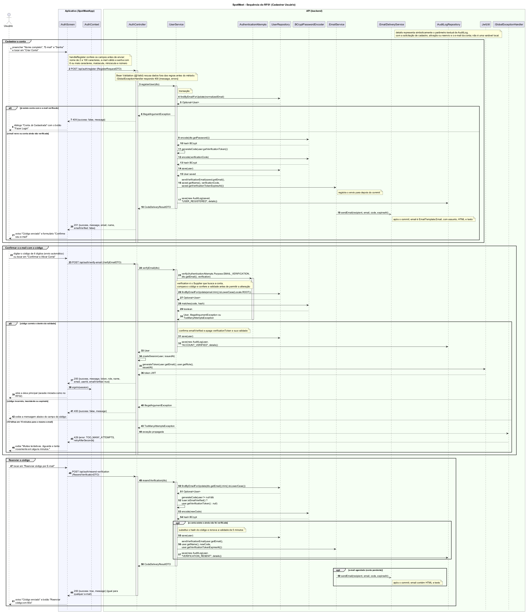

Fonte: próprio autor

#### RF02 – Autenticar Usuário

| Campo | Descrição |
|---|---|
| Função | Autentica o usuário (ou o administrador do sistema) por e-mail e senha ou por uma conta Google no APK Android compatível, emite o token JWT da sessão e libera as funcionalidades conforme o perfil global; controla também a validade da sessão e a reentrada por biometria. |
| Descrição | **Entrada com e-mail e senha:** o servidor limita as tentativas por e-mail (10 falhas em 15 minutos), consulta em users a conta com o e-mail informado, compara a senha com o hash BCrypt e só depois verifica se email_verified é true. Estando tudo correto, gera um token JWT assinado com HMAC (chave spotmeet.jwt.secret), com o e-mail como assunto e as informações role, issuedAtMillis, iat e exp, válido por spotmeet.jwt.expiration-ms (86400000 milissegundos, ou 24 horas, por padrão), e devolve os dados da sessão. O instante de emissão é sempre posterior a users.tokens_valid_after; por isso os tokens anteriores a uma troca de senha, a uma troca de e-mail ou a um reset do sistema deixam de valer. O mesmo fluxo vale para os perfis USER, ADMIN e SYSADMIN.  **Entrada com Google:** o aplicativo obtém um ID token pela escolha nativa da conta Google no APK Android e o envia ao servidor. GoogleSignInService confere a assinatura com as chaves públicas obtidas por GoogleKeysClient, o emissor (accounts.google.com ou https://accounts.google.com), o público correspondente ao ID do cliente Web configurado, a validade e o e-mail confirmado pelo Google (email_verified). O e-mail é normalizado com trim e minúsculas e identifica a conta local, sem criar uma segunda conta para um e-mail já cadastrado. Se o e-mail for novo, cria conta USER já confirmada, com nome do Google normalizado e limitado a 100 caracteres (ou a parte local do e-mail quando o nome é curto), senha aleatória em hash BCrypt e tokens_valid_after atual. Se a conta existente já estiver confirmada, preserva nome, senha, perfil e demais dados. Se estiver pendente, confirma o e-mail, substitui a senha por uma aleatória, apaga o código de confirmação e atualiza tokens_valid_after para invalidar os tokens anteriores. Conta nova ou pendente confirmada gera USER_REGISTERED_GOOGLE. Ao final, createSession emite a mesma sessão JWT do acesso com senha, com emissão posterior ao corte da conta. A pessoa que não conhece a senha aleatória pode definir uma pelo fluxo de recuperação (RF15).  **Disponibilidade do Google:** GET /api/auth/google/status informa se há ID do cliente Web configurado, não se o aparelho está apto ou se o Google está acessível. O APK precisa do módulo nativo, do Google Play Services e de um cliente Android no Google Cloud com o pacote e a assinatura SHA-1 da chave que assinou o APK instalado. O acesso não está disponível no iOS nem no Expo Go. Aparelho e servidor precisam de internet, este último para baixar as chaves públicas, mantidas em cache por uma hora (chave desconhecida permite nova busca após um minuto). O fluxo não usa segredo do cliente Web nem rota de callback; o ID token vai do aparelho diretamente ao servidor do SpotMeet.  **Validação da sessão:** a cada requisição protegida, JwtAuthFilter extrai o e-mail do token, carrega a conta (loadUserByUsername), confere assinatura, validade, assunto e o corte tokens_valid_after (isTokenValid) e exige email_verified = true; se algo falhar, a requisição segue sem autenticação e o servidor responde 401. O aplicativo consulta GET /api/users/me a cada 15 segundos, enquanto está em primeiro plano, para perceber a sessão encerrada.  **Reentrada por biometria:** com a biometria habilitada (ver os requisitos de Configurações de usuário), o aplicativo reaberto, ou que volta do segundo plano depois do prazo escolhido, fica bloqueado. Quando a saída foi pelas telas do sistema que o próprio aplicativo abre para a foto de perfil (galeria, câmera e recorte, RF16), o bloqueio só é aplicado depois de 5 minutos, ou do prazo escolhido, se for maior. Ao tocar em "Desbloquear", o aparelho autentica o usuário (biometria ou PIN), o aplicativo lê o token guardado no cofre do aparelho e o confirma no servidor com GET /api/users/me, sem emitir novo token. |
| Entradas | **Entrada:** objeto LoginRequestDTO com email (obrigatório, formato de ValidationPatterns.EMAIL; o aplicativo envia o e-mail sem caracteres invisíveis, sem espaços nas pontas e em minúsculas, e o AuthController também aplica trim e minúsculas) e password (obrigatória, sem regra de formato).  **Google:** nenhuma entrada na consulta de configuração (GET /api/auth/google/status); na autenticação, objeto GoogleSignInDTO com idToken (obrigatório, não vazio, até 4000 caracteres), recebido do módulo nativo do Google, enviado em POST /api/auth/google. Nome e e-mail não são enviados como prova de identidade pelo aplicativo; o servidor os obtém do token conferido.  **Validação da sessão:** cabeçalho Authorization com a palavra Bearer e o token.  **Reentrada por biometria:** autenticação do aparelho; nenhum dado digitado. |
| Origem | Usuário ou Administrador do sistema, pela tela AuthScreen (entrada com senha ou Google, com o utilitário googleSignIn e a escolha de contas do Google), pela tela BiometricGate (reentrada) e pelo componente SessionGuard (validação periódica). |
| Saída | **Entrada:** HTTP 200 com AuthResponseDTO {token, role, name, email, userId, emailVerified}. HTTP 403 {error: EMAIL_NOT_VERIFIED, message, email} quando a senha está correta e a conta não foi verificada (AuthController, a partir de DisabledException). HTTP 401 {error: BAD_CREDENTIALS, message: "E-mail ou senha incorretos."} para e-mail inexistente ou senha errada (AuthController, a partir de BadCredentialsException). HTTP 429 {success: false, error: TOO_MANY_ATTEMPTS, message, retryAfterSeconds}, com o cabeçalho Retry-After, a partir da 10ª falha em 15 minutos (GlobalExceptionHandler). HTTP 400 do GlobalExceptionHandler quando o corpo viola o DTO.  **Google:** GET /api/auth/google/status responde HTTP 200 com {enabled, clientId}; sem ID configurado, enabled é false e clientId é null. POST /api/auth/google responde HTTP 200 com o mesmo AuthResponseDTO {token, role, name, email, userId, emailVerified}. HTTP 400 do GlobalExceptionHandler quando idToken está ausente, vazio ou tem mais de 4000 caracteres, ou o corpo é ilegível. HTTP 401 {success: false, message: "Não foi possível entrar com o Google. Tente novamente."} quando a conferência do token ou a obtenção das chaves falha. HTTP 503 {success: false, message: "O login com Google não está configurado neste servidor."} quando não há ID do cliente Web configurado. No aplicativo, iOS, ausência do módulo nativo ou configuração indisponível geram aviso local, sem chamar POST /api/auth/google; o cancelamento da escolha de conta não é mostrado como erro.  **Validação da sessão:** a requisição segue normalmente (por exemplo, 200 de GET /api/users/me). HTTP 401 sem corpo quando o token está ausente, inválido, expirado ou revogado (SecurityConfig, HttpStatusEntryPoint); HTTP 503 quando a consulta da conta ao banco falha (JwtAuthFilter); HTTP 403 quando o perfil não tem acesso à rota (por exemplo, /api/admin/** para o perfil USER).  **Reentrada por biometria:** HTTP 200 com o perfil de GET /api/users/me; HTTP 401, 403 ou 404 encerram a sessão guardada; falha de rede ou 5xx mantém o aplicativo bloqueado. |
| Destino | Usuário ou Administrador do sistema, pelas telas AuthScreen, BiometricGate e pelo componente SessionGuard; a sessão fica guardada em memória no AuthContext. |
| Ação | **Entrada com Google:** ao tocar em "Continuar com Google", AuthScreen chama handleGoogle, que bloqueia novos envios enquanto a operação está em curso e chama signInWithGoogle do utilitário googleSignIn. Fora do Android, mostra "O login com Google está disponível apenas no aplicativo Android."; sem o módulo nativo, mostra "O login com Google funciona só no aplicativo instalado (APK), não no Expo Go.". Em um APK compatível, consulta GET /api/auth/google/status (googleStatus de AuthController); se a consulta falha ou enabled é false, mostra "O login com Google não está disponível neste servidor.". Com a configuração recebida, chama configure de GoogleSignin com webClientId, confere hasPlayServices, chama signOut para reapresentar a escolha de conta e chama signIn. Se o usuário cancelar, fica na tela de acesso sem mensagem de erro. Com um ID token, envia POST /api/auth/google com {idToken}. O método googleSignIn de AuthController valida o DTO e chama signIn de GoogleSignInService, em transação: verify confere o token, keyFor obtém a chave (fetch de GoogleKeysClient quando necessário) e findOrCreateUser localiza a conta com findByEmailForUpdate de UserRepository, criando ou confirmando a conta pendente e gravando a auditoria quando necessário. Depois da transação, createSession gera o token do SpotMeet. Com o sucesso, enterSession chama signIn de AuthContext e navigation.reset para Main, como no acesso com senha; qualquer falha de autenticação mostra "Não foi possível entrar com o Google. Tente novamente.".  **Entrada com e-mail e senha:** o aplicativo abre em AuthScreen no modo de acesso, com o título "SpotMeet", o cartão "Acessar conta" ("Entre com seu e-mail e senha."), os campos E-mail e Senha (com ícone para mostrar ou ocultar), o link "Esqueci minha senha" (RF15), o botão "Entrar no SpotMeet", o botão "Continuar com Google" (desabilitado apenas enquanto há operação de acesso em curso) e o link "Não tem uma conta? Cadastre-se" (RF01). Ao tocar em "Entrar no SpotMeet", handleLogin confere se os dois campos foram preenchidos ("Campo obrigatório.") e se o e-mail é válido e envia POST /api/auth/login (rota pública). O método login de AuthController chama verify de AuthenticationAttempts (finalidade LOGIN, chave: o e-mail), que executa authenticate de AuthenticationManager: loadUserByUsername de UserDetailsServiceImpl (findByEmail de UserRepository), matches de BCryptPasswordEncoder e, depois da senha, a verificação de conta habilitada configurada em SecurityConfig. Com o sucesso, createSession usa generateToken de JwtUtil e o controlador responde 200. O aplicativo confere se a resposta tem token e perfil USER, ADMIN ou SYSADMIN, chama signIn de AuthContext, limpa o formulário e substitui a navegação pela área principal (navigation.reset para Main), sem rota de volta à tela de acesso. A área principal depende do perfil: ADMIN e SYSADMIN veem as abas "Aprovações", "Organizações", "Monitoramento" e "Controles"; os demais usuários veem "Reuniões", "Organização" e "Ajustes", nessa ordem. Em Android e iOS, BiometricContext recebe o evento de login e BiometricGate mostra "Deseja habilitar a biometria?" com "Sim" e "Não"; se o login vem logo depois de uma troca de senha com a biometria habilitada (RF14), o convite não aparece e a biometria é religada com uma confirmação da digital (RF36). Com a resposta 403 EMAIL_NOT_VERIFIED, o aplicativo exibe o aviso "Confirmação Necessária", limpa a senha e passa ao formulário "Confirme seu e-mail" (RF01); com 401, exibe "E-mail ou senha incorretos."; com 429, exibe a mensagem "Muitas tentativas. Aguarde e tente novamente em alguns minutos."; sem conexão, exibe "Não foi possível conectar. Verifique sua conexão e tente novamente.".  **Validação da sessão:** SessionGuard, montado em App, envia GET /api/users/me com o token a cada 15 segundos enquanto o aplicativo está em primeiro plano e ao voltar ao primeiro plano. Em cada requisição protegida, JwtAuthFilter chama extractEmail e isTokenValid de JwtUtil e loadUserByUsername de UserDetailsServiceImpl. Quando qualquer requisição protegida recebe 401, o fetch instalado por installSessionFetch chama a rotina de sessão expirada: signOut de AuthContext, retorno à tela de acesso (resetRoot) e aviso "Sessão encerrada" ("Sua sessão foi encerrada. Entre novamente."). Falha de conexão não encerra a sessão.  **Reentrada por biometria:** ao abrir o aplicativo com a proteção habilitada, BiometricGate mostra "SpotMeet bloqueado" ("Use a biometria ou o PIN do aparelho para continuar. Sua sessão será confirmada no servidor.") com o botão "Desbloquear", o link "Usar a senha do aparelho" e, menor, o link "Sair desta conta". Assim que a tela aparece, unlockOnOpen de BiometricContext já pede a digital; se o Android cancela esse pedido em menos de 1 segundo (o aplicativo ainda está abrindo), o pedido é repetido uma vez depois de 0,7 segundo, sem mensagem de erro. Ao tocar em "Desbloquear", ou em "Usar a senha do aparelho" (o mesmo aviso do sistema, com o texto "Toque na opção de PIN, padrão ou senha para usar a senha do aparelho."), unlock de BiometricContext autentica o aparelho (biometria ou senha do aparelho), lê o token do cofre e envia GET /api/users/me (limite de 10 segundos); com 200, chama signIn de AuthContext com os dados do perfil e desbloqueia. Com 401, 403 ou 404, chama signOut, apaga a sessão guardada e mostra "Sessão encerrada".  **Telas abertas durante o bloqueio:** a tela "SpotMeet bloqueado" é uma janela (Modal) opaca, sem animação, aberta por cima do aplicativo. Depois do primeiro desbloqueio da sessão, as telas continuam montadas embaixo dela: quem sai do aplicativo no meio de um formulário (por exemplo, criando uma comissão) ou dentro de uma comissão volta, ao desbloquear, exatamente ao mesmo ponto, com o que tinha digitado. O BiometricGate guarda a sessão desbloqueada (token e perfil global); se, enquanto bloqueado, a sessão termina (token encerrado, como um 401 no desbloqueio) ou volta com outro perfil, as telas antigas são descartadas e abrem do começo (chave screensKey das telas). Na abertura do aplicativo (processo novo), nada é montado antes do primeiro desbloqueio. O botão voltar do Android na tela de bloqueio fecha o aplicativo (BackHandler.exitApp), sem mostrar o que está embaixo. O link "Sair desta conta" pede a confirmação "Sair desta conta" ("A biometria deste aparelho será desligada. Para voltar, entre com e-mail e senha ou com o Google e ative a biometria de novo.") e, confirmada com "Sair", returnToLogin encerra a sessão, apaga a sessão guardada e leva à tela de acesso. |
| Pré-condição | **Entrada:** existe em users uma conta com o e-mail informado e email_verified = true, e o usuário conhece a senha; há menos de 10 falhas de login desse e-mail nos últimos 15 minutos. Conta com email_verified = false e senha correta leva à confirmação do e-mail (RF01), sem sessão.  **Google:** o usuário tem conta Google e usa o APK Android com o módulo nativo e Google Play Services; o pacote e a assinatura SHA-1 desse APK estão cadastrados no Google Cloud, e o ID do cliente Web está configurado no servidor (spotmeet.google.client-id, substituível por GOOGLE_CLIENT_ID). Aparelho e servidor têm acesso à internet. Não é exigida conta local anterior nem confirmação por código do SpotMeet, pois o e-mail confirmado vem do token Google validado.  **Validação da sessão:** existe sessão iniciada no aplicativo, com token assinado por este servidor, não expirado e emitido depois de users.tokens_valid_after da conta, que continua verificada.  **Reentrada por biometria:** a biometria foi habilitada neste aparelho e para este servidor (token guardado no cofre do aparelho), o aplicativo está bloqueado e o aparelho tem biometria ou PIN configurados. |
| Pós-condição | **Entrada:** em caso de sucesso, a sessão fica em memória no AuthContext (o token só é gravado no aparelho se a biometria for habilitada), o usuário vê a área principal conforme o perfil e as próximas requisições levam o token; nada é gravado no banco. Em caso de falha, nenhuma sessão é criada, o usuário continua na tela de acesso com a mensagem e o contador de falhas do e-mail aumenta; a partir da 10ª falha, novas tentativas recebem 429 pelo tempo de retryAfterSeconds.  **Google:** em caso de sucesso, a sessão JWT fica em memória no AuthContext e abre a mesma área principal do perfil. E-mail novo tem conta USER confirmada; conta pendente fica confirmada, com nova senha aleatória, sem código de confirmação e com corte dos tokens anteriores; conta já confirmada mantém os dados e o perfil. Nova conta ou confirmação de pendente registra USER_REGISTERED_GOOGLE. Cancelamento, indisponibilidade ou token recusado não iniciam sessão; falha na transação não grava as alterações da conta.  **Validação da sessão:** com token válido, a sessão continua ativa; com token inválido, expirado ou revogado, a sessão é encerrada no aplicativo, o token é descartado e o usuário volta à tela de acesso com o aviso.  **Reentrada por biometria:** em caso de sucesso, o aplicativo é desbloqueado e a sessão é restaurada com os dados do perfil, sem novo token, e a pessoa volta à tela em que estava (as telas abrem do começo só na abertura do aplicativo ou se a sessão mudou durante o bloqueio); se a autenticação do aparelho falhar, continua bloqueado; com 401, 403 ou 404, a sessão guardada é apagada e o usuário volta à tela de acesso; com falha de rede, continua bloqueado. |
| Efeitos colaterais | **Entrada:** nenhum registro em audit_logs. Cada falha incrementa o contador em memória de AuthenticationAttempts (zerado por um acesso correto ou depois de 15 minutos, e perdido ao reiniciar o servidor). Em Android e iOS, oferta de habilitar a biometria. Cada novo login ou saída apaga a biometria guardada.  **Google:** criação da conta ou confirmação da pendente, com USER_REGISTERED_GOOGLE em audit_logs nesses dois casos; conta já confirmada não gera essa auditoria nem altera a senha. Não envia código ou e-mail de confirmação. As chaves públicas do Google podem ser baixadas e mantidas em memória no servidor; o aplicativo recebe o mesmo evento de login e a oferta de biometria do acesso com senha. O limite de tentativas do login com senha não é aplicado por esta rota.  **Validação da sessão:** nenhum no servidor; no aplicativo, signOut limpa a sessão e a biometria guardada.  **Reentrada por biometria:** nenhum no servidor; o aplicativo restaura a sessão em memória. |

O diagrama de sequência do RF02 está dividido em três figuras, uma para cada forma de entrada.

**Figura 13 – Diagrama de sequência do RF02: entrar com e-mail e senha e validar a sessão**

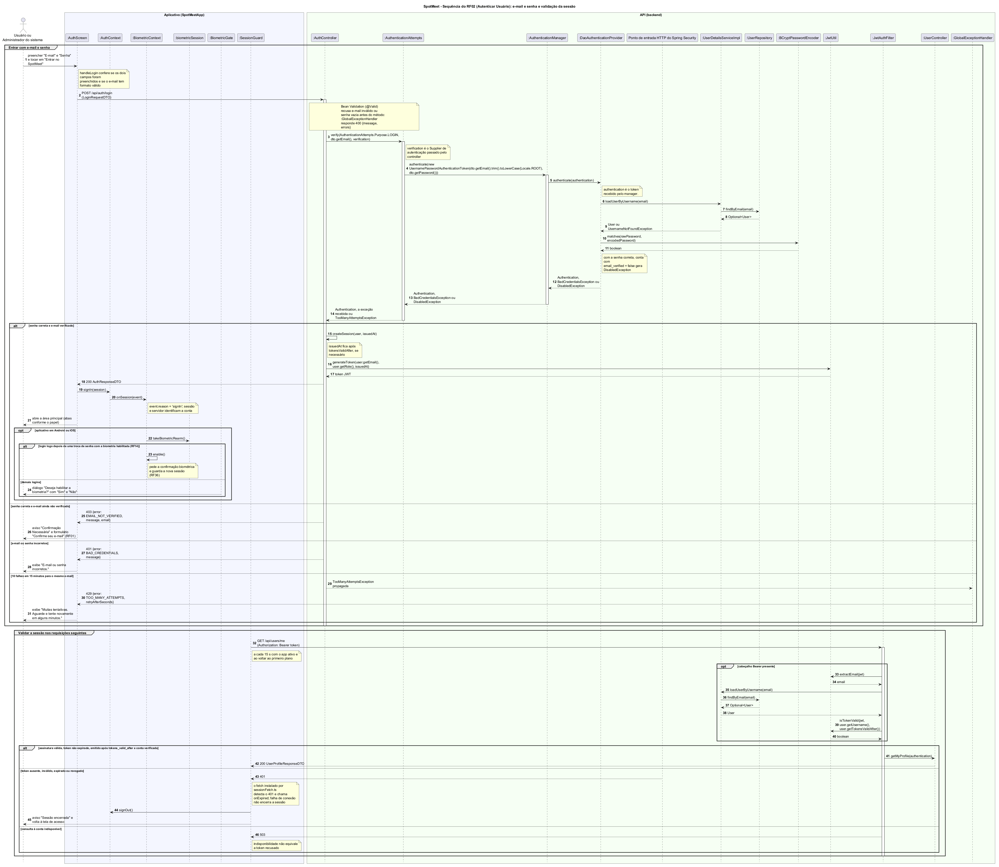

Fonte: próprio autor

**Figura 14 – Diagrama de sequência do RF02: entrar com Google**

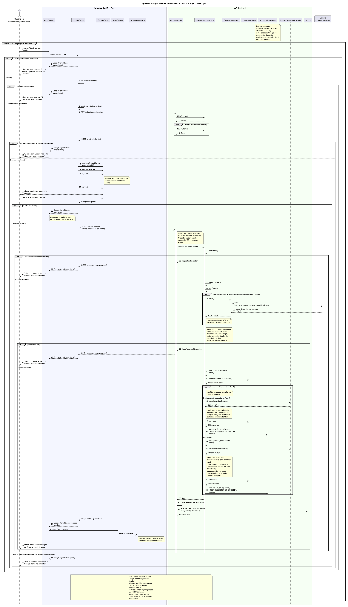

Fonte: próprio autor

**Figura 15 – Diagrama de sequência do RF02: reabrir o aplicativo com a biometria**

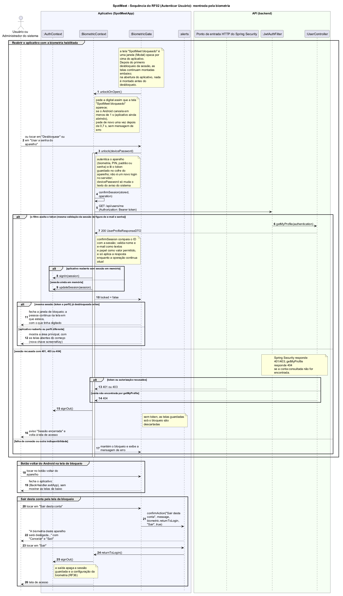

Fonte: próprio autor

#### RF03 – Solicitar Acesso à Organização

| Campo | Descrição |
|---|---|
| Função | Lista as organizações aprovadas que aceitam aparecer na aba "Entrar", registra o pedido de um usuário autenticado para entrar em uma organização aprovada, a partir da chave de acesso dela, e permite ao usuário aceitar ou recusar os convites de organização que recebeu. |
| Descrição | **Lista de organizações:** consulta na tabela organizations as organizações aprovadas (approved = true) com listed = true, em ordem alfabética de nome, exceto aquelas em que o usuário já tem vínculo em organization_members, e devolve de cada uma o nome, a chave, o nome do responsável e o número de integrantes. Não grava nada; entrar continua dependendo do pedido e da aprovação.  **Solicitação por chave:** localiza na tabela organizations a organização cuja chave (access_key) corresponde à informada, sem distinção entre maiúsculas e minúsculas e ignorando espaços nas pontas; se duas ou mais organizações tiverem a mesma chave (dado antigo), o pedido é recusado. Com a organização aprovada (approved = true; organização pendente, rejeitada ou bloqueada é recusada) e desde que o usuário não seja o dono nem membro dela, insere em access_requests uma solicitação com status PENDING e requested_at com a data e a hora do pedido. Se o usuário já tem solicitação anterior para a organização (o par user_id e organization_id é único), ela é reaberta: o status volta a PENDING e requested_at é atualizado; se a anterior ainda está PENDING, o pedido é recusado.  **Prévia da chave:** antes do pedido, devolve o nome, a chave e o nome do responsável da organização aprovada que tem a chave, com as mesmas conferências do pedido (chave vazia, inexistente, duplicada, organização não aprovada ou bloqueada); não grava nada.  **Consulta de convites:** lista os convites do usuário em organization_invitations com status PENDING, ainda dentro do prazo (expires_at posterior ao momento da consulta), de organização aprovada e para as quais o usuário ainda não é membro.  **Resposta a convite:** o destinatário aceita ou recusa um convite pendente e dentro do prazo de 24 horas. Ao aceitar, insere em organization_members o vínculo com o cargo MEMBER e, se existir solicitação PENDING dele para a mesma organização, muda-a para APPROVED; o convite passa a ACCEPTED. Ao recusar, o convite passa a REJECTED e nenhum vínculo é criado. Nos dois casos, responded_at recebe o instante da resposta. |
| Entradas | **Lista de organizações:** nenhuma entrada além do token; a busca por nome (campo "Buscar organização") é feita no aplicativo, sobre a lista recebida.  **Solicitação por chave:** a chave de acesso da organização, enviada no parâmetro de consulta accessKey (caminho usado pelo aplicativo); a rota também aceita o corpo AccessRequestDTO {accessKey}, que tem prioridade quando presente. O servidor remove os espaços das pontas (ValidationPatterns.normalizeOrganizationValue). No aplicativo, o campo "Chave da organização" mostra o # fixo e só aceita de 2 a 50 letras, números, "_" ou "-" (validateAccessKey); a chave segue com o prefixo #. A coluna access_key tem até 100 caracteres. O solicitante é identificado pelo e-mail do token JWT.  **Prévia da chave:** a chave, no parâmetro de consulta accessKey, enviada depois que o campo tem formato válido.  **Consulta de convites:** nenhuma entrada além do token.  **Resposta a convite:** identificador do convite (invitationId), na rota, e objeto RespondOrganizationInvitationDTO com accept (booleano obrigatório). O destinatário vem do token. |
| Origem | Usuário com sessão iniciada. |
| Saída | **Lista de organizações:** HTTP 200 com a lista de ListedOrganizationDTO {id, name, accessKey, ownerName, memberCount}, vazia quando não há nenhuma; HTTP 401 sem corpo quando não há sessão válida.  **Solicitação por chave:** HTTP 201 com AccessRequestResponseDTO {id, userId, userName, userEmail, organizationId, organizationName, organizationAccessKey, status: PENDING, requestedAt}. HTTP 400 {message} quando a chave vem vazia (MembershipController). HTTP 404 {message} quando nenhuma organização tem a chave (IllegalArgumentException do serviço, convertida pelo controlador). HTTP 409 {message} (IllegalStateException, convertida pelo controlador) quando a chave corresponde a mais de uma organização, a organização não foi aprovada pelo administrador ou está bloqueada, o usuário é o proprietário ou já é membro, ou já existe solicitação pendente. HTTP 401 sem corpo quando não há sessão válida (filtro de segurança).  **Prévia da chave:** HTTP 200 com OrganizationPreviewDTO {name, accessKey, ownerName}; HTTP 404 {message} quando a chave vem vazia ou nenhuma organização a tem; HTTP 409 {message} quando a chave corresponde a mais de uma organização ou a organização não foi aprovada ou está bloqueada; HTTP 401 sem corpo sem sessão válida.  **Consulta de convites:** HTTP 200 com a lista de OrganizationInvitationResponseDTO {id, organizationId, organizationName, userId, invitedById, invitedByName, status, createdAt, expiresAt, respondedAt}; HTTP 403 quando a conta não existe ou não está verificada; HTTP 500 com mensagem genérica para falha inesperada.  **Resposta a convite:** HTTP 200 com o OrganizationInvitationResponseDTO atualizado; HTTP 400 "Dados do convite inválidos." para corpo ilegível ou identificador não numérico, e HTTP 400 do GlobalExceptionHandler quando accept está ausente; HTTP 403 quando o convite não existe ou não é deste usuário; HTTP 404 quando a organização não existe; HTTP 409 quando o convite já foi respondido, venceu, a organização não está aprovada ou o usuário já é membro (OrganizationInvitationController converte as exceções do serviço). |
| Destino | Usuário, pela tela OrganizationScreen. A solicitação passa a constar na lista de pedidos pendentes da organização (RF04); com a aprovação ou o aceite do convite, a organização passa a constar em "Minhas" (listagem do RF07). |
| Ação | **Lista de organizações:** o usuário seleciona a aba "Organização" e, dentro dela, a aba interna "Entrar". A tela mostra "Entrar em uma organização" ("Informe a chave ou escolha uma organização da lista. Depois, aguarde a aprovação dos responsáveis."), o campo "Chave da organização" e, abaixo, a seção "ORGANIZAÇÕES NA LISTA" com o campo "Buscar organização". Ao abrir a aba, o aplicativo envia GET /api/organizations/listed; o método listedOrganizations de MembershipController chama listListed de MembershipService, que busca o usuário (findByEmail de UserRepository), os vínculos dele (findByUserId de OrganizationMemberRepository), as organizações aprovadas e listadas (findByApprovedTrueAndListedTrueOrderByNameAsc de OrganizationRepository) e conta os integrantes de cada uma (countByOrganizationId de OrganizationMemberRepository). Cada cartão mostra o nome, "Responsável:" com o nome do dono, a chave e o número de integrantes; sem nenhuma, a seção exibe "Nenhuma organização na lista no momento. Peça a chave ao responsável.". Ao tocar num cartão, o aplicativo preenche a "Chave da organização" com a chave dela e marca o cartão; a prévia e o pedido seguem como na solicitação por chave.  **Solicitação por chave:** na mesma aba "Entrar", o usuário digita a chave ou a preenche pela lista. Quando ela tem formato válido e o usuário para de digitar por 500 ms, o aplicativo envia GET /api/organizations/preview?accessKey=; o método previewOrganization de MembershipController chama previewByKey de MembershipService, que faz as mesmas conferências do pedido (findIdsByAccessKeyIgnoreCase, aprovação) sem bloquear a organização, e a tela mostra um cartão com o nome da organização e "Responsável:" seguido do nome do dono; para chave inexistente ou organização não aprovada, mostra abaixo do campo a mensagem do servidor. Em seguida o usuário toca em "Solicitar acesso". O aplicativo confere a chave (validateAccessKey) e envia POST /api/access-requests?accessKey= seguido da chave com o #. JwtAuthFilter autentica a requisição; o método requestAccess de MembershipController obtém o e-mail do token e chama requestAccess de MembershipService, em uma transação: normaliza a chave, procura as organizações (findIdsByAccessKeyIgnoreCase de OrganizationRepository), bloqueia a organização encontrada (findByIdForUpdate), confere se está aprovada, busca o solicitante (findByEmail de UserRepository), confere se é o proprietário ou já é membro (existsByUserIdAndOrganizationId de OrganizationMemberRepository), consulta pedidos anteriores (findByUserIdAndOrganizationId de AccessRequestRepository), grava o pedido (save) e a auditoria (save de AuditLogRepository). Com a resposta 201, o aplicativo exibe o aviso "Sucesso" ("Solicitação enviada. Aguarde a aprovação dos responsáveis."), repete a mensagem abaixo do campo e limpa o campo; com outro código, exibe acima de "Solicitar acesso" a mensagem devolvida pelo servidor. A chave digitada, o cartão da prévia e as mensagens não permanecem quando o usuário troca de aba interna ou sai da tela.  **Consulta de convites:** ao abrir a aba "Minhas" (e a cada atualização automática, de 15 em 15 segundos), o aplicativo envia GET /api/organization-invitations/mine, junto com a consulta dos convites de comissão (RF11). O método listMine de OrganizationInvitationController chama listMine de OrganizationInvitationService, que valida a conta (findByEmail) e consulta findPendingForRecipient de OrganizationInvitationRepository. Havendo convites, a aba mostra o cartão "Você recebeu convites" com o botão "Ver convites (n)"; a página "Convites" lista, em "CONVITES DE ORGANIZAÇÃO", o nome da organização, "Convite de" seguido do nome de quem convidou e "Válido até" com a data e a hora; sem convites, mostra "Você não tem convites pendentes.".  **Resposta a convite:** na página "Convites", o usuário toca em "Aceitar" ou "Recusar" no convite. O aplicativo envia POST /api/organization-invitations/{invitationId}/respond com {accept}. O método respond de OrganizationInvitationController chama respond de OrganizationInvitationService, em uma transação: valida a conta (findByEmail), confirma que o convite é do usuário (findOrganizationIdForRecipient de OrganizationInvitationRepository), bloqueia a organização (findByIdForUpdate), carrega o convite (findById), confere se está pendente e dentro do prazo e, ao aceitar, confere se a organização está aprovada e se o usuário já é membro; então grava o vínculo (save de OrganizationMemberRepository), aprova a solicitação pendente da mesma organização (findByUserIdAndOrganizationId e save de AccessRequestRepository), grava a auditoria e atualiza o convite (save). O aplicativo exibe "Convite aceito. Você entrou na organização." ou "Convite recusado." e recarrega as organizações e os convites. |
| Pré-condição | **Solicitação por chave:** o usuário está autenticado (RF02) e conhece a chave; existe em organizations uma organização com essa chave e approved = true; o usuário não é o dono (organizations.owner_id) nem tem vínculo em organization_members com ela; não existe solicitação PENDING dele para a mesma organização.  **Consulta de convites:** o usuário está autenticado e a conta está verificada.  **Resposta a convite:** o usuário está autenticado e é o destinatário do convite; o convite está PENDING e expires_at é posterior ao momento da resposta (24 horas após o envio); para aceitar, a organização está aprovada e o usuário ainda não tem vínculo com ela. |
| Pós-condição | **Lista de organizações:** nada é alterado; o usuário vê as organizações aprovadas e listadas das quais ainda não participa.  **Solicitação por chave:** em caso de sucesso, existe em access_requests uma solicitação PENDING (nova ou reaberta) do usuário para a organização, ACCESS_REQUESTED foi gravada em audit_logs e a solicitação aparece para o dono e o vice em "Solicitações" (RF04); o usuário ainda não é membro. Em caso de falha no envio, nada é gravado e a mensagem aparece acima de "Solicitar acesso". Erros da chave e da prévia continuam abaixo do campo.  **Consulta de convites:** nenhuma alteração; o usuário vê apenas convites vigentes.  **Resposta a convite:** ao aceitar, o usuário passa a ser MEMBER da organização (organization_members), o convite fica ACCEPTED com responded_at, eventual solicitação PENDING fica APPROVED, a auditoria é gravada e a organização aparece em "Minhas". Ao recusar, o convite fica REJECTED com responded_at e nenhum vínculo é criado. Em caso de falha (convite respondido, vencido ou organização não aprovada), nada é alterado e o usuário vê a mensagem. |
| Efeitos colaterais | **Lista de organizações:** nenhum.  **Solicitação por chave:** ACCESS_REQUESTED em audit_logs (organização e chave); reabertura de solicitação anterior (APPROVED ou REJECTED) para PENDING com nova data; eventos do syncBus (ORGANIZATIONS_MUTATED, COMMITTEES_MUTATED e ADMIN_ORGS_MUTATED) para atualizar outras telas abertas.  **Consulta de convites:** nenhum.  **Resposta a convite:** ORGANIZATION_INVITATION_ACCEPTED ou ORGANIZATION_INVITATION_REJECTED em audit_logs (convite e organização); aprovação automática da solicitação pendente da mesma organização; eventos do syncBus. |

**Figura 16 – Diagrama de sequência do RF03**

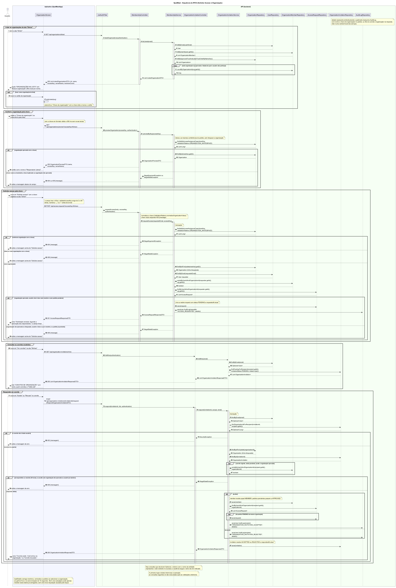

Fonte: próprio autor

#### RF04 – Avaliar Solicitação de Acesso

| Campo | Descrição |
|---|---|
| Função | Permite ao dono ou ao vice-líder da organização consultar as solicitações de acesso pendentes, aprová-las ou rejeitá-las e convidar pessoas já cadastradas para a organização, com aviso por e-mail após a decisão ou o convite. |
| Descrição | **Consulta:** lista em access_requests as solicitações da organização com status PENDING, com o nome e o e-mail do solicitante.  **Aprovação:** muda para APPROVED o status da solicitação PENDING e, se o solicitante ainda não for membro, insere em organization_members o vínculo com o cargo MEMBER. Só é possível com a organização aprovada pelo administrador do sistema.  **Rejeição:** muda para REJECTED o status da solicitação PENDING; o solicitante pode pedir de novo, e o pedido é reaberto (RF03).  **Convite:** cria em organization_invitations o convite para uma conta cadastrada e verificada, com status PENDING e validade de 24 horas, e agenda o aviso por e-mail para envio assíncrono após o commit; se já existe um convite vencido ou respondido do mesmo par organização e usuário, o registro é renovado (um registro por par). O convidado responde pelo aplicativo (RF03).  **Busca de pessoas:** para a folha de convite, lista até 10 contas confirmadas de perfil USER cujo nome ou e-mail contém o termo (mínimo de 3 caracteres; com menos, a lista é vazia), sem o dono, os membros e quem já tem convite pendente dentro do prazo, ordenadas por nome; os curingas do LIKE (%, _ e o caractere de escape) são escapados e nada é gravado.  Todas as operações exigem ser o dono (organizations.owner_id ou cargo ORG_OWNER) ou o vice (cargo ORG_VICE_OWNER) da organização. A API aceita também o perfil global SYSADMIN na consulta, na aprovação e na rejeição (uso direto da API; o aplicativo não oferece essas telas ao administrador), mas não no convite. |
| Entradas | **Consulta:** identificador numérico da organização (organizationId), na rota.  **Aprovação e rejeição:** identificador numérico da solicitação (requestId), na rota, sem corpo.  **Convite:** organizationId, na rota, e objeto OrganizationInvitationRequestDTO com email (obrigatório, formato de ValidationPatterns.EMAIL; o servidor aplica trim e minúsculas). No aplicativo, o campo "Nome ou e-mail da pessoa" (apoio "Digite pelo menos 3 letras") recebe o nome ou o e-mail; ao enviar, só o e-mail completo é aceito ("Escolha uma pessoa da lista ou digite o e-mail completo.").  **Busca de pessoas:** organizationId, na rota, e o termo q, no parâmetro de consulta (aparado; com menos de 3 caracteres a resposta é uma lista vazia).  Em todas as operações, o executor é identificado pelo e-mail do token JWT. |
| Origem | Usuário (dono ou vice-líder da organização). |
| Saída | **Consulta:** HTTP 200 com a lista de AccessRequestResponseDTO {id, userId, userName, userEmail, organizationId, organizationName, organizationAccessKey, status, requestedAt}; HTTP 403 (mensagem em texto) quando o executor não é dono nem vice (SecurityException tratada pelo MembershipController); organização inexistente ou executor sem conta no banco geram HTTP 409, pelo GlobalExceptionHandler.  **Aprovação:** HTTP 200 com AccessRequestResponseDTO com status APPROVED; HTTP 403 quando o executor não é dono nem vice; HTTP 404 quando a solicitação ou a organização não existe; HTTP 409 quando a solicitação não está PENDING ou a organização não está aprovada (mensagens em texto, montadas pelo MembershipController).  **Rejeição:** HTTP 200 com AccessRequestResponseDTO com status REJECTED; HTTP 403, 404 e 409 nas mesmas situações da aprovação, exceto a conferência da aprovação da organização, que a rejeição não faz.  **Convite:** HTTP 201 com OrganizationInvitationResponseDTO {id, organizationId, organizationName, userId, invitedById, invitedByName, status: PENDING, createdAt, expiresAt, respondedAt}; HTTP 400 do GlobalExceptionHandler quando o e-mail é inválido; HTTP 400 "Dados do convite inválidos." quando o corpo é ilegível ou o identificador não é numérico; HTTP 403 quando o executor não é dono nem vice ou a conta dele não está verificada; HTTP 404 quando a organização não existe ou o convidado não tem conta verificada; HTTP 409 quando a organização não está aprovada, o convidado já pertence a ela ou já existe convite pendente dentro do prazo; HTTP 500 "Não foi possível enviar o convite." para falha inesperada (OrganizationInvitationController).  **Busca de pessoas:** HTTP 200 com a lista de InviteCandidateDTO {userId, name, email}, até 10 itens (vazia com termo curto); HTTP 401, 403 (executor sem cargo de dono ou vice), 404 (organização inexistente) e 409 (organização não aprovada) nas mesmas condições do convite; HTTP 500 "Não foi possível buscar as pessoas." para falha inesperada. |
| Destino | Usuário, pela tela OrganizationScreen, e caixa de e-mail do solicitante (decisão) ou do convidado (convite). O solicitante aprovado passa a ver a organização em "Minhas"; o convidado vê o convite em "Minhas" (RF03) e responde pelo aplicativo, não pelo e-mail. |
| Ação | **Consulta:** o dono ou o vice abre a aba "Organização", a aba interna "Minhas", toca no cartão da organização e, na aba "Gerenciar", toca no atalho "Solicitações", que mostra a contagem de pedidos. Ao abrir a organização, loadDetails envia GET /api/organizations/{organizationId}/access-requests (somente para dono e vice). O método listPendingRequests de MembershipController chama listPendingRequests de MembershipService, que busca o executor (findByEmail), confere a liderança (requireOwnerOrViceOwner, com findById de OrganizationRepository e findByUserIdAndOrganizationId de OrganizationMemberRepository) e consulta findByOrganizationIdAndStatus de AccessRequestRepository. A página "Solicitações" mostra, em "ENTRADA NA ORGANIZAÇÃO", o nome e o e-mail de cada solicitante, com os botões "Rejeitar" e "Aprovar"; sem pedidos, mostra "Nenhuma solicitação pendente para seu papel." (a página também lista os pedidos de ingresso em comissões, RF12).  **Aprovação:** ao tocar em "Aprovar", o aplicativo envia POST /api/access-requests/{requestId}/approve. O método approveAccess de MembershipController chama approveAccess de MembershipService, em uma transação: descobre a organização do pedido (findOrganizationIdById de AccessRequestRepository), bloqueia-a (findByIdForUpdate), carrega o pedido (findById), busca o executor (findByEmail), confere a liderança (requireOwnerOrViceOwner), confere se o pedido está PENDING e se a organização está aprovada, grava APPROVED (save), confere se o solicitante já é membro (existsByUserIdAndOrganizationId) e, se não for, grava o vínculo MEMBER (save de OrganizationMemberRepository) e a auditoria. O aplicativo exibe o aviso "Sucesso" ("Integrante aprovado.") e recarrega os dados.  **Rejeição:** ao tocar em "Rejeitar", o aplicativo envia POST /api/access-requests/{requestId}/reject. O método rejectAccess de MembershipController chama rejectAccess de MembershipService, que faz as mesmas buscas, o mesmo bloqueio e a mesma verificação de liderança, confere se o pedido está PENDING, grava REJECTED (save) e a auditoria. O aplicativo exibe "Solicitação rejeitada." e recarrega os dados.  **Convite:** na aba "Gerenciar", o dono ou o vice toca em "Convidar para organização"; se a organização ainda não está aprovada, o aplicativo exibe o aviso "Organização não aprovada" e não abre a folha (a API também recusa o convite com HTTP 409). Com a organização aprovada, abre a folha "Convidar integrante" ("Procure uma pessoa já cadastrada pelo nome ou e-mail e toque nela. Ela decide se aceita ou recusa em até 24 horas.") com o campo "Nome ou e-mail da pessoa" e os botões "Enviar convite" e "Cancelar". Com três letras ou mais e 400 ms sem novas teclas, o aplicativo envia GET /api/organizations/{organizationId}/invitations/candidates?q=; o método candidates de OrganizationInvitationController chama findCandidates de OrganizationInvitationService, que valida o executor, confere a liderança (requireOwnerOrVice) e a aprovação e consulta findInviteCandidates de UserRepository. A folha lista os resultados em cartões com a foto de perfil ou as iniciais (RF16), o nome e o e-mail (ou "Nenhuma pessoa encontrada. Confira o nome ou digite o e-mail completo."); ao tocar em uma pessoa, o campo recebe o e-mail dela. O aplicativo envia POST /api/organizations/{organizationId}/invitations. O método invite de OrganizationInvitationController chama invite de OrganizationInvitationService, em uma transação: valida o executor (findByEmail, conta verificada), bloqueia a organização (findByIdForUpdate), confere a liderança (requireOwnerOrVice), confere se a organização está aprovada, busca o convidado (findByEmail, conta verificada), confere se ele já pertence à organização (existsByUserIdAndOrganizationId), consulta o convite existente (findByOrganizationIdAndUserId de OrganizationInvitationRepository), grava o convite com validade de 24 horas (save) e a auditoria. O aplicativo exibe "Convite enviado. A pessoa tem 24 horas para aceitar ou recusar." e fecha a folha. |
| Pré-condição | **Consulta:** o usuário está autenticado (RF02) e tem o cargo ORG_OWNER ou ORG_VICE_OWNER na organização (ou é o proprietário em organizations.owner_id; a API aceita também SYSADMIN).  **Aprovação:** o mesmo cargo; existe solicitação com status PENDING (RF03) da organização indicada; a organização está aprovada (approved = true).  **Rejeição:** o mesmo cargo; existe solicitação com status PENDING.  **Convite:** o usuário está autenticado, com conta verificada, e é o dono (organizations.owner_id) ou tem o cargo ORG_VICE_OWNER de uma organização aprovada; o convidado tem conta verificada, não é dono nem membro e não tem convite PENDING dentro do prazo. A busca de pessoas exige o mesmo cargo e a mesma organização aprovada. |
| Pós-condição | **Consulta:** nenhuma alteração; o usuário vê as solicitações pendentes ou, sem o cargo exigido, a mensagem de acesso negado.  **Aprovação:** em caso de sucesso, a solicitação fica APPROVED, o solicitante tem vínculo MEMBER em organization_members (se ainda não tinha), ACCESS_APPROVED foi gravada e o pedido sai da lista de pendentes; o aprovado passa a ver a organização em "Minhas". Em caso de falha, nada é alterado e o usuário vê a mensagem.  **Rejeição:** em caso de sucesso, a solicitação fica REJECTED, ACCESS_REJECTED foi gravada e o pedido sai da lista; o solicitante não é membro e pode pedir de novo (RF03). Em caso de falha, nada é alterado e o usuário vê a mensagem.  **Convite:** em caso de sucesso, existe em organization_invitations um convite PENDING do convidado para a organização, com quem convidou, data de criação e expires_at igual à criação mais 24 horas, e ORGANIZATION_INVITATION_SENT foi gravada; o aviso por e-mail fica agendado para depois do commit e o convidado o vê em "Minhas" (RF03), onde responde. Em caso de falha, nada é gravado e o usuário vê a mensagem na folha. |
| Efeitos colaterais | **Consulta:** nenhum.  **Aprovação:** ACCESS_APPROVED em audit_logs; inserção do vínculo em organization_members; e-mail ao solicitante com o assunto "SpotMeet - Acesso aprovado: {organização}" (organização, perfil Membro e quem aprovou), enviado após o commit; eventos do syncBus (ORGANIZATIONS_MUTATED, COMMITTEES_MUTATED e ADMIN_ORGS_MUTATED) para atualizar outras telas abertas.  **Rejeição:** ACCESS_REJECTED em audit_logs; e-mail ao solicitante com o assunto "SpotMeet - Solicitação de acesso recusada: {organização}" (organização, data do pedido e quem decidiu), enviado após o commit; eventos do syncBus.  **Convite:** ORGANIZATION_INVITATION_SENT em audit_logs (organização e ID do convidado); e-mail ao convidado com o assunto "SpotMeet - Convite para a organização {organização}" (quem convidou, validade de 24 horas e a orientação para aceitar ou recusar em Organização; a chave de acesso não vai no e-mail), enviado após o commit; se havia convite vencido ou respondido do mesmo par, o registro é reaproveitado, com novo prazo e responded_at limpo; eventos do syncBus.  Nos três avisos, EmailService (sendAccessApprovedEmail, sendAccessRejectedEmail ou sendOrganizationInvitationEmail) registra o envio para depois do commit; só então EmailDeliveryService.sendNotice entra na fila assíncrona (uma thread e 20 posições). A resposta HTTP não espera o SMTP nem confirma a entrega na caixa postal. Sem SMTP configurado, há apenas registro no log; falha no envio não desfaz a decisão nem o convite já gravado. |

**Figura 17 – Diagrama de sequência do RF04**

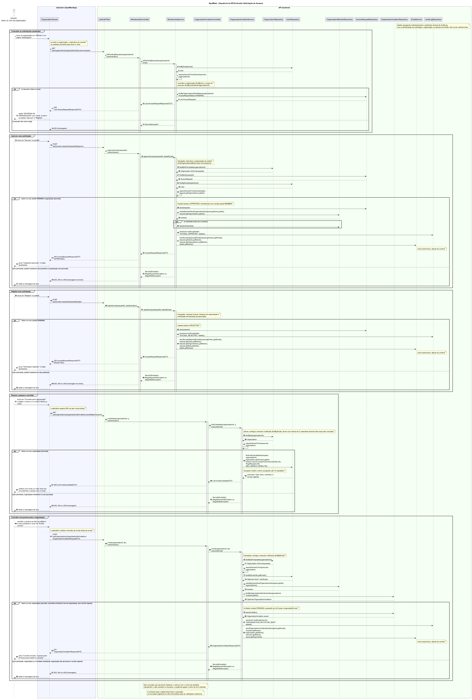

Fonte: próprio autor

#### RF05 – Manter Membros da Organização

| Campo | Descrição |
|---|---|
| Função | Permite consultar os membros de uma organização e, conforme a hierarquia de cargos, promovê-los, rebaixá-los, revogar o seu acesso e transferir a liderança da organização. |
| Descrição | **Consulta:** lista os vínculos da tabela organization_members da organização, com o identificador, o nome, o e-mail, o cargo e o status de presença (coluna availability_status da tabela users, escolhida em Ajustes, RF16) de cada membro.  **Promoção:** altera em organization_members o cargo de MEMBER para ORG_SUBOWNER (dono ou vice) ou de ORG_SUBOWNER para ORG_VICE_OWNER (somente o dono).  **Rebaixamento:** altera o cargo de ORG_VICE_OWNER para ORG_SUBOWNER (somente o dono) ou de ORG_SUBOWNER para MEMBER (dono ou vice). O cargo do dono (ORG_OWNER) não muda por promoção nem por rebaixamento.  **Revogação:** exclui os vínculos do membro com as comissões da organização (committee_members), as suas solicitações de acesso à organização (access_requests), os seus convites à organização (organization_invitations) e o seu vínculo em organization_members. O subdono remove apenas membros comuns; o vice remove membros comuns e subdonos; o dono remove qualquer integrante; ninguém remove o dono nem a si mesmo; o membro comum não remove ninguém.  **Transferência de liderança:** na mesma transação, o vínculo do dono atual passa a MEMBER, o do integrante escolhido passa a ORG_OWNER e organizations.owner_id passa a apontar para ele. O destino pode ser qualquer integrante atual da mesma organização (membro, subdono ou vice).  O perfil global SYSADMIN é aceito pela API com as permissões de dono em todas as operações (o aplicativo não oferece essas telas ao administrador); o perfil ADMIN não tem essa exceção. |
| Entradas | **Consulta:** identificador numérico da organização (organizationId), na rota.  **Promoção e rebaixamento:** organizationId e userId do membro alvo, na rota, sem corpo.  **Revogação:** organizationId e memberId (o userId do alvo), na rota.  **Transferência:** organizationId e userId do novo dono, na rota, sem corpo; o dono atual é lido do banco, não da requisição.  Em todas as operações, o executor é identificado pelo e-mail do token JWT. |
| Origem | Usuário (líder da organização; a consulta é aceita pela API para qualquer integrante). |
| Saída | **Consulta:** HTTP 200 com a lista de MemberDTO {userId, name, email, role, availabilityStatus} (classe interna de OrganizationResponseDTO; availabilityStatus é PRESENT, AWAY, BUSY ou ONLINE, e o valor nulo no banco é devolvido como PRESENT); HTTP 403 (mensagem em texto) quando o executor não é membro.  **Promoção e rebaixamento:** HTTP 200 com MemberDTO com o novo cargo (e o status de presença do alvo); HTTP 403 (texto) sem permissão; HTTP 404 (texto) quando a organização, o usuário ou o vínculo do alvo não existe; HTTP 409 (texto) quando o alvo é o dono, já está no cargo máximo (vice) ou já é membro comum.  **Revogação:** HTTP 200 com o texto "Acesso revogado com sucesso."; HTTP 400 (texto) quando o executor tenta remover a si mesmo ou o dono, ou quando a organização ou o vínculo do alvo não existe; HTTP 403 (texto) quando o executor não pertence à organização ou a hierarquia não permite a remoção.  **Transferência:** HTTP 200 com OrganizationLeadershipResponseDTO {organizationId, previousOwnerId, ownerId, previousOwnerRole: MEMBER, ownerRole: ORG_OWNER}; HTTP 400 para identificadores inválidos; HTTP 403 quando o executor não é o dono atual nem SYSADMIN; HTTP 404 quando a organização ou o vínculo do destino não existe; HTTP 409 quando a organização não está aprovada, quando o destino já é o dono ou quando a liderança está inconsistente; HTTP 500 "Não foi possível transferir a liderança." para falha inesperada. |
| Destino | Usuário, pela tela OrganizationScreen. O membro afetado vê o novo cargo, ou deixa de ver a organização, na próxima atualização de "Minhas" (a cada 15 segundos). |
| Ação | **Consulta:** na aba "Gerenciar" (visível ao dono, ao vice e ao subdono), o usuário toca no atalho "Membros". Se a organização ainda não está aprovada, o aplicativo exibe o aviso "Organização não aprovada" e não abre a página. A consulta GET /api/organizations/{organizationId}/members é feita por loadDetails ao selecionar a organização, inclusive se ela estiver pendente; a abertura da página Membros usa os dados já carregados; listMembers de MembershipController chama listMembers de MembershipService, que busca o executor (findByEmail), confere o vínculo (requireOrganizationMember) e consulta findByOrganizationId de OrganizationMemberRepository; cada MemberDTO recebe também o availabilityStatus do usuário. A página "Membros" mostra o campo "Buscar membro" (nome ou e-mail), os filtros "Todos", "Dono", "Vice-líder", "Subdono" e "Membro" e um cartão por integrante, com nome, e-mail, o status de presença (abaixo do e-mail, com bolinha verde para "Presente", amarela para "Ausente" e vermelha para "Ocupado", calculados por presenceOf; ONLINE ou sem valor aparece como "Presente") e o cargo.  **Promoção e rebaixamento:** o usuário toca no cartão do integrante, abre a folha com o nome dele e toca em "Elevar papel" ou "Rebaixar papel" (mostrados só quando a hierarquia permite); o diálogo "Alterar papel" ("Alterar o papel de" seguido do nome e "para" o novo cargo) pede a confirmação em "Elevar" ou "Rebaixar". O aplicativo envia POST /api/organizations/{organizationId}/members/{userId}/promote ou /demote; promoteMember ou demoteMember de MembershipController chama o método de mesmo nome de MembershipService, em uma transação: busca o executor (findByEmail), bloqueia a organização (findByIdForUpdate), busca o alvo (findById de UserRepository) e o seu vínculo (findByUserIdAndOrganizationId), recusa se o alvo é o dono, confere a permissão (requireOwnerOrViceOwner ou requireOwner, conforme o cargo atual do alvo), grava o novo cargo (save) e a auditoria. O aplicativo exibe "Sucesso" ("Papel atualizado.") e recarrega os dados.  **Revogação:** o usuário toca em "Remover integrante" na folha do integrante (mostrado só quando a hierarquia permite) e confirma o diálogo "Remover integrante" ("Remover" o nome "desta organização e de suas comissões?") no botão "Remover". O aplicativo envia DELETE /api/organizations/{organizationId}/members/{memberId}; revokeAccess de MembershipController chama revokeAccess de MembershipService, em uma transação: busca o executor, recusa a remoção de si mesmo, bloqueia a organização, recusa a remoção do dono, busca o vínculo do alvo e o cargo do executor, aplica as regras de hierarquia, exclui os vínculos do membro com as comissões da organização (findByUserIdAndCommitteeOrganizationId e deleteAll de CommitteeMemberRepository), as suas solicitações de acesso (findByUserIdAndOrganizationId e deleteAll de AccessRequestRepository), os seus convites (deleteByOrganizationIdAndUserId de OrganizationInvitationRepository) e o vínculo (delete de OrganizationMemberRepository), e grava a auditoria. O aplicativo exibe "Integrante removido." e recarrega os dados.  **Transferência:** na aba "Gerenciar", o dono toca em "Transferir liderança", exibido somente quando a organização está aprovada; a folha lista os demais integrantes, cada um com o botão "Transferir"; o usuário toca no escolhido e confirma o diálogo "Transferir liderança" ("Você passará a ser membro comum e perderá os poderes de dono.") no botão "Transferir". O aplicativo envia POST /api/organizations/{organizationId}/members/{userId}/make-owner; o método transfer de OrganizationLeadershipController chama transferLeadership de MembershipService, em uma transação: busca o executor, bloqueia a organização, confere que o executor é o dono em organizations.owner_id (ou SYSADMIN), que a organização está aprovada, que existe exatamente um vínculo ORG_OWNER (findByOrganizationIdAndRole) e que ele corresponde a owner_id, busca o vínculo do destino (findByUserIdAndOrganizationId), grava os dois vínculos (save) e a organização com o novo dono (save de OrganizationRepository) e registra a auditoria. O aplicativo exibe "Liderança transferida. Seu papel agora é membro." e leva o usuário à aba de comissões. |
| Pré-condição | **Consulta:** o usuário está autenticado (RF02) e tem vínculo com a organização; o aplicativo oferece a tela a dono, vice e subdono.  **Promoção:** ser ORG_OWNER ou ORG_VICE_OWNER para promover MEMBER; ser ORG_OWNER para promover ORG_SUBOWNER; o alvo é integrante da organização e não é o dono.  **Rebaixamento:** ser ORG_OWNER para rebaixar ORG_VICE_OWNER; ser ORG_OWNER ou ORG_VICE_OWNER para rebaixar ORG_SUBOWNER; o alvo é integrante da organização, não é o dono nem MEMBER.  **Revogação:** ser ORG_OWNER (remove qualquer integrante, menos a si mesmo), ORG_VICE_OWNER (remove MEMBER e ORG_SUBOWNER) ou ORG_SUBOWNER (remove MEMBER); o alvo é integrante da organização, diferente do executor e do dono.  **Transferência:** o executor é o dono atual (organizations.owner_id), existe um único vínculo ORG_OWNER coerente com owner_id e o destino é outro integrante da mesma organização; a organização deve estar aprovada (approved igual a true). |
| Pós-condição | **Consulta:** nenhuma alteração; o usuário vê a lista de integrantes, com o status de presença de cada um.  **Promoção e rebaixamento:** em caso de sucesso, o vínculo do alvo tem o novo cargo, a auditoria foi gravada e a lista mostra o cargo atualizado; o novo cargo vale na próxima requisição do alvo, porque os poderes são lidos do banco. Em caso de falha, nada é alterado e o usuário vê a mensagem.  **Revogação:** em caso de sucesso, o alvo não tem mais vínculo com a organização nem com as comissões dela, e as suas solicitações e convites nela foram excluídos; ACCESS_REVOKED foi gravada e ele deixa de ver a organização em "Minhas". Em caso de falha, nada é removido (a transação é desfeita) e o usuário vê a mensagem.  **Transferência:** em caso de sucesso, o destino é o dono (cargo ORG_OWNER e owner_id), o antigo dono é MEMBER e perde as permissões de líder, ORGANIZATION_LEADER_CHANGED foi gravada; aprovação, estado, nome, chave, comissões e convites da organização continuam como estavam. Em caso de falha, nada é alterado e o usuário vê a mensagem. |
| Efeitos colaterais | **Consulta:** nenhum.  **Promoção:** ROLE_PROMOTED_SUBOWNER ou ROLE_PROMOTED_VICE_OWNER em audit_logs.  **Rebaixamento:** ROLE_DEMOTED_SUBOWNER ou ROLE_DEMOTED_MEMBER em audit_logs.  **Revogação:** ACCESS_REVOKED em audit_logs (ID do membro, cargo e organização); exclusão dos vínculos do membro com as comissões da organização, das suas solicitações de acesso e dos seus convites a ela.  **Transferência:** ORGANIZATION_LEADER_CHANGED em audit_logs (organização, dono anterior e novo dono).  Nas operações que alteram dados, eventos do syncBus atualizam as outras telas abertas.  **Incremento 2:** se o membro removido era o presidente de uma comissão, o vínculo com a comissão é apagado e, com ele, o papel de presidente (RF24); as reuniões já agendadas continuam, e só um novo presidente poderá editá-las ou cancelá-las. |

**Figura 18 – Diagrama de sequência do RF05**

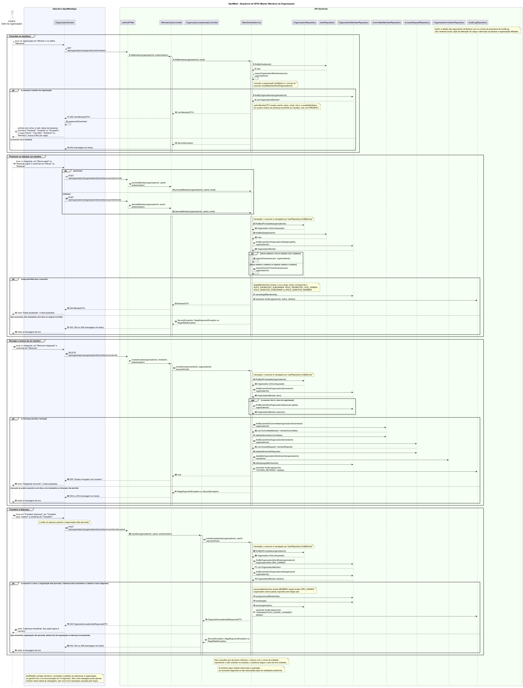

Fonte: próprio autor

#### RF06 – Cadastrar Organização

| Campo | Descrição |
|---|---|
| Função | Cadastra uma nova organização, que fica pendente de aprovação do administrador do sistema, e torna dono dela o usuário que a cadastrou. |
| Descrição | Insere na tabela organizations uma organização contendo o nome, a chave de acesso, a escolha de aparecer na lista de organizações (listed, verdadeira quando não informada) e, opcionalmente, o CNPJ, com approved igual a false, status PENDING e moderation_reason nulo. A lista da aba "Entrar" (RF03) só mostra organizações aprovadas com listed verdadeiro. O usuário autenticado, identificado pelo e-mail do token JWT e nunca pelo corpo da requisição, é gravado em owner_id e registrado na tabela organization_members com o papel ORG_OWNER. O nome e a chave são únicos em todo o sistema, em qualquer estado da organização, sem diferenciar maiúsculas de minúsculas nem espaços extras; o CNPJ, quando informado, é único pelo valor exato. A conferência de unicidade e a gravação ocorrem na mesma transação, com a tabela organizations travada até o fim dela. Enquanto não for aprovada (RF08), a organização não aceita solicitações de acesso (RF03), convites de organização nem comissões (RF09). |
| Entradas | Objeto do tipo OrganizationRequestDTO contendo: name, string obrigatória (@NotBlank) de até 255 caracteres (@Size), com os espaços das pontas removidos e as sequências de espaços internos reduzidas a um espaço antes da validação (normalizeOrganizationName de ValidationPatterns); accessKey, string obrigatória (@NotBlank) no formato `^#[A-Za-z0-9_\-]{2,50}$` (@Pattern), isto é, "#" seguido de 2 a 50 letras ASCII, números, "_" ou "-", sem espaços internos, com os espaços das pontas removidos antes da validação e a caixa preservada na gravação (coluna access_key, única, de 100 caracteres); cnpj, string opcional de até 255 caracteres (@Size), com os espaços das pontas removidos, sem validação de formato, e que, em branco, é gravada como nula; listed, booleano opcional (Boolean), que, ausente, deixa a organização na lista. Campos desconhecidos, como approved, status e owner, são ignorados. O e-mail do dono vem do token JWT.  **No aplicativo:** na aba "Criar" da tela OrganizationScreen, os campos "Nome da organização" (obrigatório, com as mensagens "Informe o nome da organização." e "Use até 255 caracteres.") e "Chave de acesso" (obrigatório; o "#" é fixo e acrescentado automaticamente; mensagem "Use de 2 a 50 letras, números, '_' ou '-'. O # é automático.") e a caixa "Mostrar na lista de organizações", marcada por padrão. O aplicativo não tem campo para o CNPJ. |
| Origem | Usuário. |
| Saída | **Sucesso:** resposta HTTP 201 com um objeto do tipo OrganizationResponseDTO contendo id, name, accessKey, ownerId, ownerName, createdAt, approved (false), status ("PENDING"), moderationReason (nulo), resubmitted (false) e listed, sem o CNPJ.  **Erros:** HTTP 400, gerado pelo GlobalExceptionHandler (MethodArgumentNotValidException) antes de o controlador ser chamado, com status, error, message (a primeira mensagem de erro) e errors (campo e mensagem); HTTP 409, gerado pelo próprio OrganizationController, com a mensagem em texto, quando o nome ("Já existe uma organização com esse nome. Escolha outro nome."), a chave ("Já existe uma organização com essa chave de acesso. Escolha outra chave.") ou o CNPJ ("Já existe uma organização com esse CNPJ.") pertence a outra organização; HTTP 409, gerado pelo GlobalExceptionHandler, quando a conta do token não existe mais ("Usuário autenticado não encontrado."); HTTP 401, sem corpo, gerado pelo SecurityConfig quando o token está ausente, expirado ou revogado; HTTP 500 com "Erro interno no servidor." para falhas inesperadas. |
| Destino | Usuário, por meio da tela OrganizationScreen; banco de dados (tabelas organizations, organization_members e audit_logs). |
| Ação | O usuário seleciona a aba "Organização" da barra inferior, que exibe a tela OrganizationScreen (título "Organizações"), e, nela, a aba interna "Criar". O sistema exibe os campos "Nome da organização" e "Chave de acesso" (com o prefixo "#" fixo e a dica "O # é adicionado automaticamente à chave."), a dica "Nome e chave são únicos. Maiúsculas, minúsculas e espaços extras não tornam o nome diferente." e a caixa "Mostrar na lista de organizações", marcada, com a explicação "Depois de aprovada, aparece na aba Entrar de quem procura uma organização. Para entrar, a pessoa ainda precisa da aprovação dos responsáveis." (desmarcada: "Não aparece na lista. Só encontra a organização quem souber a chave."). Ao tocar no botão "Criar organização", o aplicativo executa validateOrganizationName e validateAccessKey (organizationForms); se algum campo for inválido, exibe a mensagem sob o campo e não envia nada. Estando os campos válidos, normaliza os valores (normalizeOrganizationName e normalizeAccessKey) e envia a requisição POST /api/organizations com name, accessKey e listed. A requisição passa pelo JwtAuthFilter, que valida o token e carrega a conta, e o Spring MVC valida o OrganizationRequestDTO (@Valid). O método createOrganization(dto, authentication) da classe OrganizationController chama o método createOrganization(ownerEmail, dto) da classe OrganizationService, em transação com isolamento READ_COMMITTED, que normaliza nome, chave e CNPJ (ValidationPatterns), localiza o dono por findByEmail (UserRepository), trava a tabela por lockForUniquenessCheck (OrganizationRepository, LOCK TABLE organizations IN SHARE ROW EXCLUSIVE MODE), confere a disponibilidade em checkAvailability (existsByNormalizedName, existsByNormalizedAccessKey e, havendo CNPJ, existsByCnpjExcludingId), grava a organização por save, grava o vínculo ORG_OWNER por save de OrganizationMemberRepository, registra a auditoria por save de AuditLogRepository e monta a resposta por OrganizationResponseDTO.forViewer. O controlador responde 201. A tela limpa o formulário, volta à aba "Minhas", exibe o aviso "Sucesso" com o texto "Organização criada. Aguarde a avaliação do administrador do sistema." e recarrega a lista (RF07), na qual a organização aparece com os selos "Pendente" e "Dono". Em caso de erro, a mensagem recebida aparece abaixo do formulário (no erro 400, sob o campo correspondente) e os dados digitados são mantidos. Toques repetidos enquanto a requisição está em andamento são ignorados. |
| Pré-condição | O usuário deve estar autenticado: token JWT não expirado nem revogado, de uma conta com e-mail verificado (RF01 e RF02). O nome e a chave informados não podem coincidir, ignorando maiúsculas e espaços extras, com os de nenhuma organização existente, e o CNPJ, quando informado, não pode pertencer a outra organização. A API não limita o número de organizações por usuário nem o perfil global; o aplicativo oferece a tela apenas aos usuários com perfil USER. |
| Pós-condição | **Sucesso:** existem uma nova linha em organizations (approved igual a false, status PENDING, owner_id do usuário), uma linha em organization_members (ORG_OWNER) e uma em audit_logs; o usuário vê a organização em "Minhas" com os selos "Pendente" e "Dono", e a organização só passa a receber integrantes e comissões depois de aprovada (RF08).  **Falha:** nenhuma linha é gravada (a transação é desfeita); a tela exibe a mensagem do erro e mantém os dados digitados; se o servidor responder 401, o SessionGuard encerra a sessão e exibe "Sessão encerrada". |
| Efeitos colaterais | Registro em audit_logs com a ação ORGANIZATION_CREATED, contendo o nome, a chave e o identificador da organização. Inserção em organization_members com o papel ORG_OWNER. Bloqueio da tabela organizations até o fim da transação: outras criações e edições de organizações esperam. Atualização das telas do mesmo aparelho pelo syncBus (ORGANIZATIONS_MUTATED, COMMITTEES_MUTATED e ADMIN_ORGS_MUTATED); os demais aparelhos recebem a organização na próxima leitura periódica (15 segundos). A organização passa a constar na fila "Aprovações" do administrador (RF08). Nenhum e-mail é enviado. |

**Figura 19 – Diagrama de sequência do RF06**

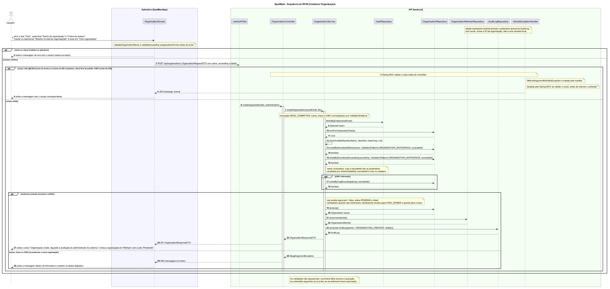

Fonte: próprio autor

#### RF07 – Manter Organização

| Campo | Descrição |
|---|---|
| Função | **Pesquisa:** lista as organizações às quais o usuário está vinculado.  **Atualização:** altera o nome e a chave de acesso de uma organização.  **Exclusão:** remove permanentemente uma organização e os dados vinculados a ela.  **Transferência de liderança:** passa o papel de dono da organização para outro integrante.  **Reavaliação:** reenvia ao administrador do sistema, uma única vez, uma organização recusada, com a justificativa do dono. |
| Descrição | **Pesquisa:** consulta na tabela organization_members os vínculos do usuário autenticado e devolve a organização de cada vínculo com o papel do usuário (myRole: ORG_OWNER, ORG_VICE_OWNER, ORG_SUBOWNER ou MEMBER), o estado (approved e status), se a reavaliação já foi usada (resubmitted), se aparece na lista de organizações (listed) e, somente ao dono atual e aos perfis ADMIN e SYSADMIN, o motivo da recusa ou do bloqueio (moderationReason). Organizações pendentes, recusadas e bloqueadas também são listadas aos seus integrantes.  **Atualização:** atualiza na tabela organizations as colunas name, access_key, cnpj e listed da organização indicada; listed nulo mantém o valor gravado. Os campos approved, status, moderation_reason e owner_id não são alterados por esta operação, e o aplicativo não envia o CNPJ: quando o cnpj chega nulo, o valor gravado é mantido; em branco, é apagado. Nome, chave e CNPJ continuam únicos em relação às outras organizações (a própria organização é excluída da conferência, o que permite mudar só a caixa do valor). A chave anterior deixa de localizar a organização nas novas solicitações de acesso (RF03). A conferência de unicidade e a gravação ocorrem na mesma transação, com a tabela organizations travada.  **Exclusão:** em uma única transação, exclui por código e nesta ordem os registros de organization_invitations, de committee_members e de committees da organização, de access_requests e de organization_members, e por fim a própria organização. As contas dos usuários e os registros de audit_logs permanecem. As reuniões das comissões e seus participantes (Incremento 2) são removidos pelo banco, pelo mapeamento ON DELETE CASCADE de Meeting e MeetingParticipant.  **Transferência de liderança:** altera para ORG_OWNER o papel do integrante escolhido na tabela organization_members, aponta organizations.owner_id para ele e rebaixa o antigo dono para MEMBER, na mesma transação. O perfil global das contas, o estado de aprovação, o nome e a chave da organização não mudam. Como o motivo de moderação só é exibido ao dono atual, quem consulta o motivo passa a ser o novo dono. Só é possível em organização aprovada (approved igual a true).  **Reavaliação:** em uma organização com status REJECTED e resubmitted_at nulo, grava na tabela organizations status PENDING, approved igual a false, a justificativa em resubmission_note (500 caracteres) e a data e a hora do pedido em resubmitted_at. O motivo da recusa (moderation_reason) é mantido para que o administrador o compare com a justificativa. Como resubmitted_at não volta a ser nulo, a reavaliação só pode ser pedida uma vez: se a organização for recusada de novo, só resta excluí-la (Exclusão) e cadastrar outra (RF06). Nome e chave são corrigidos antes, pela Atualização. |
| Entradas | **Pesquisa:** nenhuma entrada além do token JWT, do qual é obtido o e-mail do usuário.  **Atualização:** identificador organizationId (Long) na rota e objeto do tipo OrganizationRequestDTO com name, accessKey, cnpj e listed, com as mesmas restrições e a mesma normalização do RF06; o aplicativo envia name, accessKey e listed. No aplicativo, os campos "Nome da organização" e "Chave de acesso" e a caixa "Mostrar na lista de organizações" da folha "Editar organização", preenchidos com os valores atuais e com as mesmas regras e mensagens do RF06.  **Exclusão:** identificador organizationId (Long) na rota.  **Transferência de liderança:** identificadores organizationId e userId (Long) na rota, sem corpo; userId é o integrante que será o novo dono, escolhido na lista de integrantes (RF05) entre todos, exceto o dono atual.  **Reavaliação:** identificador organizationId (Long) na rota e objeto do tipo OrganizationResubmitDTO contendo justification, string obrigatória (@NotBlank) de 3 a 500 caracteres (@Size), com os espaços das pontas removidos; o serviço recusa ainda caracteres de controle, exceto tabulação e quebra de linha. No aplicativo, o campo "Justificativa" da folha "Reenviar para avaliação" (obrigatório, com a mensagem "Escreva de 3 a 500 caracteres."). |
| Origem | Usuário. Na transferência, também o Administrador do sistema com perfil SYSADMIN. |
| Saída | **Pesquisa:** resposta HTTP 200 com a lista de objetos do tipo OrganizationResponseDTO (id, name, accessKey, ownerId, ownerName, createdAt, myRole, approved, status, moderationReason, resubmitted e listed), sem o CNPJ; HTTP 409 (GlobalExceptionHandler) quando a conta do token não existe mais.  **Atualização:** resposta HTTP 200 com o OrganizationResponseDTO atualizado. Erros: HTTP 400 (GlobalExceptionHandler, MethodArgumentNotValidException), com status, error, message e errors; HTTP 403 (GlobalExceptionHandler, SecurityException) com "Acesso negado. Você não pertence a esta organização." ou "Acesso negado. Apenas o Dono ou Vice-Líder pode editar a organização."; HTTP 409, gerado pelo OrganizationController e com a mensagem em texto, quando o nome, a chave ou o CNPJ pertence a outra organização ou quando a organização não existe ("Organização não encontrada.").  **Exclusão:** resposta HTTP 200 com o texto "Organização excluída com sucesso.". Erros, todos gerados pelo GlobalExceptionHandler: HTTP 403 com "Acesso negado. Você não pertence a esta organização." ou "Acesso negado. Apenas o Dono ou Vice-Líder pode apagar toda a organização."; HTTP 409 com "Organização não encontrada.".  **Transferência de liderança:** resposta HTTP 200 com um objeto do tipo OrganizationLeadershipResponseDTO (organizationId, previousOwnerId, ownerId, previousOwnerRole igual a MEMBER e ownerRole igual a ORG_OWNER). Erros, todos gerados pelo OrganizationLeadershipController: HTTP 400 quando os identificadores não são numéricos ou não são positivos; HTTP 403 quando o executor não é o dono nem SYSADMIN ("Acesso negado. Somente o dono ou o SysAdmin pode transferir a liderança."); HTTP 404 quando a organização não existe ou o destino não pertence a ela; HTTP 409 quando a organização não está aprovada ("A liderança só pode ser transferida depois que a organização for aprovada."), quando o destino já é o dono ou quando a liderança gravada está inconsistente (sem vínculo ORG_OWNER único correspondente a owner_id); HTTP 500 com "Não foi possível transferir a liderança.".  **Reavaliação:** resposta HTTP 200 com o OrganizationResponseDTO (status "PENDING" e resubmitted igual a true). Erros, todos gerados pelo GlobalExceptionHandler: HTTP 400 (MethodArgumentNotValidException, com errors.justification: "Informe a justificativa do reenvio." ou "A justificativa deve ter de 3 a 500 caracteres."); HTTP 403 com "Somente o dono da organização pode pedir a reavaliação."; HTTP 409 com "Somente uma organização recusada pode ser reenviada para avaliação.", "A reavaliação desta organização já foi usada. Exclua a organização e crie outra, se necessário.", "Informe uma justificativa de 3 a 500 caracteres, sem caracteres de controle." ou "Organização não encontrada.".  Em todas as operações, HTTP 401 sem corpo (SecurityConfig) quando o token está ausente, expirado ou revogado. |
| Destino | Usuário, por meio da tela OrganizationScreen e, na transferência feita pelo administrador, da tela AdminOrganizationsScreen; banco de dados (tabelas organizations, organization_members, organization_invitations, committees, committee_members, access_requests e audit_logs). |
| Ação | **Pesquisa:** ao receber o foco, e a cada 15 segundos enquanto a tela está em foco e sem formulário, janela ou operação em andamento, a tela OrganizationScreen (aba "Organização" da barra inferior) envia a requisição GET /api/organizations/mine; o gesto de puxar a lista e o botão de atualizar do cabeçalho fazem a leitura na hora. O método listMyOrganizations(authentication) da classe OrganizationController chama o método listMyOrganizations(userEmail) da classe OrganizationService, que localiza o usuário por findByEmail (UserRepository), obtém os vínculos por findByUserId (OrganizationMemberRepository) e monta um OrganizationResponseDTO.forViewer por vínculo, preenchendo myRole. A tela exibe a seção "SUAS ORGANIZAÇÕES" da aba "Minhas", com o campo "Buscar organização" (filtro local por nome, chave ou responsável); cada cartão mostra o nome, a chave, o selo de estado (Aprovada, Pendente, Rejeitada ou Bloqueada) e o selo de papel (Dono, Vice-líder, Subdono ou Membro). Para o dono de uma organização rejeitada ou bloqueada, o cartão mostra também "Motivo:" com o texto gravado, e a visão geral da aba "Gerenciar" repete o texto abaixo do estado, com o título "Motivo da recusa" (ou "Motivo do bloqueio"). Tocar no cartão seleciona a organização e abre a aba "Gerenciar" (dono, vice-líder e subdono) ou "Comissões" (membro).  **Atualização:** na aba "Gerenciar", com a organização selecionada, o dono ou o vice-líder toca no botão "Editar organização". O sistema abre a folha "Editar organização" com os campos "Nome da organização" e "Chave de acesso" preenchidos, a dica "O # é automático. Maiúsculas e minúsculas são equivalentes. Ao alterar, a chave anterior deixa de valer para novos pedidos." e a caixa "Mostrar na lista de organizações" com o valor atual. Ao tocar no botão "Salvar alterações", o aplicativo executa as validações do RF06 e envia a requisição PUT /api/organizations/{organizationId} com name, accessKey e listed. Depois da validação @Valid, o método updateOrganization(organizationId, dto, authentication) da classe OrganizationController chama o método updateOrganization(organizationId, executorEmail, dto) da classe OrganizationService, em transação com isolamento READ_COMMITTED, que localiza o executor por findByEmail, trava a tabela por lockForUniquenessCheck, carrega a organização com bloqueio de linha por findByIdForUpdate, confere a permissão em requireOwnerOrViceOwner (perfil SYSADMIN, dono registrado em owner_id ou vínculo ORG_OWNER ou ORG_VICE_OWNER obtido por findByUserIdAndOrganizationId), normaliza os valores (o CNPJ nulo e o listed nulo mantêm o gravado), confere a disponibilidade em checkAvailability, excluindo a própria organização (existsByNormalizedName, existsByNormalizedAccessKey e existsByCnpjExcludingId), grava por save e registra a auditoria. Com a resposta 200, a tela fecha a folha, exibe o aviso "Sucesso" com o texto "Organização atualizada. Uma chave alterada passa a valer para novas solicitações." e recarrega a lista. Em caso de erro, a mensagem aparece abaixo do formulário.  **Exclusão:** na aba "Gerenciar", o dono ou o vice-líder toca no botão "Excluir organização". A janela de confirmação (ConfirmationHost), com o título "Excluir organização", informa "Excluir {nome}? A ação é permanente e apaga as comissões, vínculos, convites e solicitações desta organização. As contas dos usuários permanecem." e, ao tocar em "Excluir", o aplicativo envia a requisição DELETE /api/organizations/{organizationId}. O método deleteOrganization(organizationId, authentication) da classe OrganizationController chama o método deleteOrganization(organizationId, executorEmail) da classe OrganizationService, em transação, que localiza o executor por findByEmail, carrega a organização com bloqueio por findByIdForUpdate, confere a permissão (SYSADMIN, dono registrado em owner_id ou vínculo ORG_OWNER ou ORG_VICE_OWNER obtido por findByUserIdAndOrganizationId) e então exclui os convites (deleteByOrganizationId de OrganizationInvitationRepository); para cada comissão obtida por findByOrganizationIdOrderByNameAsc (CommitteeRepository), os vínculos (findByCommitteeId e deleteAll de CommitteeMemberRepository) e em seguida as comissões (deleteAll); as solicitações de acesso (findByOrganizationId e deleteAll de AccessRequestRepository); os integrantes (findByOrganizationId e deleteAll de OrganizationMemberRepository); a organização (delete de OrganizationRepository). Por último registra a auditoria. A tela exibe o aviso "Sucesso" com o texto "Organização excluída.", limpa a seleção e volta à aba "Minhas".  **Transferência de liderança:** na aba "Gerenciar", o dono toca no botão "Transferir liderança", exibido somente quando a organização está aprovada. A folha "Transferir liderança" exibe "Escolha um integrante atual. Depois da transferência, você será membro comum." e a lista dos integrantes (lida pelo RF05), sem o dono atual, cada um com o botão "Transferir". Ao tocar nele, a janela de confirmação "Transferir liderança" informa "Transferir a liderança de {organização} para {integrante}? Você passará a ser membro comum e perderá os poderes de dono." e, ao tocar em "Transferir", o aplicativo envia a requisição POST /api/organizations/{organizationId}/members/{userId}/make-owner, sem corpo. O método transfer(organizationId, userId, authentication) da classe OrganizationLeadershipController chama o método transferLeadership(organizationId, userId, executorEmail) da classe MembershipService, em transação, que localiza o executor por findByEmail, carrega a organização com bloqueio por findByIdForUpdate, confere que o executor é o dono registrado em owner_id ou SYSADMIN, lê os vínculos ORG_OWNER por findByOrganizationIdAndRole e confere que há um só e que corresponde a owner_id, lê o vínculo do destino por findByUserIdAndOrganizationId, troca os papéis, grava os dois vínculos por save de OrganizationMemberRepository e a organização por save de OrganizationRepository, e registra a auditoria. Com a resposta 200, a tela exibe o aviso "Sucesso" com o texto "Liderança transferida. Seu papel agora é membro.", recarrega os papéis e abre a aba "Comissões".  **Transferência pelo administrador:** na aba "Organizações" da tela AdminOrganizationsScreen, o SYSADMIN (ou o dono atual da organização) abre os "Detalhes da organização", toca em "Transferir liderança" (exibido somente para organização aprovada com mais de um integrante; nos demais casos a janela explica "A liderança só pode ser transferida depois que a organização for aprovada." ou "A organização tem apenas o dono. A liderança pode ser transferida quando houver outro integrante.") e escolhe o integrante em "Transferir para {nome}". A janela de confirmação informa "Transferir a liderança de {organização} para {integrante}? O antigo dono será membro comum. O papel global da conta e o estado da organização serão preservados." e, ao tocar em "Transferir", a tela envia a mesma requisição e confere se a resposta traz organizationId, ownerId, previousOwnerRole igual a MEMBER e ownerRole igual a ORG_OWNER; em seguida exibe "Liderança transferida. O antigo dono passou a ser membro comum.".  **Reavaliação:** na aba "Gerenciar" de uma organização recusada, o dono vê o botão "Reenviar para avaliação" ou, se a reavaliação já foi usada, o texto "A reavaliação desta organização já foi usada. Para tentar de novo, exclua a organização e crie outra.". O botão abre a folha "Reenviar para avaliação", com "Motivo da recusa: {motivo}", a orientação "Corrija o que foi apontado (em Editar organização) e explique a correção. A reavaliação pode ser pedida uma única vez: se a organização for recusada de novo, só restará excluí-la." e o campo "Justificativa". Ao tocar no botão "Reenviar para avaliação", o aplicativo valida o campo e envia a requisição POST /api/organizations/{organizationId}/resubmit com justification. Depois da validação @Valid, o método resubmitOrganization(organizationId, body, authentication) da classe OrganizationController chama o método resubmitOrganization(organizationId, executorEmail, justification) da classe OrganizationService, em transação, que localiza o executor por findByEmail, carrega a organização com bloqueio por findByIdForUpdate, confere que o executor é o dono registrado em owner_id, que o status é REJECTED e que resubmitted_at é nulo, valida a justificativa, grava status, approved, resubmission_note e resubmitted_at por save e registra a auditoria. Com a resposta 200, a tela fecha a folha, exibe o aviso "Sucesso" com o texto "Organização reenviada. Aguarde a nova avaliação do administrador do sistema." e recarrega a lista, na qual a organização volta a ter o selo "Pendente". |
| Pré-condição | **Pesquisa:** o usuário deve estar autenticado (token JWT não expirado nem revogado).  **Atualização e Exclusão:** o usuário deve estar autenticado, a organização deve existir (em qualquer estado: PENDING, APPROVED, REJECTED ou BLOCKED) e o usuário deve ser o dono (owner_id ou vínculo ORG_OWNER) ou o vice-líder (ORG_VICE_OWNER) da organização, ou ter o perfil global SYSADMIN (apenas pela API, pois o aplicativo não oferece essas telas ao SYSADMIN). Subdono, membro, usuário sem vínculo e ADMIN sem vínculo são recusados. Na Atualização, o novo nome, a nova chave e o CNPJ, se enviado, não podem pertencer a outra organização.  **Transferência de liderança:** o usuário deve estar autenticado e ser o dono atual da organização (owner_id) ou ter o perfil global SYSADMIN; vice-líder e ADMIN não podem transferir. O destino deve ser outro integrante atual da mesma organização, com papel diferente de ORG_OWNER, e a organização deve ter um único vínculo ORG_OWNER, correspondente a owner_id. A organização deve estar aprovada (approved igual a true).  **Reavaliação:** o usuário deve estar autenticado e ser o dono da organização (owner_id); a organização deve estar recusada (status REJECTED), a reavaliação não pode ter sido usada (resubmitted_at nulo) e a justificativa deve ter de 3 a 500 caracteres, sem caracteres de controle. |
| Pós-condição | **Pesquisa:** a tela exibe as organizações do usuário ou, se ele não tiver vínculos, "Entre em uma organização ou crie sua equipe."; se a leitura falhar, mantém a última lista e exibe "Não foi possível atualizar suas organizações. Tente novamente." com o botão "Tentar atualizar". Nada é alterado.  **Atualização:** em caso de sucesso, a organização está gravada com o novo nome e a nova chave (estado, dono e CNPJ preservados), a chave anterior deixa de localizá-la e a tela exibe o aviso de sucesso; em caso de erro (dados inválidos, acesso negado, valor em uso ou organização inexistente), nada é alterado e a folha permanece aberta com a mensagem.  **Exclusão:** em caso de sucesso, a organização, suas comissões, vínculos, convites, solicitações e integrantes deixam de existir, as contas permanecem, e o usuário volta à aba "Minhas" sem a organização; os demais integrantes deixam de vê-la na próxima leitura; em caso de erro (acesso negado ou organização inexistente), nada é removido, pois a transação é desfeita.  **Transferência de liderança:** em caso de sucesso, o destino é ORG_OWNER e dono em owner_id, o antigo dono é MEMBER e perde as telas de gestão (passa a ver "Comissões"), e o motivo de moderação passa a ser exibido ao novo dono; em caso de erro, nada é alterado e a tela exibe a mensagem.  **Reavaliação:** em caso de sucesso, a organização está com status PENDING, a justificativa e a data do reenvio gravadas e o motivo anterior mantido, volta à fila "Aprovações" do administrador (RF08) e não poderá ser reenviada outra vez; em caso de erro, nada é alterado e a folha mostra a mensagem. |
| Efeitos colaterais | **Pesquisa:** nenhum.  **Atualização:** registro em audit_logs com a ação ORGANIZATION_UPDATED, contendo o identificador, o nome e a chave anteriores e novos e, quando a escolha da lista muda, "Na lista: sim" ou "Na lista: não". Bloqueio da tabela organizations até o fim da transação. Atualização das telas do mesmo aparelho pelo syncBus (ORGANIZATIONS_MUTATED, COMMITTEES_MUTATED e ADMIN_ORGS_MUTATED).  **Exclusão:** exclusão em cascata, feita pelo código, de organization_invitations, committee_members, committees, access_requests e organization_members, e remoção pelo banco das reuniões e dos participantes das comissões (Incremento 2); registro em audit_logs com a ação ORGANIZATION_DELETED, contendo o identificador, o nome e a chave da organização. Atualização das telas pelo syncBus.  **Transferência de liderança:** alteração de dois registros de organization_members e de organizations.owner_id; registro em audit_logs com a ação ORGANIZATION_LEADER_CHANGED, contendo os identificadores da organização, do dono anterior e do novo dono. O token JWT do antigo dono continua válido, mas as operações passam a consultar o novo papel dele. Atualização das telas pelo syncBus.  **Reavaliação:** registro em audit_logs com a ação ORGANIZATION_RESUBMITTED, contendo o identificador, o nome e a quantidade de caracteres da justificativa (o texto não é copiado para a auditoria). Bloqueio da linha da organização durante a transação. Atualização das telas pelo syncBus.  **Incremento 2:** ao excluir as comissões da organização, o banco exclui também as reuniões e os participantes delas (exclusão em cascata de `meetings` e `meeting_participants`). **Incremento 3:** pela mesma cascata, são excluídas as atas, as respostas, as votações e os votos dessas reuniões (`meeting_minutes`, `minutes_responses`, `meeting_polls` e `poll_votes`). |

**Figura 20 – Diagrama de sequência do RF07**

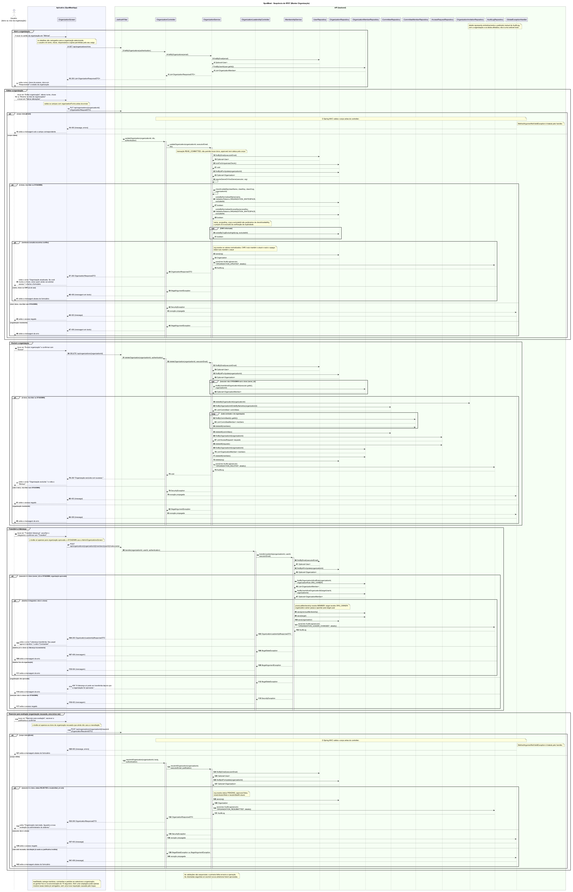

Fonte: próprio autor

#### RF08 – Gerenciar Organizações

| Campo | Descrição |
|---|---|
| Função | **Pesquisa:** lista todas as organizações cadastradas.  **Pesquisa de pendentes:** lista as organizações que aguardam aprovação.  **Aprovação:** autoriza uma organização.  **Recusa:** recusa o cadastro de uma organização, com motivo.  **Alteração de status:** bloqueia, com motivo, ou reativa uma organização. |
| Descrição | **Pesquisa:** consulta a tabela organizations, com o dono carregado na mesma consulta, e devolve, para cada organização, o identificador, o nome, a chave, o dono, o e-mail do dono mascarado, o CNPJ mascarado, approved, status, o motivo de moderação, a justificativa e a data do reenvio (resubmission_note e resubmitted_at), quando o dono pediu a reavaliação (RF07), a data de criação e as quantidades de integrantes (organization_members) e de comissões (committees). A máscara do e-mail mantém os dois primeiros caracteres, o último caractere antes do "@" e o domínio; a do CNPJ mantém os dois primeiros dígitos e os quatro dígitos da filial.  **Pesquisa de pendentes:** realiza a mesma consulta e devolve somente as organizações com approved igual a false e status PENDING ou nulo, o que inclui as reenviadas pelo dono depois de uma recusa.  **Aprovação:** atualiza na tabela organizations o campo approved para true, o campo status para APPROVED e apaga o motivo (moderation_reason).  **Recusa:** atualiza approved para false, status para REJECTED e grava o motivo informado em moderation_reason (coluna de 500 caracteres). Uma organização que já usou a reavaliação (resubmitted_at preenchido) e é recusada de novo não pode mais ser reenviada (RF07).  **Alteração de status:** com approved igual a true (reativação), atualiza approved para true, status para APPROVED e apaga o motivo; com approved igual a false (bloqueio), atualiza approved para false, status para BLOCKED e grava o motivo informado.  O serviço não confere o estado anterior: qualquer organização pode ser aprovada, recusada ou bloqueada. O aplicativo oferece "Recusar" e "Aprovar" na fila de pendentes e "Bloquear Organização" ou "Aprovar Organização" na lista geral. Enquanto approved é false (PENDING, REJECTED ou BLOCKED), o sistema recusa novas solicitações de acesso (RF03), convites de organização e criação de comissões (RF09); integrantes, comissões e demais dados já existentes são mantidos. O motivo é exibido ao dono da organização (RF07) e aos administradores. |
| Entradas | **Pesquisa e Pesquisa de pendentes:** nenhuma entrada além do token JWT, do qual é obtido o e-mail do administrador.  **Aprovação:** identificador id (Long) na rota, sem corpo.  **Recusa:** identificador id (Long) na rota e objeto do tipo OrganizationRejectionDTO contendo reason, string obrigatória (@NotBlank) de 3 a 500 caracteres (@Size), com os espaços das pontas removidos antes da validação; o serviço recusa ainda motivos com caracteres de controle, exceto tabulação e quebra de linha. No aplicativo, o campo "Motivo" da folha "Recusar organização" (obrigatório, até 500 caracteres, validado por validateModerationReason: "Informe um motivo de 3 a 500 caracteres, sem caracteres de controle.").  **Alteração de status:** identificador id (Long) na rota e objeto do tipo UpdateOrganizationStatusDTO contendo approved, valor lógico obrigatório (@NotNull), e justification, string opcional que, quando approved é false, passa a ser obrigatória e segue as mesmas regras do motivo da Recusa (3 a 500 caracteres, sem caracteres de controle, espaços das pontas removidos); quando approved é true, é ignorada. No aplicativo, o campo "Motivo" da folha "Bloquear organização". |
| Origem | Administrador do sistema (perfil global ADMIN ou SYSADMIN, sem diferença de permissão neste requisito). |
| Saída | **Pesquisa e Pesquisa de pendentes:** resposta HTTP 200 com a lista de objetos do tipo AdminOrganizationDTO (id, name, accessKey, ownerId, ownerName, ownerEmailMasked, cnpjMasked, approved, status, moderationReason, resubmissionNote, resubmittedAt, createdAt, totalMembers e totalCommittees). Erros: HTTP 403 sem corpo, gerado pelo SecurityConfig, para quem não tem o perfil ADMIN ou SYSADMIN; HTTP 403 com a mensagem ("Acesso negado. Ação restrita a Administradores."), gerado pelo AdminController quando o serviço lança SecurityException; HTTP 500 com "Erro ao listar organizações: " ou "Erro ao listar pendências: " seguido do detalhe, gerado pelo AdminController.  **Aprovação:** resposta HTTP 200 com o AdminOrganizationDTO atualizado. Erros, gerados pelo AdminController: HTTP 403; HTTP 404 com "Organização não encontrada para o ID: " seguido do identificador; HTTP 500 com "Erro ao aprovar organização: " seguido do detalhe.  **Recusa:** resposta HTTP 200 com o AdminOrganizationDTO atualizado. Erros: HTTP 400 gerado pelo GlobalExceptionHandler (MethodArgumentNotValidException, com errors.reason: "Informe o motivo da recusa." ou "O motivo deve ter de 3 a 500 caracteres."); HTTP 400 com {"message": "Dados da moderação inválidos."}, gerado pelo método invalidModerationBody do AdminController, quando o corpo está ausente ou ilegível; HTTP 400 com {"message": "Informe um motivo de 3 a 500 caracteres, sem caracteres de controle."}, gerado pelo AdminController a partir de InvalidModerationReasonException; HTTP 403; HTTP 404; HTTP 500 com "Erro ao rejeitar organização: " seguido do detalhe.  **Alteração de status:** resposta HTTP 200 com o AdminOrganizationDTO atualizado. Erros: HTTP 400 gerado pelo GlobalExceptionHandler quando approved está ausente ("O campo aprovada é obrigatório (true para aprovar, false para bloquear)."); HTTP 400 com a mensagem de "Dados da moderação inválidos." (corpo ilegível) ou do motivo inválido no bloqueio, gerados pelo AdminController; HTTP 403; HTTP 404; HTTP 500 com "Erro ao atualizar status: " seguido do detalhe.  Em todas as operações, HTTP 401 sem corpo (SecurityConfig) quando o token está ausente, expirado ou revogado. |
| Destino | Administrador do sistema, por meio da tela AdminOrganizationsScreen; banco de dados (tabelas organizations e audit_logs). |
| Ação | **Pesquisa e Pesquisa de pendentes:** o administrador seleciona a aba "Aprovações" (fila de pendentes, com o subtítulo "{n} organizações pendentes") ou a aba "Organizações" (todas, com o subtítulo "Busca global e situação das organizações") da barra inferior do aplicativo; as duas abrem a tela AdminOrganizationsScreen, com o parâmetro initialTab igual a pending ou all. Ao receber o foco, a cada 15 segundos enquanto a tela está em foco, visível e sem janela ou operação em andamento, e ao receber eventos de atualização (ADMIN_ORGS_MUTATED, ORGANIZATIONS_MUTATED, MEMBERS_MUTATED e VISIBILITY_RESTORED), a tela envia em paralelo as requisições GET /api/admin/organizations e GET /api/admin/organizations/pending; o botão "Atualizar" do cabeçalho e o gesto de puxar a lista fazem a leitura na hora. As requisições passam pelo JwtAuthFilter e pela regra hasAnyRole de SecurityConfig para /api/admin/**. Os métodos listOrganizations(authentication) e listPendingOrganizations(authentication) da classe AdminController chamam, respectivamente, os métodos listOrganizations(executorEmail) e listPendingOrganizations(executorEmail) da classe AdminService, que conferem o perfil do executor em validateSysAdmin (findByEmail de UserRepository; aceita ADMIN e SYSADMIN), obtêm as organizações por findAllWithOwner (OrganizationRepository) e convertem cada uma em toDTO, que conta os integrantes (findByOrganizationId de OrganizationMemberRepository) e as comissões (findByOrganizationIdOrderByNameAsc de CommitteeRepository) e mascara o e-mail do dono e o CNPJ (maskEmail e maskCnpj de LgpdMaskUtil). A tela valida a resposta (parseOrganizations). A aba "Organizações" exibe, por organização, o nome, a chave, o selo de estado e "{n} membros, {m} comissões", com o campo "Buscar organização" ("Buscar por nome, #chave ou responsável...") e os filtros locais "Todas", "Aprovadas", "Pendentes", "Recusadas" e "Bloqueadas"; a aba "Aprovações" exibe "Criada em", "Responsável", o CNPJ mascarado e, para as reenviadas, "Reenvio após recusa. Veja a justificativa nos detalhes.". Tocar em uma organização abre a janela "Detalhes da organização", com Responsável, E-mail (mascarado), CNPJ (mascarado), Membros, Comissões, a data de criação e, se houver, "Reenviada para avaliação em {data}." (seguido de "É a única reavaliação: uma nova recusa é definitiva." enquanto pendente), "Justificativa do dono:" e "Motivo da recusa anterior:" (pendente) ou "Motivo:". Em caso de HTTP 403, a tela limpa a lista e exibe "Acesso negado pelo servidor. Esta área exige permissão administrativa."; se a leitura falhar de outra forma, preserva os últimos dados e exibe "Não foi possível atualizar as organizações. Os últimos dados recebidos foram preservados.".  **Aprovação:** na aba "Aprovações", o administrador toca no botão "Aprovar" da organização e confirma, na janela "Aprovar organização" ("Aprovar {nome}? A organização poderá receber integrantes e criar comissões."), com o botão "Aprovar". O aplicativo envia a requisição POST /api/admin/organizations/{id}/approve, e o método approveOrganization(id, authentication) da classe AdminController chama o método approveOrganization(orgId, executorEmail) da classe AdminService, em transação, que executa validateSysAdmin, carrega a organização com bloqueio por findByIdForUpdate, grava approved igual a true, status APPROVED e motivo nulo por save, registra a auditoria e devolve toDTO. A tela confere se a resposta traz o identificador e approved, retira a organização da fila, exibe o aviso "Sucesso" com o texto "Estado de {nome} atualizado." e recarrega as listas. Na aba "Organizações", para as organizações com approved igual a false, o botão é "Aprovar Organização", que confirma da mesma forma e usa a Alteração de status com approved igual a true (reativação de organização recusada ou bloqueada, ou aprovação de uma pendente).  **Recusa:** na aba "Aprovações", o administrador toca no botão "Recusar". A folha "Recusar organização" exibe o nome, o aviso "O motivo será apresentado ao responsável pela organização e aos administradores.", o campo "Motivo" ("Explique o motivo") e "De 3 a 500 caracteres.". Ao tocar em "Confirmar recusa", o aplicativo valida o motivo (validateModerationReason) e a janela "Recusar organização" ("Recusar {nome}? Novos pedidos e criação de comissões ficarão indisponíveis.") pede a confirmação com o botão "Recusar". O aplicativo envia a requisição POST /api/admin/organizations/{id}/reject com o campo reason, e o método rejectOrganization(id, body, authentication) da classe AdminController chama o método rejectOrganization(orgId, reason, executorEmail) da classe AdminService, em transação, que executa validateSysAdmin, carrega a organização com bloqueio por findByIdForUpdate, valida o motivo em validateModerationReason, grava approved igual a false, status REJECTED e o motivo por save, registra a auditoria e devolve toDTO. A tela retira a organização da fila e exibe o aviso "Sucesso" com o texto "Estado de {nome} atualizado.".  **Alteração de status:** na aba "Organizações", para uma organização aprovada o administrador toca em "Bloquear Organização"; a folha "Bloquear organização" (campo "Motivo" e botão "Confirmar bloqueio") e a janela "Bloquear organização" ("Bloquear {nome}? Novos pedidos e criação de comissões ficarão indisponíveis.", botão "Bloquear") seguem o fluxo da Recusa. Para as demais organizações toca em "Aprovar Organização" e confirma com "Aprovar". O aplicativo envia a requisição PATCH /api/admin/organizations/{id}/status com approved igual a false e justification (bloqueio) ou apenas approved igual a true (reativação), e o método updateOrganizationStatus(id, dto, authentication) da classe AdminController chama o método updateOrganizationStatus(orgId, approved, justification, executorEmail) da classe AdminService, em transação, que executa validateSysAdmin, carrega a organização com bloqueio por findByIdForUpdate, valida o motivo quando approved é false, grava approved, status e motivo por save, registra a auditoria e devolve toDTO. Em caso de erro, a mensagem recebida aparece na própria tela; HTTP 403 limpa as listas. |
| Pré-condição | O usuário deve estar autenticado com perfil global ADMIN ou SYSADMIN (token JWT válido; o SecurityConfig, o @PreAuthorize do AdminController e validateSysAdmin exigem o perfil). ADMIN e SYSADMIN têm as mesmas permissões neste requisito.  **Aprovação:** a organização deve existir; o aplicativo oferece o botão quando approved é false (na fila, status PENDING).  **Recusa:** a organização deve existir; o aplicativo oferece o botão na fila de pendentes; o motivo deve ter de 3 a 500 caracteres, sem caracteres de controle.  **Alteração de status:** a organização deve existir; o aplicativo oferece "Bloquear Organização" quando approved é true e "Aprovar Organização" quando é false; para bloquear, o motivo deve ter de 3 a 500 caracteres, sem caracteres de controle. |
| Pós-condição | **Pesquisa e Pesquisa de pendentes:** a tela exibe a lista de organizações (ou a fila de pendentes) ou, em caso de acesso negado (403), avisa que é necessária permissão administrativa. Nada é alterado.  **Aprovação, Recusa e Alteração de status:** em caso de sucesso, a organização está gravada com o novo estado (APPROVED sem motivo, REJECTED com motivo ou BLOCKED com motivo), o dono a vê com o novo selo e, quando for o caso, com o motivo, e a organização aprovada volta a aceitar solicitações de acesso, convites e comissões, enquanto a recusada ou bloqueada passa a recusá-los; em caso de erro (dados inválidos, acesso negado, organização inexistente ou erro interno), nada é alterado e a tela exibe a mensagem. |
| Efeitos colaterais | **Pesquisa e Pesquisa de pendentes:** nenhum registro de auditoria é gravado (as ações ADMIN_ORGANIZATIONS_LISTED e ADMIN_PENDING_ORGANIZATIONS_LISTED não existem mais no servidor e restam apenas como rótulos do aplicativo).  **Aprovação:** registro em audit_logs com a ação ADMIN_ORGANIZATION_APPROVED, contendo o identificador e o nome da organização. O motivo anterior é apagado. E-mail ao dono com o assunto "SpotMeet - Organização aprovada: {organização}", enviado após o commit.  **Recusa:** registro em audit_logs com a ação ADMIN_ORGANIZATION_REJECTED, contendo o identificador, o nome e a quantidade de caracteres do motivo (o texto do motivo não é copiado para a auditoria). E-mail ao dono com o assunto "SpotMeet - Organização não aprovada: {organização}", com o motivo e a orientação de corrigir e reenviar pelo aplicativo, enviado após o commit.  **Alteração de status:** registro em audit_logs com a ação ADMIN_ORGANIZATION_STATUS_CHANGED, contendo o identificador, o nome, o novo estado (APPROVED ou BLOCKED) e, no bloqueio, a quantidade de caracteres do motivo.  Em todas as escritas, uma falha na gravação da auditoria é capturada e não impede a resposta. A organização é carregada com bloqueio de linha durante a transação. A tela atualiza as outras telas do mesmo aparelho pelo syncBus (ADMIN_ORGS_MUTATED, ORGANIZATIONS_MUTATED e MEMBERS_MUTATED); os demais aparelhos recebem a mudança na próxima leitura periódica (15 segundos). **Alteração de status:** no bloqueio, e-mail ao dono com o assunto "SpotMeet - Organização bloqueada: {organização}", com o motivo e o que deixa de funcionar; na reativação de uma organização bloqueada, "SpotMeet - Organização reativada: {organização}"; ao aprovar por esta rota uma organização que não estava aprovada, o mesmo e-mail da aprovação; enviados após o commit. Nenhuma ação envia notificação no celular.  **Incremento 2:** com a organização não aprovada ou bloqueada, o presidente não consegue agendar novas reuniões (RF25). |

**Figura 21 – Diagrama de sequência do RF08**

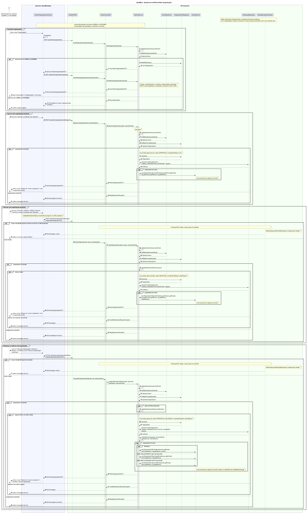

Fonte: próprio autor

#### RF09 – Cadastrar Comissão

| Campo | Descrição |
|---|---|
| Função | Cadastra uma nova comissão (grupo de trabalho) em uma organização aprovada. |
| Descrição | Insere na tabela committees do banco de dados uma comissão vinculada à organização, contendo o nome e a descrição informados por um líder da organização (dono, vice-líder ou subdono). O nome é normalizado antes da validação (sequências de espaços, tabulações e quebras de linha viram um único espaço e as pontas são removidas) e é único dentro da organização sem diferenciar maiúsculas e minúsculas: "RH" e "rh" são o mesmo nome. A regra é verificada pelo serviço (existsByNormalizedName) sob o bloqueio de escrita da linha da organização (findByIdForUpdate), que serializa criações e edições simultâneas, e é complementada no banco pela restrição uq_committee_org_name (colunas organization_id e name, comparação exata). Outra organização pode ter uma comissão com o mesmo nome. A comissão nasce sem integrantes. Só organizações aprovadas (approved = true) recebem comissões novas: uma organização pendente, rejeitada ou bloqueada recusa o cadastro. |
| Entradas | Identificador da organização (organizationId, do tipo Long), informado na rota, e objeto do tipo CommitteeRequestDTO contendo: name, string obrigatória, normalizada pelo DTO antes da validação, de 2 a 50 caracteres formados por letras (inclusive acentuadas), números, espaço, "_" ou "-" (expressão regular `^[\p{L}\p{M}0-9 _-]{2,50}$`); e description, string opcional de, no máximo, 500 caracteres (o serviço remove os espaços das pontas). O líder é identificado pelo e-mail do token JWT, fornecido pelo AuthContext. No aplicativo: o campo "Nome da comissão" é obrigatório e validateCommitteeName aplica as mesmas regras, com a mensagem "Use de 2 a 50 caracteres: letras, números, espaços, '_' ou '-'."; o campo "Descrição (opcional)" aceita até 500 caracteres ("Use até 500 caracteres."); a descrição vazia é enviada como null. |
| Origem | Usuário (líder da organização). |
| Saída | Resposta HTTP 201 com objeto do tipo CommitteeResponseDTO contendo id, name, description, organizationId, organizationName, totalActiveMembers (0), totalPending (0) e createdAt. Em caso de erro: HTTP 400, gerado pelo GlobalExceptionHandler quando o CommitteeRequestDTO não passa na Bean Validation (corpo com status, error, message e errors por campo); HTTP 403, quando o método requireOrganizationLeader lança SecurityException para quem não é líder da organização; HTTP 409, quando o serviço lança IllegalArgumentException ou IllegalStateException (organização não encontrada, nome já existente na organização, organização ainda não aprovada ou bloqueada); HTTP 401 sem corpo, gerado pelo SecurityConfig, quando o token está ausente, expirado ou revogado. |
| Destino | Banco de dados (tabelas committees e audit_logs) e usuário, por meio da folha "Nova comissão" da tela OrganizationScreen, que exibe o aviso e recarrega a lista de comissões. |
| Ação | Na tela OrganizationScreen, o líder abre a organização na aba "Minhas" (o dono, o vice-líder e o subdono entram na aba "Gerenciar"), toca no atalho "Comissões" e, na página "Comissões", no botão "Nova comissão". Se a organização não está aprovada, o aplicativo exibe o aviso "Organização não aprovada" já no atalho "Comissões" (e também em "Nova comissão"), sem abrir a página nem a folha: "Sua organização ainda não foi aprovada pelo administrador do sistema. Membros, convites e comissões ficam disponíveis depois da aprovação." ou, se recusada ou bloqueada, "Esta organização foi recusada ou bloqueada pelo administrador do sistema. Membros, convites e comissões não estão disponíveis."; a API continua recusando com HTTP 409. Estando aprovada, o aplicativo abre a folha "Nova comissão" com os campos "Nome da comissão" e "Descrição (opcional)" e a dica "Nome único nesta organização. Letras, espaços, números, '_' e '-'.". Ao tocar em "Criar comissão", o aplicativo valida o formulário (validateCommitteeName e o limite da descrição) e, em caso positivo, o método mutate envia a requisição POST /api/organizations/{organizationId}/committees com name e description. A requisição passa pelo JwtAuthFilter, que valida o token e carrega a conta. O Spring valida o CommitteeRequestDTO e o método createCommittee da classe CommitteeController chama o método createCommittee(organizationId, leaderEmail, dto) da classe CommitteeService, em uma transação READ_COMMITTED. O serviço carrega o usuário (findByEmail de UserRepository), bloqueia a linha da organização (findByIdForUpdate de OrganizationRepository) e confere, por requireOrganizationLeader, se o usuário é SYSADMIN, dono da organização ou integrante com papel ORG_OWNER, ORG_VICE_OWNER ou ORG_SUBOWNER (findById de OrganizationRepository e findByUserIdAndOrganizationId de OrganizationMemberRepository). Em seguida normaliza e valida o nome (validateName), consulta existsByNormalizedName de CommitteeRepository, verifica isApproved() da organização e, estando tudo correto, grava a comissão (save de CommitteeRepository), registra a auditoria (save de AuditLogRepository) e devolve o CommitteeResponseDTO. A primeira regra violada interrompe o fluxo, na ordem: líder, nome válido, nome livre, organização aprovada. Com a resposta 201, o aplicativo fecha a folha, exibe o aviso "Sucesso" com o texto "Comissão criada.", emite os eventos de sincronização e recarrega a lista. Nos erros, a folha continua aberta e a mensagem aparece acima dos botões (ou abaixo do campo, quando o HTTP 400 indica o campo). |
| Pré-condição | O usuário deve estar autenticado (RF02) e ser dono da organização (organizations.owner_id), ou ter papel ORG_OWNER, ORG_VICE_OWNER ou ORG_SUBOWNER na organização (organization_members), ou ter o perfil global SYSADMIN (apenas pela API, pois o aplicativo do administrador não tem telas de comissão). A organização deve existir e estar aprovada (approved = true, status APPROVED). Não pode existir outra comissão da mesma organização com o mesmo nome, sem diferenciar maiúsculas, minúsculas e espaços extras. |
| Pós-condição | Sucesso: existe uma nova linha em committees com a organização, o nome normalizado, a descrição e created_at, sem vínculos em committee_members; o registro COMMITTEE_CREATED está em audit_logs; a comissão consta da lista da organização com "0 ativos" e "0 pendentes" e o aplicativo exibe "Comissão criada.". Falha: nada é gravado em committees nem em audit_logs, a folha permanece aberta e o aplicativo exibe a mensagem recebida: HTTP 400 por campo; HTTP 403 ("Acesso negado. Apenas líderes (dono, vice-líder ou subdono) da organização podem realizar esta operação."); HTTP 409 ("Já existe uma comissão com esse nome nesta organização." ou "Esta organização ainda não foi aprovada pelo administrador do sistema ou está bloqueada."); ou "Não foi possível conectar ao servidor. Tente novamente." quando não há resposta. |
| Efeitos colaterais | Registro em audit_logs com a ação COMMITTEE_CREATED, contendo o nome da comissão, o nome da organização e o identificador gerado. Eventos de sincronização ORGANIZATIONS_MUTATED, COMMITTEES_MUTATED e ADMIN_ORGS_MUTATED (syncBus), que atualizam as outras telas abertas no mesmo aparelho; os demais aparelhos recebem a mudança na atualização automática a cada 15 segundos (useLiveSync). Nenhum e-mail é enviado. |

**Figura 22 – Diagrama de sequência do RF09**

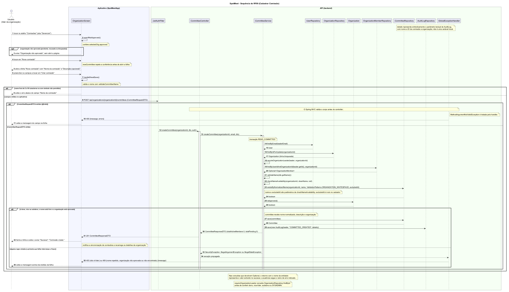

Fonte: próprio autor

#### RF10 – Manter Comissão

| Campo | Descrição |
|---|---|
| Função | **Pesquisa:** Lista as comissões de uma organização.  **Atualização:** Altera o nome e a descrição de uma comissão.  **Exclusão:** Remove uma comissão e todos os seus vínculos. |
| Descrição | **Pesquisa:** Consulta na tabela committees as comissões da organização, em ordem alfabética de nome, e conta na tabela committee_members, para cada uma, os vínculos ACTIVE (integrantes ativos) e os pendentes (PENDING_USER_ACCEPTANCE mais PENDING_LEADER_APPROVAL).  **Atualização:** Atualiza na tabela committees o nome e a descrição da comissão, mantendo a organização à qual ela pertence. Valem a normalização e a unicidade do RF09, ignorando a própria comissão na checagem de duplicidade, sob o mesmo bloqueio de escrita da linha da organização. A edição não verifica se a organização está aprovada.  **Exclusão:** Remove da tabela committee_members todos os vínculos da comissão, em qualquer situação (ativo, convite pendente, solicitação pendente ou recusado), e em seguida remove a comissão da tabela committees, na mesma transação. |
| Entradas | **Pesquisa:** Identificador da organização (organizationId, do tipo Long), informado na rota.  **Atualização:** Identificador da comissão (committeeId, do tipo Long), informado na rota, e objeto do tipo CommitteeRequestDTO com name (obrigatório, normalizado, de 2 a 50 caracteres formados por letras, inclusive acentuadas, números, espaço, "_" ou "-") e description (opcional, até 500 caracteres), com as mesmas regras do RF09. No aplicativo, a folha "Editar comissão" traz os campos "Nome da comissão" e "Descrição (opcional)" preenchidos com os dados atuais.  **Exclusão:** Identificador da comissão (committeeId, do tipo Long), informado na rota, e a confirmação do usuário no diálogo do aplicativo. |
| Origem | **Pesquisa:** Usuário (integrante da organização).  **Atualização:** Usuário (líder da organização).  **Exclusão:** Usuário (líder da organização; o aplicativo oferece a exclusão ao dono e ao vice-líder). |
| Saída | **Pesquisa:** HTTP 200 com lista de objetos do tipo CommitteeResponseDTO (id, name, description, organizationId, organizationName, totalActiveMembers, totalPending e createdAt), vazia quando não há comissões. Em caso de erro: HTTP 403, lançado como SecurityException pelo serviço para quem não pertence à organização ("Acesso negado. Você não é membro desta organização."), e HTTP 401 do SecurityConfig para token ausente, expirado ou revogado.  **Atualização:** HTTP 200 com o CommitteeResponseDTO atualizado, com os contadores reais. Em caso de erro: HTTP 400 do GlobalExceptionHandler para CommitteeRequestDTO inválido; HTTP 403 para quem não é líder; HTTP 409 para comissão ou organização não encontrada e nome já usado por outra comissão; HTTP 401 como na pesquisa.  **Exclusão:** HTTP 200 com o texto "Comissão excluída com sucesso." no corpo. Em caso de erro: HTTP 403 para quem não é líder; HTTP 409 para comissão não encontrada; HTTP 401 como na pesquisa. |
| Destino | **Pesquisa:** Usuário, por meio da página "Comissões" da tela OrganizationScreen.  **Atualização:** Banco de dados (tabelas committees e audit_logs) e usuário, por meio da tela OrganizationScreen.  **Exclusão:** Banco de dados (tabelas committee_members, committees e audit_logs) e usuário, por meio da tela OrganizationScreen. |
| Ação | **Pesquisa:** Ao abrir uma organização na aba "Minhas" (o líder cai na aba "Gerenciar" e toca em "Comissões"; o membro comum cai direto na lista "Comissões"), a tela executa loadDetails, que lê em paralelo, entre outras rotas dos RF05, RF12 e RF13, a requisição GET /api/organizations/{organizationId}/committees. A leitura se repete ao receber o foco, a cada 15 segundos (useLiveSync, pausada durante edição, folhas abertas e gravações), no botão "Atualizar organizações" e no gesto de puxar a lista. O método listCommittees da classe CommitteeController chama o método listCommittees(organizationId, userEmail) da classe CommitteeService, que carrega o usuário (findByEmail de UserRepository), verifica por existsByUserIdAndOrganizationId de OrganizationMemberRepository se ele pertence à organização (o SYSADMIN dispensa a verificação), obtém as comissões por findByOrganizationIdOrderByNameAsc de CommitteeRepository e conta os vínculos de cada uma por countByCommitteeIdAndStatus de CommitteeMemberRepository. Cada cartão exibe o nome, a descrição, "Presidente: nome" ou "Sem presidente definido", a ação "Presidente" para os líderes e as etiquetas "N ativos" e "N pendentes" e, para o próprio usuário, "Você participa" (vínculo ACTIVE) ou "Seu pedido está pendente" (vínculo PENDING_LEADER_APPROVAL), conforme os vínculos lidos no RF13. Para o dono, o vice-líder e o subdono, o cartão traz também o botão "Convidar integrantes" (RF11). Sem comissões, a página exibe "Nenhuma comissão cadastrada nesta organização.". Se a leitura devolver 403 ou 404, o aplicativo descarta a organização selecionada e volta para "Minhas"; nas demais falhas, exibe "Não foi possível atualizar os dados da organização. Tente novamente." e mantém os dados anteriores.  **Atualização:** O líder toca no botão "Editar <nome da comissão>" do cartão da comissão. O aplicativo abre a folha "Editar comissão" com os dados atuais. Ao tocar em "Salvar alterações", valida o formulário e envia a requisição PUT /api/committees/{committeeId} com name e description. O método updateCommittee da classe CommitteeController chama o método updateCommittee(committeeId, leaderEmail, dto) da classe CommitteeService, que, em transação READ_COMMITTED, localiza a comissão (findById de CommitteeRepository), carrega o usuário, bloqueia a linha da organização da comissão (findByIdForUpdate), confere o líder por requireOrganizationLeader, valida o nome, verifica por existsByNormalizedName se outra comissão da organização já o usa (passando o identificador da própria comissão), grava as alterações (save), registra a auditoria e recalcula os contadores (countByCommitteeIdAndStatus). Com a resposta 200, o aplicativo fecha a folha, exibe o aviso "Sucesso" com "Comissão atualizada." e recarrega a lista.  **Exclusão:** O líder toca no botão "Excluir <nome da comissão>", exibido pelo aplicativo ao dono e ao vice-líder (a API aceita também o subdono e o SYSADMIN). O ConfirmationHost abre o diálogo "Excluir comissão" ("Excluir <nome> e todos os seus vínculos?") com os botões "Cancelar" e "Excluir". Ao tocar em "Excluir", o aplicativo envia a requisição DELETE /api/committees/{committeeId}. O método deleteCommittee da classe CommitteeController chama o método deleteCommittee(committeeId, leaderEmail) da classe CommitteeService, que localiza a comissão, carrega o usuário, confere o líder por requireOrganizationLeader, obtém os vínculos por findByCommitteeId de CommitteeMemberRepository, remove-os por deleteAll, remove a comissão por delete de CommitteeRepository e registra a auditoria, tudo na mesma transação. Com a resposta 200, o aplicativo exibe o aviso "Sucesso" com "Comissão excluída." e recarrega a lista. |
| Pré-condição | **Pesquisa:** O usuário deve estar autenticado e ser integrante da organização (organization_members), ou ter o perfil global SYSADMIN (apenas pela API).  **Atualização:** O usuário deve estar autenticado e ser dono da organização, ou ter papel ORG_OWNER, ORG_VICE_OWNER ou ORG_SUBOWNER nela, ou ser SYSADMIN (pela API). A comissão deve existir e o novo nome não pode pertencer a outra comissão da mesma organização.  **Exclusão:** O usuário deve estar autenticado e ser dono da organização, ou ter papel ORG_OWNER, ORG_VICE_OWNER ou ORG_SUBOWNER nela, ou ser SYSADMIN (pela API). A comissão deve existir e o usuário deve confirmar no diálogo "Excluir comissão". |
| Pós-condição | **Pesquisa:** Sucesso: o aplicativo exibe a lista de comissões da organização com os contadores, ou o texto "Nenhuma comissão cadastrada nesta organização."; nada é alterado. Falha: nada é alterado; com 403 ou 404 o aplicativo volta à aba "Minhas".  **Atualização:** Sucesso: a linha da comissão em committees tem o novo nome e a nova descrição, e os vínculos e a organização permanecem; o registro COMMITTEE_UPDATED está em audit_logs e o aplicativo exibe "Comissão atualizada.". Falha: nada é alterado e o aplicativo exibe a mensagem recebida: HTTP 400 por campo; HTTP 403 (usuário sem permissão); HTTP 409 ("Comissão não encontrada." ou "Já existe uma comissão com esse nome nesta organização.").  **Exclusão:** Sucesso: a comissão e todos os seus vínculos, inclusive convites e solicitações pendentes, deixam de existir; o registro COMMITTEE_DELETED está em audit_logs e a comissão some da lista, com o aviso "Comissão excluída.". Falha: nada é removido e o aplicativo exibe a mensagem recebida (HTTP 403 ou HTTP 409 "Comissão não encontrada."). Se o usuário toca em "Cancelar" no diálogo, nenhuma requisição é enviada. |
| Efeitos colaterais | **Pesquisa:** Nenhum.  **Atualização:** Registro em audit_logs com a ação COMMITTEE_UPDATED, contendo o identificador da comissão, o nome anterior, o novo nome e o nome da organização. Eventos de sincronização ORGANIZATIONS_MUTATED, COMMITTEES_MUTATED e ADMIN_ORGS_MUTATED (syncBus).  **Exclusão:** Remoção de todos os vínculos da comissão em committee_members e registro em audit_logs com a ação COMMITTEE_DELETED, contendo o identificador, o nome da comissão e o nome da organização. Eventos de sincronização como na atualização. As comissões e os vínculos também são removidos quando a organização é excluída (RF07), e os vínculos de um integrante, quando ele é removido da organização (RF05), nesses casos sem registro COMMITTEE_*.  **Incremento 2:** ao excluir a comissão, o banco exclui também as reuniões e os participantes dela (exclusão em cascata de `meetings` e `meeting_participants`). **Incremento 3:** pela mesma cascata, são excluídas as atas, as respostas, as votações e os votos dessas reuniões. |

**Figura 23 – Diagrama de sequência do RF10**

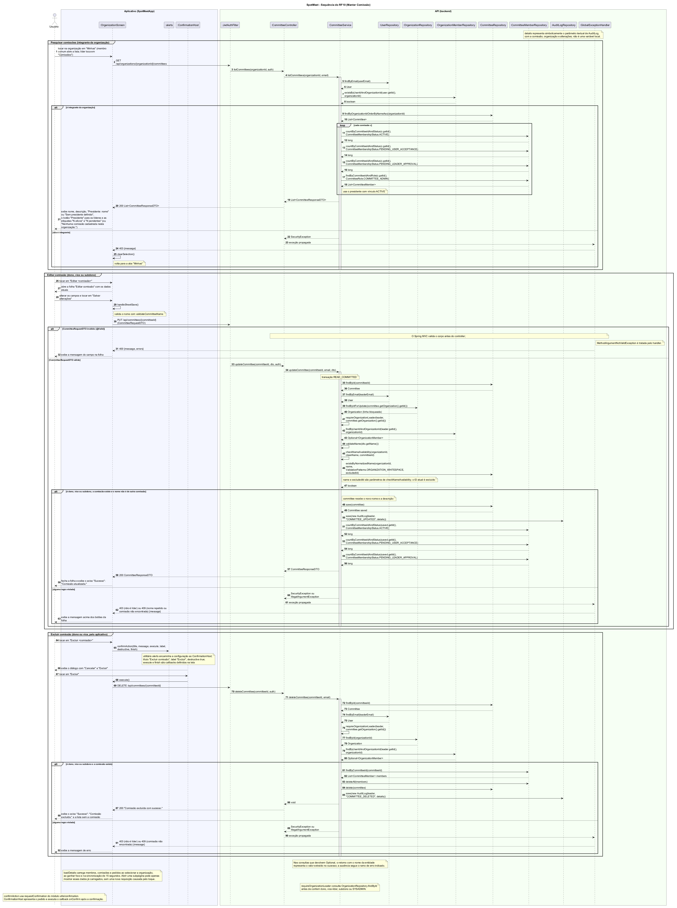

Fonte: próprio autor

#### RF11 – Convidar Membro para Comissão

| Campo | Descrição |
|---|---|
| Função | **Candidatos:** Lista os integrantes da organização que ainda podem ser convidados para a comissão.  **Convite:** Vincula um integrante da organização a uma comissão por iniciativa de um líder da organização.  **Consulta de convites:** Lista os convites de comissão pendentes do usuário autenticado.  **Resposta ao convite:** Registra o aceite ou a recusa do convite pelo integrante convidado. |
| Descrição | **Candidatos:** Consulta na tabela organization_members os integrantes da organização da comissão e, na tabela committee_members, os vínculos da comissão. Devolve, em ordem alfabética de nome, os integrantes sem vínculo ou com vínculo DECLINED; quem já participa, foi convidado ou pediu para entrar não aparece. Nada é gravado.  **Convite:** Insere na tabela committee_members um vínculo do integrante com a comissão, com status PENDING_USER_ACCEPTANCE, papel MEMBER e o líder que convidou em invited_by_id (a restrição uq_committee_member permite um vínculo por usuário e comissão). Quando já existe vínculo DECLINED, ele é reaberto como PENDING_USER_ACCEPTANCE, com novo invited_by_id e responded_at limpo. Quando já existe vínculo PENDING_LEADER_APPROVAL (o integrante havia solicitado entrada), o vínculo passa direto para ACTIVE, com responded_at preenchido. Vínculo ACTIVE ou convite já pendente são recusados. O convidado precisa ser integrante da organização. O convite de comissão não tem prazo de expiração (diferente do convite de organização, de 24 horas).  **Consulta de convites:** Consulta na tabela committee_members os vínculos do usuário autenticado com status PENDING_USER_ACCEPTANCE, de qualquer organização.  **Resposta ao convite:** Atualiza na tabela committee_members o status do vínculo para ACTIVE, em caso de aceite, ou para DECLINED, em caso de recusa, registrando a data da resposta (responded_at). |
| Entradas | **Candidatos:** Identificador da comissão (committeeId, do tipo Long), informado na rota GET /api/committees/{committeeId}/invitations/candidates. O líder é identificado pelo e-mail do token JWT. A busca por nome ou e-mail (campo "Buscar integrante") é feita no aplicativo, sobre a lista recebida.  **Convite:** Identificador da comissão (committeeId, do tipo Long) e identificador do integrante convidado (userId, do tipo Long), informados na rota. O líder é identificado pelo e-mail do token JWT.  **Consulta de convites:** Nenhuma, além do token de autenticação do usuário.  **Resposta ao convite:** Identificador da comissão (committeeId, do tipo Long), informado na rota, e parâmetro accept, do tipo boolean e obrigatório (true para aceitar, false para recusar). |
| Origem | **Candidatos:** Usuário (líder da organização).  **Convite:** Usuário (líder da organização).  **Consulta de convites:** Usuário (integrante convidado).  **Resposta ao convite:** Usuário (integrante convidado). |
| Saída | **Candidatos:** HTTP 200 com lista de objetos do tipo InviteCandidateDTO (userId, name e email), vazia quando todos os integrantes já têm vínculo. Em caso de erro: HTTP 403, quando requireOrganizationLeader lança SecurityException; HTTP 409, quando a comissão não existe ("Comissão não encontrada."); HTTP 401 do SecurityConfig para token ausente, expirado ou revogado.  **Convite:** HTTP 201 com objeto do tipo CommitteeMemberResponseDTO (id, userId, userName, userEmail, committeeId, committeeName, organizationId, status, role, requestedAt, respondedAt e invitedByName). Em caso de erro: HTTP 403, quando requireOrganizationLeader lança SecurityException; HTTP 409, quando o serviço lança IllegalArgumentException ou IllegalStateException ("Comissão não encontrada.", "Usuário não encontrado.", convidado que não pertence à organização, "O usuário já é integrante ativo desta comissão." ou "Já existe um convite pendente aguardando aceite deste usuário."); HTTP 401 do SecurityConfig para token ausente, expirado ou revogado.  **Consulta de convites:** HTTP 200 com lista de objetos do tipo CommitteeMemberResponseDTO, vazia quando não há convites; HTTP 401 como no convite.  **Resposta ao convite:** HTTP 200 com o CommitteeMemberResponseDTO com a nova situação. Em caso de erro: HTTP 400, gerado pelo GlobalExceptionHandler quando accept está ausente ou não é booleano ("Parâmetro ausente ou inválido."); HTTP 409, quando o serviço lança IllegalArgumentException ("Nenhum convite encontrado para esta comissão.") ou IllegalStateException ("Apenas convites pendentes podem ser respondidos."); HTTP 401 como no convite. |
| Destino | **Candidatos:** Usuário, por meio da janela "Convidar para <comissão>" da tela OrganizationScreen.  **Convite:** Banco de dados (tabelas committee_members e audit_logs) e usuário, por meio da janela "Convidar para <comissão>" da tela OrganizationScreen.  **Consulta de convites:** Usuário, por meio da tela OrganizationScreen.  **Resposta ao convite:** Banco de dados (tabelas committee_members e audit_logs) e usuário, por meio da tela OrganizationScreen. |
| Ação | **Candidatos:** Na aba "Gerenciar", o líder toca no atalho "Comissões" e, no cartão da comissão, em "Convidar integrantes". O aplicativo abre a janela "Convidar para <comissão>" ("Integrantes da organização que ainda não participam da comissão. Quem já foi convidado ou pediu para entrar não aparece aqui; os pedidos ficam em Solicitações."), com o campo "Buscar integrante", e envia a requisição GET /api/committees/{committeeId}/invitations/candidates. O método listInviteCandidates da classe CommitteeController chama o método listInviteCandidates(committeeId, leaderEmail) da classe CommitteeService, que localiza a comissão (findById de CommitteeRepository), carrega o líder (findByEmail de UserRepository), confere o líder por requireOrganizationLeader, consulta os vínculos da comissão (findByCommitteeId de CommitteeMemberRepository) e os integrantes da organização (findByOrganizationId de OrganizationMemberRepository) e devolve os que não têm vínculo ou têm vínculo DECLINED. Cada pessoa aparece com a foto ou as iniciais, o nome, o e-mail e o botão "Convidar" (rótulo "Convidar <nome> para <comissão>"). Sem candidatos, a janela exibe "Todos os integrantes da organização já participam, foram convidados ou pediram para entrar."; com a busca sem resultado, "Nenhum integrante corresponde à busca.". Se a leitura falha, exibe "Não foi possível buscar os integrantes.".  **Convite:** Na janela "Convidar para <comissão>", o líder toca em "Convidar" ao lado da pessoa, e o aplicativo envia a requisição POST /api/committees/{committeeId}/members/{userId}. O método addUserToCommittee da classe CommitteeController chama o método addUserToCommittee(committeeId, targetUserId, leaderEmail) da classe CommitteeService, que localiza a comissão (findById de CommitteeRepository), carrega o líder (findByEmail de UserRepository), confere o líder por requireOrganizationLeader, localiza o convidado (findById de UserRepository), verifica por existsByUserIdAndOrganizationId de OrganizationMemberRepository se ele pertence à organização, consulta o vínculo existente (findByUserIdAndCommitteeId de CommitteeMemberRepository), cria ou altera o vínculo como descrito, grava-o (save) e registra a auditoria. Com a resposta 201, o aplicativo exibe o aviso "Sucesso" com "Convite enviado. Aguarde o aceite do integrante." (ou "Integrante aprovado após seu pedido de ingresso." quando o status devolvido é ACTIVE) e recarrega a lista, de onde a pessoa convidada sai. Como a lista não traz quem tem solicitação PENDING_LEADER_APPROVAL (os pedidos são respondidos em "Solicitações", RF12), a ativação direta só ocorre por chamada direta à API ou por corrida entre aparelhos.  **Consulta de convites:** Ao receber o foco, a cada 15 segundos (useLiveSync) e a cada atualização, a tela executa loadInvitations, que lê GET /api/committees/invitations (e GET /api/organization-invitations/mine, do RF03). O método listMyInvitations da classe CommitteeController chama o método listMyInvitations(userEmail) da classe CommitteeService, que carrega o usuário e consulta o método findByUserIdAndStatus da classe CommitteeMemberRepository. Havendo convites, a aba "Minhas" exibe o cartão "Você recebeu convites" com o botão "Ver convites (N)" (N soma convites de organização e de comissão). A página "Convites" lista, na seção "CONVITES DE COMISSÃO", o nome da comissão, "Convite de <líder>" e o nome da organização, com os botões "Recusar" e "Aceitar". O membro comum também vê esses botões no cartão da comissão convidada, na página "Comissões". Sem convites, a página exibe "Você não tem convites pendentes.".  **Resposta ao convite:** Ao tocar em "Aceitar" ou "Recusar", o aplicativo envia a requisição POST /api/committees/{committeeId}/invitations/respond?accept=true ou accept=false. O método respondInvitation da classe CommitteeController chama o método respondInvitation(committeeId, userEmail, accept) da classe CommitteeService, que carrega o usuário, localiza o vínculo (findByUserIdAndCommitteeId), exige o status PENDING_USER_ACCEPTANCE, altera o status para ACTIVE ou DECLINED com responded_at, registra a auditoria e grava o vínculo (save). Com a resposta 200, o aplicativo exibe o aviso "Sucesso" com "Você entrou na comissão." ou "Convite recusado." e recarrega as listas. |
| Pré-condição | **Candidatos:** As mesmas do convite para o líder; a comissão deve existir.  **Convite:** O usuário deve estar autenticado e ser dono da organização da comissão, ou ter papel ORG_OWNER, ORG_VICE_OWNER ou ORG_SUBOWNER nela, ou ser SYSADMIN (pela API). A comissão deve existir, o convidado deve existir e ser integrante da organização (organization_members) e não pode ter vínculo ACTIVE nem convite PENDING_USER_ACCEPTANCE com a comissão. O código não exige organização aprovada.  **Consulta de convites:** O usuário deve estar autenticado.  **Resposta ao convite:** O usuário deve estar autenticado e ter vínculo com status PENDING_USER_ACCEPTANCE com a comissão. |
| Pós-condição | **Candidatos:** Sucesso: o aplicativo exibe os integrantes que podem ser convidados; nada é alterado. Falha: nada é alterado e o aplicativo exibe a mensagem de erro.  **Convite:** Sucesso: existe, em committee_members, o vínculo do convidado com a comissão em PENDING_USER_ACCEPTANCE (criado ou reaberto) ou em ACTIVE (quando havia solicitação pendente); o registro COMMITTEE_INVITATION_SENT está em audit_logs e o convidado passa a ver o convite no aplicativo. Falha: nada é alterado e o aplicativo exibe a mensagem recebida (HTTP 403 para quem não é líder; HTTP 409 para comissão ou usuário não encontrado, convidado fora da organização, integrante já ativo ou convite já pendente).  **Consulta de convites:** Sucesso: o aplicativo exibe os convites pendentes do usuário, quando houver; nada é alterado. Falha: o aplicativo exibe "Não foi possível consultar seus convites. Tente novamente." e o botão "Atualizar convites".  **Resposta ao convite:** Sucesso: o vínculo fica ACTIVE (o usuário passa a ser integrante ativo e a contar em "N ativos") ou DECLINED, com responded_at; o registro de auditoria correspondente está em audit_logs e o convite deixa de constar na lista. Falha: nada é alterado e o aplicativo exibe a mensagem recebida (HTTP 409 quando não há convite ou ele não está pendente). |
| Efeitos colaterais | **Candidatos:** Nenhum.  **Convite:** Registro em audit_logs com a ação COMMITTEE_INVITATION_SENT, contendo o e-mail do convidado e o nome da comissão; o registro é feito com essa mesma ação também quando o vínculo é ativado diretamente. Quando o vínculo fica aguardando o aceite, e-mail ao convidado com o assunto "SpotMeet - Convite para a comissão {nome}" (organização, comissão, quem convidou e a orientação para responder em Organização), enviado após o commit; quando o vínculo é ativado diretamente, nenhum e-mail é enviado. Eventos de sincronização ORGANIZATIONS_MUTATED, COMMITTEES_MUTATED e ADMIN_ORGS_MUTATED (syncBus).  **Consulta de convites:** Nenhum.  **Resposta ao convite:** Registro em audit_logs com a ação COMMITTEE_INVITATION_ACCEPTED, em caso de aceite, ou COMMITTEE_INVITATION_DECLINED, em caso de recusa, contendo o nome da comissão e o nome da organização. Eventos de sincronização como no convite. |

**Figura 24 – Diagrama de sequência do RF11**

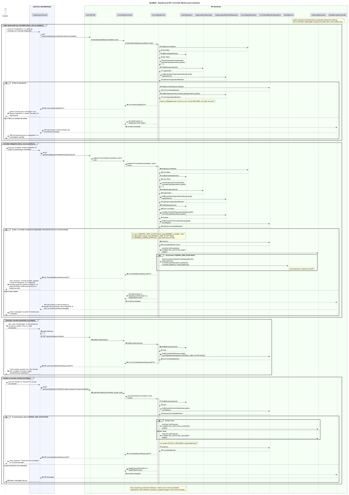

Fonte: próprio autor

#### RF12 – Solicitar Entrada em Comissão

| Campo | Descrição |
|---|---|
| Função | **Solicitação:** Registra o pedido de um integrante da organização para ingressar em uma comissão.  **Consulta de solicitações:** Lista as solicitações de entrada pendentes de aprovação.  **Resposta à solicitação:** Registra a aprovação ou a rejeição da solicitação por um líder da organização. |
| Descrição | **Solicitação:** Insere na tabela committee_members um vínculo do integrante com a comissão, com status PENDING_LEADER_APPROVAL, papel MEMBER e invited_by_id nulo. Quando já existe vínculo PENDING_USER_ACCEPTANCE (o integrante havia sido convidado), o vínculo passa direto para ACTIVE. Quando já existe vínculo DECLINED, ele é reaberto como PENDING_LEADER_APPROVAL, com responded_at limpo. Vínculo ACTIVE ou solicitação já pendente são recusados.  **Consulta de solicitações:** Consulta na tabela committee_members os vínculos com status PENDING_LEADER_APPROVAL de todas as comissões da organização.  **Resposta à solicitação:** Atualiza na tabela committee_members o status do vínculo para ACTIVE, em caso de aprovação, ou para DECLINED, em caso de rejeição, registrando a data da resposta (responded_at). |
| Entradas | **Solicitação:** Identificador da comissão (committeeId, do tipo Long), informado na rota. O solicitante é identificado pelo e-mail do token JWT.  **Consulta de solicitações:** Identificador da organização (organizationId, do tipo Long), informado na rota GET /api/organizations/{organizationId}/committees/join-requests, usada pelo aplicativo. A API tem também a rota GET /api/committees/{committeeId}/join-requests, restrita a uma comissão, que o aplicativo não utiliza.  **Resposta à solicitação:** Identificador do vínculo (membershipId, do tipo Long), informado na rota, e parâmetro approve, do tipo boolean e obrigatório (true para aprovar, false para rejeitar). |
| Origem | **Solicitação:** Usuário (integrante da organização).  **Consulta de solicitações:** Usuário (líder da organização).  **Resposta à solicitação:** Usuário (líder da organização). |
| Saída | **Solicitação:** HTTP 201 com objeto do tipo CommitteeMemberResponseDTO (id, userId, userName, userEmail, committeeId, committeeName, organizationId, status, role, requestedAt, respondedAt e invitedByName). Em caso de erro: HTTP 409, quando o serviço lança IllegalArgumentException ou IllegalStateException ("Comissão não encontrada.", "Você deve ser membro da organização para solicitar entrada em suas comissões.", "Você já é integrante desta comissão." ou "Você já possui uma solicitação pendente de aprovação para esta comissão."); HTTP 401 do SecurityConfig para token ausente, expirado ou revogado.  **Consulta de solicitações:** HTTP 200 com lista de objetos do tipo CommitteeMemberResponseDTO, vazia quando não há solicitações. Em caso de erro: HTTP 403 (SecurityException de requireOrganizationLeader), HTTP 409 (organização não encontrada) e HTTP 401 como na solicitação.  **Resposta à solicitação:** HTTP 200 com o CommitteeMemberResponseDTO com a nova situação. Em caso de erro: HTTP 400, gerado pelo GlobalExceptionHandler quando approve está ausente ou não é booleano; HTTP 403 para quem não é líder; HTTP 409 ("Solicitação de comissão não encontrada." ou "Apenas solicitações pendentes de aprovação do líder podem ser respondidas."); HTTP 401 como na solicitação. |
| Destino | **Solicitação:** Banco de dados (tabelas committee_members e audit_logs) e usuário, por meio da tela OrganizationScreen.  **Consulta de solicitações:** Usuário, por meio da página "Solicitações" da tela OrganizationScreen.  **Resposta à solicitação:** Banco de dados (tabelas committee_members e audit_logs) e usuário, por meio da página "Solicitações" da tela OrganizationScreen. |
| Ação | **Solicitação:** Na aba "Minhas", o integrante toca na organização e o aplicativo abre a página "Comissões". No cartão de uma comissão em que o usuário não tem vínculo (ou em que o vínculo foi recusado) e para a qual não há convite pendente, o botão "Solicitar ingresso" (rótulo "Solicitar entrada em <comissão>") envia a requisição POST /api/committees/{committeeId}/join-requests. O botão não aparece para o dono, o vice-líder e o subdono, embora a API aceite a solicitação de qualquer integrante da organização. O método requestToJoin da classe CommitteeController chama o método requestToJoin(committeeId, userEmail) da classe CommitteeService, que localiza a comissão (findById de CommitteeRepository), carrega o usuário (findByEmail de UserRepository), verifica por existsByUserIdAndOrganizationId de OrganizationMemberRepository se ele pertence à organização, consulta o vínculo existente (findByUserIdAndCommitteeId de CommitteeMemberRepository), cria ou altera o vínculo como descrito, grava-o (save) e, quando o vínculo é novo, registra a auditoria. Com a resposta 201, o aplicativo exibe o aviso "Sucesso" com "Pedido de ingresso enviado. Aguarde a aprovação dos líderes." e o cartão passa a exibir a etiqueta "Seu pedido está pendente". Havendo convite pendente, o aplicativo mostra "Aceitar" e "Recusar" no lugar do botão (RF11); se a API ativa o vínculo diretamente, a resposta continua sendo 201.  **Consulta de solicitações:** Na aba "Gerenciar", a tela executa loadDetails, que, para o líder, lê GET /api/organizations/{organizationId}/committees/join-requests (ao abrir a organização, ao receber o foco e a cada 15 segundos). O método listPendingJoinRequestsForOrganization da classe CommitteeController chama o método listPendingJoinRequestsForOrganization(organizationId, executorEmail) da classe CommitteeService, que carrega o usuário, confere o líder por requireOrganizationLeader e consulta o método findByCommitteeOrganizationIdAndStatus da classe CommitteeMemberRepository. O atalho "Solicitações" mostra o contador (soma das solicitações de entrada na organização, do RF04, e das de comissão) e a página "Solicitações" exibe, na seção "INGRESSO EM COMISSÃO", o nome do solicitante e o texto "Quer entrar na comissão <comissão>", com os botões "Rejeitar" e "Aprovar". Sem solicitações, exibe "Nenhuma solicitação pendente para seu papel.". Se a leitura falha, o aplicativo exibe "Não foi possível atualizar os dados da organização. Tente novamente.".  **Resposta à solicitação:** Ao tocar em "Aprovar" ou "Rejeitar" (rótulos "Aprovar ingresso de <nome>" e "Rejeitar ingresso de <nome>"), o aplicativo envia a requisição POST /api/committees/join-requests/{membershipId}/respond?approve=true ou approve=false. O método respondJoinRequest da classe CommitteeController chama o método respondJoinRequest(membershipId, leaderEmail, approve) da classe CommitteeService, que localiza o vínculo (findById de CommitteeMemberRepository), carrega o usuário, confere o líder da organização da comissão por requireOrganizationLeader, exige o status PENDING_LEADER_APPROVAL, altera o status para ACTIVE ou DECLINED com responded_at, registra a auditoria e grava o vínculo (save). Com a resposta 200, o aplicativo exibe o aviso "Sucesso" com "Integrante aprovado na comissão." ou "Solicitação rejeitada." e recarrega as listas. |
| Pré-condição | **Solicitação:** O usuário deve estar autenticado e ser integrante da organização da comissão (organization_members). A comissão deve existir e o usuário não pode ter vínculo ACTIVE nem solicitação PENDING_LEADER_APPROVAL com ela.  **Consulta de solicitações:** O usuário deve estar autenticado e ser dono da organização, ou ter papel ORG_OWNER, ORG_VICE_OWNER ou ORG_SUBOWNER nela, ou ser SYSADMIN (pela API).  **Resposta à solicitação:** O usuário deve estar autenticado e ser dono da organização da comissão, ou ter papel ORG_OWNER, ORG_VICE_OWNER ou ORG_SUBOWNER nela, ou ser SYSADMIN (pela API). O vínculo deve existir e estar com status PENDING_LEADER_APPROVAL. |
| Pós-condição | **Solicitação:** Sucesso: existe, em committee_members, o vínculo do usuário com a comissão em PENDING_LEADER_APPROVAL (criado ou reaberto) ou em ACTIVE (quando havia convite pendente); o registro COMMITTEE_JOIN_REQUESTED está em audit_logs, quando o vínculo é novo, e o líder passa a ver a solicitação na página "Solicitações". Falha: nada é alterado e o aplicativo exibe a mensagem recebida (HTTP 409).  **Consulta de solicitações:** Sucesso: o aplicativo exibe as solicitações pendentes ou "Nenhuma solicitação pendente para seu papel."; nada é alterado. Falha: nada é alterado e o aplicativo mantém os dados anteriores com a mensagem de erro.  **Resposta à solicitação:** Sucesso: o vínculo fica ACTIVE (o solicitante passa a integrante ativo da comissão) ou DECLINED (o solicitante pode pedir de novo ou ser convidado, RF11), com responded_at, e a solicitação deixa de constar na lista. Falha: nada é alterado e o aplicativo exibe a mensagem recebida (HTTP 403 para quem não é líder; HTTP 409 para solicitação não encontrada ou já respondida). |
| Efeitos colaterais | **Solicitação:** Registro em audit_logs com a ação COMMITTEE_JOIN_REQUESTED, contendo o nome da comissão e o nome da organização, somente quando um novo vínculo é criado. A ativação direta de convite pendente e a reabertura de vínculo recusado não geram registro de auditoria. Eventos de sincronização ORGANIZATIONS_MUTATED, COMMITTEES_MUTATED e ADMIN_ORGS_MUTATED (syncBus).  **Consulta de solicitações:** Nenhum.  **Resposta à solicitação:** Registro em audit_logs com a ação COMMITTEE_JOIN_APPROVED, em caso de aprovação, ou COMMITTEE_JOIN_REJECTED, em caso de rejeição, contendo o e-mail do solicitante e o nome da comissão. Eventos de sincronização como na solicitação. |

**Figura 25 – Diagrama de sequência do RF12**

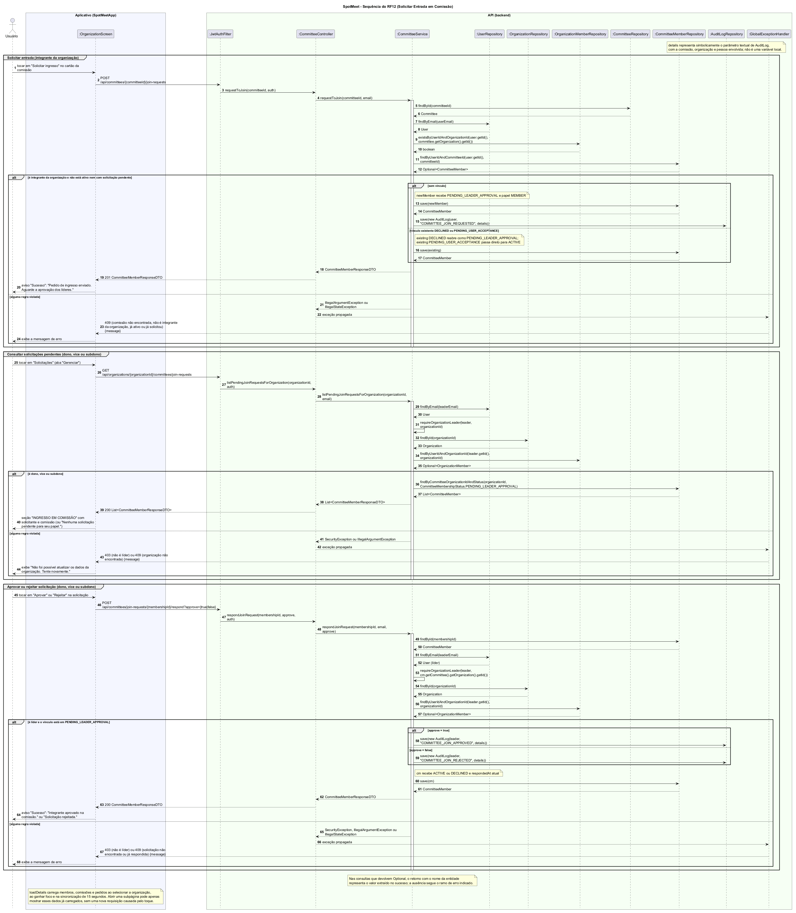

Fonte: próprio autor

#### RF13 – Manter Integrantes da Comissão

| Campo | Descrição |
|---|---|
| Função | **Pesquisa:** Consulta a situação de um integrante em cada comissão da organização.  **Exclusão:** Remove o vínculo de um integrante com uma comissão. |
| Descrição | **Pesquisa:** Consulta na tabela committees todas as comissões da organização, em ordem alfabética de nome, e na tabela committee_members o vínculo do integrante com cada uma, informando se há vínculo (linked), o status, o papel e o identificador do vínculo. As comissões sem vínculo saem com linked falso e os demais campos nulos.  **Exclusão:** Remove da tabela committee_members o vínculo do integrante com a comissão, qualquer que seja o seu status (ativo, convite pendente, solicitação pendente ou recusado). |
| Entradas | **Pesquisa:** Identificador da organização (organizationId, do tipo Long) e identificador do integrante (userId, do tipo Long), informados na rota. O usuário que consulta é identificado pelo e-mail do token JWT.  **Exclusão:** Identificador da comissão (committeeId, do tipo Long) e identificador do integrante (userId, do tipo Long), informados na rota, e a confirmação do usuário no diálogo do aplicativo. |
| Origem | **Pesquisa:** Usuário (integrante da organização; no aplicativo, o líder consulta outro integrante e a tela consulta os vínculos do próprio usuário).  **Exclusão:** Usuário (líder da organização). |
| Saída | **Pesquisa:** HTTP 200 com lista de objetos do tipo UserCommitteeLinkDTO (committeeId, committeeName, description, linked, membershipStatus, role e membershipId). Em caso de erro: HTTP 403, lançado como SecurityException pelo serviço quando quem consulta não pertence à organização ("Acesso negado. Você não pertence a esta organização."); HTTP 409, lançado como IllegalArgumentException quando o integrante não existe ("Usuário não encontrado.") ou não pertence à organização ("O usuário informado não pertence a esta organização."); HTTP 401 do SecurityConfig para token ausente, expirado ou revogado.  **Exclusão:** HTTP 200 com o texto "Acesso à comissão revogado com sucesso." no corpo. Em caso de erro: HTTP 403 para quem não é líder; HTTP 409 ("Comissão não encontrada." ou "Vínculo do usuário com esta comissão não encontrado."); HTTP 401 como na pesquisa. |
| Destino | **Pesquisa:** Usuário, por meio da janela "Comissões do integrante" da tela OrganizationScreen.  **Exclusão:** Banco de dados (tabelas committee_members e audit_logs) e usuário, por meio da janela "Comissões do integrante" da tela OrganizationScreen. |
| Ação | **Pesquisa:** Na aba "Gerenciar", o líder toca no atalho "Membros", no cartão do integrante e em "Comissões do integrante". O aplicativo abre a janela com o nome do integrante e, por loadMemberLinks, envia a requisição GET /api/organizations/{organizationId}/members/{userId}/committees. O método listUserCommitteeLinks da classe CommitteeController chama o método listUserCommitteeLinks(organizationId, targetUserId, executorEmail) da classe CommitteeService, que carrega o usuário, verifica por existsByUserIdAndOrganizationId de OrganizationMemberRepository se quem consulta pertence à organização (o SYSADMIN dispensa a verificação), localiza o integrante (findById de UserRepository), verifica se ele também pertence à organização, obtém as comissões por findByOrganizationIdOrderByNameAsc de CommitteeRepository e, para cada uma, consulta o vínculo por findByUserIdAndCommitteeId de CommitteeMemberRepository. A janela exibe, para cada comissão, o nome, a descrição e a etiqueta "Membro ativo" (ACTIVE), "Aguardando aceite" (PENDING_USER_ACCEPTANCE), "Pedido pendente" (PENDING_LEADER_APPROVAL) ou "Sem vínculo" (sem vínculo ou DECLINED). Sem comissões, exibe "Nenhuma comissão cadastrada.". Se a leitura falha, exibe "Não foi possível consultar as comissões. Tente novamente." e o botão "Tentar novamente". O aplicativo usa a mesma rota, com o identificador do próprio usuário, ao carregar cada organização (loadDetails), para exibir "Você participa" e decidir se oferece "Solicitar ingresso" (RF12). A janela só é aberta a partir da página "Membros", exclusiva do líder, embora a API aceite a consulta de qualquer integrante da organização.  **Exclusão:** Na janela "Comissões do integrante", o líder toca no botão "Remover vínculo" (rótulo "Remover vínculo com <comissão>"), exibido abaixo da etiqueta, para vínculos ACTIVE e para convites aguardando aceite; para PENDING_LEADER_APPROVAL a janela orienta "Responda ao pedido em Solicitações." e, nas comissões sem vínculo, "Para convidar, abra Comissões e toque em Convidar integrantes." (o convite é feito na página "Comissões", RF11). O ConfirmationHost abre o diálogo "Remover vínculo" ("Remover o vínculo de <integrante> com <comissão>?") com os botões "Cancelar" e "Remover". Ao tocar em "Remover", o aplicativo envia a requisição DELETE /api/committees/{committeeId}/members/{userId}. O método removeUserFromCommittee da classe CommitteeController chama o método removeUserFromCommittee(committeeId, targetUserId, leaderEmail) da classe CommitteeService, que localiza a comissão (findById de CommitteeRepository), carrega o usuário, confere o líder por requireOrganizationLeader, localiza o vínculo (findByUserIdAndCommitteeId), remove-o por delete de CommitteeMemberRepository e registra a auditoria. Com a resposta 200, o aplicativo exibe o aviso "Sucesso" com "Vínculo removido." e recarrega a janela, em que a comissão passa a exibir "Sem vínculo". |
| Pré-condição | **Pesquisa:** O usuário deve estar autenticado e ser integrante da organização (organization_members), ou ter o perfil global SYSADMIN (apenas pela API). O integrante consultado deve existir e pertencer à mesma organização.  **Exclusão:** O usuário deve estar autenticado e ser dono da organização da comissão, ou ter papel ORG_OWNER, ORG_VICE_OWNER ou ORG_SUBOWNER nela, ou ser SYSADMIN (pela API). A comissão e o vínculo do integrante com ela devem existir, em qualquer status, e o usuário deve confirmar no diálogo "Remover vínculo". |
| Pós-condição | **Pesquisa:** Sucesso: o aplicativo exibe a situação do integrante em cada comissão ou o texto "Nenhuma comissão cadastrada."; nada é alterado. Falha (HTTP 403 para quem consulta e não pertence à organização; HTTP 409 para integrante não encontrado ou de outra organização): nada é alterado, o aplicativo não exibe a lista e mostra a mensagem de erro com o botão "Tentar novamente".  **Exclusão:** Sucesso: o vínculo deixa de existir em committee_members; o registro COMMITTEE_MEMBER_REMOVED está em audit_logs; o integrante deixa de constar como ativo na comissão e a contagem "N ativos" diminui, e ele pode ser convidado de novo (RF11) ou pedir entrada (RF12) como se nunca tivesse tido vínculo. Falha: nada é removido e o aplicativo exibe a mensagem recebida (HTTP 403 para quem não é líder; HTTP 409 para comissão ou vínculo não encontrado). Se o usuário toca em "Cancelar" no diálogo, nenhuma requisição é enviada. |
| Efeitos colaterais | **Pesquisa:** Nenhum.  **Exclusão:** Registro em audit_logs com a ação COMMITTEE_MEMBER_REMOVED, contendo o identificador do integrante e o nome da comissão. Eventos de sincronização ORGANIZATIONS_MUTATED, COMMITTEES_MUTATED e ADMIN_ORGS_MUTATED (syncBus). Os vínculos de um integrante também são removidos quando ele deixa a organização por remoção (RF05), nesse caso sem registro COMMITTEE_MEMBER_REMOVED.  **Incremento 2:** se o integrante removido era o presidente da comissão, o vínculo e, com ele, o papel de presidente são apagados; a comissão fica sem presidente até nova designação (RF24), as reuniões já agendadas continuam e só um novo presidente poderá editá-las ou cancelá-las. |

**Figura 26 – Diagrama de sequência do RF13**

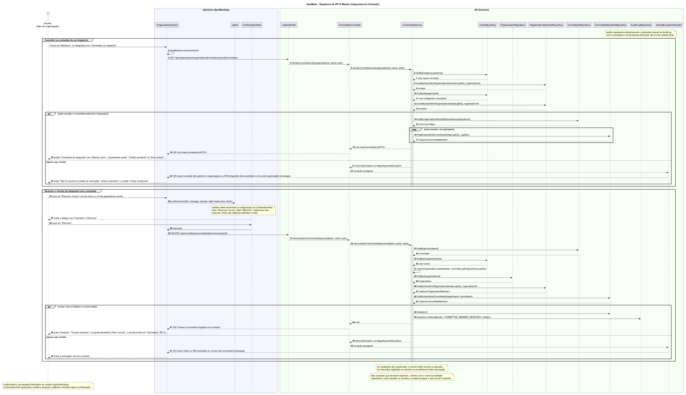

Fonte: próprio autor

#### RF14 – Alterar Senha

| Campo | Descrição |
|---|---|
| Função | Altera a senha do usuário autenticado e encerra as sessões abertas da conta. |
| Descrição | Confere a senha atual com o hash BCrypt gravado na coluna password da tabela users do banco de dados e, se estiver correta e a nova senha for diferente, grava na mesma coluna o hash BCrypt (custo 12) da nova senha. Na mesma transação grava em tokens_valid_after o instante da troca, o que invalida todos os JWT emitidos antes dele, inclusive o da requisição. A conferência da senha atual tem limite de tentativas por conta: a décima falha em 15 minutos bloqueia novas tentativas por 15 minutos. Depois da gravação, o sistema agenda um aviso por e-mail. |
| Entradas | Objeto do tipo ChangePasswordDTO contendo currentPassword (string obrigatória, @NotBlank, sem regra de formato) e newPassword (string obrigatória, @NotBlank, @Pattern `^(?=.*[a-z])(?=.*[A-Z])(?=.*\d).{6,}$`: no mínimo 6 caracteres, com pelo menos uma letra maiúscula, uma minúscula e um número; o DTO não define tamanho máximo). O e-mail do usuário não vai no corpo: é obtido do JWT do cabeçalho Authorization (objeto Authentication). O campo "Confirmar nova senha" é conferido só no aplicativo e não é enviado. |
| Origem | Usuário. |
| Saída | Respostas HTTP do método changeMyPassword da classe UserController: 200 com {success: true, message: "Senha alterada com sucesso!"}; 400 com {success: false, message} quando o UserService lança IllegalArgumentException ("A senha atual está incorreta.", "A nova senha deve ser diferente da senha atual." ou "Usuário não encontrado."); 500 com {success: false, message: "Erro ao alterar senha: " seguida da causa} em erro inesperado. Geradas por outras classes: 400 com {status, error, message, errors} do GlobalExceptionHandler quando o ChangePasswordDTO viola @NotBlank ou @Pattern (o método do controller não chega a executar); 429 do GlobalExceptionHandler, a partir da TooManyAttemptsException relançada pelo controller, com {success: false, error: "TOO_MANY_ATTEMPTS", message: "Muitas tentativas. Aguarde e tente novamente em alguns minutos.", retryAfterSeconds} e o cabeçalho Retry-After; 401 sem corpo (SecurityConfig, quando o JwtAuthFilter não autentica a requisição: JWT ausente, inválido, expirado ou emitido antes de users.tokens_valid_after). |
| Destino | Usuário (tela SettingsScreen, página "Segurança", e depois a tela de login) e caixa de e-mail da conta (aviso de senha alterada). |
| Ação | **Alteração:** A aba "Ajustes" (SettingsScreen) abre num menu (título "Ajustes", subtítulo "Perfil e preferências."): o cartão com a foto, o nome e o e-mail, que abre o "Perfil"; o grupo "REUNIÕES E AJUDA", com "Meu Relatório de Reuniões" e "Ajuda"; o grupo "CONTA", com "Segurança" ("Senha e biometria"); o grupo "STATUS DE PRESENÇA", com as opções "Presente", "Ausente" e "Ocupado", salvas no toque (RF16); e o botão "Sair da conta". Cada item abre uma página com a seta de voltar ao menu, e o botão voltar do Android também volta ao menu. Na página "Segurança", o usuário vê "Altere sua senha" ("Após salvar, entre novamente com a nova senha."), os campos "Senha atual", "Nova senha" e "Confirmar nova senha", cada um com botão para mostrar ou ocultar o texto, e a lista de requisitos da senha. Ao tocar em "Alterar Senha", o método handleChangePassword confere: senha atual preenchida ("Informe a sua senha atual."), nova senha conforme PASSWORD_REGEX ("Use pelo menos 6 caracteres, com maiúscula, minúscula e número."), confirmação igual ("A confirmação não coincide com a nova senha.") e nova senha diferente da atual ("A nova senha deve ser diferente da senha atual."). Em caso positivo, se o bloqueio biométrico está habilitado, pede a confirmação da biometria (confirmIdentity do BiometricContext); sem a confirmação, exibe "Confirme com a biometria para alterar a senha." e não envia nada. Confirmada (ou sem biometria habilitada), envia PUT /api/users/me/password com currentPassword e newPassword. O JwtAuthFilter valida a assinatura, a validade e a emissão posterior a tokens_valid_after e carrega a conta. O método changeMyPassword da classe UserController chama changePassword(authenticatedEmail, dto) da classe UserService, em transação: carrega o usuário com findByEmailForUpdate da interface UserRepository (bloqueio de linha); chama verify(CURRENT_PASSWORD, "user:" + id, ...) de AuthenticationAttempts, cuja verificação compara a senha atual com o hash pelo método matches do PasswordEncoder; recusa a nova senha se matches indicar que ela é igual à gravada; gera o hash com encode; grava password e tokens_valid_after pelo método save de UserRepository; chama sendPasswordChangedEmail da classe EmailService, que registra o envio para depois do commit; e grava a auditoria por AuditLogRepository. Depois do commit, o EmailService repassa o texto ao EmailDeliveryService, executado de forma assíncrona (emailExecutor), e a resposta HTTP não espera o SMTP.  **Depois da resposta 200:** o aplicativo chama keepForPasswordChange do BiometricContext, que, com a biometria habilitada, guarda no aparelho só a preferência (habilitada e prazo, sem o token, por saveBiometricRearm) para o próximo login, e depois chama endSession, que limpa os campos, chama signOut do AuthContext (limpa token, papel, nome, e-mail e id e notifica os assinantes, entre eles o BiometricContext, que remove a sessão guardada pelo bloqueio biométrico), substitui a pilha de navegação pela tela Auth no modo login e exibe o aviso "Sucesso: Senha alterada com sucesso. Entre novamente com a nova senha.". Se a API responde 400 com "A senha atual está incorreta." ou "A nova senha deve ser diferente da senha atual.", a mensagem aparece sob o campo "Senha atual" ou "Nova senha"; nos demais erros aparece no formulário, e a sessão não é encerrada. Um JWT revogado recebe 401 na próxima requisição protegida, e o SessionGuard encerra a sessão local com o aviso "Sessão encerrada: Sua sessão foi encerrada. Entre novamente.".  **Administrador:** a conta administrativa não tem caixa de e-mail real, por isso a troca usa só a senha atual. Na aba "Controles" (AdminControlsScreen), o cartão "Senha de acesso" tem o botão "Alterar senha", que abre a folha com os mesmos três campos e a lista de requisitos e envia o mesmo PUT /api/users/me/password. Com sucesso, a sessão é encerrada e o aviso é "Senha alterada: Entre novamente com a nova senha."; com a senha atual errada, a mensagem do servidor aparece na folha. |
| Pré-condição | Usuário autenticado: JWT válido (assinatura, validade de 24 horas e emissão posterior a users.tokens_valid_after) e conta com e-mail verificado. A aba "Ajustes" só é exibida para contas com perfil global USER; as abas de ADMIN e SYSADMIN não têm Ajustes, embora a rota aceite qualquer perfil autenticado. O usuário deve conhecer a senha atual, e a conta não pode estar em pausa por dez falhas de senha atual nos últimos 15 minutos (resposta 429). |
| Pós-condição | Sucesso: users.password guarda o hash da nova senha; users.tokens_valid_after guarda o instante da troca e nenhum JWT anterior (inclusive o do aparelho atual) é aceito; a ação PASSWORD_CHANGED consta em audit_logs; o aviso por e-mail está agendado; o aplicativo está na tela de login, sem sessão, e o usuário entra com a nova senha; se a biometria estava habilitada, ela é religada nesse login com uma confirmação da digital, sem o convite (RF36). Falha: nenhuma coluna é alterada (a transação é desfeita), a sessão continua aberta e o aplicativo exibe a mensagem de erro; cada senha atual incorreta conta para o limite de tentativas. |
| Efeitos colaterais | Registro em audit_logs com a ação PASSWORD_CHANGED. E-mail com o assunto "SpotMeet - Sua senha foi alterada" (conta, data e hora, origem "Pelo aplicativo" e o que fazer se não foi a pessoa), enviado após o commit e sem senha nem código (sem SMTP configurado, apenas um registro genérico no log do servidor). Revogação de todas as sessões da conta por tokens_valid_after. Remoção da sessão guardada pelo bloqueio biométrico no aparelho, pelo signOut, mantendo apenas a preferência de biometria (sem token) até o próximo login. Contagem de falhas de senha atual em AuthenticationAttempts, na memória da JVM. |

**Figura 27 – Diagrama de sequência do RF14**

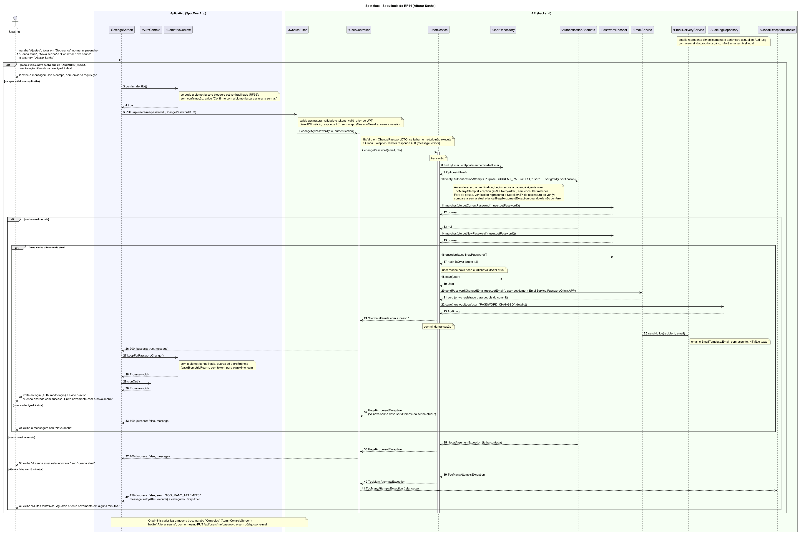

Fonte: próprio autor

#### RF15 – Recuperar Conta

| Campo | Descrição |
|---|---|
| Função | Permite ao usuário que esqueceu a senha definir uma nova senha por meio de um código de seis dígitos enviado ao e-mail cadastrado. |
| Descrição | **Solicitação:** gera, com SecureRandom, um código numérico de 6 dígitos (zeros à esquerda valem) e grava na tabela users apenas o hash BCrypt (custo 12) do código, na coluna recovery_token, e a validade de 5 minutos na coluna recovery_token_expires_at (constante CODE_EXPIRATION_MINUTES da classe UserService). O código vai por e-mail. A resposta é a mesma para e-mail cadastrado e não cadastrado, e o trabalho de hash é feito com ou sem conta. Um novo pedido substitui o código anterior.  **Validação:** confere o código informado com o hash e a validade, sem consumi-lo.  **Redefinição:** confere o código de novo, grava na coluna password o hash BCrypt da nova senha, apaga recovery_token e recovery_token_expires_at, marca email_verified como verdadeiro e grava em tokens_valid_after o instante da redefinição (os JWT anteriores deixam de valer). A Validação e a Redefinição compartilham a finalidade RECOVERY do limite de tentativas, por e-mail: a décima falha em 15 minutos bloqueia novas tentativas por 15 minutos. |
| Entradas | **Solicitação:** objeto do tipo ForgotPasswordDTO contendo email (obrigatório, @NotBlank e @Email com ValidationPatterns.EMAIL: até 255 caracteres, até 64 antes do @, domínio com ponto e rótulos de até 63 caracteres, terminação de 2 a 63 letras). O serviço usa o e-mail sem espaços nas pontas e em minúsculas.  **Validação:** objeto do tipo VerifyRecoveryCodeDTO contendo email (mesma regra) e token (obrigatório, @Pattern com ValidationPatterns.OTP: exatamente seis dígitos de 0 a 9).  **Redefinição:** objeto do tipo ResetPasswordDTO contendo email (mesma regra), token (seis dígitos) e newPassword (obrigatória, `^(?=.*[a-z])(?=.*[A-Z])(?=.*\d).{6,}$`: no mínimo 6 caracteres, com maiúscula, minúscula e número; sem tamanho máximo no DTO). O campo "Confirmar nova senha" é conferido só no aplicativo. |
| Origem | Usuário. |
| Saída | **Solicitação:** 200 com {success: true, message: "Verifique o seu e-mail."} sempre que o DTO é válido, inclusive para e-mail não cadastrado (método forgotPassword da classe AuthController); não há devCode nem outro campo de código na resposta. 400 com {status, error, message, errors} do GlobalExceptionHandler quando o DTO viola @NotBlank ou @Email.  **Validação:** 200 com {success: true, message: "Código validado. Defina a nova senha."}; 400 com {success: false, message} pelo AuthController, para IllegalArgumentException do UserService ("Código de recuperação inválido ou inexistente.", "Código de recuperação incorreto." ou "O código de recuperação expirou. Solicite um novo código no aplicativo."); 400 do GlobalExceptionHandler se o token não tem seis dígitos; 429 do GlobalExceptionHandler na décima falha (o AuthController não captura a TooManyAttemptsException), com {success: false, error: "TOO_MANY_ATTEMPTS", message, retryAfterSeconds} e o cabeçalho Retry-After.  **Redefinição:** 200 com {success: true, message: "Senha redefinida com sucesso! Você já pode acessar sua conta com a nova senha."}; 400 com {success: false, message} pelo AuthController (código incorreto, expirado ou inexistente, como na Validação); 400 e 429 do GlobalExceptionHandler, como acima. |
| Destino | Usuário (mensagens da tela AuthScreen) e caixa de e-mail cadastrada (código de recuperação e, ao final, aviso de senha alterada). |
| Ação | **Solicitação:** Na tela de login (AuthScreen, cartão "Acessar conta"), o usuário toca em "Esqueci minha senha". A tela "Esqueci minha senha" ("Etapa 1 de 3. Informe seu e-mail para receber um código.") tem o campo "E-mail cadastrado". Ao tocar em "Enviar Código por E-mail", o aplicativo confere se o e-mail foi informado e tem formato válido (isValidEmail) e envia POST /api/auth/forgot-password com o e-mail normalizado. A rota é pública (/api/auth/**), então a requisição não passa pelo JwtAuthFilter. O método forgotPassword da classe AuthController chama forgotPassword(dto) da classe UserService, em transação: findByEmailForUpdate de UserRepository (e-mail em minúsculas); generateCode (método privado) e encode do PasswordEncoder, executados com ou sem conta; se a conta existe, save de UserRepository com o hash e a validade, sendPasswordRecoveryEmail da classe EmailService e a auditoria. O e-mail sai depois do commit, de forma assíncrona (EmailDeliveryService, executor emailExecutor), e a resposta não espera o SMTP. O aplicativo exibe o aviso "Código enviado: Verifique o seu e-mail.", bloqueia o reenvio por 60 segundos e passa para a Etapa 2.  **Validação:** A tela "Confirmar código" ("Etapa 2 de 3. Digite o código recebido por e-mail.") mostra o e-mail informado e o campo "Código de verificação" (seis caixas que aceitam só dígitos, com as dicas "Digite o código recebido" e "Validade do código: até 5 minutos." abaixo das caixas). Ao completar os seis dígitos, o aplicativo envia a verificação automaticamente; o botão "Validar Código" repete a tentativa. Envia POST /api/auth/verify-recovery-code, tratada pelo método verifyRecoveryCode da classe AuthController, que chama verifyRecoveryCode(dto) da classe UserService. Esse método usa o método privado resolveRecoveryToken(email, token), que chama verify(RECOVERY, email, ...) de AuthenticationAttempts; a verificação (validateRecoveryToken) localiza a conta por findByEmailForUpdate, compara o código com o hash pelo método matches do PasswordEncoder e confere a validade, sem consumir o código. Com sucesso, o aplicativo mostra a Etapa 3; com erro, mostra a mensagem sob o campo. O link de reenvio fica desabilitado com "Reenviar código em 60s" em contagem regressiva e depois exibe "Não recebeu? Reenviar código", que repete a Solicitação (o novo código invalida o anterior). O link "E-mail errado? Alterar e-mail" volta à Etapa 1 e mantém o endereço digitado.  **Redefinição:** A tela "Criar nova senha" ("Etapa 3 de 3. Defina e confirme a nova senha.") tem os campos "Nova senha" e "Confirmar nova senha" e a lista de requisitos da senha. Ao tocar em "Atualizar Senha", o aplicativo confere o código (seis dígitos), PASSWORD_REGEX e a igualdade com a confirmação e envia POST /api/auth/reset-password com email, token e newPassword. O método resetPassword da classe AuthController chama resetPassword(dto) da classe UserService, em transação: valida o código com resolveRecoveryToken (a mesma conferência da Etapa 2), gera o hash da nova senha com encode, grava password, tokens_valid_after, recovery_token e recovery_token_expires_at nulos e email_verified verdadeiro pelo método save, chama sendPasswordChangedEmail da classe EmailService e grava a auditoria. O aplicativo exibe o aviso "Sucesso" com a mensagem recebida, limpa todos os campos e volta ao login. O link "Voltar ao código de verificação" retorna à Etapa 2 sem enviar nada e limpa as senhas digitadas. |
| Pré-condição | **Solicitação:** conhecer o e-mail de uma conta cadastrada (a recuperação vale para qualquer perfil, inclusive ADMIN e SYSADMIN) e ter acesso à caixa desse e-mail. Não é preciso estar autenticado. Sem conta com esse e-mail, a resposta é a mesma, mas nenhum código é gravado ou enviado.  **Validação:** existir um código gravado na Solicitação para a conta, com no máximo 5 minutos, e a conta não estar em pausa por dez falhas de código em 15 minutos.  **Redefinição:** o mesmo código, ainda válido (a Validação não o consome), e uma nova senha que atenda à regra de formato. |
| Pós-condição | **Solicitação:** com conta existente, recovery_token e recovery_token_expires_at estão gravados (o código anterior deixa de valer) e o e-mail está agendado; o aplicativo mostra a Etapa 2 em qualquer caso.  **Validação:** nada é gravado. Com sucesso, o aplicativo mostra a Etapa 3; com código incorreto ou expirado, mostra a mensagem e permanece na Etapa 2, e a falha conta para o limite (pausa de 15 minutos na décima, resposta 429).  **Redefinição:** com sucesso, a senha da conta é a nova, o código é apagado e não pode ser reutilizado, a conta fica com e-mail verificado, todos os JWT anteriores deixam de valer e o aplicativo volta ao login; em falha, a senha e o código permanecem como estavam e a mensagem é exibida. |
| Efeitos colaterais | **Solicitação:** e-mail com o assunto "SpotMeet - Recuperação de Senha", contendo o código e a validade de 5 minutos, e registro em audit_logs com a ação PASSWORD_RECOVERY_REQUESTED, ambos somente quando a conta existe. Sem SMTP configurado, o código aparece apenas no log local do servidor, nunca na resposta.  **Validação:** contagem de falhas em AuthenticationAttempts (memória da JVM); nenhum registro no banco.  **Redefinição:** registro em audit_logs com a ação PASSWORD_RESET; e-mail com o assunto "SpotMeet - Sua senha foi alterada", com a origem "Pela recuperação de senha"; tokens_valid_after atualizado (revoga as sessões); email_verified passa a verdadeiro. |

**Figura 28 – Diagrama de sequência do RF15**

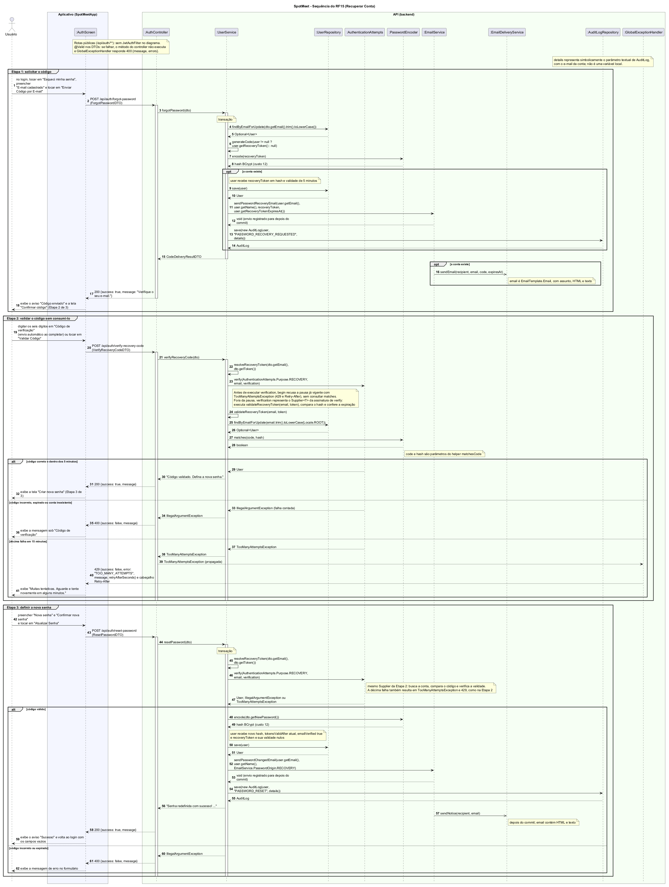

Fonte: próprio autor

#### RF16 – Alterar Dados Pessoais

| Campo | Descrição |
|---|---|
| Função | Consulta e altera os dados pessoais do usuário autenticado: nome, biografia, disponibilidade (status de presença) e foto de perfil. Também exibe a foto de perfil das outras pessoas nas listas da aba "Organização" e o status de presença de cada integrante na página "Membros". |
| Descrição | **Consulta:** lê da tabela users do banco de dados o perfil da conta autenticada (id, name, email, bio, availability_status, preferred_theme e role).  **Nome e biografia:** atualiza as colunas name e bio.  **Disponibilidade:** atualiza a coluna availability_status (PRESENT, ONLINE, BUSY ou AWAY); o aplicativo oferece Presente, Ausente e Ocupado no próprio menu de "Ajustes", grava no toque e reenvia o tema salvo (RF17), sem mudança, na mesma requisição.  **Foto:** mantém na tabela user_profile_photos, com no máximo um registro por usuário, a imagem em JPEG quadrada de até 512 pixels (coluna image_data, tipo bytea) e uma versão em UUID (coluna version). O e-mail é exibido só para leitura e é alterado pelo RF18; o tema é tratado no RF17.  **Foto das outras pessoas:** lê da mesma tabela user_profile_photos a foto de outra conta, pelo id do usuário, só para exibição.  **Status das outras pessoas:** a consulta de integrantes da organização (RF05) devolve, para cada membro, o availability_status da tabela users, e a página "Membros" o exibe. |
| Entradas | **Consulta:** nenhuma além do JWT do cabeçalho Authorization (a conta vem do token; o aplicativo não envia id nem e-mail).  **Nome e biografia:** objeto do tipo UpdateUserProfileDTO contendo name (opcional; se enviado, depois de remover os espaços das pontas, inclusive os de Unicode (NAME_WHITESPACE), deve ter de 2 a 100 caracteres, @Size) e bio (opcional, até 500 caracteres, @Size; gravada sem espaços nas pontas, e uma bio vazia apaga o texto). O aplicativo envia name e bio nesta operação e, se o tema foi trocado no Perfil, também preferredTheme (RF17).  **Disponibilidade:** o mesmo UpdateUserProfileDTO, com availabilityStatus (string opcional, convertida para maiúsculas e aceita se for PRESENT, ONLINE, BUSY ou AWAY; valor desconhecido é ignorado sem erro).  **Foto:** requisição multipart/form-data com uma parte "photo": imagem JPEG ou PNG (o Content-Type é conferido junto do formato real do arquivo), quadrada, de 1 a 512 pixels de lado e com até 1 MB (o limite de 1 MB é conferido pelo serviço da foto; a camada multipart do Spring admite 10 MB por arquivo e 11 MB por requisição, compartilhada com os anexos das reuniões). O aplicativo escolhe a imagem na Galeria ou na Câmera (recorte quadrado 1:1; aceita imagens de até 20 MB e 40 megapixels), reduz para no máximo 512 por 512 pixels e envia JPEG. A remoção não tem corpo.  **Foto das outras pessoas:** o id do usuário na rota (GET /api/users/{userId}/photo), além do JWT; nenhum corpo.  **Status das outras pessoas:** o id da organização na rota (GET /api/organizations/{organizationId}/members, RF05), além do JWT; nenhum corpo. |
| Origem | Usuário. |
| Saída | **Consulta:** 200 com UserProfileResponseDTO (id, name, email, bio, availabilityStatus, preferredTheme e role); 404 com o texto da mensagem se a conta não é encontrada e 500 com "Erro ao buscar perfil: " seguida da causa (ambos pelo método getMyProfile da classe UserController).  **Nome, biografia e disponibilidade:** 200 com UserProfileResponseDTO dos dados gravados; 400 com o texto da mensagem se a conta não é encontrada e 500 com "Erro ao atualizar perfil: " seguida da causa (método updateMyProfile da classe UserController); 400 com {status, error, message, errors} do GlobalExceptionHandler quando name ou bio violam @Size.  **Foto:** consulta e gravação respondem 200 com ProfilePhotoResponseDTO {userId, imageBase64, version} (imageBase64 e version nulos quando não há foto); a remoção responde 204 sem corpo, inclusive quando não havia foto. Erros do ProfilePhotoController, com {message} e Cache-Control: no-store: 400 "Envie uma foto JPEG ou PNG quadrada, com até 512 × 512 pixels e 1 MB." (InvalidProfilePhotoException) ou "Selecione uma foto para enviar." (parte ausente); 401 "Usuário não autenticado."; 503 "Não foi possível acessar a foto de perfil. Tente novamente.". Parte maior que o limite global de multipart (10 MB por arquivo ou 11 MB na requisição): 413 "O arquivo enviado passa do tamanho permitido." (MaxUploadSizeExceededException, tratada pelo GlobalExceptionHandler). Uma foto que excede 1 MB, mas ainda cabe no multipart, é recusada pelo serviço com HTTP 400 e a mensagem de formato e tamanho da foto. JWT ausente, inválido ou revogado: 401 sem corpo (SecurityConfig).  **Foto das outras pessoas:** 200 com ProfilePhotoResponseDTO {userId, imageBase64, version} da conta pedida (imageBase64 e version nulos quando ela não tem foto), com Cache-Control: no-store; 401 "Usuário não autenticado." quando a conta de quem pede não é encontrada ou não tem e-mail verificado; 503 em falha de leitura. A rota só aceita GET: PUT e DELETE em /api/users/{userId}/photo respondem 405.  **Status das outras pessoas:** 200 com a lista de MemberDTO {userId, name, email, role, availabilityStatus}, em que availabilityStatus é PRESENT, AWAY, BUSY ou ONLINE (nulo no banco é devolvido como PRESENT); 403 em texto quando quem pede não é membro (RF05). |
| Destino | Usuário (tela SettingsScreen: cartão e grupo "STATUS DE PRESENÇA" do menu e página "Perfil"; o nome confirmado passa a valer na sessão do aplicativo) e demais integrantes da organização (tela OrganizationScreen, página "Membros", com o status de presença). |
| Ação | **Consulta:** Ao receber o foco, a aba "Ajustes" (SettingsScreen) exibe "Carregando perfil..." e envia GET /api/users/me. O JwtAuthFilter autentica a requisição; o método getMyProfile da classe UserController chama getMyProfile(email) da classe UserService, que usa findByEmail da interface UserRepository e devolve UserProfileResponseDTO.fromEntity. Com a resposta, o menu mostra o cartão com a foto (pelo UserAvatar, como em "Foto das outras pessoas"), o nome e o e-mail; a página "Perfil" preenche "Nome completo", "Biografia (opcional)" (com o contador "0 / 500") e "E-mail" (somente leitura) e marca o tema, e o grupo "STATUS DE PRESENÇA" do menu marca o status atual. Se a consulta falha, mostra a mensagem e o botão "Tentar novamente", sem liberar o formulário. A leitura acontece ao receber o foco ou ao trocar o token, sem repetição periódica, para não repor o que o usuário digita. Ao abrir a página "Perfil", o ProfilePhotoEditor pede a foto (GET /api/users/me/photo, ProfilePhotoController, ProfilePhotoService e findByUserId de UserProfilePhotoRepository); sem foto, exibe o avatar com as iniciais do nome: a primeira letra do primeiro e do segundo nome, pulando "da", "das", "de", "do", "dos" e "e" ("Maria da Silva" vira MS; nome de uma palavra só fica com uma letra).  **Nome e biografia:** Na página "Perfil", o usuário altera "Nome completo" e "Biografia (opcional)" e toca em "Salvar Alterações". O método handleSaveProfile confere nome de 2 a 100 caracteres (isValidName) e biografia de até 500 e envia PUT /api/users/me com name e bio (e preferredTheme, se o tema foi trocado, RF17). O método updateMyProfile da classe UserController chama updateMyProfile(email, dto) da classe UserService, que localiza o usuário (findByEmail), grava o nome sem espaços nas pontas somente se não estiver em branco, grava a biografia sempre que enviada, salva pelo método save e registra a auditoria (uma falha de auditoria não bloqueia a resposta). O aplicativo atualiza o nome na sessão (updateSession do AuthContext), emite o evento PROFILE_MUTATED e exibe o aviso "Perfil atualizado: Suas alterações foram salvas."; havendo prévia de foto pendente, salva também a foto (save com quiet) e exibe "Perfil atualizado: Suas alterações e a foto foram salvas." ou, se a foto falhar, "Perfil salvo: Os dados do perfil foram salvos, mas a foto não. Veja o aviso abaixo da foto.". Erros do servidor aparecem sob os campos ou como "Não foi possível salvar o perfil. Confira os campos e tente novamente.". O texto "Alterações não salvas" aparece enquanto há campo modificado, tema trocado ou prévia de foto, e só então o botão "Salvar Alterações" fica habilitado; sem alteração, ele aparece esmaecido.  **Disponibilidade:** No menu de "Ajustes", abaixo do grupo "CONTA" e acima de "Sair da conta", o grupo "STATUS DE PRESENÇA" mostra três opções lado a lado: "Presente" (bolinha verde), "Ausente" (bolinha amarela) e "Ocupado" (bolinha vermelha), com a marca na opção atual. Não há página própria nem botão de salvar: ao tocar numa opção diferente da marcada, o método handleSaveStatus envia na hora PUT /api/users/me com availabilityStatus e preferredTheme (o tema salvo, sem mudança); tocar na opção já marcada não envia nada. Enquanto a requisição está em andamento, as opções ficam desabilitadas e aparece o indicador "Salvando status". O método updateMyProfile da classe UserController chama updateMyProfile(email, dto) da classe UserService, que aplica o status como descrito nas Entradas, salva pelo método save e registra a auditoria. O aplicativo confere a resposta (mesmo id, tema LIGHT ou DARK e status PRESENT, AWAY, BUSY ou ONLINE), marca o status devolvido, emite o evento PROFILE_MUTATED e exibe o aviso "Sucesso: Status de presença salvo."; em falha, a marca continua no status anterior e o menu mostra, abaixo das opções, "Não foi possível salvar o status. Tente novamente.".  **Foto:** Na página "Perfil", o ProfilePhotoEditor mostra a foto ("Foto de perfil") com 120 pixels de lado; ao rolar a página para baixo, a foto diminui até 55% do tamanho (com 100 pixels de rolagem) e volta ao tamanho cheio quando a tela retorna ao topo ou ao reabrir a página. Abaixo ficam os botões "Galeria" e "Câmera". Ao tocar em um deles, o método select do ProfilePhotoContext chama pickProfilePhoto (profilePhotoPicker), que abre o seletor do sistema (a câmera pede permissão ao tocar), recorta o centro em quadrado, reduz a no máximo 512 por 512 pixels e gera um JPEG no cache do aparelho; enquanto a galeria, a câmera e o recorte estão abertos, o aplicativo avisa o BiometricContext (allowExternalScreen), e o bloqueio biométrico só é aplicado se a saída passar de 5 minutos (RF02); a tela mostra a prévia ("Confira a foto antes de salvar.") com os botões "Salvar foto" e "Cancelar foto". Ao tocar em "Salvar foto", o método save envia PUT /api/users/me/photo (multipart, prazo de 15 segundos), com a prévia anexada como File do expo-file-system, o formato que o fetch do Expo SDK 58 sabe enviar. O método save da classe ProfilePhotoController chama save(email, arquivo) da classe ProfilePhotoService, em transação: carrega o usuário com findByEmailForUpdate e exige e-mail verificado; valida e regrava a imagem em normalizeImage (confere tamanho, Content-Type, formato real e dimensões antes de decodificar, e gera um novo JPEG RGB sem metadados); cria ou substitui o registro pelo método save de UserProfilePhotoRepository (nova version em UUID) e registra a auditoria. O aplicativo exibe a foto confirmada e o aviso "Sucesso: Foto de perfil salva com sucesso."; em erro, mantém a prévia e exibe o motivo: "A foto passou do limite de 1 MB. Escolha outra imagem." (HTTP 413), "O servidor não aceitou esta imagem. Escolha outra foto." (HTTP 400) ou "Não foi possível salvar a foto. Verifique a conexão e tente novamente.". Ao voltar ao menu com a prévia pendente, o diálogo descrito abaixo pede para salvar ou descartar; a prévia também é descartada quando "Ajustes" perde o foco. Se tocar em "Salvar Alterações" com uma prévia pendente, a foto é salva junto do perfil. Para remover, o usuário toca em "Remover foto" (exibido só quando há foto) e confirma "Remover" em "Remover foto: Deseja remover sua foto de perfil e voltar ao avatar padrão?". O aplicativo envia DELETE /api/users/me/photo; o método remove da classe ProfilePhotoService apaga o registro pelo método delete de UserProfilePhotoRepository e grava a auditoria somente se havia foto. O aplicativo volta ao avatar e exibe "Sucesso: Foto de perfil removida.". A foto só é consultada, gravada ou removida com o aplicativo desbloqueado e em primeiro plano; trocar de conta ou de servidor descarta a prévia.  **Foto das outras pessoas:** Na aba "Organização" (OrganizationScreen), as listas de membros, de solicitações de entrada na organização e na comissão e a busca de pessoas para convite mostram cada pessoa com o componente UserAvatar, que exibe primeiro as iniciais e, para cada pessoa com id conhecido, envia GET /api/users/{userId}/photo. O JwtAuthFilter autentica a requisição; o método getOf da classe ProfilePhotoController chama getOf(email, userId) da classe ProfilePhotoService, que confere a conta de quem pede (findByEmail de UserRepository, com e-mail verificado) e lê a foto da conta pedida (findByUserId de UserProfilePhotoRepository). Com foto, o UserAvatar cobre as iniciais com a imagem; sem foto, em erro ou sem resposta em 15 segundos, as iniciais continuam. O aplicativo guarda cada foto por 1 minuto, para a lista não pedir de novo a cada atualização, e descarta a cópia da própria conta ao salvar ou remover a foto. Qualquer usuário autenticado pode ler a foto de outro pelo id; não há como alterar nem remover a foto de outra pessoa.  **Status das outras pessoas:** Na aba "Organização", aba interna "Gerenciar", a página "Membros" lista os integrantes lidos por GET /api/organizations/{organizationId}/members (RF05). O método listMembers da classe MembershipService passa a cada MemberDTO o availabilityStatus do usuário. Em cada cartão, abaixo do e-mail, o aplicativo mostra a bolinha colorida e o texto do status, calculados por presenceOf: "Ausente" (amarela) para AWAY, "Ocupado" (vermelha) para BUSY e "Presente" (verde) para PRESENT, ONLINE ou ausência do campo; o botão do cartão tem a dica de acessibilidade "Status" seguida do texto. O status é lido a cada atualização da lista; não há aviso imediato quando a pessoa o troca.  **Alterações não salvas:** com nome, biografia, tema ou foto alterados e não salvos no "Perfil", tocar na seta de voltar, em outra aba ou no botão voltar do Android abre o diálogo "Alterações não salvas" ("Você alterou o perfil e ainda não salvou. Deseja salvar antes de sair?") com "Continuar editando", "Descartar" e "Salvar". "Salvar" grava como o botão da página e só então segue; se a gravação falha, a tela continua com a mensagem. "Descartar" volta aos valores gravados (inclusive o tema), descarta a prévia da foto e segue. "Continuar editando" fecha o diálogo. Ao voltar a "Ajustes", a tela abre sempre no menu, salvo pelo atalho "Meu Relatório" da aba "Reuniões", que abre direto o relatório. |
| Pré-condição | **Em todas as operações:** usuário autenticado com JWT válido e e-mail verificado. A aba "Ajustes" só é exibida para contas com perfil global USER.  **Nome e biografia:** perfil carregado (a tela não libera o formulário se a consulta falhou).  **Disponibilidade:** perfil carregado, menu de "Ajustes" aberto e nenhuma gravação em andamento; a opção tocada deve ser diferente da marcada.  **Foto:** para a "Câmera", permissão de câmera concedida no aparelho; para salvar, uma prévia escolhida na mesma sessão; para remover, confirmação do usuário (sem foto, o botão "Remover foto" não é exibido).  **Foto das outras pessoas:** a pessoa estar numa das listas da aba "Organização"; a API exige só sessão válida com e-mail verificado.  **Status das outras pessoas:** quem consulta ser membro da organização, que deve estar aprovada para a página "Membros" abrir (RF05). |
| Pós-condição | **Consulta:** a tela exibe os dados atuais; nada é alterado.  **Nome e biografia:** com sucesso, users.name e users.bio estão atualizados, o nome da sessão do aplicativo é o confirmado pela API e a ação PROFILE_UPDATED consta em audit_logs; em falha (nome ou biografia fora dos limites, erro do servidor), nada é gravado e a mensagem é exibida sob o campo.  **Disponibilidade:** users.availability_status guarda o valor escolhido (o tema gravado é reenviado sem mudança, RF17), o menu marca o novo status e os demais integrantes o veem na próxima leitura da página "Membros"; em falha, nada é gravado e a marca continua no status anterior.  **Foto:** com sucesso, user_profile_photos tem um registro da conta com a imagem JPEG normalizada e uma nova version, e a tela exibe a foto; depois da remoção não há registro e a tela exibe o avatar. Em falha, a foto anterior (ou a ausência dela) permanece e a mensagem é exibida.  **Foto das outras pessoas:** a lista exibe a foto ou as iniciais; nada é alterado.  **Status das outras pessoas:** a página "Membros" exibe o status de cada integrante; nada é alterado. |
| Efeitos colaterais | **Consulta:** Nenhum.  **Nome, biografia e disponibilidade:** registro em audit_logs com a ação PROFILE_UPDATED a cada gravação de PUT /api/users/me (o detalhe traz o status e o tema); o aplicativo emite o evento PROFILE_MUTATED ao salvar o perfil ou o status de presença (nenhuma tela o assina hoje).  **Foto:** registro com a ação PROFILE_PHOTO_UPDATED ao salvar e PROFILE_PHOTO_REMOVED ao remover uma foto existente. A cópia temporária da prévia no cache do aparelho é apagada ao cancelar, salvar ou sair.  **Foto das outras pessoas:** nenhum no servidor (a leitura não gera auditoria); o aplicativo mantém a imagem em memória por 1 minuto.  **Status das outras pessoas:** nenhum (a leitura não gera auditoria). |

**Figura 29 – Diagrama de sequência do RF16**

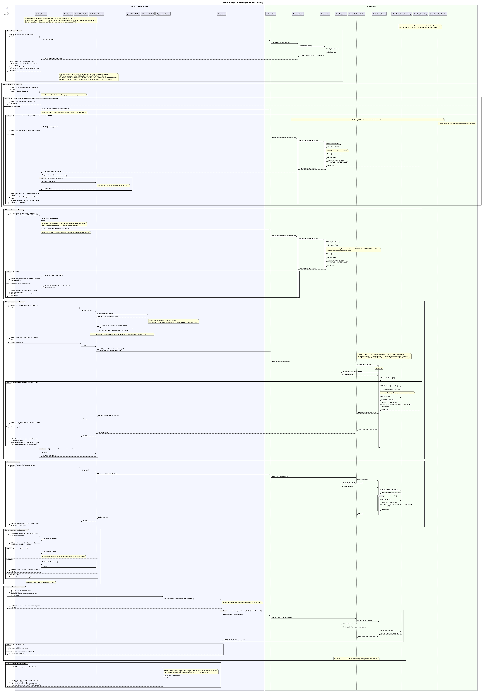

Fonte: próprio autor

#### RF17 – Definir Tema

| Campo | Descrição |
|---|---|
| Função | Define o tema visual (claro ou escuro) do aplicativo para o usuário autenticado e grava a preferência para os próximos acessos. |
| Descrição | Aplica no aplicativo o tema escolhido, com prévia imediata e sem envio ao servidor, e, ao salvar, grava a preferência na coluna preferred_theme da tabela users do banco de dados. Depois do login, o aplicativo lê o tema gravado e o aplica. Sem sessão, o tema é escuro. A API aceita e armazena SYSTEM, mas o aplicativo não oferece a opção "Seguir sistema" nem acompanha automaticamente o tema do aparelho; só aplica LIGHT ou DARK. |
| Entradas | **Carregamento:** nenhuma além do JWT do cabeçalho Authorization.  **Seleção:** toque em "Claro" ou "Escuro" no grupo "TEMA" da página "Perfil" (valores LIGHT ou DARK do tipo ThemeType); não gera requisição.  **Gravação:** objeto do tipo UpdateUserProfileDTO contendo preferredTheme (string opcional, convertida para maiúsculas e aceita se for LIGHT, DARK ou SYSTEM, os valores do enum PreferredTheme da classe User; valor desconhecido é ignorado sem erro). O aplicativo oferece e envia apenas LIGHT e DARK: ao salvar o Perfil, junto com name e bio, e só quando o tema foi trocado (RF16); o toque num status de presença do menu reenvia o tema salvo, sem mudança, junto com availabilityStatus. |
| Origem | Usuário. |
| Saída | **Carregamento:** 200 com UserProfileResponseDTO, cujo campo preferredTheme é DARK quando a coluna está nula (como no RF16). O aplicativo só aplica LIGHT ou DARK.  **Gravação:** 200 com UserProfileResponseDTO dos dados gravados, incluindo preferredTheme; 400 com o texto da mensagem se a conta não é encontrada e 500 com "Erro ao atualizar perfil: " seguida da causa (método updateMyProfile da classe UserController). Ao salvar o Perfil, o aplicativo confere o nome devolvido e guarda como tema salvo o preferredTheme da resposta (LIGHT ou DARK) ou, se ela não trouxer um desses valores, o tema escolhido; ao salvar o status, só aceita a resposta se preferredTheme for LIGHT ou DARK e a disponibilidade for PRESENT, AWAY, BUSY ou ONLINE. |
| Destino | Usuário (cores do aplicativo e mensagem da tela SettingsScreen). |
| Ação | **Carregamento:** Quando há sessão, o ThemeProvider (arquivo ThemeContext) chama loadThemeFromProfile, que envia GET /api/users/me (getMyProfile de UserController e de UserService, como no RF16) e aplica preferredTheme se for LIGHT ou DARK. A resposta é descartada se a sessão ou a escolha mudou enquanto ela chegava. Sem sessão, e ao encerrar a sessão, o tema é DARK.  **Seleção:** Em "Ajustes", página "Perfil" (aberta pelo cartão com a foto, o nome e o e-mail no menu), o grupo "TEMA", abaixo do campo "E-mail", mostra "Claro" e "Escuro" com uma miniatura de cada um e o texto "O tema muda na prévia. Salve as alterações para manter a escolha; sair do Perfil sem salvar desfaz a prévia.". Ao tocar numa opção, o método previewTheme chama setTheme(tema, false) do ThemeContext, que troca as cores na hora, sem falar com o servidor. Toques rápidos são agrupados em intervalos de 150 ms, valendo a última seleção.  **Gravação:** Ao tocar em "Salvar Alterações" no Perfil, o método handleSaveProfile confere o nome e a biografia (RF16) e envia PUT /api/users/me com name, bio e preferredTheme (o tema só vai no corpo quando foi trocado). O método updateMyProfile da classe UserController chama updateMyProfile(email, dto) da classe UserService, que localiza o usuário (findByEmail), converte o valor para maiúsculas, aplica-o se corresponder ao enum PreferredTheme, grava pelo método save de UserRepository e registra a auditoria. O aplicativo guarda o tema devolvido como tema salvo, mantém as cores e exibe "Perfil atualizado: Suas alterações foram salvas." (com prévia de foto pendente, a foto é salva junto, RF16). Se a gravação falha, a prévia continua e a mensagem "Não foi possível salvar o perfil. Confira os campos e tente novamente." é exibida.  **Saída sem salvar:** com o tema trocado e não salvo, tocar na seta de voltar ao menu, em outra aba ou no voltar do Android abre o diálogo "Alterações não salvas" do Perfil (RF16); "Descartar" e a perda de foco da aba "Ajustes" restauram o último tema gravado. O botão "Salvar Alterações" só fica habilitado quando há alteração, e o tema trocado conta como alteração. |
| Pré-condição | **Carregamento:** usuário autenticado com JWT válido e e-mail verificado. Contas ADMIN e SYSADMIN também recebem o tema gravado, mas não têm a aba "Ajustes" para alterá-lo.  **Seleção e gravação:** usuário autenticado com perfil global USER, perfil carregado e página "Perfil" aberta. |
| Pós-condição | **Seleção:** o aplicativo exibe o tema escolhido como prévia; nada é gravado.  **Gravação:** com sucesso, users.preferred_theme guarda o tema, o aplicativo o exibe e o restaura nos próximos acessos, e a ação PROFILE_UPDATED consta em audit_logs; em falha, nada é gravado e a mensagem de erro é exibida (a prévia é desfeita ao sair do Perfil sem salvar). |
| Efeitos colaterais | Registro em audit_logs com a ação PROFILE_UPDATED, cujo detalhe traz o tema ("tema=..."); o aplicativo emite o evento PROFILE_MUTATED. A mesma requisição grava também o nome e a biografia enviados (RF16). |

**Figura 30 – Diagrama de sequência do RF17**

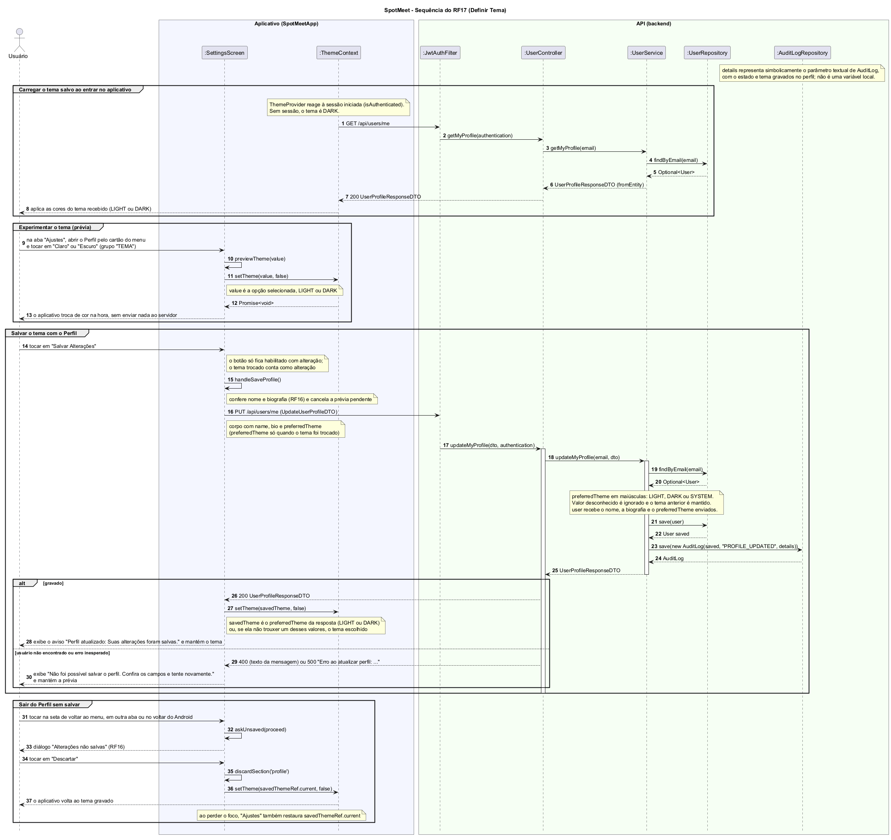

Fonte: próprio autor

#### RF18 – Alterar E-mail

| Campo | Descrição |
|---|---|
| Função | Altera o e-mail do usuário autenticado mediante dupla confirmação: um código enviado ao e-mail atual e outro enviado ao novo e-mail. |
| Descrição | Grava na tabela users o hash BCrypt do código do e-mail atual (current_email_change_token, com current_email_change_token_expires_at), o endereço pendente (pending_new_email) e o hash do código do novo e-mail (new_email_token, com new_email_token_expires_at). Cada código tem 6 dígitos, gerados com SecureRandom, e validade de 5 minutos (constante CODE_EXPIRATION_MINUTES da classe UserService). Ao final, substitui a coluna email pelo novo endereço, marca email_verified como verdadeiro, apaga as colunas temporárias e emite um novo JWT. A conferência de cada código tem limite de tentativas por conta (finalidades CURRENT_EMAIL e NEW_EMAIL): a décima falha em 15 minutos bloqueia novas tentativas por 15 minutos. A disponibilidade do novo e-mail (existsByEmail) é verificada depois da conferência do código atual e de novo na conclusão. |
| Entradas | **Etapa 1 (envio do código ao e-mail atual):** nenhuma além do JWT do cabeçalho Authorization, do qual vem o e-mail atual.  **Etapa 2 (confirmação do e-mail atual):** objeto do tipo ConfirmEmailChangeDTO contendo currentCode (obrigatório, exatamente seis dígitos, @Pattern com ValidationPatterns.OTP) e newEmail (obrigatório, @Email com ValidationPatterns.EMAIL: até 255 caracteres, até 64 antes do @, domínio com ponto e rótulos de até 63 caracteres, terminação de 2 a 63 letras). O serviço usa o endereço sem espaços nas pontas e em minúsculas, e o aplicativo o normaliza antes de enviar.  **Reenvio ao novo e-mail:** nenhuma além do JWT; o destino é o pending_new_email gravado, nunca um valor do cliente.  **Etapa 3 (conclusão):** objeto do tipo CompleteEmailChangeDTO contendo newEmailCode (obrigatório, exatamente seis dígitos). O cabeçalho Authorization com Bearer é obrigatório, pois dele se extrai a emissão original do JWT. |
| Origem | Usuário. |
| Saída | **Etapa 1:** 200 com {success: true, message: "Verifique o seu e-mail.", currentEmail}; 400 com {success: false, message} se a conta não é encontrada; 500 com {success: false, message: "Erro ao processar solicitação de troca de e-mail: " seguida da causa} (método requestEmailChange da classe UserController). Não há devCode.  **Etapa 2:** 200 com {success: true, message, newEmail}; 400 com {success: false, message} pelo UserController para "O novo e-mail não pode ser idêntico ao e-mail atual.", "Código de autorização do e-mail atual incorreto.", "O código de autorização expirou. Solicite um novo envio no aplicativo." e "O novo e-mail informado já está vinculado a outra conta no SpotMeet."; 400 com {status, error, message, errors} do GlobalExceptionHandler quando o DTO viola @NotBlank, @Pattern ou @Email; 429 do GlobalExceptionHandler, a partir da TooManyAttemptsException relançada pelo controller, com {success: false, error: "TOO_MANY_ATTEMPTS", message, retryAfterSeconds} e o cabeçalho Retry-After; 500 com {success: false, message: "Erro ao confirmar etapa 1 da troca de e-mail: " seguida da causa}.  **Reenvio:** 200 com {success: true, message, newEmail}; 400 com {success: false, message} ("Nenhuma troca de e-mail autorizada. Inicie o processo novamente." ou "O novo e-mail informado já foi cadastrado por outro usuário.").  **Etapa 3:** 200 com {success: true, message: "E-mail alterado com sucesso!", newEmail, token} (novo JWT); 400 com {success: false, message} pelo UserController para "Nenhuma solicitação de troca de e-mail pendente encontrada. Inicie o processo novamente.", "Código de ativação do novo e-mail incorreto.", "O código de ativação do novo e-mail expirou. Por favor, reinicie a solicitação." e "O novo e-mail informado já foi cadastrado por outro usuário."; 400 e 429 do GlobalExceptionHandler, como na Etapa 2; 401 com "Usuário não autenticado." (UserController, sem cabeçalho Bearer ou com JWT ilegível); 500 com {success: false, message: "Não foi possível concluir a alteração de e-mail."}.  Em todas as rotas, JWT ausente, inválido, expirado ou emitido antes de users.tokens_valid_after recebe 401 sem corpo (SecurityConfig). |
| Destino | Usuário (mensagens da folha de duas etapas e da tela SettingsScreen), caixa do e-mail atual (código de autorização) e caixa do novo e-mail (código de ativação). |
| Ação | **Etapa 1:** Em "Ajustes", página "Perfil", o campo "E-mail" é somente leitura e traz o botão "Alterar", com a dica "Para trocar, confirmamos com um código no e-mail atual e outro no novo." logo abaixo. Ao tocar nele, o método openEmailChangeModal, se o bloqueio biométrico está habilitado, pede antes a confirmação da biometria (confirmIdentity do BiometricContext); sem a confirmação, exibe "Confirmação necessária: Confirme com a biometria para alterar o e-mail." e não abre a folha. Confirmada (ou sem biometria habilitada), abre a folha de duas etapas e envia POST /api/users/me/email-change/request. O JwtAuthFilter autentica a requisição; o método requestEmailChange da classe UserController chama requestEmailChange(authenticatedEmail) da classe UserService, em transação: carrega o usuário com findByEmailForUpdate de UserRepository, gera o código (generateCode) e o hash (encode do PasswordEncoder), grava current_email_change_token e a validade, apaga qualquer troca pendente anterior (pending_new_email, new_email_token e validade) pelo método save, chama sendCurrentEmailChangeCode da classe EmailService e registra a auditoria. O e-mail sai depois do commit, de forma assíncrona (EmailDeliveryService), e a resposta não espera o SMTP. A folha exibe "ETAPA 1 DE 2", "Confirme seu e-mail atual" e "Confira o código recebido em" seguido do e-mail atual, e o aviso "Código enviado: Verifique o seu e-mail.". O botão de reenvio fica bloqueado por 60 segundos ("Reenviar código em 60s") e depois exibe "Reenviar código para e-mail atual", que repete esta etapa.  **Etapa 2:** O usuário preenche "Novo e-mail" (exemplo "novo.email@exemplo.com") e "Código do e-mail atual" (seis dígitos). Com os seis dígitos e um novo e-mail válido e diferente do atual, o aplicativo envia a confirmação automaticamente (também ao terminar de editar o e-mail, se o código foi digitado antes); o botão "Avançar para Etapa 2" faz o mesmo manualmente. O aplicativo confere o código (isValidOtp), o formato do e-mail (isValidEmail) e se difere do atual, e envia POST /api/users/me/email-change/confirm com currentCode e newEmail. O método confirmEmailChange da classe UserController chama confirmEmailChange(authenticatedEmail, dto) da classe UserService, em transação: carrega o usuário (findByEmailForUpdate); recusa novo e-mail igual ao atual; chama verify(CURRENT_EMAIL, "user:" + id, ...) de AuthenticationAttempts, cuja verificação compara o código com o hash (matches do PasswordEncoder) e confere a validade; verifica por existsByEmail se o novo endereço pertence a outra conta; grava o hash do código de ativação (new_email_token), o endereço pendente (pending_new_email) e a validade e apaga o código do e-mail atual (uso único), tudo pelo método save; chama sendNewEmailConfirmationCode da classe EmailService (envio assíncrono após o commit) e registra a auditoria. A folha passa a "ETAPA 2 DE 2" ("Verifique o novo e-mail", "Digite o código enviado para" seguido do novo e-mail), com novo aviso "Código enviado" e nova espera de 60 segundos. Erros aparecem sob o campo do código. O botão "Reenviar código para novo e-mail" envia POST /api/users/me/email-change/resend-new, tratada por resendNewEmailCode nas classes UserController e UserService (findByEmailForUpdate, existsByEmail do endereço pendente, novo código e novo hash, save, sendNewEmailConfirmationCode e auditoria), sempre para o endereço já autorizado.  **Etapa 3:** O usuário digita o código em "Código do novo e-mail"; ao completar os seis dígitos o aplicativo confirma automaticamente, e o botão "Confirmar e Atualizar" repete a tentativa. Envia POST /api/users/me/email-change/complete com newEmailCode. O método completeEmailChange da classe UserController extrai do JWT a emissão original (extractIssuedAt da classe JwtUtil) e chama completeEmailChange(authenticatedEmail, dto) da classe UserService, em transação: carrega o usuário, exige a troca pendente (pending_new_email), chama verify(NEW_EMAIL, "user:" + id, ...) de AuthenticationAttempts com a conferência do código e da validade, confere de novo com existsByEmail que o endereço continua livre, grava o novo e-mail na coluna email, marca email_verified como verdadeiro, apaga as colunas temporárias pelo método save e registra a auditoria. O controlador gera o novo JWT por generateToken(novoEmail, papel, emissão original) da classe JwtUtil e o devolve. O aplicativo confere o e-mail e o token recebidos, chama updateSession do AuthContext para trocar o token e o e-mail da sessão (um nome ainda não salvo não é publicado), fecha a folha e exibe "Sucesso: E-mail atualizado com sucesso.". O link "Voltar" (Etapa 2) retorna à Etapa 1 com o aviso "Para alterar o endereço novamente, reenvie o código para o e-mail atual." e exige novo código do e-mail atual. |
| Pré-condição | **Etapa 1:** usuário autenticado com perfil global USER (a aba "Ajustes" não é exibida para ADMIN e SYSADMIN), JWT válido e e-mail verificado, com acesso à caixa do e-mail atual.  **Etapa 2:** o código do e-mail atual enviado na Etapa 1, ainda dentro de 5 minutos e não consumido (repetir a Etapa 1 invalida o anterior); novo e-mail diferente do atual e que não pertença a outra conta; acesso à caixa do novo e-mail; conta fora da pausa de 15 minutos por falhas do código do e-mail atual.  **Reenvio ao novo e-mail:** Etapa 2 concluída (pending_new_email e new_email_token gravados) e o novo e-mail ainda livre.  **Etapa 3:** Etapa 2 concluída, código do novo e-mail ainda dentro de 5 minutos, novo e-mail ainda livre e conta fora da pausa por falhas do código do novo e-mail. |
| Pós-condição | **Etapa 1:** o código do e-mail atual está gravado (hash e validade), o e-mail está agendado e qualquer troca pendente anterior foi apagada.  **Etapa 2:** com sucesso, o código do e-mail atual foi consumido, pending_new_email e new_email_token estão gravados, o e-mail ao novo endereço está agendado e a folha mostra a Etapa 2. Em falha, nada é gravado e a mensagem aparece sob o campo (a falha de código conta para o limite).  **Etapa 3:** com sucesso, users.email é o novo endereço, email_verified é verdadeiro, as colunas temporárias estão nulas, a sessão do aplicativo usa o novo e-mail e o novo JWT, o JWT anterior deixa de ser aceito (o e-mail faz parte do token) e a ação LGPD_EMAIL_CHANGED consta em audit_logs. Em falha, o e-mail da conta permanece o mesmo e a mensagem é exibida. |
| Efeitos colaterais | **Etapa 1:** e-mail ao endereço atual com o assunto "SpotMeet - Autorização de Alteração de E-mail (LGPD)"; registro em audit_logs com a ação LGPD_EMAIL_CHANGE_REQUESTED.  **Etapa 2:** e-mail ao novo endereço com o assunto "SpotMeet - Validação do Novo Endereço de E-mail"; registro LGPD_EMAIL_CHANGE_STEP1_CONFIRMED. Cada reenvio ao novo endereço repete o e-mail e registra LGPD_EMAIL_CHANGE_CODE_RESENT.  **Etapa 3:** registro LGPD_EMAIL_CHANGED, com o e-mail anterior e o novo no detalhe; e-mail ao endereço anterior com o assunto "SpotMeet - O e-mail da sua conta foi alterado" (endereço anterior e novo, data e hora e o que fazer se não foi a pessoa), enviado após o commit; novo JWT, que substitui o anterior na sessão do aplicativo e, se o bloqueio biométrico estiver ativo, na sessão guardada no aparelho; o endereço antigo fica livre para um novo cadastro, e o JWT antigo, que só traz o e-mail, não abre a conta nova (o cadastro grava tokens_valid_after).  Sem SMTP configurado, os códigos aparecem apenas no log local do servidor, nunca na resposta. |

**Figura 31 – Diagrama de sequência do RF18**

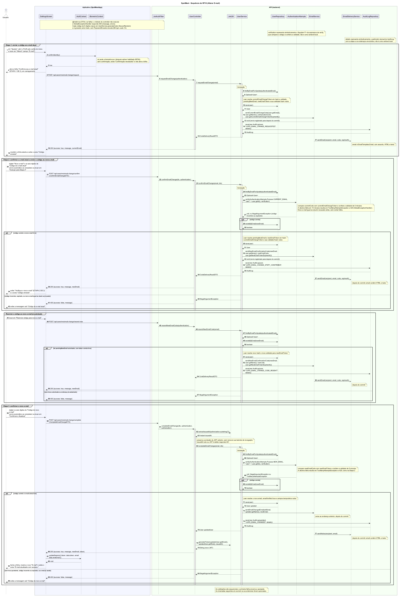

Fonte: próprio autor

#### RF19 – Inicializar Sistema

| Campo | Descrição |
|---|---|
| Função | Prepara o servidor e o aplicativo do SpotMeet para o uso: cria o banco de dados e as tabelas, provisiona a conta do administrador do sistema, define o endereço do servidor no aplicativo e informa ao usuário quando há uma versão mais nova do APK Android. |
| Descrição | **Servidor:** ao ser iniciado, o servidor cria o banco de dados configurado quando ele ainda não existe (classe DatabaseCreator), cria as tabelas ausentes e acrescenta as colunas novas das entidades sem apagar dados (Hibernate com spring.jpa.hibernate.ddl-auto=update) e, se não existir usuário com o e-mail sysadmin@spotmeet.com, insere na tabela users a conta "Administrador do Sistema", com perfil global SYSADMIN, e-mail verificado e senha padrão armazenada como hash BCrypt de custo 12. Uma conta já existente não é alterada.  **Abertura do aplicativo:** o aplicativo define o endereço do servidor na ordem: host salvo pelo usuário, variável EXPO_PUBLIC_API_HOST, servidor de desenvolvimento do Expo, host encontrado por busca na rede local e, por fim, o padrão da plataforma (10.0.2.2 no emulador Android e localhost nos demais). Em seguida exibe a tela de login.  **Endereço do servidor:** no rodapé da tela de login, o usuário informa o IP do servidor, procura o servidor na rede ou volta ao modo automático.  **Aviso de nova versão:** no APK Android de release, o aplicativo consulta ao servidor a versão publicada e, se for mais nova que a instalada, oferece abrir a página da build no Expo. O servidor só anuncia uma versão quando as três variáveis APP_ANDROID_* estão preenchidas com valores válidos. |
| Entradas | **Servidor:** nenhuma entrada do usuário. Propriedades lidas de application.properties, com valores vindos do arquivo backend/.env ou de variáveis de ambiente (que têm precedência): SERVER_PORT (padrão 8080); DB_URL (padrão jdbc:postgresql://localhost:5432/spotmeet_db), DB_USERNAME (padrão postgres) e DB_PASSWORD; JWT_SECRET (chave Base64 de pelo menos 256 bits) e JWT_EXPIRATION_MS (padrão 86400000); MAIL_HOST (padrão smtp.gmail.com), MAIL_PORT (padrão 587), MAIL_USERNAME e MAIL_PASSWORD; APP_ANDROID_VERSION, APP_ANDROID_VERSION_CODE e APP_ANDROID_DOWNLOAD_URL (opcionais, vazias por padrão). O valor ddl-auto=update é fixo em application.properties.  **Aplicativo:** nenhuma entrada na abertura. Lê o host salvo no armazenamento local sob a chave @spotmeet/api-host, as variáveis EXPO_PUBLIC_API_HOST, EXPO_PUBLIC_API_PORT (padrão 8080) e EXPO_PUBLIC_API_SCHEME (padrão http), o host do servidor de desenvolvimento do Expo e o host guardado sob a chave @spotmeet/discovered-host.  **Endereço do servidor:** campo de texto com o IP do servidor (exemplo "192.168.1.185"); o protocolo, o caminho e a porta digitados são descartados, e a porta usada é a de EXPO_PUBLIC_API_PORT. Botões "Procurar na rede", "Salvar" e "Automático".  **Aviso de nova versão:** nenhum dado; o usuário escolhe "Atualizar" ou "Agora não". |
| Origem | Administrador do sistema (quem inicia o servidor e mantém o arquivo .env), arquivos de configuração do backend, armazenamento local do dispositivo e Usuário (rodapé "Servidor" e janela de nova versão). |
| Saída | **Servidor:** banco de dados, tabelas e conta SYSADMIN disponíveis. No console: "Banco {nome} criado." quando o banco é criado; "[SpotMeet] Conta do administrador criada: sysadmin@spotmeet.com. Troque a senha padrão na aba Controles." quando a conta é criada; "Nao foi possivel verificar o banco {nome}: {mensagem}" quando a verificação do banco falha (a inicialização continua e termina com erro se o banco seguir inacessível). Ficam públicas as rotas GET /actuator/info (200 com app.name igual a "SpotMeet") e GET /api/app/android-release.  **Aplicativo:** tela de login (card "Acessar conta") com o rodapé "Servidor: {host}:{porta} ({origem})", em que a origem é manual, Expo, encontrado na rede ou não encontrado.  **Aviso de nova versão:** GET /api/app/android-release responde 200 com AndroidReleaseDTO (applicationId, version, versionCode e downloadUrl) e o cabeçalho Cache-Control: no-store, ou 204 sem corpo quando a configuração está ausente ou inválida. Com versão mais nova, o aplicativo exibe a janela "Nova versão disponível". |
| Destino | Banco de dados PostgreSQL, console do servidor, tela de login do aplicativo (AuthScreen e ServerSettings), armazenamento local do dispositivo e navegador do aparelho (página da build no Expo). |
| Ação | **Servidor:** o Administrador do sistema inicia o servidor (mvnw spring-boot:run ou java -jar). O método main da classe BackendApplication registra um ouvinte do evento ApplicationEnvironmentPreparedEvent, que chama o método createIfMissing da classe DatabaseCreator depois da leitura do .env e antes da abertura do pool de conexões. O método ignora URLs que não começam com jdbc:postgresql://, conecta ao banco "postgres" do mesmo servidor com DB_USERNAME e DB_PASSWORD, consulta pg_database e, se o banco indicado em DB_URL não existir, cria-o e escreve "Banco {nome} criado." no console; em caso de SQLException, escreve a mensagem de falha e segue. Em seguida, SpringApplication.run abre o pool, o Hibernate atualiza o esquema e o Spring executa o ApplicationRunner sysAdminBootstrap, que chama findByEmail da UserRepository com sysadmin@spotmeet.com. Se o resultado for vazio, cria um User com nome "Administrador do Sistema", senha "Admin@123" codificada pelo método encode do PasswordEncoder (BCrypt de custo 12), perfil SYSADMIN e e-mail verificado, grava-o pelo método save da UserRepository e escreve no console uma linha com o e-mail do administrador e o aviso para trocar a senha padrão na aba Controles. Nenhum registro é gravado em audit_logs.  **Abertura do aplicativo:** o componente App exibe o logotipo com um indicador de carregamento e chama loadPersistedApiHost (config/api.ts), que lê a chave @spotmeet/api-host. A função needsDiscovery indica a busca quando não há host salvo, nem EXPO_PUBLIC_API_HOST, nem servidor de desenvolvimento do Expo (caso do APK e do IPA). Nesse caso o aplicativo exibe "Procurando o servidor na rede..." com o progresso e chama discoverBackendHost (config/discovery.ts), que testa primeiro o host guardado em @spotmeet/discovered-host e depois os endereços da sub-rede /24 do aparelho (lido por Network.getIpAddressAsync), em lotes de 64 e com os finais .1 a .20 primeiro. O primeiro que responder a GET /actuator/info em até 1,2 segundo com app.name igual a "SpotMeet" é aceito e guardado em @spotmeet/discovered-host. O host é registrado por setDiscoveredHost, que atualiza API_BASE_URL (esquema://host:porta/api). Terminada a verificação, com ou sem host, o aplicativo monta a navegação e exibe a tela Auth (AuthScreen) no modo de login. Se houver acesso biométrico habilitado, a BiometricGate pede o desbloqueio antes (ver RF02).  **Endereço do servidor:** na tela de login, o rodapé ServerSettings mostra "Servidor: {host}:{porta} ({origem})". Ao tocar nele, abre o campo de IP. O botão "Salvar" chama setApiHost com o texto digitado e grava @spotmeet/api-host; "Automático" chama setApiHost(null), que remove o host salvo; "Procurar na rede" (oculto quando o aplicativo é servido pelo Expo) apaga o host guardado (clearDiscoveryCache), chama discoverBackendHost e, ao encontrar, registra o host com setDiscoveredHost e remove o host manual.  **Aviso de nova versão:** o componente AppUpdateNotice usa o hook useAppUpdate, que só age no APK Android de release (pacote com.anonymous.SpotMeetApp, com versão e build válidas; não em Expo Go, desenvolvimento ou iOS). Depois de resolvido o endereço, e uma vez por endereço de API a cada inicialização do processo, envia GET /api/app/android-release, sem credenciais e com limite de 6 segundos. A rota é pública e não passa pelo JwtAuthFilter. O método androidRelease da classe AppReleaseController chama getAndroidRelease da classe AppReleaseService, que devolve o Optional montado na inicialização a partir das propriedades spotmeet.app.android.*: a versão deve ter três partes numéricas, o versionCode deve ser inteiro de 1 a 2147483647 e o downloadUrl deve ser a página de uma build do projeto SpotMeetApp em https://expo.dev. Com a configuração válida, responde 200; caso contrário, 204. O aplicativo aceita uma resposta de até 4096 bytes e só oferece a atualização se o applicationId for o mesmo, o versionCode for maior que o instalado e a versão não for menor. Nesse caso exibe a janela "Nova versão disponível", com os botões "Atualizar", que abre a página da build com Linking.openURL, e "Agora não", que fecha a janela. A janela fica oculta durante o bloqueio biométrico, e qualquer falha na consulta é ignorada. |
| Pré-condição | **Servidor:** servidor PostgreSQL em execução e acessível pela URL de DB_URL, com usuário e senha (DB_USERNAME e DB_PASSWORD) que permitam conectar ao banco "postgres" e, se o banco ainda não existir, criar bancos; arquivo backend/.env (ou variáveis de ambiente) com DB_PASSWORD e JWT_SECRET (Base64 de pelo menos 256 bits), conforme o .env.example; porta SERVER_PORT livre; JDK 21.  **Abertura do aplicativo:** aplicativo instalado; servidor em execução e alcançável pelo aparelho (mesma rede Wi-Fi, no caso da busca automática, ou endereço informado em "Servidor").  **Endereço do servidor:** estar na tela de login, sem sessão ativa.  **Aviso de nova versão:** APK Android de release instalado e servidor com APP_ANDROID_VERSION, APP_ANDROID_VERSION_CODE e APP_ANDROID_DOWNLOAD_URL válidos, com versionCode maior que o do aplicativo instalado. |
| Pós-condição | **Servidor:** em caso de sucesso, o banco, as tabelas e a conta sysadmin@spotmeet.com existem, os dados anteriores foram preservados e o servidor atende na porta SERVER_PORT. Se o banco não puder ser acessado, o servidor não conclui a inicialização, nada é criado e a mensagem de erro fica no console.  **Abertura do aplicativo:** API_BASE_URL aponta para o servidor e a tela de login é exibida. Se nenhum servidor for encontrado, o login é exibido com "(não encontrado)" no rodapé e as chamadas ao servidor falham com mensagem de conexão até o usuário informar o IP ou usar "Procurar na rede".  **Endereço do servidor:** o host fica salvo (ou removido) no dispositivo e as próximas chamadas passam a usá-lo; o rodapé mostra a nova origem. Uma busca sem resultado não altera o host salvo.  **Aviso de nova versão:** sem versão mais nova, com 204, resposta inválida ou falha, nenhum aviso é exibido e o uso continua normalmente; nada é gravado no servidor. |
| Efeitos colaterais | Criação do banco de dados e criação ou alteração das tabelas e colunas pelo Hibernate. Inserção do administrador do sistema na tabela users quando ausente e escrita, no console do servidor, de uma linha com o e-mail do administrador e o aviso para trocar a senha padrão (a senha não é exibida). Nenhuma ação é gravada em audit_logs. No dispositivo: a chave @spotmeet/discovered-host é gravada pela busca de rede (e apagada antes de "Procurar na rede"), e a chave @spotmeet/api-host é gravada por "Salvar" e removida por "Automático". O botão "Atualizar" abre o navegador do aparelho na página da build no Expo. |

**Figura 32 – Diagrama de sequência do RF19**

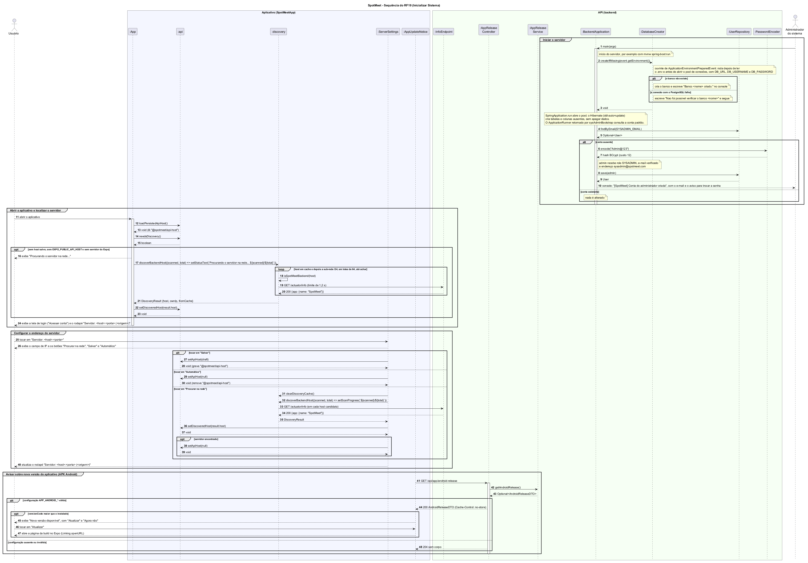

Fonte: próprio autor

#### RF20 – Consultar Status do Sistema

| Campo | Descrição |
|---|---|
| Função | Consulta o estado de funcionamento do sistema e dos seus subsistemas (Banco de dados, Rede e Recursos da JVM) e os detalhes do banco, da API e da JVM. |
| Descrição | **Status:** devolve ao administrador do sistema o estado geral (OPERATIONAL ou DEGRADED), a versão, o tempo em execução da JVM e o estado de cada subsistema. Banco de dados: validação de uma conexão do pool (ONLINE, WARNING ou FAILURE). Rede: teste de conexão à porta do servidor em 127.0.0.1, endereços IPv4 das placas de rede ativas e data do último reinício da Rede (ONLINE, WARNING quando não há placa de rede ativa ou FAILURE quando a porta recusa a conexão). Recursos: heap da JVM, percentual de uso e CPU do processo (ONLINE, ou WARNING acima de 90% do máximo ou sem limite conhecido). O estado geral é OPERATIONAL somente se os três estiverem ONLINE.  **Detalhes:** sob demanda, devolve nome, versão, tamanho, latência e contagem de linhas das oito tabelas do banco (users, organizations, organization_members, access_requests, organization_invitations, committees, committee_members e audit_logs), a situação do pool de conexões, as métricas da API (requisições, média de resposta, erros 4xx e 5xx, requisições ativas, threads e até três rotas mais usadas) e os recursos da JVM. A consulta é somente de leitura e não retorna dados pessoais. |
| Entradas | **Status:** nenhum corpo ou parâmetro; cabeçalho Authorization: Bearer {JWT}, cujo e-mail identifica o executor.  **Detalhes:** nenhum corpo ou parâmetro, com o mesmo cabeçalho. No aplicativo, a escolha do cartão "Banco de dados" ou "Recursos" ou do botão "Detalhes da API" (o cartão "Rede" não envia requisição). |
| Origem | Administrador do sistema. |
| Saída | **Status:** HTTP 200 com SystemStatusDTO contendo overallStatus ("OPERATIONAL" ou "DEGRADED"), version (versão do build, hoje "0.0.1-SNAPSHOT", ou "unknown" quando indisponível), uptimeSeconds (long), timestamp (LocalDateTime, horário do servidor, sem fuso), database e network (SubsystemInfo com name, status e details) e memory (MemoryInfo com name, status, details, totalMb, usedMb, freeMb, maxMb, usagePercent, processCpuPercent e processors). Os estados produzidos são ONLINE, WARNING e FAILURE. Erros: HTTP 401 quando o token está ausente, inválido, vencido ou revogado (SecurityConfig); HTTP 403 para conta sem perfil ADMIN ou SYSADMIN (regra hasAnyRole do SecurityConfig, ou SecurityException da AdminService convertida pela AdminController); HTTP 503, sem corpo, quando o JwtAuthFilter não consegue consultar a conta no banco; HTTP 500 com "Não foi possível consultar o status do sistema." em falha inesperada.  **Detalhes:** HTTP 200 com SystemDetailsDTO contendo timestamp (Instant, UTC), database (status, details, name, version, sizeBytes, responseTimeMs, pool com active, idle, waiting, total e maximum, e tableRows), api (version, countersSince, uptimeSeconds, requestMetricsAvailable, totalRequests, averageResponseTimeMs, clientErrors, serverErrors, activeRequests, jvmThreads, tomcatCurrentThreads, tomcatBusyThreads e topRoutes, com até três itens de method, route, requests e averageResponseTimeMs) e resources (MemoryInfo). Campos sem medição vêm nulos. Uma falha parcial na consulta ao banco devolve database.status WARNING com os valores obtidos, sem expor SQL, URL JDBC ou credenciais. Erros: os mesmos HTTP 401, 403 e 503, e HTTP 500 com "Não foi possível consultar os detalhes do sistema.". |
| Destino | Tela AdminMonitoringReportsScreen (aba "Monitoramento"), nos cartões "Banco de dados", "Rede" e "Recursos" e nas janelas "Detalhes: Banco de dados", "Detalhes: Rede", "Detalhes: Recursos" e "Detalhes: API". |
| Ação | **Status:** o Administrador do sistema, que vê as abas "Aprovações", "Organizações", "Monitoramento" e "Controles", toca na aba "Monitoramento". Ao receber o foco, a tela AdminMonitoringReportsScreen executa loadData, que envia ao mesmo tempo GET /api/admin/system/status e GET /api/admin/reports (RF21), com o cabeçalho Authorization e limite de 15 segundos. O hook useLiveSync repete a chamada de forma silenciosa a cada 4 segundos enquanto a aba está em foco e o aplicativo visível, e também ao receber os eventos MONITORING_REFRESH, VISIBILITY_RESTORED e os de alteração de organizações, integrantes e comissões; o botão "Atualizar" do cabeçalho e o gesto de puxar a lista repetem a chamada manualmente. A requisição passa pelo JwtAuthFilter, que valida a assinatura e a validade do token, o e-mail, a emissão depois de users.tokens_valid_after e a conta verificada, e pela regra hasAnyRole('ADMIN', 'SYSADMIN') do SecurityConfig para /api/admin/** e pelo @PreAuthorize da classe AdminController. O método getSystemStatus da classe AdminController chama getSystemStatus da classe AdminService, que confirma o executor por findByEmail da UserRepository e exige o perfil ADMIN ou SYSADMIN. Em seguida, obtém a versão e o tempo em execução (getVersion e getUptimeSeconds da SystemMonitoringService); para o banco, obtém uma conexão do DataSource e chama isValid(2) (ONLINE, WARNING se inválida, FAILURE com "Não foi possível consultar o banco de dados." em caso de exceção); para a rede, buildNetworkInfo tenta conectar a 127.0.0.1 na porta do servidor com limite de 1 segundo (FAILURE se recusar) e lista os IPv4 das placas ativas (WARNING se não houver nenhuma), informando o último reinício da Rede; para os recursos, collectResources lê o heap da JVM; e getOverallStatus calcula o estado geral. A tela mostra o selo do estado geral (Operacional ou Degradado), a linha "Última leitura", os cartões "Banco de dados", "Rede" e "Recursos", cada um com o selo Online, Alerta ou Falha, e, no cartão "API", a "Versão" e o "Tempo em execução". Se a atualização falhar, mantém os últimos dados e oferece o botão "Tentar novamente".  **Detalhes:** ao tocar em "Banco de dados", "Recursos" ou "Detalhes da API", abre a janela "Detalhes: {nome}" e envia GET /api/admin/system/details, fora do ciclo de 4 segundos; o botão "Atualizar detalhes" repete a consulta. Em "Recursos", a janela explica que o heap (memória usada pelo servidor Java) sobe a cada requisição, inclusive as consultas do próprio painel, e cai quando a JVM faz a coleta de memória, sozinha ou depois da solicitação em "Controles > Reiniciar subsistema > Recursos"; a JVM decide quando efetuar a coleta. O método getSystemDetails da classe AdminController chama getSystemDetails da AdminService, que confirma o executor por findByEmail e chama collect da SystemMonitoringService. Esse método abre uma conexão somente de leitura do DataSource, mede a latência, lê o nome, a versão, o tamanho e a contagem das oito tabelas em consultas fixas de até 3 segundos, lê o pool HikariCP, lê os temporizadores http.server.requests do MeterRegistry (total, média, erros 4xx e 5xx, até três rotas por modelo de endpoint, sem as rotas de monitoramento) e as threads da JVM e do Tomcat, e coleta os recursos da JVM. O cartão "Rede" abre a janela com o status já recebido e a explicação de que a Rede é o conector HTTP da API, sem nova requisição. |
| Pré-condição | **Status e detalhes:** servidor em execução com o PostgreSQL acessível (o filtro consulta a conta a cada requisição); estar autenticado (RF02) com um JWT válido (assinatura e validade corretas, e-mail igual ao da conta, emitido depois de users.tokens_valid_after) de conta com e-mail verificado e perfil global ADMIN ou SYSADMIN, com a aba "Monitoramento" aberta e o aplicativo em primeiro plano.  **Detalhes:** as mesmas, e ter tocado em um cartão (exceto "Rede") ou em "Detalhes da API". |
| Pós-condição | **Sucesso:** a tela exibe o selo do estado geral, os três cartões com seus estados, a "Última leitura", a versão e o "Tempo em execução"; ao abrir uma janela de detalhes, exibe os valores recebidos, e um campo sem medição aparece como "Indisponível". Nada é alterado no banco de dados.  **Falha:** em HTTP 403, os dados são limpos e a tela exibe "Acesso negado pelo servidor. Esta área exige permissão administrativa."; em HTTP 401, a sessão é encerrada e o aplicativo volta ao login com o aviso "Sua sessão foi encerrada. Entre novamente."; nas demais falhas (HTTP 500, HTTP 503, rede), a tela mantém os últimos dados e exibe "Não foi possível atualizar o monitoramento. Os últimos dados recebidos foram preservados.", com o botão "Tentar novamente" (nos detalhes, "Não foi possível consultar os detalhes. Tente novamente."). |
| Efeitos colaterais | Nenhum. A consulta não grava em audit_logs. |

**Figura 33 – Diagrama de sequência do RF20**

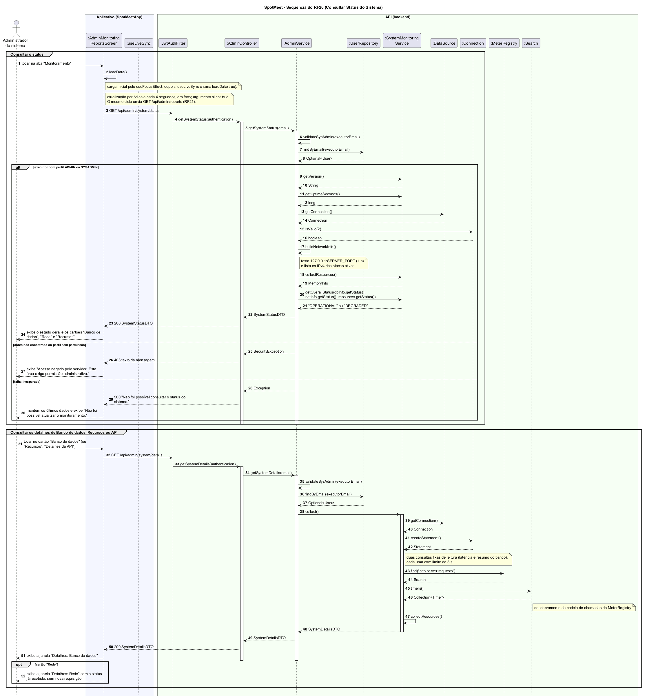

Fonte: próprio autor

#### RF21 – Consultar Relatórios

| Campo | Descrição |
|---|---|
| Função | Consulta relatórios agregados de usuários, organizações, comissões e auditoria. |
| Descrição | Gera um relatório com os totais de usuários (total, verificados e por perfil USER, ADMIN e SYSADMIN), de organizações (total, aprovadas e pendentes, com status PENDING), de comissões e de registros de auditoria, além das 15 atividades de auditoria mais recentes. Nas atividades, o e-mail do autor é mascarado e senhas, segredos e tokens são removidos do texto dos detalhes pela classe LgpdMaskUtil; registros sem autor aparecem como "Sistema". A consulta não grava auditoria. |
| Entradas | Nenhum corpo ou parâmetro. Cabeçalho Authorization: Bearer {JWT}, cujo e-mail identifica o executor. |
| Origem | Administrador do sistema. |
| Saída | HTTP 200 com AdminReportDTO contendo totalUsers, verifiedUsers, usersByRole (mapa com as chaves USER, ADMIN e SYSADMIN), totalOrganizations, approvedOrganizations, pendingOrganizations (organizações aguardando análise, com status PENDING; as recusadas e as bloqueadas não entram), totalCommittees, totalAuditLogs, generatedAt (LocalDateTime, horário do servidor, sem fuso) e recentActivities, lista de até 15 AuditActivityDTO com id, action, executorName, executorEmailMasked, sanitizedDetails e createdAt. Erros: HTTP 401 quando o token está ausente, inválido, vencido ou revogado; HTTP 403 para conta sem perfil ADMIN ou SYSADMIN; HTTP 503, sem corpo, quando o JwtAuthFilter não consegue consultar a conta no banco; HTTP 500 com "Erro ao gerar relatórios: {mensagem}" em falha inesperada. |
| Destino | Tela AdminMonitoringReportsScreen (aba "Monitoramento"), nos cartões "Usuários cadastrados" e "Visão geral" e na lista "Atividades recentes". |
| Ação | O Administrador do sistema toca na aba "Monitoramento". A mesma execução de loadData que consulta o status (RF20) envia GET /api/admin/reports, com limite de 15 segundos, e é repetida a cada 4 segundos pelo useLiveSync enquanto a aba está em foco. A requisição passa pelo JwtAuthFilter e pela regra hasAnyRole('ADMIN', 'SYSADMIN') do SecurityConfig. O método getReports da classe AdminController chama getReports da classe AdminService (transacional), que confirma o executor por findByEmail da UserRepository e exige o perfil ADMIN ou SYSADMIN. O serviço obtém todos os usuários por findAll da UserRepository e conta o total, os verificados e os de cada perfil; obtém todas as organizações por findAll da OrganizationRepository e conta o total, as aprovadas e as pendentes (não aprovadas com status PENDING ou sem status); obtém o total de comissões por count da CommitteeRepository e o total de registros de auditoria por count da AuditLogRepository. Em seguida, obtém os 100 registros mais recentes por findTop100ByOrderByCreatedAtDesc da AuditLogRepository, mantém os 15 primeiros e, para cada um, usa o nome do autor (ou "Sistema"), mascara o e-mail com maskEmail (dois primeiros caracteres, "***", último caractere do nome e domínio; "[NÃO INFORMADO]" quando não há autor) e remove senhas, segredos e tokens dos detalhes com sanitizeDetails, ambos da classe LgpdMaskUtil. A tela exibe o cartão "Usuários cadastrados" (total, "E-mails verificados", "Usuários comuns", "Administradores" e "Superadministradores"), o cartão "Visão geral" ("Organizações", "Aprovadas", "Pendentes", "Comissões", "Registros de auditoria" e "Relatório de {data} (servidor)") e a lista "Atividades recentes", em que cada item mostra o rótulo em português da ação (por exemplo "Reset total executado"), o autor com o e-mail mascarado, os detalhes sanitizados e a data. Sem registros, exibe "Nenhuma atividade registrada.". |
| Pré-condição | Servidor em execução com o PostgreSQL acessível; estar autenticado (RF02) com um JWT válido (assinatura e validade corretas, e-mail igual ao da conta, emitido depois de users.tokens_valid_after) de conta com e-mail verificado e perfil global ADMIN ou SYSADMIN, com a aba "Monitoramento" aberta e o aplicativo em primeiro plano. |
| Pós-condição | **Sucesso:** a tela exibe os totais e as atividades recentes recebidos, atualizados a cada 4 segundos, sem alterar nenhum registro.  **Falha:** em HTTP 403, os dados são limpos e a tela exibe "Acesso negado pelo servidor. Esta área exige permissão administrativa."; em HTTP 401, a sessão é encerrada e o aplicativo volta ao login com "Sua sessão foi encerrada. Entre novamente."; nas demais falhas, a tela mantém os últimos dados e exibe "Não foi possível atualizar o monitoramento. Os últimos dados recebidos foram preservados.", com o botão "Tentar novamente". |
| Efeitos colaterais | Nenhum. A consulta não grava em audit_logs, nem nas atualizações automáticas a cada 4 segundos. |

**Figura 34 – Diagrama de sequência do RF21**

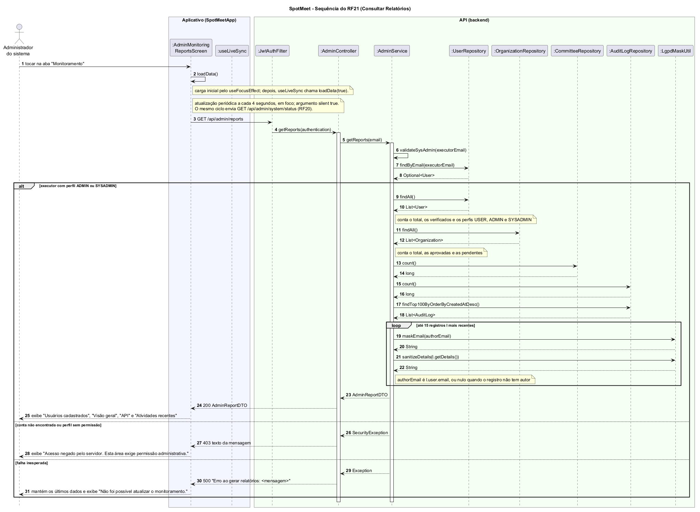

Fonte: próprio autor

#### RF22 – Reiniciar Subsistemas

| Campo | Descrição |
|---|---|
| Função | Reinicia um subsistema do servidor por vez (Banco de dados, Recursos ou Rede), a pedido do administrador do sistema, e registra o motivo na auditoria. |
| Descrição | **Banco de dados (DATABASE):** descarta as conexões do pool HikariCP (softEvictConnections), para que novas conexões sejam abertas, e testa uma conexão nova com isValid(2). Não reinicia o serviço PostgreSQL.  **Recursos (RESOURCES):** solicita a coleta de lixo da JVM (System.gc()) e informa quantos MB de memória em uso foram liberados. A JVM decide quando executar a coleta, e o processo do servidor não é reiniciado.  **Rede (NETWORK):** fecha e reabre o conector HTTP do Tomcat embutido (o componente que escuta a porta do servidor), em outra thread, cerca de 1 segundo depois de a resposta ser enviada e com até três tentativas de reabertura. Requisições em andamento nesse instante podem falhar. Não reinicia o Wi-Fi nem a rede do aparelho. O aplicativo não oferece esta opção; ela só é aceita pela API.  O reinício é por subsistema; não há reinício global. |
| Entradas | Objeto do tipo CriticalActionRequestDTO contendo subsystem ("DATABASE", "NETWORK" ou "RESOURCES"; o servidor aplica trim e converte para maiúsculas, e qualquer outro valor ou a ausência do campo é recusada), reason (opcional, sem limite no DTO; depois do trim é gravado em audit_logs.details, coluna de no máximo 1000 caracteres; ausente, o serviço usa "Rotina administrativa periódica") e confirmation (o aplicativo envia "RESTART_SYSTEM"; esta rota não usa @Valid e não confere o campo). Um corpo ausente equivale a subsistema inválido.  No aplicativo: a opção "Subsistema *" ("Banco de dados" ou "Recursos") e o campo "Motivo (opcional)", de até 500 caracteres; com o motivo vazio, o aplicativo envia "Reinicialização rotineira de subsistemas". |
| Origem | Administrador do sistema. |
| Saída | HTTP 200 com mapa contendo success (true), subsystem, message, executor (nome do administrador) e timestamp. A message é "Banco de dados reiniciado: conexões renovadas e conexão testada com sucesso.", "Recursos reiniciados: {n} MB de memória liberados (em uso: {m} MB)." ou "Rede em reinicialização: a porta {porta} será fechada e reaberta em cerca de 1 segundo. Requisições em andamento nesse instante podem falhar.". Erros: HTTP 400 com o texto "Subsistema inválido. Escolha Banco de Dados, Rede ou Recursos." (IllegalArgumentException convertida pela AdminController); HTTP 400 com {message: "Dados da moderação inválidos."} para corpo JSON malformado (tratador local da AdminController); HTTP 401 e HTTP 403, como no RF20; HTTP 500 com "Erro ao reiniciar subsistemas: {mensagem}" quando o banco não responde ou o servidor web não é o Tomcat embutido. |
| Destino | Tela AdminControlsScreen (aba "Controles"). |
| Ação | O Administrador do sistema toca na aba "Controles", que exibe a tela AdminControlsScreen. No cartão "Reiniciar subsistema", seleciona "Banco de dados" ou "Recursos" (cada opção mostra seus efeitos) e toca em "Reiniciar subsistema", que fica desabilitado enquanto nenhuma opção está selecionada. O aplicativo abre a janela "Reiniciar {subsistema}" com o campo "Motivo (opcional)", e o botão "Confirmar reinício" envia, por useAdminOperation.execute, a requisição POST /api/admin/system/restart com confirmation igual a "RESTART_SYSTEM", subsystem e o motivo informado, ou "Reinicialização rotineira de subsistemas" quando o campo está vazio. A requisição passa pelo JwtAuthFilter e pela regra hasAnyRole('ADMIN', 'SYSADMIN') do SecurityConfig. O método restartSystem da classe AdminController chama restartSystem da classe AdminService (transacional), que confirma o executor por findByEmail da UserRepository, exige o perfil ADMIN ou SYSADMIN, normaliza o subsistema e adota o motivo recebido. Para DATABASE, chama softEvictConnections no pool do DataSource e testa uma conexão nova; para RESOURCES, mede a memória em uso, chama System.gc() e mede de novo; para NETWORK, obtém os conectores do TomcatWebServer e inicia a thread "network-restart". Grava então o registro de auditoria pelo método save da AuditLogRepository e retorna o mapa. O aplicativo confere success e subsystem na resposta; em caso positivo, fecha a janela, exibe o aviso "Solicitação aceita" com o resultado (para o banco, "As conexões foram renovadas. Confira o estado do banco no Monitoramento."; para recursos, que a coleta foi solicitada e que a liberação de memória não é assegurada) e dispara o evento MONITORING_REFRESH, que atualiza a tela de Monitoramento. Em caso de erro, a mensagem aparece dentro da janela, que continua aberta. O botão de fechar a janela cancela sem enviar a requisição. |
| Pré-condição | Servidor em execução com o PostgreSQL acessível; estar autenticado (RF02) com um JWT válido de conta com e-mail verificado e perfil global ADMIN ou SYSADMIN, com a aba "Controles" aberta; ter selecionado um subsistema (o botão "Reiniciar subsistema" fica desabilitado sem seleção). Para DATABASE, o pool de conexões é o HikariCP; para NETWORK, o servidor web precisa ser o Tomcat embutido. |
| Pós-condição | **Sucesso:** o subsistema escolhido foi reiniciado (conexões do pool descartadas e uma nova conexão validada; coleta de memória solicitada; ou conector HTTP agendado para fechar e reabrir) e o registro ADMIN_SYSTEM_RESTART foi gravado. O aplicativo fecha a janela, exibe "Solicitação aceita" e atualiza o Monitoramento. Para a Rede, o aceite não comprova que a reabertura terminou: o status da Rede (RF20) informa o último reinício.  **Falha:** com subsistema inválido (HTTP 400) ou erro (HTTP 500), nenhum registro é gravado em audit_logs e a janela permanece aberta com a mensagem; em HTTP 403 ou HTTP 401, o aplicativo exibe "Acesso negado pelo servidor." ou encerra a sessão e volta ao login. |
| Efeitos colaterais | Registro em audit_logs com a ação ADMIN_SYSTEM_RESTART e os detalhes "Subsistema reiniciado: {subsistema}. Motivo: {motivo}". Conexões do pool descartadas e reabertas (DATABASE), coleta de lixo na JVM (RESOURCES) ou fechamento e reabertura do conector HTTP, com a linha "Rede reiniciada: conector HTTP reaberto na porta {porta}." no log do servidor e a data do último reinício no status da Rede (NETWORK). Atualização da tela de Monitoramento pelo evento MONITORING_REFRESH do syncBus. |

**Figura 35 – Diagrama de sequência do RF22**

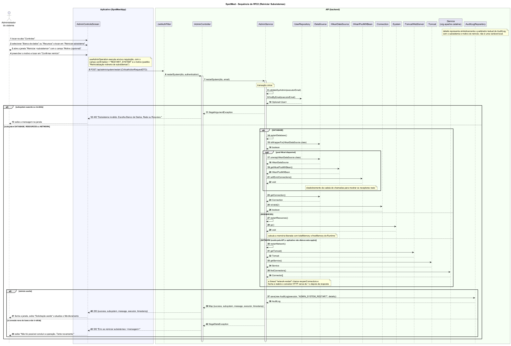

Fonte: próprio autor

#### RF23 – Resetar Sistema

| Campo | Descrição |
|---|---|
| Função | Remove todos os dados do sistema, preservando apenas a conta do administrador que executa a ação, e encerra todas as sessões. |
| Descrição | Exclui, em uma única transação, os registros de auditoria de outros usuários, os convites de organização, as solicitações de acesso, os integrantes de comissões, as comissões, os integrantes de organizações, as organizações e todos os usuários, exceto o executor. As fotos de perfil (user_profile_photos) saem junto com os usuários, pela chave estrangeira com exclusão em cascata. Grava na conta do executor o instante de corte de sessões (users.tokens_valid_after), que invalida todos os JWT emitidos antes dele; os tokens das contas excluídas deixam de ser aceitos porque a conta não existe mais. A conta preservada é a de quem executa: se o executor for ADMIN, a conta SYSADMIN também é excluída. |
| Entradas | Objeto do tipo CriticalActionRequestDTO contendo confirmation (obrigatória, anotada com @NotBlank, e igual a "CONFIRM_FULL_RESET", com distinção de maiúsculas e sem remoção de espaços), reason (opcional, sem limite no DTO; depois do trim é gravado em audit_logs.details, coluna de no máximo 1000 caracteres; ausente ou em branco, o serviço usa "Reset Total Administrativo do Sistema") e subsystem (ignorado nesta rota).  No aplicativo: o campo "Confirmação" (obrigatório, até 40 caracteres, igual a CONFIRM_FULL_RESET) e o campo "Motivo (opcional)", de até 500 caracteres; com o motivo vazio, o aplicativo envia "Manutenção administrativa de segurança". |
| Origem | Administrador do sistema. |
| Saída | HTTP 200 com mapa contendo success (true), message ("Reset Total do Sistema executado com sucesso! Todas as organizações, comissões e usuários comuns foram limpos do banco de dados, preservando exclusivamente a conta do Administrador."), adminPreserved ("{nome} ({e-mail})"), reason e timestamp. Erros: HTTP 400 com {status, error, message: "O token ou chave de confirmação é obrigatório.", errors} quando confirmation está em branco (@Valid, tratado pelo GlobalExceptionHandler); HTTP 400 com o texto "Código de confirmação inválido. Digite exatamente 'CONFIRM_FULL_RESET' para executar o Reset Total do Sistema." quando o texto é outro (IllegalArgumentException convertida pela AdminController); HTTP 401 e HTTP 403, como no RF20; HTTP 500 com "Erro ao executar reset: {mensagem}" em falha inesperada, caso em que a transação é desfeita. |
| Destino | Tela AdminControlsScreen (aba "Controles") e tela Auth (AuthScreen), para a qual o aplicativo retorna. |
| Ação | O Administrador do sistema toca na aba "Controles" e, no cartão "Reset total", no botão "Executar Reset Total do Sistema". O aplicativo abre a janela "Confirmar reset total", que informa que a ação é irreversível e pede "Digite exatamente CONFIRM_FULL_RESET para confirmar", com os campos "Confirmação" e "Motivo (opcional)". Digitar o texto não executa a ação: ao tocar em "Executar Reset", o formulário valida que o campo foi preenchido ("Informe o texto de confirmação.") e é igual a CONFIRM_FULL_RESET ("Digite exatamente CONFIRM_FULL_RESET."), sem enviar a requisição em caso de erro. Com os dados válidos, useAdminOperation.execute envia POST /api/admin/system/reset, e um toque repetido enquanto a requisição está em andamento é ignorado. A requisição passa pelo JwtAuthFilter e pela regra hasAnyRole('ADMIN', 'SYSADMIN') do SecurityConfig, e a anotação @Valid recusa um corpo com confirmation em branco. O método resetSystem da classe AdminController chama resetSystem da classe AdminService (transacional), que carrega o executor com bloqueio de linha por findByEmailForUpdate da UserRepository, exige o perfil ADMIN ou SYSADMIN e confere que confirmation é exatamente CONFIRM_FULL_RESET. Em caso positivo, executa nesta ordem deleteAllExceptAdminLogs da AuditLogRepository e deleteAllInBatch das repositories OrganizationInvitationRepository, AccessRequestRepository, CommitteeMemberRepository, CommitteeRepository, OrganizationMemberRepository e OrganizationRepository, e então deleteAllExceptAdmin da UserRepository, passando o identificador do executor. Grava tokensValidAfter do executor com o instante atual por save da UserRepository e registra a auditoria do reset por save da AuditLogRepository, em um bloco que ignora falha de gravação. Ao receber a resposta com success igual a true, o aplicativo fecha a janela, encerra a sessão por signOut do AuthContext (o que remove também o acesso biométrico guardado, ver RF02), reinicia a navegação na tela Auth em modo de login e exibe o aviso "Reset concluído" ("O sistema foi limpo. Sua sessão foi encerrada. Entre novamente."). Em caso de erro, a mensagem aparece dentro da janela, que continua aberta, e a sessão é mantida. O botão de fechar a janela cancela e limpa os campos. |
| Pré-condição | Servidor em execução com o PostgreSQL acessível; estar autenticado (RF02) com um JWT válido de conta com e-mail verificado e perfil global ADMIN ou SYSADMIN, com a aba "Controles" aberta. A conta que executa é a única que será preservada: qualquer outra conta, inclusive de outro administrador, será excluída. É preciso digitar exatamente CONFIRM_FULL_RESET. |
| Pós-condição | **Sucesso:** access_requests, organization_invitations, committee_members, committees, organization_members e organizations ficam sem registros; users contém apenas o executor (com tokens_valid_after preenchido); audit_logs contém apenas os registros do executor e os sem autor, mais o novo ADMIN_SYSTEM_FULL_RESET. Todos os JWT emitidos antes do reset são recusados com HTTP 401. O aplicativo volta ao login com o aviso "Reset concluído", e o administrador entra de novo com a mesma senha. Outros aparelhos descobrem o encerramento na próxima requisição ou na verificação periódica de sessão, a cada 15 segundos.  **Falha:** com confirmação inválida (HTTP 400), perfil sem permissão (HTTP 403) ou erro (HTTP 500), nenhum dado é alterado (a transação é desfeita), a sessão continua e a janela exibe a mensagem de erro. |
| Efeitos colaterais | Exclusão dos dados das tabelas access_requests, organization_invitations, committee_members, committees, organization_members e organizations, de todos os usuários da tabela users exceto o executor (inclusive outros administradores) e dos registros de audit_logs de outros usuários; remoção das fotos de perfil dos usuários excluídos e, por cascata das comissões, de reuniões, participantes, séries (meeting_series), anexos (meeting_files), atas, respostas, votações e votos. Registro em audit_logs com a ação ADMIN_SYSTEM_FULL_RESET, com o e-mail do administrador preservado e o motivo. Corte de sessões do executor (users.tokens_valid_after). No aplicativo, encerramento da sessão e do acesso biométrico guardado.  **Incremento 2:** as tabelas `meetings`, `meeting_participants`, `meeting_series` e `meeting_files` são esvaziadas pela exclusão em cascata das comissões. **Incremento 3:** pela mesma cascata, são esvaziadas também `meeting_minutes`, `minutes_responses`, `meeting_polls` e `poll_votes`. |

**Figura 36 – Diagrama de sequência do RF23**

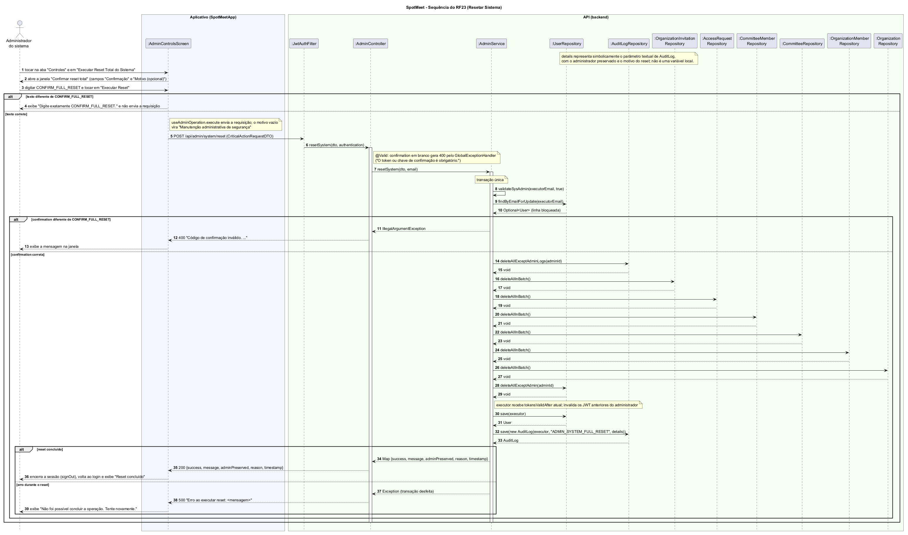

Fonte: próprio autor

#### RF24 – Designar Presidente da Comissão

| Campo | Descrição |
|---|---|
| Função | Define qual integrante ativo é o presidente de uma comissão e permite consultar os integrantes ativos. |
| Descrição | **Designação:** altera na tabela committee_members a coluna role. O integrante escolhido passa a COMMITTEE_ADMIN e o presidente anterior volta a MEMBER, de modo que a comissão tem no máximo um presidente. Se o escolhido já é o presidente, nada é alterado e o vínculo atual é devolvido. A organização é bloqueada para escrita durante a operação (OrganizationRepository.findByIdForUpdate), o que serializa designações simultâneas.  **Consulta de integrantes:** devolve os vínculos com status ACTIVE da comissão, nos quais o presidente aparece com role COMMITTEE_ADMIN. |
| Entradas | **Designação:** variáveis de rota committeeId (Long, comissão) e userId (Long, integrante a ser presidente). O executor é obtido do token JWT.  **Consulta de integrantes:** variável de rota committeeId (Long). |
| Origem | Usuário (líder da organização) e banco de dados (vínculos da comissão). |
| Saída | **Designação:** HTTP 200 com CommitteeMemberResponseDTO contendo id, userId, userName, userEmail, committeeId, committeeName, organizationId, status, role, requestedAt, respondedAt e invitedByName. Em caso de erro, HTTP 403 quando o executor não é líder da organização (SecurityException) e HTTP 409 quando a comissão ou a organização não existe ou o escolhido não é integrante ativo (IllegalArgumentException e IllegalStateException, convertidas pelo GlobalExceptionHandler).  **Consulta de integrantes:** HTTP 200 com a lista de CommitteeMemberResponseDTO; HTTP 403 quando o usuário não é integrante ativo nem líder; HTTP 409 quando a comissão não existe. |
| Destino | Usuário, por meio da folha PresidentSheet (aberta pela tela OrganizationScreen) e do cartão da comissão, que passa a exibir "Presidente: nome". |
| Ação | Na aba "Organização", na lista de comissões, o líder vê em cada cartão a linha "Presidente: nome" (ou "Sem presidente definido") e o botão "Presidente" (com o rótulo de acessibilidade "Presidente de nome da comissão"). Ao tocar, o aplicativo abre a folha "Presidente da comissão", que envia GET /api/committees/{committeeId}/members. O método listActiveMembers da classe CommitteeController chama o método listActiveMembers da classe CommitteeService, que consulta a comissão (CommitteeRepository.findById), o usuário (UserRepository.findByEmail) e, se o usuário não for integrante ativo, exige a liderança da organização (requireOrganizationLeader); em seguida lista os integrantes (CommitteeMemberRepository.findByCommitteeIdAndStatus). A folha exibe cada integrante com a ação "Definir presidente" (o presidente atual exibe a etiqueta "Presidente").  Ao tocar em "Definir presidente", o aplicativo pede a confirmação "Definir presidente" (o integrante será o presidente da comissão e o presidente atual deixa o cargo) e, ao confirmar com "Definir", envia PUT /api/committees/{committeeId}/president/{userId}. O método assignPresident da classe CommitteeController chama o método assignPresident da classe CommitteeService, que carrega a comissão e o usuário, bloqueia a organização (findByIdForUpdate), confere a liderança (requireOrganizationLeader, que consulta OrganizationMemberRepository.findByUserIdAndOrganizationId), localiza o vínculo ACTIVE do escolhido (CommitteeMemberRepository.findByUserIdAndCommitteeId), rebaixa os presidentes atuais (findByCommitteeIdAndRole e save), promove o escolhido (save) e registra a auditoria (AuditLogRepository.save). Com a resposta de sucesso, o aplicativo exibe o aviso "Sucesso" com o texto "Presidente definido.", dispara o evento COMMITTEES_MUTATED e recarrega as comissões. |
| Pré-condição | **Designação:** o usuário estar autenticado e ser dono, vice-líder ou subdono da organização da comissão (a conta SYSADMIN também é aceita pela API); a comissão existir; o escolhido ser integrante da comissão com status ACTIVE.  **Consulta de integrantes:** o usuário ser integrante ativo da comissão ou líder da organização. |
| Pós-condição | **Sucesso:** a comissão passa a ter exatamente um vínculo ACTIVE com role COMMITTEE_ADMIN, o do escolhido; o presidente anterior volta a MEMBER; a auditoria fica registrada; o cartão da comissão exibe "Presidente: nome" e o escolhido passa a ver o botão "+" de agendar na aba "Reuniões" (RF25).  **Falha:** nenhum papel é alterado e a folha exibe a mensagem de erro. |
| Efeitos colaterais | Registro em audit_logs com a ação COMMITTEE_PRESIDENT_ASSIGNED (detalhe com o ID do usuário e o nome da comissão). Evento COMMITTEES_MUTATED, que atualiza as outras telas abertas. |

**Figura 37 – Diagrama de sequência do RF24**

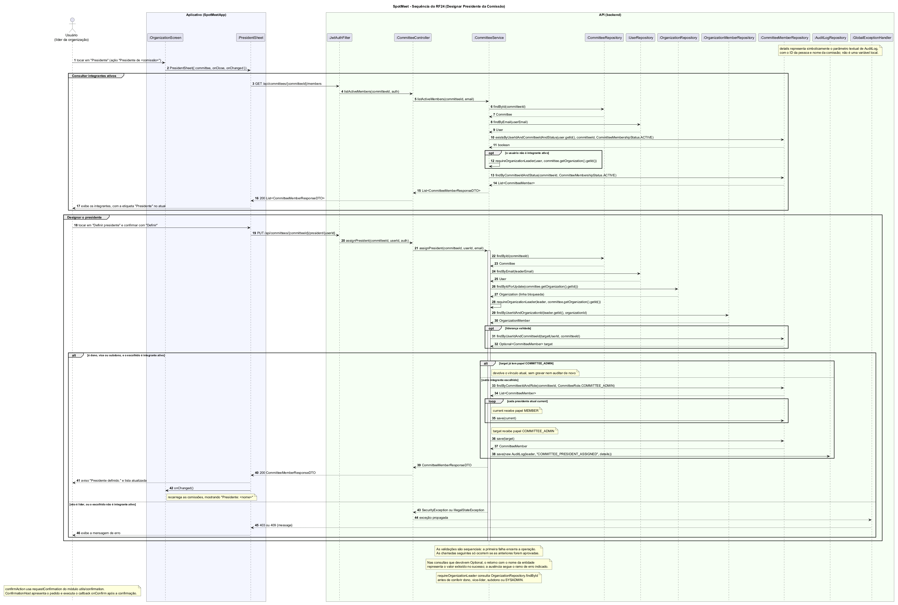

Fonte: próprio autor

#### RF25 – Agendar Reunião

| Campo | Descrição |
|---|---|
| Função | Agenda uma reunião, ou uma série de reuniões que se repetem, para uma comissão, registra os convidados e envia o convite por e-mail. |
| Descrição | Insere na tabela meetings uma reunião com título, pauta, modalidade, local, link, prioridade, início, término, indicação de dia inteiro, anexo, comissão e autor, e insere em meeting_participants uma linha para cada convidado (RF29), com resposta PENDING; o presidente já entra com resposta ACCEPTED. Na reunião de dia inteiro sem repetição (all_day), o servidor grava 00:00 da data inicial e 23:59:59 da data final, seja qual for a hora enviada. Nas séries, a duração é guardada em minutos inteiros (Duration.toMinutes); nas séries de dia inteiro, cada data gerada recebe os 59 segundos finais e também termina às 23:59:59 da data final. A reunião pode ocupar vários dias, sem limite de duração; o término deve ser depois do início. Na modalidade presencial o link é descartado e na online, o local. O link sem http:// ou https:// recebe https://.  **Repetição:** quando a frequência é informada, grava em meeting_series a regra (diária, semanal, mensal ou anual, repetida a cada N unidades, com os dias da semana, o tipo do mês e o fim: em uma data, após um número de vezes ou nunca) e os dados da reunião, e cria uma reunião em meetings para cada data dos próximos três meses, cada uma com os seus convidados. As datas são calculadas a partir da data escolhida (MeetingRecurrence); a primeira é a primeira data da regra a partir dela. A cada hora, e um minuto depois de o servidor ligar, são criadas as datas que entraram na janela de três meses (MeetingService.extendSeries), convidando os escolhidos que continuam integrantes ativos e o presidente atual. O agendamento é recusado quando a reunião dura mais que o intervalo entre as datas.  **Anexo da pauta:** o arquivo é enviado antes do agendamento, conferido pelo conteúdo (PDF, DOC, DOCX, JPG ou PNG, até 10 MB) e gravado em meeting_files; a reunião, ou todas as datas da série, apontam para ele. A limpeza ocorre no próximo upload válido: só apaga arquivos criados há mais de 24 horas e sem referência em nenhuma reunião nem série. Não há limpeza periódica apenas pela passagem do prazo.  A situação da reunião não é gravada: é calculada pelo relógio (Meeting.statusAt), sendo "Agendada" antes do início, "Em andamento" entre o início e o término efetivamente gravado, "Encerrada" depois do término e "Cancelada" quando há data de cancelamento. |
| Entradas | **Anexo:** variável de rota committeeId (Long) e a parte de formulário file (arquivo de até 10 MB).  **Agendamento:** variável de rota committeeId (Long) e objeto do tipo MeetingRequestDTO contendo title (string obrigatória de 2 a 100 caracteres, com espaços repetidos normalizados), agenda (opcional, até 2000 caracteres), modality (IN_PERSON, ONLINE ou HYBRID; sem ela, deduzida do local e do link), location (opcional, até 100 caracteres), link (opcional, até 300 caracteres, endereço com ponto no nome, com ou sem http:// ou https://), priority (LOW, MEDIUM ou HIGH; padrão MEDIUM), allDay (booleano opcional), invitedUserIds (lista opcional de IDs de integrantes ativos; se ausente, todos são convidados), startsAt e endsAt (obrigatórios, texto de data e hora local sem fuso, como 2026-11-02T16:00:00), attachmentFileId (opcional, ID do anexo enviado antes) e recurrence (opcional, MeetingRecurrenceDTO com frequency DAILY, WEEKLY, MONTHLY ou YEARLY, interval de 1 a 99, weekDays de 1 a 7, monthlyByWeekday e, no máximo um dos dois, endDate ou occurrences de 1 a 365). No aplicativo, as datas e as horas são escolhidas no seletor do celular. |
| Origem | Usuário (presidente da comissão) e banco de dados (integrantes ativos da comissão). |
| Saída | **Anexo:** HTTP 201 com AttachmentDTO contendo id, fileName, contentType e sizeBytes. Em caso de erro, HTTP 403 quando o usuário não é presidente ativo da comissão; HTTP 409 quando o arquivo não é PDF, DOC, DOCX, JPG ou PNG ou passa de 10 MB; HTTP 413 quando o envio passa do limite do servidor.  **Agendamento:** HTTP 201 com MeetingResponseDTO contendo id, committeeId, committeeName, organizationId, title, agenda, location, link, priority, modality, allDay, startsAt, endsAt, status, createdByUserId, createdByName, canceledAt, cancelReason, seriesId, recurrence, attachment, attendanceListGeneratedAt, myResponse, myEnteredAt, myLeftAt, totalInvited, totalAccepted, totalDeclined, totalPending, declines, minutesStatus, minutesToAnswer e participants (na série, os da primeira data). Em caso de erro, HTTP 400 quando algum campo não atende às validações; HTTP 403 quando o usuário não é presidente ativo da comissão ou o anexo não foi enviado por ele nesta comissão; HTTP 409 quando a comissão não existe, a organização não está aprovada, o início não é futuro (no dia inteiro, quando é antes de hoje), algum convidado não é integrante ativo, a repetição tem as duas formas de terminar, termina antes do primeiro dia, não tem nenhuma data ou a reunião dura mais que o intervalo entre as datas. |
| Destino | Usuário, por meio da tela MeetingsScreen, do formulário MeetingForm e das folhas FrequencySheet e InviteesSheet; banco de dados (tabelas meetings, meeting_participants, meeting_series e meeting_files); caixa de e-mail dos convidados (assunto "Convite: título, data, hora"). |
| Ação | Na aba "Reuniões", o botão "+" aparece quando o usuário preside ao menos uma comissão (RF28). Ao tocá-lo, o aplicativo abre o formulário "Agendar reunião" (MeetingForm), com a escolha da comissão, Título, Data inicial, a caixa "Dia inteiro", Data final, Início e Término (que somem no dia inteiro), Frequência, Modalidade (Presencial, Online ou Híbrida), Local e Link conforme a modalidade, Pauta, "Anexar documento da pauta", Prioridade (Baixa, Média ou Alta) e Convidados (RF29). Datas e horas abrem o seletor do celular (DateTimeField, com @react-native-community/datetimepicker); a data final não aceita dia anterior à inicial e, se o término ficar antes do início no mesmo dia, passa para o dia seguinte, com o aviso "Termina no dia seguinte, às 01:00.". O campo Frequência abre a folha "Frequência" (FrequencySheet), com Não se repete, Todos os dias, Semanal, Mensal, Anual, Todos os dias úteis e "Personalizar...", que abre "Personalizar frequência": repetir a cada N dia, semana, mês ou ano, os dias da semana, no mês "Todo dia 2" ou "Toda primeira segunda", Termina (Nunca, Em uma data ou Após N ocorrências) e o resumo em português. O anexo é escolhido no celular (expo-document-picker); acima de 10 MB, o formulário exibe "O arquivo passa de 10 MB. Escolha um menor.". O formulário confere o título, o início futuro ("O início precisa ser no futuro."), o término depois do início e o link.  Ao tocar em "Agendar reunião", se houver anexo, o aplicativo o envia primeiro em POST /api/committees/{committeeId}/meeting-files: o método upload da classe MeetingFileController chama o método upload da classe MeetingFileService, que exige o presidente (MeetingAccess.requirePresident), confere o tipo pelo começo do arquivo, apaga os anexos criados há mais de 24 horas que nenhuma reunião nem série referencia (MeetingFileRepository.deleteUnusedBefore, executado apenas nesse upload) e grava o arquivo (MeetingFileRepository.save). Em seguida envia POST /api/committees/{committeeId}/meetings com o ID do anexo. O método createMeeting da classe MeetingController chama o método createMeeting da classe MeetingService, que carrega a comissão e o usuário (MeetingAccess.findCommittee e findUser), exige o presidente (requirePresident), confere que a organização está aprovada, exige o início futuro (requireFutureStart), escolhe os convidados (resolveInvitees) e confere o anexo (MeetingFileService.resolve). Sem repetição, grava a reunião (MeetingRepository.save) e os participantes (MeetingParticipantRepository.saveAll); com repetição, grava a série (MeetingSeriesRepository.save) e cria as datas (extend, com MeetingRecurrence.window). Por fim registra a auditoria (MeetingAccess.audit) e agenda um e-mail de convite por convidado (EmailService.sendMeetingInvitationEmail), enviado depois do commit. Com a resposta de sucesso, o aplicativo exibe o aviso "Sucesso" com o texto "Reunião agendada. Os convidados recebem um e-mail." (na série, "Reuniões agendadas para os próximos 3 meses. Os convidados recebem um e-mail."), fecha o formulário e abre o detalhe da reunião. |
| Pré-condição | O usuário estar autenticado e ser integrante ativo da comissão com o papel de presidente (COMMITTEE_ADMIN); a organização da comissão estar aprovada; o horário de início ser posterior ao momento do envio (no dia inteiro, a data inicial ser hoje ou depois); o anexo, quando houver, ter sido enviado pelo próprio presidente na mesma comissão. |
| Pós-condição | **Sucesso:** existe uma nova reunião (ou uma para cada data dos próximos três meses, ligadas à série) com situação "Agendada" ("Em andamento" no dia inteiro que começa hoje) e uma linha em meeting_participants para cada convidado (pendente, exceto o presidente, que consta como aceito); a auditoria fica registrada; a reunião aparece em "Próximas" e, para os convidados, no aviso de convites e no número da aba "Reuniões".  **Falha:** nada é gravado (um anexo já enviado pode ficar sem uso; só será apagado no próximo upload válido, se tiver mais de 24 horas e não for referenciado por nenhuma reunião nem série); o formulário continua aberto, com os dados preenchidos e a mensagem de erro. |
| Efeitos colaterais | Registro em audit_logs com a ação MEETING_CREATED (detalhe com o ID da reunião, o nome da comissão e o número de convidados ou, na série, de reuniões criadas). E-mail de convite a cada convidado, exceto o presidente, com o assunto "Convite: título, data, hora", os dados da reunião, o nome do anexo e o botão "Abrir no SpotMeet"; na série, um e-mail só, com a frequência. Sem SMTP configurado, apenas um registro no log do servidor. Criação automática das datas seguintes da série, a cada hora. Evento MEETINGS_MUTATED, que atualiza as telas abertas. Não há notificação push. |

**Figura 38 – Diagrama de sequência do RF25**

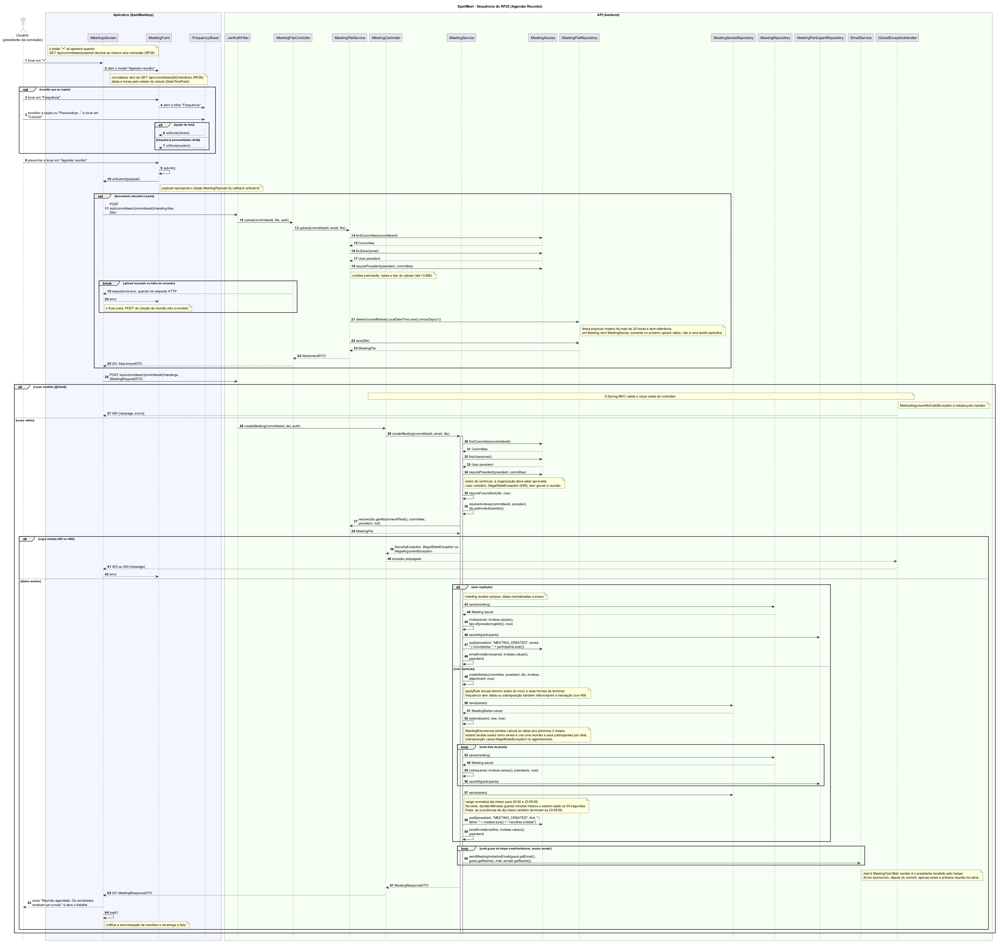

Fonte: próprio autor

#### RF26 – Editar Reunião

| Campo | Descrição |
|---|---|
| Função | Altera os dados e a lista de convidados de uma reunião agendada ou em andamento e avisa os convidados. |
| Descrição | Atualiza na tabela meetings os campos informados, com as mesmas regras do RF25 (dia inteiro, modalidade, link e anexo), e, quando a lista de convidados é enviada, ajusta meeting_participants: quem continua convidado mantém a resposta e o comentário, quem saiu da lista é removido e quem entrou é criado com resposta PENDING. Quem já registrou entrada não pode ser retirado. A comissão da reunião não pode ser trocada. A reunião pode ser editada enquanto está "Agendada" ou "Em andamento"; o início só precisa ser futuro quando muda, e o término precisa ser depois do momento da edição. Numa reunião de uma série, só a data escolhida muda; a regra de repetição não é editada. A edição apaga o carimbo da lista de presença já gerada (RF34). Um anexo trocado é apagado quando nenhuma reunião ou série aponta mais para ele. |
| Entradas | Variável de rota meetingId (Long) e objeto do tipo MeetingRequestDTO, com os mesmos campos e restrições do RF25, exceto recurrence, que é ignorado. Se invitedUserIds for omitido, os convidados atuais são mantidos; attachmentFileId com o ID atual mantém o anexo, vazio o remove e um novo ID, enviado antes como no RF25, o troca. |
| Origem | Usuário (presidente da comissão) e banco de dados (reunião e participantes atuais). |
| Saída | HTTP 200 com MeetingResponseDTO, incluindo os participantes. Em caso de erro, HTTP 400 quando algum campo não atende às validações; HTTP 403 quando o usuário não é presidente ativo da comissão; HTTP 409 quando a reunião não existe, está encerrada ou cancelada, o novo início não é futuro, o término não é depois de agora, algum convidado não é integrante ativo ou a edição retira quem já registrou entrada. |
| Destino | Usuário, por meio da tela MeetingsScreen e do formulário MeetingForm; caixa de e-mail dos convidados (assunto "Reunião alterada: título"). |
| Ação | No detalhe de uma reunião "Agendada" ou "Em andamento", o presidente toca em "Editar reunião". O botão só fica ativo depois que o detalhe carregou a lista de participantes, porque o formulário parte dos convidados atuais e, sem eles, a gravação retiraria os demais convidados. O aplicativo abre o formulário "Editar reunião" (MeetingForm) preenchido com os dados atuais, sem a escolha de comissão e com a frequência travada; a dica "A frequência da série não muda por aqui." aparece somente para reunião de uma série; exibe o aviso "Reunião de uma série: Só esta reunião será alterada." quando é o caso e "Reunião em andamento: As alterações valem a partir de agora." quando a reunião já começou. Ao tocar em "Salvar alterações", o aplicativo valida os campos como no RF25, envia o anexo novo, se houver, e envia PUT /api/meetings/{meetingId}. O método updateMeeting da classe MeetingController chama o método updateMeeting da classe MeetingService, que carrega a reunião e o usuário (MeetingAccess.findMeeting e findUser), exige o presidente (requirePresident), confere a situação (Meeting.statusAt), exige o início futuro quando ele muda, confere o término, escolhe os convidados quando foram enviados (resolveInvitees), confere o anexo (MeetingFileService.resolve), grava a reunião (MeetingRepository.save), ajusta os participantes (syncInvitees, com findByMeetingIdOrderByUserNameAsc, deleteAll e saveAll), apaga o anexo trocado sem uso (MeetingFileService.deleteIfUnused), apaga o carimbo da lista (MeetingAccess.invalidateList), registra a auditoria e agenda os e-mails (EmailService.sendMeetingChangedEmail aos que já estavam convidados, quando muda o título, a data, o horário, a modalidade, o local, o link, a pauta ou o anexo, e sendMeetingInvitationEmail aos que entraram na lista). Com a resposta de sucesso, o aplicativo exibe o aviso "Sucesso" com o texto "Reunião atualizada. Os convidados recebem um e-mail com o que mudou." e abre o detalhe. |
| Pré-condição | O usuário estar autenticado e ser o presidente ativo da comissão; a reunião existir e estar agendada ou em andamento; o novo horário de início, quando muda, ser posterior ao momento do envio; o término ser posterior ao momento do envio. |
| Pós-condição | **Sucesso:** a reunião e os participantes refletem os dados enviados, mantendo as respostas de quem continua convidado; as outras datas da série não mudam; a lista de presença precisa ser gerada de novo; a auditoria fica registrada.  **Falha:** nada é alterado; o formulário continua aberto com a mensagem de erro. |
| Efeitos colaterais | Registro em audit_logs com a ação MEETING_UPDATED. E-mail "Reunião alterada: título" aos convidados que já estavam na reunião (exceto o presidente), com "O que mudou" (antes e depois) e a reunião completa, quando algo que eles veem mudou; e-mail de convite a quem entrou na lista. Evento MEETINGS_MUTATED. |

**Figura 39 – Diagrama de sequência do RF26**

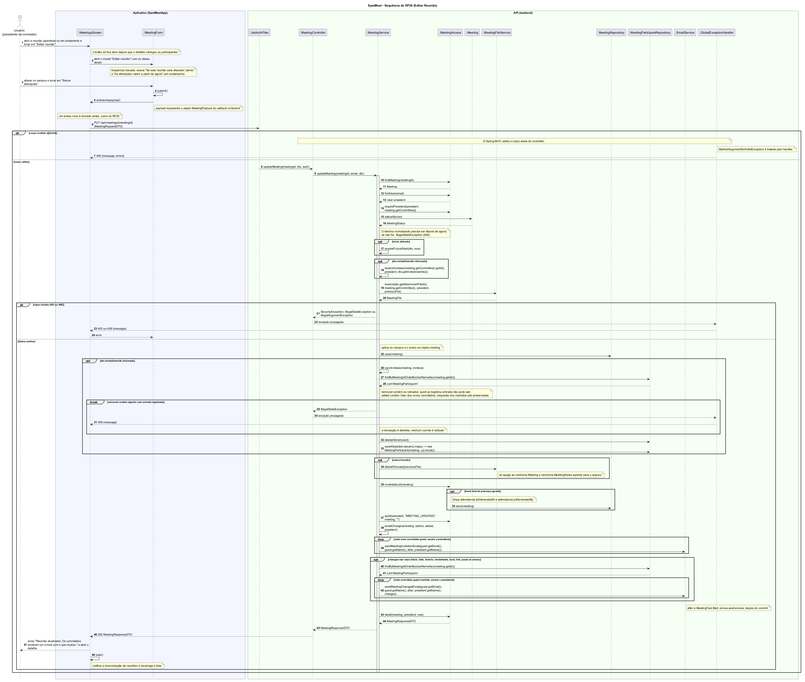

Fonte: próprio autor

#### RF27 – Cancelar Reunião

| Campo | Descrição |
|---|---|
| Função | Cancela uma reunião que ainda não terminou e avisa os convidados. |
| Descrição | Grava na tabela meetings a data e a hora do cancelamento (canceled_at) e o motivo opcional (cancel_reason, até 300 caracteres). Com isso, a situação calculada passa a "Cancelada", a reunião deixa de aceitar respostas, registros de presença e geração da lista, e os convites e registros existentes são mantidos. A API e o aplicativo aceitam o cancelamento de reuniões agendadas e em andamento. Numa série, só a data escolhida é cancelada; as outras continuam agendadas. |
| Entradas | Variável de rota meetingId (Long) e, opcionalmente, objeto do tipo MeetingCancelDTO contendo reason (string de, no máximo, 300 caracteres). |
| Origem | Usuário (presidente da comissão). |
| Saída | HTTP 200 com MeetingResponseDTO atualizado, com cancelReason. Em caso de erro, HTTP 400 quando o motivo passa de 300 caracteres; HTTP 403 quando o usuário não é presidente ativo da comissão e HTTP 409 quando a reunião não existe, já foi cancelada ou já terminou. |
| Destino | Usuário, por meio da tela MeetingsScreen; caixa de e-mail dos convidados (assunto "Reunião cancelada: título"). |
| Ação | No detalhe de uma reunião "Agendada" ou "Em andamento", o presidente toca em "Cancelar reunião". O aplicativo mostra a tela "Cancelar reunião", com o aviso "Reunião de uma série: Só a reunião de segunda, 2 de novembro será cancelada. As outras da série continuam agendadas." quando é o caso, o título, a comissão e o horário, o campo "Motivo (opcional)" e a nota "O motivo aparece no e-mail enviado aos convidados.". Ao tocar em "Cancelar reunião", o aplicativo envia POST /api/meetings/{meetingId}/cancel com o motivo; "Manter reunião" volta ao detalhe. O método cancelMeeting da classe MeetingController chama o método cancelMeeting da classe MeetingService, que carrega a reunião e o usuário, exige o presidente (requirePresident), confere a situação (Meeting.statusAt), grava canceledAt e o motivo (MeetingRepository.save), registra a auditoria e agenda o e-mail de cancelamento a cada convidado (EmailService.sendMeetingCanceledEmail). Com a resposta de sucesso, o aplicativo exibe o aviso "Sucesso" com o texto "Reunião cancelada. Os convidados recebem um e-mail." e o detalhe passa a exibir a situação "Cancelada" e o motivo. |
| Pré-condição | O usuário estar autenticado e ser o presidente ativo da comissão; a reunião existir e não estar cancelada nem encerrada. |
| Pós-condição | **Sucesso:** a reunião tem a data e o motivo do cancelamento gravados e situação "Cancelada"; aparece em "Próximas", com a etiqueta "Cancelada", até a data passar, e depois em "Anteriores"; não aceita mais respostas, registros de presença nem lista; a auditoria fica registrada.  **Falha:** a reunião não é alterada e a mensagem de erro é exibida. |
| Efeitos colaterais | Registro em audit_logs com a ação MEETING_CANCELED. E-mail "Reunião cancelada: título" a cada convidado, exceto o presidente, com o motivo, a data, o horário e o local; na série, avisa que as outras datas continuam agendadas. Evento MEETINGS_MUTATED. Não há notificação push. |

**Figura 40 – Diagrama de sequência do RF27**

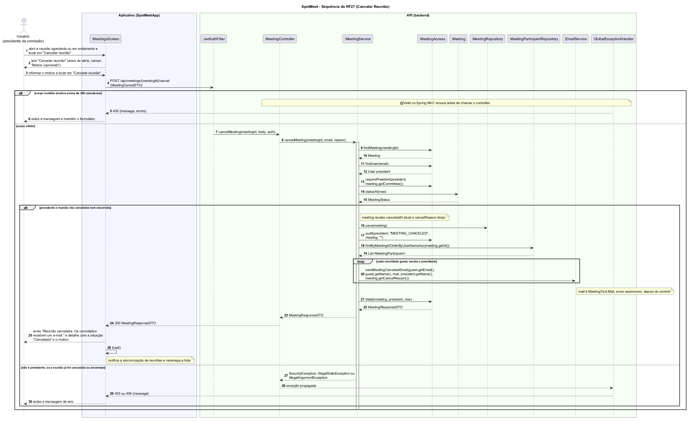

Fonte: próprio autor

#### RF28 – Consultar Reuniões

| Campo | Descrição |
|---|---|
| Função | Consulta as reuniões do usuário, as de uma comissão, o detalhe de uma reunião, o anexo da pauta e o número de convites sem resposta. |
| Descrição | **Minhas reuniões:** devolve as reuniões em que o usuário foi convidado, desde que o seu vínculo com a comissão continue ativo, todas as reuniões das comissões em que ele é o presidente ativo (um presidente designado depois do agendamento ainda não é convidado das reuniões antigas) e, quando ele é dono, vice-líder ou subdono (papel diferente de MEMBER em organization_members), todas as reuniões das comissões dessas organizações, sem repetir, da mais recente para a mais antiga, com a resposta dele (myResponse, vazia quando não foi convidado), os horários da sua entrada e saída (myEnteredAt e myLeftAt) e os contadores de convidados. Para as reuniões das comissões que o usuário preside, cada resumo traz também declines: os convidados com resposta DECLINED, com o nome e o comentário, da recusa mais recente para a mais antiga; para os demais, declines vem nulo.  **Reuniões da comissão:** devolve as reuniões da comissão, da mais recente para a mais antiga, sem a lista de participantes.  **Detalhe:** devolve a reunião com a lista de participantes, as respostas, os comentários de recusa e os registros de entrada e saída.  **Comissões presididas:** devolve os vínculos ACTIVE em que o usuário tem o papel COMMITTEE_ADMIN; o aplicativo usa essa lista para exibir o botão "+" (RF25).  **Convites sem resposta:** conta os convites PENDING do usuário em reuniões não canceladas e não terminadas de comissões em que ele continua ativo.  **Anexo:** devolve o arquivo da pauta da reunião, com o nome e o tipo.  **Página do e-mail:** a rota pública /abrir/reuniao/{meetingId} devolve uma página que abre a reunião no aplicativo (spotmeet://reunioes/{meetingId}), sem mostrar dados da reunião. |
| Entradas | **Minhas reuniões, comissões presididas e convites sem resposta:** nenhuma; o usuário é obtido do token JWT.  **Reuniões da comissão:** variável de rota committeeId (Long).  **Detalhe, anexo e página do e-mail:** variável de rota meetingId (Long). |
| Origem | Usuário e banco de dados (tabelas meetings, meeting_participants, meeting_files e committee_members). |
| Saída | HTTP 200 com lista de MeetingResponseDTO (minhas reuniões e reuniões da comissão), com um MeetingResponseDTO completo (detalhe) com lista de CommitteeMemberResponseDTO (comissões presididas), com {count} (convites sem resposta), com o conteúdo do arquivo, o tipo e o nome em Content-Disposition (anexo) ou com a página HTML (página do e-mail). Em caso de erro, HTTP 403 quando o usuário não é integrante ativo da comissão nem líder da organização, e HTTP 409 quando a comissão ou a reunião não existe ou a reunião não tem anexo. |
| Destino | Usuário, por meio da tela MeetingsScreen, do número na aba "Reuniões" (usePendingInvitations) e do aplicativo do celular que abre o anexo (expo-sharing). |
| Ação | A aba "Reuniões" é a primeira e exibe o número de convites sem resposta: o hook usePendingInvitations envia GET /api/meetings/invitations/pending a cada 30 segundos e depois de qualquer mudança em reuniões; o método countPendingInvitations da classe MeetingController chama o método de mesmo nome da classe MeetingService (MeetingParticipantRepository.countPending).  Ao abrir a aba "Reuniões", o aplicativo envia GET /api/meetings/mine e GET /api/committees/presided. O método listMyMeetings da classe MeetingController chama o método listMyMeetings da classe MeetingService, que consulta MeetingParticipantRepository.findActiveByUser, acrescenta as reuniões das comissões presididas (CommitteeMemberRepository.findByUserIdAndStatus e MeetingRepository.findByCommitteeIdOrderByStartsAtDesc) e as das comissões das organizações que o usuário lidera (OrganizationMemberRepository.findByUserId, CommitteeRepository.findByOrganizationId e MeetingRepository.findByCommitteeIdOrderByStartsAtDesc) e monta os resumos (MeetingAccess.summaries, que preenche declines nas comissões presididas); o método listPresidedCommittees da classe CommitteeController chama o método de mesmo nome da classe CommitteeService. A tela exibe a data de hoje, o aviso de pendências e os filtros. O aviso mostra "Você tem N convites para responder." (e as atas, RF39) com "Ver convites" ou "Ver Pendências"; para o presidente, mostra também as recusas das reuniões ainda não terminadas ("1 convidado recusou seu convite.", com "Ver recusas"). A página "Pendências" lista, em "RECUSAS DOS SEUS CONVITES", quem recusou, a reunião, a data e o motivo em letra normal ("Não informou o motivo." quando não há); cada recusa sai da lista quando a reunião termina ou quando a pessoa muda a resposta, e tocar nela abre a reunião. A página Pendências organiza, nessa ordem, "ATAS PARA RESPONDER", "RECUSAS DOS SEUS CONVITES" e "CONVITES PARA RESPONDER". Na lista principal ficam os filtros "Todas", "Próximas" e "Passadas" e as seções "Acontecendo agora" (com Registrar entrada, Registrar saída e Lista de presença no próprio cartão, RF31 a RF35), "Próximas" e "Anteriores"; nos cartões comuns há o bloco da data (TER 03 NOV), o título, a comissão, o horário ou "Dia inteiro", a situação, a prioridade e o símbolo de repetição; para o presidente, o selo "1 recusou" (ou "N recusaram") nas reuniões agendadas ou em andamento com recusas; e, para o líder que não preside nem foi convidado, o selo "Só visualização". O cartão de "Acontecendo agora" tem os selos "Em andamento" e, quando aplicável, "Só visualização", mas não o bloco de data, a prioridade nem os selos de pendência e recusa dos cartões comuns. Reuniões canceladas e encerradas não entram nas pendências de recusa. O botão voltar do Android fecha a página "Pendências" antes de deixar o aplicativo. A lista é atualizada a cada 10 segundos enquanto a aba está aberta, ao puxar a tela para atualizar e ao tocar em "Atualizar reuniões".  Ao tocar em um cartão, o aplicativo envia GET /api/meetings/{meetingId}. O método getMeeting da classe MeetingController chama o método getMeeting da classe MeetingService, que exige que o usuário seja integrante ativo ou líder (MeetingAccess.requireViewer) e monta o detalhe (MeetingAccess.detail). O modal "Detalhe da reunião" exibe a situação, a prioridade, o título, a comissão e quem organizou; para o presidente, logo abaixo, o quadro "1 convidado recusou" (ou "N convidados recusaram") com o nome e o motivo de cada recusa em letra normal; para o líder que só visualiza, o quadro "Só visualização" ("Você vê esta reunião por ser líder da organização. Só o presidente da comissão edita, e só os convidados respondem e registram presença."), sem as ações de editar, cancelar, responder e registrar presença; e as datas, o horário ("Das 00:00 às 23:59" no dia inteiro), a frequência ("Repete toda segunda"), o local com a modalidade, o link (aberto no navegador ao tocar), a pauta, o motivo do cancelamento, o anexo, o cartão "Seu convite" (RF30), o cartão "Presença" e os convidados com a foto ou as iniciais e a resposta (os cinco primeiros e "+ N convidados").  Ao tocar no anexo, o aplicativo baixa o arquivo de GET /api/meetings/{meetingId}/attachment (File.downloadFileAsync, de expo-file-system) e o abre com um aplicativo do celular (expo-sharing). O método download da classe MeetingFileController chama o método download da classe MeetingFileService, que exige integrante ativo ou líder (MeetingAccess.requireViewer).  O botão "Abrir no SpotMeet" dos e-mails leva à página GET /abrir/reuniao/{meetingId} (MeetingLinkController.open), que manda o celular para spotmeet://reunioes/{meetingId}; o aplicativo (meetingLinks e MeetingsScreen) abre a aba "Reuniões" e o detalhe, pedindo o login quando necessário. No iPhone pelo Expo Go, o endereço não abre o aplicativo, e a página indica o caminho pelo aplicativo.  A rota GET /api/committees/{committeeId}/meetings (listCommitteeMeetings) está disponível na API; o aplicativo usa /api/meetings/mine. |
| Pré-condição | O usuário estar autenticado (exceto na página do e-mail, que é pública). Para ver as reuniões das comissões em que não está, ser dono, vice-líder ou subdono da organização. Para o detalhe, o anexo e as reuniões da comissão, ser integrante ativo da comissão ou líder da organização (a conta SYSADMIN também é aceita pela API; o aplicativo não oferece a aba "Reuniões" ao administrador do sistema). |
| Pós-condição | Nada é alterado no banco. As reuniões e os dados consultados são exibidos; em caso de erro de leitura, a tela exibe "Não foi possível carregar as reuniões. Tente novamente." com a ação "Tentar atualizar". |
| Efeitos colaterais | Nenhum no banco. O anexo baixado fica no cache do aplicativo. |

**Figura 41 – Diagrama de sequência do RF28**

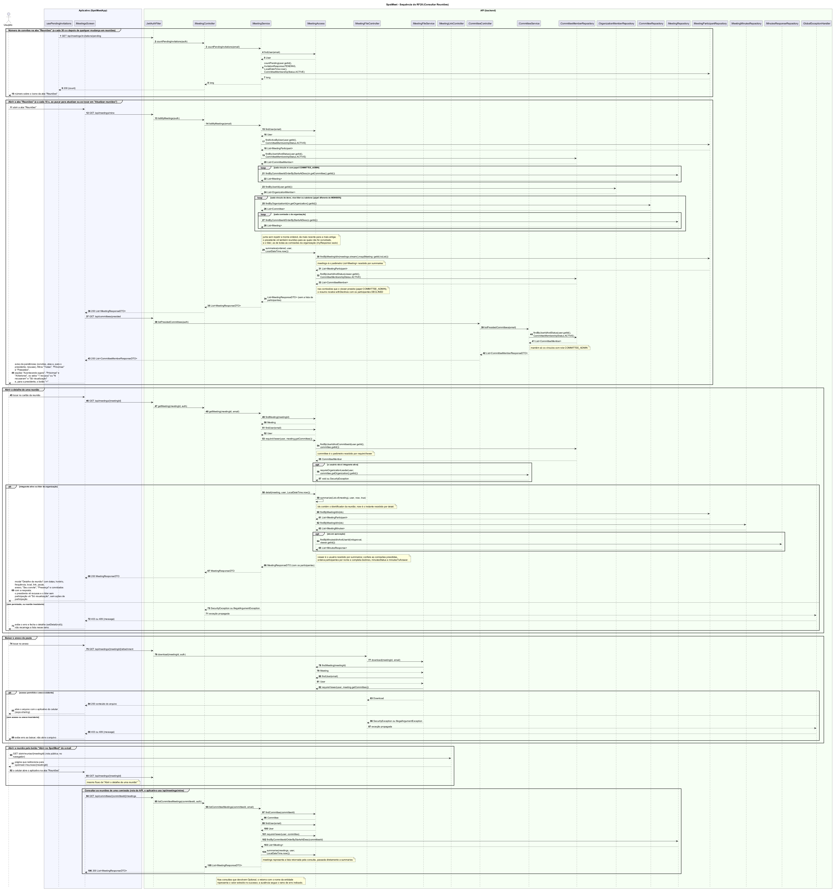

Fonte: próprio autor

#### RF29 – Convidar Integrantes para a Reunião

| Campo | Descrição |
|---|---|
| Função | Define quem é convidado para uma reunião. |
| Descrição | Cada convidado tem uma linha em meeting_participants (única por reunião e usuário), criada com resposta PENDING. Ao agendar (RF25), se invitedUserIds for omitido, todos os integrantes ativos da comissão são convidados; se for informado, só os listados, e todos precisam ser integrantes ativos. O presidente é sempre convidado e sua resposta já consta como ACCEPTED ao agendar. Ao editar (RF26), quem continua na lista mantém a resposta e o comentário, quem sai é removido (exceto quem já registrou entrada) e quem entra é criado como pendente. Na série, cada nova data convida os escolhidos que continuam integrantes ativos e o presidente atual. |
| Entradas | invitedUserIds: lista opcional de IDs (Long) no MeetingRequestDTO. Para a escolha na tela, variável de rota committeeId (Long) da consulta de integrantes ativos. |
| Origem | Usuário (presidente da comissão) e banco de dados (integrantes ativos da comissão). |
| Saída | A lista de participants do MeetingResponseDTO e os contadores totalInvited, totalAccepted, totalDeclined e totalPending. Em caso de erro, HTTP 409 com "Só integrantes ativos da comissão podem ser convidados." ou, na edição, quando a seleção retira quem já registrou entrada. |
| Destino | Usuário, por meio do formulário MeetingForm. |
| Ação | Ao abrir o formulário (ou trocar de comissão), o MeetingForm envia GET /api/committees/{committeeId}/members (RF24, listActiveMembers) e exibe o campo "Convidados", com "n de m selecionados" e os primeiros nomes, todos marcados por padrão no agendamento; na edição, mantém a seleção dos convidados atuais. Ao tocar, abre a folha "Convidados" (InviteesSheet), com "Integrantes da comissão nome.", a busca "Buscar integrante" (que ignora acentos), "Selecionar todos" e, para cada integrante, a foto ou as iniciais (UserAvatar) e a caixa de seleção; o presidente aparece fixo, com a etiqueta "Presidente". "Concluir (n)" grava a escolha no formulário. Ao enviar o formulário, o aplicativo inclui em invitedUserIds os integrantes marcados e o presidente. No servidor, o método resolveInvitees da classe MeetingService consulta CommitteeMemberRepository.findByCommitteeIdAndStatus, valida que cada ID é de integrante ativo e acrescenta o presidente; em seguida, os participantes são gravados com MeetingParticipantRepository.saveAll (agendamento) ou ajustados por syncInvitees (edição). |
| Pré-condição | O usuário ser o presidente ativo da comissão e estar agendando uma reunião ou editando uma reunião agendada ou em andamento. |
| Pós-condição | **Sucesso:** meeting_participants contém exatamente os convidados escolhidos mais o presidente; os convidados que já tinham respondido mantêm a resposta.  **Falha:** nenhum participante é criado, removido ou alterado. |
| Efeitos colaterais | Os mesmos do RF25 e do RF26, inclusive o e-mail de convite a cada convidado. Não há notificação push: o convidado vê o convite na aba "Reuniões", com o número na aba, na próxima atualização. |

**Figura 42 – Diagrama de sequência do RF29**

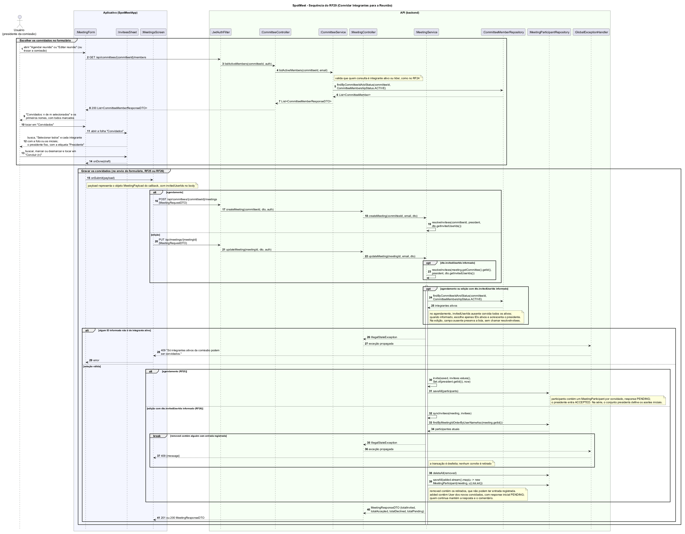

Fonte: próprio autor

#### RF30 – Responder Convite de Reunião

| Campo | Descrição |
|---|---|
| Função | Registra a resposta do convidado ao convite de uma reunião. |
| Descrição | Atualiza na tabela meeting_participants a resposta (ACCEPTED ou DECLINED), a data da resposta e o comentário. O comentário só é guardado na recusa; ao aceitar, o comentário anterior é apagado. Numa recusa nova (a resposta anterior não era DECLINED), o presidente ativo da comissão recebe um e-mail, salvo quando é ele quem recusa. A resposta pode ser trocada até a reunião terminar ou ser cancelada. Numa série, cada data tem o seu convite e a sua resposta. A linha do participante é bloqueada para escrita (MeetingParticipantRepository.findForUpdate), serializando respostas, entradas e saídas simultâneas da mesma pessoa. |
| Entradas | Variável de rota meetingId (Long), parâmetro accept (boolean obrigatório) e, opcionalmente, objeto do tipo MeetingAnswerDTO contendo comment (string de, no máximo, 200 caracteres). |
| Origem | Usuário (convidado). |
| Saída | HTTP 200 com MeetingResponseDTO atualizado. Em caso de erro, HTTP 400 quando o comentário excede 200 caracteres; HTTP 403 quando o usuário não é integrante ativo da comissão; HTTP 409 quando a reunião não existe, já foi cancelada ou encerrada, ou o usuário não foi convidado. |
| Destino | Usuário, por meio da tela MeetingsScreen e do componente MeetingInvitationActions. |
| Ação | No detalhe da reunião, o cartão "Seu convite" exibe a resposta atual, o texto "Sua resposta vale só para esta data, segunda, 2 de novembro." numa série, e, no convite pendente, as ações "Recusar" e "Aceitar". Depois de aceitar, mostra somente "Recusar"; depois de recusar, somente "Aceitar". Os convites sem resposta também aparecem na lista "Convites para responder" (RF28). Ao tocar em "Aceitar", o aplicativo envia POST /api/meetings/{meetingId}/respond?accept=true. Ao tocar em "Recusar", exibe o campo "Motivo (opcional)", na largura do cartão, com o contador "n/200" (ao abrir o teclado, a folha rola até o campo) e, ao tocar em "Confirmar recusa", envia POST /api/meetings/{meetingId}/respond?accept=false com o comentário. O método respond da classe MeetingInvitationController chama o método respond da classe MeetingInvitationService, que carrega a reunião e o usuário, exige integrante ativo (MeetingAccess.requireActiveMember), confere que a reunião não está cancelada nem encerrada (Meeting.statusAt), bloqueia e carrega o participante (findForUpdate), grava a resposta (save) e registra a auditoria; numa recusa nova, obtém o presidente ativo (MeetingAccess.president) e chama EmailService.sendInvitationDeclinedEmail. Com a resposta de sucesso, o aplicativo exibe o aviso "Sucesso" com o texto "Presença confirmada." ou "Recusa enviada." e atualiza o detalhe. |
| Pré-condição | O usuário estar autenticado, ser integrante ativo da comissão e estar na lista de convidados; a reunião estar agendada ou em andamento. |
| Pós-condição | **Sucesso:** a linha do participante tem a nova resposta e a data; o comentário consta só na recusa; os contadores do presidente e dos demais refletem a resposta; a recusa aparece para o presidente no aviso de pendências, em "Pendências", no selo do cartão e no topo do detalhe (RF28); a auditoria fica registrada.  **Falha:** a resposta anterior é mantida e a mensagem de erro é exibida. |
| Efeitos colaterais | Registro em audit_logs com a ação MEETING_INVITATION_ANSWERED (detalhe com a resposta, sem o comentário). Numa recusa nova, e-mail ao presidente com o assunto "Convite recusado: <título>", com quem recusou, a data, o horário, o motivo (ou "<nome> não informou o motivo.") e o botão "Abrir no SpotMeet", enviado depois do commit; recusar de novo, aceitar ou a recusa do próprio presidente não enviam e-mail. Evento MEETINGS_MUTATED, que também atualiza o número de convites da aba "Reuniões". |

**Figura 43 – Diagrama de sequência do RF30**

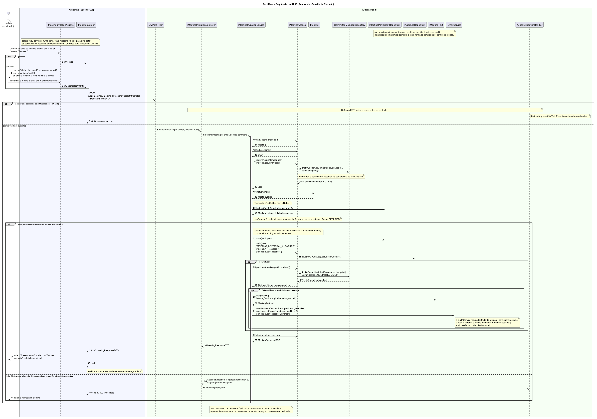

Fonte: próprio autor

#### RF31 – Registrar Entrada na Reunião

| Campo | Descrição |
|---|---|
| Função | Registra a entrada de convidados na reunião. |
| Descrição | **Individual:** grava na tabela meeting_participants o horário de entrada (entered_at) e quem fez o registro (entered_by_id). A própria pessoa registra a sua entrada; o presidente registra a de qualquer convidado, independentemente da resposta ao convite. Cada pessoa tem uma entrada.  **Em massa:** o presidente registra a entrada de todos os convidados que aceitaram o convite e ainda não têm entrada. Em ambos os casos, o registro só é aceito com a reunião em andamento e apaga o carimbo da lista de presença já gerada (RF34), que precisa ser gerada de novo. |
| Entradas | **Individual:** variáveis de rota meetingId e userId (Long).  **Em massa:** variável de rota meetingId (Long). O executor é obtido do token JWT. |
| Origem | Usuário (convidado ou presidente da comissão). |
| Saída | HTTP 200 com MeetingResponseDTO atualizado. Em caso de erro, HTTP 403 quando o usuário não é integrante ativo (registro próprio) ou presidente (registro de outra pessoa ou em massa); HTTP 409 quando a reunião não está em andamento, o usuário informado não foi convidado ou a entrada já foi registrada. |
| Destino | Usuário, por meio da tela MeetingsScreen e do painel MeetingAttendancePanel. |
| Ação | Numa reunião em andamento, o convidado toca em "Registrar entrada" no cartão da seção "Acontecendo agora" da lista ou no cartão "Presença" do detalhe; o presidente toca em "Registrar entrada" na linha de outra pessoa, em "Convidados", ou em "Entrada de todos que aceitaram" (com a confirmação "Registrar entrada de todos"). O aplicativo envia POST /api/meetings/{meetingId}/participants/{userId}/entry ou POST /api/meetings/{meetingId}/attendance/entries. O método registerEntry (ou registerAllEntries) da classe MeetingAttendanceController chama o método de mesmo nome da classe MeetingAttendanceService, que confere o papel (MeetingAccess.requireActiveMember para o registro próprio, requirePresident nos demais), exige a reunião em andamento, no registro individual bloqueia o participante (findForUpdate), grava a entrada (save) e apaga o carimbo da lista (MeetingAccess.invalidateList); no registro em lote, consulta a lista sem findForUpdate, grava com saveAll e só invalida a lista se houve alguma entrada nova e registra a auditoria. Com a resposta de sucesso, o aplicativo exibe o aviso "Sucesso" com o texto "Entrada registrada." ou "Entradas registradas.". Quando o registro é feito pelo presidente, a lista de convidados exibe "Entrada 14:02 (por nome)". |
| Pré-condição | O usuário estar autenticado; a reunião estar em andamento (entre o início e o término, sem cancelamento); o participante ser convidado e ainda não ter entrada registrada. No registro próprio, o usuário ser integrante ativo da comissão; no registro de outra pessoa e em massa, ser o presidente. |
| Pós-condição | **Sucesso:** o participante tem a entrada e o autor do registro gravados; o carimbo da lista de presença é apagado quando existia; a auditoria fica registrada.  **Falha:** nenhum registro é gravado e a mensagem de erro é exibida. |
| Efeitos colaterais | Registro em audit_logs com a ação MEETING_ENTRY_REGISTERED (individual) ou MEETING_ENTRIES_REGISTERED_BULK (em massa, com o número de pessoas). Evento MEETINGS_MUTATED. |

**Figura 44 – Diagrama de sequência do RF31**

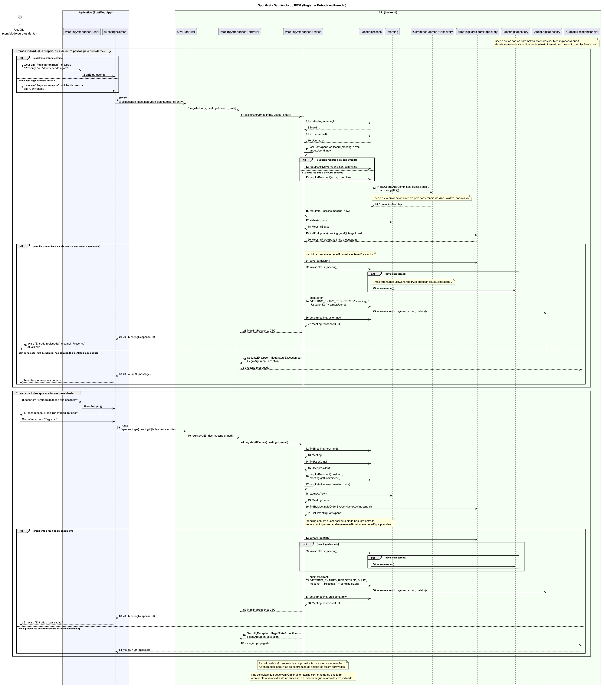

Fonte: próprio autor

#### RF32 – Registrar Saída da Reunião

| Campo | Descrição |
|---|---|
| Função | Registra a saída de convidados da reunião. |
| Descrição | **Individual:** grava na tabela meeting_participants o horário de saída (left_at) e quem fez o registro (left_by_id). A própria pessoa registra a sua saída; o presidente registra a de qualquer convidado que tenha entrada. Cada pessoa tem uma saída.  **Em massa:** o presidente registra a saída de todos os convidados que têm entrada e ainda não têm saída. Em ambos os casos, o registro só é aceito com a reunião em andamento e apaga o carimbo da lista de presença já gerada. |
| Entradas | **Individual:** variáveis de rota meetingId e userId (Long).  **Em massa:** variável de rota meetingId (Long). O executor é obtido do token JWT. |
| Origem | Usuário (convidado ou presidente da comissão). |
| Saída | HTTP 200 com MeetingResponseDTO atualizado. Em caso de erro, HTTP 403 quando o usuário não é integrante ativo (registro próprio) ou presidente (registro de outra pessoa ou em massa); HTTP 409 quando a reunião não está em andamento, o usuário informado não foi convidado, não tem entrada registrada ou a saída já foi registrada. |
| Destino | Usuário, por meio da tela MeetingsScreen e do painel MeetingAttendancePanel. |
| Ação | Numa reunião em andamento, o convidado que já entrou toca em "Registrar saída" no cartão da seção "Acontecendo agora" ou no cartão "Presença" do detalhe; o presidente toca em "Registrar saída" na linha de outra pessoa, em "Convidados", ou em "Saída de todos que estão dentro" (com a confirmação "Registrar saída de todos"). O aplicativo envia POST /api/meetings/{meetingId}/participants/{userId}/exit ou POST /api/meetings/{meetingId}/attendance/exits. O método registerExit (ou registerAllExits) da classe MeetingAttendanceController chama o método de mesmo nome da classe MeetingAttendanceService, que confere o papel, exige a reunião em andamento, no registro individual bloqueia o participante (findForUpdate), confere a entrada prévia e a ausência de saída, grava a saída (save) e apaga o carimbo da lista (invalidateList); no lote, consulta a lista sem findForUpdate, grava com saveAll e só invalida a lista se houve alguma saída nova e registra a auditoria. Com a resposta de sucesso, o aplicativo exibe o aviso "Sucesso" com o texto "Saída registrada." ou "Saídas registradas.". |
| Pré-condição | O usuário estar autenticado; a reunião estar em andamento; o participante ser convidado, ter entrada registrada e não ter saída registrada. No registro próprio, o usuário ser integrante ativo da comissão; no registro de outra pessoa e em massa, ser o presidente. |
| Pós-condição | **Sucesso:** o participante tem a saída e o autor do registro gravados; o carimbo da lista de presença é apagado quando existia; a auditoria fica registrada.  **Falha:** nenhum registro é gravado e a mensagem de erro é exibida. |
| Efeitos colaterais | Registro em audit_logs com a ação MEETING_EXIT_REGISTERED (individual) ou MEETING_EXITS_REGISTERED_BULK (em massa, com o número de pessoas). Evento MEETINGS_MUTATED. |

**Figura 45 – Diagrama de sequência do RF32**

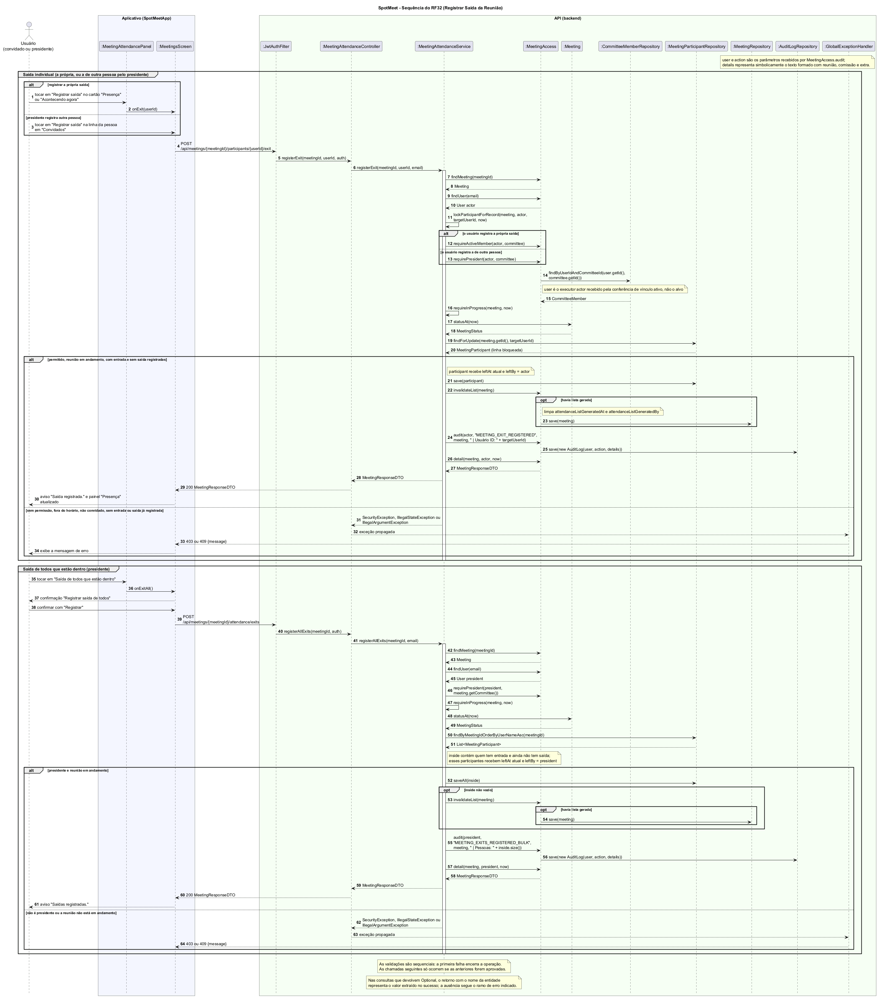

Fonte: próprio autor

#### RF33 – Corrigir Registros de Presença

| Campo | Descrição |
|---|---|
| Função | Apaga a entrada e a saída registradas de um convidado, para que possam ser registradas de novo. |
| Descrição | Limpa na tabela meeting_participants as colunas entered_at, entered_by_id, left_at e left_by_id de um convidado e apaga o carimbo da lista de presença já gerada. Só o presidente corrige, com a reunião em andamento ou encerrada. |
| Entradas | Variáveis de rota meetingId e userId (Long). |
| Origem | Usuário (presidente da comissão). |
| Saída | HTTP 200 com MeetingResponseDTO atualizado. Em caso de erro, HTTP 403 quando o usuário não é presidente ativo da comissão; HTTP 409 quando a reunião não existe, foi cancelada, ainda não começou, o usuário informado não foi convidado ou a ata já foi enviada ("A presença não pode mais ser corrigida porque a ata já foi enviada."). |
| Destino | Usuário, por meio da tela MeetingsScreen e do painel MeetingAttendancePanel. |
| Ação | Na lista "Convidados" do detalhe, o presidente toca em "Limpar registros" na linha de uma pessoa que tenha entrada ou saída. O aplicativo pede a confirmação "Limpar registros" (apagar a entrada e a saída da pessoa) e, ao confirmar com "Limpar", envia DELETE /api/meetings/{meetingId}/participants/{userId}/attendance. O método resetAttendance da classe MeetingAttendanceController chama o método de mesmo nome da classe MeetingAttendanceService, que carrega a reunião e o usuário, exige o papel de presidente (requirePresident), confere a situação (Meeting.statusAt), consulta a ata (MeetingMinutesRepository.findByMeetingId) e recusa com 409 se ela já saiu de DRAFT, bloqueia e limpa o participante (findForUpdate e save), apaga o carimbo da lista (invalidateList) e registra a auditoria. Com a resposta de sucesso, o aplicativo exibe o aviso "Sucesso" com o texto "Registros apagados.". |
| Pré-condição | O usuário estar autenticado e ser o presidente ativo da comissão; a reunião estar em andamento ou encerrada; o usuário informado ser convidado; não existir ata ou a ata ainda estar em DRAFT. |
| Pós-condição | **Sucesso:** a entrada e a saída do convidado ficam em branco, com os autores apagados; o carimbo da lista de presença é apagado; a auditoria fica registrada.  **Falha:** nenhum registro é alterado e a mensagem de erro é exibida. |
| Efeitos colaterais | Registro em audit_logs com a ação MEETING_ATTENDANCE_RESET. Evento MEETINGS_MUTATED.  **Incremento 3:** depois que a ata da reunião é enviada para aprovação (RF38), em qualquer situação diferente de Rascunho, a correção é recusada com a mensagem "A presença não pode mais ser corrigida porque a ata já foi enviada.", e o detalhe da reunião deixa de mostrar "Limpar registros"; quem responde à ata vem desses registros. |

**Figura 46 – Diagrama de sequência do RF33**

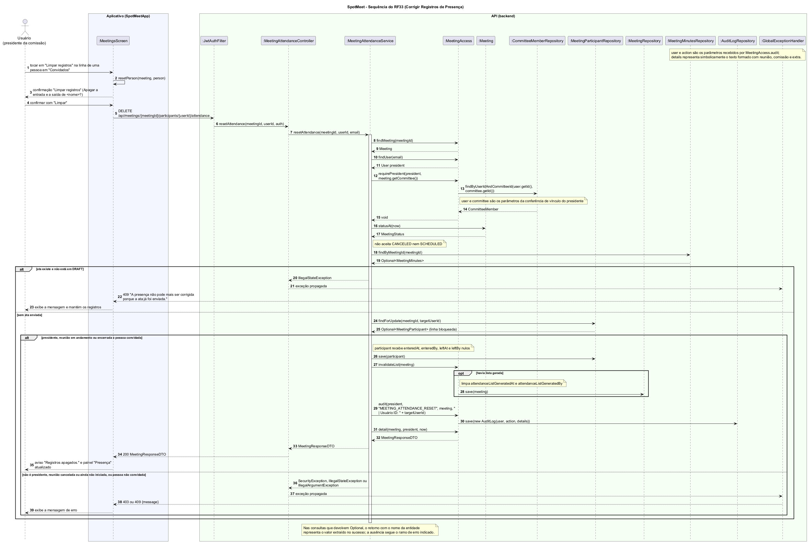

Fonte: próprio autor

#### RF34 – Gerar Lista de Presença

| Campo | Descrição |
|---|---|
| Função | Disponibiliza a lista de presença de uma reunião para consulta. |
| Descrição | Grava na tabela meetings a data (attendance_list_generated_at) e o autor (attendance_list_generated_by_id) da geração. O conteúdo da lista é montado a cada consulta a partir dos participantes: a pessoa é "Presente" quando tem entrada registrada, "Presente, saída não registrada" quando tem entrada, não tem saída e a reunião já terminou, e "Ausente" quando não tem entrada. O tempo na reunião é calculado quando há entrada e saída. Qualquer alteração posterior de presença (RF31, RF32 e RF33) ou edição da reunião (RF26) apaga o carimbo, e a lista precisa ser gerada de novo. |
| Entradas | Variável de rota meetingId (Long). Não há corpo. |
| Origem | Usuário (presidente da comissão) e banco de dados (participantes). |
| Saída | HTTP 200 com AttendanceListDTO contendo meetingId, title, committeeName, startsAt, endsAt, generatedAt, generatedByName, totalInvited, totalPresent, totalAbsent e rows (userId, userName, response, responseComment, enteredAt, enteredByName, leftAt, leftByName, durationMinutes e situation). Em caso de erro, HTTP 403 quando o usuário não é presidente ativo da comissão; HTTP 409 quando a reunião não existe, foi cancelada ou ainda não começou. |
| Destino | Usuário, por meio da tela MeetingsScreen e do componente AttendanceListView. |
| Ação | No detalhe de uma reunião em andamento ou encerrada, o presidente toca em "Gerar lista de presença", no cartão "Presença" (ou em "Gerar a lista de novo", quando já existe um carimbo). O aplicativo pede a confirmação "Gerar lista de presença" (a lista usa os registros de agora e fica disponível para os integrantes) e, ao confirmar com "Gerar", envia POST /api/meetings/{meetingId}/attendance-list. O método generate da classe AttendanceListController chama o método generate da classe AttendanceListService, que carrega a reunião e o usuário, exige o papel de presidente (requirePresident), confere a situação (Meeting.statusAt), grava o carimbo (MeetingRepository.save), registra a auditoria e monta a lista (AttendanceListDTO.from, a partir de MeetingParticipantRepository.findByMeetingIdOrderByUserNameAsc). Com a resposta de sucesso, o aplicativo exibe o aviso "Sucesso" com o texto "Lista de presença gerada." e abre a lista. |
| Pré-condição | O usuário estar autenticado e ser o presidente ativo da comissão; a reunião já ter começado e não estar cancelada. |
| Pós-condição | **Sucesso:** a reunião tem o carimbo de geração gravado, o que libera a consulta aos integrantes e líderes (RF35); a auditoria fica registrada.  **Falha:** o carimbo não é alterado e a mensagem de erro é exibida. |
| Efeitos colaterais | Registro em audit_logs com a ação MEETING_ATTENDANCE_LIST_GENERATED. Evento MEETINGS_MUTATED. |

**Figura 47 – Diagrama de sequência do RF34**

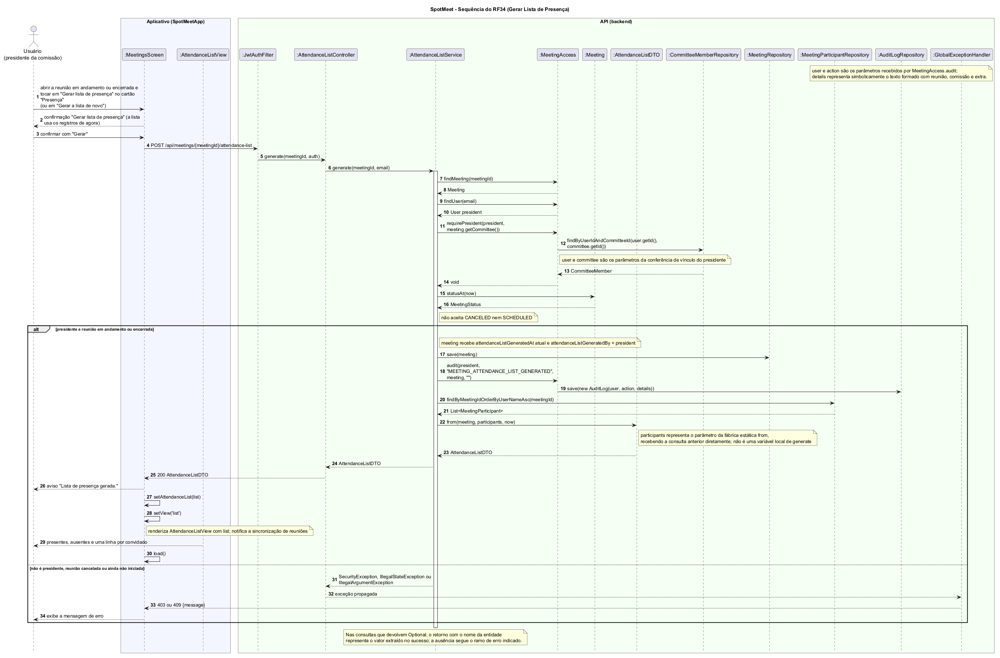

Fonte: próprio autor

#### RF35 – Consultar Lista de Presença

| Campo | Descrição |
|---|---|
| Função | Consulta a lista de presença de uma reunião, depois de gerada. |
| Descrição | Devolve o conteúdo da lista de presença montado a partir dos participantes, com os mesmos cálculos de situação e de tempo do RF34. Só está disponível quando a reunião tem o carimbo de geração. |
| Entradas | Variável de rota meetingId (Long). |
| Origem | Usuário e banco de dados (participantes da reunião). |
| Saída | HTTP 200 com AttendanceListDTO, como descrito no RF34. Em caso de erro, HTTP 403 quando o usuário não é integrante ativo da comissão nem líder da organização; HTTP 409 quando a reunião não existe ou a lista ainda não foi gerada. |
| Destino | Usuário, por meio da tela MeetingsScreen e do componente AttendanceListView. |
| Ação | Com a lista gerada, o usuário toca em "Lista de presença", no cartão "Presença" do detalhe ou no cartão da seção "Acontecendo agora". O aplicativo envia GET /api/meetings/{meetingId}/attendance-list. O método get da classe AttendanceListController chama o método get da classe AttendanceListService, que carrega a reunião e o usuário, exige integrante ativo ou líder (MeetingAccess.requireViewer), confere o carimbo de geração e monta a lista. O modal "Lista de presença" exibe o título, a comissão, o período, os totais "presentes", "ausentes" e "convidados", a data e o autor da geração e, para cada convidado, a situação (Presente, Presente, saída não registrada, ou Ausente), a resposta ao convite com o comentário, a entrada e a saída com "(registrado por nome)" quando o autor é outra pessoa e o tempo na reunião. Se, com a lista aberta, a atualização automática (a cada 10 segundos) mostrar que a lista foi invalidada por uma entrada ou saída registrada depois da geração, o aplicativo volta ao detalhe com o aviso "A presença mudou depois que a lista foi gerada. A lista precisa ser gerada de novo.". |
| Pré-condição | O usuário estar autenticado e ser integrante ativo da comissão ou líder da organização; a lista de presença ter sido gerada e não ter sido invalidada por uma alteração posterior de presença. |
| Pós-condição | Nada é alterado no banco. A lista é exibida; em caso de erro, a mensagem é exibida no modal. |
| Efeitos colaterais | Nenhum. |

**Figura 48 – Diagrama de sequência do RF35**

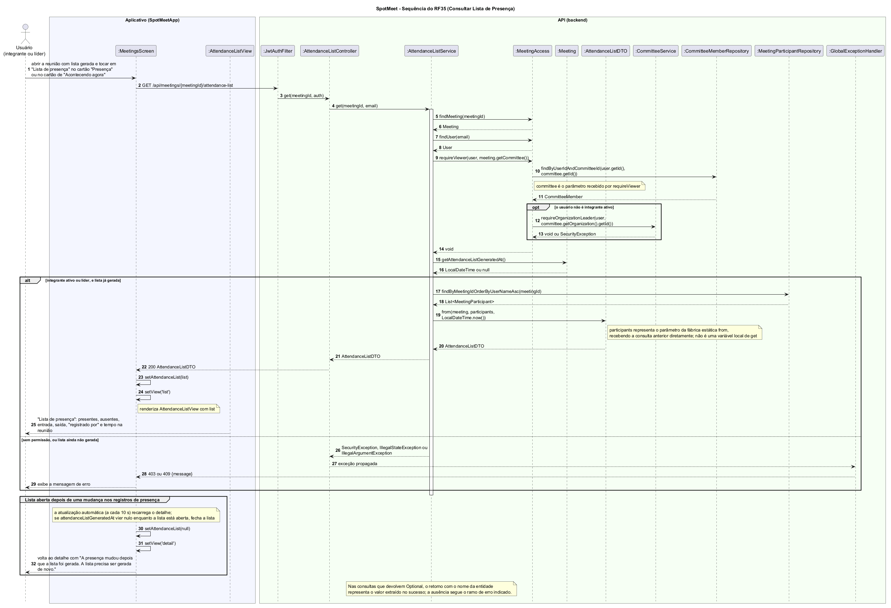

Fonte: próprio autor

#### RF36 – Configurar Bloqueio Biométrico

| Campo | Descrição |
|---|---|
| Função | Habilita, ajusta e desabilita o bloqueio do aplicativo por biometria, que protege o acesso guardado no aparelho. |
| Descrição | **Habilitar:** confere se o aparelho tem armazenamento seguro, biometria compatível e cadastrada (no Android, biometria forte), pede a confirmação da biometria, confirma a sessão no servidor e guarda no armazenamento seguro do aparelho (expo-secure-store) o token JWT, o identificador do usuário e o endereço do servidor; o prazo do bloqueio fica em armazenamento local (AsyncStorage). O token nunca vai para o armazenamento comum.  **Definir o prazo:** grava o prazo escolhido, em milissegundos: 0 (Imediatamente, padrão), 60 000 (1 minuto), 300 000 (5 minutos), 3 600 000 (1 hora), 10 800 000 (3 horas) ou 86 400 000 (24 horas). O prazo vale para o aplicativo deixado em segundo plano; se o aplicativo for fechado (pelo usuário ou pelo sistema), o desbloqueio é sempre pedido ao reabrir, porque a sessão só existe na memória e o token guardado só é lido depois da biometria.  **Religar depois da troca de senha:** a troca de senha (RF14) revoga o token guardado, mas, com a biometria habilitada, o aparelho guarda a preferência (habilitada e prazo, sem token). No login seguinte da mesma conta e no mesmo servidor, a preferência é lida e apagada, o prazo é restaurado e a habilitação é feita de novo, pedindo apenas a confirmação da biometria.  **Desabilitar:** remove a sessão guardada e a configuração. O bloqueio em si (pedir a biometria ao reabrir o aplicativo) é descrito no RF02: a tela "SpotMeet bloqueado" é uma janela opaca por cima do aplicativo e, depois do primeiro desbloqueio da sessão, não desmonta as telas abertas, de modo que, ao desbloquear, a pessoa volta exatamente ao ponto em que estava (um formulário em preenchimento, uma comissão aberta). |
| Entradas | **Habilitar:** a confirmação da biometria do aparelho e, para a conferência da sessão, o token da sessão atual (cabeçalho Authorization da requisição GET /api/users/me).  **Definir o prazo:** uma das seis opções de prazo.  **Desabilitar:** nenhuma. |
| Origem | Usuário e aparelho (leitor de biometria). |
| Saída | **Habilitar:** chave "Habilitado" e as opções de prazo; em caso de falha, mensagem como "Cadastre uma biometria nas configurações do aparelho antes de habilitar.", "Use uma impressão digital ou biometria forte compatível com o aparelho.", "Este aparelho não possui biometria compatível.", "Armazenamento seguro indisponível neste aparelho.", "O Face ID precisa de uma build própria do SpotMeet; não está disponível no Expo Go.", "Autenticação cancelada ou não confirmada. A biometria permanece desligada." ou "Não foi possível habilitar a biometria. Tente novamente; seu login continua ativo.". Se o servidor recusar o token (HTTP 401, 403 ou 404), a sessão é encerrada com o aviso "Sessão encerrada".  **Definir o prazo e desabilitar:** a chave e a opção marcada atualizadas, ou mensagem de erro. |
| Destino | Usuário, por meio do cartão BiometricSettings da tela SettingsScreen e do contexto BiometricContext. |
| Ação | Na tela "Ajustes", página "Segurança" (item do grupo "CONTA" do menu), o cartão "Bloqueio biométrico" (texto "Protege este acesso no aparelho. O desbloqueio também aceita o PIN do sistema.") exibe a chave "Desligado" ou "Habilitado", desenhada como um interruptor: bolinha à esquerda e trilho cinza quando desligada, bolinha à direita e trilho na cor principal quando habilitada. Ao tocar na chave desligada, o método enable da classe BiometricContext consulta a disponibilidade (getBiometricAvailability, que usa SecureStore e LocalAuthentication), pede a confirmação da biometria (authenticateBiometricDevice, sem a alternativa do PIN na habilitação) e envia GET /api/users/me. O método getMyProfile da classe UserController chama o método de mesmo nome da classe UserService, que consulta o usuário (UserRepository.findByEmail). O aplicativo confere que o identificador da resposta é o da sessão, que nome e e-mail são textos e que o perfil é um valor permitido e guarda a sessão (saveBiometricSession). A chave passa a "Habilitado" e exibe a opção "Bloquear após deixar o app em segundo plano", com as seis opções de prazo e a nota "Se o aplicativo for fechado, o desbloqueio é sempre solicitado, mesmo dentro do prazo. Sair da conta remove essa proteção e a sessão guardada."; ao escolher uma, o método setDelay regrava a configuração, e a chave mantém o interruptor durante a gravação (o indicador de carregamento só aparece ao habilitar ou desabilitar). Ao tocar na chave habilitada, o método disable pede a confirmação da biometria (authenticateBiometricDevice, aceitando o PIN do aparelho); sem a confirmação, exibe "Autenticação cancelada ou não confirmada. A biometria continua habilitada."; confirmada, chama clearBiometricSession, que remove os dados do armazenamento seguro e do armazenamento local. O mesmo método enable atende ao convite "Deseja habilitar a biometria?", exibido uma vez depois do login e respondido com "Sim" ou "Não". Nas saídas marcadas para câmera, galeria ou recorte, o prazo é o maior entre o prazo configurado e cinco minutos. Depois de uma troca de senha com a biometria habilitada, o convite não é exibido: no login seguinte, o BiometricContext lê a preferência (takeBiometricRearm), restaura o prazo e chama enable, que pede a confirmação da biometria e guarda a nova sessão; se a confirmação falhar, o convite é exibido com a mensagem. |
| Pré-condição | Ter sessão iniciada, em "Ajustes" (perfil global USER; a aba não é exibida a ADMIN e SYSADMIN, que só podem habilitar pelo convite exibido depois do login); usar o aplicativo Android ou iOS, com armazenamento seguro, biometria compatível e cadastrada no aparelho; o servidor estar acessível para a conferência da sessão. Para desabilitar ou definir o prazo, o bloqueio estar habilitado e o aplicativo desbloqueado. |
| Pós-condição | **Sucesso:** o aparelho guarda (ou deixa de guardar) a sessão protegida por biometria e o prazo do bloqueio; ao voltar ao aplicativo depois do prazo, o desbloqueio é exigido e, confirmado, a pessoa continua na tela em que estava; ao reabrir o aplicativo fechado, as telas abrem do começo (RF02).  **Falha:** nada é guardado, ou o estado anterior é mantido, e a mensagem de erro é exibida no cartão. |
| Efeitos colaterais | Nenhum no servidor: a consulta GET /api/users/me só lê dados e não grava auditoria. No aparelho, a sessão guardada é removida ao sair da conta (na troca de senha fica só a preferência, sem token, até o próximo login), e o token guardado é substituído quando a sessão é renovada (por exemplo, na troca de e-mail, RF18). |

**Figura 49 – Diagrama de sequência do RF36**

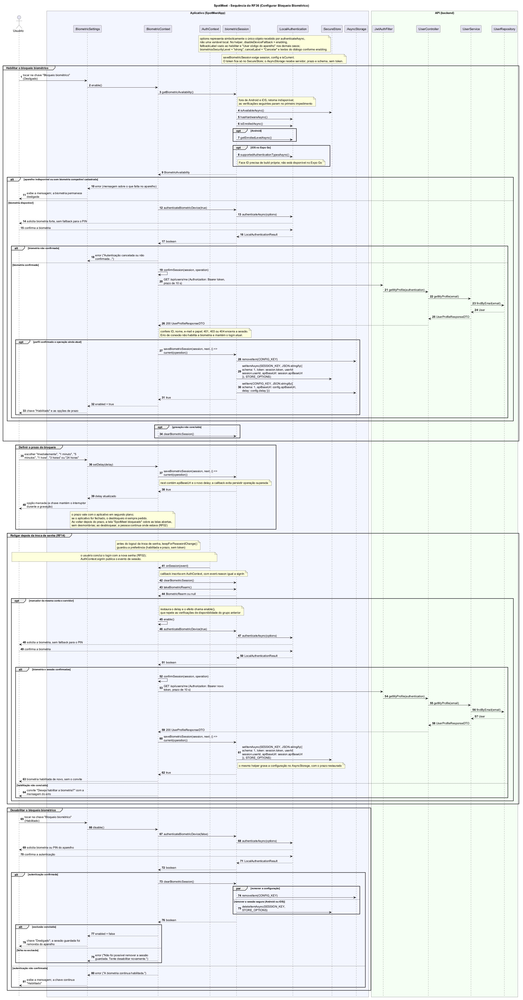

Fonte: próprio autor

#### RF37 – Escrever e Salvar Rascunho da Ata

| Campo | Descrição |
|---|---|
| Função | Cria e atualiza o rascunho da ata de uma reunião encerrada. |
| Descrição | Grava na tabela meeting_minutes, uma por reunião (meeting_id único), o texto da ata em três partes: topics (assuntos tratados), decisions (decisões tomadas) e notes (observações), com o autor (written_by_id) e a data da última alteração (updated_at). O primeiro salvamento cria a ata com status DRAFT; os seguintes substituem o texto. Cada campo é gravado sem os espaços das pontas, e um campo vazio é gravado como nulo; o rascunho precisa ter ao menos um campo preenchido. Só o presidente escreve, e só depois que a reunião termina; reunião cancelada não tem ata. Presentes e ausentes não são gravados na ata: vêm dos registros de entrada (RF31), e a presença ainda pode ser corrigida enquanto a ata é rascunho (RF33). Enquanto a ata é rascunho, o texto só é devolvido ao presidente. A linha da ata é bloqueada para escrita (MeetingMinutesRepository.findForUpdate), o que serializa salvamento, envio, respostas e encerramento da mesma ata. |
| Entradas | Variável de rota meetingId (Long) e objeto do tipo MinutesRequestDTO contendo topics (texto de, no máximo, 4000 caracteres), decisions (no máximo 4000) e notes (no máximo 2000), todos opcionais no rascunho. No aplicativo, os campos "Assuntos tratados" e "Decisões tomadas" (marcados como obrigatórios, exigidos só no envio, RF38) aceitam até 4000 caracteres, e "Observações (opcional)", até 2000. O executor é obtido do token JWT. |
| Origem | Usuário (presidente da comissão). |
| Saída | HTTP 200 com MinutesResponseDTO contendo meetingId, status, topics, decisions, notes, writtenByName, updatedAt, submittedAt, closedAt, present e absent (userId e userName), totalApproved, totalRejected, totalPending, viewerPresent, canAnswer, myAnswer e answers (descritos no RF42). Em caso de erro, HTTP 400 quando um campo excede o tamanho: "Os assuntos tratados podem ter até 4000 caracteres.", "As decisões tomadas podem ter até 4000 caracteres." ou "As observações podem ter até 2000 caracteres."; HTTP 403 quando o usuário não é o presidente ativo da comissão; HTTP 409 quando a reunião não existe, foi cancelada ("Reunião cancelada não tem ata."), ainda não terminou ("A ata só pode ser escrita depois que a reunião terminar."), a ata já foi enviada ("A ata já foi enviada. As correções são salvas ao reenviar para aprovação."), foi aprovada ("Uma ata aprovada não pode mais ser editada.") ou todos os campos estão vazios ("Escreva algo na ata antes de salvar o rascunho."). |
| Destino | Usuário, por meio da tela MeetingsScreen e do componente MinutesSection. |
| Ação | No detalhe de uma reunião encerrada, o cartão "Ata" do presidente exibe "Sem ata", com o texto "Registre o que foi tratado e decidido. Só você, presidente, escreve a ata." e o botão "Escrever Ata", ou "Rascunho", com "Rascunho salvo em 30 de outubro, às 11:20. Só você vê o rascunho até enviar." e o botão "Editar Ata". Antes do fim da reunião, o cartão exibe "Você poderá escrever a ata depois que a reunião terminar." e o botão "Escrever Ata" desabilitado. Ao tocar no botão, o componente MinutesSection abre a página "Escrever ata" (MeetingsScreen.openPage), com a data, o título e o horário da reunião (MeetingHeader), os campos preenchidos com o rascunho salvo, a seção "PRESENTES E AUSENTES" com o aviso "Vem da lista de presença. Não dá para editar." e as pessoas com foto ou iniciais (PeopleGrid), e os botões "Enviar para Aprovação" (RF38) e "Salvar Rascunho". Ao tocar em "Salvar Rascunho", o aplicativo verifica os três campos após remover espaços das pontas. Se todos estiverem vazios, mostra "Escreva algo na ata antes de salvar o rascunho." acima dos botões, sem enviar. Com algum texto, mesmo sem completar assuntos e decisões, envia PUT /api/meetings/{meetingId}/minutes (apiRequest) com os três campos. O método saveDraft da classe MeetingMinutesController chama o método saveDraft da classe MeetingMinutesService, que carrega a reunião e o usuário (MeetingAccess.findMeeting e findUser), exige o presidente (requirePresident), exige a reunião encerrada (requireEnded, com Meeting.statusAt), bloqueia e carrega a ata (MeetingMinutesRepository.findForUpdate) ou cria uma nova, confere a situação DRAFT, aplica o texto (applyText, com MeetingAccess.clean em cada campo), recusa o rascunho se os três campos ficaram nulos, grava a ata (save), registra a auditoria (MeetingAccess.audit) e devolve a ata montada (view). Com a resposta de sucesso, o aplicativo confere os dados (readMinutes), exibe o aviso "Rascunho salvo" com o texto "Só você vê o rascunho até enviar.", continua na página e atualiza o detalhe e a lista (refreshDetail). Em caso de erro, a mensagem aparece acima dos botões. |
| Pré-condição | O usuário estar autenticado e ser o presidente ativo da comissão (integrante ativo com papel COMMITTEE_ADMIN); a reunião ter terminado e não estar cancelada; a ata não existir ou estar com status DRAFT; ao menos um dos três campos estar preenchido. |
| Pós-condição | **Sucesso:** a reunião tem uma ata com status DRAFT, o texto informado, o presidente como autor e a data da alteração; o cartão "Ata" exibe "Rascunho"; os demais integrantes veem "O presidente ainda está escrevendo a ata." e não recebem o texto; a auditoria fica registrada.  **Falha:** a ata não é criada nem alterada e a mensagem de erro é exibida. |
| Efeitos colaterais | Registro em audit_logs com a ação MEETING_MINUTES_DRAFT_SAVED. Evento MEETINGS_MUTATED. Nenhum e-mail é enviado. |

**Figura 50 – Diagrama de sequência do RF37**

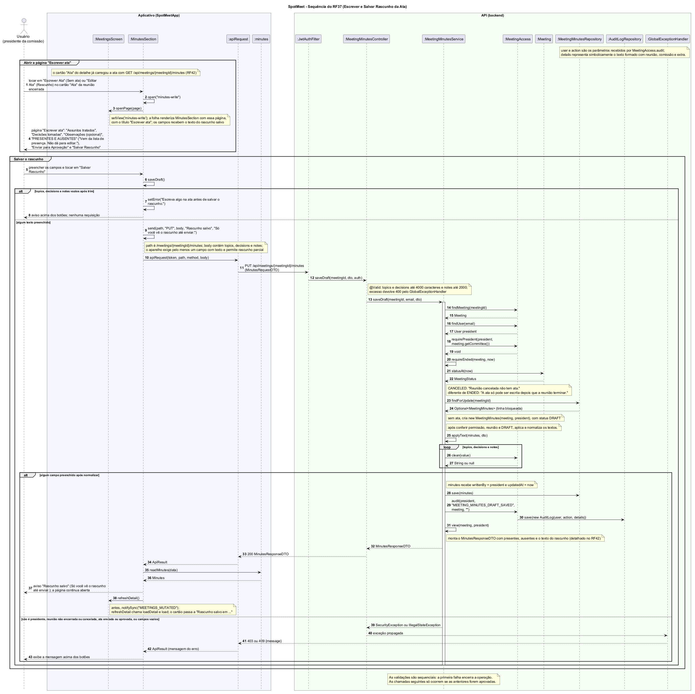

Fonte: próprio autor

#### RF38 – Enviar Ata para Aprovação

| Campo | Descrição |
|---|---|
| Função | Envia a ata da reunião para a aprovação das pessoas que registraram entrada. |
| Descrição | Exige os assuntos tratados e as decisões tomadas preenchidos e pelo menos uma pessoa, além do presidente, com entrada registrada na reunião (meeting_participants.entered_at). Grava o texto na tabela meeting_minutes (e cria a ata, quando o presidente envia sem ter salvo rascunho), muda o status para IN_APPROVAL, grava o autor, updated_at e submitted_at com o momento do envio e deixa closed_at nulo. A partir do envio, o texto passa a ser devolvido a todos que veem a reunião, a ata não aceita mais rascunho e a presença fica travada: o método resetAttendance da classe MeetingAttendanceService recusa a correção de registros (RF33) sempre que a ata existe com status diferente de DRAFT, porque quem responde à ata vem desses registros. Cada pessoa presente, menos o presidente, recebe um e-mail para responder. O mesmo envio, sobre uma ata com status REJECTED, é o reenvio do RF41. |
| Entradas | Variável de rota meetingId (Long) e objeto do tipo MinutesRequestDTO contendo topics e decisions (obrigatórios no envio, de, no máximo, 4000 caracteres cada) e notes (opcional, no máximo 2000). O executor é obtido do token JWT. |
| Origem | Usuário (presidente da comissão) e banco de dados (registros de entrada da reunião). |
| Saída | HTTP 200 com MinutesResponseDTO (campos no RF37), com status IN_APPROVAL, submittedAt e a contagem de respostas. Em caso de erro, HTTP 400 quando um campo excede o tamanho: "Os assuntos tratados podem ter até 4000 caracteres.", "As decisões tomadas podem ter até 4000 caracteres." ou "As observações podem ter até 2000 caracteres."; HTTP 403 quando o usuário não é o presidente ativo da comissão; HTTP 409 quando a reunião não existe, foi cancelada ou ainda não terminou, a ata já está em aprovação ("A ata já está em aprovação.") ou foi aprovada ("Uma ata aprovada não pode mais ser editada."), falta o texto ("Registre os assuntos tratados." ou "Registre as decisões tomadas.") ou ninguém além do presidente registrou entrada ("Não dá para enviar: ninguém além de você registrou entrada nesta reunião."). |
| Destino | Usuário, por meio da tela MeetingsScreen e do componente MinutesSection; e-mail de cada pessoa presente. |
| Ação | Na página "Escrever ata" (RF37), o presidente toca em "Enviar para Aprovação". O aplicativo confere os campos (validate) e, se "Assuntos tratados" ou "Decisões tomadas" estiver vazio, exibe "Registre os assuntos tratados." ou "Registre as decisões tomadas." abaixo do campo, sem enviar. Quando ninguém além do presidente registrou entrada, a página exibe o aviso "Não dá para enviar: ninguém além de você registrou entrada nesta reunião." com "Corrija a presença na reunião ou salve a ata como rascunho.", e o botão fica desabilitado. Com os campos preenchidos, o aplicativo envia POST /api/meetings/{meetingId}/minutes/submit (apiRequest). O método submit da classe MeetingMinutesController chama o método submit da classe MeetingMinutesService, que carrega a reunião e o usuário, exige o presidente (requirePresident) e a reunião encerrada (requireEnded), bloqueia e carrega a ata (findForUpdate) ou cria uma nova, recusa as situações IN_APPROVAL e APPROVED, aplica o texto (applyText), confere assuntos e decisões, lista os presentes menos o presidente (presentPeople, com MeetingParticipantRepository.findByMeetingIdOrderByUserNameAsc), grava a ata (save), monta os dados do e-mail (MeetingText.mail, com o endereço de MeetingService.appLink), agenda um e-mail para cada presente (EmailService.sendMinutesForApprovalEmail), registra a auditoria e devolve a ata montada (view). Com a resposta de sucesso, o aplicativo exibe o aviso "Ata enviada para aprovação" com o texto "As pessoas presentes foram avisadas por e-mail.", atualiza o detalhe e a lista e volta ao detalhe da reunião. O cartão "Ata" passa a "Em aprovação", com a contagem (por exemplo "0 aprovaram, 0 reprovaram, 3 sem resposta.") e o botão "Acompanhar Aprovação" (RF40). Na lista "Convidados", o botão "Limpar registros" deixa de aparecer e o texto "Você pode corrigir a presença até enviar a ata." dá lugar a "A presença não pode mais ser corrigida porque a ata já foi enviada.". |
| Pré-condição | O usuário estar autenticado e ser o presidente ativo da comissão; a reunião ter terminado e não estar cancelada; a ata não existir ou estar com status DRAFT; "Assuntos tratados" e "Decisões tomadas" preenchidos; pelo menos uma pessoa além do presidente com entrada registrada. |
| Pós-condição | **Sucesso:** a ata tem status IN_APPROVAL, o texto enviado, o presidente como autor e a data do envio; os presentes que não escreveram a ata podem responder (RF39) e veem o selo "Ata para aprovar" na lista; a correção da presença é recusada com a mensagem "A presença não pode mais ser corrigida porque a ata já foi enviada."; os e-mails ficam agendados para depois do commit; a auditoria fica registrada.  **Falha:** a ata não é alterada, nenhum e-mail é enviado e a mensagem de erro é exibida. |
| Efeitos colaterais | Registro em audit_logs com a ação MEETING_MINUTES_SUBMITTED (detalhe com o número de pessoas avisadas). E-mail "Ata para aprovar: título da reunião" para cada pessoa presente, menos o presidente, enviado de forma assíncrona depois do commit, com a comissão, a data, o horário, quem escreveu, a data do envio e o botão "Abrir no SpotMeet" (/abrir/reuniao/{meetingId}). Evento MEETINGS_MUTATED. |

**Figura 51 – Diagrama de sequência do RF38**

Fonte: próprio autor

#### RF39 – Aprovar ou Reprovar Ata

| Campo | Descrição |
|---|---|
| Função | Registra a resposta de uma pessoa presente à ata em aprovação. |
| Descrição | Grava na tabela minutes_responses a resposta (approved), o motivo (reason, só na reprovação) e a data (responded_at) da pessoa (user_id) para a ata (minutes_id). Responde quem registrou entrada na reunião, menos quem escreveu a ata; cada pessoa responde uma vez por rodada, sem troca (restrição única uq_minutes_response, em minutes_id e user_id). O motivo é obrigatório na reprovação e gravado sem os espaços das pontas; na aprovação, nenhum motivo é gravado. A ata fica bloqueada para escrita durante a resposta (findForUpdate), o que serializa as respostas e o encerramento. |
| Entradas | Variável de rota meetingId (Long) e objeto do tipo MinutesAnswerDTO contendo approved (booleano obrigatório) e reason (texto de, no máximo, 300 caracteres, obrigatório quando approved é falso). No aplicativo, o campo "Motivo" da página "Reprovar ata" aceita até 300 caracteres. O executor é obtido do token JWT. |
| Origem | Usuário (pessoa presente na reunião). |
| Saída | HTTP 200 com MinutesResponseDTO atualizado, com myAnswer preenchido e canAnswer falso. Em caso de erro, HTTP 400 quando approved não é informado ("Informe se aprova ou reprova a ata.") ou o motivo excede 300 caracteres; HTTP 403 quando o usuário não é integrante ativo da comissão nem líder da organização; HTTP 409 quando a reunião não existe, a ata não está em aprovação ("A ata não está em aprovação."), o usuário escreveu a ata ("Você não responde à sua própria ata."), não registrou entrada ("Só quem registrou entrada na reunião pode responder à ata."), já respondeu ("Você já respondeu a esta ata.") ou reprovou sem motivo ("Informe o motivo da reprovação."). |
| Destino | Usuário, por meio da tela MeetingsScreen e do componente MinutesSection. |
| Ação | A pessoa chega à ata pelo cartão "Ata" do detalhe (texto "Você registrou entrada, então pode responder. A ata vale pela maioria de quem responder." e botão "Aprovar ou Reprovar"), pela reunião com o selo "Ata para aprovar" ou pela página "Pendências" (RF42). Na página "Ata da reunião", abaixo do texto, dos presentes e dos ausentes, ficam os botões "Reprovar" e "Aprovar". Ao tocar em "Aprovar", o aplicativo pede a confirmação "Aprovar a ata?" ("Depois de enviada, a resposta não pode ser trocada."); confirmada, envia POST /api/meetings/{meetingId}/minutes/answer com approved verdadeiro. Ao tocar em "Reprovar", abre a página "Reprovar ata", com o campo "Motivo", o texto "O presidente recebe o motivo com o seu nome e corrige a ata." e os botões "Reprovar Ata" e "Voltar"; com o campo vazio, "Reprovar Ata" exibe "Informe o motivo da reprovação." e, preenchido, envia a mesma rota com approved falso e o motivo. O método answer da classe MeetingMinutesController chama o método answer da classe MeetingMinutesService, que carrega a reunião e o usuário, exige integrante ativo ou líder (MeetingAccess.requireViewer), bloqueia e carrega a ata em aprovação (findForUpdate), recusa quem escreveu, confere a entrada (MeetingParticipantRepository.findByMeetingIdAndUserId), recusa uma segunda resposta (MinutesResponseRepository.existsByMinutesIdAndUserId), exige o motivo na reprovação (MeetingAccess.clean), grava a resposta (save), registra a auditoria e devolve a ata montada (view). Com a resposta de sucesso, o aplicativo exibe o aviso "Resposta enviada" com o texto "Você aprovou a ata." ou "Você reprovou a ata.", mostra a página "Ata da reunião" com o quadro "Você aprovou esta ata" ou "Você reprovou esta ata", "Respondida em 30 de outubro, às 11:20." e "O presidente encerra a aprovação e você recebe o resultado por e-mail." (ou, na reprovação, "O presidente vê o motivo, corrige a ata e envia de novo." e "SEU MOTIVO"), e atualiza o detalhe e a lista, em que o selo "Ata para aprovar" e a pendência deixam de aparecer. O cartão "Ata" passa a "Você aprovou esta ata. Falta o presidente encerrar a aprovação." (ou "reprovou"). |
| Pré-condição | O usuário estar autenticado, ser integrante ativo da comissão ou líder da organização e ter registrado entrada na reunião; não ser quem escreveu a ata; a ata estar com status IN_APPROVAL; o usuário ainda não ter respondido nesta rodada; na reprovação, informar o motivo. |
| Pós-condição | **Sucesso:** a resposta fica gravada com a data (e o motivo, na reprovação) e entra na contagem do presidente (RF40); a pessoa não responde de novo nesta rodada; a auditoria fica registrada.  **Falha:** nenhuma resposta é gravada e a mensagem de erro é exibida. |
| Efeitos colaterais | Registro em audit_logs com a ação MEETING_MINUTES_APPROVED_BY_MEMBER ou MEETING_MINUTES_REJECTED_BY_MEMBER. Evento MEETINGS_MUTATED. Nenhum e-mail é enviado. |

**Figura 52 – Diagrama de sequência do RF39**

Fonte: próprio autor

#### RF40 – Encerrar Aprovação da Ata

| Campo | Descrição |
|---|---|
| Função | Encerra a aprovação da ata com as respostas recebidas e define o resultado. |
| Descrição | Conta as respostas da rodada (minutes_responses): a ata é aprovada quando as aprovações são mais que as reprovações entre quem respondeu; empate, maioria contra ou nenhuma resposta reprovam. Quem não respondeu não entra na conta. Grava na tabela meeting_minutes o status APPROVED ou REJECTED e a data do encerramento (closed_at). Uma ata aprovada não pode mais ser alterada; a reprovada continua REJECTED até o presidente reenviar o texto corrigido (RF41). Cada pessoa com entrada registrada recebe o resultado por e-mail; na reprovação, o e-mail traz o nome e o motivo de cada reprovação. Antes de encerrar, o presidente acompanha as respostas: só ele recebe a resposta de cada pessoa, com nome e motivo (answers); os demais recebem a contagem e a própria resposta. |
| Entradas | **Acompanhar:** variável de rota meetingId (Long), na consulta GET /api/meetings/{meetingId}/minutes (RF42).  **Encerrar:** variável de rota meetingId (Long), sem corpo. O executor é obtido do token JWT. |
| Origem | Usuário (presidente da comissão) e banco de dados (respostas da rodada e registros de entrada). |
| Saída | HTTP 200 com MinutesResponseDTO atualizado, com status APPROVED ou REJECTED, closedAt, os totais e answers (userId, userName, approved, reason e respondedAt de cada presente, menos quem escreveu; approved nulo para quem não respondeu). Em caso de erro, HTTP 403 quando o usuário não é o presidente ativo da comissão; HTTP 409 quando a reunião não existe ou a ata não está em aprovação ("A ata não está em aprovação."). |
| Destino | Usuário, por meio da tela MeetingsScreen e do componente MinutesSection; e-mail de cada pessoa presente. |
| Ação | Com a ata em aprovação, o cartão "Ata" do presidente exibe a contagem (por exemplo "2 aprovaram, 1 reprovou, 1 sem resposta.") e o botão "Acompanhar Aprovação", que abre a página "Aprovação da ata": título, comissão e data, a situação, o botão "Ver Ata", a contagem com o texto "A ata é aprovada se a maioria de quem respondeu aprovar. Você não responde à sua própria ata." e a lista "RESPOSTAS (N)", com uma linha por pessoa presente, "Aprovou", "Reprovou" ou "Sem resposta" e o motivo ("Motivo: ..."). A página se atualiza junto com o detalhe, a cada 10 segundos (useLiveSync), pela consulta GET /api/meetings/{meetingId}/minutes. Abaixo da lista ficam o texto "N pessoas ainda não responderam." e o botão "Encerrar Aprovação", que pede a confirmação "Encerrar a aprovação?", com o texto "N pessoas ainda não responderam. O resultado vale pela maioria de quem respondeu." (ou "Todos já responderam. O resultado vale pela maioria de quem respondeu.") e os botões "Cancelar" e "Confirmar". Ao confirmar, o aplicativo envia POST /api/meetings/{meetingId}/minutes/close. O método close da classe MeetingMinutesController chama o método close da classe MeetingMinutesService, que carrega a reunião e o usuário, exige o presidente (requirePresident), bloqueia e carrega a ata em aprovação (findForUpdate), lê as respostas (MinutesResponseRepository.findByMinutesIdOrderByRespondedAtAsc), calcula o resultado, grava a situação e a data (save), lista os presentes (presentPeople), monta o texto do resultado (resultText, por exemplo "2 aprovaram, 1 reprovou, 1 sem resposta.") e os dados do e-mail (MeetingText.mail), agenda para cada presente o e-mail de aprovação (EmailService.sendMinutesApprovedEmail) ou de reprovação (EmailService.sendMinutesRejectedEmail, com MeetingAccess.isPresident para escolher o texto do presidente), registra a auditoria e devolve a ata montada (view). Com a resposta de sucesso, o aplicativo exibe o aviso "Aprovação encerrada" com o texto "As pessoas presentes receberam o resultado por e-mail.", atualiza o detalhe e a lista e mostra "Ata aprovada", com "A maioria de quem respondeu aprovou." e "Esta ata não pode mais ser editada.", ou "Ata reprovada", com "Houve empate entre as respostas.", "A maioria de quem respondeu reprovou." ou "Sem respostas, a ata não é aprovada." e o botão "Corrigir e Reenviar" (RF41). No detalhe, o cartão "Ata" do presidente passa a "Aprovada em 30 de outubro, às 11:20, pela maioria de quem respondeu." com "Ver Ata", ou a "2 reprovaram. Corrija a ata e envie de novo para recomeçar a contagem." (ou "Não houve maioria de aprovações. Corrija a ata e envie de novo para recomeçar a contagem.") com "Corrigir e Reenviar"; o dos demais, a "A ata foi aprovada e não pode mais ser editada." ou "A ata foi reprovada. O presidente vai corrigir e enviar de novo.". |
| Pré-condição | **Acompanhar:** o usuário ser o presidente ativo da comissão e a ata ter sido enviada.  **Encerrar:** o usuário estar autenticado e ser o presidente ativo da comissão; a ata estar com status IN_APPROVAL. |
| Pós-condição | **Sucesso:** a ata tem status APPROVED (e não pode mais ser alterada) ou REJECTED, com a data do encerramento; as respostas da rodada ficam guardadas até um reenvio; os e-mails ficam agendados para depois do commit; a auditoria fica registrada.  **Falha:** a ata continua em aprovação e a mensagem de erro é exibida. |
| Efeitos colaterais | Registro em audit_logs com a ação MEETING_MINUTES_APPROVED ou MEETING_MINUTES_REJECTED (detalhe com o número de aprovações e de reprovações). E-mail "Ata aprovada: título da reunião" ou "Ata reprovada: título da reunião" para cada pessoa com entrada registrada (o presidente só o recebe se também registrou entrada), enviado de forma assíncrona depois do commit. O de aprovação traz o resultado e a nota "Ata fechada"; o de reprovação traz o resultado, a razão ("Ninguém respondeu.", "Houve empate entre as respostas." ou "A maioria de quem respondeu reprovou."), a seção "Motivos" com o nome e o motivo de cada reprovação e, para o presidente, "O que fazer" ("Corrija a ata e envie de novo. A contagem de aprovações recomeça do zero."); para os demais, "O que acontece agora". Evento MEETINGS_MUTATED. |

**Figura 53 – Diagrama de sequência do RF40**

Fonte: próprio autor

#### RF41 – Corrigir e Reenviar Ata

| Campo | Descrição |
|---|---|
| Função | Reenvia a ata reprovada, com o texto corrigido, para uma nova rodada de aprovação. |
| Descrição | Usa a mesma rota e as mesmas regras do envio (RF38) sobre uma ata com status REJECTED: exige assuntos e decisões preenchidos e pelo menos uma pessoa além do presidente com entrada. Apaga da tabela minutes_responses todas as respostas da rodada anterior (MinutesResponseRepository.deleteByMinutesId), grava o texto corrigido em meeting_minutes, volta o status a IN_APPROVAL, atualiza updated_at e submitted_at e limpa closed_at. A contagem recomeça do zero, e cada presente pode responder de novo. A ata reprovada não aceita rascunho: a correção só é gravada ao reenviar, e, enquanto o presidente não reenvia, a ata continua REJECTED. A presença continua travada (RF38). |
| Entradas | Variável de rota meetingId (Long) e objeto do tipo MinutesRequestDTO, como no RF38. O executor é obtido do token JWT. |
| Origem | Usuário (presidente da comissão) e banco de dados (motivos das reprovações e registros de entrada). |
| Saída | HTTP 200 com MinutesResponseDTO, com status IN_APPROVAL, novo submittedAt e todos os presentes, menos quem escreveu, sem resposta. Em caso de erro, as mesmas respostas do RF38. A tentativa de salvar rascunho de uma ata reprovada (PUT /api/meetings/{meetingId}/minutes) recebe HTTP 409 com "A ata já foi enviada. As correções são salvas ao reenviar para aprovação.". |
| Destino | Usuário, por meio da tela MeetingsScreen e do componente MinutesSection; e-mail de cada pessoa presente. |
| Ação | Com a ata reprovada, o cartão "Ata" do presidente e a página "Aprovação da ata" exibem o botão "Corrigir e Reenviar" (na página, com o texto "Ao reenviar, a contagem de aprovações recomeça."). O botão abre a página "Corrigir ata" (título dado por minutesTitle), com o quadro "A ata foi reprovada." quando não há motivos ou "A ata foi reprovada. Motivos:" quando há respostas de reprovação e uma linha "nome: motivo" por reprovação (lidas de answers, que só o presidente recebe), "Ao reenviar, a contagem de aprovações recomeça.", os campos com o texto enviado, os presentes e os ausentes, o texto "A ata continua Reprovada até você reenviar." e o botão "Reenviar para Aprovação"; não há "Salvar Rascunho". Ao tocar em "Reenviar para Aprovação", o aplicativo confere os campos (validate) e envia POST /api/meetings/{meetingId}/minutes/submit. O método submit da classe MeetingMinutesController chama o método submit da classe MeetingMinutesService, que segue os passos do RF38 e, por ser reenvio, apaga as respostas anteriores (MinutesResponseRepository.deleteByMinutesId) antes de gravar a ata (save), agenda o e-mail para cada presente (EmailService.sendMinutesForApprovalEmail) e registra a auditoria do reenvio. Com a resposta de sucesso, o aplicativo exibe o aviso "Ata enviada para aprovação" com o texto "As pessoas presentes foram avisadas por e-mail.", atualiza o detalhe e a lista e volta ao detalhe, com o cartão "Ata" em "Em aprovação"; cada presente volta a ver o selo "Ata para aprovar" e a pendência (RF42). |
| Pré-condição | O usuário estar autenticado e ser o presidente ativo da comissão; a ata estar com status REJECTED; "Assuntos tratados" e "Decisões tomadas" preenchidos; pelo menos uma pessoa além do presidente com entrada registrada. |
| Pós-condição | **Sucesso:** a ata tem o texto corrigido, status IN_APPROVAL, nova data de envio e nenhuma resposta; os presentes podem responder de novo (RF39); os e-mails ficam agendados para depois do commit; a auditoria fica registrada.  **Falha:** a ata continua REJECTED, com o texto e as respostas anteriores, e a mensagem de erro é exibida. |
| Efeitos colaterais | Registro em audit_logs com a ação MEETING_MINUTES_RESUBMITTED (detalhe com o número de pessoas avisadas). E-mail "Ata para aprovar: título da reunião" para cada pessoa presente, menos o presidente, como no RF38. Evento MEETINGS_MUTATED. |

**Figura 54 – Diagrama de sequência do RF41**

Fonte: próprio autor

#### RF42 – Consultar Ata

| Campo | Descrição |
|---|---|
| Função | Consulta a situação e o conteúdo da ata de uma reunião e as atas que o usuário ainda precisa responder. |
| Descrição | **Ata da reunião:** a resposta é montada a cada consulta a partir da ata (meeting_minutes), das respostas da rodada (minutes_responses) e dos participantes (meeting_participants): presentes são os convidados com entrada registrada, e ausentes, os demais. O texto do rascunho só é devolvido ao presidente; depois do envio, a todos que veem a reunião. Todos recebem a situação, o autor, as datas, a contagem (sem contar quem escreveu), se o próprio usuário esteve presente (viewerPresent), se ainda pode responder (canAnswer) e a própria resposta (myAnswer); a resposta de cada pessoa (answers) só vai ao presidente. Reunião sem ata devolve só presentes e ausentes, com status nulo.  **Atas para responder:** cada reunião da lista da aba "Reuniões" e do detalhe traz a situação da ata (minutesStatus) e se o usuário ainda precisa responder (minutesToAnswer), verdadeiro quando a ata está em aprovação, o usuário registrou entrada, não escreveu a ata e ainda não respondeu nesta rodada. |
| Entradas | **Ata da reunião:** variável de rota meetingId (Long).  **Atas para responder:** nenhuma; o usuário é obtido do token JWT, na consulta GET /api/meetings/mine (RF28). |
| Origem | Usuário e banco de dados (ata, respostas e participantes da reunião). |
| Saída | **Ata da reunião:** HTTP 200 com MinutesResponseDTO (campos no RF37); present e absent trazem userId e userName; myAnswer e cada item de answers trazem userId, userName, approved, reason e respondedAt. Em caso de erro, HTTP 403 quando o usuário não é integrante ativo da comissão nem líder da organização; HTTP 409 quando a reunião não existe.  **Atas para responder:** HTTP 200 com a lista de MeetingResponseDTO, cada um com minutesStatus (DRAFT, IN_APPROVAL, APPROVED, REJECTED ou nulo) e minutesToAnswer. |
| Destino | Usuário, por meio da tela MeetingsScreen e do componente MinutesSection. |
| Ação | **Ata da reunião:** ao abrir o detalhe de uma reunião não cancelada (RF28), o componente MinutesSection envia GET /api/meetings/{meetingId}/minutes (apiRequest) e repete a consulta a cada atualização do detalhe (a cada 10 segundos e depois de cada alteração). O método getMinutes da classe MeetingMinutesController chama o método get da classe MeetingMinutesService, que carrega a reunião e o usuário, exige integrante ativo ou líder (MeetingAccess.requireViewer) e monta a resposta (view): lê os participantes (MeetingParticipantRepository.findByMeetingIdOrderByUserNameAsc), a ata (MeetingMinutesRepository.findByMeetingId) e as respostas (MinutesResponseRepository.findByMinutesIdOrderByRespondedAtAsc), confere se o usuário preside a comissão (MeetingAccess.isPresident) e monta o DTO (MinutesResponseDTO.from). O aplicativo confere os dados (readMinutes) e exibe o cartão "Ata" com a situação ("Sem ata", "Rascunho", "Em aprovação", "Aprovada" ou "Reprovada") e o texto do perfil; para quem não preside: "A ata fica disponível depois que a reunião terminar.", "O presidente ainda não escreveu a ata.", "O presidente ainda está escrevendo a ata.", "Você não registrou entrada nesta reunião, então só pode ler a ata.", "A ata foi aprovada e não pode mais ser editada." ou "A ata foi reprovada. O presidente vai corrigir e enviar de novo." (os três primeiros textos não exibem "Ver Ata"; o botão aparece quando há ata disponível para leitura). Se a consulta falhar numa reunião encerrada, o cartão exibe "Não foi possível carregar a ata.". Ao tocar em "Ver Ata", abre a página "Ata da reunião": a situação, o título, "Comissão ... · escrita por ...", a data e o horário, "Enviada em 30 de outubro, às 11:20", "Aprovada em 30 de outubro, às 11:20. Uma ata aprovada não pode mais ser editada." quando aprovada, as seções "ASSUNTOS TRATADOS", "DECISÕES TOMADAS" (numeradas quando há mais de uma linha) e "OBSERVAÇÕES" e as listas "PRESENTES (N)" e "AUSENTES (N)" com foto ou iniciais (PeopleGrid). Quem pode responder vê os botões do RF39; o presidente vê "Acompanhar Aprovação" (RF40) ou "Editar Ata" (RF37).  **Atas para responder:** a lista da aba "Reuniões" (GET /api/meetings/mine, método listMyMeetings das classes MeetingController e MeetingService) e o detalhe (GET /api/meetings/{meetingId}) são montados por MeetingAccess.summaries e detail, que leem as atas das reuniões (MeetingMinutesRepository.findByMeetingIdIn) e as respostas do usuário às atas em aprovação (MinutesResponseRepository.findByMinutesIdInAndUserId) e completam cada reunião (MeetingResponseDTO.withMinutes). A reunião com ata para responder ganha o selo "Ata para aprovar"; o aviso do topo junta convites e atas ("Você tem 1 convite e 1 ata para responder."), com o texto "Toque para ver os convites e a ata." (ou "Toque para ler a ata e aprovar ou reprovar.", sem convites) e o link "Ver Pendências", "Ver Ata" ou "Ver Atas". A página "Pendências" lista "ATAS PARA RESPONDER (N)", com "Toque em uma ata para ler e aprovar ou reprovar.", e, quando houver, "RECUSAS DOS SEUS CONVITES" e "CONVITES PARA RESPONDER (N)"; ao tocar numa ata, o aplicativo abre o detalhe da reunião já na página "Ata da reunião" (openMinutes). Com uma só ata e nenhum convite, "Ver Ata" abre a ata direto. |
| Pré-condição | **Ata da reunião:** o usuário estar autenticado e ser integrante ativo da comissão ou líder da organização; a reunião não estar cancelada (o aplicativo não consulta nem exibe o cartão "Ata" numa reunião cancelada). Para ler o texto, a ata ter sido enviada, ou o usuário ser o presidente.  **Atas para responder:** o usuário estar autenticado e ser integrante ativo da comissão da reunião. |
| Pós-condição | Nada é alterado no banco. A situação, a ata e as pendências são exibidas; em caso de erro, a mensagem é exibida no cartão "Ata". |
| Efeitos colaterais | Nenhum. |

**Figura 55 – Diagrama de sequência do RF42**

Fonte: próprio autor

#### RF43 – Abrir Votação

| Campo | Descrição |
|---|---|
| Função | Abre uma votação durante a reunião, para as pessoas que registraram entrada. |
| Descrição | Grava na tabela meeting_polls a reunião (meeting_id), a pergunta (question, até 150 caracteres), a descrição opcional (description, até 500 caracteres), quem abriu (opened_by_id) e o horário (opened_at); closed_at e closed_by_id ficam vazios, e a votação está aberta. Só o presidente abre, e só com a reunião em andamento (entre o início e o término, sem cancelamento). A pergunta e a descrição são gravadas sem os espaços das pontas, e a descrição vazia é gravada como nula. Uma reunião pode ter várias votações, abertas ao mesmo tempo ou uma depois da outra, listadas na ordem de abertura. Votam as pessoas que registraram entrada na reunião (RF44); a votação é encerrada pelo presidente ou no fim da reunião (RF45). A votação não envia e-mail. |
| Entradas | Variável de rota meetingId (Long) e objeto do tipo PollRequestDTO contendo question (string obrigatória, de no máximo 150 caracteres) e description (string opcional, de no máximo 500 caracteres). O executor é obtido do token JWT. |
| Origem | Usuário (presidente da comissão). |
| Saída | HTTP 201 com a lista de PollResponseDTO de todas as votações da reunião, na ordem de abertura, já com a nova votação (campos descritos no RF46). Em caso de erro, HTTP 400 quando a pergunta está em branco ("Escreva a pergunta da votação."), a pergunta excede 150 caracteres ("A pergunta pode ter até 150 caracteres.") ou a descrição excede 500 caracteres ("A descrição pode ter até 500 caracteres."); HTTP 403 quando o usuário não é o presidente ativo da comissão; HTTP 409 quando a reunião não existe ou não está em andamento ("A reunião terminou. Só é possível abrir uma votação com a reunião em andamento." depois do término e "Só é possível abrir uma votação com a reunião em andamento." antes do início ou com a reunião cancelada). |
| Destino | Usuário, por meio da tela MeetingsScreen e do componente MeetingPolls. |
| Ação | No detalhe de uma reunião em andamento, o cartão "Votações" fica abaixo do cartão "Ata"; quando ainda não há votação, ele exibe "Nenhuma votação aberta nesta reunião.", e só o presidente vê o botão "Abrir Votação". Ao tocar nele, a folha do detalhe passa à página "Abrir votação" (método openPage da tela MeetingsScreen), que exibe o cabeçalho da reunião com o selo "Em andamento", o campo "Pergunta" (obrigatório, até 150 caracteres, com o exemplo "Ex: Aprovar o orçamento de dezembro?"), o campo "Descrição (opcional)" (até 500 caracteres) e o aviso "Votam as pessoas que registraram entrada. O voto é nominal e não pode ser trocado.", com o número de pessoas que podem votar agora (por exemplo, "3 pessoas podem votar agora. Quem se abster pode explicar o motivo, se quiser."). Com a pergunta vazia, o campo exibe "Escreva a pergunta da votação." e nada é enviado. Ao tocar em "Abrir Votação", o aplicativo envia POST /api/meetings/{meetingId}/polls (função apiRequest). O método openPoll da classe MeetingPollController chama o método open da classe MeetingPollService, que carrega a reunião e o usuário (MeetingAccess.findMeeting e findUser), exige o papel de presidente (MeetingAccess.requirePresident), confere a situação (Meeting.statusAt), limpa a pergunta e a descrição (MeetingAccess.clean), grava a votação (MeetingPollRepository.save), registra a auditoria (MeetingAccess.audit) e monta a lista das votações (método view, com MeetingPollRepository.findByMeetingIdOrderByOpenedAtAsc, MeetingParticipantRepository.findByMeetingIdOrderByUserNameAsc, PollVoteRepository.findByPollIdInOrderByVotedAtAsc, MeetingAccess.isPresident e PollResponseDTO.from). Com a resposta de sucesso, o aplicativo lê a lista (readPolls), exibe o aviso "Votação aberta" com o texto "As pessoas que registraram entrada já podem votar.", atualiza o detalhe e abre a página "Votação" da nova votação. Se a reunião terminar com a página aberta, ela passa a exibir "A reunião terminou." e "Só é possível abrir uma votação com a reunião em andamento.", e o botão fica desabilitado. "Cancelar" volta ao detalhe. |
| Pré-condição | O usuário estar autenticado e ser o presidente ativo da comissão (integrante ativo com o papel COMMITTEE_ADMIN); a reunião estar em andamento. |
| Pós-condição | **Sucesso:** a votação fica gravada como aberta e aparece no cartão "Votações" de quem abre o detalhe da reunião; as pessoas com entrada registrada podem votar (RF44); a auditoria fica registrada.  **Falha:** nenhuma votação é gravada e a mensagem de erro é exibida na página. |
| Efeitos colaterais | Registro em audit_logs com a ação MEETING_POLL_OPENED (detalhe com a reunião, a comissão e o identificador da votação). Evento MEETINGS_MUTATED. Nenhum e-mail é enviado. |

**Figura 56 – Diagrama de sequência do RF43**

Fonte: próprio autor

#### RF44 – Votar

| Campo | Descrição |
|---|---|
| Função | Registra o voto nominal de uma pessoa presente numa votação aberta. |
| Descrição | Grava na tabela poll_votes a votação (poll_id), quem votou (user_id), a escolha (choice: YES, NO ou ABSTAIN, exibidas como Sim, Não e Abstenção), a justificativa (justification) e o horário (voted_at). Vota quem é integrante ativo da comissão e registrou entrada na reunião (entered_at preenchido em meeting_participants, mesmo que já tenha registrado a saída), inclusive o presidente. Cada pessoa vota uma vez em cada votação, e o voto não pode ser trocado (restrição única uq_poll_vote, em poll_id e user_id). A justificativa é opcional, tem até 280 caracteres e só é gravada na abstenção: num voto Sim ou Não ela é descartada; é gravada sem os espaços das pontas, e a justificativa vazia é gravada como nula. O voto é aceito enquanto a votação está aberta, isto é, não foi encerrada pelo presidente (RF45) e a reunião continua em andamento. A linha da votação é bloqueada para escrita (MeetingPollRepository.findForUpdate), o que serializa os votos e o encerramento da mesma votação. |
| Entradas | Variáveis de rota meetingId e pollId (Long) e objeto do tipo PollVoteDTO contendo choice (YES, NO ou ABSTAIN, obrigatório) e justification (string opcional, de no máximo 280 caracteres). O executor é obtido do token JWT. |
| Origem | Usuário (pessoa que registrou entrada na reunião). |
| Saída | HTTP 200 com a lista de PollResponseDTO de todas as votações da reunião; na votação respondida, myVote vem preenchido e canVote vem falso. Em caso de erro, HTTP 400 quando a escolha falta ("Escolha Sim, Não ou Abstenção."), não é YES, NO nem ABSTAIN ("Corpo da requisição inválido.") ou a justificativa excede 280 caracteres ("A justificativa pode ter até 280 caracteres."); HTTP 403 quando o usuário não é integrante ativo da comissão; HTTP 409 quando a reunião não existe, a votação não existe nessa reunião ("Votação não encontrada."), a votação já foi encerrada ("Esta votação já foi encerrada."), a reunião não está em andamento ("Só é possível votar com a reunião em andamento."), o usuário não registrou entrada ("Só quem registrou entrada na reunião pode votar.") ou já votou ("Você já votou nesta votação. O voto não pode ser trocado."). |
| Destino | Usuário, por meio da tela MeetingsScreen e do componente MeetingPolls. |
| Ação | No cartão "Votações" do detalhe, a votação aberta em que a pessoa ainda pode votar exibe "Você ainda não votou." e o botão "Votar Agora"; para o presidente, o botão não aparece no cartão, e ele vota na própria página da votação. Ao tocar no botão ou na votação, a folha passa à página "Votação", com o selo "Aberta", a pergunta, a descrição e "Aberta por nome às 14:05.". Na seção "SEU VOTO", a pessoa escolhe "Sim", "Não" ou "Abstenção"; ao escolher "Abstenção", aparece o campo "Justificativa (opcional)" (até 280 caracteres, com o exemplo "Ex: Preciso de mais informações antes de decidir.") e a nota "Até 280 caracteres. Aparece com o seu nome, junto com o seu voto.". O texto "Votam as 5 pessoas que registraram entrada. Seu voto aparece com o seu nome e não pode ser trocado." fica acima do botão "Confirmar Voto", desabilitado até a escolha. Ao tocar nele, o aplicativo pede a confirmação "Confirmar voto" com o texto "Confirmar voto: Sim? Não será possível trocar." (na abstenção com justificativa, acrescenta "Sua justificativa:" e o texto) e os botões "Cancelar" e "Confirmar" (função confirmAction). Confirmado, envia POST /api/meetings/{meetingId}/polls/{pollId}/vote (função apiRequest), com a justificativa só na abstenção. O método vote da classe MeetingPollController chama o método vote da classe MeetingPollService, que carrega a reunião e o usuário, exige integrante ativo (MeetingAccess.requireActiveMember), bloqueia e carrega a votação (MeetingPollRepository.findForUpdate), confere se a votação está aberta (MeetingPoll.isClosedAt) e se a reunião está em andamento (Meeting.statusAt), confere a entrada registrada (MeetingParticipantRepository.findByMeetingIdAndUserId) e o voto anterior (PollVoteRepository.existsByPollIdAndUserId), limpa a justificativa da abstenção (MeetingAccess.clean), grava o voto (PollVoteRepository.save), registra a auditoria e monta a lista das votações, como no RF43. Com a resposta de sucesso, o aplicativo exibe o aviso "Voto registrado" com o texto "Você votou Sim.", "Você votou Não." ou "Você se absteve." e passa a mostrar o cartão "Seu voto: Sim", com "Registrado às 14:07, com o seu nome.", a justificativa, quando houver, e, para quem não é o presidente, "Aguardando o encerramento.". Quem não registrou entrada vê, no cartão, "Só quem registrou entrada vota." e, na página, "Só quem registrou entrada na reunião vota.". |
| Pré-condição | O usuário estar autenticado, ser integrante ativo da comissão e ter registrado entrada na reunião; a votação estar aberta (não encerrada pelo presidente e com a reunião em andamento); o usuário ainda não ter votado nela. |
| Pós-condição | **Sucesso:** o voto fica gravado com o nome da pessoa e não pode mais ser trocado; a contagem ao vivo do presidente passa a incluí-lo (RF46); a auditoria fica registrada.  **Falha:** nenhum voto é gravado e a mensagem de erro é exibida na página. |
| Efeitos colaterais | Registro em audit_logs com a ação MEETING_POLL_VOTED (detalhe com a reunião, a comissão e o identificador da votação, sem a escolha). Evento MEETINGS_MUTATED. |

**Figura 57 – Diagrama de sequência do RF44**

Fonte: próprio autor

#### RF45 – Encerrar Votação

| Campo | Descrição |
|---|---|
| Função | Encerra uma votação aberta, o que impede novos votos e libera o resultado para todos. |
| Descrição | **Pelo presidente:** grava na tabela meeting_polls o horário (closed_at) e o autor (closed_by_id) do encerramento. Só o presidente encerra, e só uma votação ainda aberta. A linha da votação é bloqueada para escrita (MeetingPollRepository.findForUpdate): um voto enviado ao mesmo tempo é gravado antes do encerramento ou recusado com "Esta votação já foi encerrada.".  **No fim da reunião:** sem nenhuma gravação e sem tarefa agendada, a votação passa a ser considerada encerrada quando a reunião termina ou é cancelada (MeetingPoll.isClosedAt). closed_at continua nulo, e o horário do encerramento é o término da reunião ou, se a reunião for cancelada antes do término, o horário do cancelamento (MeetingPoll.closingTime). A regra é aplicada a cada consulta (RF46).  Nos dois casos, ninguém mais vota e o resultado nominal aparece para todos (RF46). |
| Entradas | Variáveis de rota meetingId e pollId (Long). Não há corpo. O executor é obtido do token JWT. |
| Origem | Usuário (presidente da comissão) e relógio do servidor, no encerramento no fim da reunião. |
| Saída | HTTP 200 com a lista de PollResponseDTO de todas as votações da reunião; a votação encerrada já traz o resultado (RF46). Em caso de erro, HTTP 403 quando o usuário não é o presidente ativo da comissão; HTTP 409 quando a reunião não existe, a votação não existe nessa reunião ("Votação não encontrada.") ou a votação já foi encerrada, pelo presidente ou pelo fim da reunião ("Esta votação já foi encerrada."). |
| Destino | Usuário, por meio da tela MeetingsScreen e do componente MeetingPolls. |
| Ação | Na página "Votação" de uma votação aberta, o presidente toca em "Encerrar Votação". O aplicativo pede a confirmação "Encerrar a votação?" com o número de quem falta votar ("2 pessoas ainda não votaram." ou "Todos já votaram.", ou "Ninguém votou." quando não há participantes elegíveis nem votos; com pessoas presentes sem votar, informa quantas faltam) e o texto "Depois de encerrada, ninguém mais vota e o resultado aparece para todos.", com os botões "Cancelar" e "Confirmar" (função confirmAction). Confirmado, envia POST /api/meetings/{meetingId}/polls/{pollId}/close (função apiRequest). O método closePoll da classe MeetingPollController chama o método close da classe MeetingPollService, que carrega a reunião e o usuário, exige o papel de presidente (MeetingAccess.requirePresident), bloqueia e carrega a votação (MeetingPollRepository.findForUpdate), confere se ainda está aberta (MeetingPoll.isClosedAt), grava o horário e o autor do encerramento (MeetingPollRepository.save), registra a auditoria e monta a lista das votações, como no RF43. Com a resposta de sucesso, o aplicativo exibe o aviso "Votação encerrada" com o texto "O resultado já aparece para todos." e a página passa a mostrar o resultado (RF46). No fim da reunião, nenhuma ação é necessária: na atualização seguinte do detalhe (a cada 10 segundos), a votação aparece como "Encerrada", com "Encerrada automaticamente às 15:00, no fim da reunião.". |
| Pré-condição | **Pelo presidente:** o usuário estar autenticado e ser o presidente ativo da comissão; a votação estar aberta, com a reunião em andamento.  **No fim da reunião:** a reunião chegar ao término ou ser cancelada com a votação ainda aberta. |
| Pós-condição | **Sucesso:** a votação fica encerrada, não aceita mais votos e o resultado nominal fica visível para todos que consultam a reunião; no encerramento pelo presidente, o horário e o autor ficam gravados e a auditoria é registrada.  **Falha:** a votação continua como estava e a mensagem de erro é exibida na página. |
| Efeitos colaterais | Registro em audit_logs com a ação MEETING_POLL_CLOSED, só no encerramento pelo presidente; o encerramento no fim da reunião não grava nada. Evento MEETINGS_MUTATED. |

**Figura 58 – Diagrama de sequência do RF45**

Fonte: próprio autor

#### RF46 – Consultar Resultado da Votação

| Campo | Descrição |
|---|---|
| Função | Consulta as votações da reunião, com a contagem ao vivo para o presidente e o resultado nominal para todos depois do encerramento. |
| Descrição | Devolve as votações da reunião na ordem de abertura. O conteúdo é montado a cada consulta (PollResponseDTO.from), a partir das votações, dos votos e dos participantes da reunião; nada é gravado.  **Situação:** a votação está encerrada quando o presidente a encerrou (closed_at preenchido) ou quando a reunião terminou ou foi cancelada (MeetingPoll.isClosedAt). Uma reunião em andamento editada para começar mais tarde mantém a votação aberta, mas ninguém vota até a reunião voltar a estar em andamento. O horário do encerramento é closed_at ou, no encerramento automático, o término da reunião, ou o horário do cancelamento, se a reunião for cancelada antes do término (MeetingPoll.closingTime). Não há tarefa agendada: a regra é aplicada na leitura.  **O que cada um vê:** todos recebem a pergunta, a descrição, quem abriu e quando, o número de pessoas que podem votar (eligible, quem registrou entrada na reunião), o número de votos (totalVotes), o próprio voto (myVote) e se ainda pode votar (canVote: votação aberta, sem voto e com entrada registrada). Enquanto a votação está aberta, só o presidente recebe a contagem de Sim, Não e Abstenção, os votos com o nome e a justificativa e quem ainda não votou. Depois do encerramento, todos recebem a contagem, o voto de cada pessoa com a justificativa e quem não votou (pessoas com entrada registrada e sem voto).  **Resultado:** com a votação encerrada, Sim acima de Não é "Aprovada" (APPROVED), Não acima de Sim é "Rejeitada" (REJECTED), Sim igual a Não, com ou sem abstenções, é "Empate" (TIE), e nenhum voto é "Sem votos" (NO_VOTES). As abstenções não decidem o resultado: só abstenções dão "Empate". Exemplo: 5 Sim, 2 Não e 1 abstenção dão "Aprovada por 5 a 2, 1 abstenção".  **Porcentagens:** calculadas no aplicativo pela função percentages (utils/polls.ts), pelo método do maior resto, com números inteiros que sempre somam 100%: cada porcentagem é arredondada para baixo, e os pontos que faltam para 100 vão, um a um, para as opções com a maior parte decimal; com partes decimais iguais, a ordem é Sim, Não e Abstenção. Exemplo: 5, 2 e 1 votos (62,5%, 25% e 12,5%) dão 63%, 25% e 12%. Sem votos, todas ficam em 0%. |
| Entradas | Variável de rota meetingId (Long). O usuário é obtido do token JWT. |
| Origem | Usuário e banco de dados (votações, votos e participantes da reunião). |
| Saída | HTTP 200 com a lista de PollResponseDTO, cada um contendo id, question, description, openedByName, openedAt, closed, closedAt, closedByName, closedAutomatically, eligible, totalVotes, canVote, myVote, result (APPROVED, REJECTED, TIE ou NO_VOTES, só depois do encerramento), yes, no, abstain, votes (userId, userName, choice, justification e votedAt) e notVoted (userId e userName). Para quem não é o presidente, yes, no, abstain, votes e notVoted vêm nulos enquanto a votação está aberta. closedByName vem nulo no encerramento automático. A lista vazia indica que a reunião não tem votação. Em caso de erro, HTTP 403 quando o usuário não é integrante ativo da comissão nem líder da organização; HTTP 409 quando a reunião não existe. |
| Destino | Usuário, por meio da tela MeetingsScreen e do componente MeetingPolls. |
| Ação | Com a reunião em andamento ou encerrada, o componente MeetingPolls envia GET /api/meetings/{meetingId}/polls (função apiRequest) a cada atualização do detalhe (ao abrir, a cada 10 segundos e depois de qualquer mudança em reuniões) e lê a resposta (readPolls). O método listPolls da classe MeetingPollController chama o método list da classe MeetingPollService, que carrega a reunião e o usuário, exige integrante ativo ou líder (MeetingAccess.requireViewer) e monta a lista (método view, com MeetingPollRepository.findByMeetingIdOrderByOpenedAtAsc, MeetingParticipantRepository.findByMeetingIdOrderByUserNameAsc, PollVoteRepository.findByPollIdInOrderByVotedAtAsc, MeetingAccess.isPresident e PollResponseDTO.from).  **Cartão "Votações":** lista cada votação com a pergunta, o selo "Aberta" ou "Encerrada" e, ao lado, o resultado resumido (resultShort: "Aprovada por 5 a 2, 1 abstenção" ou "Empate: 4 a 4"); com a votação aberta, o presidente vê "3 de 5 votaram", e os demais veem "Você ainda não votou.", "Seu voto: Sim" ou, sem entrada registrada, "Só quem registrou entrada vota.". O cartão não aparece em reunião agendada ou cancelada, nem quando não há votação (a não ser para o presidente, com a reunião em andamento). Ao tocar numa votação, a folha passa à página "Votação".  **Votação aberta:** o presidente vê "Aberta por você às 14:05. 3 de 5 votaram.", as barras de "CONTAGEM AO VIVO" (Sim, Não e Abstenção, com o número e a porcentagem), "QUEM VOTOU" (nome, voto e justificativa) e "FALTAM VOTAR" (com o selo "Aguardando"); os demais veem só o próprio voto ou as opções para votar (RF44). A nota final diz que o resultado aparece para todos quando o presidente encerrar a votação ou quando a reunião terminar.  **Votação encerrada:** todos veem o selo "Encerrada", quem encerrou e quando ("Encerrada por nome às 14:30." ou, no encerramento automático, "Aberta por nome às 14:05." e "Encerrada automaticamente às 15:00, no fim da reunião."), "Votaram 4 de 5.", o cartão do resultado (resultTitle e resultDetail: por exemplo, "Aprovada por 5 a 2, 1 abstenção" com "5 votos Sim, 2 Não e 1 abstenção."; "Empate" com "Nenhuma opção venceu."; "Sem votos" com "Ninguém votou. A votação foi encerrada sem nenhum voto e não tem resultado."), o próprio voto, as barras de "RESULTADO" com as porcentagens (exceto sem votos), "QUEM VOTOU EM QUÊ" com a justificativa das abstenções e "NÃO VOTARAM" (com o selo "Não votou"). |
| Pré-condição | O usuário estar autenticado e ser integrante ativo da comissão ou líder da organização; no aplicativo, a reunião estar em andamento ou encerrada. Para ver a contagem com a votação aberta, ser o presidente; para ver o resultado, a votação estar encerrada. |
| Pós-condição | Nada é alterado no banco. As votações são exibidas conforme o perfil e a situação; em caso de erro na consulta, o cartão mantém os dados anteriores e a atualização seguinte tenta de novo. |
| Efeitos colaterais | Nenhum. A consulta não grava auditoria. |

**Figura 59 – Diagrama de sequência do RF46**

Fonte: próprio autor

#### RF47 – Consultar Meu Relatório de Reuniões

| Campo | Descrição |
|---|---|
| Função | Consulta o relatório individual de reuniões do usuário: as reuniões em que ele registrou entrada, com o tempo em cada uma e os totais, filtradas por período e por comissão. |
| Descrição | **Quais reuniões entram:** só as reuniões em que o próprio usuário tem a entrada registrada (coluna entered_at preenchida em meeting_participants, RF31), de qualquer comissão, da mais recente para a mais antiga pela data de início. O usuário vem sempre do token da sessão: a rota não recebe identificador de usuário, então ninguém consulta o relatório de outra pessoa. O relatório não tem tabela própria; é calculado a cada consulta.  **Tempo:** o tempo de cada reunião é a saída menos a entrada, em minutos inteiros. Sem saída registrada, a reunião não tem tempo: aparece com "Saída não registrada" e um traço ("–") no lugar do tempo e não soma em "Horas no total". Os totais são: "Reuniões" (quantidade de reuniões listadas), "Horas no total" (soma dos tempos, exibida como "58 min" ou "7 h 58 min") e "Comissões" (comissões diferentes entre as reuniões listadas).  **Período:** vale o dia de início da reunião, com a data inicial e a data final incluídas. As opções são "Este mês" (do dia 1 até hoje), "Últimos 3 meses" (padrão, de hoje menos três meses até hoje), "Este ano" (de 1º de janeiro até hoje), "Todo o período" (sem datas) e "Escolher as datas" (as datas escolhidas pelo usuário). A data final antes da inicial é recusada com "A data final não pode ser antes da data inicial.", no aplicativo, antes de enviar, e também no servidor.  **Comissão:** as opções do filtro são todas as comissões em que o usuário registrou entrada, em qualquer período, em ordem alfabética. Uma comissão sem reuniões do usuário devolve o relatório vazio, sem erro. |
| Entradas | Parâmetros opcionais da requisição GET /api/users/me/report: from e to (datas no formato AAAA-MM-DD) e committeeId (Long), enviados só quando definidos; e o token da sessão (cabeçalho Authorization).  No aplicativo: a opção de período, a "Data inicial" e a "Data final" do período personalizado e a comissão escolhida. |
| Origem | Usuário e banco de dados (registros de entrada e saída de meeting_participants, com a reunião e a comissão). |
| Saída | HTTP 200 com AttendanceReportDTO: from, to e committeeId recebidos; totalMeetings, totalMinutes, totalCommittees e missingExit (verdadeiro quando alguma reunião listada não tem saída); rows, com meetingId, title, committeeId, committeeName, startsAt, enteredAt, leftAt e durationMinutes (nulo sem saída) de cada reunião; e committees, com committeeId e committeeName de cada opção do filtro.  Em caso de erro: HTTP 409 com "A data final não pode ser antes da data inicial." (ou "Usuário autenticado não encontrado."); HTTP 400 com "Parâmetro ausente ou inválido." quando uma data ou a comissão não estão no formato esperado; HTTP 401 sem token válido, e o aplicativo encerra a sessão com o aviso "Sessão encerrada". No aplicativo, falhas de conexão exibem "Não foi possível conectar ao servidor. Tente novamente." e uma resposta ilegível exibe "Não foi possível ler o relatório. Tente novamente.", sempre com o botão "Tentar novamente". |
| Destino | Usuário, por meio da página "Meu Relatório" da tela SettingsScreen e do componente AttendanceReport. |
| Ação | O relatório abre de dois jeitos. Na aba "Reuniões", o usuário toca em "Meu Relatório", no topo, ao lado do título: a tela MeetingsScreen chama navigation.navigate('Settings', { open: 'report' }), e a tela SettingsScreen lê route.params.open, limpa o parâmetro e abre a página "report". Ou, em "Ajustes", seção "REUNIÕES E AJUDA", o usuário toca em "Meu Relatório de Reuniões" ("Suas presenças por período e comissão."), e a tela chama changeSection. A página tem o título "Meu Relatório", o subtítulo "Reuniões em que você registrou entrada." e a seta "Voltar a Ajustes"; o botão voltar do celular também volta ao menu quando não há escolha de período aberta.  O componente AttendanceReport começa com "Últimos 3 meses" e "Todas as suas comissões", calcula as datas do período (periodRange, de utils/report.ts) e envia GET /api/users/me/report (apiRequest, de utils/apiRequest.ts). O método getReport da classe AttendanceReportController tira o e-mail do token (getEmail) e chama o método report da classe AttendanceReportService, que recusa a data final antes da inicial, carrega o usuário (MeetingAccess.findUser, que usa UserRepository.findByEmail), consulta as participações com entrada registrada, já com a reunião e a comissão (MeetingParticipantRepository.findEnteredByUser), monta as opções de comissão, aplica os filtros de período e de comissão, calcula os minutos de cada reunião e devolve o AttendanceReportDTO, cujo construtor calcula os totais.  O aplicativo lê a resposta (readReport) e exibe os cartões "Reuniões", "Horas no total" (formatTotal) e "Comissões"; os filtros "PERÍODO" ("Este mês", "Últimos 3 meses", "Este ano", "Todo o período" e "Escolher as datas") e "COMISSÃO" ("Todas as suas comissões" e uma opção com o nome de cada comissão); o aviso "Reuniões sem saída registrada não entram em Horas no total.", quando é o caso; e as reuniões agrupadas por mês ("NOVEMBRO DE 2026"), cada uma com o bloco da data (TER 03 NOV), o título, a comissão, "Entrada 14:00 · Saída 15:30" (ou "Entrada 14:00 · Saída não registrada") e, à direita, o tempo ("1 h 30 min") ou "–". Cada toque num filtro refaz a consulta.  Em "Escolher as datas", a página "Período Personalizado" mostra os campos "Data inicial" e "Data final" (DateTimeField, que abre o seletor de data do celular: um diálogo no Android e uma folha com "Concluir" no iOS), preenchidos com o período personalizado anterior ou, na primeira vez, com o dia 1 do mês e hoje; a dica "O relatório mostra as reuniões em que você registrou entrada nesse período."; e os botões "Aplicar Período" e "Cancelar". Com a data final antes da inicial, "Aplicar Período" exibe "A data final não pode ser antes da data inicial." abaixo de "Data final" e nada é enviado. Aplicado, o filtro "Escolher as datas" fica marcado e mostra "De 1 de novembro a 7 de novembro.". Na escolha de período, "Cancelar" e o botão voltar do celular fecham a escolha, limpam seu erro e preservam o período anterior; a seta "Voltar a Ajustes" continua sendo a navegação para o menu.  Sem reuniões, o relatório exibe "Você ainda não participou de nenhuma reunião neste período." (com uma comissão escolhida, "Você ainda não participou de nenhuma reunião da comissão Nome neste período."), "Só contam as reuniões em que você registrou entrada." e, fora de "Todo o período", o botão "Ver Todo o Período". Em caso de erro, exibe a mensagem e "Tentar novamente", que repete a consulta. |
| Pré-condição | Ter sessão iniciada com perfil global USER: a aba "Ajustes" e a aba "Reuniões", com o atalho, só existem para esse perfil (a rota aceita qualquer token válido, mas o aplicativo não oferece o relatório a ADMIN e SYSADMIN). Ajustes ter carregado o perfil (GET /api/users/me, consulta descrita no RF16) e o servidor estar acessível. Para haver reuniões no relatório, ter registrado entrada em alguma reunião (RF31). |
| Pós-condição | Nada é alterado no banco.  **Sucesso:** o relatório do período e da comissão escolhidos é exibido.  **Falha:** a mensagem de erro é exibida com "Tentar novamente"; falha da requisição apaga o relatório anterior (setReport(null)); se a requisição teve sucesso mas a resposta não pôde ser interpretada, o relatório anterior é preservado. |
| Efeitos colaterais | Nenhum: a consulta só lê dados (transação somente leitura), não grava auditoria e não envia e-mail. |

**Figura 60 – Diagrama de sequência do RF47**

Fonte: próprio autor

#### RF48 – Consultar a Ajuda

| Campo | Descrição |
|---|---|
| Função | Exibe no aplicativo o manual de utilização do SpotMeet, organizado por perfil, com busca por palavra e uma página por tópico. |
| Descrição | **Conteúdo:** o manual tem 23 tópicos em cinco perfis: "Primeiros Passos" (6 tópicos, para todos: criar conta, entrar, recuperar a senha, organização, convite de comissão e Ajustes), "Membro" (5), "Presidente da comissão" (5), "Dono e vice-líder da organização" (3) e "Administrador do sistema" (4). Cada tópico tem título, resumo, passo a passo numerado com os nomes dos botões do aplicativo, um destaque opcional (15 dos 23 tópicos têm) e dois tópicos relacionados ("VEJA TAMBÉM"). O manual é só texto, sem imagens.  **Onde fica o texto:** no próprio aplicativo, no módulo utils/helpTopics.ts (HELP_TOPICS, PROFILE_LABELS e PROFILE_HINTS). A ajuda não consulta o servidor e não grava nada. O mesmo texto forma o documento Doc/06-manual-de-uso.md, gerado a partir desse módulo, com a tabela dos perfis, o sumário numerado de 1 a 23 e os mesmos tópicos, passos, destaques e relacionados; assim, o documento e a tela "Ajuda" têm o mesmo conteúdo. Os tópicos do perfil "Administrador do sistema" também aparecem na tela, mas o administrador (ADMIN e SYSADMIN) não tem a aba "Ajustes"; para ele, o texto está no Doc/06.  **Busca:** a busca (searchTopics) separa o texto digitado em palavras e mostra os tópicos em que cada palavra é o início de alguma palavra do título, do resumo, dos passos ou do destaque, sem diferença de acentos e de maiúsculas. Por exemplo, "votacao" encontra "votação", e "ata" não encontra "data". Os relacionados não entram na busca. O campo vazio, ou só com espaços, mostra os perfis. |
| Entradas | O texto digitado no campo "Buscar um tópico", o perfil tocado e o tópico escolhido. Não há requisição ao servidor. |
| Origem | Usuário e texto do manual guardado no aplicativo (utils/helpTopics.ts). |
| Saída | Cartões dos perfis com o nome e "N tópicos · descrição" ("6 tópicos · Todos", "5 tópicos · Seu perfil", "5 tópicos · Quem preside uma comissão", "3 tópicos · Quem lidera uma organização" e "4 tópicos · Equipe do SpotMeet"); resultados da busca, com "1 tópico encontrado." ou "N tópicos encontrados." e o perfil de cada tópico, ou "Nenhum tópico encontrado.", "Tente outra palavra, como ata, convite ou votação." e o botão "Limpar Busca"; e a página do tópico, com o título, o perfil ("Todos" nos tópicos de "Primeiros Passos"), o resumo, "PASSO A PASSO" com os passos numerados, o destaque e "VEJA TAMBÉM". |
| Destino | Usuário, por meio da página "Ajuda" da tela SettingsScreen e do componente HelpCenter. |
| Ação | Em "Ajustes", seção "REUNIÕES E AJUDA", o usuário toca em "Ajuda" ("Manual de utilização do SpotMeet."). A tela SettingsScreen abre a página "help" (changeSection), com o título "Ajuda", o subtítulo "Manual de utilização do SpotMeet." e a seta "Voltar a Ajustes".  O componente HelpCenter exibe o campo "BUSCAR UM TÓPICO" (exemplo "Ex: ata, convite, votação") e os cinco cartões de perfil, na ordem "Primeiros Passos", "Membro", "Presidente da comissão", "Dono e vice-líder da organização" e "Administrador do sistema", com "Primeiros Passos" aberto. Tocar num cartão abre a lista dos tópicos daquele perfil e fecha o cartão que estava aberto; tocar de novo no cartão aberto o fecha.  Ao digitar, os cartões dão lugar aos resultados de searchTopics; o "x" do campo ("Limpar busca") e o botão "Limpar Busca" apagam o texto e voltam aos cartões.  Ao tocar num tópico, o HelpCenter chama onOpenTopic, que guarda o tópico aberto na tela (helpTopic), e mostra a página do tópico: título, perfil, resumo, "PASSO A PASSO" com os passos em círculos numerados, o destaque (ícone de informação, título e texto) e "VEJA TAMBÉM", cujos tópicos abrem da mesma forma. Com um tópico aberto, a seta passa a "Voltar à Ajuda" e, como o botão voltar do celular (BackHandler), volta à lista de perfis; a página é montada de novo, do topo, preservando o campo de busca e o perfil que estava aberto. Sem tópico aberto, a seta e o botão voltar do celular voltam ao menu de Ajustes. Sair de Ajustes por outra aba fecha o tópico, e Ajustes volta a abrir no menu. |
| Pré-condição | Ter sessão iniciada com perfil global USER (a aba "Ajustes" não é exibida a ADMIN e SYSADMIN). Ajustes ter carregado o perfil (GET /api/users/me, consulta descrita no RF16), o que exige o servidor acessível, embora a ajuda em si não consulte o servidor. |
| Pós-condição | Nada é gravado no aparelho nem no servidor. A lista de perfis, os resultados da busca ou o tópico escolhido são exibidos; a busca sem resultado mostra "Nenhum tópico encontrado.". |
| Efeitos colaterais | Nenhum: não há requisição, auditoria nem gravação. A busca e o perfil aberto ficam guardados na tela SettingsScreen enquanto a pessoa está na Ajuda (voltar de um tópico mantém a lista como estava) e voltam ao estado inicial quando changeSection/switchSection retorna ao menu. Ao trocar de aba, o tópico fecha e Ajustes retorna ao menu, mas a busca e o perfil aberto são preservados. |

**Figura 61 – Diagrama de sequência do RF48**

Fonte: próprio autor

## 7. Modelo do Sistema

Nesta seção descreve-se a forma de armazenamento dos dados pelo sistema. O banco de dados utilizado é o PostgreSQL 18, e as tabelas são criadas e atualizadas pelo Hibernate a partir das entidades, sem apagar os dados existentes. A Figura 62 exibe o modelo relacional implantado, com as dezessete tabelas do sistema.

**Figura 62 – Modelo relacional do sistema**

Fonte: próprio autor

O dicionário de dados descreve cada campo de cada tabela utilizada no sistema. Os tipos e as restrições foram lidos do banco criado pelo servidor atual (consulta ao `information_schema` e ao `pg_constraint` do PostgreSQL).

#### 1. users

Armazena as contas de usuário, incluindo o administrador do sistema criado na inicialização, os hashes dos códigos temporários de verificação, recuperação de senha e troca de e-mail e o instante de revogação dos tokens de acesso.

| Campo | id |
|---|---|
| Tipo de Dado | Inteiro longo (bigint) |
| Pode ser Nulo | Não |
| Chave Primária | Sim (exclusivo) |
| Chave Estrangeira | Não |
| Outros | Campo identidade (início em 1, incremento em 1) |
| Descrição | Identificador único, gerado automaticamente |

| Campo | availability_status |
|---|---|
| Tipo de Dado | String (varchar de 255 caracteres) |
| Pode ser Nulo | Não |
| Chave Primária | Não |
| Chave Estrangeira | Não |
| Outros | Valores permitidos: PRESENT, ONLINE, BUSY, AWAY |
| Descrição | `PRESENT`, `ONLINE`, `BUSY` ou `AWAY`. Padrão `PRESENT` |

| Campo | bio |
|---|---|
| Tipo de Dado | String (varchar de 500 caracteres) |
| Pode ser Nulo | Sim |
| Chave Primária | Não |
| Chave Estrangeira | Não |
| Outros | - |
| Descrição | Biografia curta do usuário |

| Campo | current_email_change_token |
|---|---|
| Tipo de Dado | String (varchar de 255 caracteres) |
| Pode ser Nulo | Sim |
| Chave Primária | Não |
| Chave Estrangeira | Não |
| Outros | - |
| Descrição | Hash BCrypt do código da etapa 1 da troca de e-mail (enviado ao e-mail atual) |

| Campo | current_email_change_token_expires_at |
|---|---|
| Tipo de Dado | Data e hora (timestamp) |
| Pode ser Nulo | Sim |
| Chave Primária | Não |
| Chave Estrangeira | Não |
| Outros | - |
| Descrição | Validade do código da etapa 1 (5 minutos) |

| Campo | email |
|---|---|
| Tipo de Dado | String (varchar de 255 caracteres) |
| Pode ser Nulo | Não |
| Chave Primária | Não |
| Chave Estrangeira | Não |
| Outros | Único |
| Descrição | E-mail, usado como identificador de login |

| Campo | email_verified |
|---|---|
| Tipo de Dado | Booleano (boolean) |
| Pode ser Nulo | Não |
| Chave Primária | Não |
| Chave Estrangeira | Não |
| Outros | - |
| Descrição | Indica se o e-mail foi confirmado por OTP. Padrão `false` |

| Campo | name |
|---|---|
| Tipo de Dado | String (varchar de 255 caracteres) |
| Pode ser Nulo | Não |
| Chave Primária | Não |
| Chave Estrangeira | Não |
| Outros | - |
| Descrição | Nome completo do usuário |

| Campo | new_email_token |
|---|---|
| Tipo de Dado | String (varchar de 255 caracteres) |
| Pode ser Nulo | Sim |
| Chave Primária | Não |
| Chave Estrangeira | Não |
| Outros | - |
| Descrição | Hash BCrypt do código da etapa 2 da troca de e-mail (enviado ao novo e-mail) |

| Campo | new_email_token_expires_at |
|---|---|
| Tipo de Dado | Data e hora (timestamp) |
| Pode ser Nulo | Sim |
| Chave Primária | Não |
| Chave Estrangeira | Não |
| Outros | - |
| Descrição | Validade do código da etapa 2 (5 minutos) |

| Campo | password |
|---|---|
| Tipo de Dado | String (varchar de 255 caracteres) |
| Pode ser Nulo | Não |
| Chave Primária | Não |
| Chave Estrangeira | Não |
| Outros | - |
| Descrição | Hash BCrypt da senha; nunca é devolvido pela API |

| Campo | pending_new_email |
|---|---|
| Tipo de Dado | String (varchar de 255 caracteres) |
| Pode ser Nulo | Sim |
| Chave Primária | Não |
| Chave Estrangeira | Não |
| Outros | - |
| Descrição | Novo e-mail aguardando confirmação na troca em duas etapas |

| Campo | phone |
|---|---|
| Tipo de Dado | String (varchar de 255 caracteres) |
| Pode ser Nulo | Sim |
| Chave Primária | Não |
| Chave Estrangeira | Não |
| Outros | - |
| Descrição | Telefone de contato |

| Campo | preferred_theme |
|---|---|
| Tipo de Dado | String (varchar de 255 caracteres) |
| Pode ser Nulo | Não |
| Chave Primária | Não |
| Chave Estrangeira | Não |
| Outros | Valores permitidos: LIGHT, DARK, SYSTEM |
| Descrição | `LIGHT`, `DARK` ou `SYSTEM`. Padrão `DARK` |

| Campo | recovery_token |
|---|---|
| Tipo de Dado | String (varchar de 255 caracteres) |
| Pode ser Nulo | Sim |
| Chave Primária | Não |
| Chave Estrangeira | Não |
| Outros | - |
| Descrição | Hash BCrypt do código de 6 dígitos de recuperação de senha; o código em si não é guardado |

| Campo | recovery_token_expires_at |
|---|---|
| Tipo de Dado | Data e hora (timestamp) |
| Pode ser Nulo | Sim |
| Chave Primária | Não |
| Chave Estrangeira | Não |
| Outros | - |
| Descrição | Validade do código de recuperação (5 minutos) |

| Campo | role |
|---|---|
| Tipo de Dado | String (varchar de 255 caracteres) |
| Pode ser Nulo | Não |
| Chave Primária | Não |
| Chave Estrangeira | Não |
| Outros | - |
| Descrição | `USER`, `ADMIN` ou `SYSADMIN`. Padrão `USER` |

| Campo | tokens_valid_after |
|---|---|
| Tipo de Dado | Data e hora com fuso (timestamptz) |
| Pode ser Nulo | Sim |
| Chave Primária | Não |
| Chave Estrangeira | Não |
| Outros | - |
| Descrição | Instante a partir do qual os tokens de acesso são aceitos; os emitidos antes dele são recusados. É atualizado quando a senha é trocada ou redefinida, quando uma conta ainda não verificada é cadastrada de novo e quando o administrador reseta o sistema. Nulo enquanto nunca foi atualizado |

| Campo | verification_token |
|---|---|
| Tipo de Dado | String (varchar de 255 caracteres) |
| Pode ser Nulo | Sim |
| Chave Primária | Não |
| Chave Estrangeira | Não |
| Outros | - |
| Descrição | Hash BCrypt do código de 6 dígitos de verificação de cadastro; o código em si não é guardado |

| Campo | verification_token_expires_at |
|---|---|
| Tipo de Dado | Data e hora (timestamp) |
| Pode ser Nulo | Sim |
| Chave Primária | Não |
| Chave Estrangeira | Não |
| Outros | - |
| Descrição | Validade do código de verificação de cadastro (5 minutos) |

#### 2. organizations

Armazena as organizações, com a chave de acesso, o dono, a situação de aprovação e o motivo da última decisão do administrador do sistema.

| Campo | id |
|---|---|
| Tipo de Dado | Inteiro longo (bigint) |
| Pode ser Nulo | Não |
| Chave Primária | Sim (exclusivo) |
| Chave Estrangeira | Não |
| Outros | Campo identidade (início em 1, incremento em 1) |
| Descrição | Identificador único |

| Campo | access_key |
|---|---|
| Tipo de Dado | String (varchar de 100 caracteres) |
| Pode ser Nulo | Não |
| Chave Primária | Não |
| Chave Estrangeira | Não |
| Outros | Único |
| Descrição | Chave de acesso, formato `#Nome`, usada para solicitar entrada |

| Campo | approved |
|---|---|
| Tipo de Dado | Booleano (boolean) |
| Pode ser Nulo | Não |
| Chave Primária | Não |
| Chave Estrangeira | Não |
| Outros | - |
| Descrição | Aprovada pelo SysAdmin. Padrão `false` |

| Campo | cnpj |
|---|---|
| Tipo de Dado | String (varchar de 255 caracteres) |
| Pode ser Nulo | Sim |
| Chave Primária | Não |
| Chave Estrangeira | Não |
| Outros | Único |
| Descrição | CNPJ, opcional; se informado, não pode repetir |

| Campo | created_at |
|---|---|
| Tipo de Dado | Data e hora (timestamp) |
| Pode ser Nulo | Não |
| Chave Primária | Não |
| Chave Estrangeira | Não |
| Outros | - |
| Descrição | Data de criação |

| Campo | listed |
|---|---|
| Tipo de Dado | Booleano (boolean) |
| Pode ser Nulo | Não |
| Chave Primária | Não |
| Chave Estrangeira | Não |
| Outros | - |
| Descrição | Indica se a organização aparece na lista da aba Entrar depois de aprovada. Verdadeiro por padrão; o dono ou o vice-líder pode desligar para uma organização privada, que só é encontrada pela chave |

| Campo | moderation_reason |
|---|---|
| Tipo de Dado | String (varchar de 500 caracteres) |
| Pode ser Nulo | Sim |
| Chave Primária | Não |
| Chave Estrangeira | Não |
| Outros | - |
| Descrição | Motivo informado pelo administrador do sistema ao rejeitar ou bloquear a organização (3 a 500 caracteres); é apagado quando a organização é aprovada ou reativada |

| Campo | name |
|---|---|
| Tipo de Dado | String (varchar de 255 caracteres) |
| Pode ser Nulo | Não |
| Chave Primária | Não |
| Chave Estrangeira | Não |
| Outros | - |
| Descrição | Nome da organização |

| Campo | owner_id |
|---|---|
| Tipo de Dado | Inteiro longo (bigint) |
| Pode ser Nulo | Não |
| Chave Primária | Não |
| Chave Estrangeira | Sim (users : id) |
| Outros | - |
| Descrição | Dono atual da organização (quem a criou ou quem recebeu a liderança por transferência) |

| Campo | resubmission_note |
|---|---|
| Tipo de Dado | String (varchar de 500 caracteres) |
| Pode ser Nulo | Sim |
| Chave Primária | Não |
| Chave Estrangeira | Não |
| Outros | - |
| Descrição | Justificativa escrita pelo dono ao reenviar para avaliação uma organização recusada (3 a 500 caracteres). Nula enquanto a reavaliação não foi pedida; é mantida depois da nova decisão do administrador |

| Campo | resubmitted_at |
|---|---|
| Tipo de Dado | Data e hora (timestamp) |
| Pode ser Nulo | Sim |
| Chave Primária | Não |
| Chave Estrangeira | Não |
| Outros | - |
| Descrição | Data e hora em que o dono pediu a reavaliação. Nula enquanto não foi pedida; preenchida, impede um novo reenvio, pois a reavaliação só pode ser usada uma vez |

| Campo | status |
|---|---|
| Tipo de Dado | String (varchar de 255 caracteres) |
| Pode ser Nulo | Sim |
| Chave Primária | Não |
| Chave Estrangeira | Não |
| Outros | - |
| Descrição | `PENDING`, `APPROVED`, `REJECTED` ou `BLOCKED`. Padrão `PENDING`, definido no Java (a coluna não tem `NOT NULL`) |

#### 3. organization_members

Armazena o vínculo de cada usuário com uma organização e o seu papel de liderança.

| Campo | id |
|---|---|
| Tipo de Dado | Inteiro longo (bigint) |
| Pode ser Nulo | Não |
| Chave Primária | Sim (exclusivo) |
| Chave Estrangeira | Não |
| Outros | Campo identidade (início em 1, incremento em 1) |
| Descrição | Identificador único |

| Campo | organization_id |
|---|---|
| Tipo de Dado | Inteiro longo (bigint) |
| Pode ser Nulo | Não |
| Chave Primária | Não |
| Chave Estrangeira | Sim (organizations : id) |
| Outros | Único em conjunto com user_id |
| Descrição | Organização |

| Campo | role |
|---|---|
| Tipo de Dado | String (varchar de 255 caracteres) |
| Pode ser Nulo | Não |
| Chave Primária | Não |
| Chave Estrangeira | Não |
| Outros | Valores permitidos: ORG_OWNER, ORG_VICE_OWNER, ORG_SUBOWNER, MEMBER |
| Descrição | `ORG_OWNER`, `ORG_VICE_OWNER`, `ORG_SUBOWNER` ou `MEMBER`. Padrão `MEMBER` |

| Campo | user_id |
|---|---|
| Tipo de Dado | Inteiro longo (bigint) |
| Pode ser Nulo | Não |
| Chave Primária | Não |
| Chave Estrangeira | Sim (users : id) |
| Outros | Único em conjunto com organization_id |
| Descrição | Membro |

#### 4. access_requests

Armazena as solicitações de acesso feitas por usuários a organizações, a partir da chave de acesso.

| Campo | id |
|---|---|
| Tipo de Dado | Inteiro longo (bigint) |
| Pode ser Nulo | Não |
| Chave Primária | Sim (exclusivo) |
| Chave Estrangeira | Não |
| Outros | Campo identidade (início em 1, incremento em 1) |
| Descrição | Identificador único |

| Campo | organization_id |
|---|---|
| Tipo de Dado | Inteiro longo (bigint) |
| Pode ser Nulo | Não |
| Chave Primária | Não |
| Chave Estrangeira | Sim (organizations : id) |
| Outros | Único em conjunto com user_id |
| Descrição | Organização alvo |

| Campo | requested_at |
|---|---|
| Tipo de Dado | Data e hora (timestamp) |
| Pode ser Nulo | Não |
| Chave Primária | Não |
| Chave Estrangeira | Não |
| Outros | - |
| Descrição | Data da solicitação |

| Campo | status |
|---|---|
| Tipo de Dado | String (varchar de 20 caracteres) |
| Pode ser Nulo | Não |
| Chave Primária | Não |
| Chave Estrangeira | Não |
| Outros | Valores permitidos: PENDING, APPROVED, REJECTED |
| Descrição | `PENDING`, `APPROVED` ou `REJECTED`. Padrão `PENDING` |

| Campo | user_id |
|---|---|
| Tipo de Dado | Inteiro longo (bigint) |
| Pode ser Nulo | Não |
| Chave Primária | Não |
| Chave Estrangeira | Sim (users : id) |
| Outros | Único em conjunto com organization_id |
| Descrição | Quem solicitou o acesso |

#### 5. organization_invitations

Armazena os convites enviados por líderes para que um usuário entre em uma organização, com prazo de 24 horas para a resposta.

| Campo | id |
|---|---|
| Tipo de Dado | Inteiro longo (bigint) |
| Pode ser Nulo | Não |
| Chave Primária | Sim (exclusivo) |
| Chave Estrangeira | Não |
| Outros | Campo identidade (início em 1, incremento em 1) |
| Descrição | Identificador único, gerado automaticamente |

| Campo | created_at |
|---|---|
| Tipo de Dado | Data e hora com fuso (timestamptz) |
| Pode ser Nulo | Não |
| Chave Primária | Não |
| Chave Estrangeira | Não |
| Outros | - |
| Descrição | Data e hora (com fuso) do convite |

| Campo | expires_at |
|---|---|
| Tipo de Dado | Data e hora com fuso (timestamptz) |
| Pode ser Nulo | Não |
| Chave Primária | Não |
| Chave Estrangeira | Não |
| Outros | - |
| Descrição | Data e hora (com fuso) em que o convite expira, 24 horas depois de criado |

| Campo | invited_by_id |
|---|---|
| Tipo de Dado | Inteiro longo (bigint) |
| Pode ser Nulo | Não |
| Chave Primária | Não |
| Chave Estrangeira | Sim (users : id) |
| Outros | - |
| Descrição | Líder que enviou o convite |

| Campo | organization_id |
|---|---|
| Tipo de Dado | Inteiro longo (bigint) |
| Pode ser Nulo | Não |
| Chave Primária | Não |
| Chave Estrangeira | Sim (organizations : id) |
| Outros | Único em conjunto com user_id |
| Descrição | Organização para a qual o usuário foi convidado |

| Campo | responded_at |
|---|---|
| Tipo de Dado | Data e hora com fuso (timestamptz) |
| Pode ser Nulo | Sim |
| Chave Primária | Não |
| Chave Estrangeira | Não |
| Outros | - |
| Descrição | Data e hora (com fuso) da resposta; nulo enquanto o convite está pendente |

| Campo | status |
|---|---|
| Tipo de Dado | String (varchar de 20 caracteres) |
| Pode ser Nulo | Não |
| Chave Primária | Não |
| Chave Estrangeira | Não |
| Outros | Valores permitidos: PENDING, ACCEPTED, REJECTED |
| Descrição | `PENDING`, `ACCEPTED` ou `REJECTED`. Padrão `PENDING`, definido no Java |

| Campo | user_id |
|---|---|
| Tipo de Dado | Inteiro longo (bigint) |
| Pode ser Nulo | Não |
| Chave Primária | Não |
| Chave Estrangeira | Sim (users : id) |
| Outros | Único em conjunto com organization_id |
| Descrição | Usuário convidado |

#### 6. committees

Armazena as comissões de cada organização.

| Campo | id |
|---|---|
| Tipo de Dado | Inteiro longo (bigint) |
| Pode ser Nulo | Não |
| Chave Primária | Sim (exclusivo) |
| Chave Estrangeira | Não |
| Outros | Campo identidade (início em 1, incremento em 1) |
| Descrição | Identificador único |

| Campo | created_at |
|---|---|
| Tipo de Dado | Data e hora (timestamp) |
| Pode ser Nulo | Sim |
| Chave Primária | Não |
| Chave Estrangeira | Não |
| Outros | - |
| Descrição | Data de criação, preenchida pelo Java ao salvar |

| Campo | description |
|---|---|
| Tipo de Dado | String (varchar de 500 caracteres) |
| Pode ser Nulo | Sim |
| Chave Primária | Não |
| Chave Estrangeira | Não |
| Outros | - |
| Descrição | Descrição opcional |

| Campo | name |
|---|---|
| Tipo de Dado | String (varchar de 50 caracteres) |
| Pode ser Nulo | Não |
| Chave Primária | Não |
| Chave Estrangeira | Não |
| Outros | Único em conjunto com organization_id (restrição uq_committee_org_name) |
| Descrição | Nome da comissão, único dentro da organização |

| Campo | organization_id |
|---|---|
| Tipo de Dado | Inteiro longo (bigint) |
| Pode ser Nulo | Não |
| Chave Primária | Não |
| Chave Estrangeira | Sim (organizations : id) |
| Outros | Único em conjunto com name (restrição uq_committee_org_name) |
| Descrição | Organização à qual pertence |

#### 7. committee_members

Armazena o vínculo de cada usuário com uma comissão: convite, solicitação de entrada, vínculo ativo, recusa e o papel de presidente.

| Campo | id |
|---|---|
| Tipo de Dado | Inteiro longo (bigint) |
| Pode ser Nulo | Não |
| Chave Primária | Sim (exclusivo) |
| Chave Estrangeira | Não |
| Outros | Campo identidade (início em 1, incremento em 1) |
| Descrição | Identificador único |

| Campo | committee_id |
|---|---|
| Tipo de Dado | Inteiro longo (bigint) |
| Pode ser Nulo | Não |
| Chave Primária | Não |
| Chave Estrangeira | Sim (committees : id) |
| Outros | Único em conjunto com user_id (restrição uq_committee_member) |
| Descrição | Comissão |

| Campo | invited_by_id |
|---|---|
| Tipo de Dado | Inteiro longo (bigint) |
| Pode ser Nulo | Sim |
| Chave Primária | Não |
| Chave Estrangeira | Sim (users : id) |
| Outros | - |
| Descrição | Quem convidou; nulo quando o vínculo nasceu de uma solicitação do próprio membro |

| Campo | requested_at |
|---|---|
| Tipo de Dado | Data e hora (timestamp) |
| Pode ser Nulo | Sim |
| Chave Primária | Não |
| Chave Estrangeira | Não |
| Outros | - |
| Descrição | Data do convite ou da solicitação |

| Campo | responded_at |
|---|---|
| Tipo de Dado | Data e hora (timestamp) |
| Pode ser Nulo | Sim |
| Chave Primária | Não |
| Chave Estrangeira | Não |
| Outros | - |
| Descrição | Data em que o convite/solicitação foi respondido |

| Campo | role |
|---|---|
| Tipo de Dado | String (varchar de 20 caracteres) |
| Pode ser Nulo | Não |
| Chave Primária | Não |
| Chave Estrangeira | Não |
| Outros | Valores permitidos: COMMITTEE_ADMIN, MEMBER |
| Descrição | `COMMITTEE_ADMIN` (presidente da comissão, no máximo um por comissão) ou `MEMBER`. Padrão `MEMBER`, definido no Java |

| Campo | status |
|---|---|
| Tipo de Dado | String (varchar de 30 caracteres) |
| Pode ser Nulo | Não |
| Chave Primária | Não |
| Chave Estrangeira | Não |
| Outros | Valores permitidos: PENDING_USER_ACCEPTANCE, PENDING_LEADER_APPROVAL, ACTIVE, DECLINED |
| Descrição | `PENDING_USER_ACCEPTANCE` (convite pendente), `PENDING_LEADER_APPROVAL` (solicitação pendente), `ACTIVE` ou `DECLINED`. Padrão `PENDING_USER_ACCEPTANCE` |

| Campo | user_id |
|---|---|
| Tipo de Dado | Inteiro longo (bigint) |
| Pode ser Nulo | Não |
| Chave Primária | Não |
| Chave Estrangeira | Sim (users : id) |
| Outros | Único em conjunto com committee_id (restrição uq_committee_member) |
| Descrição | Integrante |

#### 8. meetings

Armazena as reuniões agendadas pelo presidente de uma comissão. A situação da reunião (agendada, em andamento, encerrada ou cancelada) não é guardada: é calculada a partir do horário atual, dos horários de início e término e da data de cancelamento. A exclusão de uma comissão remove as suas reuniões no próprio banco. Cada data de uma reunião que se repete é uma linha desta tabela, ligada à série.

| Campo | id |
|---|---|
| Tipo de Dado | Inteiro longo (bigint) |
| Pode ser Nulo | Não |
| Chave Primária | Sim (exclusivo) |
| Chave Estrangeira | Não |
| Outros | Campo identidade (início em 1, incremento em 1) |
| Descrição | Identificador único, gerado automaticamente |

| Campo | agenda |
|---|---|
| Tipo de Dado | String (varchar de 2000 caracteres) |
| Pode ser Nulo | Sim |
| Chave Primária | Não |
| Chave Estrangeira | Não |
| Outros | - |
| Descrição | Pauta da reunião, opcional |

| Campo | all_day |
|---|---|
| Tipo de Dado | Booleano (boolean) |
| Pode ser Nulo | Não |
| Chave Primária | Não |
| Chave Estrangeira | Não |
| Outros | - |
| Descrição | Verdadeiro quando a reunião ocupa os dias inteiros, das 00:00 da data inicial às 23:59 da data final. Padrão falso, definido no banco |

| Campo | attachment_id |
|---|---|
| Tipo de Dado | Inteiro longo (bigint) |
| Pode ser Nulo | Sim |
| Chave Primária | Não |
| Chave Estrangeira | Sim (meeting_files : id) |
| Outros | - |
| Descrição | Arquivo anexado à pauta; nulo quando não há anexo |

| Campo | attendance_list_generated_at |
|---|---|
| Tipo de Dado | Data e hora (timestamp) |
| Pode ser Nulo | Sim |
| Chave Primária | Não |
| Chave Estrangeira | Não |
| Outros | - |
| Descrição | Data e hora em que o presidente gerou a lista de presença; nulo quando a lista não foi gerada ou foi invalidada por uma alteração de presença |

| Campo | attendance_list_generated_by_id |
|---|---|
| Tipo de Dado | Inteiro longo (bigint) |
| Pode ser Nulo | Sim |
| Chave Primária | Não |
| Chave Estrangeira | Sim (users : id) |
| Outros | - |
| Descrição | Presidente que gerou a lista de presença; nulo quando não há lista gerada |

| Campo | cancel_reason |
|---|---|
| Tipo de Dado | String (varchar de 300 caracteres) |
| Pode ser Nulo | Sim |
| Chave Primária | Não |
| Chave Estrangeira | Não |
| Outros | - |
| Descrição | Motivo opcional do cancelamento, de até 300 caracteres, enviado no e-mail aos convidados |

| Campo | canceled_at |
|---|---|
| Tipo de Dado | Data e hora (timestamp) |
| Pode ser Nulo | Sim |
| Chave Primária | Não |
| Chave Estrangeira | Não |
| Outros | - |
| Descrição | Data e hora do cancelamento; nulo enquanto a reunião não foi cancelada |

| Campo | committee_id |
|---|---|
| Tipo de Dado | Inteiro longo (bigint) |
| Pode ser Nulo | Não |
| Chave Primária | Não |
| Chave Estrangeira | Sim (committees : id) |
| Outros | Exclusão em cascata: ao excluir a linha de committees, esta também é excluída |
| Descrição | Comissão da reunião |

| Campo | created_at |
|---|---|
| Tipo de Dado | Data e hora (timestamp) |
| Pode ser Nulo | Sim |
| Chave Primária | Não |
| Chave Estrangeira | Não |
| Outros | - |
| Descrição | Data e hora de criação, preenchida pelo Java ao salvar |

| Campo | created_by_id |
|---|---|
| Tipo de Dado | Inteiro longo (bigint) |
| Pode ser Nulo | Não |
| Chave Primária | Não |
| Chave Estrangeira | Sim (users : id) |
| Outros | - |
| Descrição | Presidente que agendou a reunião |

| Campo | ends_at |
|---|---|
| Tipo de Dado | Data e hora (timestamp) |
| Pode ser Nulo | Não |
| Chave Primária | Não |
| Chave Estrangeira | Não |
| Outros | - |
| Descrição | Data e hora de término, sem fuso (horário do servidor); deve ser depois do início. Em dia inteiro, 23:59:59 da data final, também nas datas de uma série |

| Campo | link |
|---|---|
| Tipo de Dado | String (varchar de 300 caracteres) |
| Pode ser Nulo | Sim |
| Chave Primária | Não |
| Chave Estrangeira | Não |
| Outros | - |
| Descrição | Link da reunião online, opcional; o servidor acrescenta https:// quando o endereço vem sem ele. Vazio na reunião presencial |

| Campo | location |
|---|---|
| Tipo de Dado | String (varchar de 100 caracteres) |
| Pode ser Nulo | Sim |
| Chave Primária | Não |
| Chave Estrangeira | Não |
| Outros | - |
| Descrição | Local da reunião, opcional. Vazio na reunião online |

| Campo | modality |
|---|---|
| Tipo de Dado | String (varchar de 10 caracteres) |
| Pode ser Nulo | Sim |
| Chave Primária | Não |
| Chave Estrangeira | Não |
| Outros | Valores permitidos: IN_PERSON, ONLINE, HYBRID |
| Descrição | Modalidade: `IN_PERSON` (presencial), `ONLINE` ou `HYBRID` (híbrida). Nulo nas reuniões criadas antes da modalidade existir |

| Campo | priority |
|---|---|
| Tipo de Dado | String (varchar de 10 caracteres) |
| Pode ser Nulo | Não |
| Chave Primária | Não |
| Chave Estrangeira | Não |
| Outros | Valores permitidos: LOW, MEDIUM, HIGH |
| Descrição | `LOW`, `MEDIUM` ou `HIGH`. Padrão `MEDIUM`, definido no Java |

| Campo | series_id |
|---|---|
| Tipo de Dado | Inteiro longo (bigint) |
| Pode ser Nulo | Sim |
| Chave Primária | Não |
| Chave Estrangeira | Sim (meeting_series : id) |
| Outros | - |
| Descrição | Série de repetição que criou a reunião; nulo na reunião que não se repete |

| Campo | starts_at |
|---|---|
| Tipo de Dado | Data e hora (timestamp) |
| Pode ser Nulo | Não |
| Chave Primária | Não |
| Chave Estrangeira | Não |
| Outros | - |
| Descrição | Data e hora de início, sem fuso (horário do servidor); no agendamento deve ser futura. Em reunião de dia inteiro, 00:00 da data inicial, que pode ser hoje |

| Campo | title |
|---|---|
| Tipo de Dado | String (varchar de 100 caracteres) |
| Pode ser Nulo | Não |
| Chave Primária | Não |
| Chave Estrangeira | Não |
| Outros | - |
| Descrição | Título da reunião, de 2 a 100 caracteres |

#### 9. meeting_participants

Armazena cada convidado de uma reunião, com a resposta ao convite e os registros de entrada e saída. A exclusão de uma reunião remove os seus participantes no próprio banco.

| Campo | id |
|---|---|
| Tipo de Dado | Inteiro longo (bigint) |
| Pode ser Nulo | Não |
| Chave Primária | Sim (exclusivo) |
| Chave Estrangeira | Não |
| Outros | Campo identidade (início em 1, incremento em 1) |
| Descrição | Identificador único, gerado automaticamente |

| Campo | entered_at |
|---|---|
| Tipo de Dado | Data e hora (timestamp) |
| Pode ser Nulo | Sim |
| Chave Primária | Não |
| Chave Estrangeira | Não |
| Outros | - |
| Descrição | Data e hora da entrada na reunião; nulo enquanto não registrada |

| Campo | entered_by_id |
|---|---|
| Tipo de Dado | Inteiro longo (bigint) |
| Pode ser Nulo | Sim |
| Chave Primária | Não |
| Chave Estrangeira | Sim (users : id) |
| Outros | - |
| Descrição | Quem registrou a entrada (a própria pessoa ou o presidente) |

| Campo | left_at |
|---|---|
| Tipo de Dado | Data e hora (timestamp) |
| Pode ser Nulo | Sim |
| Chave Primária | Não |
| Chave Estrangeira | Não |
| Outros | - |
| Descrição | Data e hora da saída da reunião; nulo enquanto não registrada |

| Campo | left_by_id |
|---|---|
| Tipo de Dado | Inteiro longo (bigint) |
| Pode ser Nulo | Sim |
| Chave Primária | Não |
| Chave Estrangeira | Sim (users : id) |
| Outros | - |
| Descrição | Quem registrou a saída (a própria pessoa ou o presidente) |

| Campo | meeting_id |
|---|---|
| Tipo de Dado | Inteiro longo (bigint) |
| Pode ser Nulo | Não |
| Chave Primária | Não |
| Chave Estrangeira | Sim (meetings : id) |
| Outros | Único em conjunto com user_id (restrição uq_meeting_participant); Exclusão em cascata: ao excluir a linha de meetings, esta também é excluída |
| Descrição | Reunião do convite |

| Campo | responded_at |
|---|---|
| Tipo de Dado | Data e hora (timestamp) |
| Pode ser Nulo | Sim |
| Chave Primária | Não |
| Chave Estrangeira | Não |
| Outros | - |
| Descrição | Data e hora da resposta ao convite; nulo enquanto o convite está sem resposta |

| Campo | response |
|---|---|
| Tipo de Dado | String (varchar de 20 caracteres) |
| Pode ser Nulo | Não |
| Chave Primária | Não |
| Chave Estrangeira | Não |
| Outros | Valores permitidos: PENDING, ACCEPTED, DECLINED |
| Descrição | `PENDING` (sem resposta), `ACCEPTED` ou `DECLINED`. Padrão `PENDING`, definido no Java; o presidente entra como `ACCEPTED` ao agendar |

| Campo | response_comment |
|---|---|
| Tipo de Dado | String (varchar de 200 caracteres) |
| Pode ser Nulo | Sim |
| Chave Primária | Não |
| Chave Estrangeira | Não |
| Outros | - |
| Descrição | Comentário opcional da recusa, de até 200 caracteres; apagado quando o convite é aceito |

| Campo | user_id |
|---|---|
| Tipo de Dado | Inteiro longo (bigint) |
| Pode ser Nulo | Não |
| Chave Primária | Não |
| Chave Estrangeira | Sim (users : id) |
| Outros | Único em conjunto com meeting_id (restrição uq_meeting_participant) |
| Descrição | Usuário convidado |

#### 10. meeting_series

Armazena a regra de repetição de uma reunião (frequência, intervalo, dias da semana e fim) e os dados copiados para cada nova data. O servidor cria as reuniões dos próximos três meses e acrescenta as seguintes com o tempo. A exclusão de uma comissão remove as suas séries no próprio banco.

| Campo | id |
|---|---|
| Tipo de Dado | Inteiro longo (bigint) |
| Pode ser Nulo | Não |
| Chave Primária | Sim (exclusivo) |
| Chave Estrangeira | Não |
| Outros | Campo identidade (início em 1, incremento em 1) |
| Descrição | Identificador único, gerado automaticamente |

| Campo | agenda |
|---|---|
| Tipo de Dado | String (varchar de 2000 caracteres) |
| Pode ser Nulo | Sim |
| Chave Primária | Não |
| Chave Estrangeira | Não |
| Outros | - |
| Descrição | Pauta copiada para cada nova data, opcional |

| Campo | all_day |
|---|---|
| Tipo de Dado | Booleano (boolean) |
| Pode ser Nulo | Não |
| Chave Primária | Não |
| Chave Estrangeira | Não |
| Outros | - |
| Descrição | Verdadeiro quando cada reunião da série ocupa os dias inteiros. Padrão falso |

| Campo | attachment_id |
|---|---|
| Tipo de Dado | Inteiro longo (bigint) |
| Pode ser Nulo | Sim |
| Chave Primária | Não |
| Chave Estrangeira | Sim (meeting_files : id) |
| Outros | - |
| Descrição | Arquivo anexado à pauta, compartilhado pelas datas da série; nulo quando não há anexo |

| Campo | committee_id |
|---|---|
| Tipo de Dado | Inteiro longo (bigint) |
| Pode ser Nulo | Não |
| Chave Primária | Não |
| Chave Estrangeira | Sim (committees : id) |
| Outros | Exclusão em cascata: ao excluir a linha de committees, esta também é excluída |
| Descrição | Comissão da série |

| Campo | created_at |
|---|---|
| Tipo de Dado | Data e hora (timestamp) |
| Pode ser Nulo | Sim |
| Chave Primária | Não |
| Chave Estrangeira | Não |
| Outros | - |
| Descrição | Data e hora de criação, preenchida pelo Java ao salvar |

| Campo | created_by_id |
|---|---|
| Tipo de Dado | Inteiro longo (bigint) |
| Pode ser Nulo | Não |
| Chave Primária | Não |
| Chave Estrangeira | Sim (users : id) |
| Outros | - |
| Descrição | Presidente que agendou a série |

| Campo | created_count |
|---|---|
| Tipo de Dado | Inteiro (integer) |
| Pode ser Nulo | Não |
| Chave Primária | Não |
| Chave Estrangeira | Não |
| Outros | - |
| Descrição | Quantas reuniões da série já foram criadas |

| Campo | duration_minutes |
|---|---|
| Tipo de Dado | Inteiro longo (bigint) |
| Pode ser Nulo | Não |
| Chave Primária | Não |
| Chave Estrangeira | Não |
| Outros | - |
| Descrição | Duração de cada reunião da série, em minutos |

| Campo | end_date |
|---|---|
| Tipo de Dado | Data (date) |
| Pode ser Nulo | Sim |
| Chave Primária | Não |
| Chave Estrangeira | Não |
| Outros | - |
| Descrição | Último dia em que a reunião se repete; nulo quando termina após um número de vezes ou nunca |

| Campo | finished |
|---|---|
| Tipo de Dado | Booleano (boolean) |
| Pode ser Nulo | Não |
| Chave Primária | Não |
| Chave Estrangeira | Não |
| Outros | - |
| Descrição | Verdadeiro quando a regra não tem mais datas a criar. Padrão falso |

| Campo | first_starts_at |
|---|---|
| Tipo de Dado | Data e hora (timestamp) |
| Pode ser Nulo | Não |
| Chave Primária | Não |
| Chave Estrangeira | Não |
| Outros | - |
| Descrição | Data e hora escolhidas no agendamento; as datas da regra são contadas a partir delas |

| Campo | frequency |
|---|---|
| Tipo de Dado | String (varchar de 10 caracteres) |
| Pode ser Nulo | Não |
| Chave Primária | Não |
| Chave Estrangeira | Não |
| Outros | Valores permitidos: DAILY, WEEKLY, MONTHLY, YEARLY |
| Descrição | `DAILY` (dias), `WEEKLY` (semanas), `MONTHLY` (meses) ou `YEARLY` (anos) |

| Campo | invited_user_ids |
|---|---|
| Tipo de Dado | String (varchar de 4000 caracteres) |
| Pode ser Nulo | Sim |
| Chave Primária | Não |
| Chave Estrangeira | Não |
| Outros | - |
| Descrição | Identificadores dos convidados escolhidos, separados por vírgula; cada nova data convida os que continuam integrantes ativos, mais o presidente atual |

| Campo | last_starts_at |
|---|---|
| Tipo de Dado | Data e hora (timestamp) |
| Pode ser Nulo | Sim |
| Chave Primária | Não |
| Chave Estrangeira | Não |
| Outros | - |
| Descrição | Início da última reunião já criada; o servidor continua a partir dela |

| Campo | link |
|---|---|
| Tipo de Dado | String (varchar de 300 caracteres) |
| Pode ser Nulo | Sim |
| Chave Primária | Não |
| Chave Estrangeira | Não |
| Outros | - |
| Descrição | Link copiado para cada nova data, opcional |

| Campo | location |
|---|---|
| Tipo de Dado | String (varchar de 100 caracteres) |
| Pode ser Nulo | Sim |
| Chave Primária | Não |
| Chave Estrangeira | Não |
| Outros | - |
| Descrição | Local copiado para cada nova data, opcional |

| Campo | max_occurrences |
|---|---|
| Tipo de Dado | Inteiro (integer) |
| Pode ser Nulo | Sim |
| Chave Primária | Não |
| Chave Estrangeira | Não |
| Outros | - |
| Descrição | Quantas vezes a reunião acontece, de 1 a 365; nulo quando termina em uma data ou nunca |

| Campo | modality |
|---|---|
| Tipo de Dado | String (varchar de 10 caracteres) |
| Pode ser Nulo | Sim |
| Chave Primária | Não |
| Chave Estrangeira | Não |
| Outros | Valores permitidos: IN_PERSON, ONLINE, HYBRID |
| Descrição | Modalidade copiada para cada nova data: `IN_PERSON`, `ONLINE` ou `HYBRID` |

| Campo | monthly_by_weekday |
|---|---|
| Tipo de Dado | Booleano (boolean) |
| Pode ser Nulo | Não |
| Chave Primária | Não |
| Chave Estrangeira | Não |
| Outros | - |
| Descrição | Na regra mensal, verdadeiro repete no mesmo dia da semana do mês (toda primeira segunda) e falso no mesmo dia do mês (todo dia 2). Padrão falso |

| Campo | priority |
|---|---|
| Tipo de Dado | String (varchar de 10 caracteres) |
| Pode ser Nulo | Não |
| Chave Primária | Não |
| Chave Estrangeira | Não |
| Outros | Valores permitidos: LOW, MEDIUM, HIGH |
| Descrição | Prioridade copiada para cada nova data: `LOW`, `MEDIUM` ou `HIGH` |

| Campo | repeat_interval |
|---|---|
| Tipo de Dado | Inteiro (integer) |
| Pode ser Nulo | Não |
| Chave Primária | Não |
| Chave Estrangeira | Não |
| Outros | - |
| Descrição | Repetir a cada quantas unidades da frequência, de 1 a 99 |

| Campo | title |
|---|---|
| Tipo de Dado | String (varchar de 100 caracteres) |
| Pode ser Nulo | Não |
| Chave Primária | Não |
| Chave Estrangeira | Não |
| Outros | - |
| Descrição | Título copiado para cada nova data, de 2 a 100 caracteres |

| Campo | week_days |
|---|---|
| Tipo de Dado | String (varchar de 20 caracteres) |
| Pode ser Nulo | Sim |
| Chave Primária | Não |
| Chave Estrangeira | Não |
| Outros | - |
| Descrição | Dias da semana da regra semanal, de 1 (segunda) a 7 (domingo), separados por vírgula; nulo nas outras frequências |

#### 11. meeting_files

Armazena o arquivo anexado à pauta de uma reunião (PDF, documento do Word ou imagem, até 10 MB). As datas de uma série apontam para o mesmo arquivo. A exclusão de uma comissão remove os seus arquivos no próprio banco.

| Campo | id |
|---|---|
| Tipo de Dado | Inteiro longo (bigint) |
| Pode ser Nulo | Não |
| Chave Primária | Sim (exclusivo) |
| Chave Estrangeira | Não |
| Outros | Campo identidade (início em 1, incremento em 1) |
| Descrição | Identificador único, gerado automaticamente |

| Campo | committee_id |
|---|---|
| Tipo de Dado | Inteiro longo (bigint) |
| Pode ser Nulo | Não |
| Chave Primária | Não |
| Chave Estrangeira | Sim (committees : id) |
| Outros | Exclusão em cascata: ao excluir a linha de committees, esta também é excluída |
| Descrição | Comissão em que o arquivo foi enviado |

| Campo | content_type |
|---|---|
| Tipo de Dado | String (varchar de 100 caracteres) |
| Pode ser Nulo | Não |
| Chave Primária | Não |
| Chave Estrangeira | Não |
| Outros | - |
| Descrição | Tipo do conteúdo conferido pelo começo do arquivo: application/pdf, application/msword, o tipo do DOCX, image/jpeg ou image/png |

| Campo | created_at |
|---|---|
| Tipo de Dado | Data e hora (timestamp) |
| Pode ser Nulo | Não |
| Chave Primária | Não |
| Chave Estrangeira | Não |
| Outros | - |
| Descrição | Data e hora do envio; arquivos que nenhuma reunião usa são apagados depois de um dia |

| Campo | data |
|---|---|
| Tipo de Dado | Binário (bytea) |
| Pode ser Nulo | Não |
| Chave Primária | Não |
| Chave Estrangeira | Não |
| Outros | - |
| Descrição | Conteúdo do arquivo |

| Campo | file_name |
|---|---|
| Tipo de Dado | String (varchar de 150 caracteres) |
| Pode ser Nulo | Não |
| Chave Primária | Não |
| Chave Estrangeira | Não |
| Outros | - |
| Descrição | Nome do arquivo, sem pastas, com a extensão do tipo real, de até 150 caracteres |

| Campo | size_bytes |
|---|---|
| Tipo de Dado | Inteiro longo (bigint) |
| Pode ser Nulo | Não |
| Chave Primária | Não |
| Chave Estrangeira | Não |
| Outros | - |
| Descrição | Tamanho do arquivo em bytes, até 10 MB |

| Campo | uploaded_by_id |
|---|---|
| Tipo de Dado | Inteiro longo (bigint) |
| Pode ser Nulo | Sim |
| Chave Primária | Não |
| Chave Estrangeira | Sim (users : id) |
| Outros | - |
| Descrição | Presidente que enviou o arquivo; nulo se a conta for excluída |

#### 12. meeting_minutes

Armazena a ata de uma reunião, escrita pelo presidente depois do término, com a situação da aprovação. Há no máximo uma ata por reunião. Os presentes e os ausentes não são guardados aqui: vêm dos registros de entrada de meeting_participants. A exclusão da reunião remove a ata no próprio banco.

| Campo | id |
|---|---|
| Tipo de Dado | Inteiro longo (bigint) |
| Pode ser Nulo | Não |
| Chave Primária | Sim (exclusivo) |
| Chave Estrangeira | Não |
| Outros | Campo identidade (início em 1, incremento em 1) |
| Descrição | Identificador único, gerado automaticamente |

| Campo | closed_at |
|---|---|
| Tipo de Dado | Data e hora (timestamp) |
| Pode ser Nulo | Sim |
| Chave Primária | Não |
| Chave Estrangeira | Não |
| Outros | - |
| Descrição | Data e hora em que o presidente encerrou a aprovação; nulo enquanto a ata está em rascunho ou em aprovação |

| Campo | decisions |
|---|---|
| Tipo de Dado | String (varchar de 4000 caracteres) |
| Pode ser Nulo | Sim |
| Chave Primária | Não |
| Chave Estrangeira | Não |
| Outros | - |
| Descrição | Decisões tomadas, de até 4000 caracteres; obrigatório para enviar, opcional no rascunho |

| Campo | meeting_id |
|---|---|
| Tipo de Dado | Inteiro longo (bigint) |
| Pode ser Nulo | Não |
| Chave Primária | Não |
| Chave Estrangeira | Sim (meetings : id) |
| Outros | Único; Exclusão em cascata: ao excluir a linha de meetings, esta também é excluída |
| Descrição | Reunião da ata; cada reunião tem no máximo uma ata |

| Campo | notes |
|---|---|
| Tipo de Dado | String (varchar de 2000 caracteres) |
| Pode ser Nulo | Sim |
| Chave Primária | Não |
| Chave Estrangeira | Não |
| Outros | - |
| Descrição | Observações opcionais, de até 2000 caracteres |

| Campo | status |
|---|---|
| Tipo de Dado | String (varchar de 20 caracteres) |
| Pode ser Nulo | Não |
| Chave Primária | Não |
| Chave Estrangeira | Não |
| Outros | Valores permitidos: DRAFT, IN_APPROVAL, APPROVED, REJECTED |
| Descrição | `DRAFT` (rascunho), `IN_APPROVAL` (em aprovação), `APPROVED` (aprovada) ou `REJECTED` (reprovada). Padrão `DRAFT`, definido no Java |

| Campo | submitted_at |
|---|---|
| Tipo de Dado | Data e hora (timestamp) |
| Pode ser Nulo | Sim |
| Chave Primária | Não |
| Chave Estrangeira | Não |
| Outros | - |
| Descrição | Data e hora do último envio para aprovação; nulo enquanto a ata é só rascunho |

| Campo | topics |
|---|---|
| Tipo de Dado | String (varchar de 4000 caracteres) |
| Pode ser Nulo | Sim |
| Chave Primária | Não |
| Chave Estrangeira | Não |
| Outros | - |
| Descrição | Assuntos tratados, de até 4000 caracteres; obrigatório para enviar, opcional no rascunho |

| Campo | updated_at |
|---|---|
| Tipo de Dado | Data e hora (timestamp) |
| Pode ser Nulo | Não |
| Chave Primária | Não |
| Chave Estrangeira | Não |
| Outros | - |
| Descrição | Data e hora da última gravação do texto (rascunho ou envio) |

| Campo | written_by_id |
|---|---|
| Tipo de Dado | Inteiro longo (bigint) |
| Pode ser Nulo | Não |
| Chave Primária | Não |
| Chave Estrangeira | Sim (users : id) |
| Outros | - |
| Descrição | Presidente que escreveu ou enviou a ata por último; não responde à própria ata |

#### 13. minutes_responses

Armazena a resposta de cada pessoa presente à ata em aprovação: aprovação, ou reprovação com o motivo. Uma resposta por pessoa em cada rodada; o reenvio da ata corrigida apaga as respostas da rodada anterior. A exclusão da ata remove as respostas no próprio banco.

| Campo | id |
|---|---|
| Tipo de Dado | Inteiro longo (bigint) |
| Pode ser Nulo | Não |
| Chave Primária | Sim (exclusivo) |
| Chave Estrangeira | Não |
| Outros | Campo identidade (início em 1, incremento em 1) |
| Descrição | Identificador único, gerado automaticamente |

| Campo | approved |
|---|---|
| Tipo de Dado | Booleano (boolean) |
| Pode ser Nulo | Não |
| Chave Primária | Não |
| Chave Estrangeira | Não |
| Outros | - |
| Descrição | Verdadeiro quando a pessoa aprovou; falso quando reprovou |

| Campo | minutes_id |
|---|---|
| Tipo de Dado | Inteiro longo (bigint) |
| Pode ser Nulo | Não |
| Chave Primária | Não |
| Chave Estrangeira | Sim (meeting_minutes : id) |
| Outros | Único em conjunto com user_id (restrição uq_minutes_response); Exclusão em cascata: ao excluir a linha de meeting_minutes, esta também é excluída |
| Descrição | Ata respondida |

| Campo | reason |
|---|---|
| Tipo de Dado | String (varchar de 300 caracteres) |
| Pode ser Nulo | Sim |
| Chave Primária | Não |
| Chave Estrangeira | Não |
| Outros | - |
| Descrição | Motivo da reprovação, de até 300 caracteres; obrigatório ao reprovar e nulo ao aprovar |

| Campo | responded_at |
|---|---|
| Tipo de Dado | Data e hora (timestamp) |
| Pode ser Nulo | Não |
| Chave Primária | Não |
| Chave Estrangeira | Não |
| Outros | - |
| Descrição | Data e hora da resposta |

| Campo | user_id |
|---|---|
| Tipo de Dado | Inteiro longo (bigint) |
| Pode ser Nulo | Não |
| Chave Primária | Não |
| Chave Estrangeira | Sim (users : id) |
| Outros | Único em conjunto com minutes_id (restrição uq_minutes_response) |
| Descrição | Pessoa presente que respondeu |

#### 14. meeting_polls

Armazena as votações abertas pelo presidente durante uma reunião. A situação (aberta ou encerrada) e o resultado não são guardados: a votação fica encerrada quando closed_at é preenchido pelo presidente ou quando a reunião termina, e o resultado é calculado a partir dos votos. A exclusão da reunião remove as votações no próprio banco.

| Campo | id |
|---|---|
| Tipo de Dado | Inteiro longo (bigint) |
| Pode ser Nulo | Não |
| Chave Primária | Sim (exclusivo) |
| Chave Estrangeira | Não |
| Outros | Campo identidade (início em 1, incremento em 1) |
| Descrição | Identificador único, gerado automaticamente |

| Campo | closed_at |
|---|---|
| Tipo de Dado | Data e hora (timestamp) |
| Pode ser Nulo | Sim |
| Chave Primária | Não |
| Chave Estrangeira | Não |
| Outros | - |
| Descrição | Data e hora em que o presidente encerrou a votação; nulo quando ela está aberta ou fechou sozinha no término da reunião |

| Campo | closed_by_id |
|---|---|
| Tipo de Dado | Inteiro longo (bigint) |
| Pode ser Nulo | Sim |
| Chave Primária | Não |
| Chave Estrangeira | Sim (users : id) |
| Outros | - |
| Descrição | Presidente que encerrou a votação; nulo quando ela está aberta ou fechou sozinha no término da reunião |

| Campo | description |
|---|---|
| Tipo de Dado | String (varchar de 500 caracteres) |
| Pode ser Nulo | Sim |
| Chave Primária | Não |
| Chave Estrangeira | Não |
| Outros | - |
| Descrição | Descrição opcional, de até 500 caracteres |

| Campo | meeting_id |
|---|---|
| Tipo de Dado | Inteiro longo (bigint) |
| Pode ser Nulo | Não |
| Chave Primária | Não |
| Chave Estrangeira | Sim (meetings : id) |
| Outros | Exclusão em cascata: ao excluir a linha de meetings, esta também é excluída |
| Descrição | Reunião em que a votação foi aberta |

| Campo | opened_at |
|---|---|
| Tipo de Dado | Data e hora (timestamp) |
| Pode ser Nulo | Não |
| Chave Primária | Não |
| Chave Estrangeira | Não |
| Outros | - |
| Descrição | Data e hora da abertura, com a reunião em andamento |

| Campo | opened_by_id |
|---|---|
| Tipo de Dado | Inteiro longo (bigint) |
| Pode ser Nulo | Não |
| Chave Primária | Não |
| Chave Estrangeira | Sim (users : id) |
| Outros | - |
| Descrição | Presidente que abriu a votação |

| Campo | question |
|---|---|
| Tipo de Dado | String (varchar de 150 caracteres) |
| Pode ser Nulo | Não |
| Chave Primária | Não |
| Chave Estrangeira | Não |
| Outros | - |
| Descrição | Pergunta da votação, de até 150 caracteres |

#### 15. poll_votes

Armazena o voto nominal de cada pessoa presente em uma votação. Um voto por pessoa, sem troca. A exclusão da votação remove os votos no próprio banco.

| Campo | id |
|---|---|
| Tipo de Dado | Inteiro longo (bigint) |
| Pode ser Nulo | Não |
| Chave Primária | Sim (exclusivo) |
| Chave Estrangeira | Não |
| Outros | Campo identidade (início em 1, incremento em 1) |
| Descrição | Identificador único, gerado automaticamente |

| Campo | choice |
|---|---|
| Tipo de Dado | String (varchar de 10 caracteres) |
| Pode ser Nulo | Não |
| Chave Primária | Não |
| Chave Estrangeira | Não |
| Outros | Valores permitidos: YES, NO, ABSTAIN |
| Descrição | `YES` (Sim), `NO` (Não) ou `ABSTAIN` (Abstenção) |

| Campo | justification |
|---|---|
| Tipo de Dado | String (varchar de 280 caracteres) |
| Pode ser Nulo | Sim |
| Chave Primária | Não |
| Chave Estrangeira | Não |
| Outros | - |
| Descrição | Justificativa opcional, de até 280 caracteres; só é gravada na abstenção |

| Campo | poll_id |
|---|---|
| Tipo de Dado | Inteiro longo (bigint) |
| Pode ser Nulo | Não |
| Chave Primária | Não |
| Chave Estrangeira | Sim (meeting_polls : id) |
| Outros | Único em conjunto com user_id (restrição uq_poll_vote); Exclusão em cascata: ao excluir a linha de meeting_polls, esta também é excluída |
| Descrição | Votação do voto |

| Campo | user_id |
|---|---|
| Tipo de Dado | Inteiro longo (bigint) |
| Pode ser Nulo | Não |
| Chave Primária | Não |
| Chave Estrangeira | Sim (users : id) |
| Outros | Único em conjunto com poll_id (restrição uq_poll_vote) |
| Descrição | Pessoa presente que votou |

| Campo | voted_at |
|---|---|
| Tipo de Dado | Data e hora (timestamp) |
| Pode ser Nulo | Não |
| Chave Primária | Não |
| Chave Estrangeira | Não |
| Outros | - |
| Descrição | Data e hora do voto |

#### 16. user_profile_photos

Armazena a foto de perfil de cada usuário, validada e regravada pelo servidor como JPEG sem os metadados originais. O aplicativo reduz a imagem antes do envio; o servidor recusa dimensões fora do limite, sem redimensioná-la. A exclusão do usuário remove a foto no próprio banco.

| Campo | id |
|---|---|
| Tipo de Dado | Inteiro longo (bigint) |
| Pode ser Nulo | Não |
| Chave Primária | Sim (exclusivo) |
| Chave Estrangeira | Não |
| Outros | Campo identidade (início em 1, incremento em 1) |
| Descrição | Identificador único, gerado automaticamente |

| Campo | image_data |
|---|---|
| Tipo de Dado | Binário (bytea) |
| Pode ser Nulo | Não |
| Chave Primária | Não |
| Chave Estrangeira | Não |
| Outros | - |
| Descrição | Bytes da imagem JPEG, de até 512 x 512 pixels e 1 MB, gerada pelo servidor a partir do arquivo enviado |

| Campo | user_id |
|---|---|
| Tipo de Dado | Inteiro longo (bigint) |
| Pode ser Nulo | Não |
| Chave Primária | Não |
| Chave Estrangeira | Sim (users : id) |
| Outros | Único; Exclusão em cascata: ao excluir a linha de users, esta também é excluída |
| Descrição | Usuário dono da foto (uma por usuário) |

| Campo | version |
|---|---|
| Tipo de Dado | String (varchar de 36 caracteres) |
| Pode ser Nulo | Não |
| Chave Primária | Não |
| Chave Estrangeira | Não |
| Outros | - |
| Descrição | Identificador (UUID) da versão da foto, trocado a cada envio, usado para atualizar o cache do aplicativo |

#### 17. audit_logs

Armazena o registro das ações relevantes executadas no sistema, para fins de auditoria.

| Campo | id |
|---|---|
| Tipo de Dado | Inteiro longo (bigint) |
| Pode ser Nulo | Não |
| Chave Primária | Sim (exclusivo) |
| Chave Estrangeira | Não |
| Outros | Campo identidade (início em 1, incremento em 1) |
| Descrição | Identificador único |

| Campo | action |
|---|---|
| Tipo de Dado | String (varchar de 255 caracteres) |
| Pode ser Nulo | Não |
| Chave Primária | Não |
| Chave Estrangeira | Não |
| Outros | - |
| Descrição | Código da ação (ex.: `USER_REGISTERED`, `ORGANIZATION_CREATED`, `ADMIN_SYSTEM_FULL_RESET`) |

| Campo | created_at |
|---|---|
| Tipo de Dado | Data e hora (timestamp) |
| Pode ser Nulo | Não |
| Chave Primária | Não |
| Chave Estrangeira | Não |
| Outros | - |
| Descrição | Data e hora da ação |

| Campo | details |
|---|---|
| Tipo de Dado | String (varchar de 1000 caracteres) |
| Pode ser Nulo | Sim |
| Chave Primária | Não |
| Chave Estrangeira | Não |
| Outros | - |
| Descrição | Texto livre com o detalhe da ação, sem dados sensíveis |

| Campo | user_id |
|---|---|
| Tipo de Dado | Inteiro longo (bigint) |
| Pode ser Nulo | Sim |
| Chave Primária | Não |
| Chave Estrangeira | Sim (users : id) |
| Outros | - |
| Descrição | Quem executou a ação |

## 8. Evolução do Sistema

O Incremento 1 foi modelado para receber a gestão de reuniões nos incrementos seguintes. O Incremento 2 acrescentou `meetings` e `meeting_participants`; a revisão das reuniões acrescentou `meeting_series` e `meeting_files`. O Incremento 3 acrescentou a ata (`meeting_minutes` e `minutes_responses`) e a votação (`meeting_polls` e `poll_votes`), associadas à reunião e aos registros de entrada já cadastrados, além do relatório individual, que só lê os registros existentes, do manual de utilização no aplicativo e da atualização para o Expo SDK 58. Em todos os incrementos o esquema foi atualizado de forma incremental, sem apagar os dados existentes (RNF11).

## 9. Cronograma de Execução

O cronograma de execução das tarefas está distribuído na tabela da seção 9.1, que discrimina o requisito entregue em cada semana, o responsável pela entrega, os pré-requisitos e o total de horas previsto para o desenvolvimento do requisito. As semanas seguem o histórico de commits do projeto, de 31/08 a 13/11/2026, e as horas foram estimadas pelo volume de código de cada requisito nesse histórico.

O Incremento 1 foi entregue na semana 4 (25/09) e o Incremento 2 na semana 8 (23/10). O Incremento 3 foi desenvolvido na semana 10 e é entregue na semana 11 (13/11), que fica com a revisão da documentação dos três incrementos. As semanas 5 a 7 ficaram com as correções do Incremento 1, a nova interface do aplicativo e o bloqueio biométrico.

### 9.1. Planejamento semanal de entregas

| Semana | Requisito | Pré-requisito | Responsável | Total de horas |
|---|---|---|---|---|
| 1 (31/08 a 06/09) | RF19 – Inicializar Sistema | Nenhum | Guilherme | 18 |
| 1 (31/08 a 06/09) | RF01 – Cadastrar Usuário | RF19 | João | 14 |
| 1 (31/08 a 06/09) | RF02 – Autenticar Usuário | RF01 | João | 24 |
| 1 (31/08 a 06/09) | RF06 – Cadastrar Organização | RF02 | Lavínia | 4 |
| 1 (31/08 a 06/09) | RF08 – Gerenciar Organizações | RF06 | Lavínia | 29 |
| 1 (31/08 a 06/09) | RF03 – Solicitar Acesso à Organização | RF08 | João | 14 |
| 1 (31/08 a 06/09) | RF04 – Avaliar Solicitação de Acesso | RF03 | João | 13 |
| 1 (31/08 a 06/09) | RF09 – Cadastrar Comissão | RF08 | Enrico | 7 |
| 2 (07/09 a 13/09) | RF05 – Manter Membros da Organização | RF04 | João | 11 |
| 2 (07/09 a 13/09) | RF11 – Convidar Membro para Comissão | RF09 | Enrico | 9 |
| 2 (07/09 a 13/09) | RF12 – Solicitar Entrada em Comissão | RF09 | Enrico | 7 |
| 2 (07/09 a 13/09) | RF13 – Manter Integrantes da Comissão | RF11 | Enrico | 6 |
| 2 (07/09 a 13/09) | RF14 – Alterar Senha | RF02 | Vitor | 10 |
| 2 (07/09 a 13/09) | RF16 – Alterar Dados Pessoais | RF02 | Vitor | 27 |
| 2 (07/09 a 13/09) | RF21 – Consultar Relatórios | RF02 | Guilherme | 8 |
| 2 (07/09 a 13/09) | RF23 – Resetar Sistema | RF19 | Guilherme | 10 |
| 3 (14/09 a 20/09) | RF07 – Manter Organização | RF06 | Lavínia | 19 |
| 3 (14/09 a 20/09) | RF10 – Manter Comissão | RF09 | Enrico | 10 |
| 3 (14/09 a 20/09) | RF15 – Recuperar Conta | RF01 | Vitor | 14 |
| 3 (14/09 a 20/09) | RF17 – Definir Tema | RF16 | Vitor | 13 |
| 3 (14/09 a 20/09) | RF18 – Alterar E-mail | RF16 | Vitor | 18 |
| 3 (14/09 a 20/09) | RF20 – Consultar Status do Sistema | RF02 | Guilherme | 14 |
| 4 (21/09 a 27/09) | RF22 – Reiniciar Subsistemas | RF20 | Guilherme | 11 |
| 7 (12/10 a 18/10) | RF36 – Configurar Bloqueio Biométrico | RF02 | Vitor | 9 |
| 8 (19/10 a 25/10) | RF24 – Designar Presidente da Comissão | RF13 | Enrico | 4 |
| 8 (19/10 a 25/10) | RF25 – Agendar Reunião | RF24 | Lavínia | 11 |
| 8 (19/10 a 25/10) | RF29 – Convidar Integrantes para a Reunião | RF25 | João | 6 |
| 8 (19/10 a 25/10) | RF26 – Editar Reunião | RF25 | Lavínia | 6 |
| 8 (19/10 a 25/10) | RF27 – Cancelar Reunião | RF25 | Lavínia | 2 |
| 8 (19/10 a 25/10) | RF28 – Consultar Reuniões | RF25 | Lavínia | 8 |
| 8 (19/10 a 25/10) | RF30 – Responder Convite de Reunião | RF29 | João | 4 |
| 8 (19/10 a 25/10) | RF31 – Registrar Entrada na Reunião | RF29 | Guilherme | 4 |
| 8 (19/10 a 25/10) | RF32 – Registrar Saída da Reunião | RF31 | Guilherme | 4 |
| 8 (19/10 a 25/10) | RF33 – Corrigir Registros de Presença | RF31 | Guilherme | 2 |
| 8 (19/10 a 25/10) | RF34 – Gerar Lista de Presença | RF32 | Vitor | 3 |
| 8 (19/10 a 25/10) | RF35 – Consultar Lista de Presença | RF34 | Vitor | 3 |
| 9 (26/10 a 01/11) | RNF14 – Plataforma do aplicativo atualizada (Expo SDK 58) | Nenhum | Vitor | 8 |
| 9 (26/10 a 01/11) | RF02 – Autenticar Usuário (login com Google) | RF01 | João | 5 |
| 10 (02/11 a 08/11) | RF37 – Escrever e Salvar Rascunho da Ata | RF32 | Enrico | 2 |
| 10 (02/11 a 08/11) | RF38 – Enviar Ata para Aprovação | RF37 | Enrico | 3 |
| 10 (02/11 a 08/11) | RF39 – Aprovar ou Reprovar Ata | RF38 | Enrico | 3 |
| 10 (02/11 a 08/11) | RF40 – Encerrar Aprovação da Ata | RF39 | Enrico | 5 |
| 10 (02/11 a 08/11) | RF41 – Corrigir e Reenviar Ata | RF40 | Enrico | 4 |
| 10 (02/11 a 08/11) | RF42 – Consultar Ata | RF38 | Enrico | 8 |
| 10 (02/11 a 08/11) | RF43 – Abrir Votação | RF31 | João | 4 |
| 10 (02/11 a 08/11) | RF44 – Votar | RF43 | João | 4 |
| 10 (02/11 a 08/11) | RF45 – Encerrar Votação | RF44 | João | 3 |
| 10 (02/11 a 08/11) | RF46 – Consultar Resultado da Votação | RF45 | João | 6 |
| 10 (02/11 a 08/11) | RF47 – Consultar Meu Relatório de Reuniões | RF32 | Lavínia | 11 |
| 10 (02/11 a 08/11) | RF48 – Consultar a Ajuda | RNF14 | Guilherme | 15 |
| **Total** | | | | **457** |

### 9.2. Total de horas por desenvolvedor

| Desenvolvedor | Total de horas |
|---|---|
| João | 108 |
| Lavínia | 90 |
| Enrico | 68 |
| Vitor | 105 |
| Guilherme | 86 |
| **Total** | **457** |

### 9.3. Total de horas por camada

As horas de cada requisito foram divididas entre as camadas conforme o código alterado em cada uma.

| Camada | Total de horas |
|---|---|
| Aplicativo (telas, componentes e contextos) | 280 |
| Servidor (controllers, serviços e segurança) | 161 |
| Banco de dados (entidades e repositórios) | 16 |
| **Total** | **457** |

## 10. Planejamento de Testes e Manutenção

O planejamento combina testes automatizados de unidade e de integração do servidor, chamadas à API com PostgreSQL real separado do banco da equipe e testes de release no aplicativo instalado em aparelho. Antes de um envio, são executadas as verificações das partes alteradas. A seção 10.2 registra os testes executados em cada rodada, e a seção 10.3, os casos de teste de release.

### 10.1. Ferramentas e ambiente

| Tipo de teste | Ferramenta | Como é aplicado |
|---|---|---|
| Unidade e integração (servidor) | JUnit 5, Mockito e MockMvc, do Spring Boot Test 3.3.5 | As classes de serviço são testadas com os repositórios simulados, e as rotas são chamadas pelo MockMvc com e sem token, com dados válidos e inválidos, conferindo o código HTTP, o corpo da resposta e o que foi salvo. Há 28 classes de teste em `backend/src/test`, incluindo as de login com Google, conteúdo dos e-mails e repetição de reuniões; o comando para executar a suíte é `./mvnw test`. |
| Integração com banco real (servidor) | PostgreSQL 18 em contêiner Docker e roteiros em Node.js | Uma cópia do servidor sobe na porta 8099 com um banco criado só para o teste. O roteiro cria usuários, organizações, comissões e reuniões pela API e confere cada resposta. No fim, o banco é apagado. |
| Segurança (servidor) | Postman e Newman | Coleção com tentativas de acesso sem permissão, força bruta, XSS e dados inválidos, executada contra o servidor de teste. |
| Verificação estática (aplicativo) | TypeScript (`npx tsc --noEmit`) e exportação do Expo (`npx expo export --platform android`) | Executadas depois de cada alteração no aplicativo; o envio só é feito se as duas terminarem sem erro. |
| Comportamento de componentes (aplicativo) | Executor de testes do Node.js, com dependências e eventos simulados | Exercita funções e componentes reais para conferir validação, mensagens e requisições. A interface nativa é conferida no teste de release. |
| Release (aplicativo) | APK "SpotMeet Testes" em aparelhos Android e Expo Go no iPhone | A equipe usa o aplicativo ligado ao servidor de teste e registra cada problema com gravação de tela ou áudio. Os problemas encontrados são corrigidos e testados de novo na build seguinte. |

### 10.2. Testes executados

| Data | Teste | Resultado |
|---|---|---|
| 18/10/2026 | Coleção de segurança no Postman (195 requisições, executadas pelo Newman) | Acesso entre organizações, troca de cargo, token falsificado, SQL injection e arquivos maliciosos na foto foram recusados. Foram corrigidos a tomada de conta pelo cadastro pendente, o token antigo que abria uma conta nova com o mesmo e-mail e os erros que mostravam detalhes internos; a coleção foi executada de novo depois da correção. |
| 20/10/2026 | Roteiro das reuniões contra PostgreSQL real (61 verificações) | Todas passaram: permissões do presidente, convidados, respostas, entrada e saída, lista de presença e exclusão em cascata. |
| 22/10/2026 | Release com o APK em aparelhos Android | 12 problemas relatados pelos integrantes (foto de perfil não salvava, biometria pedida ao voltar da galeria, textos da tela de código, entre outros) e dois no painel do administrador. Todos foram corrigidos. |
| 22/10/2026 | Roteiro da reavaliação de organização e da transferência de liderança contra PostgreSQL real (18 verificações) | Todas passaram. |
| 22 e 23/10/2026 | Segunda rodada de release (APK e gravações de tela) | 12 relatos, entre eles o diálogo de sair da conta que demorava a fechar e a foto escolhida que se perdia ao trocar de seção em Ajustes. Corrigidos e conferidos contra o servidor de teste; o reteste em aparelho é feito na build seguinte. |
| 23/10/2026 | Terceira rodada de release (gravações de tela) e revisão das reuniões | Cinco relatos na tela de organizações (motivo da recusa fora da visão geral, chave que continuava no campo, mensagens sem acento, falta de detalhes da organização ao digitar a chave e de busca de pessoas no convite) e quatro problemas achados na revisão das reuniões (edição antes de carregar os convidados, reuniões antigas fora da lista do novo presidente, lista de presença aberta desatualizada e cancelamento de reunião em andamento sem o botão). Corrigidos; o reteste em aparelho é feito na build seguinte. |
| 23/10/2026 | Testes automatizados do servidor | 759 testes executados, nenhuma falha. Cinco foram pulados porque dependem de um PostgreSQL configurado no ambiente de teste. |
| 07/11/2026 | Roteiro do Incremento 3 contra PostgreSQL real (52 verificações) | Todas passaram: ata (rascunho, envio, quem responde, motivo obrigatório, empate e nenhuma resposta reprovam, reenvio, ata aprovada travada, presença bloqueada depois do envio), votação (só presentes, voto sem troca, justificativa da abstenção, contagem ao vivo só para o presidente, empate, sem votos, fechamento no fim da reunião) e relatório (saída não registrada, filtros e datas invertidas). |
| 07/11/2026 | Testes automatizados do servidor | 802 testes executados, nenhuma falha (inclui os novos testes de ata, votação, relatório e dos três e-mails da ata). Cinco foram pulados porque dependem de um PostgreSQL configurado no ambiente de teste. |
| 07/11/2026 | Verificação estática e telas do aplicativo | `npx tsc --noEmit` sem erro e exportação do pacote JavaScript; telas da ata, da votação, do relatório, da ajuda e do novo menu de Ajustes conferidas na versão web ligada ao servidor de teste. Dois problemas achados assim foram corrigidos. O teste em aparelho é feito com o APK seguinte. |
| 08/11/2026 | Roteiro das correções relatadas pelo grupo contra PostgreSQL real (41 verificações) | Todas passaram. O banco foi criado pelo servidor da versão anterior, com uma organização, e depois aberto pelo servidor novo: a coluna `listed` foi criada com `true` e a organização antiga ficou na lista. Conferidos a lista de organizações (só aprovadas e listadas, sem as do usuário, com o número de integrantes, liga e desliga na edição), os candidatos de "Convidar integrantes" (sem quem já participa, foi convidado ou pediu para entrar; quem recusou volta), o e-mail de recusa ao presidente (uma vez por recusa nova, nunca para o próprio presidente), as recusas na lista só para o presidente e as reuniões vistas pelos líderes só para leitura (sem responder nem editar). |
| 08/11/2026 | Testes automatizados do servidor | 808 testes executados, nenhuma falha (inclui os novos testes do e-mail de recusa, das recusas na lista, das reuniões vistas pelo líder e dos candidatos da comissão). Cinco foram pulados porque dependem de um PostgreSQL configurado no ambiente de teste. |
| 08/11/2026 | Verificação estática e telas do aplicativo | `npx tsc --noEmit` sem erro; telas de Reuniões (aviso e página de recusas, selos "1 recusou" e "Só visualização", motivo da recusa na largura toda com o contador), Organização (lista da aba Entrar, opção da lista na criação, "Quer entrar na comissão", "Convidar integrantes", espaço entre selo e botão) conferidas na versão web ligada ao servidor de teste. O botão voltar do Android, a rolagem do motivo com o teclado e o pedido da digital ao abrir são conferidos no APK seguinte. |
| 09/11/2026 | Rascunho da ata, verificações de código e exportação | Os seis testes de rascunho passaram: campos vazios, somente espaços, cada campo isolado, correção depois de erro e exigências do envio para aprovação. Compilação e empacotamento do servidor com Java 21, verificação TypeScript e exportação Android concluídos sem erro. |
| 09/11/2026 | Esquema em PostgreSQL novo e isolado | O servidor atual criou 17 tabelas, 162 colunas e 13 restrições de unicidade. Tipos, tamanhos, nulabilidade, padrões, chaves primárias e estrangeiras e restrições de unicidade coincidem com o dicionário de dados e o modelo relacional da seção 7. |
| 12/11/2026 | Testes automatizados do aplicativo | 826 testes em 27 arquivos, executados com `npm test`, nenhuma falha. Os testes foram atualizados para as telas atuais (menu de Ajustes, busca de pessoas no convite, lista de organizações e login com Google) e passaram a conferir os rótulos de todas as ações de auditoria exibidas no Monitoramento. |
| 13/11/2026 | Testes automatizados do aplicativo e do servidor, depois das correções de 13/11 | Aplicativo: 827 testes, nenhuma falha; os testes de Ajustes e da biometria foram ajustados ao status no menu e à tela de bloqueio por cima do aplicativo, e o teste novo "the screens stay mounted under the lock" confere que a aba aberta continua a mesma depois do desbloqueio. Servidor: 808 testes, nenhuma falha. O teste em aparelho fica para o APK seguinte. |

### 10.3. Casos de teste de release

| Caso | Requisito | Procedimento | Resultado esperado |
|---|---|---|---|
| CT01 | RF01 | Cadastrar com a senha `abc123` | Cadastro recusado, com a regra de senha não atendida |
| CT02 | RF01 | Cadastrar com um e-mail já verificado | Aviso "Conta Já Cadastrada" (409) |
| CT03 | RF01 | Informar um código de verificação incorreto | Mensagem de código inválido; a conta continua não verificada |
| CT04 | RF02 | Entrar com e-mail e senha corretos de uma conta ainda não verificada, sem usar o Google | O aplicativo leva ao formulário "Confirme seu e-mail" (403) |
| CT05 | RF02 | Entrar com a senha incorreta | Mensagem "E-mail ou senha incorretos." (401) |
| CT06 | RF02 | Depois de entrar, usar o botão voltar do Android | O aplicativo não volta à tela de acesso |
| CT07 | RF03 | Pedir acesso com uma chave que não existe | Mensagem de organização não encontrada |
| CT08 | RF03 | Pedir acesso duas vezes à mesma organização | Segundo pedido recusado (409) |
| CT09 | RF04 | Membro comum tentar aprovar um pedido | Acesso negado (403) |
| CT10 | RF06 | Criar organização com uma chave já usada | Cadastro recusado (409) |
| CT11 | RF07 | Transferir a liderança de uma organização pendente | Opção não exibida; pela API, 409 |
| CT12 | RF07 | Dono reenviar uma organização recusada para avaliação, duas vezes | O primeiro reenvio volta a organização para pendente; o segundo é recusado |
| CT13 | RF08 | Administrador aprovar uma organização pendente | O dono passa a ver a organização como aprovada |
| CT14 | RF09 | Tocar em "Comissões" numa organização pendente | Aviso "Organização não aprovada", sem abrir a página |
| CT15 | RF09 | Criar duas comissões com o mesmo nome na mesma organização | Segunda criação recusada (409) |
| CT16 | RF11 | Convidar para a comissão um usuário de outra organização | Convite recusado |
| CT17 | RF14 | Trocar a senha informando a senha atual errada | Troca recusada (400) |
| CT18 | RF14 | Trocar a senha corretamente | O aplicativo encerra a sessão e pede a nova senha |
| CT19 | RF15 | Usar o código de recuperação depois de 5 minutos | Código recusado por expiração |
| CT20 | RF16 | No Perfil, escolher uma foto, não salvar e tocar na seta de voltar | Diálogo "Alterações não salvas" com "Continuar editando", "Descartar" e "Salvar" |
| CT21 | RF17 | No Perfil, escolher o tema claro e tocar em Salvar Alterações; sair da conta e entrar de novo | Tema claro mantido |
| CT22 | RF18 | Informar o código errado na segunda etapa da troca de e-mail | Troca recusada; o e-mail original é mantido |
| CT23 | RF20 | Abrir o Monitoramento como administrador | Banco de dados, Rede e Recursos com a situação de cada um |
| CT24 | RF21 | Consultar os relatórios | Nenhum e-mail aparece por completo |
| CT25 | RF24 | Designar como presidente alguém que não é integrante ativo da comissão | Designação recusada |
| CT26 | RF25 | No formulário, com "Dia inteiro" desmarcado, escolher um término anterior ou igual ao início no mesmo dia; depois, chamar diretamente a API com allDay = false e endsAt anterior ou igual a startsAt | No aplicativo, o término passa para o dia seguinte e o formulário mostra o aviso correspondente. Pela API, sem esse ajuste automático, a requisição inválida é recusada com HTTP 400 |
| CT27 | RF25 | Integrante que não é presidente tentar agendar | Opção não exibida; pela API, agendamento recusado |
| CT28 | RF30 | Recusar o convite com um comentário e depois aceitar | A resposta muda para aceita e o comentário é descartado |
| CT29 | RF31 | Registrar a entrada antes do início da reunião | Registro recusado |
| CT30 | RF32 | Registrar a saída sem ter registrado a entrada | Registro recusado (409) |
| CT31 | RF34 | Gerar a lista e depois registrar uma nova entrada | A lista precisa ser gerada de novo para mostrar a mudança |
| CT32 | RF36 | Habilitar a biometria, deixar o aplicativo em segundo plano por mais tempo que o prazo escolhido e voltar | O aplicativo pede a biometria |
| CT33 | Todos | Chamar uma rota protegida sem token | Acesso negado (401) |
| CT34 | RNF11 | Parar e iniciar o servidor com dados cadastrados | Dados preservados |
| CT35 | RF37 | Presidente tocar em "Escrever Ata" com a reunião ainda em andamento | Botão desabilitado; pela API, recusa "A ata só pode ser escrita depois que a reunião terminar." (409) |
| CT36 | RF38 | Enviar a ata sem preencher "Decisões tomadas" | Mensagem "Registre as decisões tomadas."; a ata não é enviada |
| CT37 | RF38 | Enviar a ata de uma reunião em que só o presidente registrou entrada | Aviso "Não dá para enviar: ninguém além de você registrou entrada nesta reunião." |
| CT38 | RF39 | Pessoa presente tocar em Reprovar e confirmar sem escrever o motivo | Mensagem "Informe o motivo da reprovação." |
| CT39 | RF39 | Convidado que não registrou entrada abrir a ata em aprovação | Só leitura, com "Você não registrou entrada nesta reunião, então só pode ler a ata." |
| CT40 | RF40 | Encerrar a aprovação com uma aprovação e uma reprovação | Ata Reprovada (empate) e e-mail "Ata reprovada" aos presentes |
| CT41 | RF41 | Reenviar a ata reprovada com o texto corrigido | Ata Em aprovação, contagem recomeçada do zero |
| CT42 | RF33 | Depois do envio da ata, tentar corrigir a presença | Botão não exibido; pela API, "A presença não pode mais ser corrigida porque a ata já foi enviada." |
| CT43 | RF44 | Votar duas vezes na mesma votação | Segundo voto recusado: "Você já votou nesta votação. O voto não pode ser trocado." |
| CT44 | RF46 | Deixar uma votação aberta até o fim da reunião | A votação aparece encerrada "automaticamente", com o resultado para todos |
| CT45 | RF47 | Escolher as datas com a data final antes da inicial | Mensagem "A data final não pode ser antes da data inicial." |
| CT46 | RF48 | Buscar "ata" na Ajuda | Só os tópicos de ata, sem tópicos que apenas contenham "data" |
| CT47 | RNF14 | Conferir `expo` no `package.json`, executar `npm ls expo react-native react` e consultar `npx expo config --type public` | Pacote expo 58.0.21, React Native 0.88.1, React 19.3.0 e SDK 58. A versão da CLI não é usada como prova da versão do SDK |
| CT48 | RF03 | Abrir a aba "Entrar" e tocar numa organização da lista | A chave é preenchida e "Solicitar acesso" envia o pedido; organizações não aprovadas ou fora da lista não aparecem |
| CT49 | RF07 | Desmarcar "Mostrar na lista de organizações" em "Editar organização" e abrir a aba "Entrar" com outra conta | A organização some da lista e continua sendo encontrada pela chave |
| CT50 | RF11 | Abrir "Convidar integrantes" numa comissão | Só aparecem integrantes sem vínculo; quem tem convite ou pedido pendente não aparece |
| CT51 | RF30 | Convidado recusar com motivo; presidente abrir a aba "Reuniões" | E-mail "Convite recusado" ao presidente; aviso "1 convidado recusou seu convite.", selo "1 recusou" e o motivo no topo do detalhe |
| CT52 | RF28 | Vice-líder que não está na comissão abrir a aba "Reuniões" | Reuniões da comissão com o selo "Só visualização", sem responder, editar nem registrar presença |
| CT53 | RF02 | Reabrir o aplicativo com a biometria habilitada | A digital é pedida sozinha, sem a mensagem "Autenticação cancelada"; "Sair desta conta" pede confirmação |
| CT54 | RNF09 | No Android, abrir Organização, Membros e tocar no botão voltar do aparelho | Volta para a visão da organização, não para Reuniões |
| CT55 | RF37 / RNF09 | Tentar salvar rascunho de ata com os três campos vazios; repetir com apenas espaços; depois preencher somente Observações | Os dois primeiros casos exibem o aviso sem enviar requisição. O rascunho parcial é permitido e enviado ao servidor |
| CT56 | RF16 / RNF09 | Abrir Perfil nos dois temas e digitar uma biografia até o limite | Um único contador acompanha o texto até 500 caracteres |
| CT57 | RF47 | Abrir Escolher as datas e usar o botão voltar do aparelho | A escolha é cancelada, o período aplicado é preservado e o usuário permanece no relatório |
| CT58 | RF48 | Buscar um termo, abrir um tópico e voltar; depois alternar de aba e retornar à Ajuda | A busca e o perfil aberto são preservados nesses percursos. Sair da Ajuda para outra seção do menu de Ajustes segue a limpeza descrita no RF48 |
| CT59 | RF16 | Em Ajustes, tocar em "Ocupado" no grupo "STATUS DE PRESENÇA"; depois tocar de novo em "Ocupado" | O primeiro toque mostra "Salvando status" e o aviso "Status de presença salvo."; o segundo não envia nada |
| CT60 | RF05 / RF16 | Com outra conta da mesma organização, abrir Gerenciar e Membros | Abaixo do e-mail da primeira conta aparece a bolinha vermelha e "Ocupado" |
| CT61 | RF02 / RF36 | Com a biometria habilitada, começar a criar uma comissão, deixar o aplicativo em segundo plano além do prazo, voltar e desbloquear | A folha da comissão continua aberta, com o que foi digitado |
| CT62 | RNF09 | No Android, abrir Organização, aba Criar, digitar um nome e tocar no botão voltar do aparelho; repetir em Minhas | Em Criar, volta para Minhas sem o rascunho; em Minhas, vai para a aba Reuniões |

### 10.4. Manutenção e atualização entre incrementos

Uma correção começa pela reprodução do problema e pela identificação do requisito afetado. O responsável altera o código, o formulário do RF, sua sequência e as explicações do manual quando houver mudança para o usuário. Os demais integrantes revisam os arquivos compartilhados antes da integração. Cada teste executado é registrado com a data, o procedimento e o resultado.

As atualizações preservam o banco existente. Antes de trocar a versão do servidor, a equipe faz uma cópia de segurança e verifica a atualização em um banco de teste com dados da versão anterior. O Hibernate usa `spring.jpa.hibernate.ddl-auto=update`; não se apagam tabelas nem se troca essa opção por `create` para aplicar um incremento. Campos obrigatórios novos precisam de valor compatível com os registros anteriores, como ocorreu com `organizations.listed`. A conferência inclui os registros já existentes, as restrições e as novas funções. Se houver falha na migração ou perda de dados, o envio é interrompido e a recuperação é ensaiada no ambiente de teste.

O aplicativo é atualizado mantendo o mesmo identificador de instalação e os dados compatíveis; a equipe confere a abertura, a sessão, o tema e o acesso ao servidor depois da atualização. Não se exige apagar os dados do usuário ou reinstalar o sistema como procedimento normal de mudança de incremento.

Antes de uma entrega, o servidor deve compilar, o aplicativo deve passar pela verificação de tipos e pela exportação do pacote Android, e os testes relativos à alteração devem passar. A conferência funcional inclui Android e iOS reais, com os limites nativos descritos no manual. Falhas encontradas são registradas, corrigidas e testadas novamente.

Os documentos são montados a partir de suas fontes, com numeração, links, tabelas e figuras conferidos. As imagens dos diagramas são abertas para verificar cortes, textos sobrepostos e legibilidade. O manual publicado e a Ajuda do aplicativo devem trazer o mesmo conteúdo. A equipe publica o conjunto revisado de código e documentação com as contas dos responsáveis e confere os arquivos publicados antes do prazo de entrega.

## 11. Apêndice

Este apêndice registra como os requisitos foram levantados e as decisões tomadas pela equipe em cada incremento.

### 11.1. Levantamento com a comunidade (Incremento 2)

O enunciado do Incremento 2 pede levantar com a comunidade os itens válidos para uma reunião. Em 20/10/2026 a equipe aplicou, por mensagem, um questionário de seis perguntas, respondido por quatro pessoas: João, Lavínia, Enrico e Guilherme. É uma amostra pequena e formada pelos próprios integrantes, usada para decidir os campos e as regras da reunião; não se trata de uma pesquisa de mercado.

| Pergunta | João | Lavínia | Enrico | Guilherme |
|---|---|---|---|---|
| 1. Quando você marca uma reunião, quais informações coloca? (título, data de início, data de término, pauta, local, link, outras) | Título, data de início, pauta e link | Título, data e hora de início e de fim, local | Título, link, local, início e término | Título, assunto, link e data de início |
| 2. Quais dessas informações são indispensáveis para você aceitar um convite? | Prioridade | Título e data | Pauta e prioridade | Título e data |
| 3. Prefere receber o convite para todos os integrantes automaticamente ou que o presidente escolha quem convidar? | O presidente escolhe | Escolher quem convidar | Opcional: todos ou pessoas específicas | O presidente escolhe |
| 4. O que você espera ao recusar um convite? (só recusar, informar o motivo, sugerir outro horário) | Informar o motivo | As três opções, como no Outlook | Recusar com comentário opcional | Informar o motivo |
| 5. Como você acha que a presença deve ser registrada? (cada um marca entrada e saída, o presidente marca, os dois) | O sistema marca automaticamente quem entrou e quem saiu | O sistema registra sozinho quando o líder escolher | Os dois, como verificação dupla | O presidente marca os dois |
| 6. O que você gostaria de ver numa lista de presença? (nome, horário de entrada, horário de saída, tempo total, resposta ao convite) | Nome, horários de entrada e saída e resposta | Só nome e horários | Nome, horário e resposta | Nome, horário e resposta |

Como as respostas foram aplicadas:

- **Dados da reunião (RF25):** título, início, término e pauta, pedidos no enunciado, mais local, link e prioridade (baixa, média ou alta), citados nas respostas.
- **Convidados (RF25 e RF26):** as quatro respostas pedem que o presidente escolha. Todos os integrantes ativos da comissão vêm marcados e o presidente desmarca quem não participa.
- **Recusa (RF30):** três respostas pedem o motivo ou um comentário, e a recusa aceita um comentário opcional de até 200 caracteres. As outras opções citadas uma vez ("talvez" e sugerir outro horário) ficaram fora, porque o enunciado pede aceite e recusa.
- **Presença (RF31 a RF33):** duas respostas pedem marcação automática, uma pede que o presidente marque e uma pede as duas formas. O aplicativo não detecta a presença sozinho (não usa localização nem câmera): cada integrante registra a própria entrada e saída, o presidente registra a de qualquer convidado e tem botões para registrar a entrada ou a saída de todos de uma vez. O horário gravado é sempre o do servidor.
- **Lista de presença (RF34 e RF35):** nome, resposta ao convite e horários de entrada e de saída de cada convidado, como pedido nas respostas.

### 11.2. Levantamento e decisões do Incremento 3

O enunciado do Incremento 3 estabeleceu ata de reunião, votação, relatório individual, manual de utilização e atualização tecnológica. Em 06/11/2026, a equipe definiu os responsáveis e comparou as regras propostas com os desenhos das telas. As divergências foram resolvidas no mesmo dia e complementadas em 07/11, antes da implementação. As decisões adotadas estão na tabela abaixo.

| Data | Assunto | Decisão adotada | Requisitos |
|---|---|---|---|
| 06/11 | Responsáveis | Enrico: ata; João: votação; Lavínia: relatório; Guilherme: manual; Vitor: SDK 58 e manutenção dos requisitos existentes | RF37 a RF48 e RNF14 |
| 06/11 | Conteúdo da ata | Três campos: Assuntos tratados e Decisões tomadas, obrigatórios no envio para aprovação, e Observações, opcional. Rascunho pode ser parcial | RF37, RF38 |
| 06/11 | Quem responde à ata | Pessoas que registraram entrada, exceto quem escreveu a ata. Quem não registrou entrada pode consultar, mas não responder | RF39, RF42 |
| 06/11 | Encerramento da aprovação | O presidente encerra. Aprovações em número maior que reprovações aprovam a ata; empate ou ausência de respostas reprovam | RF40 |
| 06/11 | Votação nominal | Quem registrou entrada pode votar uma vez, inclusive se já registrou saída. Sim, Não e Abstenção são opções distintas; justificativa é opcional na abstenção | RF44 |
| 06/11 | Visibilidade da votação | O presidente acompanha a contagem ao vivo. Os demais veem apenas o próprio voto enquanto a votação está aberta; depois do encerramento, o resultado nominal fica disponível aos usuários autorizados a consultar a reunião | RF43 a RF46 |
| 06/11 | Resultado da votação | Sem votos significa nenhum voto registrado. Sim igual a Não é empate, inclusive quando só houve abstenções | RF45, RF46 |
| 07/11 | Fechamento da votação | O presidente encerra ou o fim da reunião encerra a votação pelo horário. Não há fechamento automático só porque todos os presentes naquele momento votaram | RF45, RF46 |
| 07/11 | Presença após envio da ata | A correção de presença fica bloqueada desde o primeiro envio da ata, inclusive enquanto ela está Reprovada | RF33, RF38 |
| 07/11 | Ata reprovada | Continua Reprovada durante a correção. O reenvio inicia nova rodada de aprovação e limpa as respostas anteriores. Ata Aprovada não pode ser editada | RF41 |
| 06 e 07/11 | Reunião e ata | Uma ata por reunião, inclusive uma para cada ocorrência de série; ata somente após reunião encerrada e não cancelada. O envio exige alguém além do autor com entrada registrada | RF37, RF38 |
| 06 e 07/11 | Relatório individual | Consulta as próprias reuniões com entrada registrada. O período usa a data de início da reunião; sem saída, não se calcula tempo de participação nem se soma esse registro às horas totais | RF47 |
| 06 e 07/11 | Manual | Ajuda por perfil, cobrindo o aplicativo inteiro, com busca, passos e destaques textuais. Não usa imagens dentro do aplicativo. O mesmo conteúdo compõe o Doc/06 | RF48 |
| 06 e 07/11 | E-mails | Ata para aprovar, ata aprovada e ata reprovada têm aviso por e-mail. Votações não enviam e-mail | RF38, RF40, RF41 |

### 11.3. Rastreabilidade e revisão

As decisões deste apêndice são detalhadas nos formulários e sequências da seção 6.3. Campos, limites e relações persistidas constam nas fichas das seções 6.2 e 7. Os casos de teste da seção 10.3 verificam o comportamento esperado. Quando uma regra muda, esses registros são revistos em conjunto, com a data da decisão.
