# Bloco 5 - Documento de Requisitos dos Incrementos 1 e 2

## Prefácio

| Versão | Data | Autor | Razão |
|---|---|---|---|
| 1.0 | 23/09/2026 | Equipe SpotMeet | Documentação dos requisitos do Incremento 1 |
| 2.0 | 20/10/2026 | Equipe SpotMeet | Incremento 2 (reuniões e lista de presença, RF24 a RF35). Revisão do Incremento 1 conforme o código atual e o retorno do professor: atores e casos de uso com pré e pós-condições, diagramas de classes com identificação da camada, diagramas de sequência com as classes e mensagens do código e requisitos não funcionais revistos |

### Glossário

| Termo | Significado |
|---|---|
| Organização | Grupo de pessoas cadastrado por um usuário e aprovado pelo administrador do sistema. É identificada por uma chave de acesso, como `#Equipe` |
| Dono, vice-líder e subdono | Papéis de liderança de uma organização (ORG_OWNER, ORG_VICE_OWNER e ORG_SUBOWNER). Os três são chamados de líderes da organização |
| Membro | Usuário vinculado a uma organização sem papel de liderança (MEMBER) |
| Comissão | Subgrupo de uma organização, com seus integrantes |
| Integrante | Usuário com vínculo ativo (ACTIVE) em uma comissão |
| Presidente da comissão | Integrante que a organização designa para agendar reuniões e gerar a lista de presença (papel COMMITTEE_ADMIN). Há um por comissão |
| Reunião | Encontro agendado pelo presidente de uma comissão, com horário de início e de término, convidados e, opcionalmente, local, link e pauta |
| Convite | Registro de que um integrante foi chamado para uma reunião, com a sua resposta (sem resposta, aceitou ou recusou) |
| Lista de presença | Relação dos convidados de uma reunião com a resposta ao convite, a entrada, a saída e a situação de cada um (presente, presente com saída não registrada ou ausente) |
| Administrador do sistema | Conta com perfil global ADMIN ou SYSADMIN, que opera a plataforma (aprova organizações, consulta o status e reinicia ou reseta o sistema) |

## 1. Introdução

O SpotMeet é um aplicativo mobile, para Android e iOS, destinado a organizar equipes em organizações e comissões e a gerir as suas reuniões. O Incremento 1 entregou o cadastro de usuários, o cadastro de organizações com aprovação do administrador do sistema, o cadastro de comissões dentro das organizações, as configurações da conta do usuário e as informações do sistema para o administrador. O Incremento 2 entrega o agendamento de reuniões pelo presidente da comissão, o convite e a resposta dos integrantes, o registro de entrada e saída e a lista de presença. A criação e a aprovação da ata da reunião ficam para o incremento seguinte.

Este documento descreve os requisitos dos dois incrementos conforme implementados no código. Os nomes de classes, métodos, rotas e tabelas citados são os mesmos do código-fonte.

### 1.1. Resumo do Sistema

| Item | Valor |
|---|---|
| Nome | SpotMeet |
| Tipo | Aplicativo mobile (Android e iOS) com servidor próprio (API REST) |
| Linguagens | Java 21 (servidor) e TypeScript 6 (aplicativo) |
| Acesso a banco de dados | Sim (PostgreSQL 18) |

### 1.2. Responsáveis por requisito

| Requisito | Requisitos funcionais | Responsável |
|---|---|---|
| Cadastro de usuário | RF01 a RF05; no Incremento 2, RF29 e RF30 (convite e resposta) | João |
| Cadastro de organização | RF06 a RF08; no Incremento 2, RF25 a RF28 (agendar, editar, cancelar e consultar reuniões) | Lavínia |
| Cadastro de comissão | RF09 a RF13; no Incremento 2, RF24 (presidente da comissão) | Enrico |
| Configurações de usuário | RF14 a RF18 e RF36 (bloqueio biométrico); no Incremento 2, RF34 e RF35 (lista de presença) | Vitor |
| Informações do sistema | RF19 a RF23; no Incremento 2, RF31 a RF33 (entrada, saída e correção de presença) | Guilherme |

### 1.3. Levantamento com a comunidade (Incremento 2)

O enunciado do Incremento 2 pede levantar com a comunidade os itens válidos para uma reunião. Em 20/10/2026 a equipe aplicou, por mensagem, um questionário de seis perguntas, respondido por quatro pessoas: João, Lavínia, Enrico e Guilherme. É uma amostra pequena e formada pelos próprios integrantes, usada para decidir os campos e as regras da reunião; não se trata de uma pesquisa de mercado.

| Pergunta | João | Lavínia | Enrico | Guilherme |
|---|---|---|---|---|
| 1. Quando você marca uma reunião, quais informações coloca? (título, data de início, data de término, pauta, local, link, outras) | Título, data de início, pauta e link | Título, data e hora de início e de fim, local | Título, link, local, início e término | Título, assunto, link e data de início |
| 2. Quais dessas informações são indispensáveis para você aceitar um convite? | Prioridade | Título e data | Pauta e prioridade | Título e data |
| 3. Prefere receber o convite para todos os integrantes automaticamente ou que o presidente escolha quem convidar? | O presidente escolhe | Escolher quem convidar | Opcional: todos ou pessoas específicas | O presidente escolhe |
| 4. O que você espera ao recusar um convite? (só recusar, informar o motivo, sugerir outro horário) | Informar o motivo | As três opções, como no Outlook | Recusar com comentário opcional | Informar o motivo |
| 5. Como você acha que a presença deve ser registrada? (cada um marca entrada e saída, o presidente marca, os dois) | O sistema marca automaticamente quem entrou e quem saiu | O sistema registra sozinho quando o líder escolher | Os dois, como verificação dupla | O presidente marca os dois |
| 6. O que você gostaria de ver numa lista de presença? (nome, horário de entrada, horário de saída, tempo total, resposta ao convite) | Nome, horários de entrada e saída e resposta | Só nome e horários | Nome, horário e resposta | Nome, horário e resposta |

Como as respostas foram aplicadas:

- **Dados da reunião (RF25):** título, início, término e pauta, pedidos no enunciado, mais local, link e prioridade (baixa, média ou alta), citados nas respostas.
- **Convidados (RF25 e RF26):** as quatro respostas pedem que o presidente escolha. Todos os integrantes ativos da comissão vêm marcados e o presidente desmarca quem não participa.
- **Recusa (RF30):** três respostas pedem o motivo ou um comentário, e a recusa aceita um comentário opcional de até 200 caracteres. As outras opções citadas uma vez ("talvez" e sugerir outro horário) ficaram fora, porque o enunciado pede aceite e recusa.
- **Presença (RF31 a RF33):** duas respostas pedem marcação automática, uma pede que o presidente marque e uma pede as duas formas. O aplicativo não detecta a presença sozinho (não usa localização nem câmera): cada integrante registra a própria entrada e saída, o presidente registra a de qualquer convidado e tem botões para registrar a entrada ou a saída de todos de uma vez. O horário gravado é sempre o do servidor.
- **Lista de presença (RF34 e RF35):** nome, resposta ao convite e horários de entrada e de saída de cada convidado, como pedido nas respostas.

## 2. Arquitetura do Sistema

O sistema segue a arquitetura cliente-servidor. O aplicativo é responsável pela interface, pela validação preliminar dos campos e pelo estado da sessão. Toda regra de negócio, validação definitiva e autorização fica no servidor, que expõe uma API REST em JSON. A Figura 1 mostra a comunicação entre as camadas e a Figura 2 mostra onde cada parte é executada.

**Figura 1 – Comunicação entre as camadas do software**

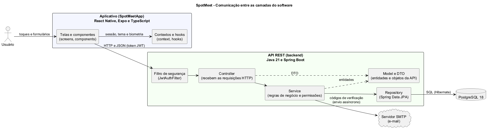

Fonte: próprio autor

O aplicativo (`SpotMeetApp/src`) é organizado em:

- **Telas** (`screens/`): uma por área do sistema (`AuthScreen`, `OrganizationScreen`, `MeetingsScreen`, `SettingsScreen` e as telas de `screens/admin/`).
- **Componentes** (`components/`): formulários, avisos, painéis e folhas reutilizados pelas telas.
- **Contextos e hooks** (`context/`, `hooks/`): sessão, tema, biometria, foto de perfil, atualização automática das telas e leitura com cancelamento.
- **Utilitários e configuração** (`utils/`, `config/`): validações, leitura das respostas da API e descoberta do endereço do servidor.

O servidor (`backend/src/main/java/com/spotmeet/backend`) é organizado em camadas:

- **Filtro de segurança** (`security/JwtAuthFilter`): valida o token JWT de cada requisição e carrega a conta.
- **Controller** (`controller/`): recebe as requisições HTTP. É implementado com o Spring Web (Spring MVC), por meio de classes anotadas com `@RestController`; o Jackson converte os objetos em JSON e o Tomcat embutido atende as requisições.
- **Service** (`service/`): aplica as regras de negócio e as verificações de permissão.
- **Repository** (`repository/`): acessa o banco de dados com Spring Data JPA e Hibernate.
- **Model** (`model/`): entidades JPA que representam as tabelas.
- **DTO** (`dto/`): objetos de entrada e saída da API, validados com Bean Validation.
- **Exceções** (`exception/GlobalExceptionHandler`): converte as exceções em respostas HTTP com mensagem em JSON.

A autenticação é feita por token JWT enviado no cabeçalho `Authorization` de cada requisição, sem sessão no servidor. O servidor envia e-mails por SMTP para a confirmação de cadastro, a recuperação de conta, a troca de e-mail e o aviso de troca de senha; o envio é feito em segundo plano, depois da gravação dos dados.

**Figura 2 – Diagrama de implantação**

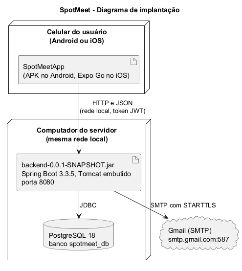

Fonte: próprio autor

### 2.1. Tecnologias e versões

| Camada | Tecnologia | Versão | Uso |
|---|---|---|---|
| Servidor | Java (OpenJDK) | 21 | Linguagem |
| Servidor | Spring Boot | 3.3.5 | Base do projeto |
| Servidor | Spring Web (Spring MVC) | 6.1.14 | Criação da API REST (`@RestController`) |
| Servidor | Tomcat embutido | 10.1.31 | Servidor HTTP |
| Servidor | Spring Data JPA | 3.3.5 | Repositórios |
| Servidor | Hibernate | 6.5.3.Final | Mapeamento objeto-relacional |
| Servidor | Spring Security | 6.3.4 | Autenticação, autorização e BCrypt |
| Servidor | JJWT | 0.12.6 | Geração e validação do token JWT |
| Servidor | Hibernate Validator | 8.0.1.Final | Validação dos DTOs (Bean Validation) |
| Servidor | Jakarta Mail (Spring Mail, implementação Angus) | 2.0.3 | Envio de e-mails por SMTP |
| Servidor | Spring Boot Actuator | 3.3.5 | Saúde e identificação do servidor |
| Servidor | Driver PostgreSQL (JDBC) | 42.7.4 | Conexão com o banco |
| Servidor | Maven (Maven Wrapper) | 3.9.16 | Compilação e execução |
| Banco | PostgreSQL | 18.6 | Armazenamento dos dados |
| Aplicativo | Expo SDK | 57 (pacote expo 57.0.14) | Ferramentas de desenvolvimento, Expo Go e geração do APK |
| Aplicativo | React Native | 0.86.2 | Interface nativa |
| Aplicativo | React | 19.2.3 | Componentes |
| Aplicativo | TypeScript | 6.0.3 | Tipagem |
| Aplicativo | React Navigation | 7 (native 7.3.16, native-stack 7.18.8, bottom-tabs 7.18.16) | Navegação por pilha e por abas |
| Aplicativo | react-hook-form | 7.90.0 | Controle e validação dos formulários |
| Aplicativo | @react-native-vector-icons/ionicons | 13.1.5 | Ícones |
| Aplicativo | expo-local-authentication | 57.0.3 | Biometria opcional |
| Aplicativo | expo-secure-store | 57.0.4 | Guarda protegida da sessão, quando a biometria é ativada |
| Aplicativo | expo-image-picker e expo-image-manipulator | 57.0.20 e 57.0.21 | Escolha e preparo da foto de perfil |

O Expo foi adotado para executar o aplicativo em aparelhos reais pelo Expo Go, sem necessidade de publicação nas lojas, e para gerar o APK do Android. Os mínimos exigidos pelo Expo SDK 57 são Android 7.0 (API 24) e iOS 16.4; o ambiente de desenvolvimento exige Node.js 22.13 ou superior.

## 3. Requisitos Não Funcionais de Usuário

Descrevem as propriedades gerais do sistema de forma simples e concisa. São qualidades do sistema, e não funções: as funções estão nos requisitos funcionais (seções 4 e 6).

**RNF01 – Plataformas**

O aplicativo deve funcionar em celulares Android e iOS.

**RNF02 – Segurança dos dados sensíveis**

As senhas e os códigos de verificação dos usuários devem ser armazenados de forma que não possam ser lidos.

**RNF03 – Senha forte**

O sistema deve exigir senhas com letras maiúsculas, minúsculas e números.

**RNF04 – Acesso autenticado**

Somente usuários autenticados devem acessar os dados do sistema, exceto no cadastro, no login e na recuperação de conta.

**RNF05 – Validade das sessões**

A sessão do usuário deve ter prazo de validade e deixar de valer quando a senha for trocada.

**RNF06 – Proteção contra tentativas repetidas**

O sistema deve bloquear temporariamente as tentativas repetidas de adivinhar senhas e códigos.

**RNF07 – Tempo de resposta**

As telas devem responder rapidamente às ações do usuário.

**RNF08 – Integridade em acessos simultâneos**

Duas pessoas que alterem o mesmo dado ao mesmo tempo não devem deixá-lo em estado inconsistente.

**RNF09 – Usabilidade**

O aplicativo deve apresentar todos os textos em português, apontar os erros de preenchimento antes de enviar os dados ao servidor e exibir mensagens de erro compreensíveis.

**RNF10 – Horário das reuniões**

As datas e os horários das reuniões devem ser exibidos exatamente como foram agendados, no horário do servidor.

**RNF11 – Preservação dos dados**

A atualização do sistema entre incrementos não deve apagar os dados já cadastrados.

**RNF12 – Execução do servidor**

O servidor deve poder ser executado em computadores com Windows ou Linux que tenham Java 21 e PostgreSQL 18.

**RNF13 – Custo zero**

Todas as tecnologias utilizadas devem ser gratuitas e não exigir assinatura.

## 4. Requisitos Funcionais de Usuário

Descrevem as funcionalidades do sistema de maneira simples e concisa. A Figura 3 apresenta o diagrama de casos de uso de todo o sistema, com os dois atores e todos os casos de uso dos Incrementos 1 e 2. Cada caso de uso é descrito, com a sua pré-condição e a sua pós-condição, na seção do requisito a que pertence (4.2 a 4.7).

### 4.1. Atores e papéis

O sistema tem dois atores:

| Ator | Quem é |
|---|---|
| Usuário | Qualquer pessoa que usa o aplicativo, com a conta de perfil global USER, esteja ou não com a sessão iniciada. Antes do login, realiza o cadastro, o login, a recuperação de conta e a escolha do endereço do servidor. |
| Administrador do sistema | Conta com perfil global ADMIN ou SYSADMIN, que opera a plataforma. Faz login como qualquer usuário (caso de uso "Autenticar") e vê apenas as abas administrativas. |

Os papéis dentro de uma organização (dono, vice-líder, subdono e membro) e de uma comissão (presidente e integrante) não são atores: são condições dos casos de uso e aparecem na pré-condição de cada um. O mesmo Usuário pode ser dono de uma organização, integrante de outra e presidente de uma comissão. Os líderes da organização (dono, vice-líder e subdono) respondem pelas comissões; o presidente de cada comissão responde pelas reuniões dela.

**Figura 3 – Diagrama de casos de uso do sistema**

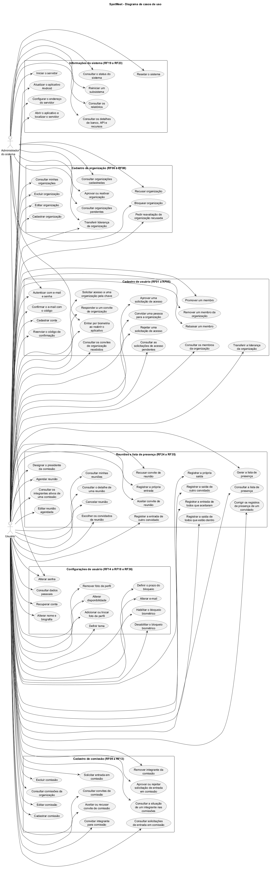

Fonte: próprio autor

### 4.2. Cadastro de Usuário

**Requisito RF01 – Cadastrar Usuário**

O sistema deve permitir que uma pessoa crie uma conta informando nome, e-mail e senha e a ative confirmando o e-mail com um código de 6 dígitos, podendo pedir um novo código; ao confirmar, a pessoa já entra no aplicativo.

**Requisito RF02 – Autenticar Usuário**

O sistema deve permitir que o usuário e o administrador do sistema entrem no aplicativo informando e-mail e senha (ou, quando a biometria estiver habilitada, desbloqueando o aparelho) e que a sessão seja encerrada quando o token deixar de valer.

**Requisito RF03 – Solicitar Acesso à Organização**

O sistema deve permitir ao usuário solicitar acesso a uma organização aprovada informando a chave de acesso dela e aceitar ou recusar os convites de organização que receber.

**Requisito RF04 – Avaliar Solicitação de Acesso**

O sistema deve permitir ao dono ou ao vice-líder da organização consultar, aprovar ou rejeitar as solicitações de acesso e convidar pessoas já cadastradas para a organização.

**Requisito RF05 – Manter Membros da Organização**

O sistema deve permitir aos líderes da organização consultar os membros, promovê-los, rebaixá-los e revogar o seu acesso, respeitando a hierarquia de cargos, e ao dono transferir a liderança a outro integrante.

**Casos de uso**

| Código | Caso de uso | Ator | Pré-condição | Pós-condição | RF |
|---|---|---|---|---|---|
| UC01 | Cadastrar conta | Usuário | Não há sessão iniciada e não existe conta verificada (email_verified = true) com o e-mail informado. | Existe em users uma conta com email_verified = false, senha em hash e código de 6 dígitos válido por 5 minutos, enviado ao e-mail; USER_REGISTERED gravada. Se a conta já era pendente, nome, senha e código foram substituídos. Em caso de falha, nada é gravado e a mensagem é exibida. | RF01 |
| UC02 | Confirmar o e-mail com o código | Usuário | Existe conta com o e-mail informado, com email_verified = false e código ainda válido; o usuário tem o código recebido; há menos de 10 falhas de verificação do mesmo e-mail nos últimos 15 minutos. | A conta fica com email_verified = true e sem código; ACCOUNT_VERIFIED gravada; o usuário recebe a sessão e vê a área principal. Em caso de falha, a conta não muda e a mensagem é exibida. | RF01 |
| UC03 | Reenviar o código de confirmação | Usuário | E-mail em formato válido. Só há novo envio se existir conta com esse e-mail e email_verified = false. | A conta pendente passa a ter um novo código com validade de 5 minutos (o anterior deixa de valer), o e-mail é enviado e VERIFICATION_RESENT é gravada; o botão fica bloqueado por 60 segundos. Para outro e-mail, nada é alterado e a resposta é a mesma. | RF01 |
| UC04 | Autenticar com e-mail e senha | Usuário; Administrador do sistema | Existe conta com o e-mail informado e email_verified = true; o usuário conhece a senha; há menos de 10 falhas de login desse e-mail nos últimos 15 minutos. | A sessão é iniciada com um token JWT (24 horas por padrão) e o usuário vê a área principal do seu perfil: Organização, Reuniões e Ajustes para USER; abas administrativas para ADMIN e SYSADMIN. Em caso de falha, nenhuma sessão é criada e a mensagem é exibida; conta pendente com a senha correta é levada à confirmação do e-mail (UC02). | RF02 |
| UC05 | Entrar por biometria ao reabrir o aplicativo | Usuário; Administrador do sistema | A biometria foi habilitada neste aparelho e para este servidor; o aplicativo está bloqueado; o aparelho tem biometria ou PIN configurados. | O aplicativo é desbloqueado e a sessão guardada é restaurada, depois de o servidor confirmar o token, sem emitir novo token. Se o servidor recusar o token, a sessão guardada é apagada e o usuário volta à tela de acesso com o aviso "Sessão encerrada". | RF02 |
| UC06 | Solicitar acesso a uma organização pela chave | Usuário | Sessão iniciada; existe organização aprovada com a chave informada; o usuário não é o dono nem membro dela e não tem solicitação pendente para ela. | Existe em access_requests uma solicitação PENDING do usuário para a organização (nova ou reaberta) e ACCESS_REQUESTED foi gravada; o usuário ainda não é membro. Em caso de falha, nada é gravado e a mensagem é exibida. | RF03 |
| UC07 | Consultar os convites de organização recebidos | Usuário | Sessão iniciada e conta verificada. | Nenhuma alteração; o usuário vê os convites PENDING ainda dentro do prazo de 24 horas, de organizações aprovadas e às quais ainda não pertence. | RF03 |
| UC08 | Responder a um convite de organização | Usuário | Sessão iniciada; o convite é do usuário, está PENDING e dentro do prazo de 24 horas; para aceitar, a organização está aprovada e o usuário ainda não é membro. | Ao aceitar, o usuário passa a ser MEMBER da organização, o convite fica ACCEPTED, eventual solicitação pendente dele fica APPROVED e ORGANIZATION_INVITATION_ACCEPTED é gravada. Ao recusar, o convite fica REJECTED, sem vínculo, e ORGANIZATION_INVITATION_REJECTED é gravada. Em caso de falha, nada é alterado. | RF03 |
| UC09 | Consultar as solicitações de acesso pendentes | Usuário | Sessão iniciada e ser dono (ORG_OWNER) ou vice (ORG_VICE_OWNER) da organização; a API aceita também o perfil global SYSADMIN, sem uso pelo aplicativo. | Nenhuma alteração; o usuário vê os pedidos com status PENDING da organização. Sem o cargo exigido, vê a mensagem de acesso negado. | RF04 |
| UC10 | Aprovar uma solicitação de acesso | Usuário | Mesmo cargo de UC09; existe a solicitação PENDING; a organização está aprovada. | A solicitação fica APPROVED, o solicitante passa a ser MEMBER da organização e ACCESS_APPROVED é gravada. Em caso de falha, nada é alterado. | RF04 |
| UC11 | Rejeitar uma solicitação de acesso | Usuário | Mesmo cargo de UC09; existe a solicitação PENDING. | A solicitação fica REJECTED, sem vínculo, e ACCESS_REJECTED é gravada; o solicitante pode pedir de novo (UC06). Em caso de falha, nada é alterado. | RF04 |
| UC12 | Convidar uma pessoa para a organização | Usuário | Sessão iniciada e conta verificada; ser dono ou vice de organização aprovada; o convidado tem conta verificada, não pertence à organização e não tem convite pendente dentro do prazo. | Existe em organization_invitations um convite PENDING do convidado, com validade de 24 horas, e ORGANIZATION_INVITATION_SENT foi gravada; nenhum e-mail é enviado. Em caso de falha, nada é gravado. | RF04 |
| UC13 | Consultar os membros da organização | Usuário | Sessão iniciada e vínculo com a organização (o aplicativo oferece a tela a dono, vice e subdono; a API aceita qualquer integrante e o SYSADMIN). | Nenhuma alteração; o usuário vê nome, e-mail e cargo de cada integrante. | RF05 |
| UC14 | Promover um membro | Usuário | Ser dono ou vice para promover MEMBER a ORG_SUBOWNER; ser dono para promover ORG_SUBOWNER a ORG_VICE_OWNER; o alvo é integrante e não é o dono. | O alvo tem o novo cargo em organization_members e ROLE_PROMOTED_SUBOWNER ou ROLE_PROMOTED_VICE_OWNER é gravada. Em caso de falha, nada é alterado. | RF05 |
| UC15 | Rebaixar um membro | Usuário | Ser dono para rebaixar ORG_VICE_OWNER a ORG_SUBOWNER; ser dono ou vice para rebaixar ORG_SUBOWNER a MEMBER; o alvo é integrante e não é o dono. | O alvo tem o novo cargo e ROLE_DEMOTED_SUBOWNER ou ROLE_DEMOTED_MEMBER é gravada. Em caso de falha, nada é alterado. | RF05 |
| UC16 | Remover um membro da organização | Usuário | Ser dono (remove qualquer integrante), vice (remove membro e subdono) ou subdono (remove membro); o alvo é integrante, diferente do executor e do dono. | O alvo perde o vínculo com a organização, com as comissões dela, e as suas solicitações e convites nela são excluídos; ACCESS_REVOKED é gravada. Em caso de falha, nada é removido. | RF05 |
| UC17 | Transferir a liderança da organização | Usuário | Ser o dono atual (organizations.owner_id) de uma organização aprovada; o destino é outro integrante da mesma organização; existe um único vínculo ORG_OWNER, coerente com owner_id. A API aceita também o SYSADMIN, sem uso pelo aplicativo. | O destino passa a ser o dono (ORG_OWNER e owner_id), o antigo dono passa a MEMBER e ORGANIZATION_LEADER_CHANGED é gravada. Em caso de falha, nada é alterado. | RF05 |

### 4.3. Cadastro de Organização

**Requisito RF06 – Cadastrar Organização**

O sistema deve permitir ao usuário cadastrar uma nova organização, informando o nome e a chave de acesso, que fica pendente até a aprovação do administrador do sistema e tem o próprio usuário como dono.

**Requisito RF07 – Manter Organização**

O sistema deve permitir ao usuário consultar as suas organizações, ao dono ou ao vice-líder editar ou excluir a organização, ao dono pedir uma única reavaliação de uma organização recusada e ao dono, ou ao administrador do sistema com perfil SYSADMIN, transferir a liderança de uma organização aprovada para outro integrante.

**Requisito RF08 – Gerenciar Organizações**

O sistema deve permitir ao administrador do sistema consultar as organizações e aprovar, recusar, bloquear ou reativar o seu cadastro, informando um motivo na recusa e no bloqueio.

**Casos de uso**

| Código | Caso de uso | Ator | Pré-condição | Pós-condição | RF |
|---|---|---|---|---|---|
| UC18 | Cadastrar organização | Usuário | Estar autenticado (sessão válida, conta com e-mail verificado). O nome e a chave informados não coincidem, ignorando maiúsculas e espaços extras, com os de nenhuma organização existente, e o CNPJ, se informado, não pertence a outra organização. | Organização gravada com approved igual a false e status PENDING, tendo o usuário como dono (ORG_OWNER), e exibida em "Minhas" com o selo "Pendente". Auditoria ORGANIZATION_CREATED. Em caso de falha, nada é gravado e a tela exibe a mensagem. | RF06 |
| UC19 | Consultar minhas organizações | Usuário | Estar autenticado. | Lista das organizações em que o usuário tem vínculo, com o selo de estado e o de papel; o dono vê o motivo de uma organização recusada ou bloqueada. Nada é alterado. | RF07 |
| UC20 | Editar organização | Usuário | Ser o dono (ORG_OWNER) ou o vice-líder (ORG_VICE_OWNER) da organização, que deve existir em qualquer estado. O novo nome e a nova chave não coincidem com os de outra organização. | Nome e chave atualizados; estado de aprovação, dono e CNPJ preservados; a chave anterior deixa de localizar a organização. Auditoria ORGANIZATION_UPDATED. Em caso de falha, nada é alterado. | RF07 |
| UC21 | Excluir organização | Usuário | Ser o dono (ORG_OWNER) ou o vice-líder (ORG_VICE_OWNER) da organização, que deve existir em qualquer estado. | Organização, comissões, vínculos, convites, solicitações de acesso e integrantes removidos; as contas permanecem. Auditoria ORGANIZATION_DELETED. Em caso de falha, nada é removido. | RF07 |
| UC22 | Transferir liderança da organização | Usuário, Administrador do sistema | Ser o dono atual da organização (owner_id) ou o Administrador do sistema com perfil SYSADMIN. A organização está aprovada e o destino é outro integrante atual da mesma organização. | O destino passa a ORG_OWNER e a owner_id; o antigo dono passa a MEMBER, mantendo o perfil global e o estado da organização. Auditoria ORGANIZATION_LEADER_CHANGED. Em caso de falha, nada é alterado. | RF07 |
| UC23 | Consultar organizações cadastradas | Administrador do sistema | Estar autenticado com perfil global ADMIN ou SYSADMIN. | Lista de todas as organizações, com o e-mail do dono e o CNPJ mascarados e as quantidades de integrantes e de comissões. Nada é alterado. | RF08 |
| UC24 | Consultar organizações pendentes | Administrador do sistema | Estar autenticado com perfil global ADMIN ou SYSADMIN. | Fila das organizações com approved igual a false e status PENDING ou nulo, incluindo as reenviadas pelo dono, com a justificativa e o motivo da recusa anterior. Nada é alterado. | RF08 |
| UC25 | Aprovar ou reativar organização | Administrador do sistema | Ser ADMIN ou SYSADMIN. A organização existe e está com approved igual a false (PENDING, REJECTED ou BLOCKED). | approved igual a true, status APPROVED e motivo apagado; a organização volta a aceitar solicitações de acesso, convites e comissões. Auditoria ADMIN_ORGANIZATION_APPROVED (fila) ou ADMIN_ORGANIZATION_STATUS_CHANGED (lista geral). Em caso de falha, nada é alterado. | RF08 |
| UC26 | Recusar organização | Administrador do sistema | Ser ADMIN ou SYSADMIN. A organização existe e está pendente (o aplicativo oferece "Recusar" na fila). O motivo tem de 3 a 500 caracteres, sem caracteres de controle. | approved igual a false, status REJECTED e motivo gravado, visível ao dono e aos administradores; se a organização já tinha sido reenviada, a recusa é definitiva. Auditoria ADMIN_ORGANIZATION_REJECTED. Em caso de falha, nada é alterado. | RF08 |
| UC27 | Bloquear organização | Administrador do sistema | Ser ADMIN ou SYSADMIN. A organização existe e está aprovada (o aplicativo oferece "Bloquear Organização" nesse estado). O motivo tem de 3 a 500 caracteres, sem caracteres de controle. | approved igual a false, status BLOCKED e motivo gravado, visível ao dono e aos administradores; integrantes e comissões existentes são mantidos. Auditoria ADMIN_ORGANIZATION_STATUS_CHANGED. Em caso de falha, nada é alterado. | RF08 |
| UC28 | Pedir reavaliação de organização recusada | Usuário | Ser o dono (owner_id) de uma organização recusada (status REJECTED) cuja reavaliação ainda não foi usada (resubmitted_at nulo). A justificativa tem de 3 a 500 caracteres, sem caracteres de controle. | Organização volta a PENDING, com a justificativa e a data do reenvio gravadas e o motivo anterior mantido, e retorna à fila de Aprovações; não pode ser reenviada outra vez. Auditoria ORGANIZATION_RESUBMITTED. Em caso de falha, nada é alterado. | RF07 |

### 4.4. Cadastro de Comissão

**Requisito RF09 – Cadastrar Comissão**

O sistema deve permitir ao dono, ao vice-líder e ao subdono de uma organização aprovada cadastrar comissões dentro dela, com nome único na organização (sem diferenciar maiúsculas, minúsculas e espaços extras) e descrição opcional.

**Requisito RF10 – Manter Comissão**

O sistema deve permitir aos integrantes da organização consultar as comissões dela, com a quantidade de integrantes ativos e de vínculos pendentes, e ao dono, ao vice-líder e ao subdono editar o nome e a descrição das comissões. O aplicativo oferece a exclusão da comissão ao dono e ao vice-líder.

**Requisito RF11 – Convidar Membro para Comissão**

O sistema deve permitir ao dono, ao vice-líder e ao subdono convidar integrantes da organização para uma comissão, e ao convidado consultar os seus convites pendentes e aceitar ou recusar cada um.

**Requisito RF12 – Solicitar Entrada em Comissão**

O sistema deve permitir ao integrante da organização solicitar a entrada em uma comissão, e ao dono, ao vice-líder e ao subdono consultar as solicitações pendentes e aprová-las ou rejeitá-las.

**Requisito RF13 – Manter Integrantes da Comissão**

O sistema deve permitir consultar a situação de um integrante em cada comissão da organização e, ao dono, ao vice-líder e ao subdono, remover o vínculo do integrante com uma comissão.

**Casos de uso**

| Código | Caso de uso | Ator | Pré-condição | Pós-condição | RF |
|---|---|---|---|---|---|
| UC29 | Cadastrar comissão | Usuário | Estar autenticado e ser dono da organização (organizations.owner_id) ou ter papel ORG_OWNER, ORG_VICE_OWNER ou ORG_SUBOWNER nela. A organização deve estar aprovada (approved = true, status APPROVED) e não pode haver outra comissão com o mesmo nome nela, sem diferenciar maiúsculas, minúsculas e espaços extras. O perfil global SYSADMIN também é aceito, apenas pela API. | Sucesso: comissão gravada em committees, sem integrantes, com o nome normalizado; auditoria COMMITTEE_CREATED; a comissão aparece na lista da organização com "0 ativos" e "0 pendentes". Falha: nada é gravado e o aplicativo exibe a mensagem do servidor. | RF09 |
| UC30 | Consultar comissões da organização | Usuário | Estar autenticado e ser integrante da organização (organization_members). O perfil global SYSADMIN também é aceito, apenas pela API. | Sucesso: lista das comissões em ordem alfabética, com os integrantes ativos e os vínculos pendentes de cada uma; nada é alterado. Falha (usuário fora da organização): nada é exibido e o aplicativo volta à aba "Minhas". | RF10 |
| UC31 | Editar comissão | Usuário | Estar autenticado e ser líder da organização (dono, ORG_VICE_OWNER ou ORG_SUBOWNER, ou SYSADMIN pela API). A comissão deve existir e o novo nome não pode pertencer a outra comissão da mesma organização. | Sucesso: nome e descrição atualizados em committees; organização e vínculos mantidos; auditoria COMMITTEE_UPDATED. Falha: nada é alterado e o aplicativo exibe a mensagem do servidor. | RF10 |
| UC32 | Excluir comissão | Usuário | Estar autenticado e ser líder da organização (o aplicativo oferece o botão ao dono e ao vice-líder; a API aceita também o subdono e o SYSADMIN). A comissão deve existir e o usuário deve confirmar no diálogo "Excluir comissão". | Sucesso: comissão e todos os seus vínculos (ativos, convites e solicitações pendentes, recusados) removidos; auditoria COMMITTEE_DELETED; a comissão some da lista. Falha ou desistência no diálogo: nada é removido. | RF10 |
| UC33 | Convidar integrante para comissão | Usuário | Estar autenticado e ser líder da organização da comissão. O convidado deve ser integrante da organização e não pode ter vínculo ACTIVE nem convite PENDING_USER_ACCEPTANCE com a comissão. | Sucesso: vínculo PENDING_USER_ACCEPTANCE (papel MEMBER, invited_by_id do líder) criado ou reaberto, se estava DECLINED; se havia PENDING_LEADER_APPROVAL, o vínculo passa direto para ACTIVE; auditoria COMMITTEE_INVITATION_SENT. Falha: nada é alterado. | RF11 |
| UC34 | Consultar convites de comissão | Usuário | Estar autenticado. | Lista dos vínculos PENDING_USER_ACCEPTANCE do usuário, de qualquer organização, com a comissão e o nome de quem convidou; nada é alterado. | RF11 |
| UC35 | Aceitar ou recusar convite de comissão | Usuário | Estar autenticado e ter vínculo PENDING_USER_ACCEPTANCE com a comissão. | Sucesso: vínculo ACTIVE (aceite) ou DECLINED (recusa), com responded_at; auditoria COMMITTEE_INVITATION_ACCEPTED ou COMMITTEE_INVITATION_DECLINED. Falha (sem convite ou já respondido): nada é alterado. | RF11 |
| UC36 | Solicitar entrada em comissão | Usuário | Estar autenticado e ser integrante da organização da comissão, sem vínculo ACTIVE nem solicitação PENDING_LEADER_APPROVAL com ela. | Sucesso: vínculo PENDING_LEADER_APPROVAL (papel MEMBER) criado ou reaberto, se estava DECLINED; se havia convite PENDING_USER_ACCEPTANCE, o vínculo passa direto para ACTIVE; auditoria COMMITTEE_JOIN_REQUESTED apenas quando o vínculo é novo. Falha: nada é alterado. | RF12 |
| UC37 | Consultar solicitações de entrada em comissão | Usuário | Estar autenticado e ser líder da organização (dono, ORG_VICE_OWNER ou ORG_SUBOWNER, ou SYSADMIN pela API). | Lista dos vínculos PENDING_LEADER_APPROVAL de todas as comissões da organização, com solicitante e comissão; nada é alterado. Falha (não é líder): nada é exibido. | RF12 |
| UC38 | Aprovar ou rejeitar solicitação de entrada em comissão | Usuário | Estar autenticado e ser líder da organização da comissão. O vínculo deve existir e estar em PENDING_LEADER_APPROVAL. | Sucesso: vínculo ACTIVE (aprovação) ou DECLINED (rejeição), com responded_at; auditoria COMMITTEE_JOIN_APPROVED ou COMMITTEE_JOIN_REJECTED. Falha (solicitação inexistente ou já respondida): nada é alterado. | RF12 |
| UC39 | Consultar a situação de um integrante nas comissões | Usuário | Estar autenticado e ser integrante da organização (ou SYSADMIN pela API). O integrante consultado deve pertencer à mesma organização. | Lista de todas as comissões da organização, em ordem alfabética, com a situação do integrante em cada uma (sem vínculo, convite aguardando aceite, solicitação pendente, ativo ou recusado); nada é alterado. Falha: a janela exibe a mensagem de erro e o botão "Tentar novamente". | RF13 |
| UC40 | Remover integrante da comissão | Usuário | Estar autenticado e ser líder da organização da comissão. O vínculo do integrante com a comissão deve existir, em qualquer situação, e o usuário deve confirmar o diálogo "Remover vínculo". | Sucesso: vínculo removido de committee_members; auditoria COMMITTEE_MEMBER_REMOVED; o integrante deixa de constar na comissão e pode ser convidado de novo (UC33) ou pedir entrada (UC36). Falha ou desistência: nada é removido. | RF13 |

### 4.5. Configurações de Usuário

**Requisito RF14 – Alterar Senha**

O sistema deve permitir ao usuário autenticado trocar a sua senha, informando a senha atual. Ao concluir, as sessões abertas da conta são encerradas e o usuário entra novamente com a nova senha.

**Requisito RF15 – Recuperar Conta**

O sistema deve permitir ao usuário que esqueceu a senha recuperar a conta por meio de um código de seis dígitos enviado ao seu e-mail, em três etapas: solicitar o código, validá-lo e definir a nova senha.

**Requisito RF16 – Alterar Dados Pessoais**

O sistema deve permitir ao usuário consultar e alterar os seus dados pessoais: nome, biografia, disponibilidade (Presente, Ausente ou Ocupado) e foto de perfil. O e-mail é exibido apenas para leitura e é alterado pelo RF18.

**Requisito RF17 – Definir Tema**

O sistema deve permitir ao usuário escolher entre o tema claro e o tema escuro do aplicativo, com prévia imediata, e gravar a escolha para os próximos acessos.

**Requisito RF18 – Alterar E-mail**

O sistema deve permitir ao usuário trocar o seu e-mail, confirmando a posse do e-mail atual e do novo e-mail por códigos de seis dígitos.

**Requisito RF36 – Configurar Bloqueio Biométrico**

O sistema deve permitir ao usuário habilitar ou desabilitar o bloqueio do aplicativo por biometria e escolher depois de quanto tempo fora do aplicativo o desbloqueio volta a ser pedido.

**Casos de uso**

| Código | Caso de uso | Ator | Pré-condição | Pós-condição | RF |
|---|---|---|---|---|---|
| UC41 | Alterar senha | Usuário; Administrador do sistema | Ter sessão iniciada com JWT válido e e-mail verificado (o usuário comum troca na aba "Ajustes"; o administrador, que não tem essa aba, troca no cartão "Senha de acesso" da aba "Controles"); conhecer a senha atual; a conta não estar em pausa por dez falhas de senha atual nos últimos 15 minutos. | Sucesso: users.password guarda o hash da nova senha e users.tokens_valid_after o instante da troca (nenhum JWT anterior vale), PASSWORD_CHANGED consta em audit_logs, o aviso por e-mail está agendado e o aplicativo volta ao login. Falha: nada é alterado, a sessão continua e a mensagem é exibida. | RF14 |
| UC42 | Recuperar conta | Usuário | Conhecer o e-mail de uma conta cadastrada, de qualquer perfil (inclusive ADMIN e SYSADMIN), e ter acesso à caixa desse e-mail. Não é preciso estar autenticado. | Sucesso: a senha da conta é a nova, o código é apagado, email_verified é verdadeiro, users.tokens_valid_after revoga as sessões anteriores, PASSWORD_RESET consta em audit_logs e o aplicativo volta ao login. Falha: senha e código permanecem como estavam. A solicitação do código responde igual para e-mail cadastrado e não cadastrado. | RF15 |
| UC43 | Consultar dados pessoais | Usuário | Ter sessão iniciada com perfil global USER, JWT válido e e-mail verificado. | A tela "Ajustes" exibe nome, biografia, e-mail (somente leitura), disponibilidade, tema e foto ou avatar da conta; nada é alterado. Falha: mensagem com o botão "Tentar novamente", sem liberar o formulário. | RF16 |
| UC44 | Alterar nome e biografia | Usuário | Ter sessão iniciada com perfil global USER e o perfil carregado; nome de 2 a 100 caracteres (sem espaços nas pontas) e biografia de até 500 caracteres. | users.name e users.bio estão atualizados, o nome da sessão do aplicativo é o confirmado pela API e PROFILE_UPDATED consta em audit_logs. Falha: nada é gravado e a mensagem aparece sob o campo. | RF16 |
| UC45 | Alterar disponibilidade | Usuário | Ter sessão iniciada com perfil global USER, o perfil carregado e a seção "Preferências" aberta. | users.availability_status guarda Presente, Ausente ou Ocupado (PRESENT, AWAY ou BUSY), gravado junto com o tema selecionado, e PROFILE_UPDATED consta em audit_logs. Falha: nada é gravado. | RF16 |
| UC46 | Adicionar ou trocar foto de perfil | Usuário | Ter sessão iniciada com perfil global USER e e-mail verificado; escolher a imagem na Galeria ou na Câmera (esta exige a permissão de câmera do aparelho) e ver a prévia. | user_profile_photos tem um registro da conta com a imagem JPEG quadrada normalizada e uma nova version, PROFILE_PHOTO_UPDATED consta em audit_logs e a tela exibe a foto. Falha: a foto anterior permanece e a mensagem é exibida. | RF16 |
| UC47 | Remover foto de perfil | Usuário | Ter sessão iniciada com perfil global USER, ter foto salva (só então o botão "Remover foto" é exibido) e confirmar a remoção. | O registro da foto deixou de existir em user_profile_photos, PROFILE_PHOTO_REMOVED consta em audit_logs e a tela exibe o avatar com a inicial do nome. Falha: a foto permanece. | RF16 |
| UC48 | Definir tema | Usuário | Ter sessão iniciada com perfil global USER e a seção "Preferências" aberta para salvar (a prévia só muda as cores do aplicativo). | Prévia: o aplicativo exibe o tema escolhido sem gravar nada. Gravação: users.preferred_theme guarda LIGHT ou DARK, PROFILE_UPDATED consta em audit_logs e o tema volta nos próximos acessos. Sair da aba sem salvar restaura o último tema gravado. | RF17 |
| UC49 | Alterar e-mail | Usuário | Ter sessão iniciada com perfil global USER e e-mail verificado; ter acesso à caixa do e-mail atual e à do novo e-mail; o novo e-mail ser diferente do atual e não pertencer a outra conta; a conta não estar em pausa por dez falhas de código em 15 minutos. | Sucesso: users.email é o novo endereço, email_verified é verdadeiro, as colunas temporárias ficam nulas, a sessão do aplicativo usa o novo e-mail e o novo JWT (o anterior deixa de valer) e LGPD_EMAIL_CHANGED consta em audit_logs. Falha: o e-mail da conta permanece o mesmo. | RF18 |
| UC50 | Habilitar o bloqueio biométrico | Usuário | Ter sessão iniciada, na seção "Segurança" de "Ajustes" (perfil global USER) ou no convite "Deseja habilitar a biometria?" exibido depois do login (qualquer perfil), ou automaticamente no primeiro login depois de uma troca de senha com a biometria habilitada (RF14); usar o aplicativo Android ou iOS em aparelho com armazenamento seguro e biometria forte cadastrada (o Face ID não funciona no Expo Go); o servidor confirmar a sessão. | O token da sessão, o identificador do usuário e o servidor ficam guardados no armazenamento seguro do aparelho, o prazo do bloqueio fica gravado e a chave exibe "Habilitado". Em caso de falha, nada é guardado, a chave continua "Desligado" e a mensagem é exibida. | RF36 |
| UC51 | Definir o prazo do bloqueio | Usuário | Ter sessão iniciada com perfil global USER (a seção "Segurança" fica em "Ajustes"), o bloqueio biométrico habilitado e o aplicativo desbloqueado. | O prazo escolhido (Imediatamente, 1 minuto, 5 minutos, 1 hora, 3 horas ou 24 horas) fica gravado no aparelho e passa a valer na próxima saída do aplicativo. Em caso de falha, o prazo anterior é mantido. | RF36 |
| UC52 | Desabilitar o bloqueio biométrico | Usuário | Ter sessão iniciada com perfil global USER (a seção "Segurança" fica em "Ajustes"), o bloqueio biométrico habilitado e o aplicativo desbloqueado. | Depois da confirmação da biometria, a sessão guardada e a configuração do bloqueio são removidas do aparelho e a chave exibe "Desligado"; o login continua ativo. Sem a confirmação ou em caso de falha, a mensagem é exibida e o bloqueio continua habilitado. | RF36 |

### 4.6. Informações do Sistema

**Requisito RF19 – Inicializar Sistema**

O sistema deve criar o banco de dados, as tabelas e a conta do administrador do sistema quando o servidor é iniciado, e o aplicativo deve localizar o servidor na rede, permitir informar o seu endereço e avisar sobre uma versão mais nova do aplicativo Android.

**Requisito RF20 – Consultar Status do Sistema**

O sistema deve permitir ao administrador do sistema consultar o estado geral do sistema e dos subsistemas Banco de dados, Rede e Recursos, com a versão, o tempo em execução e os detalhes do banco de dados, da API e da JVM.

**Requisito RF21 – Consultar Relatórios**

O sistema deve permitir ao administrador do sistema consultar relatórios com os totais de usuários, organizações, comissões e registros de auditoria e as atividades recentes, com e-mails mascarados e detalhes sanitizados.

**Requisito RF22 – Reiniciar Subsistemas**

O sistema deve permitir ao administrador do sistema reiniciar um subsistema por vez (Banco de dados ou Recursos no aplicativo, e também Rede pela API), informando o motivo, com registro em auditoria.

**Requisito RF23 – Resetar Sistema**

O sistema deve permitir ao administrador do sistema apagar todos os dados, preservando apenas a conta do administrador que executa a ação, mediante a digitação de um texto de confirmação, e encerrar todas as sessões.

**Casos de uso**

| Código | Caso de uso | Ator | Pré-condição | Pós-condição | RF |
|---|---|---|---|---|---|
| UC53 | Iniciar o servidor | Administrador do sistema | Servidor PostgreSQL em execução e acessível pela URL de DB_URL, com usuário e senha que permitam conectar ao banco "postgres" e, se o banco ainda não existir, criar bancos. Arquivo backend/.env (ou variáveis de ambiente) com DB_PASSWORD e JWT_SECRET válidos e porta SERVER_PORT livre. | O banco e as tabelas existem e estão atualizados, sem perda de dados. A conta sysadmin@spotmeet.com existe (criada agora com perfil SYSADMIN, ou já existente e inalterada) e o servidor atende na porta SERVER_PORT. Se o banco não puder ser acessado, o servidor não conclui a inicialização e o erro fica no console. | RF19 |
| UC54 | Abrir o aplicativo e localizar o servidor | Usuário | Aplicativo instalado e servidor em execução, alcançável pelo aparelho (mesma rede Wi-Fi para a busca automática, ou endereço informado no rodapé "Servidor"). | O endereço do servidor está definido (host salvo, variável de ambiente, servidor do Expo, host encontrado na rede ou padrão da plataforma) e a tela de login é exibida com o rodapé "Servidor: host:porta (origem)". Se nenhum servidor for encontrado, o login é exibido com "(não encontrado)" e as chamadas ao servidor falham com mensagem de conexão. | RF19 |
| UC55 | Configurar o endereço do servidor | Usuário | Estar na tela de login, sem sessão ativa. | O host informado fica salvo no aparelho (ou o host salvo é removido por "Automático", ou o host encontrado por "Procurar na rede" passa a ser usado) e as próximas chamadas usam o novo endereço. Busca sem resultado não altera o host salvo. | RF19 |
| UC56 | Atualizar o aplicativo Android | Usuário | APK Android de release instalado (não Expo Go, não desenvolvimento, não iOS). Servidor com APP_ANDROID_VERSION, APP_ANDROID_VERSION_CODE e APP_ANDROID_DOWNLOAD_URL válidos e versionCode maior que o instalado. | A janela "Nova versão disponível" é exibida. "Atualizar" abre a página da build no Expo no navegador e "Agora não" fecha a janela. Sem versão mais nova, 204, resposta inválida ou falha na consulta, nenhum aviso é exibido e nada é alterado no servidor. | RF19 |
| UC57 | Consultar o status do sistema | Administrador do sistema | Estar autenticado (caso de uso Autenticar, RF02) com conta de e-mail verificado e perfil global ADMIN ou SYSADMIN, com a aba "Monitoramento" aberta. Servidor em execução com o PostgreSQL acessível. | O aplicativo exibe o estado geral (Operacional ou Degradado), o estado de Banco de dados, Rede e Recursos, a versão e o tempo em execução, atualizados a cada 4 segundos. Nada é gravado. Em falha, mantém os últimos dados e exibe o aviso de erro; sem permissão (403), limpa os dados e exibe "Acesso negado pelo servidor. Esta área exige permissão administrativa." | RF20 |
| UC58 | Consultar os detalhes de banco, API e recursos | Administrador do sistema | As mesmas de Consultar o status do sistema, e ter tocado no cartão "Banco de dados" ou "Recursos" ou no botão "Detalhes da API". | A janela "Detalhes" exibe nome, versão, tamanho, latência, pool de conexões e linhas das oito tabelas do banco, ou as métricas da API, ou os recursos da JVM, lidos no momento. Campos sem medição aparecem como "Indisponível". Nada é gravado. Em falha, a janela exibe "Não foi possível consultar os detalhes. Tente novamente.". O cartão "Rede" mostra o status já recebido, sem nova consulta. | RF20 |
| UC59 | Consultar os relatórios | Administrador do sistema | Estar autenticado (RF02) com perfil global ADMIN ou SYSADMIN e a aba "Monitoramento" aberta. | O aplicativo exibe os totais de usuários, organizações, comissões e registros de auditoria e as 15 atividades mais recentes, com e-mails mascarados e detalhes sanitizados, atualizados a cada 4 segundos. Nada é gravado, nem na auditoria. Em falha, mantém os últimos dados e exibe o aviso de erro. | RF21 |
| UC60 | Reiniciar um subsistema | Administrador do sistema | Estar autenticado (RF02) com perfil global ADMIN ou SYSADMIN, na aba "Controles", com um subsistema selecionado ("Banco de dados" ou "Recursos"). Servidor em execução com o PostgreSQL acessível. | O subsistema escolhido foi reiniciado (conexões do pool renovadas e testadas, ou coleta de memória solicitada) e o registro ADMIN_SYSTEM_RESTART foi gravado com o motivo. O aplicativo fecha a janela, exibe "Solicitação aceita" e atualiza o Monitoramento. Em falha, nada é gravado em audit_logs e a janela permanece aberta com a mensagem de erro. | RF22 |
| UC61 | Resetar o sistema | Administrador do sistema | Estar autenticado (RF02) com perfil global ADMIN ou SYSADMIN, na aba "Controles". A conta que executa é a única que será preservada: qualquer outra conta, inclusive de outro administrador, será excluída. Conhecer e digitar o texto CONFIRM_FULL_RESET. | Organizações, comissões, integrantes, solicitações, convites e todas as outras contas foram excluídos, e permanecem só a conta do executor e os registros de auditoria dele (mais o novo ADMIN_SYSTEM_FULL_RESET). Todas as sessões foram invalidadas, o aplicativo volta ao login e exibe "Reset concluído". Em falha, nada é alterado, a sessão continua e a janela exibe a mensagem de erro. | RF23 |

### 4.7. Reuniões e Lista de Presença (Incremento 2)

**Requisito RF24 – Designar Presidente da Comissão**

O sistema deve permitir ao dono, ao vice-líder ou ao subdono da organização designar, entre os integrantes ativos de uma comissão, o seu presidente, e substituí-lo quando necessário.

**Requisito RF25 – Agendar Reunião**

O sistema deve permitir ao presidente da comissão agendar uma reunião, informando título, horário de início e de término, local, link, pauta e prioridade.

**Requisito RF26 – Editar Reunião**

O sistema deve permitir ao presidente da comissão editar os dados e a lista de convidados de uma reunião agendada que ainda não começou.

**Requisito RF27 – Cancelar Reunião**

O sistema deve permitir ao presidente da comissão cancelar uma reunião que ainda não terminou.

**Requisito RF28 – Consultar Reuniões**

O sistema deve permitir aos integrantes da comissão e aos líderes da organização consultar as reuniões, e ao usuário consultar as reuniões para as quais foi convidado, com a sua resposta ao convite, e as reuniões das comissões que preside.

**Requisito RF29 – Convidar Integrantes para a Reunião**

O sistema deve permitir ao presidente da comissão escolher, entre os integrantes ativos, quem é convidado para a reunião.

**Requisito RF30 – Responder Convite de Reunião**

O sistema deve permitir ao convidado aceitar ou recusar o convite, com comentário opcional na recusa, enquanto a reunião não terminar nem for cancelada.

**Requisito RF31 – Registrar Entrada na Reunião**

O sistema deve permitir a cada convidado registrar a própria entrada e ao presidente registrar a entrada de qualquer convidado, individualmente ou de todos que aceitaram, enquanto a reunião está em andamento.

**Requisito RF32 – Registrar Saída da Reunião**

O sistema deve permitir a cada convidado registrar a própria saída e ao presidente registrar a saída de qualquer convidado, individualmente ou de todos que estão dentro, enquanto a reunião está em andamento.

**Requisito RF33 – Corrigir Registros de Presença**

O sistema deve permitir ao presidente da comissão apagar a entrada e a saída registradas de um convidado.

**Requisito RF34 – Gerar Lista de Presença**

O sistema deve permitir ao presidente da comissão gerar a lista de presença de uma reunião que já começou e não foi cancelada.

**Requisito RF35 – Consultar Lista de Presença**

O sistema deve permitir aos integrantes da comissão e aos líderes da organização consultar a lista de presença depois de gerada.

**Casos de uso**

| Código | Caso de uso | Ator | Pré-condição | Pós-condição | RF |
|---|---|---|---|---|---|
| UC62 | Consultar os integrantes ativos de uma comissão | Usuário | Ser integrante ativo da comissão ou líder (dono, vice ou subdono) da organização | A lista dos integrantes ativos é exibida, com o presidente identificado; nada é alterado | RF24 |
| UC63 | Designar o presidente da comissão | Usuário | Ser dono, vice ou subdono da organização da comissão; o escolhido ser integrante ativo da comissão | O escolhido passa a ser o único presidente (COMMITTEE_ADMIN) e o anterior volta a integrante comum; a auditoria é registrada | RF24 |
| UC64 | Agendar reunião | Usuário | Ser o presidente (integrante ativo com papel COMMITTEE_ADMIN) de uma comissão de organização aprovada | Reunião criada com situação "Agendada" e um convite pendente para cada convidado (o presidente já aceito); a auditoria é registrada | RF25 |
| UC65 | Editar reunião agendada | Usuário | Ser o presidente da comissão; a reunião estar agendada e ainda não ter começado | Dados e convidados atualizados; quem continua convidado mantém a resposta; a auditoria é registrada | RF26 |
| UC66 | Cancelar reunião | Usuário | Ser o presidente da comissão; a reunião não estar cancelada nem encerrada | Reunião com situação "Cancelada" (data de cancelamento gravada); deixa de aceitar respostas e registros; a auditoria é registrada | RF27 |
| UC67 | Consultar minhas reuniões | Usuário | Estar autenticado; ter sido convidado a reuniões de comissões em que o vínculo continua ativo | As reuniões do usuário são listadas com a resposta dele; nada é alterado | RF28 |
| UC68 | Consultar o detalhe de uma reunião | Usuário | Ser integrante ativo da comissão ou líder da organização | Dados da reunião, contadores e participantes são exibidos; nada é alterado | RF28 |
| UC69 | Escolher os convidados da reunião | Usuário | Ser o presidente da comissão, ao agendar ou ao editar uma reunião | Os convidados informados (mais o presidente) ficam registrados na reunião | RF29 |
| UC70 | Aceitar convite de reunião | Usuário | Ser integrante ativo e convidado; a reunião estar agendada ou em andamento | Resposta "Aceitou" gravada com a data; comentário anterior apagado; a auditoria é registrada | RF30 |
| UC71 | Recusar convite de reunião | Usuário | Ser integrante ativo e convidado; a reunião estar agendada ou em andamento | Resposta "Recusou" gravada com a data e o comentário opcional; a auditoria é registrada | RF30 |
| UC72 | Registrar a própria entrada | Usuário | Ser integrante ativo e convidado; a reunião estar em andamento; ainda não ter entrada registrada | Entrada gravada com o horário, tendo o próprio usuário como autor; o carimbo da lista de presença é apagado; a auditoria é registrada | RF31 |
| UC73 | Registrar a entrada de outro convidado | Usuário | Ser o presidente; a reunião estar em andamento; o convidado não ter entrada registrada | Entrada gravada com o presidente como autor; o carimbo da lista é apagado; a auditoria é registrada | RF31 |
| UC74 | Registrar a entrada de todos que aceitaram | Usuário | Ser o presidente; a reunião estar em andamento | Entrada gravada para todos que aceitaram e ainda não entraram; o carimbo da lista é apagado se houve registro; a auditoria é registrada | RF31 |
| UC75 | Registrar a própria saída | Usuário | Ser integrante ativo e convidado; a reunião estar em andamento; ter entrada e não ter saída registradas | Saída gravada com o horário, tendo o próprio usuário como autor; o carimbo da lista é apagado; a auditoria é registrada | RF32 |
| UC76 | Registrar a saída de outro convidado | Usuário | Ser o presidente; a reunião estar em andamento; o convidado ter entrada e não ter saída registradas | Saída gravada com o presidente como autor; o carimbo da lista é apagado; a auditoria é registrada | RF32 |
| UC77 | Registrar a saída de todos que estão dentro | Usuário | Ser o presidente; a reunião estar em andamento | Saída gravada para todos que entraram e ainda não saíram; o carimbo da lista é apagado se houve registro; a auditoria é registrada | RF32 |
| UC78 | Corrigir os registros de presença de um convidado | Usuário | Ser o presidente; a reunião estar em andamento ou encerrada | Entrada e saída do convidado apagadas; o carimbo da lista é apagado; a auditoria é registrada | RF33 |
| UC79 | Gerar a lista de presença | Usuário | Ser o presidente; a reunião ter começado e não estar cancelada | Carimbo de geração (data e autor) gravado; a lista fica disponível para consulta; a auditoria é registrada | RF34 |
| UC80 | Consultar a lista de presença | Usuário | Ser integrante ativo da comissão ou líder da organização; a lista já ter sido gerada | A lista é exibida (presentes, ausentes, entradas, saídas e tempo na reunião); nada é alterado | RF35 |

## 5. Requisitos Não Funcionais de Sistema

Descrevem as propriedades gerais do sistema de forma completa, indicando as características, as métricas utilizadas e a forma de verificação. Cada requisito tem o mesmo número do requisito não funcional de usuário correspondente.

**RNF01 – Plataformas**

O aplicativo é desenvolvido com React Native 0.86.2 e Expo SDK 57, que exigem no mínimo Android 7.0 (API 24) e iOS 16.4. No Android, o aplicativo é executado pelo Expo Go ou por um APK instalável, gerado pelo EAS Build; no iOS, pelo Expo Go. O Face ID e o bloqueio biométrico completo exigem uma build própria e não funcionam no Expo Go.

Verificação: executar o aplicativo em um aparelho Android e em um iPhone reais e realizar o login.

**RNF02 – Segurança dos dados sensíveis**

As senhas são armazenadas apenas como hash BCrypt com fator de custo 12 (Spring Security 6), na coluna `users.password`. Os códigos de verificação de seis dígitos (cadastro, recuperação de conta e troca de e-mail) também são guardados como hash BCrypt, em colunas de 255 caracteres, e valem uma só vez. Nenhuma rota da API devolve esses hashes, e nenhuma resposta da API devolve o código em texto.

Verificação: consultar `SELECT password FROM users` e confirmar que todos os valores começam com `$2a$12$`; consultar `GET /api/users/me` e confirmar que a resposta não contém os campos `password`, `verificationToken`, `recoveryToken`, `currentEmailChangeToken` e `newEmailToken`.

**RNF03 – Senha forte**

A senha deve ter no mínimo 6 caracteres, com pelo menos uma letra minúscula, uma letra maiúscula e um dígito (expressão `^(?=.*[a-z])(?=.*[A-Z])(?=.*\d).{6,}$`). A regra é validada no aplicativo (`validators.ts`) e no servidor (Bean Validation nos DTOs de cadastro, redefinição e troca de senha).

Verificação: tentar cadastrar a senha `abc123`; o aplicativo exibe a regra não atendida, e a chamada direta a `POST /api/auth/register` responde 400.

**RNF04 – Acesso autenticado**

A autenticação usa token JWT assinado com HMAC (biblioteca JJWT 0.12.6, algoritmo escolhido pelo tamanho da chave `JWT_SECRET`), enviado no cabeçalho `Authorization: Bearer`. São públicas apenas as rotas `/api/auth/**`, `GET /api/app/android-release`, `/actuator/health` e `/actuator/info`. Qualquer outra rota chamada sem token válido responde HTTP 401; as rotas `/api/admin/**` respondem 403 a quem não tem o perfil ADMIN ou SYSADMIN.

Verificação: chamar `GET /api/users/me` e `GET /api/meetings/mine` sem o cabeçalho `Authorization` e com um token inválido e confirmar a resposta 401. Executado em 20/10/2026: 401 sem token em `/api/users/me`, `/api/meetings/mine` e `/api/admin/reports`, e com token inválido em `/api/users/me`.

**RNF05 – Validade das sessões**

O token JWT vale 24 horas (`JWT_EXPIRATION_MS=86400000`, padrão em `application.properties`). A coluna `users.tokens_valid_after` guarda o instante a partir do qual os tokens são aceitos: ao trocar ou redefinir a senha, ao cadastrar de novo uma conta ainda não verificada e ao resetar o sistema, os tokens emitidos antes são recusados com HTTP 401, e o aplicativo volta ao login. Com o aplicativo em primeiro plano, a validade da sessão é consultada a cada 15 segundos.

Verificação: entrar em dois aparelhos com a mesma conta, trocar a senha em um e confirmar que o outro volta ao login em até 15 segundos.

**RNF06 – Proteção contra tentativas repetidas**

Cada finalidade (login, senha atual, código de cadastro, de recuperação e das duas etapas da troca de e-mail) tem um limite de 10 falhas em 15 minutos para a mesma identidade. Ao atingi-lo, o servidor bloqueia novas tentativas por 15 minutos e responde HTTP 429, com o cabeçalho `Retry-After` e o campo `retryAfterSeconds`. O controle fica na memória do servidor (`AuthenticationAttempts`) e é zerado quando ele reinicia.

Verificação: enviar 10 códigos de cadastro incorretos para o mesmo e-mail e confirmar que a 11ª tentativa, mesmo com o código correto, responde 429.

**RNF07 – Tempo de resposta**

Em rede local, as operações de consulta devem responder em até 1 segundo, e o login em até 2 segundos. O login é a operação mais lenta por causa do cálculo do BCrypt. Medido em 20/10/2026, com servidor e banco no mesmo computador e o banco quase vazio, em cinco chamadas de cada rota: `POST /api/auth/login` entre 0,27 e 0,29 s (a primeira chamada levou 0,74 s, por causa do aquecimento do servidor), `GET /api/users/me` entre 0,013 e 0,021 s (a primeira, 0,099 s) e `GET /api/meetings/mine` entre 0,015 e 0,026 s (a primeira, 0,046 s). As consultas de comissões, de organizações e do monitoramento não são paginadas; o tempo cresce com a quantidade de dados.

Verificação: medir com `curl -w "%{time_total}"` cinco chamadas de cada rota.

**RNF08 – Integridade em acessos simultâneos**

As escritas que podem ser disputadas são serializadas no banco: a criação e a edição de organizações e de comissões bloqueiam a tabela de organizações durante a transação (`LOCK TABLE organizations`, isolamento `READ_COMMITTED`); a designação do presidente bloqueia a organização (`findByIdForUpdate`); senha, códigos e foto usam o bloqueio da linha do usuário (`findByEmailForUpdate`); resposta ao convite, entrada, saída e correção de presença bloqueiam a linha do participante (`findForUpdate`). Restrições de unicidade do banco (`uq_committee_member`, `uq_committee_org_name`, `uq_meeting_participant`, entre outras) impedem duplicidades que escapem da verificação.

Verificação: enviar duas respostas simultâneas ao mesmo convite de reunião e duas designações simultâneas de presidente e confirmar que sobra uma única linha de participante e um único presidente por comissão.

**RNF09 – Usabilidade**

Os textos do aplicativo e as mensagens de erro do servidor são apresentados em português, sem códigos técnicos. Os formulários usam react-hook-form e validam os campos obrigatórios, os formatos e os limites antes de enviar os dados, exibindo o erro junto do campo. As ações que apagam dados ou afetam outras pessoas (exclusão de organização e de comissão, remoção de vínculo, cancelamento de reunião, geração da lista de presença, reinício e reset do sistema) pedem confirmação antes de executar.

Verificação: enviar cada formulário vazio e com valores inválidos e confirmar, no registro de rede, que nenhuma requisição foi feita e que a mensagem aparece junto do campo; acionar cada ação com confirmação e escolher "Cancelar", confirmando que nada é alterado.

**RNF10 – Horário das reuniões**

As datas e os horários de início e término das reuniões são enviados e gravados como texto de data e hora local, sem fuso (`2026-10-23T14:00:00`), e exibidos pelo aplicativo exatamente como estão, sem conversão. O início de uma reunião nova deve ser posterior ao horário do servidor, e a situação da reunião (agendada, em andamento ou encerrada) é calculada pelo relógio do servidor. O servidor e os usuários devem estar na mesma região de fuso horário.

Verificação: agendar uma reunião para as 14:00 e confirmar que aparece como 14:00 em dois aparelhos; agendar uma reunião para um horário já passado e confirmar a recusa.

**RNF11 – Preservação dos dados**

O esquema do banco é atualizado pelo Hibernate com `spring.jpa.hibernate.ddl-auto=update`, que cria tabelas e colunas novas sem apagar as existentes. O Incremento 2 acrescentou as tabelas `meetings` e `meeting_participants` dessa forma. O administrador do sistema só é criado na inicialização quando ainda não existe.

Verificação: cadastrar dados, parar e iniciar o servidor novamente com a versão atual do código e confirmar que os dados continuam no banco.

**RNF12 – Execução do servidor**

O servidor é um arquivo JAR executável (Spring Boot 3.3.5, Tomcat embutido na porta 8080, configurável por `SERVER_PORT`) que exige Java 21 e um PostgreSQL 18 acessível. Foi executado em Windows, com o PostgreSQL em contêiner Docker no WSL; por ser um JAR Java, não depende do sistema operacional. O banco é criado na primeira execução, se não existir. A conexão e as chaves são configuradas por variáveis de ambiente ou pelo arquivo `backend/.env`, que não faz parte do repositório.

Verificação: compilar com `./mvnw package`, executar o JAR em um computador com Java 21 e PostgreSQL 18 e consultar `GET /actuator/health`, que deve responder `UP`.

**RNF13 – Custo zero**

Todas as tecnologias são gratuitas e de código aberto, sem assinatura: Java 21 (OpenJDK, GPLv2 com Classpath Exception), Spring Boot 3.3.5 (Apache 2.0), PostgreSQL 18 (PostgreSQL License), React Native 0.86.2 (MIT), Expo SDK 57 (MIT), JJWT 0.12.6 (Apache 2.0) e react-hook-form 7.90.0 (MIT). O envio de e-mail usa uma conta gratuita do Gmail.

Verificação: conferir as licenças nas páginas oficiais de cada projeto.

## 6. Requisitos Funcionais de Sistema

Descrevem as funcionalidades do sistema de maneira completa, sendo referência para o seu desenvolvimento. Os diagramas de classes estão separados conforme a parte do sistema que descrevem: as Figuras 4 a 9 descrevem a **API (backend)** e a Figura 10 descreve o **aplicativo (SpotMeetApp)**. Na sequência, o dicionário de classes explica o que cada classe representa e, depois, cada requisito é descrito em um formulário seguido do seu diagrama de sequência.

### 6.1. Diagramas de classes

**API (backend).** A Figura 4 mostra as entidades do pacote `model`, que representam as tabelas do banco, com os seus atributos e associações. Os atributos são privados e acessados por métodos get e set. As Figuras 5 a 9 mostram, para cada área do sistema, as classes das camadas controller (recebem as requisições), service (regras de negócio) e repository (acesso ao banco), com os principais métodos públicos e as dependências entre elas. Os objetos de entrada e saída (pacote `dto`) e as classes de segurança constam no dicionário de classes.

**Figura 4 – Diagrama de classes da API: entidades (pacote model)**

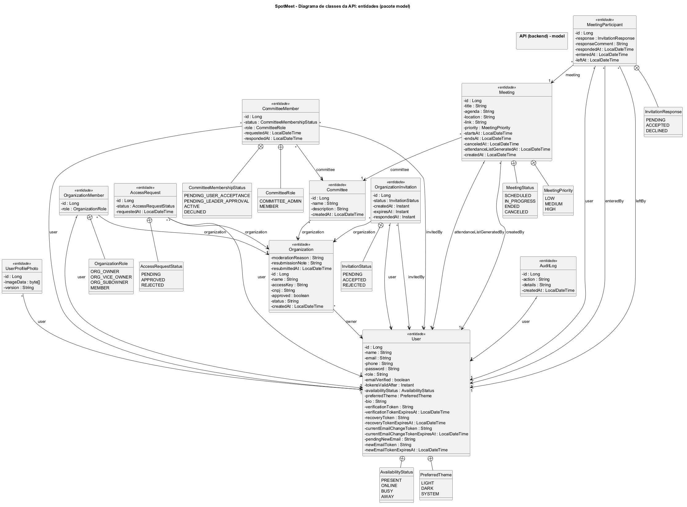

Fonte: próprio autor

**Figura 5 – Diagrama de classes da API: conta de usuário (RF01, RF02 e RF14 a RF18)**

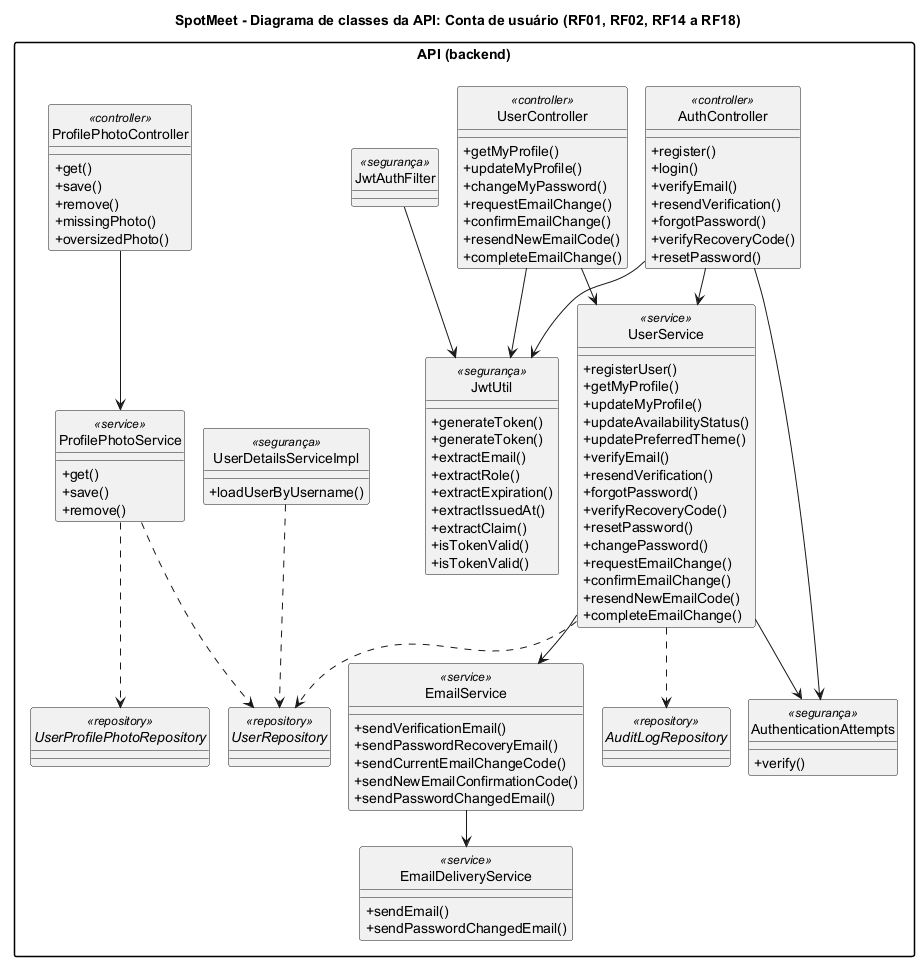

Fonte: próprio autor

**Figura 6 – Diagrama de classes da API: organização (RF03 a RF08)**

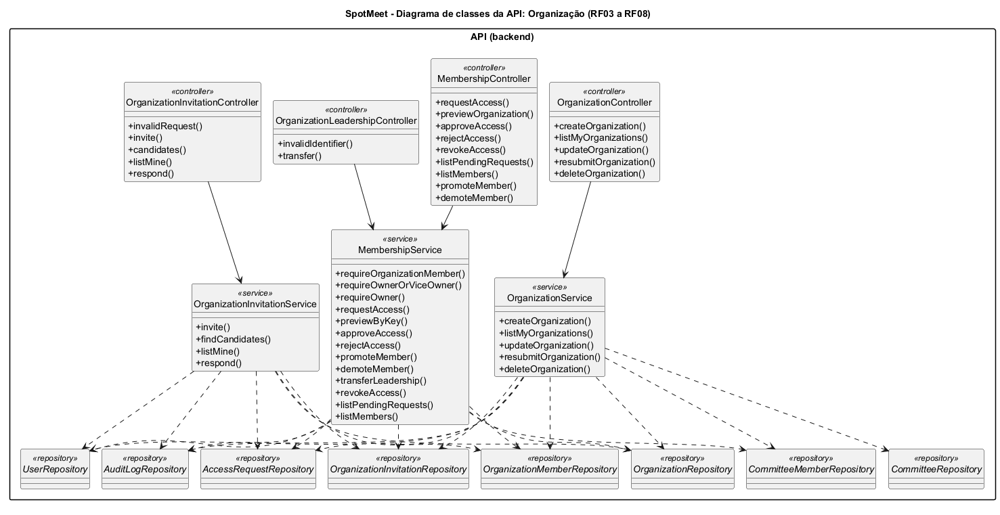

Fonte: próprio autor

**Figura 7 – Diagrama de classes da API: comissão (RF09 a RF13 e RF24)**

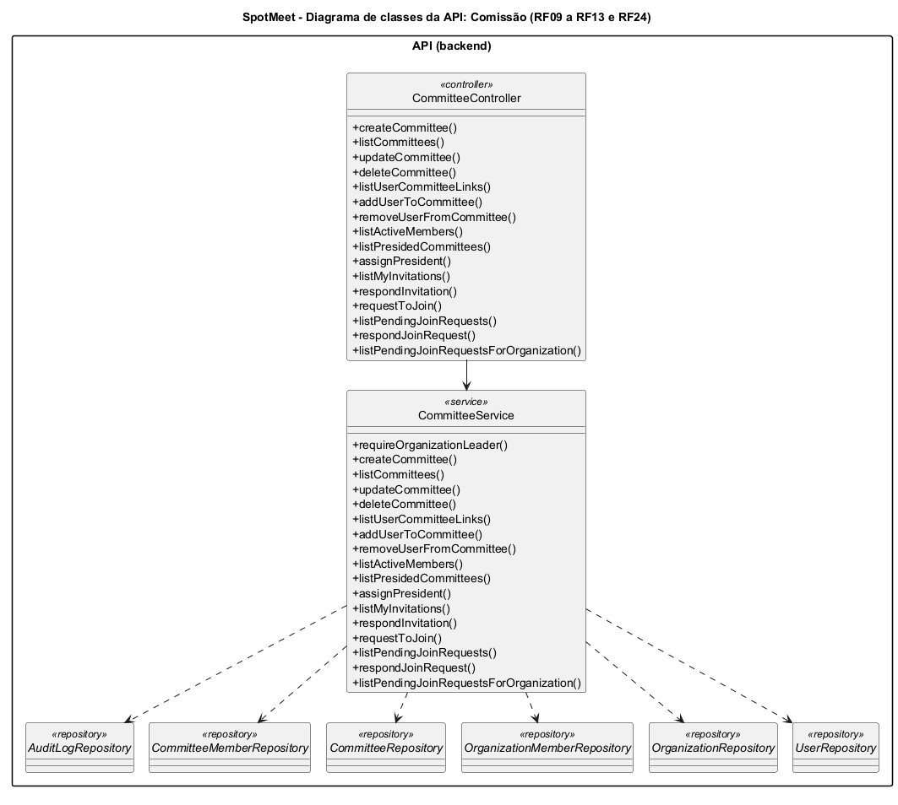

Fonte: próprio autor

**Figura 8 – Diagrama de classes da API: administração do sistema (RF19 a RF23)**

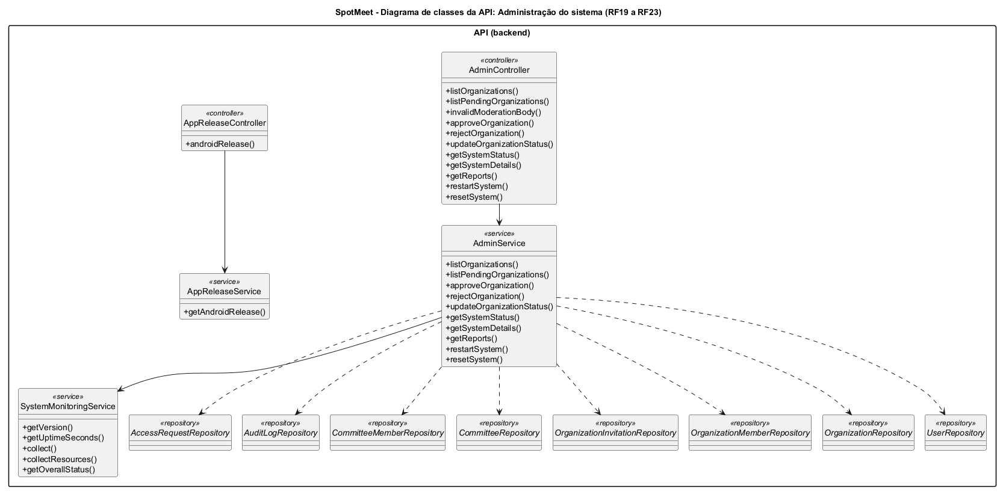

Fonte: próprio autor

**Figura 9 – Diagrama de classes da API: reuniões e presença (RF25 a RF35)**

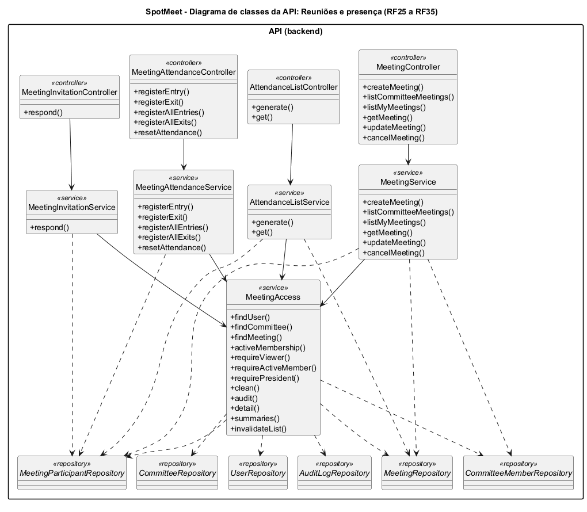

Fonte: próprio autor

**Aplicativo (SpotMeetApp).** O aplicativo é escrito em TypeScript com componentes funcionais; para o diagrama, cada tela, componente, contexto e hook é tratado como uma classe, com o estereótipo correspondente. A Figura 10 mostra as telas e as classes específicas que elas usam. Todas as telas usam, além disso, `AuthContext` (sessão), `ThemeContext` (tema), os componentes de formulário (`FormField`, `FormButton`, `FormScrollView`) e os de aviso (`ToastHost`, `ConfirmationHost`), que não foram desenhados para não poluir o diagrama. O arquivo raiz `App.tsx` monta os contextos e a navegação por abas.

**Figura 10 – Diagrama de classes do aplicativo: telas e dependências específicas**

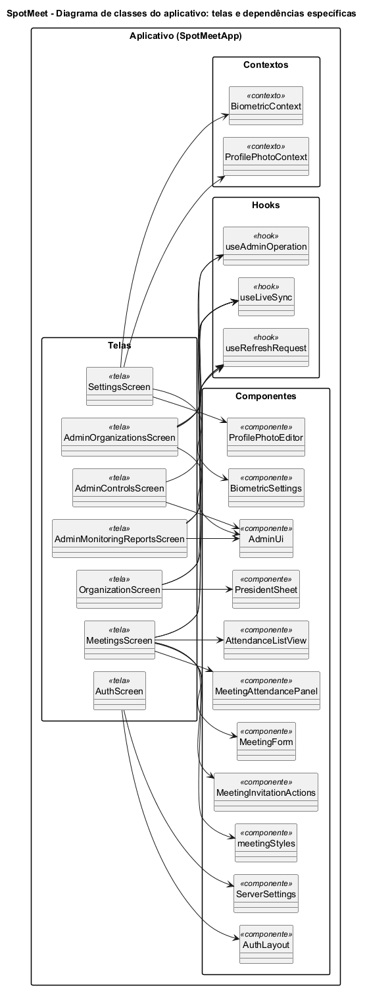

Fonte: próprio autor

### 6.2. Dicionário de classes

A tabela explica o que cada classe representa e a camada a que pertence. As classes do aplicativo ficam em `SpotMeetApp/src` e as da API em `backend/src/main/java/com/spotmeet/backend`. Classes de bibliotecas que aparecem nos diagramas de sequência por serem quem possui o método chamado (por exemplo `PasswordEncoder` e `DataSource`) constam na categoria "Biblioteca".

| Classe | Camada | Arquivo | O que representa |
|---|---|---|---|
| AdminControlsScreen | Aplicativo (tela) | screens/admin/AdminControlsScreen.tsx | Aba "Controles": reinício de subsistema, reset total e saída da sessão administrativa. |
| AdminMonitoringReportsScreen | Aplicativo (tela) | screens/admin/AdminMonitoringReportsScreen.tsx | Aba "Monitoramento": estado geral, cartões dos subsistemas, janelas de detalhes, totais e atividades recentes. |
| AdminOrganizationsScreen | Aplicativo (tela) | screens/admin/AdminOrganizationsScreen.tsx | Tela do administrador (abas "Aprovações" e "Organizações"): lista, busca, filtros, detalhes, aprovação, recusa, bloqueio e transferência de liderança. |
| AuthScreen | Aplicativo (tela) | screens/AuthScreen.tsx | Tela de acesso: formulários de login, cadastro, confirmação do e-mail (e recuperação de senha, RF15); valida os campos, chama a API e inicia a sessão. |
| MeetingsScreen | Aplicativo (tela) | screens/MeetingsScreen.tsx | Aba "Reuniões": lista, convites pendentes, detalhe, formulário e lista de presença; envia as requisições de escrita uma de cada vez |
| OrganizationScreen | Aplicativo (tela) | screens/OrganizationScreen.tsx | Tela "Organização": lista as organizações do usuário, mostra as páginas "Comissões", "Membros", "Solicitações" e "Convites", as folhas "Nova comissão" e "Editar comissão" e a janela "Comissões do integrante"; envia as requisições (mutate, loadDetails, loadInvitations, loadMemberLinks) e exibe os avisos. |
| SettingsScreen | Aplicativo (tela) | screens/SettingsScreen.tsx | Aba "Ajustes" do usuário com perfil USER, com as seções Perfil, Segurança e Preferências: dados pessoais, troca de senha, disponibilidade, tema e a folha de duas etapas da troca de e-mail. |
| AdminSheet | Aplicativo (componente) | components/admin/AdminUi.tsx | Folha inferior usada para os detalhes, para o motivo de recusa e de bloqueio e para a escolha do novo dono. |
| AdminUi | Aplicativo (componente) | components/admin/AdminUi.tsx | Componentes visuais do painel (cabeçalho, cartão, janela inferior, selo de estado, métrica). |
| App | Aplicativo (componente) | App.tsx | Componente raiz: resolve o endereço do servidor antes de montar a navegação, escolhe as abas do administrador (Aprovações, Organizações, Monitoramento e Controles) ou do usuário comum e exibe a tela de login. |
| AppUpdateNotice | Aplicativo (componente) | components/ui/AppUpdateNotice.tsx | Janela "Nova versão disponível", com os botões "Atualizar" e "Agora não". |
| AttendanceListView | Aplicativo (componente) | components/meetings/AttendanceListView.tsx | Exibição da lista de presença gerada |
| BiometricGate | Aplicativo (componente) | components/auth/BiometricGate.tsx | Mostra a tela "SpotMeet bloqueado", o botão "Desbloquear" e o pedido "Deseja habilitar a biometria?". |
| BiometricSettings | Aplicativo (componente) | components/auth/BiometricSettings.tsx | Cartão "Bloqueio biométrico" de Ajustes: chave habilitar e desabilitar e escolha do prazo |
| ConfirmationHost | Aplicativo (componente) | components/ui/ConfirmationHost.tsx | Janela de confirmação (botão "Cancelar" e o botão da ação) de exclusões, transferências, aprovações, recusas e bloqueios. |
| FormButton | Aplicativo (componente) | components/forms/FormButton.tsx | Botão dos formulários ("Criar organização", "Salvar alterações", "Cancelar") com indicação de envio. |
| FormField | Aplicativo (componente) | components/forms/FormField.tsx | Campo de formulário com rótulo, marca de obrigatório, prefixo "#" e mensagem de erro. |
| MeetingAttendancePanel | Aplicativo (componente) | components/meetings/MeetingAttendancePanel.tsx | Painel "Presença": registrar entrada e saída, em massa e limpar registros |
| MeetingForm | Aplicativo (componente) | components/meetings/MeetingForm.tsx | Formulário de agendar e editar reunião, com validação, máscara de data e escolha de convidados |
| MeetingInvitationActions | Aplicativo (componente) | components/meetings/MeetingInvitationActions.tsx | Cartão "Seu convite": aceitar ou recusar com comentário |
| OtpInput | Aplicativo (componente) | components/forms/OtpInput.tsx | Campo de seis casas numéricas do código de confirmação. |
| PasswordRules | Aplicativo (componente) | components/forms/PasswordRules.tsx | Lista de regras da senha mostrada no cadastro. |
| PresidentSheet | Aplicativo (componente) | components/meetings/PresidentSheet.tsx | Folha para designar o presidente da comissão |
| ProfilePhotoEditor | Aplicativo (componente) | components/profile/ProfilePhotoEditor.tsx | Exibe a foto ou o avatar e as ações Galeria, Câmera, Salvar foto, Cancelar foto e Remover foto na seção Perfil. |
| ServerSettings | Aplicativo (componente) | components/auth/ServerSettings.tsx | Rodapé da tela de login que mostra o servidor em uso e permite informar o IP, procurar na rede ou voltar ao automático. |
| SessionGuard | Aplicativo (componente) | components/auth/SessionGuard.tsx | Encerra a sessão local ao receber 401 de rota protegida e consulta GET /api/users/me a cada 15 segundos em primeiro plano. |
| AuthContext | Aplicativo (contexto) | context/AuthContext.tsx | Guarda a sessão em memória (token, perfil, nome, e-mail, userId) e avisa os interessados em signIn, signOut e update. |
| BiometricContext | Aplicativo (contexto) | context/BiometricContext.tsx | Estado e operações do bloqueio biométrico: habilitar, desabilitar, definir o prazo, desbloquear, confirmar a sessão no servidor, religar depois da troca de senha e não bloquear nas telas do sistema abertas para a foto |
| ProfilePhotoContext | Aplicativo (contexto) | context/ProfilePhotoContext.tsx | ProfilePhotoProvider: estado da foto e operações refresh, select, save, remove e discard contra /api/users/me/photo. |
| ThemeContext | Aplicativo (contexto) | context/ThemeContext.tsx | ThemeProvider: tema atual, cores, setTheme (prévia local) e loadThemeFromProfile. |
| adminData | Aplicativo (utilitário) | utils/adminData.ts | Validação das respostas do painel (parseStatus, parseReport, parseDetails), formatação dos valores, texto dos erros HTTP e rótulos em português das ações de auditoria. |
| alerts.ts | Aplicativo (utilitário) | utils/alerts.ts | Mostra os avisos (toast) e os diálogos de confirmação do aplicativo. |
| api | Aplicativo (utilitário) | config/api.ts | Resolve e guarda o endereço da API (loadPersistedApiHost, needsDiscovery, setApiHost, setDiscoveredHost) e expõe API_BASE_URL. |
| appUpdate | Aplicativo (utilitário) | utils/appUpdate.ts | Regras de comparação da versão instalada com a anunciada e de validação da página da build no Expo. |
| biometricSession (utilitário) | Aplicativo (utilitário) | utils/biometricSession.ts | Disponibilidade da biometria, confirmação do aparelho, leitura, gravação e remoção da sessão guardada (armazenamento seguro e local) e da preferência mantida entre a troca de senha e o próximo login |
| biometricSession.ts | Aplicativo (utilitário) | utils/biometricSession.ts | Autentica o aparelho e lê, grava e apaga a sessão guardada no cofre do aparelho. |
| discovery | Aplicativo (utilitário) | config/discovery.ts | Procura o servidor na sub-rede /24 do aparelho por GET /actuator/info (discoverBackendHost, isSpotMeetBackend, clearDiscoveryCache). |
| meetings (utilitário) | Aplicativo (utilitário) | utils/meetings.ts | Tipos, rótulos, máscara e leitura de datas, validação de link e leitura das respostas da API |
| moderation | Aplicativo (utilitário) | utils/moderation.ts | Valida o motivo de recusa e de bloqueio (validateModerationReason: 3 a 500 caracteres, sem caracteres de controle). |
| organizationForms | Aplicativo (utilitário) | utils/organizationForms.ts | Normaliza e valida nome e chave de organização (validateOrganizationName, validateAccessKey, normalizeAccessKey) e filtra por busca (matchesSearch). |
| organizationForms.ts | Aplicativo (utilitário) | utils/organizationForms.ts | Normaliza e valida a chave de acesso (prefixo #, 2 a 50 caracteres). |
| profilePhotoPicker | Aplicativo (utilitário) | utils/profilePhotoPicker.ts | pickProfilePhoto: abre a Galeria ou a Câmera e prepara o JPEG quadrado de até 512 pixels. |
| sessionFetch.ts | Aplicativo (utilitário) | utils/sessionFetch.ts | Substitui o fetch global para detectar respostas 401 das rotas protegidas e chamar a rotina de sessão expirada. |
| syncBus | Aplicativo (utilitário) | utils/syncBus.ts | Barramento de eventos do próprio aparelho (ORGANIZATIONS_MUTATED, MEMBERS_MUTATED, ADMIN_ORGS_MUTATED e outros) que dispara a releitura das telas. |
| syncBus.ts | Aplicativo (utilitário) | utils/syncBus.ts | Barramento de eventos que avisa as telas abertas de que organizações, membros ou pedidos mudaram. |
| useAdminOperation | Aplicativo (utilitário) | hooks/useAdminOperation.ts | Hook que envia as operações administrativas de escrita (reinício e reset), com trava contra toques repetidos e descarte de respostas de sessão antiga. |
| useAppUpdate | Aplicativo (utilitário) | hooks/useAppUpdate.ts | Hook que consulta GET /api/app/android-release, valida a resposta (com appUpdate.ts) e abre a página da build no Expo. |
| useLiveSync | Aplicativo (utilitário) | hooks/useLiveSync.ts | Repete a leitura das listas a cada 15 segundos e ao receber eventos do syncBus, pausada durante edição e gravação. |
| useLiveSync.ts | Aplicativo (utilitário) | hooks/useLiveSync.ts | Atualiza a tela a cada 15 segundos e quando chega um evento do syncBus. |
| useRefreshRequest | Aplicativo (utilitário) | hooks/useRefreshRequest.ts | Hook que serializa as leituras do painel, com limite de 15 segundos e cancelamento ao perder o foco. |
| validators | Aplicativo (utilitário) | utils/validators.ts | PASSWORD_REGEX, isValidEmail e normalizeEmail, isValidOtp e normalizeOtp, isValidName e normalizeName. |
| validators.ts | Aplicativo (utilitário) | utils/validators.ts | Regras de e-mail, senha, nome e código de 6 dígitos usadas antes de enviar os formulários. |
| AdminController | API (controller) | controller/AdminController.java | Rotas /api/admin/organizations: consultar, aprovar, recusar e alterar o estado; exige ADMIN ou SYSADMIN e converte as exceções em 400, 403, 404 e 500. |
| AppReleaseController | API (controller) | controller/AppReleaseController.java | Rota pública GET /api/app/android-release, que responde 200 com a versão anunciada ou 204. |
| AttendanceListController | API (controller) | controller/AttendanceListController.java | Rotas de gerar e consultar a lista de presença |
| AuthController | API (controller) | controller/AuthController.java | Rotas públicas /api/auth: cadastro, login, confirmação do e-mail, reenvio (e recuperação de senha, RF15); monta a sessão e converte exceções em respostas. |
| CommitteeController | API (controller) | controller/CommitteeController.java | Recebe as requisições das rotas de comissão, obtém o e-mail do token e chama o CommitteeService, devolvendo 200 ou 201. |
| MeetingAttendanceController | API (controller) | controller/MeetingAttendanceController.java | Rotas de entrada, saída, registro em massa e correção de presença |
| MeetingController | API (controller) | controller/MeetingController.java | Rotas de agendar, editar, cancelar e consultar reuniões |
| MeetingInvitationController | API (controller) | controller/MeetingInvitationController.java | Rota de resposta ao convite |
| MembershipController | API (controller) | controller/MembershipController.java | Rotas de solicitações de acesso, listagem de membros, promoção, rebaixamento e revogação. |
| OrganizationController | API (controller) | controller/OrganizationController.java | Rotas /api/organizations: criar, listar as minhas, editar, excluir e reenviar para avaliação; obtém o e-mail do usuário do token e converte parte das exceções em HTTP 409. |
| OrganizationInvitationController | API (controller) | controller/OrganizationInvitationController.java | Rotas de convite de organização: enviar, listar os do usuário e responder. |
| OrganizationLeadershipController | API (controller) | controller/OrganizationLeadershipController.java | Rota POST /api/organizations/{organizationId}/members/{userId}/make-owner; converte as exceções da transferência em 400, 403, 404, 409 e 500. |
| ProfilePhotoController | API (controller) | controller/ProfilePhotoController.java | Rotas GET, PUT e DELETE /api/users/me/photo, com conversão dos erros da foto em HTTP. |
| UserController | API (controller) | controller/UserController.java | Rota GET /api/users/me, usada para confirmar a sessão (demais rotas no grupo de Configurações). |
| AdminService | API (service) | service/AdminService.java | Regras administrativas das organizações: conferência do perfil, listagem com máscaras e contagens, aprovação, recusa, bloqueio, validação do motivo e auditoria. |
| AppReleaseService | API (service) | service/AppReleaseService.java | Valida, na inicialização, as propriedades spotmeet.app.android.* e devolve a versão do APK anunciada. |
| AttendanceListService | API (service) | service/AttendanceListService.java | Regras de geração e consulta da lista de presença |
| CommitteeService | API (service) | service/CommitteeService.java | Regras de comissão: autorização do líder (requireOrganizationLeader), validação e unicidade do nome, estados do vínculo (convite, solicitação, ativo, recusado), contadores e auditoria. |
| EmailDeliveryService | API (service) | service/EmailDeliveryService.java | Envia o e-mail em segundo plano pelo SMTP, ou registra o código no log quando o SMTP não está configurado. |
| EmailService | API (service) | service/EmailService.java | Monta os e-mails (código de recuperação, códigos da troca de e-mail e aviso de senha alterada) e registra o envio para depois do commit. |
| MeetingAccess | API (service) | service/MeetingAccess.java | Componente compartilhado: busca de usuário, comissão e reunião, verificação de papel (visualizador, integrante ativo, presidente), auditoria e invalidação da lista |
| MeetingAttendanceService | API (service) | service/MeetingAttendanceService.java | Regras de entrada, saída, registro em massa e correção de presença |
| MeetingInvitationService | API (service) | service/MeetingInvitationService.java | Regras da resposta ao convite |
| MeetingService | API (service) | service/MeetingService.java | Regras de agendar, editar, cancelar e consultar reuniões e de escolha dos convidados |
| MembershipService | API (service) | service/MembershipService.java | Solicitação, aprovação e rejeição de acesso; promoção, rebaixamento, revogação e transferência de liderança; regras da hierarquia. |
| OrganizationInvitationService | API (service) | service/OrganizationInvitationService.java | Envio, consulta e resposta de convites de organização, com validade de 24 horas. |
| OrganizationService | API (service) | service/OrganizationService.java | Regras de criação, listagem, edição, exclusão e reenvio de organizações: normalização, unicidade, permissão do dono ou vice, reavaliação única, exclusão em cascata e auditoria. |
| ProfilePhotoService | API (service) | service/ProfilePhotoService.java | Consulta, valida, regrava (JPEG quadrado de até 512 pixels) e remove a foto da conta autenticada. |
| SystemMonitoringService | API (service) | service/SystemMonitoringService.java | Coleta versão, tempo em execução, recursos da JVM, estado geral e os detalhes do banco e da API. |
| UserService | API (service) | service/UserService.java | Regras de troca de senha, recuperação, perfil e tema e troca de e-mail; geração, hash e validade dos códigos. |
| AccessRequestRepository | API (repository) | repository/AccessRequestRepository.java | Acesso à tabela access_requests: lista e apaga as solicitações da organização excluída. |
| AuditLogRepository | API (repository) | repository/AuditLogRepository.java | Acesso à tabela audit_logs (save, count, findTop100ByOrderByCreatedAtDesc, deleteAllExceptAdminLogs). |
| CommitteeMemberRepository | API (repository) | repository/CommitteeMemberRepository.java | Acesso à tabela committee_members: vínculo por usuário e comissão, listagens por status e contagens. |
| CommitteeRepository | API (repository) | repository/CommitteeRepository.java | Acesso à tabela committees, incluindo existsByNormalizedName (duplicidade sem diferenciar caixa e espaços extras). |
| MeetingParticipantRepository | API (repository) | repository/MeetingParticipantRepository.java | Acesso à tabela meeting_participants, inclusive o bloqueio de escrita do participante |
| MeetingRepository | API (repository) | repository/MeetingRepository.java | Acesso à tabela meetings |
| OrganizationInvitationRepository | API (repository) | repository/OrganizationInvitationRepository.java | Acesso à tabela organization_invitations; apaga os convites da organização excluída. |
| OrganizationMemberRepository | API (repository) | repository/OrganizationMemberRepository.java | Acesso à tabela organization_members, para conferir o papel e a participação do usuário na organização. |
| OrganizationRepository | API (repository) | repository/OrganizationRepository.java | Acesso à tabela organizations: bloqueios de tabela e de linha, consultas de unicidade por nome, chave e CNPJ e listagem com o dono. |
| UserProfilePhotoRepository | API (repository) | repository/UserProfilePhotoRepository.java | findByUserId, save e delete da tabela user_profile_photos. |
| UserRepository | API (repository) | repository/UserRepository.java | Acesso à tabela users (findByEmail e findByEmailForUpdate, com bloqueio de linha; findInviteCandidates, que busca pessoas para o convite por parte do nome ou do e-mail). |
| AccessRequest | API (model) | model/AccessRequest.java | Entidade da tabela access_requests, com status PENDING, APPROVED ou REJECTED. |
| AuditLog | API (model) | model/AuditLog.java | Registro de auditoria (tabela audit_logs) com autor, ação, detalhes (até 1000 caracteres) e data. |
| Committee | API (model) | model/Committee.java | Comissão da organização (tabela committees): nome, descrição, organização e data de criação; nome único por organização (uq_committee_org_name). |
| CommitteeMember | API (model) | model/CommitteeMember.java | Vínculo entre usuário e comissão (tabela committee_members): status (PENDING_USER_ACCEPTANCE, PENDING_LEADER_APPROVAL, ACTIVE, DECLINED), papel, quem convidou e datas; um vínculo por usuário e comissão (uq_committee_member). |
| Meeting | API (model) | model/Meeting.java | Reunião agendada por um presidente; a situação é calculada pelo relógio |
| MeetingParticipant | API (model) | model/MeetingParticipant.java | Convidado de uma reunião, com a resposta e os registros de entrada e saída |
| Organization | API (model) | model/Organization.java | Entidade da tabela organizations: nome, chave, dono, CNPJ, approved, status, moderation_reason, justificativa e data do reenvio (resubmission_note e resubmitted_at) e data de criação. |
| OrganizationInvitation | API (model) | model/OrganizationInvitation.java | Entidade da tabela organization_invitations, com status PENDING, ACCEPTED ou REJECTED e prazo. |
| OrganizationMember | API (model) | model/OrganizationMember.java | Entidade da tabela organization_members: vínculo entre usuário e organização, com o papel ORG_OWNER, ORG_VICE_OWNER, ORG_SUBOWNER ou MEMBER. |
| User | API (model) | model/User.java | Entidade da tabela users (senha, e-mail, nome, bio, disponibilidade, tema, códigos temporários e tokens_valid_after); implementa UserDetails. |
| UserProfilePhoto | API (model) | model/UserProfilePhoto.java | Entidade da tabela user_profile_photos (user_id único, image_data e version). |
| AccessRequestDTO | API (dto) | dto/AccessRequestDTO.java | Corpo opcional do pedido de acesso, com a chave da organização. |
| AccessRequestResponseDTO | API (dto) | dto/AccessRequestResponseDTO.java | Dados da solicitação de acesso devolvidos ao solicitante e ao líder. |
| AdminOrganizationDTO | API (dto) | dto/AdminOrganizationDTO.java | Resposta ao administrador, com e-mail do dono e CNPJ mascarados, motivo, justificativa e data do reenvio e totais de integrantes e de comissões. |
| AdminReportDTO | API (dto) | dto/AdminReportDTO.java | Resposta dos relatórios, com o tipo aninhado AuditActivityDTO. |
| AndroidReleaseDTO | API (dto) | dto/AndroidReleaseDTO.java | Resposta da versão do APK anunciada: applicationId, version, versionCode e downloadUrl. |
| AttendanceListDTO | API (dto) | dto/AttendanceListDTO.java | Lista de presença, com a situação e o tempo de cada convidado |
| AuthResponseDTO | API (dto) | dto/AuthResponseDTO.java | Dados da sessão devolvidos no login: token, perfil, nome, e-mail, userId e emailVerified. |
| ChangePasswordDTO | API (dto) | dto/ChangePasswordDTO.java | Entrada do RF14: currentPassword e newPassword. |
| CodeDeliveryResultDTO | API (dto) | dto/CodeDeliveryResultDTO.java | Resultado interno de um pedido de código (mensagem, destino e usuário), sem o código. |
| CommitteeMemberResponseDTO | API (dto) | dto/CommitteeMemberResponseDTO.java | Saída de um vínculo, convite ou solicitação (usuário, comissão, status, papel, datas e quem convidou). |
| CommitteeRequestDTO | API (dto) | dto/CommitteeRequestDTO.java | Entrada de criação e edição de comissão (name e description), com normalização do nome e Bean Validation. |
| CommitteeResponseDTO | API (dto) | dto/CommitteeResponseDTO.java | Saída de comissão, com os contadores totalActiveMembers e totalPending. |
| CompleteEmailChangeDTO | API (dto) | dto/CompleteEmailChangeDTO.java | Entrada da Etapa 3 do RF18: newEmailCode. |
| ConfirmEmailChangeDTO | API (dto) | dto/ConfirmEmailChangeDTO.java | Entrada da Etapa 2 do RF18: currentCode e newEmail. |
| CriticalActionRequestDTO | API (dto) | dto/CriticalActionRequestDTO.java | Corpo do reinício e do reset: confirmation, reason e subsystem. |
| ForgotPasswordDTO | API (dto) | dto/ForgotPasswordDTO.java | Entrada da Solicitação do RF15: email. |
| InviteCandidateDTO | API (dto) | dto/InviteCandidateDTO.java | Pessoa encontrada na busca do convite: nome e e-mail. |
| LoginRequestDTO | API (dto) | dto/LoginRequestDTO.java | Entrada do login: e-mail e senha. |
| MeetingAnswerDTO | API (dto) | dto/MeetingAnswerDTO.java | Comentário opcional da resposta ao convite |
| MeetingRequestDTO | API (dto) | dto/MeetingRequestDTO.java | Dados de agendar e editar reunião, com as validações |
| MeetingResponseDTO | API (dto) | dto/MeetingResponseDTO.java | Reunião com contadores de convites e, no detalhe, a lista de participantes |
| OrganizationInvitationRequestDTO | API (dto) | dto/OrganizationInvitationRequestDTO.java | Entrada do convite: e-mail do convidado. |
| OrganizationInvitationResponseDTO | API (dto) | dto/OrganizationInvitationResponseDTO.java | Dados do convite devolvidos ao líder e ao destinatário. |
| OrganizationLeadershipResponseDTO | API (dto) | dto/OrganizationLeadershipResponseDTO.java | Resposta da transferência de liderança (organização, dono anterior, novo dono e os dois papéis). |
| OrganizationPreviewDTO | API (dto) | dto/OrganizationPreviewDTO.java | Prévia da organização pela chave: nome, chave e nome do responsável. |
| OrganizationRejectionDTO | API (dto) | dto/OrganizationRejectionDTO.java | Corpo da recusa (reason, de 3 a 500 caracteres). |
| OrganizationRequestDTO | API (dto) | dto/OrganizationRequestDTO.java | Corpo de criação e de edição (name, accessKey, cnpj), com as validações e a normalização dos valores. |
| OrganizationResponseDTO | API (dto) | dto/OrganizationResponseDTO.java | Resposta ao usuário (id, name, accessKey, ownerId, ownerName, createdAt, myRole, approved, status, moderationReason, resubmitted), sem o CNPJ; o motivo só vai ao dono e aos administradores. |
| OrganizationResponseDTO.MemberDTO | API (dto) | dto/OrganizationResponseDTO.java | Dados de um integrante da organização: userId, nome, e-mail e cargo. |
| OrganizationResubmitDTO | API (dto) | dto/OrganizationResubmitDTO.java | Corpo do reenvio para avaliação (justification, de 3 a 500 caracteres). |
| ProfilePhotoResponseDTO | API (dto) | dto/ProfilePhotoResponseDTO.java | Saída da foto: userId, imageBase64 e version. |
| RegisterRequestDTO | API (dto) | dto/RegisterRequestDTO.java | Entrada do cadastro: nome, e-mail e senha, com as regras de validação. |
| ResendVerificationDTO | API (dto) | dto/ResendVerificationDTO.java | Entrada do reenvio do código: e-mail. |
| ResetPasswordDTO | API (dto) | dto/ResetPasswordDTO.java | Entrada da Redefinição do RF15: email, token e newPassword. |
| RespondOrganizationInvitationDTO | API (dto) | dto/RespondOrganizationInvitationDTO.java | Entrada da resposta ao convite: aceitar ou recusar. |
| SystemDetailsDTO | API (dto) | dto/SystemDetailsDTO.java | Resposta dos detalhes de banco, API e recursos. |
| SystemStatusDTO | API (dto) | dto/SystemStatusDTO.java | Resposta do status, com os tipos aninhados SubsystemInfo e MemoryInfo. |
| UpdateOrganizationStatusDTO | API (dto) | dto/UpdateOrganizationStatusDTO.java | Corpo da alteração de estado (approved e justification). |
| UpdateUserProfileDTO | API (dto) | dto/UpdateUserProfileDTO.java | Entrada dos RF16 e RF17: name, bio, availabilityStatus e preferredTheme (todos opcionais). |
| UserCommitteeLinkDTO | API (dto) | dto/UserCommitteeLinkDTO.java | Saída da consulta do RF13: uma comissão da organização com a situação do integrante nela. |
| UserProfileResponseDTO | API (dto) | dto/UserProfileResponseDTO.java | Saída do perfil: id, name, email, bio, availabilityStatus, preferredTheme e role. |
| ValidationPatterns | API (dto) | dto/ValidationPatterns.java | Padrão da chave de acesso e normalização de espaços de nome, chave e CNPJ, compartilhados pelo DTO, pelo serviço e pelo banco. |
| VerifyEmailDTO | API (dto) | dto/VerifyEmailDTO.java | Entrada da confirmação: e-mail e código de 6 dígitos. |
| VerifyRecoveryCodeDTO | API (dto) | dto/VerifyRecoveryCodeDTO.java | Entrada da Validação do RF15: email e token. |
| AuthenticationAttempts | API (segurança) | security/AuthenticationAttempts.java | Limita as tentativas de login e de confirmação por e-mail (10 falhas em 15 minutos) e lança TooManyAttemptsException. |
| AuthenticationManager | API (segurança) | config/SecurityConfig.java | Gerenciador do Spring Security que executa o login (provedor configurado em SecurityConfig). |
| BCryptPasswordEncoder | API (segurança) | config/SecurityConfig.java | Codificador de senhas e códigos, com custo 12, definido como bean em SecurityConfig. |
| JwtAuthFilter | API (segurança) | security/JwtAuthFilter.java | Filtro que valida o JWT e carrega a conta (assinatura, validade, e-mail verificado e corte tokens_valid_after) em cada requisição protegida. |
| JwtUtil | API (segurança) | security/JwtUtil.java | Gera e valida o JWT; extractIssuedAt e generateToken são usados na troca de e-mail. |
| LgpdMaskUtil | API (segurança) | security/LgpdMaskUtil.java | Mascara e-mails (maskEmail) e remove senhas, segredos e tokens de textos (sanitizeDetails) nos relatórios. |
| UserDetailsServiceImpl | API (segurança) | security/UserDetailsServiceImpl.java | Carrega a conta pelo e-mail para a autenticação e para o filtro de token. |
| GlobalExceptionHandler | API (exceção) | exception/GlobalExceptionHandler.java | Converte exceções em respostas HTTP: 400 (Bean Validation e parâmetro inválido), 403 (SecurityException) e 409 (IllegalArgumentException e IllegalStateException). |
| InvalidModerationReasonException | API (exceção) | exception/InvalidModerationReasonException.java | Exceção lançada quando o motivo de recusa ou de bloqueio é inválido; o AdminController a converte em HTTP 400. |
| InvalidProfilePhotoException | API (exceção) | exception/InvalidProfilePhotoException.java | Lançada quando a imagem enviada não atende às regras de formato, tamanho e dimensões. |
| TooManyAttemptsException | API (exceção) | exception/TooManyAttemptsException.java | Lançada ao atingir o limite; carrega o tempo de espera usado no 429. |
| BackendApplication | API (configuração) | BackendApplication.java | Ponto de entrada do servidor (main) e ApplicationRunner sysAdminBootstrap, que cria a conta do administrador do sistema. |
| DatabaseCreator | API (configuração) | config/DatabaseCreator.java | Cria o banco de dados configurado quando ele não existe, antes de o pool de conexões ser aberto. |
| EmailAsyncConfig | API (configuração) | config/EmailAsyncConfig.java | Define o executor emailExecutor (uma thread e fila de 20 envios). |
| SecurityConfig | API (configuração) | config/SecurityConfig.java | Define as rotas públicas, a exigência de ADMIN ou SYSADMIN em /api/admin/**, a restrição do Actuator a SYSADMIN e o PasswordEncoder BCrypt de custo 12. |
| Connection | Biblioteca | biblioteca (JDBC) | Conexão obtida do DataSource, usada para isValid e para as consultas fixas de detalhes do banco. |
| DataSource | Biblioteca | biblioteca (HikariCP via Spring Boot), configurada por spring.datasource.* | Pool de conexões com o PostgreSQL; usado para validar a conexão, renovar o pool e consultar o banco. |
| InfoEndpoint | Biblioteca | biblioteca (Spring Boot Actuator), configurada em application.properties | Endpoint público GET /actuator/info, que informa app.name igual a "SpotMeet" e é usado pela busca do servidor. |
| MeterRegistry | Biblioteca | biblioteca (Micrometer, via Spring Boot Actuator) | Fonte das métricas http.server.requests e das threads do Tomcat. |
| PasswordEncoder | Biblioteca | config/SecurityConfig.java | BCryptPasswordEncoder com custo 12: encode e matches de senhas e dos códigos de seis dígitos. |
| System | Biblioteca | biblioteca (JDK) | Fornece System.gc(), usado no reinício de Recursos. |
| TomcatWebServer | Biblioteca | biblioteca (Spring Boot) | Servidor web embutido, do qual o reinício da Rede obtém os conectores HTTP. |

### 6.3. Descrição dos requisitos funcionais

A seguir, descrevem-se os requisitos funcionais de sistema, cada um seguido do seu diagrama de sequência. Nos diagramas, as linhas de vida do aplicativo ficam no quadro "Aplicativo (SpotMeetApp)" e as da API no quadro "API (backend)"; as mensagens entre classes usam os nomes de métodos do código, e o acesso ao banco é feito pelas classes `Repository`. As figuras são extensas; para ler os detalhes, abra o arquivo da imagem.

#### RF01 – Cadastrar Usuário

| Campo | Descrição |
|---|---|
| Função | Cadastra uma pessoa como usuário do SpotMeet e ativa a conta quando ela confirma o e-mail com um código de 6 dígitos; ao confirmar, inicia a sessão do usuário. |
| Descrição | **Cadastro:** normaliza o e-mail (remove espaços das pontas e converte para minúsculas) e o nome (remove espaços das pontas) e insere na tabela users um registro com name, email, password (hash BCrypt de custo 12), role USER, email_verified false e tokens_valid_after com o instante do cadastro (um token emitido a um antigo dono do mesmo e-mail não abre a conta nova). O servidor gera um código numérico de 6 dígitos com SecureRandom, diferente do anterior quando houver, grava somente o seu hash BCrypt em verification_token e a validade de 5 minutos em verification_token_expires_at, e agenda o envio do código por e-mail para depois da confirmação da transação. Se o e-mail já pertencer a uma conta ainda não verificada, a conta é reaproveitada: nome e senha são substituídos e um novo código é gerado. Se pertencer a uma conta verificada, nada é alterado.  **Confirmação:** localiza a conta pelo e-mail informado (o código sozinho não identifica a conta), compara o código com o hash gravado e confere a validade. Estando correto, grava email_verified = true, apaga verification_token e verification_token_expires_at e devolve ao aplicativo uma sessão (token JWT emitido como no RF02), de modo que o usuário entra sem digitar a senha de novo. Cada código vale uma única vez. As tentativas erradas são contadas por e-mail: a 10ª falha dentro de 15 minutos e as tentativas seguintes são recusadas até o fim de 15 minutos.  **Reenvio:** para uma conta existente e ainda não verificada, gera um novo código de 6 dígitos (o anterior deixa de valer), grava o novo hash com nova validade de 5 minutos e agenda o e-mail. Para e-mail inexistente ou de conta já verificada, o servidor não envia nada e devolve a mesma resposta. |
| Entradas | **Cadastro:** objeto RegisterRequestDTO com name (obrigatório; o servidor remove os espaços das pontas antes de validar; de 2 a 100 caracteres), email (obrigatório, formato de ValidationPatterns.EMAIL: até 255 caracteres, parte local de até 64, rótulos de domínio de até 63 e domínio final de 2 a 63 letras) e password (obrigatória, no mínimo 6 caracteres, com pelo menos uma letra maiúscula, uma minúscula e um número, sem limite máximo). No aplicativo, o formulário "Criar conta" tem os campos Nome completo, E-mail (normalizado: sem caracteres invisíveis nem espaços nas pontas e em minúsculas) e Senha, com o ícone para mostrar ou ocultar a senha e a lista de regras "Mínimo de 6 caracteres", "Pelo menos 1 letra maiúscula", "Pelo menos 1 letra minúscula" e "Pelo menos 1 número".  **Confirmação:** objeto VerifyEmailDTO com email (obrigatório, mesmo formato) e code (obrigatório, exatamente 6 dígitos numéricos; zeros à esquerda valem). No aplicativo, o campo E-mail cadastrado e o campo Código de confirmação (seis casas, teclado numérico, aceita só dígitos).  **Reenvio:** objeto ResendVerificationDTO com email (obrigatório, mesmo formato). |
| Origem | Usuário (pessoa ainda sem sessão), pela tela AuthScreen. |
| Saída | **Cadastro:** HTTP 201 com {success: true, message: "Verifique o seu e-mail.", email, name, emailVerified: false}; a API nunca devolve o código. HTTP 409 {success: false, message} quando o e-mail pertence a uma conta já verificada (o AuthController converte a IllegalArgumentException do serviço). HTTP 400 {status, error, message, errors} quando um campo viola o DTO (resposta do GlobalExceptionHandler, antes de o método do controlador ser executado) ou "Corpo da requisição inválido." quando o corpo é ilegível.  **Confirmação:** HTTP 200 com {success: true, message: "Conta verificada com sucesso.", token, role, name, email, userId, emailVerified: true}. HTTP 400 {success: false, message} (AuthController) para código incorreto, expirado ou de e-mail sem cadastro ("Código de verificação incorreto.", "O código de verificação expirou. Solicite um novo código no aplicativo." e "Código de verificação inválido ou inexistente."); HTTP 400 do GlobalExceptionHandler quando o código não tem 6 dígitos; HTTP 429 {success: false, error: TOO_MANY_ATTEMPTS, message, retryAfterSeconds}, com o cabeçalho Retry-After, depois de 10 falhas (GlobalExceptionHandler).  **Reenvio:** HTTP 200 {success: true, message: "Verifique o seu e-mail."}, igual para e-mail cadastrado, inexistente ou já verificado; HTTP 400 do GlobalExceptionHandler para e-mail em formato inválido. |
| Destino | Usuário, pela tela AuthScreen e pela caixa de e-mail informada (assunto "SpotMeet - Confirmação de Cadastro"). |
| Ação | **Cadastro:** na tela de acesso (AuthScreen, modo login), o usuário toca em "Não tem uma conta? Cadastre-se". A tela mostra "Criar conta" ("Você confirma seu e-mail por código antes de entrar.") com os campos Nome completo, E-mail e Senha; o e-mail já digitado no acesso continua no campo E-mail. A seta no topo e o botão voltar do Android levam de volta ao acesso. Ao tocar em "Criar Conta", handleRegister confere se os três campos foram preenchidos ("Campo obrigatório."), se o nome normalizado tem de 2 a 100 caracteres, se o e-mail é válido e se a senha atende à regra, e envia POST /api/auth/register (rota pública, sem token). O método register de AuthController chama registerUser de UserService, em uma transação: consulta a conta com bloqueio de linha (findByEmailForUpdate de UserRepository); se já for verificada, lança IllegalArgumentException; caso contrário, gera o hash da senha (encode de BCryptPasswordEncoder), gera o código (generateCode) e o seu hash, grava o usuário (save), chama sendVerificationEmail de EmailService, que registra o envio para depois do commit, e grava a auditoria (save de AuditLogRepository). Depois do commit, EmailService chama sendEmail de EmailDeliveryService, executado em segundo plano (@Async, fila com uma thread e 20 posições): a resposta HTTP não espera o SMTP. Quando o SMTP não está configurado, o código é apenas escrito no log do servidor, para teste local. Com a resposta 201, o aplicativo limpa nome e senha, exibe o aviso "Código enviado" ("Verifique o seu e-mail.") e passa ao formulário "Confirme seu e-mail", mantendo o e-mail digitado. Com a resposta 409, exibe o diálogo "Conta Já Cadastrada" com o botão "Fazer Login".  **Confirmação:** o formulário "Confirme seu e-mail" ("Digite o código de 6 dígitos enviado para o e-mail cadastrado.") mostra o campo E-mail cadastrado e o campo Código de confirmação, com a indicação "Validade do código: até 5 minutos.". Ao completar o sexto dígito com um e-mail válido, o aplicativo envia o código sozinho; o botão "Confirmar e Ativar Conta" faz o mesmo. A requisição é POST /api/auth/verify-email. O método verifyEmail de AuthController chama verifyEmail de UserService, que entrega a conferência a verify de AuthenticationAttempts (finalidade EMAIL_VERIFICATION, chave: o e-mail); dentro dela, findByEmailForUpdate localiza a conta, matches de BCryptPasswordEncoder compara o código com verification_token e o serviço confere a validade. Estando tudo correto, o serviço grava a conta como verificada (save), registra ACCOUNT_VERIFIED e devolve o usuário; o controlador chama createSession, que usa generateToken de JwtUtil, e responde 200 com a sessão. O aplicativo chama signIn de AuthContext e abre a área principal, como no RF02. Em caso de erro, mostra a mensagem do servidor abaixo do campo do código, que continua disponível para nova tentativa.  **Reenvio:** no mesmo formulário, o usuário toca em "Reenviar código por E-mail" (exige e-mail válido). O aplicativo envia POST /api/auth/resend-verification; resendVerification de AuthController chama resendVerification de UserService, que consulta a conta (findByEmailForUpdate), gera o código e o seu hash e, se a conta existe e não foi verificada, grava (save), chama sendVerificationEmail e registra VERIFICATION_RESENT. Com a resposta 200, o aplicativo limpa o campo do código, exibe o aviso "Código enviado" e bloqueia o botão por 60 segundos ("Reenviar código em 60s"). |
| Pré-condição | **Cadastro:** a pessoa não tem sessão iniciada e não existe em users uma conta com o e-mail informado e email_verified = true (conta com email_verified = false é aceita e atualizada).  **Confirmação:** existe em users uma conta com o e-mail informado, com email_verified = false, verification_token gravado e verification_token_expires_at posterior ao momento da confirmação; o usuário tem o código de 6 dígitos recebido por e-mail; há menos de 10 falhas de verificação desse e-mail nos últimos 15 minutos.  **Reenvio:** e-mail em formato válido; só há novo código se existir em users uma conta com esse e-mail e email_verified = false. |
| Pós-condição | **Cadastro:** em caso de sucesso, existe em users uma conta com email_verified = false, role USER, senha em hash e código com validade de 5 minutos; o e-mail está agendado, USER_REGISTERED foi gravada e o usuário vê o formulário de confirmação (a conta ainda não permite login). Em caso de falha (e-mail de conta verificada, campo inválido), nada é gravado e o usuário vê o diálogo ou a mensagem correspondente.  **Confirmação:** em caso de sucesso, a conta fica com email_verified = true e sem código, ACCOUNT_VERIFIED foi gravada, o usuário tem sessão iniciada e vê a área principal; o código usado não vale mais. Em caso de falha, a conta não é alterada e o usuário vê a mensagem; pode tentar de novo ou reenviar o código. Depois de 10 falhas, vê "Muitas tentativas. Aguarde e tente novamente em alguns minutos.".  **Reenvio:** em caso de sucesso, a conta pendente passa a ter um novo código (o anterior é invalidado) com nova validade de 5 minutos, o e-mail está agendado, VERIFICATION_RESENT foi gravada e o botão fica bloqueado por 60 segundos. Para e-mail inexistente ou já verificado, nada é alterado nem enviado e a resposta é a mesma. |
| Efeitos colaterais | **Cadastro:** gravação de USER_REGISTERED em audit_logs; envio assíncrono de e-mail com o assunto "SpotMeet - Confirmação de Cadastro" e o código de 6 dígitos, com validade de 5 minutos; em conta nova, gravação de tokens_valid_after.  **Confirmação:** gravação de ACCOUNT_VERIFIED em audit_logs; emissão do token JWT da sessão (sem gravação no banco); depois do login, o aplicativo oferece a biometria (RF02). Cada tentativa errada incrementa o contador em memória de AuthenticationAttempts.  **Reenvio:** gravação de VERIFICATION_RESENT em audit_logs e envio assíncrono do mesmo e-mail do cadastro, apenas para conta pendente. |

**Figura 11 – Diagrama de sequência do RF01**

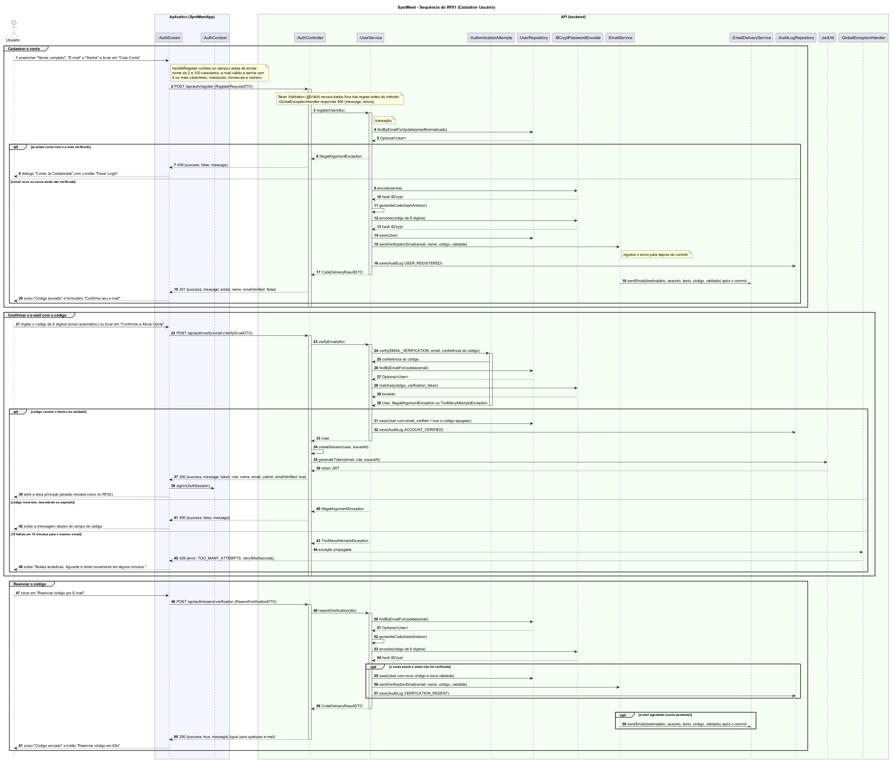

Fonte: próprio autor

#### RF02 – Autenticar Usuário

| Campo | Descrição |
|---|---|
| Função | Autentica o usuário (ou o administrador do sistema) com e-mail e senha, emite o token JWT da sessão e libera as funcionalidades conforme o perfil global; controla também a validade da sessão e a reentrada por biometria. |
| Descrição | **Entrada com e-mail e senha:** o servidor limita as tentativas por e-mail (10 falhas em 15 minutos), consulta em users a conta com o e-mail informado, compara a senha com o hash BCrypt e só depois verifica se email_verified é true. Estando tudo correto, gera um token JWT assinado com HMAC (chave spotmeet.jwt.secret), com o e-mail como assunto e as informações role, issuedAtMillis, iat e exp, válido por spotmeet.jwt.expiration-ms (86400000 milissegundos, ou 24 horas, por padrão), e devolve os dados da sessão. O instante de emissão é sempre posterior a users.tokens_valid_after; por isso os tokens anteriores a uma troca de senha, a uma troca de e-mail ou a um reset do sistema deixam de valer. O mesmo fluxo vale para os perfis USER, ADMIN e SYSADMIN.  **Validação da sessão:** a cada requisição protegida, JwtAuthFilter extrai o e-mail do token, carrega a conta (loadUserByUsername), confere assinatura, validade, assunto e o corte tokens_valid_after (isTokenValid) e exige email_verified = true; se algo falhar, a requisição segue sem autenticação e o servidor responde 401. O aplicativo consulta GET /api/users/me a cada 15 segundos, enquanto está em primeiro plano, para perceber a sessão encerrada.  **Reentrada por biometria:** com a biometria habilitada (ver os requisitos de Configurações de usuário), o aplicativo reaberto, ou que volta do segundo plano depois do prazo escolhido, fica bloqueado. Quando a saída foi pelas telas do sistema que o próprio aplicativo abre para a foto de perfil (galeria, câmera e recorte, RF16), o bloqueio só é aplicado depois de 5 minutos, ou do prazo escolhido, se for maior. Ao tocar em "Desbloquear", o aparelho autentica o usuário (biometria ou PIN), o aplicativo lê o token guardado no cofre do aparelho e o confirma no servidor com GET /api/users/me, sem emitir novo token. |
| Entradas | **Entrada:** objeto LoginRequestDTO com email (obrigatório, formato de ValidationPatterns.EMAIL; o aplicativo envia o e-mail sem caracteres invisíveis, sem espaços nas pontas e em minúsculas, e o AuthController também aplica trim e minúsculas) e password (obrigatória, sem regra de formato).  **Validação da sessão:** cabeçalho Authorization com a palavra Bearer e o token.  **Reentrada por biometria:** autenticação do aparelho; nenhum dado digitado. |
| Origem | Usuário ou Administrador do sistema, pelas telas AuthScreen (entrada) e BiometricGate (reentrada) e pelo componente SessionGuard (validação periódica). |
| Saída | **Entrada:** HTTP 200 com AuthResponseDTO {token, role, name, email, userId, emailVerified}. HTTP 403 {error: EMAIL_NOT_VERIFIED, message, email} quando a senha está correta e a conta não foi verificada (AuthController, a partir de DisabledException). HTTP 401 {error: BAD_CREDENTIALS, message: "E-mail ou senha incorretos."} para e-mail inexistente ou senha errada (AuthController, a partir de BadCredentialsException). HTTP 429 {success: false, error: TOO_MANY_ATTEMPTS, message, retryAfterSeconds}, com o cabeçalho Retry-After, a partir da 10ª falha em 15 minutos (GlobalExceptionHandler). HTTP 400 do GlobalExceptionHandler quando o corpo viola o DTO.  **Validação da sessão:** a requisição segue normalmente (por exemplo, 200 de GET /api/users/me). HTTP 401 sem corpo quando o token está ausente, inválido, expirado ou revogado (SecurityConfig, HttpStatusEntryPoint); HTTP 503 quando a consulta da conta ao banco falha (JwtAuthFilter); HTTP 403 quando o perfil não tem acesso à rota (por exemplo, /api/admin/** para o perfil USER).  **Reentrada por biometria:** HTTP 200 com o perfil de GET /api/users/me; HTTP 401, 403 ou 404 encerram a sessão guardada; falha de rede ou 5xx mantém o aplicativo bloqueado. |
| Destino | Usuário ou Administrador do sistema, pelas telas AuthScreen, BiometricGate e pelo componente SessionGuard; a sessão fica guardada em memória no AuthContext. |
| Ação | **Entrada:** o aplicativo abre em AuthScreen no modo de acesso, com o título "SpotMeet", o cartão "Acessar conta" ("Entre com seu e-mail e senha."), os campos E-mail e Senha (com ícone para mostrar ou ocultar), o link "Esqueci minha senha" (RF15), o botão "Entrar no SpotMeet", o botão desabilitado "Continuar com Google" (marcado "EM BREVE", sem função) e o link "Não tem uma conta? Cadastre-se" (RF01). Ao tocar em "Entrar no SpotMeet", handleLogin confere se os dois campos foram preenchidos ("Campo obrigatório.") e se o e-mail é válido e envia POST /api/auth/login (rota pública). O método login de AuthController chama verify de AuthenticationAttempts (finalidade LOGIN, chave: o e-mail), que executa authenticate de AuthenticationManager: loadUserByUsername de UserDetailsServiceImpl (findByEmail de UserRepository), matches de BCryptPasswordEncoder e, depois da senha, a verificação de conta habilitada configurada em SecurityConfig. Com o sucesso, createSession usa generateToken de JwtUtil e o controlador responde 200. O aplicativo confere se a resposta tem token e perfil USER, ADMIN ou SYSADMIN, chama signIn de AuthContext, limpa o formulário e substitui a navegação pela área principal (navigation.reset para Main), sem rota de volta à tela de acesso. A área principal depende do perfil: ADMIN e SYSADMIN veem as abas "Aprovações", "Organizações", "Monitoramento" e "Controles"; os demais usuários veem "Organização", "Reuniões" e "Ajustes". Em Android e iOS, BiometricContext recebe o evento de login e BiometricGate mostra "Deseja habilitar a biometria?" com "Sim" e "Não"; se o login vem logo depois de uma troca de senha com a biometria habilitada (RF14), o convite não aparece e a biometria é religada com uma confirmação da digital (RF36). Com a resposta 403 EMAIL_NOT_VERIFIED, o aplicativo exibe o aviso "Confirmação Necessária", limpa a senha e passa ao formulário "Confirme seu e-mail" (RF01); com 401, exibe "E-mail ou senha incorretos."; com 429, exibe a mensagem "Muitas tentativas. Aguarde e tente novamente em alguns minutos."; sem conexão, exibe "Não foi possível conectar. Verifique sua conexão e tente novamente.".  **Validação da sessão:** SessionGuard, montado em App, envia GET /api/users/me com o token a cada 15 segundos enquanto o aplicativo está em primeiro plano e ao voltar ao primeiro plano. Em cada requisição protegida, JwtAuthFilter chama extractEmail e isTokenValid de JwtUtil e loadUserByUsername de UserDetailsServiceImpl. Quando qualquer requisição protegida recebe 401, o fetch instalado por installSessionFetch chama a rotina de sessão expirada: signOut de AuthContext, retorno à tela de acesso (resetRoot) e aviso "Sessão encerrada" ("Sua sessão foi encerrada. Entre novamente."). Falha de conexão não encerra a sessão.  **Reentrada por biometria:** ao abrir o aplicativo com a proteção habilitada, BiometricGate mostra "SpotMeet bloqueado" ("Use a biometria ou o PIN do aparelho para continuar. Sua sessão será confirmada no servidor.") com o botão "Desbloquear" e o link "Entrar com e-mail e senha". Ao tocar em "Desbloquear", unlock de BiometricContext autentica o aparelho, lê o token do cofre e envia GET /api/users/me (limite de 10 segundos); com 200, chama signIn de AuthContext com os dados do perfil e desbloqueia. Com 401, 403 ou 404, chama signOut, apaga a sessão guardada e mostra "Sessão encerrada". O link "Entrar com e-mail e senha" encerra a sessão guardada e leva à tela de acesso. |
| Pré-condição | **Entrada:** existe em users uma conta com o e-mail informado e email_verified = true, e o usuário conhece a senha; há menos de 10 falhas de login desse e-mail nos últimos 15 minutos. Conta com email_verified = false e senha correta leva à confirmação do e-mail (RF01), sem sessão.  **Validação da sessão:** existe sessão iniciada no aplicativo, com token assinado por este servidor, não expirado e emitido depois de users.tokens_valid_after da conta, que continua verificada.  **Reentrada por biometria:** a biometria foi habilitada neste aparelho e para este servidor (token guardado no cofre do aparelho), o aplicativo está bloqueado e o aparelho tem biometria ou PIN configurados. |
| Pós-condição | **Entrada:** em caso de sucesso, a sessão fica em memória no AuthContext (o token só é gravado no aparelho se a biometria for habilitada), o usuário vê a área principal conforme o perfil e as próximas requisições levam o token; nada é gravado no banco. Em caso de falha, nenhuma sessão é criada, o usuário continua na tela de acesso com a mensagem e o contador de falhas do e-mail aumenta; a partir da 10ª falha, novas tentativas recebem 429 pelo tempo de retryAfterSeconds.  **Validação da sessão:** com token válido, a sessão continua ativa; com token inválido, expirado ou revogado, a sessão é encerrada no aplicativo, o token é descartado e o usuário volta à tela de acesso com o aviso.  **Reentrada por biometria:** em caso de sucesso, o aplicativo é desbloqueado e a sessão é restaurada com os dados do perfil, sem novo token; se a autenticação do aparelho falhar, continua bloqueado; com 401, 403 ou 404, a sessão guardada é apagada e o usuário volta à tela de acesso; com falha de rede, continua bloqueado. |
| Efeitos colaterais | **Entrada:** nenhum registro em audit_logs. Cada falha incrementa o contador em memória de AuthenticationAttempts (zerado por um acesso correto ou depois de 15 minutos, e perdido ao reiniciar o servidor). Em Android e iOS, oferta de habilitar a biometria. Cada novo login ou saída apaga a biometria guardada.  **Validação da sessão:** nenhum no servidor; no aplicativo, signOut limpa a sessão e a biometria guardada.  **Reentrada por biometria:** nenhum no servidor; o aplicativo restaura a sessão em memória. |

**Figura 12 – Diagrama de sequência do RF02**

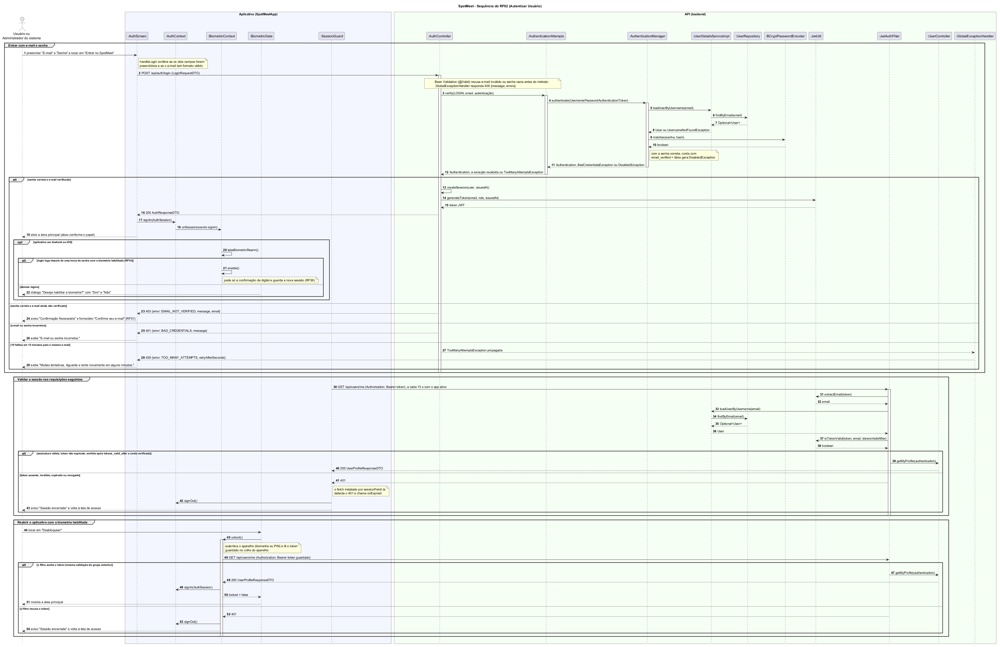

Fonte: próprio autor

#### RF03 – Solicitar Acesso à Organização

| Campo | Descrição |
|---|---|
| Função | Registra o pedido de um usuário autenticado para entrar em uma organização aprovada, a partir da chave de acesso dela, e permite ao usuário aceitar ou recusar os convites de organização que recebeu. |
| Descrição | **Solicitação por chave:** localiza na tabela organizations a organização cuja chave (access_key) corresponde à informada, sem distinção entre maiúsculas e minúsculas e ignorando espaços nas pontas; se duas ou mais organizações tiverem a mesma chave (dado antigo), o pedido é recusado. Com a organização aprovada (approved = true; organização pendente, rejeitada ou bloqueada é recusada) e desde que o usuário não seja o dono nem membro dela, insere em access_requests uma solicitação com status PENDING e requested_at com a data e a hora do pedido. Se o usuário já tem solicitação anterior para a organização (o par user_id e organization_id é único), ela é reaberta: o status volta a PENDING e requested_at é atualizado; se a anterior ainda está PENDING, o pedido é recusado.  **Prévia da chave:** antes do pedido, devolve o nome, a chave e o nome do responsável da organização aprovada que tem a chave, com as mesmas conferências do pedido (chave vazia, inexistente, duplicada, organização não aprovada ou bloqueada); não grava nada.  **Consulta de convites:** lista os convites do usuário em organization_invitations com status PENDING, ainda dentro do prazo (expires_at posterior ao momento da consulta), de organização aprovada e para as quais o usuário ainda não é membro.  **Resposta a convite:** o destinatário aceita ou recusa um convite pendente e dentro do prazo de 24 horas. Ao aceitar, insere em organization_members o vínculo com o cargo MEMBER e, se existir solicitação PENDING dele para a mesma organização, muda-a para APPROVED; o convite passa a ACCEPTED. Ao recusar, o convite passa a REJECTED e nenhum vínculo é criado. Nos dois casos, responded_at recebe o instante da resposta. |
| Entradas | **Solicitação por chave:** a chave de acesso da organização, enviada no parâmetro de consulta accessKey (caminho usado pelo aplicativo); a rota também aceita o corpo AccessRequestDTO {accessKey}, que tem prioridade quando presente. O servidor remove os espaços das pontas (ValidationPatterns.normalizeOrganizationValue). No aplicativo, o campo "Chave da organização" mostra o # fixo e só aceita de 2 a 50 letras, números, "_" ou "-" (validateAccessKey); a chave segue com o prefixo #. A coluna access_key tem até 100 caracteres. O solicitante é identificado pelo e-mail do token JWT.  **Prévia da chave:** a chave, no parâmetro de consulta accessKey, enviada depois que o campo tem formato válido.  **Consulta de convites:** nenhuma entrada além do token.  **Resposta a convite:** identificador do convite (invitationId), na rota, e objeto RespondOrganizationInvitationDTO com accept (booleano obrigatório). O destinatário vem do token. |
| Origem | Usuário com sessão iniciada. |
| Saída | **Solicitação por chave:** HTTP 201 com AccessRequestResponseDTO {id, userId, userName, userEmail, organizationId, organizationName, organizationAccessKey, status: PENDING, requestedAt}. HTTP 400 {message} quando a chave vem vazia (MembershipController). HTTP 404 {message} quando nenhuma organização tem a chave (IllegalArgumentException do serviço, convertida pelo controlador). HTTP 409 {message} (IllegalStateException, convertida pelo controlador) quando a chave corresponde a mais de uma organização, a organização não foi aprovada pelo administrador ou está bloqueada, o usuário é o proprietário ou já é membro, ou já existe solicitação pendente. HTTP 401 sem corpo quando não há sessão válida (filtro de segurança).  **Prévia da chave:** HTTP 200 com OrganizationPreviewDTO {name, accessKey, ownerName}; HTTP 404 {message} quando a chave vem vazia ou nenhuma organização a tem; HTTP 409 {message} quando a chave corresponde a mais de uma organização ou a organização não foi aprovada ou está bloqueada; HTTP 401 sem corpo sem sessão válida.  **Consulta de convites:** HTTP 200 com a lista de OrganizationInvitationResponseDTO {id, organizationId, organizationName, userId, invitedById, invitedByName, status, createdAt, expiresAt, respondedAt}; HTTP 403 quando a conta não existe ou não está verificada; HTTP 500 com mensagem genérica para falha inesperada.  **Resposta a convite:** HTTP 200 com o OrganizationInvitationResponseDTO atualizado; HTTP 400 "Dados do convite inválidos." para corpo ilegível ou identificador não numérico, e HTTP 400 do GlobalExceptionHandler quando accept está ausente; HTTP 403 quando o convite não existe ou não é deste usuário; HTTP 404 quando a organização não existe; HTTP 409 quando o convite já foi respondido, venceu, a organização não está aprovada ou o usuário já é membro (OrganizationInvitationController converte as exceções do serviço). |
| Destino | Usuário, pela tela OrganizationScreen. A solicitação passa a constar na lista de pedidos pendentes da organização (RF04); com a aprovação ou o aceite do convite, a organização passa a constar em "Minhas" (listagem do RF07). |
| Ação | **Solicitação por chave:** o usuário seleciona a aba "Organização" e, dentro dela, a aba interna "Entrar". A tela mostra "Entrar em uma organização" ("Informe a chave e aguarde a aprovação dos responsáveis.") e o campo "Chave da organização". O usuário digita a chave. Quando ela tem formato válido e o usuário para de digitar por 500 ms, o aplicativo envia GET /api/organizations/preview?accessKey=; o método previewOrganization de MembershipController chama previewByKey de MembershipService, que faz as mesmas conferências do pedido (findIdsByAccessKeyIgnoreCase, aprovação) sem bloquear a organização, e a tela mostra um cartão com o nome da organização e "Responsável:" seguido do nome do dono; para chave inexistente ou organização não aprovada, mostra abaixo do campo a mensagem do servidor. Em seguida o usuário toca em "Solicitar acesso". O aplicativo confere a chave (validateAccessKey) e envia POST /api/access-requests?accessKey= seguido da chave com o #. JwtAuthFilter autentica a requisição; o método requestAccess de MembershipController obtém o e-mail do token e chama requestAccess de MembershipService, em uma transação: normaliza a chave, procura as organizações (findIdsByAccessKeyIgnoreCase de OrganizationRepository), bloqueia a organização encontrada (findByIdForUpdate), confere se está aprovada, busca o solicitante (findByEmail de UserRepository), confere se é o proprietário ou já é membro (existsByUserIdAndOrganizationId de OrganizationMemberRepository), consulta pedidos anteriores (findByUserIdAndOrganizationId de AccessRequestRepository), grava o pedido (save) e a auditoria (save de AuditLogRepository). Com a resposta 201, o aplicativo exibe o aviso "Sucesso" ("Solicitação enviada. Aguarde a aprovação dos responsáveis."), repete a mensagem abaixo do campo e limpa o campo; com outro código, exibe abaixo do campo a mensagem devolvida pelo servidor. A chave digitada, o cartão da prévia e as mensagens não permanecem quando o usuário troca de aba interna ou sai da tela.  **Consulta de convites:** ao abrir a aba "Minhas" (e a cada atualização automática, de 15 em 15 segundos), o aplicativo envia GET /api/organization-invitations/mine, junto com a consulta dos convites de comissão (RF11). O método listMine de OrganizationInvitationController chama listMine de OrganizationInvitationService, que valida a conta (findByEmail) e consulta findPendingForRecipient de OrganizationInvitationRepository. Havendo convites, a aba mostra o cartão "Você recebeu convites" com o botão "Ver convites (n)"; a página "Convites" lista, em "CONVITES DE ORGANIZAÇÃO", o nome da organização, "Convite de" seguido do nome de quem convidou e "Válido até" com a data e a hora; sem convites, mostra "Você não tem convites pendentes.".  **Resposta a convite:** na página "Convites", o usuário toca em "Aceitar" ou "Recusar" no convite. O aplicativo envia POST /api/organization-invitations/{invitationId}/respond com {accept}. O método respond de OrganizationInvitationController chama respond de OrganizationInvitationService, em uma transação: valida a conta (findByEmail), confirma que o convite é do usuário (findOrganizationIdForRecipient de OrganizationInvitationRepository), bloqueia a organização (findByIdForUpdate), carrega o convite (findById), confere se está pendente e dentro do prazo e, ao aceitar, confere se a organização está aprovada e se o usuário já é membro; então grava o vínculo (save de OrganizationMemberRepository), aprova a solicitação pendente da mesma organização (findByUserIdAndOrganizationId e save de AccessRequestRepository), grava a auditoria e atualiza o convite (save). O aplicativo exibe "Convite aceito. Você entrou na organização." ou "Convite recusado." e recarrega as organizações e os convites. |
| Pré-condição | **Solicitação por chave:** o usuário está autenticado (RF02) e conhece a chave; existe em organizations uma organização com essa chave e approved = true; o usuário não é o dono (organizations.owner_id) nem tem vínculo em organization_members com ela; não existe solicitação PENDING dele para a mesma organização.  **Consulta de convites:** o usuário está autenticado e a conta está verificada.  **Resposta a convite:** o usuário está autenticado e é o destinatário do convite; o convite está PENDING e expires_at é posterior ao momento da resposta (24 horas após o envio); para aceitar, a organização está aprovada e o usuário ainda não tem vínculo com ela. |
| Pós-condição | **Solicitação por chave:** em caso de sucesso, existe em access_requests uma solicitação PENDING (nova ou reaberta) do usuário para a organização, ACCESS_REQUESTED foi gravada em audit_logs e a solicitação aparece para o dono e o vice em "Solicitações" (RF04); o usuário ainda não é membro. Em caso de falha, nada é gravado e o usuário vê a mensagem abaixo do campo.  **Consulta de convites:** nenhuma alteração; o usuário vê apenas convites vigentes.  **Resposta a convite:** ao aceitar, o usuário passa a ser MEMBER da organização (organization_members), o convite fica ACCEPTED com responded_at, eventual solicitação PENDING fica APPROVED, a auditoria é gravada e a organização aparece em "Minhas". Ao recusar, o convite fica REJECTED com responded_at e nenhum vínculo é criado. Em caso de falha (convite respondido, vencido ou organização não aprovada), nada é alterado e o usuário vê a mensagem. |
| Efeitos colaterais | **Solicitação por chave:** ACCESS_REQUESTED em audit_logs (organização e chave); reabertura de solicitação anterior (APPROVED ou REJECTED) para PENDING com nova data; eventos do syncBus (ORGANIZATIONS_MUTATED, COMMITTEES_MUTATED e ADMIN_ORGS_MUTATED) para atualizar outras telas abertas.  **Consulta de convites:** nenhum.  **Resposta a convite:** ORGANIZATION_INVITATION_ACCEPTED ou ORGANIZATION_INVITATION_REJECTED em audit_logs (convite e organização); aprovação automática da solicitação pendente da mesma organização; eventos do syncBus. |

**Figura 13 – Diagrama de sequência do RF03**

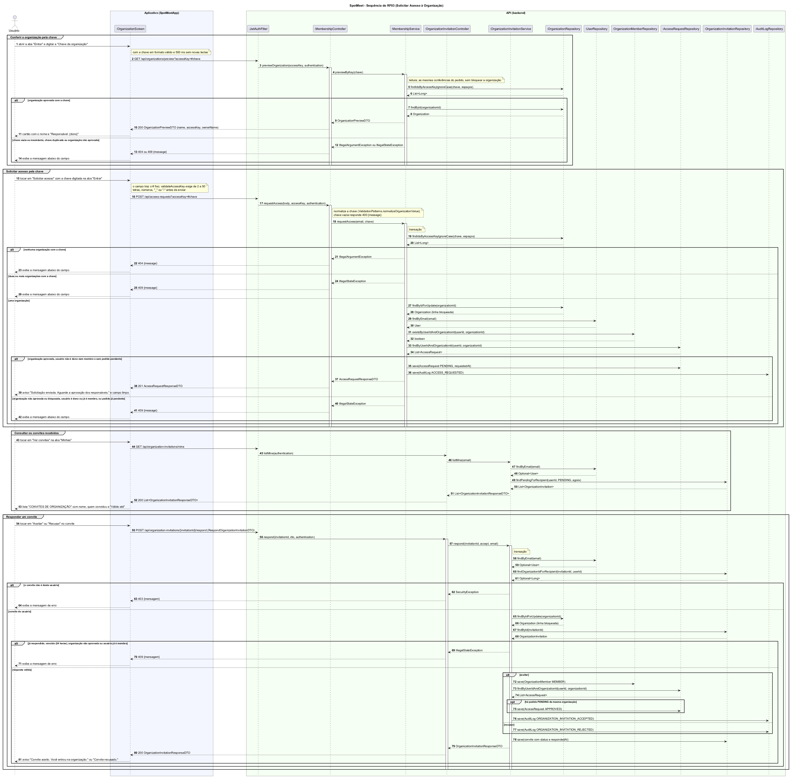

Fonte: próprio autor

#### RF04 – Avaliar Solicitação de Acesso

| Campo | Descrição |
|---|---|
| Função | Permite ao dono ou ao vice-líder da organização consultar as solicitações de acesso pendentes, aprová-las ou rejeitá-las e convidar pessoas já cadastradas para a organização. |
| Descrição | **Consulta:** lista em access_requests as solicitações da organização com status PENDING, com o nome e o e-mail do solicitante.  **Aprovação:** muda para APPROVED o status da solicitação PENDING e, se o solicitante ainda não for membro, insere em organization_members o vínculo com o cargo MEMBER. Só é possível com a organização aprovada pelo administrador do sistema.  **Rejeição:** muda para REJECTED o status da solicitação PENDING; o solicitante pode pedir de novo, e o pedido é reaberto (RF03).  **Convite:** cria em organization_invitations o convite para uma conta cadastrada e verificada, com status PENDING e validade de 24 horas, sem enviar e-mail; se já existe um convite vencido ou respondido do mesmo par organização e usuário, o registro é renovado (um registro por par). O convidado responde pelo aplicativo (RF03).  **Busca de pessoas:** para a folha de convite, lista até 10 contas confirmadas de perfil USER cujo nome ou e-mail contém o termo (mínimo de 3 caracteres; com menos, a lista é vazia), sem o dono, os membros e quem já tem convite pendente dentro do prazo, ordenadas por nome; os curingas do LIKE (%, _ e o caractere de escape) são escapados e nada é gravado.  Todas as operações exigem ser o dono (organizations.owner_id ou cargo ORG_OWNER) ou o vice (cargo ORG_VICE_OWNER) da organização. A API aceita também o perfil global SYSADMIN na consulta, na aprovação e na rejeição (uso direto da API; o aplicativo não oferece essas telas ao administrador), mas não no convite. |
| Entradas | **Consulta:** identificador numérico da organização (organizationId), na rota.  **Aprovação e rejeição:** identificador numérico da solicitação (requestId), na rota, sem corpo.  **Convite:** organizationId, na rota, e objeto OrganizationInvitationRequestDTO com email (obrigatório, formato de ValidationPatterns.EMAIL; o servidor aplica trim e minúsculas). No aplicativo, o campo "Nome ou e-mail da pessoa" (apoio "Digite pelo menos 3 letras") recebe o nome ou o e-mail; ao enviar, só o e-mail completo é aceito ("Escolha uma pessoa da lista ou digite o e-mail completo.").  **Busca de pessoas:** organizationId, na rota, e o termo q, no parâmetro de consulta (aparado; com menos de 3 caracteres a resposta é uma lista vazia).  Em todas as operações, o executor é identificado pelo e-mail do token JWT. |
| Origem | Usuário (dono ou vice-líder da organização). |
| Saída | **Consulta:** HTTP 200 com a lista de AccessRequestResponseDTO {id, userId, userName, userEmail, organizationId, organizationName, organizationAccessKey, status, requestedAt}; HTTP 403 (mensagem em texto) quando o executor não é dono nem vice (SecurityException tratada pelo MembershipController); organização inexistente ou executor sem conta no banco geram HTTP 409, pelo GlobalExceptionHandler.  **Aprovação:** HTTP 200 com AccessRequestResponseDTO com status APPROVED; HTTP 403 quando o executor não é dono nem vice; HTTP 404 quando a solicitação ou a organização não existe; HTTP 409 quando a solicitação não está PENDING ou a organização não está aprovada (mensagens em texto, montadas pelo MembershipController).  **Rejeição:** HTTP 200 com AccessRequestResponseDTO com status REJECTED; HTTP 403, 404 e 409 nas mesmas situações da aprovação, exceto a conferência da aprovação da organização, que a rejeição não faz.  **Convite:** HTTP 201 com OrganizationInvitationResponseDTO {id, organizationId, organizationName, userId, invitedById, invitedByName, status: PENDING, createdAt, expiresAt, respondedAt}; HTTP 400 do GlobalExceptionHandler quando o e-mail é inválido; HTTP 400 "Dados do convite inválidos." quando o corpo é ilegível ou o identificador não é numérico; HTTP 403 quando o executor não é dono nem vice ou a conta dele não está verificada; HTTP 404 quando a organização não existe ou o convidado não tem conta verificada; HTTP 409 quando a organização não está aprovada, o convidado já pertence a ela ou já existe convite pendente dentro do prazo; HTTP 500 "Não foi possível enviar o convite." para falha inesperada (OrganizationInvitationController).  **Busca de pessoas:** HTTP 200 com a lista de InviteCandidateDTO {name, email}, até 10 itens (vazia com termo curto); HTTP 401, 403 (executor sem cargo de dono ou vice), 404 (organização inexistente) e 409 (organização não aprovada) nas mesmas condições do convite; HTTP 500 "Não foi possível buscar as pessoas." para falha inesperada. |
| Destino | Usuário, pela tela OrganizationScreen. O solicitante aprovado passa a ver a organização em "Minhas"; o convidado vê o convite em "Minhas" (RF03). |
| Ação | **Consulta:** o dono ou o vice abre a aba "Organização", a aba interna "Minhas", toca no cartão da organização e, na aba "Gerenciar", toca no atalho "Solicitações", que mostra a contagem de pedidos. Ao abrir a organização, loadDetails envia GET /api/organizations/{organizationId}/access-requests (somente para dono e vice). O método listPendingRequests de MembershipController chama listPendingRequests de MembershipService, que busca o executor (findByEmail), confere a liderança (requireOwnerOrViceOwner, com findById de OrganizationRepository e findByUserIdAndOrganizationId de OrganizationMemberRepository) e consulta findByOrganizationIdAndStatus de AccessRequestRepository. A página "Solicitações" mostra, em "ENTRADA NA ORGANIZAÇÃO", o nome e o e-mail de cada solicitante, com os botões "Rejeitar" e "Aprovar"; sem pedidos, mostra "Nenhuma solicitação pendente para seu papel." (a página também lista os pedidos de ingresso em comissões, RF12).  **Aprovação:** ao tocar em "Aprovar", o aplicativo envia POST /api/access-requests/{requestId}/approve. O método approveAccess de MembershipController chama approveAccess de MembershipService, em uma transação: descobre a organização do pedido (findOrganizationIdById de AccessRequestRepository), bloqueia-a (findByIdForUpdate), carrega o pedido (findById), busca o executor (findByEmail), confere a liderança (requireOwnerOrViceOwner), confere se o pedido está PENDING e se a organização está aprovada, grava APPROVED (save), confere se o solicitante já é membro (existsByUserIdAndOrganizationId) e, se não for, grava o vínculo MEMBER (save de OrganizationMemberRepository) e a auditoria. O aplicativo exibe o aviso "Sucesso" ("Integrante aprovado.") e recarrega os dados.  **Rejeição:** ao tocar em "Rejeitar", o aplicativo envia POST /api/access-requests/{requestId}/reject. O método rejectAccess de MembershipController chama rejectAccess de MembershipService, que faz as mesmas buscas, o mesmo bloqueio e a mesma verificação de liderança, confere se o pedido está PENDING, grava REJECTED (save) e a auditoria. O aplicativo exibe "Solicitação rejeitada." e recarrega os dados.  **Convite:** na aba "Gerenciar", o dono ou o vice toca em "Convidar para organização"; se a organização ainda não está aprovada, o aplicativo exibe o aviso "Organização não aprovada" e não abre a folha (a API também recusa o convite com HTTP 409). Com a organização aprovada, abre a folha "Convidar integrante" ("Procure uma pessoa já cadastrada pelo nome ou e-mail e toque nela. Ela decide se aceita ou recusa em até 24 horas.") com o campo "Nome ou e-mail da pessoa" e os botões "Enviar convite" e "Cancelar". Com três letras ou mais e 400 ms sem novas teclas, o aplicativo envia GET /api/organizations/{organizationId}/invitations/candidates?q=; o método candidates de OrganizationInvitationController chama findCandidates de OrganizationInvitationService, que valida o executor, confere a liderança (requireOwnerOrVice) e a aprovação e consulta findInviteCandidates de UserRepository. A folha lista os resultados em cartões com o nome e o e-mail (ou "Nenhuma pessoa encontrada. Confira o nome ou digite o e-mail completo."); ao tocar em uma pessoa, o campo recebe o e-mail dela. O aplicativo envia POST /api/organizations/{organizationId}/invitations. O método invite de OrganizationInvitationController chama invite de OrganizationInvitationService, em uma transação: valida o executor (findByEmail, conta verificada), bloqueia a organização (findByIdForUpdate), confere a liderança (requireOwnerOrVice), confere se a organização está aprovada, busca o convidado (findByEmail, conta verificada), confere se ele já pertence à organização (existsByUserIdAndOrganizationId), consulta o convite existente (findByOrganizationIdAndUserId de OrganizationInvitationRepository), grava o convite com validade de 24 horas (save) e a auditoria. O aplicativo exibe "Convite enviado. A pessoa tem 24 horas para aceitar ou recusar." e fecha a folha. |
| Pré-condição | **Consulta:** o usuário está autenticado (RF02) e tem o cargo ORG_OWNER ou ORG_VICE_OWNER na organização (ou é o proprietário em organizations.owner_id; a API aceita também SYSADMIN).  **Aprovação:** o mesmo cargo; existe solicitação com status PENDING (RF03) da organização indicada; a organização está aprovada (approved = true).  **Rejeição:** o mesmo cargo; existe solicitação com status PENDING.  **Convite:** o usuário está autenticado, com conta verificada, e é o dono (organizations.owner_id) ou tem o cargo ORG_VICE_OWNER de uma organização aprovada; o convidado tem conta verificada, não é dono nem membro e não tem convite PENDING dentro do prazo. A busca de pessoas exige o mesmo cargo e a mesma organização aprovada. |
| Pós-condição | **Consulta:** nenhuma alteração; o usuário vê as solicitações pendentes ou, sem o cargo exigido, a mensagem de acesso negado.  **Aprovação:** em caso de sucesso, a solicitação fica APPROVED, o solicitante tem vínculo MEMBER em organization_members (se ainda não tinha), ACCESS_APPROVED foi gravada e o pedido sai da lista de pendentes; o aprovado passa a ver a organização em "Minhas". Em caso de falha, nada é alterado e o usuário vê a mensagem.  **Rejeição:** em caso de sucesso, a solicitação fica REJECTED, ACCESS_REJECTED foi gravada e o pedido sai da lista; o solicitante não é membro e pode pedir de novo (RF03). Em caso de falha, nada é alterado e o usuário vê a mensagem.  **Convite:** em caso de sucesso, existe em organization_invitations um convite PENDING do convidado para a organização, com quem convidou, data de criação e expires_at igual à criação mais 24 horas, e ORGANIZATION_INVITATION_SENT foi gravada; o convidado o vê em "Minhas" (RF03). Em caso de falha, nada é gravado e o usuário vê a mensagem na folha. |
| Efeitos colaterais | **Consulta:** nenhum.  **Aprovação:** ACCESS_APPROVED em audit_logs; inserção do vínculo em organization_members; eventos do syncBus (ORGANIZATIONS_MUTATED, COMMITTEES_MUTATED e ADMIN_ORGS_MUTATED) para atualizar outras telas abertas.  **Rejeição:** ACCESS_REJECTED em audit_logs; eventos do syncBus.  **Convite:** ORGANIZATION_INVITATION_SENT em audit_logs (organização e ID do convidado); nenhum e-mail é enviado; se havia convite vencido ou respondido do mesmo par, o registro é reaproveitado, com novo prazo e respondido_at limpo; eventos do syncBus. |

**Figura 14 – Diagrama de sequência do RF04**

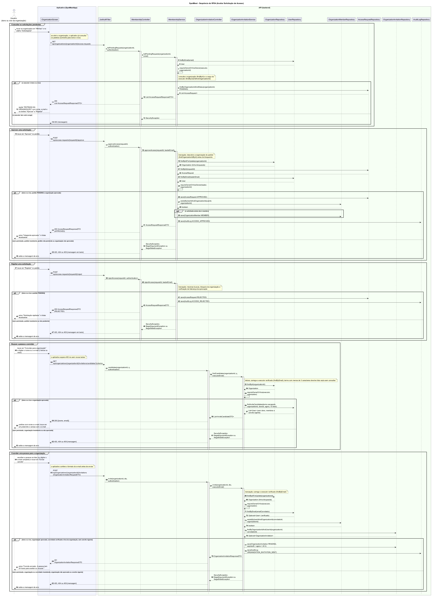

Fonte: próprio autor

#### RF05 – Manter Membros da Organização

| Campo | Descrição |
|---|---|
| Função | Permite consultar os membros de uma organização e, conforme a hierarquia de cargos, promovê-los, rebaixá-los, revogar o seu acesso e transferir a liderança da organização. |
| Descrição | **Consulta:** lista os vínculos da tabela organization_members da organização, com o identificador, o nome, o e-mail e o cargo de cada membro.  **Promoção:** altera em organization_members o cargo de MEMBER para ORG_SUBOWNER (dono ou vice) ou de ORG_SUBOWNER para ORG_VICE_OWNER (somente o dono).  **Rebaixamento:** altera o cargo de ORG_VICE_OWNER para ORG_SUBOWNER (somente o dono) ou de ORG_SUBOWNER para MEMBER (dono ou vice). O cargo do dono (ORG_OWNER) não muda por promoção nem por rebaixamento.  **Revogação:** exclui os vínculos do membro com as comissões da organização (committee_members), as suas solicitações de acesso à organização (access_requests), os seus convites à organização (organization_invitations) e o seu vínculo em organization_members. O subdono remove apenas membros comuns; o vice remove membros comuns e subdonos; o dono remove qualquer integrante; ninguém remove o dono nem a si mesmo; o membro comum não remove ninguém.  **Transferência de liderança:** na mesma transação, o vínculo do dono atual passa a MEMBER, o do integrante escolhido passa a ORG_OWNER e organizations.owner_id passa a apontar para ele. O destino pode ser qualquer integrante atual da mesma organização (membro, subdono ou vice).  O perfil global SYSADMIN é aceito pela API com as permissões de dono em todas as operações (o aplicativo não oferece essas telas ao administrador); o perfil ADMIN não tem essa exceção. |
| Entradas | **Consulta:** identificador numérico da organização (organizationId), na rota.  **Promoção e rebaixamento:** organizationId e userId do membro alvo, na rota, sem corpo.  **Revogação:** organizationId e memberId (o userId do alvo), na rota.  **Transferência:** organizationId e userId do novo dono, na rota, sem corpo; o dono atual é lido do banco, não da requisição.  Em todas as operações, o executor é identificado pelo e-mail do token JWT. |
| Origem | Usuário (líder da organização; a consulta é aceita pela API para qualquer integrante). |
| Saída | **Consulta:** HTTP 200 com a lista de MemberDTO {userId, name, email, role} (classe interna de OrganizationResponseDTO); HTTP 403 (mensagem em texto) quando o executor não é membro.  **Promoção e rebaixamento:** HTTP 200 com MemberDTO com o novo cargo; HTTP 403 (texto) sem permissão; HTTP 404 (texto) quando a organização, o usuário ou o vínculo do alvo não existe; HTTP 409 (texto) quando o alvo é o dono, já está no cargo máximo (vice) ou já é membro comum.  **Revogação:** HTTP 200 com o texto "Acesso revogado com sucesso."; HTTP 400 (texto) quando o executor tenta remover a si mesmo ou o dono, ou quando a organização ou o vínculo do alvo não existe; HTTP 403 (texto) quando o executor não pertence à organização ou a hierarquia não permite a remoção.  **Transferência:** HTTP 200 com OrganizationLeadershipResponseDTO {organizationId, previousOwnerId, ownerId, previousOwnerRole: MEMBER, ownerRole: ORG_OWNER}; HTTP 400 para identificadores inválidos; HTTP 403 quando o executor não é o dono atual nem SYSADMIN; HTTP 404 quando a organização ou o vínculo do destino não existe; HTTP 409 quando a organização não está aprovada, quando o destino já é o dono ou quando a liderança está inconsistente; HTTP 500 "Não foi possível transferir a liderança." para falha inesperada. |
| Destino | Usuário, pela tela OrganizationScreen. O membro afetado vê o novo cargo, ou deixa de ver a organização, na próxima atualização de "Minhas" (a cada 15 segundos). |
| Ação | **Consulta:** na aba "Gerenciar" (visível ao dono, ao vice e ao subdono), o usuário toca no atalho "Membros". Se a organização ainda não está aprovada, o aplicativo exibe o aviso "Organização não aprovada" e não abre a página. Com a organização aprovada, o aplicativo envia GET /api/organizations/{organizationId}/members; listMembers de MembershipController chama listMembers de MembershipService, que busca o executor (findByEmail), confere o vínculo (requireOrganizationMember) e consulta findByOrganizationId de OrganizationMemberRepository. A página "Membros" mostra o campo "Buscar membro" (nome ou e-mail), os filtros "Todos", "Dono", "Vice-líder", "Subdono" e "Membro" e um cartão por integrante, com nome, e-mail e cargo.  **Promoção e rebaixamento:** o usuário toca no cartão do integrante, abre a folha com o nome dele e toca em "Elevar papel" ou "Rebaixar papel" (mostrados só quando a hierarquia permite); o diálogo "Alterar papel" ("Alterar o papel de" seguido do nome e "para" o novo cargo) pede a confirmação em "Elevar" ou "Rebaixar". O aplicativo envia POST /api/organizations/{organizationId}/members/{userId}/promote ou /demote; promoteMember ou demoteMember de MembershipController chama o método de mesmo nome de MembershipService, em uma transação: busca o executor (findByEmail), bloqueia a organização (findByIdForUpdate), busca o alvo (findById de UserRepository) e o seu vínculo (findByUserIdAndOrganizationId), recusa se o alvo é o dono, confere a permissão (requireOwnerOrViceOwner ou requireOwner, conforme o cargo atual do alvo), grava o novo cargo (save) e a auditoria. O aplicativo exibe "Sucesso" ("Papel atualizado.") e recarrega os dados.  **Revogação:** o usuário toca em "Remover integrante" na folha do integrante (mostrado só quando a hierarquia permite) e confirma o diálogo "Remover integrante" ("Remover" o nome "desta organização e de suas comissões?") no botão "Remover". O aplicativo envia DELETE /api/organizations/{organizationId}/members/{memberId}; revokeAccess de MembershipController chama revokeAccess de MembershipService, em uma transação: busca o executor, recusa a remoção de si mesmo, bloqueia a organização, recusa a remoção do dono, busca o vínculo do alvo e o cargo do executor, aplica as regras de hierarquia, exclui os vínculos do membro com as comissões da organização (findByUserIdAndCommitteeOrganizationId e deleteAll de CommitteeMemberRepository), as suas solicitações de acesso (findByUserIdAndOrganizationId e deleteAll de AccessRequestRepository), os seus convites (deleteByOrganizationIdAndUserId de OrganizationInvitationRepository) e o vínculo (delete de OrganizationMemberRepository), e grava a auditoria. O aplicativo exibe "Integrante removido." e recarrega os dados.  **Transferência:** na aba "Gerenciar", o dono toca em "Transferir liderança", exibido somente quando a organização está aprovada; a folha lista os demais integrantes, cada um com o botão "Transferir"; o usuário toca no escolhido e confirma o diálogo "Transferir liderança" ("Você passará a ser membro comum e perderá os poderes de dono.") no botão "Transferir". O aplicativo envia POST /api/organizations/{organizationId}/members/{userId}/make-owner; o método transfer de OrganizationLeadershipController chama transferLeadership de MembershipService, em uma transação: busca o executor, bloqueia a organização, confere que o executor é o dono em organizations.owner_id (ou SYSADMIN), que a organização está aprovada, que existe exatamente um vínculo ORG_OWNER (findByOrganizationIdAndRole) e que ele corresponde a owner_id, busca o vínculo do destino (findByUserIdAndOrganizationId), grava os dois vínculos (save) e a organização com o novo dono (save de OrganizationRepository) e registra a auditoria. O aplicativo exibe "Liderança transferida. Seu papel agora é membro." e leva o usuário à aba de comissões. |
| Pré-condição | **Consulta:** o usuário está autenticado (RF02) e tem vínculo com a organização; o aplicativo oferece a tela a dono, vice e subdono.  **Promoção:** ser ORG_OWNER ou ORG_VICE_OWNER para promover MEMBER; ser ORG_OWNER para promover ORG_SUBOWNER; o alvo é integrante da organização e não é o dono.  **Rebaixamento:** ser ORG_OWNER para rebaixar ORG_VICE_OWNER; ser ORG_OWNER ou ORG_VICE_OWNER para rebaixar ORG_SUBOWNER; o alvo é integrante da organização, não é o dono nem MEMBER.  **Revogação:** ser ORG_OWNER (remove qualquer integrante, menos a si mesmo), ORG_VICE_OWNER (remove MEMBER e ORG_SUBOWNER) ou ORG_SUBOWNER (remove MEMBER); o alvo é integrante da organização, diferente do executor e do dono.  **Transferência:** o executor é o dono atual (organizations.owner_id), existe um único vínculo ORG_OWNER coerente com owner_id e o destino é outro integrante da mesma organização; a organização deve estar aprovada (approved igual a true). |
| Pós-condição | **Consulta:** nenhuma alteração; o usuário vê a lista de integrantes.  **Promoção e rebaixamento:** em caso de sucesso, o vínculo do alvo tem o novo cargo, a auditoria foi gravada e a lista mostra o cargo atualizado; o novo cargo vale na próxima requisição do alvo, porque os poderes são lidos do banco. Em caso de falha, nada é alterado e o usuário vê a mensagem.  **Revogação:** em caso de sucesso, o alvo não tem mais vínculo com a organização nem com as comissões dela, e as suas solicitações e convites nela foram excluídos; ACCESS_REVOKED foi gravada e ele deixa de ver a organização em "Minhas". Em caso de falha, nada é removido (a transação é desfeita) e o usuário vê a mensagem.  **Transferência:** em caso de sucesso, o destino é o dono (cargo ORG_OWNER e owner_id), o antigo dono é MEMBER e perde as permissões de líder, ORGANIZATION_LEADER_CHANGED foi gravada; aprovação, estado, nome, chave, comissões e convites da organização continuam como estavam. Em caso de falha, nada é alterado e o usuário vê a mensagem. |
| Efeitos colaterais | **Consulta:** nenhum.  **Promoção:** ROLE_PROMOTED_SUBOWNER ou ROLE_PROMOTED_VICE_OWNER em audit_logs.  **Rebaixamento:** ROLE_DEMOTED_SUBOWNER ou ROLE_DEMOTED_MEMBER em audit_logs.  **Revogação:** ACCESS_REVOKED em audit_logs (ID do membro, cargo e organização); exclusão dos vínculos do membro com as comissões da organização, das suas solicitações de acesso e dos seus convites a ela.  **Transferência:** ORGANIZATION_LEADER_CHANGED em audit_logs (organização, dono anterior e novo dono).  Nas operações que alteram dados, eventos do syncBus atualizam as outras telas abertas.  **Incremento 2:** se o membro removido era o presidente de uma comissão, o vínculo com a comissão é apagado e, com ele, o papel de presidente (RF24); as reuniões já agendadas continuam, e só um novo presidente poderá editá-las ou cancelá-las. |

**Figura 15 – Diagrama de sequência do RF05**

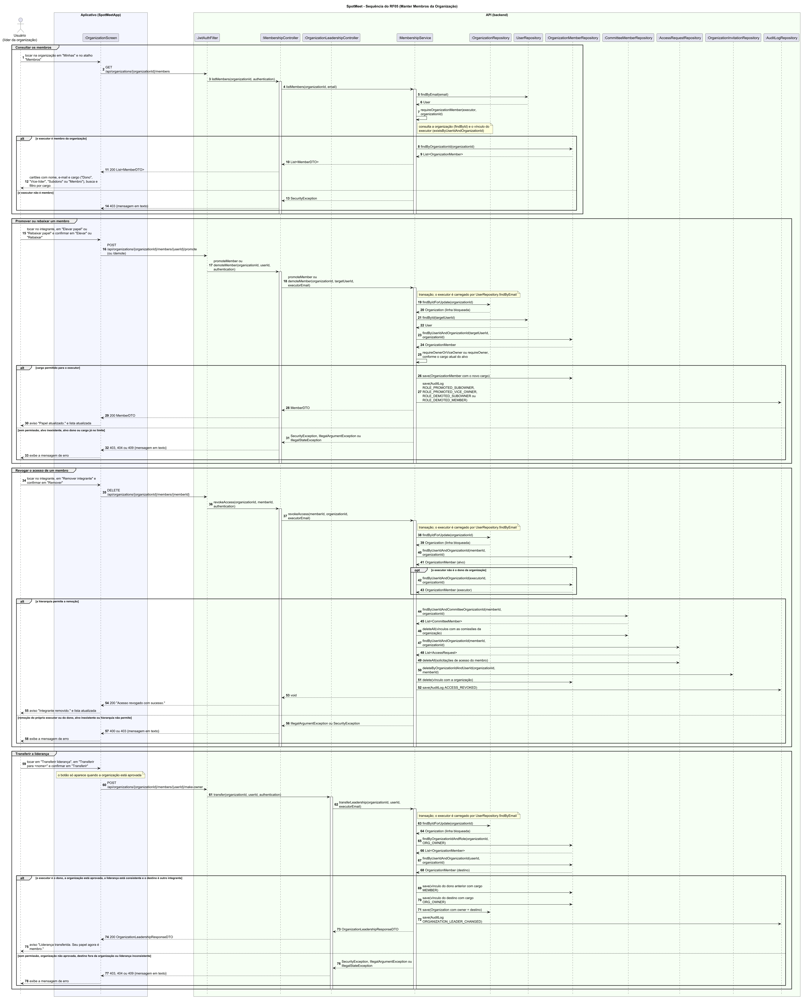

Fonte: próprio autor

#### RF06 – Cadastrar Organização

| Campo | Descrição |
|---|---|
| Função | Cadastra uma nova organização, que fica pendente de aprovação do administrador do sistema, e torna dono dela o usuário que a cadastrou. |
| Descrição | Insere na tabela organizations uma organização contendo o nome, a chave de acesso e, opcionalmente, o CNPJ, com approved igual a false, status PENDING e moderation_reason nulo. O usuário autenticado, identificado pelo e-mail do token JWT e nunca pelo corpo da requisição, é gravado em owner_id e registrado na tabela organization_members com o papel ORG_OWNER. O nome e a chave são únicos em todo o sistema, em qualquer estado da organização, sem diferenciar maiúsculas de minúsculas nem espaços extras; o CNPJ, quando informado, é único pelo valor exato. A conferência de unicidade e a gravação ocorrem na mesma transação, com a tabela organizations travada até o fim dela. Enquanto não for aprovada (RF08), a organização não aceita solicitações de acesso (RF03), convites de organização nem comissões (RF09). |
| Entradas | Objeto do tipo OrganizationRequestDTO contendo: name, string obrigatória (@NotBlank) de até 255 caracteres (@Size), com os espaços das pontas removidos e as sequências de espaços internos reduzidas a um espaço antes da validação (normalizeOrganizationName de ValidationPatterns); accessKey, string obrigatória (@NotBlank) no formato `^#[A-Za-z0-9_\-]{2,50}$` (@Pattern), isto é, "#" seguido de 2 a 50 letras ASCII, números, "_" ou "-", sem espaços internos, com os espaços das pontas removidos antes da validação e a caixa preservada na gravação (coluna access_key, única, de 100 caracteres); cnpj, string opcional de até 255 caracteres (@Size), com os espaços das pontas removidos, sem validação de formato, e que, em branco, é gravada como nula. Campos desconhecidos, como approved, status e owner, são ignorados. O e-mail do dono vem do token JWT.  **No aplicativo:** na aba "Criar" da tela OrganizationScreen, os campos "Nome da organização" (obrigatório, com as mensagens "Informe o nome da organização." e "Use até 255 caracteres.") e "Chave de acesso" (obrigatório; o "#" é fixo e acrescentado automaticamente; mensagem "Use de 2 a 50 letras, números, '_' ou '-'. O # é automático."). O aplicativo não tem campo para o CNPJ. |
| Origem | Usuário. |
| Saída | **Sucesso:** resposta HTTP 201 com um objeto do tipo OrganizationResponseDTO contendo id, name, accessKey, ownerId, ownerName, createdAt, approved (false), status ("PENDING") e moderationReason (nulo), sem o CNPJ.  **Erros:** HTTP 400, gerado pelo GlobalExceptionHandler (MethodArgumentNotValidException) antes de o controlador ser chamado, com status, error, message (a primeira mensagem de erro) e errors (campo e mensagem); HTTP 409, gerado pelo próprio OrganizationController, com a mensagem em texto, quando o nome ("Já existe uma organização com esse nome. Escolha outro nome."), a chave ("Já existe uma organização com essa chave de acesso. Escolha outra chave.") ou o CNPJ ("Já existe uma organização com esse CNPJ.") pertence a outra organização; HTTP 409, gerado pelo GlobalExceptionHandler, quando a conta do token não existe mais ("Usuário autenticado não encontrado."); HTTP 401, sem corpo, gerado pelo SecurityConfig quando o token está ausente, expirado ou revogado; HTTP 500 com "Erro interno no servidor." para falhas inesperadas. |
| Destino | Usuário, por meio da tela OrganizationScreen; banco de dados (tabelas organizations, organization_members e audit_logs). |
| Ação | O usuário seleciona a aba "Organização" da barra inferior, que exibe a tela OrganizationScreen (título "Organizações"), e, nela, a aba interna "Criar". O sistema exibe os campos "Nome da organização" e "Chave de acesso" (com o prefixo "#" fixo), a dica "Nome e chave são únicos. Maiúsculas, minúsculas e espaços extras não tornam o nome diferente." e o quadro "Em análise pelo administrador". Ao tocar no botão "Criar organização", o aplicativo executa validateOrganizationName e validateAccessKey (organizationForms); se algum campo for inválido, exibe a mensagem sob o campo e não envia nada. Estando os campos válidos, normaliza os valores (normalizeOrganizationName e normalizeAccessKey) e envia a requisição POST /api/organizations com name e accessKey. A requisição passa pelo JwtAuthFilter, que valida o token e carrega a conta, e o Spring MVC valida o OrganizationRequestDTO (@Valid). O método createOrganization(dto, authentication) da classe OrganizationController chama o método createOrganization(ownerEmail, dto) da classe OrganizationService, em transação com isolamento READ_COMMITTED, que normaliza nome, chave e CNPJ (ValidationPatterns), localiza o dono por findByEmail (UserRepository), trava a tabela por lockForUniquenessCheck (OrganizationRepository, LOCK TABLE organizations IN SHARE ROW EXCLUSIVE MODE), confere a disponibilidade em checkAvailability (existsByNormalizedName, existsByNormalizedAccessKey e, havendo CNPJ, existsByCnpjExcludingId), grava a organização por save, grava o vínculo ORG_OWNER por save de OrganizationMemberRepository, registra a auditoria por save de AuditLogRepository e monta a resposta por OrganizationResponseDTO.forViewer. O controlador responde 201. A tela limpa o formulário, volta à aba "Minhas", exibe o aviso "Sucesso" com o texto "Organização criada. Aguarde a avaliação do administrador do sistema." e recarrega a lista (RF07), na qual a organização aparece com os selos "Pendente" e "Dono". Em caso de erro, a mensagem recebida aparece abaixo do formulário (no erro 400, sob o campo correspondente) e os dados digitados são mantidos. Toques repetidos enquanto a requisição está em andamento são ignorados. |
| Pré-condição | O usuário deve estar autenticado: token JWT não expirado nem revogado, de uma conta com e-mail verificado (RF01 e RF02). O nome e a chave informados não podem coincidir, ignorando maiúsculas e espaços extras, com os de nenhuma organização existente, e o CNPJ, quando informado, não pode pertencer a outra organização. A API não limita o número de organizações por usuário nem o perfil global; o aplicativo oferece a tela apenas aos usuários com perfil USER. |
| Pós-condição | **Sucesso:** existem uma nova linha em organizations (approved igual a false, status PENDING, owner_id do usuário), uma linha em organization_members (ORG_OWNER) e uma em audit_logs; o usuário vê a organização em "Minhas" com os selos "Pendente" e "Dono", e a organização só passa a receber integrantes e comissões depois de aprovada (RF08).  **Falha:** nenhuma linha é gravada (a transação é desfeita); a tela exibe a mensagem do erro e mantém os dados digitados; se o servidor responder 401, o SessionGuard encerra a sessão e exibe "Sessão encerrada". |
| Efeitos colaterais | Registro em audit_logs com a ação ORGANIZATION_CREATED, contendo o nome, a chave e o identificador da organização. Inserção em organization_members com o papel ORG_OWNER. Bloqueio da tabela organizations até o fim da transação: outras criações e edições de organizações esperam. Atualização das telas do mesmo aparelho pelo syncBus (ORGANIZATIONS_MUTATED, COMMITTEES_MUTATED e ADMIN_ORGS_MUTATED); os demais aparelhos recebem a organização na próxima leitura periódica (15 segundos). A organização passa a constar na fila "Aprovações" do administrador (RF08). Nenhum e-mail é enviado. |

**Figura 16 – Diagrama de sequência do RF06**

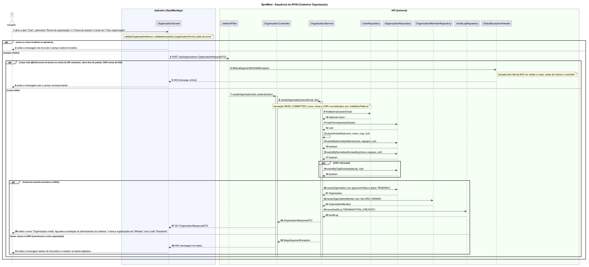

Fonte: próprio autor

#### RF07 – Manter Organização

| Campo | Descrição |
|---|---|
| Função | **Pesquisa:** lista as organizações às quais o usuário está vinculado.  **Atualização:** altera o nome e a chave de acesso de uma organização.  **Exclusão:** remove permanentemente uma organização e os dados vinculados a ela.  **Transferência de liderança:** passa o papel de dono da organização para outro integrante.  **Reavaliação:** reenvia ao administrador do sistema, uma única vez, uma organização recusada, com a justificativa do dono. |
| Descrição | **Pesquisa:** consulta na tabela organization_members os vínculos do usuário autenticado e devolve a organização de cada vínculo com o papel do usuário (myRole: ORG_OWNER, ORG_VICE_OWNER, ORG_SUBOWNER ou MEMBER), o estado (approved e status), se a reavaliação já foi usada (resubmitted) e, somente ao dono atual e aos perfis ADMIN e SYSADMIN, o motivo da recusa ou do bloqueio (moderationReason). Organizações pendentes, recusadas e bloqueadas também são listadas aos seus integrantes.  **Atualização:** atualiza na tabela organizations as colunas name, access_key e cnpj da organização indicada. Os campos approved, status, moderation_reason e owner_id não são alterados por esta operação, e o aplicativo não envia o CNPJ: quando o cnpj chega nulo, o valor gravado é mantido; em branco, é apagado. Nome, chave e CNPJ continuam únicos em relação às outras organizações (a própria organização é excluída da conferência, o que permite mudar só a caixa do valor). A chave anterior deixa de localizar a organização nas novas solicitações de acesso (RF03). A conferência de unicidade e a gravação ocorrem na mesma transação, com a tabela organizations travada.  **Exclusão:** em uma única transação, exclui por código e nesta ordem os registros de organization_invitations, de committee_members e de committees da organização, de access_requests e de organization_members, e por fim a própria organização. As contas dos usuários e os registros de audit_logs permanecem. As reuniões das comissões e seus participantes (Incremento 2) são removidos pelo banco, pelo mapeamento ON DELETE CASCADE de Meeting e MeetingParticipant.  **Transferência de liderança:** altera para ORG_OWNER o papel do integrante escolhido na tabela organization_members, aponta organizations.owner_id para ele e rebaixa o antigo dono para MEMBER, na mesma transação. O perfil global das contas, o estado de aprovação, o nome e a chave da organização não mudam. Como o motivo de moderação só é exibido ao dono atual, quem consulta o motivo passa a ser o novo dono. Só é possível em organização aprovada (approved igual a true).  **Reavaliação:** em uma organização com status REJECTED e resubmitted_at nulo, grava na tabela organizations status PENDING, approved igual a false, a justificativa em resubmission_note (500 caracteres) e a data e a hora do pedido em resubmitted_at. O motivo da recusa (moderation_reason) é mantido para que o administrador o compare com a justificativa. Como resubmitted_at não volta a ser nulo, a reavaliação só pode ser pedida uma vez: se a organização for recusada de novo, só resta excluí-la (Exclusão) e cadastrar outra (RF06). Nome e chave são corrigidos antes, pela Atualização. |
| Entradas | **Pesquisa:** nenhuma entrada além do token JWT, do qual é obtido o e-mail do usuário.  **Atualização:** identificador organizationId (Long) na rota e objeto do tipo OrganizationRequestDTO com name, accessKey e cnpj, com as mesmas restrições e a mesma normalização do RF06; o aplicativo envia apenas name e accessKey. No aplicativo, os campos "Nome da organização" e "Chave de acesso" da folha "Editar organização", preenchidos com os valores atuais e com as mesmas regras e mensagens do RF06.  **Exclusão:** identificador organizationId (Long) na rota.  **Transferência de liderança:** identificadores organizationId e userId (Long) na rota, sem corpo; userId é o integrante que será o novo dono, escolhido na lista de integrantes (RF05) entre todos, exceto o dono atual.  **Reavaliação:** identificador organizationId (Long) na rota e objeto do tipo OrganizationResubmitDTO contendo justification, string obrigatória (@NotBlank) de 3 a 500 caracteres (@Size), com os espaços das pontas removidos; o serviço recusa ainda caracteres de controle, exceto tabulação e quebra de linha. No aplicativo, o campo "Justificativa" da folha "Reenviar para avaliação" (obrigatório, com a mensagem "Escreva de 3 a 500 caracteres."). |
| Origem | Usuário. Na transferência, também o Administrador do sistema com perfil SYSADMIN. |
| Saída | **Pesquisa:** resposta HTTP 200 com a lista de objetos do tipo OrganizationResponseDTO (id, name, accessKey, ownerId, ownerName, createdAt, myRole, approved, status, moderationReason e resubmitted), sem o CNPJ; HTTP 409 (GlobalExceptionHandler) quando a conta do token não existe mais.  **Atualização:** resposta HTTP 200 com o OrganizationResponseDTO atualizado. Erros: HTTP 400 (GlobalExceptionHandler, MethodArgumentNotValidException), com status, error, message e errors; HTTP 403 (GlobalExceptionHandler, SecurityException) com "Acesso negado. Você não pertence a esta organização." ou "Acesso negado. Apenas o Dono ou Vice-Líder pode editar a organização."; HTTP 409, gerado pelo OrganizationController e com a mensagem em texto, quando o nome, a chave ou o CNPJ pertence a outra organização ou quando a organização não existe ("Organização não encontrada.").  **Exclusão:** resposta HTTP 200 com o texto "Organização excluída com sucesso.". Erros, todos gerados pelo GlobalExceptionHandler: HTTP 403 com "Acesso negado. Você não pertence a esta organização." ou "Acesso negado. Apenas o Dono ou Vice-Líder pode apagar toda a organização."; HTTP 409 com "Organização não encontrada.".  **Transferência de liderança:** resposta HTTP 200 com um objeto do tipo OrganizationLeadershipResponseDTO (organizationId, previousOwnerId, ownerId, previousOwnerRole igual a MEMBER e ownerRole igual a ORG_OWNER). Erros, todos gerados pelo OrganizationLeadershipController: HTTP 400 quando os identificadores não são numéricos ou não são positivos; HTTP 403 quando o executor não é o dono nem SYSADMIN ("Acesso negado. Somente o dono ou o SysAdmin pode transferir a liderança."); HTTP 404 quando a organização não existe ou o destino não pertence a ela; HTTP 409 quando a organização não está aprovada ("A liderança só pode ser transferida depois que a organização for aprovada."), quando o destino já é o dono ou quando a liderança gravada está inconsistente (sem vínculo ORG_OWNER único correspondente a owner_id); HTTP 500 com "Não foi possível transferir a liderança.".  **Reavaliação:** resposta HTTP 200 com o OrganizationResponseDTO (status "PENDING" e resubmitted igual a true). Erros, todos gerados pelo GlobalExceptionHandler: HTTP 400 (MethodArgumentNotValidException, com errors.justification: "Informe a justificativa do reenvio." ou "A justificativa deve ter de 3 a 500 caracteres."); HTTP 403 com "Somente o dono da organização pode pedir a reavaliação."; HTTP 409 com "Somente uma organização recusada pode ser reenviada para avaliação.", "A reavaliação desta organização já foi usada. Exclua a organização e crie outra, se necessário.", "Informe uma justificativa de 3 a 500 caracteres, sem caracteres de controle." ou "Organização não encontrada.".  Em todas as operações, HTTP 401 sem corpo (SecurityConfig) quando o token está ausente, expirado ou revogado. |
| Destino | Usuário, por meio da tela OrganizationScreen e, na transferência feita pelo administrador, da tela AdminOrganizationsScreen; banco de dados (tabelas organizations, organization_members, organization_invitations, committees, committee_members, access_requests e audit_logs). |
| Ação | **Pesquisa:** ao receber o foco, e a cada 15 segundos enquanto a tela está em foco e sem formulário, janela ou operação em andamento, a tela OrganizationScreen (aba "Organização" da barra inferior) envia a requisição GET /api/organizations/mine; o gesto de puxar a lista e o botão de atualizar do cabeçalho fazem a leitura na hora. O método listMyOrganizations(authentication) da classe OrganizationController chama o método listMyOrganizations(userEmail) da classe OrganizationService, que localiza o usuário por findByEmail (UserRepository), obtém os vínculos por findByUserId (OrganizationMemberRepository) e monta um OrganizationResponseDTO.forViewer por vínculo, preenchendo myRole. A tela exibe a seção "SUAS ORGANIZAÇÕES" da aba "Minhas", com o campo "Buscar organização" (filtro local por nome, chave ou responsável); cada cartão mostra o nome, a chave, o selo de estado (Aprovada, Pendente, Rejeitada ou Bloqueada) e o selo de papel (Dono, Vice-líder, Subdono ou Membro). Para o dono de uma organização rejeitada ou bloqueada, o cartão mostra também "Motivo:" com o texto gravado, e a visão geral da aba "Gerenciar" repete o texto abaixo do estado, com o título "Motivo da recusa" (ou "Motivo do bloqueio"). Tocar no cartão seleciona a organização e abre a aba "Gerenciar" (dono, vice-líder e subdono) ou "Comissões" (membro).  **Atualização:** na aba "Gerenciar", com a organização selecionada, o dono ou o vice-líder toca no botão "Editar organização". O sistema abre a folha "Editar organização" com os campos "Nome da organização" e "Chave de acesso" preenchidos e a dica "O # é automático. Maiúsculas e minúsculas são equivalentes. Ao alterar, a chave anterior deixa de valer para novos pedidos.". Ao tocar no botão "Salvar alterações", o aplicativo executa as validações do RF06 e envia a requisição PUT /api/organizations/{organizationId} com name e accessKey. Depois da validação @Valid, o método updateOrganization(organizationId, dto, authentication) da classe OrganizationController chama o método updateOrganization(organizationId, executorEmail, dto) da classe OrganizationService, em transação com isolamento READ_COMMITTED, que localiza o executor por findByEmail, trava a tabela por lockForUniquenessCheck, carrega a organização com bloqueio de linha por findByIdForUpdate, confere a permissão em requireOwnerOrViceOwner (perfil SYSADMIN, dono registrado em owner_id ou vínculo ORG_OWNER ou ORG_VICE_OWNER obtido por findByUserIdAndOrganizationId), normaliza os valores (o CNPJ nulo mantém o gravado), confere a disponibilidade em checkAvailability, excluindo a própria organização (existsByNormalizedName, existsByNormalizedAccessKey e existsByCnpjExcludingId), grava por save e registra a auditoria. Com a resposta 200, a tela fecha a folha, exibe o aviso "Sucesso" com o texto "Organização atualizada. Uma chave alterada passa a valer para novas solicitações." e recarrega a lista. Em caso de erro, a mensagem aparece abaixo do formulário.  **Exclusão:** na aba "Gerenciar", o dono ou o vice-líder toca no botão "Excluir organização". A janela de confirmação (ConfirmationHost), com o título "Excluir organização", informa "Excluir {nome}? A ação é permanente e apaga as comissões, vínculos, convites e solicitações desta organização. As contas dos usuários permanecem." e, ao tocar em "Excluir", o aplicativo envia a requisição DELETE /api/organizations/{organizationId}. O método deleteOrganization(organizationId, authentication) da classe OrganizationController chama o método deleteOrganization(organizationId, executorEmail) da classe OrganizationService, em transação, que localiza o executor por findByEmail, carrega a organização com bloqueio por findByIdForUpdate, confere a permissão (SYSADMIN, dono registrado em owner_id ou vínculo ORG_OWNER ou ORG_VICE_OWNER obtido por findByUserIdAndOrganizationId) e então exclui os convites (deleteByOrganizationId de OrganizationInvitationRepository); para cada comissão obtida por findByOrganizationIdOrderByNameAsc (CommitteeRepository), os vínculos (findByCommitteeId e deleteAll de CommitteeMemberRepository) e em seguida as comissões (deleteAll); as solicitações de acesso (findByOrganizationId e deleteAll de AccessRequestRepository); os integrantes (findByOrganizationId e deleteAll de OrganizationMemberRepository); a organização (delete de OrganizationRepository). Por último registra a auditoria. A tela exibe o aviso "Sucesso" com o texto "Organização excluída.", limpa a seleção e volta à aba "Minhas".  **Transferência de liderança:** na aba "Gerenciar", o dono toca no botão "Transferir liderança", exibido somente quando a organização está aprovada. A folha "Transferir liderança" exibe "Escolha um integrante atual. Depois da transferência, você será membro comum." e a lista dos integrantes (lida pelo RF05), sem o dono atual, cada um com o botão "Transferir". Ao tocar nele, a janela de confirmação "Transferir liderança" informa "Transferir a liderança de {organização} para {integrante}? Você passará a ser membro comum e perderá os poderes de dono." e, ao tocar em "Transferir", o aplicativo envia a requisição POST /api/organizations/{organizationId}/members/{userId}/make-owner, sem corpo. O método transfer(organizationId, userId, authentication) da classe OrganizationLeadershipController chama o método transferLeadership(organizationId, userId, executorEmail) da classe MembershipService, em transação, que localiza o executor por findByEmail, carrega a organização com bloqueio por findByIdForUpdate, confere que o executor é o dono registrado em owner_id ou SYSADMIN, lê os vínculos ORG_OWNER por findByOrganizationIdAndRole e confere que há um só e que corresponde a owner_id, lê o vínculo do destino por findByUserIdAndOrganizationId, troca os papéis, grava os dois vínculos por save de OrganizationMemberRepository e a organização por save de OrganizationRepository, e registra a auditoria. Com a resposta 200, a tela exibe o aviso "Sucesso" com o texto "Liderança transferida. Seu papel agora é membro.", recarrega os papéis e abre a aba "Comissões".  **Transferência pelo administrador:** na aba "Organizações" da tela AdminOrganizationsScreen, o SYSADMIN (ou o dono atual da organização) abre os "Detalhes da organização", toca em "Transferir liderança" (exibido somente para organização aprovada com mais de um integrante; nos demais casos a janela explica "A liderança só pode ser transferida depois que a organização for aprovada." ou "A organização tem apenas o dono. A liderança pode ser transferida quando houver outro integrante.") e escolhe o integrante em "Transferir para {nome}". A janela de confirmação informa "Transferir a liderança de {organização} para {integrante}? O antigo dono será membro comum. O papel global da conta e o estado da organização serão preservados." e, ao tocar em "Transferir", a tela envia a mesma requisição e confere se a resposta traz organizationId, ownerId, previousOwnerRole igual a MEMBER e ownerRole igual a ORG_OWNER; em seguida exibe "Liderança transferida. O antigo dono passou a ser membro comum.".  **Reavaliação:** na aba "Gerenciar" de uma organização recusada, o dono vê o botão "Reenviar para avaliação" ou, se a reavaliação já foi usada, o texto "A reavaliação desta organização já foi usada. Para tentar de novo, exclua a organização e crie outra.". O botão abre a folha "Reenviar para avaliação", com "Motivo da recusa: {motivo}", a orientação "Corrija o que foi apontado (em Editar organização) e explique a correção. A reavaliação pode ser pedida uma única vez: se a organização for recusada de novo, só restará excluí-la." e o campo "Justificativa". Ao tocar no botão "Reenviar para avaliação", o aplicativo valida o campo e envia a requisição POST /api/organizations/{organizationId}/resubmit com justification. Depois da validação @Valid, o método resubmitOrganization(organizationId, body, authentication) da classe OrganizationController chama o método resubmitOrganization(organizationId, executorEmail, justification) da classe OrganizationService, em transação, que localiza o executor por findByEmail, carrega a organização com bloqueio por findByIdForUpdate, confere que o executor é o dono registrado em owner_id, que o status é REJECTED e que resubmitted_at é nulo, valida a justificativa, grava status, approved, resubmission_note e resubmitted_at por save e registra a auditoria. Com a resposta 200, a tela fecha a folha, exibe o aviso "Sucesso" com o texto "Organização reenviada. Aguarde a nova avaliação do administrador do sistema." e recarrega a lista, na qual a organização volta a ter o selo "Pendente". |
| Pré-condição | **Pesquisa:** o usuário deve estar autenticado (token JWT não expirado nem revogado).  **Atualização e Exclusão:** o usuário deve estar autenticado, a organização deve existir (em qualquer estado: PENDING, APPROVED, REJECTED ou BLOCKED) e o usuário deve ser o dono (owner_id ou vínculo ORG_OWNER) ou o vice-líder (ORG_VICE_OWNER) da organização, ou ter o perfil global SYSADMIN (apenas pela API, pois o aplicativo não oferece essas telas ao SYSADMIN). Subdono, membro, usuário sem vínculo e ADMIN sem vínculo são recusados. Na Atualização, o novo nome, a nova chave e o CNPJ, se enviado, não podem pertencer a outra organização.  **Transferência de liderança:** o usuário deve estar autenticado e ser o dono atual da organização (owner_id) ou ter o perfil global SYSADMIN; vice-líder e ADMIN não podem transferir. O destino deve ser outro integrante atual da mesma organização, com papel diferente de ORG_OWNER, e a organização deve ter um único vínculo ORG_OWNER, correspondente a owner_id. A organização deve estar aprovada (approved igual a true).  **Reavaliação:** o usuário deve estar autenticado e ser o dono da organização (owner_id); a organização deve estar recusada (status REJECTED), a reavaliação não pode ter sido usada (resubmitted_at nulo) e a justificativa deve ter de 3 a 500 caracteres, sem caracteres de controle. |
| Pós-condição | **Pesquisa:** a tela exibe as organizações do usuário ou, se ele não tiver vínculos, "Entre em uma organização ou crie sua equipe."; se a leitura falhar, mantém a última lista e exibe "Não foi possível atualizar suas organizações. Tente novamente." com o botão "Tentar atualizar". Nada é alterado.  **Atualização:** em caso de sucesso, a organização está gravada com o novo nome e a nova chave (estado, dono e CNPJ preservados), a chave anterior deixa de localizá-la e a tela exibe o aviso de sucesso; em caso de erro (dados inválidos, acesso negado, valor em uso ou organização inexistente), nada é alterado e a folha permanece aberta com a mensagem.  **Exclusão:** em caso de sucesso, a organização, suas comissões, vínculos, convites, solicitações e integrantes deixam de existir, as contas permanecem, e o usuário volta à aba "Minhas" sem a organização; os demais integrantes deixam de vê-la na próxima leitura; em caso de erro (acesso negado ou organização inexistente), nada é removido, pois a transação é desfeita.  **Transferência de liderança:** em caso de sucesso, o destino é ORG_OWNER e dono em owner_id, o antigo dono é MEMBER e perde as telas de gestão (passa a ver "Comissões"), e o motivo de moderação passa a ser exibido ao novo dono; em caso de erro, nada é alterado e a tela exibe a mensagem.  **Reavaliação:** em caso de sucesso, a organização está com status PENDING, a justificativa e a data do reenvio gravadas e o motivo anterior mantido, volta à fila "Aprovações" do administrador (RF08) e não poderá ser reenviada outra vez; em caso de erro, nada é alterado e a folha mostra a mensagem. |
| Efeitos colaterais | **Pesquisa:** nenhum.  **Atualização:** registro em audit_logs com a ação ORGANIZATION_UPDATED, contendo o identificador, o nome e a chave anteriores e novos. Bloqueio da tabela organizations até o fim da transação. Atualização das telas do mesmo aparelho pelo syncBus (ORGANIZATIONS_MUTATED, COMMITTEES_MUTATED e ADMIN_ORGS_MUTATED).  **Exclusão:** exclusão em cascata, feita pelo código, de organization_invitations, committee_members, committees, access_requests e organization_members, e remoção pelo banco das reuniões e dos participantes das comissões (Incremento 2); registro em audit_logs com a ação ORGANIZATION_DELETED, contendo o identificador, o nome e a chave da organização. Atualização das telas pelo syncBus.  **Transferência de liderança:** alteração de dois registros de organization_members e de organizations.owner_id; registro em audit_logs com a ação ORGANIZATION_LEADER_CHANGED, contendo os identificadores da organização, do dono anterior e do novo dono. O token JWT do antigo dono continua válido, mas as operações passam a consultar o novo papel dele. Atualização das telas pelo syncBus.  **Reavaliação:** registro em audit_logs com a ação ORGANIZATION_RESUBMITTED, contendo o identificador, o nome e a quantidade de caracteres da justificativa (o texto não é copiado para a auditoria). Bloqueio da linha da organização durante a transação. Atualização das telas pelo syncBus.  **Incremento 2:** ao excluir as comissões da organização, o banco exclui também as reuniões e os participantes delas (exclusão em cascata de `meetings` e `meeting_participants`). |

**Figura 17 – Diagrama de sequência do RF07**

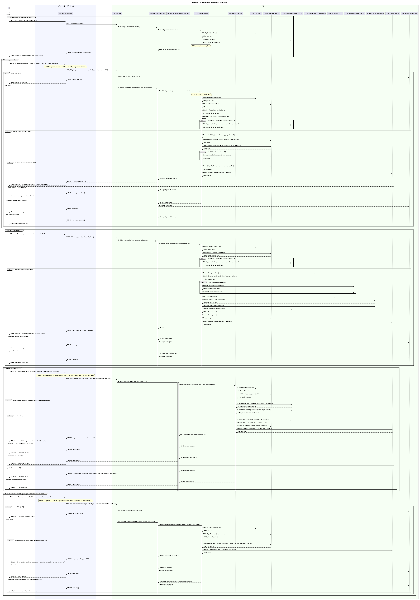

Fonte: próprio autor

#### RF08 – Gerenciar Organizações

| Campo | Descrição |
|---|---|
| Função | **Pesquisa:** lista todas as organizações cadastradas.  **Pesquisa de pendentes:** lista as organizações que aguardam aprovação.  **Aprovação:** autoriza uma organização.  **Recusa:** recusa o cadastro de uma organização, com motivo.  **Alteração de status:** bloqueia, com motivo, ou reativa uma organização. |
| Descrição | **Pesquisa:** consulta a tabela organizations, com o dono carregado na mesma consulta, e devolve, para cada organização, o identificador, o nome, a chave, o dono, o e-mail do dono mascarado, o CNPJ mascarado, approved, status, o motivo de moderação, a justificativa e a data do reenvio (resubmission_note e resubmitted_at), quando o dono pediu a reavaliação (RF07), a data de criação e as quantidades de integrantes (organization_members) e de comissões (committees). A máscara do e-mail mantém os dois primeiros caracteres, o último caractere antes do "@" e o domínio; a do CNPJ mantém os dois primeiros dígitos e os quatro dígitos da filial.  **Pesquisa de pendentes:** realiza a mesma consulta e devolve somente as organizações com approved igual a false e status PENDING ou nulo, o que inclui as reenviadas pelo dono depois de uma recusa.  **Aprovação:** atualiza na tabela organizations o campo approved para true, o campo status para APPROVED e apaga o motivo (moderation_reason).  **Recusa:** atualiza approved para false, status para REJECTED e grava o motivo informado em moderation_reason (coluna de 500 caracteres). Uma organização que já usou a reavaliação (resubmitted_at preenchido) e é recusada de novo não pode mais ser reenviada (RF07).  **Alteração de status:** com approved igual a true (reativação), atualiza approved para true, status para APPROVED e apaga o motivo; com approved igual a false (bloqueio), atualiza approved para false, status para BLOCKED e grava o motivo informado.  O serviço não confere o estado anterior: qualquer organização pode ser aprovada, recusada ou bloqueada. O aplicativo oferece "Recusar" e "Aprovar" na fila de pendentes e "Bloquear Organização" ou "Aprovar Organização" na lista geral. Enquanto approved é false (PENDING, REJECTED ou BLOCKED), o sistema recusa novas solicitações de acesso (RF03), convites de organização e criação de comissões (RF09); integrantes, comissões e demais dados já existentes são mantidos. O motivo é exibido ao dono da organização (RF07) e aos administradores. |
| Entradas | **Pesquisa e Pesquisa de pendentes:** nenhuma entrada além do token JWT, do qual é obtido o e-mail do administrador.  **Aprovação:** identificador id (Long) na rota, sem corpo.  **Recusa:** identificador id (Long) na rota e objeto do tipo OrganizationRejectionDTO contendo reason, string obrigatória (@NotBlank) de 3 a 500 caracteres (@Size), com os espaços das pontas removidos antes da validação; o serviço recusa ainda motivos com caracteres de controle, exceto tabulação e quebra de linha. No aplicativo, o campo "Motivo" da folha "Recusar organização" (obrigatório, até 500 caracteres, validado por validateModerationReason: "Informe um motivo de 3 a 500 caracteres, sem caracteres de controle.").  **Alteração de status:** identificador id (Long) na rota e objeto do tipo UpdateOrganizationStatusDTO contendo approved, valor lógico obrigatório (@NotNull), e justification, string opcional que, quando approved é false, passa a ser obrigatória e segue as mesmas regras do motivo da Recusa (3 a 500 caracteres, sem caracteres de controle, espaços das pontas removidos); quando approved é true, é ignorada. No aplicativo, o campo "Motivo" da folha "Bloquear organização". |
| Origem | Administrador do sistema (perfil global ADMIN ou SYSADMIN, sem diferença de permissão neste requisito). |
| Saída | **Pesquisa e Pesquisa de pendentes:** resposta HTTP 200 com a lista de objetos do tipo AdminOrganizationDTO (id, name, accessKey, ownerId, ownerName, ownerEmailMasked, cnpjMasked, approved, status, moderationReason, resubmissionNote, resubmittedAt, createdAt, totalMembers e totalCommittees). Erros: HTTP 403 sem corpo, gerado pelo SecurityConfig, para quem não tem o perfil ADMIN ou SYSADMIN; HTTP 403 com a mensagem ("Acesso negado. Ação restrita a Administradores."), gerado pelo AdminController quando o serviço lança SecurityException; HTTP 500 com "Erro ao listar organizações: " ou "Erro ao listar pendências: " seguido do detalhe, gerado pelo AdminController.  **Aprovação:** resposta HTTP 200 com o AdminOrganizationDTO atualizado. Erros, gerados pelo AdminController: HTTP 403; HTTP 404 com "Organização não encontrada para o ID: " seguido do identificador; HTTP 500 com "Erro ao aprovar organização: " seguido do detalhe.  **Recusa:** resposta HTTP 200 com o AdminOrganizationDTO atualizado. Erros: HTTP 400 gerado pelo GlobalExceptionHandler (MethodArgumentNotValidException, com errors.reason: "Informe o motivo da recusa." ou "O motivo deve ter de 3 a 500 caracteres."); HTTP 400 com {"message": "Dados da moderação inválidos."}, gerado pelo método invalidModerationBody do AdminController, quando o corpo está ausente ou ilegível; HTTP 400 com {"message": "Informe um motivo de 3 a 500 caracteres, sem caracteres de controle."}, gerado pelo AdminController a partir de InvalidModerationReasonException; HTTP 403; HTTP 404; HTTP 500 com "Erro ao rejeitar organização: " seguido do detalhe.  **Alteração de status:** resposta HTTP 200 com o AdminOrganizationDTO atualizado. Erros: HTTP 400 gerado pelo GlobalExceptionHandler quando approved está ausente ("O campo aprovada é obrigatório (true para aprovar, false para bloquear)."); HTTP 400 com a mensagem de "Dados da moderação inválidos." (corpo ilegível) ou do motivo inválido no bloqueio, gerados pelo AdminController; HTTP 403; HTTP 404; HTTP 500 com "Erro ao atualizar status: " seguido do detalhe.  Em todas as operações, HTTP 401 sem corpo (SecurityConfig) quando o token está ausente, expirado ou revogado. |
| Destino | Administrador do sistema, por meio da tela AdminOrganizationsScreen; banco de dados (tabelas organizations e audit_logs). |
| Ação | **Pesquisa e Pesquisa de pendentes:** o administrador seleciona a aba "Aprovações" (fila de pendentes, com o subtítulo "{n} organizações pendentes") ou a aba "Organizações" (todas, com o subtítulo "Busca global e situação das organizações") da barra inferior do aplicativo; as duas abrem a tela AdminOrganizationsScreen, com o parâmetro initialTab igual a pending ou all. Ao receber o foco, a cada 15 segundos enquanto a tela está em foco, visível e sem janela ou operação em andamento, e ao receber eventos de atualização (ADMIN_ORGS_MUTATED, ORGANIZATIONS_MUTATED, MEMBERS_MUTATED e VISIBILITY_RESTORED), a tela envia em paralelo as requisições GET /api/admin/organizations e GET /api/admin/organizations/pending; o botão "Atualizar" do cabeçalho e o gesto de puxar a lista fazem a leitura na hora. As requisições passam pelo JwtAuthFilter e pela regra hasAnyRole de SecurityConfig para /api/admin/**. Os métodos listOrganizations(authentication) e listPendingOrganizations(authentication) da classe AdminController chamam, respectivamente, os métodos listOrganizations(executorEmail) e listPendingOrganizations(executorEmail) da classe AdminService, que conferem o perfil do executor em validateSysAdmin (findByEmail de UserRepository; aceita ADMIN e SYSADMIN), obtêm as organizações por findAllWithOwner (OrganizationRepository) e convertem cada uma em toDTO, que conta os integrantes (findByOrganizationId de OrganizationMemberRepository) e as comissões (findByOrganizationIdOrderByNameAsc de CommitteeRepository) e mascara o e-mail do dono e o CNPJ (maskEmail e maskCnpj de LgpdMaskUtil). A tela valida a resposta (parseOrganizations). A aba "Organizações" exibe, por organização, o nome, a chave, o selo de estado e "{n} membros, {m} comissões", com o campo "Buscar organização" ("Buscar por nome, #chave ou responsável...") e os filtros locais "Todas", "Aprovadas", "Pendentes", "Recusadas" e "Bloqueadas"; a aba "Aprovações" exibe "Criada em", "Responsável", o CNPJ mascarado e, para as reenviadas, "Reenvio após recusa. Veja a justificativa nos detalhes.". Tocar em uma organização abre a janela "Detalhes da organização", com Responsável, E-mail (mascarado), CNPJ (mascarado), Membros, Comissões, a data de criação e, se houver, "Reenviada para avaliação em {data}." (seguido de "É a única reavaliação: uma nova recusa é definitiva." enquanto pendente), "Justificativa do dono:" e "Motivo da recusa anterior:" (pendente) ou "Motivo:". Em caso de HTTP 403, a tela limpa a lista e exibe "Acesso negado pelo servidor. Esta área exige permissão administrativa."; se a leitura falhar de outra forma, preserva os últimos dados e exibe "Não foi possível atualizar as organizações. Os últimos dados recebidos foram preservados.".  **Aprovação:** na aba "Aprovações", o administrador toca no botão "Aprovar" da organização e confirma, na janela "Aprovar organização" ("Aprovar {nome}? A organização poderá receber integrantes e criar comissões."), com o botão "Aprovar". O aplicativo envia a requisição POST /api/admin/organizations/{id}/approve, e o método approveOrganization(id, authentication) da classe AdminController chama o método approveOrganization(orgId, executorEmail) da classe AdminService, em transação, que executa validateSysAdmin, carrega a organização com bloqueio por findByIdForUpdate, grava approved igual a true, status APPROVED e motivo nulo por save, registra a auditoria e devolve toDTO. A tela confere se a resposta traz o identificador e approved, retira a organização da fila, exibe o aviso "Sucesso" com o texto "Estado de {nome} atualizado." e recarrega as listas. Na aba "Organizações", para as organizações com approved igual a false, o botão é "Aprovar Organização", que confirma da mesma forma e usa a Alteração de status com approved igual a true (reativação de organização recusada ou bloqueada, ou aprovação de uma pendente).  **Recusa:** na aba "Aprovações", o administrador toca no botão "Recusar". A folha "Recusar organização" exibe o nome, o aviso "O motivo será apresentado ao responsável pela organização e aos administradores.", o campo "Motivo" ("Explique o motivo") e "De 3 a 500 caracteres.". Ao tocar em "Confirmar recusa", o aplicativo valida o motivo (validateModerationReason) e a janela "Recusar organização" ("Recusar {nome}? Novos pedidos e criação de comissões ficarão indisponíveis.") pede a confirmação com o botão "Recusar". O aplicativo envia a requisição POST /api/admin/organizations/{id}/reject com o campo reason, e o método rejectOrganization(id, body, authentication) da classe AdminController chama o método rejectOrganization(orgId, reason, executorEmail) da classe AdminService, em transação, que executa validateSysAdmin, carrega a organização com bloqueio por findByIdForUpdate, valida o motivo em validateModerationReason, grava approved igual a false, status REJECTED e o motivo por save, registra a auditoria e devolve toDTO. A tela retira a organização da fila e exibe o aviso "Sucesso" com o texto "Estado de {nome} atualizado.".  **Alteração de status:** na aba "Organizações", para uma organização aprovada o administrador toca em "Bloquear Organização"; a folha "Bloquear organização" (campo "Motivo" e botão "Confirmar bloqueio") e a janela "Bloquear organização" ("Bloquear {nome}? Novos pedidos e criação de comissões ficarão indisponíveis.", botão "Bloquear") seguem o fluxo da Recusa. Para as demais organizações toca em "Aprovar Organização" e confirma com "Aprovar". O aplicativo envia a requisição PATCH /api/admin/organizations/{id}/status com approved igual a false e justification (bloqueio) ou apenas approved igual a true (reativação), e o método updateOrganizationStatus(id, dto, authentication) da classe AdminController chama o método updateOrganizationStatus(orgId, approved, justification, executorEmail) da classe AdminService, em transação, que executa validateSysAdmin, carrega a organização com bloqueio por findByIdForUpdate, valida o motivo quando approved é false, grava approved, status e motivo por save, registra a auditoria e devolve toDTO. Em caso de erro, a mensagem recebida aparece na própria tela; HTTP 403 limpa as listas. |
| Pré-condição | O usuário deve estar autenticado com perfil global ADMIN ou SYSADMIN (token JWT válido; o SecurityConfig, o @PreAuthorize do AdminController e validateSysAdmin exigem o perfil). ADMIN e SYSADMIN têm as mesmas permissões neste requisito.  **Aprovação:** a organização deve existir; o aplicativo oferece o botão quando approved é false (na fila, status PENDING).  **Recusa:** a organização deve existir; o aplicativo oferece o botão na fila de pendentes; o motivo deve ter de 3 a 500 caracteres, sem caracteres de controle.  **Alteração de status:** a organização deve existir; o aplicativo oferece "Bloquear Organização" quando approved é true e "Aprovar Organização" quando é false; para bloquear, o motivo deve ter de 3 a 500 caracteres, sem caracteres de controle. |
| Pós-condição | **Pesquisa e Pesquisa de pendentes:** a tela exibe a lista de organizações (ou a fila de pendentes) ou, em caso de acesso negado (403), avisa que é necessária permissão administrativa. Nada é alterado.  **Aprovação, Recusa e Alteração de status:** em caso de sucesso, a organização está gravada com o novo estado (APPROVED sem motivo, REJECTED com motivo ou BLOCKED com motivo), o dono a vê com o novo selo e, quando for o caso, com o motivo, e a organização aprovada volta a aceitar solicitações de acesso, convites e comissões, enquanto a recusada ou bloqueada passa a recusá-los; em caso de erro (dados inválidos, acesso negado, organização inexistente ou erro interno), nada é alterado e a tela exibe a mensagem. |
| Efeitos colaterais | **Pesquisa e Pesquisa de pendentes:** nenhum registro de auditoria é gravado (as ações ADMIN_ORGANIZATIONS_LISTED e ADMIN_PENDING_ORGANIZATIONS_LISTED não existem mais no servidor e restam apenas como rótulos do aplicativo).  **Aprovação:** registro em audit_logs com a ação ADMIN_ORGANIZATION_APPROVED, contendo o identificador e o nome da organização. O motivo anterior é apagado.  **Recusa:** registro em audit_logs com a ação ADMIN_ORGANIZATION_REJECTED, contendo o identificador, o nome e a quantidade de caracteres do motivo (o texto do motivo não é copiado para a auditoria).  **Alteração de status:** registro em audit_logs com a ação ADMIN_ORGANIZATION_STATUS_CHANGED, contendo o identificador, o nome, o novo estado (APPROVED ou BLOCKED) e, no bloqueio, a quantidade de caracteres do motivo.  Em todas as escritas, uma falha na gravação da auditoria é capturada e não impede a resposta. A organização é carregada com bloqueio de linha durante a transação. A tela atualiza as outras telas do mesmo aparelho pelo syncBus (ADMIN_ORGS_MUTATED, ORGANIZATIONS_MUTATED e MEMBERS_MUTATED); os demais aparelhos recebem a mudança na próxima leitura periódica (15 segundos). Nenhum e-mail ou notificação é enviado ao dono.  **Incremento 2:** com a organização não aprovada ou bloqueada, o presidente não consegue agendar novas reuniões (RF25). |

**Figura 18 – Diagrama de sequência do RF08**

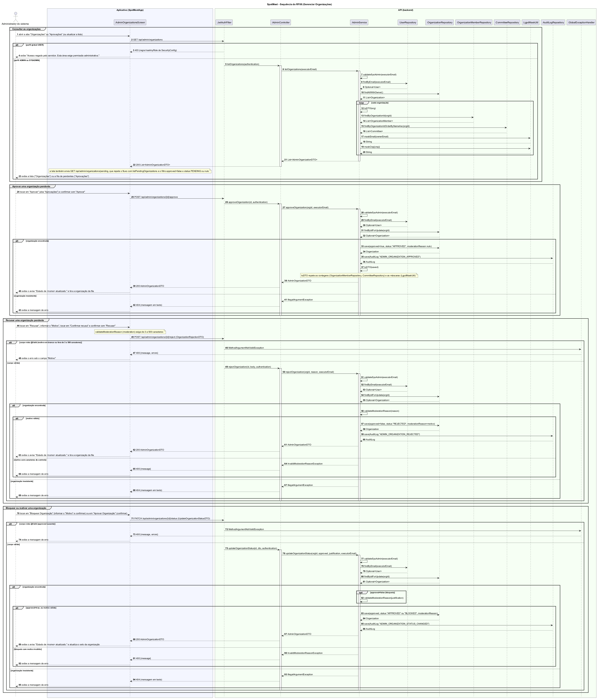

Fonte: próprio autor

#### RF09 – Cadastrar Comissão

| Campo | Descrição |
|---|---|
| Função | Cadastra uma nova comissão (grupo de trabalho) em uma organização aprovada. |
| Descrição | Insere na tabela committees do banco de dados uma comissão vinculada à organização, contendo o nome e a descrição informados por um líder da organização (dono, vice-líder ou subdono). O nome é normalizado antes da validação (sequências de espaços, tabulações e quebras de linha viram um único espaço e as pontas são removidas) e é único dentro da organização sem diferenciar maiúsculas e minúsculas: "RH" e "rh" são o mesmo nome. A regra é verificada pelo serviço (existsByNormalizedName) sob o bloqueio de escrita da linha da organização (findByIdForUpdate), que serializa criações e edições simultâneas, e é complementada no banco pela restrição uq_committee_org_name (colunas organization_id e name, comparação exata). Outra organização pode ter uma comissão com o mesmo nome. A comissão nasce sem integrantes. Só organizações aprovadas (approved = true) recebem comissões novas: uma organização pendente, rejeitada ou bloqueada recusa o cadastro. |
| Entradas | Identificador da organização (organizationId, do tipo Long), informado na rota, e objeto do tipo CommitteeRequestDTO contendo: name, string obrigatória, normalizada pelo DTO antes da validação, de 2 a 50 caracteres formados por letras (inclusive acentuadas), números, espaço, "_" ou "-" (expressão regular `^[\p{L}\p{M}0-9 _-]{2,50}$`); e description, string opcional de, no máximo, 500 caracteres (o serviço remove os espaços das pontas). O líder é identificado pelo e-mail do token JWT, fornecido pelo AuthContext. No aplicativo: o campo "Nome da comissão" é obrigatório e validateCommitteeName aplica as mesmas regras, com a mensagem "Use de 2 a 50 caracteres: letras, números, espaços, '_' ou '-'."; o campo "Descrição (opcional)" aceita até 500 caracteres ("Use até 500 caracteres."); a descrição vazia é enviada como null. |
| Origem | Usuário (líder da organização). |
| Saída | Resposta HTTP 201 com objeto do tipo CommitteeResponseDTO contendo id, name, description, organizationId, organizationName, totalActiveMembers (0), totalPending (0) e createdAt. Em caso de erro: HTTP 400, gerado pelo GlobalExceptionHandler quando o CommitteeRequestDTO não passa na Bean Validation (corpo com status, error, message e errors por campo); HTTP 403, quando o método requireOrganizationLeader lança SecurityException para quem não é líder da organização; HTTP 409, quando o serviço lança IllegalArgumentException ou IllegalStateException (organização não encontrada, nome já existente na organização, organização ainda não aprovada ou bloqueada); HTTP 401 sem corpo, gerado pelo SecurityConfig, quando o token está ausente, expirado ou revogado. |
| Destino | Banco de dados (tabelas committees e audit_logs) e usuário, por meio da folha "Nova comissão" da tela OrganizationScreen, que exibe o aviso e recarrega a lista de comissões. |
| Ação | Na tela OrganizationScreen, o líder abre a organização na aba "Minhas" (o dono, o vice-líder e o subdono entram na aba "Gerenciar"), toca no atalho "Comissões" e, na página "Comissões", no botão "Nova comissão". Se a organização não está aprovada, o aplicativo exibe o aviso "Organização não aprovada" já no atalho "Comissões" (e também em "Nova comissão"), sem abrir a página nem a folha: "Sua organização ainda não foi aprovada pelo administrador do sistema. Membros, convites e comissões ficam disponíveis depois da aprovação." ou, se recusada ou bloqueada, "Esta organização foi recusada ou bloqueada pelo administrador do sistema. Membros, convites e comissões não estão disponíveis."; a API continua recusando com HTTP 409. Estando aprovada, o aplicativo abre a folha "Nova comissão" com os campos "Nome da comissão" e "Descrição (opcional)" e a dica "Nome único nesta organização. Letras, espaços, números, '_' e '-'.". Ao tocar em "Criar comissão", o aplicativo valida o formulário (validateCommitteeName e o limite da descrição) e, em caso positivo, o método mutate envia a requisição POST /api/organizations/{organizationId}/committees com name e description. A requisição passa pelo JwtAuthFilter, que valida o token e carrega a conta. O Spring valida o CommitteeRequestDTO e o método createCommittee da classe CommitteeController chama o método createCommittee(organizationId, leaderEmail, dto) da classe CommitteeService, em uma transação READ_COMMITTED. O serviço carrega o usuário (findByEmail de UserRepository), bloqueia a linha da organização (findByIdForUpdate de OrganizationRepository) e confere, por requireOrganizationLeader, se o usuário é SYSADMIN, dono da organização ou integrante com papel ORG_OWNER, ORG_VICE_OWNER ou ORG_SUBOWNER (findById de OrganizationRepository e findByUserIdAndOrganizationId de OrganizationMemberRepository). Em seguida normaliza e valida o nome (validateName), consulta existsByNormalizedName de CommitteeRepository, verifica isApproved() da organização e, estando tudo correto, grava a comissão (save de CommitteeRepository), registra a auditoria (save de AuditLogRepository) e devolve o CommitteeResponseDTO. A primeira regra violada interrompe o fluxo, na ordem: líder, nome válido, nome livre, organização aprovada. Com a resposta 201, o aplicativo fecha a folha, exibe o aviso "Sucesso" com o texto "Comissão criada.", emite os eventos de sincronização e recarrega a lista. Nos erros, a folha continua aberta e a mensagem aparece acima dos botões (ou abaixo do campo, quando o HTTP 400 indica o campo). |
| Pré-condição | O usuário deve estar autenticado (RF02) e ser dono da organização (organizations.owner_id), ou ter papel ORG_OWNER, ORG_VICE_OWNER ou ORG_SUBOWNER na organização (organization_members), ou ter o perfil global SYSADMIN (apenas pela API, pois o aplicativo do administrador não tem telas de comissão). A organização deve existir e estar aprovada (approved = true, status APPROVED). Não pode existir outra comissão da mesma organização com o mesmo nome, sem diferenciar maiúsculas, minúsculas e espaços extras. |
| Pós-condição | Sucesso: existe uma nova linha em committees com a organização, o nome normalizado, a descrição e created_at, sem vínculos em committee_members; o registro COMMITTEE_CREATED está em audit_logs; a comissão consta da lista da organização com "0 ativos" e "0 pendentes" e o aplicativo exibe "Comissão criada.". Falha: nada é gravado em committees nem em audit_logs, a folha permanece aberta e o aplicativo exibe a mensagem recebida: HTTP 400 por campo; HTTP 403 ("Acesso negado. Apenas líderes (dono, vice-líder ou subdono) da organização podem realizar esta operação."); HTTP 409 ("Já existe uma comissão com esse nome nesta organização." ou "Esta organização ainda não foi aprovada pelo administrador do sistema ou está bloqueada."); ou "Não foi possível conectar ao servidor. Tente novamente." quando não há resposta. |
| Efeitos colaterais | Registro em audit_logs com a ação COMMITTEE_CREATED, contendo o nome da comissão, o nome da organização e o identificador gerado. Eventos de sincronização ORGANIZATIONS_MUTATED, COMMITTEES_MUTATED e ADMIN_ORGS_MUTATED (syncBus), que atualizam as outras telas abertas no mesmo aparelho; os demais aparelhos recebem a mudança na atualização automática a cada 15 segundos (useLiveSync). Nenhum e-mail é enviado. |

**Figura 19 – Diagrama de sequência do RF09**

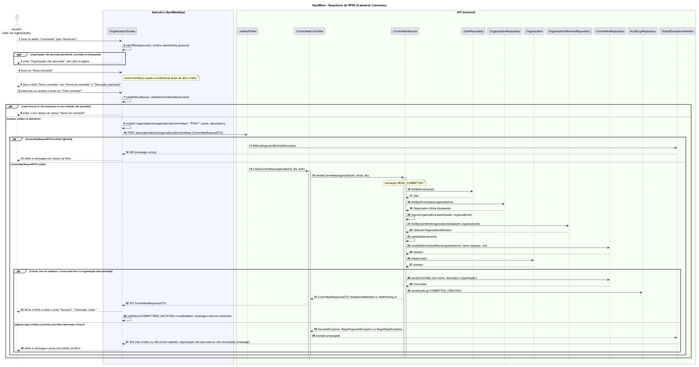

Fonte: próprio autor

#### RF10 – Manter Comissão

| Campo | Descrição |
|---|---|
| Função | **Pesquisa:** Lista as comissões de uma organização.  **Atualização:** Altera o nome e a descrição de uma comissão.  **Exclusão:** Remove uma comissão e todos os seus vínculos. |
| Descrição | **Pesquisa:** Consulta na tabela committees as comissões da organização, em ordem alfabética de nome, e conta na tabela committee_members, para cada uma, os vínculos ACTIVE (integrantes ativos) e os pendentes (PENDING_USER_ACCEPTANCE mais PENDING_LEADER_APPROVAL).  **Atualização:** Atualiza na tabela committees o nome e a descrição da comissão, mantendo a organização à qual ela pertence. Valem a normalização e a unicidade do RF09, ignorando a própria comissão na checagem de duplicidade, sob o mesmo bloqueio de escrita da linha da organização. A edição não verifica se a organização está aprovada.  **Exclusão:** Remove da tabela committee_members todos os vínculos da comissão, em qualquer situação (ativo, convite pendente, solicitação pendente ou recusado), e em seguida remove a comissão da tabela committees, na mesma transação. |
| Entradas | **Pesquisa:** Identificador da organização (organizationId, do tipo Long), informado na rota.  **Atualização:** Identificador da comissão (committeeId, do tipo Long), informado na rota, e objeto do tipo CommitteeRequestDTO com name (obrigatório, normalizado, de 2 a 50 caracteres formados por letras, inclusive acentuadas, números, espaço, "_" ou "-") e description (opcional, até 500 caracteres), com as mesmas regras do RF09. No aplicativo, a folha "Editar comissão" traz os campos "Nome da comissão" e "Descrição (opcional)" preenchidos com os dados atuais.  **Exclusão:** Identificador da comissão (committeeId, do tipo Long), informado na rota, e a confirmação do usuário no diálogo do aplicativo. |
| Origem | **Pesquisa:** Usuário (integrante da organização).  **Atualização:** Usuário (líder da organização).  **Exclusão:** Usuário (líder da organização; o aplicativo oferece a exclusão ao dono e ao vice-líder). |
| Saída | **Pesquisa:** HTTP 200 com lista de objetos do tipo CommitteeResponseDTO (id, name, description, organizationId, organizationName, totalActiveMembers, totalPending e createdAt), vazia quando não há comissões. Em caso de erro: HTTP 403, lançado como SecurityException pelo serviço para quem não pertence à organização ("Acesso negado. Você não é membro desta organização."), e HTTP 401 do SecurityConfig para token ausente, expirado ou revogado.  **Atualização:** HTTP 200 com o CommitteeResponseDTO atualizado, com os contadores reais. Em caso de erro: HTTP 400 do GlobalExceptionHandler para CommitteeRequestDTO inválido; HTTP 403 para quem não é líder; HTTP 409 para comissão ou organização não encontrada e nome já usado por outra comissão; HTTP 401 como na pesquisa.  **Exclusão:** HTTP 200 com o texto "Comissão excluída com sucesso." no corpo. Em caso de erro: HTTP 403 para quem não é líder; HTTP 409 para comissão não encontrada; HTTP 401 como na pesquisa. |
| Destino | **Pesquisa:** Usuário, por meio da página "Comissões" da tela OrganizationScreen.  **Atualização:** Banco de dados (tabelas committees e audit_logs) e usuário, por meio da tela OrganizationScreen.  **Exclusão:** Banco de dados (tabelas committee_members, committees e audit_logs) e usuário, por meio da tela OrganizationScreen. |
| Ação | **Pesquisa:** Ao abrir uma organização na aba "Minhas" (o líder cai na aba "Gerenciar" e toca em "Comissões"; o membro comum cai direto na lista "Comissões"), a tela executa loadDetails, que lê em paralelo, entre outras rotas dos RF05, RF12 e RF13, a requisição GET /api/organizations/{organizationId}/committees. A leitura se repete ao receber o foco, a cada 15 segundos (useLiveSync, pausada durante edição, folhas abertas e gravações), no botão "Atualizar organizações" e no gesto de puxar a lista. O método listCommittees da classe CommitteeController chama o método listCommittees(organizationId, userEmail) da classe CommitteeService, que carrega o usuário (findByEmail de UserRepository), verifica por existsByUserIdAndOrganizationId de OrganizationMemberRepository se ele pertence à organização (o SYSADMIN dispensa a verificação), obtém as comissões por findByOrganizationIdOrderByNameAsc de CommitteeRepository e conta os vínculos de cada uma por countByCommitteeIdAndStatus de CommitteeMemberRepository. Cada cartão exibe o nome, a descrição e as etiquetas "N ativos" e "N pendentes" e, para o próprio usuário, "Você participa" (vínculo ACTIVE) ou "Seu pedido está pendente" (vínculo PENDING_LEADER_APPROVAL), conforme os vínculos lidos no RF13. Sem comissões, a página exibe "Nenhuma comissão cadastrada nesta organização.". Se a leitura devolver 403 ou 404, o aplicativo descarta a organização selecionada e volta para "Minhas"; nas demais falhas, exibe "Não foi possível atualizar os dados da organização. Tente novamente." e mantém os dados anteriores.  **Atualização:** O líder toca no botão "Editar <nome da comissão>" do cartão da comissão. O aplicativo abre a folha "Editar comissão" com os dados atuais. Ao tocar em "Salvar alterações", valida o formulário e envia a requisição PUT /api/committees/{committeeId} com name e description. O método updateCommittee da classe CommitteeController chama o método updateCommittee(committeeId, leaderEmail, dto) da classe CommitteeService, que, em transação READ_COMMITTED, localiza a comissão (findById de CommitteeRepository), carrega o usuário, bloqueia a linha da organização da comissão (findByIdForUpdate), confere o líder por requireOrganizationLeader, valida o nome, verifica por existsByNormalizedName se outra comissão da organização já o usa (passando o identificador da própria comissão), grava as alterações (save), registra a auditoria e recalcula os contadores (countByCommitteeIdAndStatus). Com a resposta 200, o aplicativo fecha a folha, exibe o aviso "Sucesso" com "Comissão atualizada." e recarrega a lista.  **Exclusão:** O líder toca no botão "Excluir <nome da comissão>", exibido pelo aplicativo ao dono e ao vice-líder (a API aceita também o subdono e o SYSADMIN). O ConfirmationHost abre o diálogo "Excluir comissão" ("Excluir <nome> e todos os seus vínculos?") com os botões "Cancelar" e "Excluir". Ao tocar em "Excluir", o aplicativo envia a requisição DELETE /api/committees/{committeeId}. O método deleteCommittee da classe CommitteeController chama o método deleteCommittee(committeeId, leaderEmail) da classe CommitteeService, que localiza a comissão, carrega o usuário, confere o líder por requireOrganizationLeader, obtém os vínculos por findByCommitteeId de CommitteeMemberRepository, remove-os por deleteAll, remove a comissão por delete de CommitteeRepository e registra a auditoria, tudo na mesma transação. Com a resposta 200, o aplicativo exibe o aviso "Sucesso" com "Comissão excluída." e recarrega a lista. |
| Pré-condição | **Pesquisa:** O usuário deve estar autenticado e ser integrante da organização (organization_members), ou ter o perfil global SYSADMIN (apenas pela API).  **Atualização:** O usuário deve estar autenticado e ser dono da organização, ou ter papel ORG_OWNER, ORG_VICE_OWNER ou ORG_SUBOWNER nela, ou ser SYSADMIN (pela API). A comissão deve existir e o novo nome não pode pertencer a outra comissão da mesma organização.  **Exclusão:** O usuário deve estar autenticado e ser dono da organização, ou ter papel ORG_OWNER, ORG_VICE_OWNER ou ORG_SUBOWNER nela, ou ser SYSADMIN (pela API). A comissão deve existir e o usuário deve confirmar no diálogo "Excluir comissão". |
| Pós-condição | **Pesquisa:** Sucesso: o aplicativo exibe a lista de comissões da organização com os contadores, ou o texto "Nenhuma comissão cadastrada nesta organização."; nada é alterado. Falha: nada é alterado; com 403 ou 404 o aplicativo volta à aba "Minhas".  **Atualização:** Sucesso: a linha da comissão em committees tem o novo nome e a nova descrição, e os vínculos e a organização permanecem; o registro COMMITTEE_UPDATED está em audit_logs e o aplicativo exibe "Comissão atualizada.". Falha: nada é alterado e o aplicativo exibe a mensagem recebida: HTTP 400 por campo; HTTP 403 (usuário sem permissão); HTTP 409 ("Comissão não encontrada." ou "Já existe uma comissão com esse nome nesta organização.").  **Exclusão:** Sucesso: a comissão e todos os seus vínculos, inclusive convites e solicitações pendentes, deixam de existir; o registro COMMITTEE_DELETED está em audit_logs e a comissão some da lista, com o aviso "Comissão excluída.". Falha: nada é removido e o aplicativo exibe a mensagem recebida (HTTP 403 ou HTTP 409 "Comissão não encontrada."). Se o usuário toca em "Cancelar" no diálogo, nenhuma requisição é enviada. |
| Efeitos colaterais | **Pesquisa:** Nenhum.  **Atualização:** Registro em audit_logs com a ação COMMITTEE_UPDATED, contendo o identificador da comissão, o nome anterior, o novo nome e o nome da organização. Eventos de sincronização ORGANIZATIONS_MUTATED, COMMITTEES_MUTATED e ADMIN_ORGS_MUTATED (syncBus).  **Exclusão:** Remoção de todos os vínculos da comissão em committee_members e registro em audit_logs com a ação COMMITTEE_DELETED, contendo o identificador, o nome da comissão e o nome da organização. Eventos de sincronização como na atualização. As comissões e os vínculos também são removidos quando a organização é excluída (RF07), e os vínculos de um integrante, quando ele é removido da organização (RF05), nesses casos sem registro COMMITTEE_*.  **Incremento 2:** ao excluir a comissão, o banco exclui também as reuniões e os participantes dela (exclusão em cascata de `meetings` e `meeting_participants`). |

**Figura 20 – Diagrama de sequência do RF10**

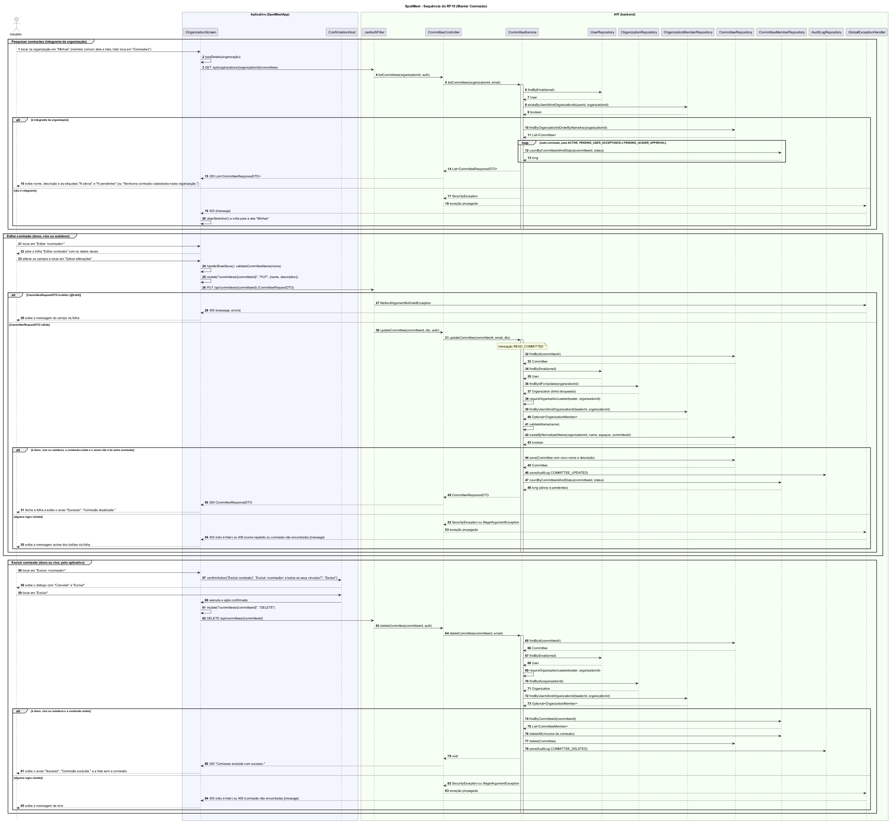

Fonte: próprio autor

#### RF11 – Convidar Membro para Comissão

| Campo | Descrição |
|---|---|
| Função | **Convite:** Vincula um integrante da organização a uma comissão por iniciativa de um líder da organização.  **Consulta de convites:** Lista os convites de comissão pendentes do usuário autenticado.  **Resposta ao convite:** Registra o aceite ou a recusa do convite pelo integrante convidado. |
| Descrição | **Convite:** Insere na tabela committee_members um vínculo do integrante com a comissão, com status PENDING_USER_ACCEPTANCE, papel MEMBER e o líder que convidou em invited_by_id (a restrição uq_committee_member permite um vínculo por usuário e comissão). Quando já existe vínculo DECLINED, ele é reaberto como PENDING_USER_ACCEPTANCE, com novo invited_by_id e responded_at limpo. Quando já existe vínculo PENDING_LEADER_APPROVAL (o integrante havia solicitado entrada), o vínculo passa direto para ACTIVE, com responded_at preenchido. Vínculo ACTIVE ou convite já pendente são recusados. O convidado precisa ser integrante da organização. O sistema não envia e-mail e o convite de comissão não tem prazo de expiração (diferente do convite de organização, de 24 horas).  **Consulta de convites:** Consulta na tabela committee_members os vínculos do usuário autenticado com status PENDING_USER_ACCEPTANCE, de qualquer organização.  **Resposta ao convite:** Atualiza na tabela committee_members o status do vínculo para ACTIVE, em caso de aceite, ou para DECLINED, em caso de recusa, registrando a data da resposta (responded_at). |
| Entradas | **Convite:** Identificador da comissão (committeeId, do tipo Long) e identificador do integrante convidado (userId, do tipo Long), informados na rota. O líder é identificado pelo e-mail do token JWT.  **Consulta de convites:** Nenhuma, além do token de autenticação do usuário.  **Resposta ao convite:** Identificador da comissão (committeeId, do tipo Long), informado na rota, e parâmetro accept, do tipo boolean e obrigatório (true para aceitar, false para recusar). |
| Origem | **Convite:** Usuário (líder da organização).  **Consulta de convites:** Usuário (integrante convidado).  **Resposta ao convite:** Usuário (integrante convidado). |
| Saída | **Convite:** HTTP 201 com objeto do tipo CommitteeMemberResponseDTO (id, userId, userName, userEmail, committeeId, committeeName, organizationId, status, role, requestedAt, respondedAt e invitedByName). Em caso de erro: HTTP 403, quando requireOrganizationLeader lança SecurityException; HTTP 409, quando o serviço lança IllegalArgumentException ou IllegalStateException ("Comissão não encontrada.", "Usuário não encontrado.", convidado que não pertence à organização, "O usuário já é integrante ativo desta comissão." ou "Já existe um convite pendente aguardando aceite deste usuário."); HTTP 401 do SecurityConfig para token ausente, expirado ou revogado.  **Consulta de convites:** HTTP 200 com lista de objetos do tipo CommitteeMemberResponseDTO, vazia quando não há convites; HTTP 401 como no convite.  **Resposta ao convite:** HTTP 200 com o CommitteeMemberResponseDTO com a nova situação. Em caso de erro: HTTP 400, gerado pelo GlobalExceptionHandler quando accept está ausente ou não é booleano ("Parâmetro ausente ou inválido."); HTTP 409, quando o serviço lança IllegalArgumentException ("Nenhum convite encontrado para esta comissão.") ou IllegalStateException ("Apenas convites pendentes podem ser respondidos."); HTTP 401 como no convite. |
| Destino | **Convite:** Banco de dados (tabelas committee_members e audit_logs) e usuário, por meio da janela "Comissões do integrante" da tela OrganizationScreen.  **Consulta de convites:** Usuário, por meio da tela OrganizationScreen.  **Resposta ao convite:** Banco de dados (tabelas committee_members e audit_logs) e usuário, por meio da tela OrganizationScreen. |
| Ação | **Convite:** Na aba "Gerenciar", o líder toca no atalho "Membros", escolhe o integrante (cartão com o nome e o e-mail) e toca em "Comissões do integrante", janela descrita no RF13. Em cada comissão sem vínculo ou com vínculo recusado, o botão "Convidar para <comissão>" envia a requisição POST /api/committees/{committeeId}/members/{userId}. O método addUserToCommittee da classe CommitteeController chama o método addUserToCommittee(committeeId, targetUserId, leaderEmail) da classe CommitteeService, que localiza a comissão (findById de CommitteeRepository), carrega o líder (findByEmail de UserRepository), confere o líder por requireOrganizationLeader, localiza o convidado (findById de UserRepository), verifica por existsByUserIdAndOrganizationId de OrganizationMemberRepository se ele pertence à organização, consulta o vínculo existente (findByUserIdAndCommitteeId de CommitteeMemberRepository), cria ou altera o vínculo como descrito, grava-o (save) e registra a auditoria. Com a resposta 201, o aplicativo exibe o aviso "Sucesso" com "Convite enviado. Aguarde o aceite do integrante." (ou "Integrante aprovado após seu pedido de ingresso." quando o status devolvido é ACTIVE) e recarrega a janela, em que a comissão passa a exibir a etiqueta "Aguardando aceite". Para vínculo PENDING_LEADER_APPROVAL, a janela não mostra o botão e orienta "Responda ao pedido em Solicitações."; a ativação direta só ocorre por chamada direta à API ou por corrida entre aparelhos.  **Consulta de convites:** Ao receber o foco, a cada 15 segundos (useLiveSync) e a cada atualização, a tela executa loadInvitations, que lê GET /api/committees/invitations (e GET /api/organization-invitations/mine, do RF03). O método listMyInvitations da classe CommitteeController chama o método listMyInvitations(userEmail) da classe CommitteeService, que carrega o usuário e consulta o método findByUserIdAndStatus da classe CommitteeMemberRepository. Havendo convites, a aba "Minhas" exibe o cartão "Você recebeu convites" com o botão "Ver convites (N)" (N soma convites de organização e de comissão). A página "Convites" lista, na seção "CONVITES DE COMISSÃO", o nome da comissão, "Convite de <líder>" e o nome da organização, com os botões "Recusar" e "Aceitar". O membro comum também vê esses botões no cartão da comissão convidada, na página "Comissões". Sem convites, a página exibe "Você não tem convites pendentes.".  **Resposta ao convite:** Ao tocar em "Aceitar" ou "Recusar", o aplicativo envia a requisição POST /api/committees/{committeeId}/invitations/respond?accept=true ou accept=false. O método respondInvitation da classe CommitteeController chama o método respondInvitation(committeeId, userEmail, accept) da classe CommitteeService, que carrega o usuário, localiza o vínculo (findByUserIdAndCommitteeId), exige o status PENDING_USER_ACCEPTANCE, altera o status para ACTIVE ou DECLINED com responded_at, registra a auditoria e grava o vínculo (save). Com a resposta 200, o aplicativo exibe o aviso "Sucesso" com "Você entrou na comissão." ou "Convite recusado." e recarrega as listas. |
| Pré-condição | **Convite:** O usuário deve estar autenticado e ser dono da organização da comissão, ou ter papel ORG_OWNER, ORG_VICE_OWNER ou ORG_SUBOWNER nela, ou ser SYSADMIN (pela API). A comissão deve existir, o convidado deve existir e ser integrante da organização (organization_members) e não pode ter vínculo ACTIVE nem convite PENDING_USER_ACCEPTANCE com a comissão. O código não exige organização aprovada.  **Consulta de convites:** O usuário deve estar autenticado.  **Resposta ao convite:** O usuário deve estar autenticado e ter vínculo com status PENDING_USER_ACCEPTANCE com a comissão. |
| Pós-condição | **Convite:** Sucesso: existe, em committee_members, o vínculo do convidado com a comissão em PENDING_USER_ACCEPTANCE (criado ou reaberto) ou em ACTIVE (quando havia solicitação pendente); o registro COMMITTEE_INVITATION_SENT está em audit_logs e o convidado passa a ver o convite no aplicativo. Falha: nada é alterado e o aplicativo exibe a mensagem recebida (HTTP 403 para quem não é líder; HTTP 409 para comissão ou usuário não encontrado, convidado fora da organização, integrante já ativo ou convite já pendente).  **Consulta de convites:** Sucesso: o aplicativo exibe os convites pendentes do usuário, quando houver; nada é alterado. Falha: o aplicativo exibe "Não foi possível consultar seus convites. Tente novamente." e o botão "Atualizar convites".  **Resposta ao convite:** Sucesso: o vínculo fica ACTIVE (o usuário passa a ser integrante ativo e a contar em "N ativos") ou DECLINED, com responded_at; o registro de auditoria correspondente está em audit_logs e o convite deixa de constar na lista. Falha: nada é alterado e o aplicativo exibe a mensagem recebida (HTTP 409 quando não há convite ou ele não está pendente). |
| Efeitos colaterais | **Convite:** Registro em audit_logs com a ação COMMITTEE_INVITATION_SENT, contendo o e-mail do convidado e o nome da comissão; o registro é feito com essa mesma ação também quando o vínculo é ativado diretamente. Eventos de sincronização ORGANIZATIONS_MUTATED, COMMITTEES_MUTATED e ADMIN_ORGS_MUTATED (syncBus).  **Consulta de convites:** Nenhum.  **Resposta ao convite:** Registro em audit_logs com a ação COMMITTEE_INVITATION_ACCEPTED, em caso de aceite, ou COMMITTEE_INVITATION_DECLINED, em caso de recusa, contendo o nome da comissão e o nome da organização. Eventos de sincronização como no convite. |

**Figura 21 – Diagrama de sequência do RF11**

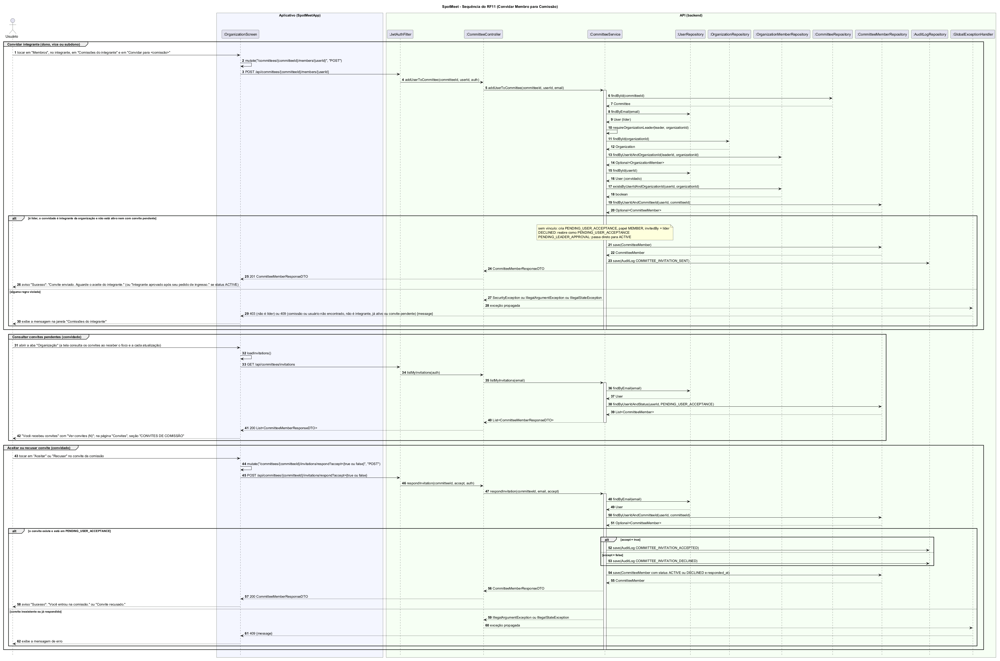

Fonte: próprio autor

#### RF12 – Solicitar Entrada em Comissão

| Campo | Descrição |
|---|---|
| Função | **Solicitação:** Registra o pedido de um integrante da organização para ingressar em uma comissão.  **Consulta de solicitações:** Lista as solicitações de entrada pendentes de aprovação.  **Resposta à solicitação:** Registra a aprovação ou a rejeição da solicitação por um líder da organização. |
| Descrição | **Solicitação:** Insere na tabela committee_members um vínculo do integrante com a comissão, com status PENDING_LEADER_APPROVAL, papel MEMBER e invited_by_id nulo. Quando já existe vínculo PENDING_USER_ACCEPTANCE (o integrante havia sido convidado), o vínculo passa direto para ACTIVE. Quando já existe vínculo DECLINED, ele é reaberto como PENDING_LEADER_APPROVAL, com responded_at limpo. Vínculo ACTIVE ou solicitação já pendente são recusados.  **Consulta de solicitações:** Consulta na tabela committee_members os vínculos com status PENDING_LEADER_APPROVAL de todas as comissões da organização.  **Resposta à solicitação:** Atualiza na tabela committee_members o status do vínculo para ACTIVE, em caso de aprovação, ou para DECLINED, em caso de rejeição, registrando a data da resposta (responded_at). |
| Entradas | **Solicitação:** Identificador da comissão (committeeId, do tipo Long), informado na rota. O solicitante é identificado pelo e-mail do token JWT.  **Consulta de solicitações:** Identificador da organização (organizationId, do tipo Long), informado na rota GET /api/organizations/{organizationId}/committees/join-requests, usada pelo aplicativo. A API tem também a rota GET /api/committees/{committeeId}/join-requests, restrita a uma comissão, que o aplicativo não utiliza.  **Resposta à solicitação:** Identificador do vínculo (membershipId, do tipo Long), informado na rota, e parâmetro approve, do tipo boolean e obrigatório (true para aprovar, false para rejeitar). |
| Origem | **Solicitação:** Usuário (integrante da organização).  **Consulta de solicitações:** Usuário (líder da organização).  **Resposta à solicitação:** Usuário (líder da organização). |
| Saída | **Solicitação:** HTTP 201 com objeto do tipo CommitteeMemberResponseDTO (id, userId, userName, userEmail, committeeId, committeeName, organizationId, status, role, requestedAt, respondedAt e invitedByName). Em caso de erro: HTTP 409, quando o serviço lança IllegalArgumentException ou IllegalStateException ("Comissão não encontrada.", "Você deve ser membro da organização para solicitar entrada em suas comissões.", "Você já é integrante desta comissão." ou "Você já possui uma solicitação pendente de aprovação para esta comissão."); HTTP 401 do SecurityConfig para token ausente, expirado ou revogado.  **Consulta de solicitações:** HTTP 200 com lista de objetos do tipo CommitteeMemberResponseDTO, vazia quando não há solicitações. Em caso de erro: HTTP 403 (SecurityException de requireOrganizationLeader), HTTP 409 (organização não encontrada) e HTTP 401 como na solicitação.  **Resposta à solicitação:** HTTP 200 com o CommitteeMemberResponseDTO com a nova situação. Em caso de erro: HTTP 400, gerado pelo GlobalExceptionHandler quando approve está ausente ou não é booleano; HTTP 403 para quem não é líder; HTTP 409 ("Solicitação de comissão não encontrada." ou "Apenas solicitações pendentes de aprovação do líder podem ser respondidas."); HTTP 401 como na solicitação. |
| Destino | **Solicitação:** Banco de dados (tabelas committee_members e audit_logs) e usuário, por meio da tela OrganizationScreen.  **Consulta de solicitações:** Usuário, por meio da página "Solicitações" da tela OrganizationScreen.  **Resposta à solicitação:** Banco de dados (tabelas committee_members e audit_logs) e usuário, por meio da página "Solicitações" da tela OrganizationScreen. |
| Ação | **Solicitação:** Na aba "Minhas", o integrante toca na organização e o aplicativo abre a página "Comissões". No cartão de uma comissão em que o usuário não tem vínculo (ou em que o vínculo foi recusado) e para a qual não há convite pendente, o botão "Solicitar ingresso" (rótulo "Solicitar entrada em <comissão>") envia a requisição POST /api/committees/{committeeId}/join-requests. O botão não aparece para o dono, o vice-líder e o subdono, embora a API aceite a solicitação de qualquer integrante da organização. O método requestToJoin da classe CommitteeController chama o método requestToJoin(committeeId, userEmail) da classe CommitteeService, que localiza a comissão (findById de CommitteeRepository), carrega o usuário (findByEmail de UserRepository), verifica por existsByUserIdAndOrganizationId de OrganizationMemberRepository se ele pertence à organização, consulta o vínculo existente (findByUserIdAndCommitteeId de CommitteeMemberRepository), cria ou altera o vínculo como descrito, grava-o (save) e, quando o vínculo é novo, registra a auditoria. Com a resposta 201, o aplicativo exibe o aviso "Sucesso" com "Pedido de ingresso enviado. Aguarde a aprovação dos líderes." e o cartão passa a exibir a etiqueta "Seu pedido está pendente". Havendo convite pendente, o aplicativo mostra "Aceitar" e "Recusar" no lugar do botão (RF11); se a API ativa o vínculo diretamente, a resposta continua sendo 201.  **Consulta de solicitações:** Na aba "Gerenciar", a tela executa loadDetails, que, para o líder, lê GET /api/organizations/{organizationId}/committees/join-requests (ao abrir a organização, ao receber o foco e a cada 15 segundos). O método listPendingJoinRequestsForOrganization da classe CommitteeController chama o método listPendingJoinRequestsForOrganization(organizationId, executorEmail) da classe CommitteeService, que carrega o usuário, confere o líder por requireOrganizationLeader e consulta o método findByCommitteeOrganizationIdAndStatus da classe CommitteeMemberRepository. O atalho "Solicitações" mostra o contador (soma das solicitações de entrada na organização, do RF04, e das de comissão) e a página "Solicitações" exibe, na seção "INGRESSO EM COMISSÃO", o nome do solicitante e o da comissão, com os botões "Rejeitar" e "Aprovar". Sem solicitações, exibe "Nenhuma solicitação pendente para seu papel.". Se a leitura falha, o aplicativo exibe "Não foi possível atualizar os dados da organização. Tente novamente.".  **Resposta à solicitação:** Ao tocar em "Aprovar" ou "Rejeitar" (rótulos "Aprovar ingresso de <nome>" e "Rejeitar ingresso de <nome>"), o aplicativo envia a requisição POST /api/committees/join-requests/{membershipId}/respond?approve=true ou approve=false. O método respondJoinRequest da classe CommitteeController chama o método respondJoinRequest(membershipId, leaderEmail, approve) da classe CommitteeService, que localiza o vínculo (findById de CommitteeMemberRepository), carrega o usuário, confere o líder da organização da comissão por requireOrganizationLeader, exige o status PENDING_LEADER_APPROVAL, altera o status para ACTIVE ou DECLINED com responded_at, registra a auditoria e grava o vínculo (save). Com a resposta 200, o aplicativo exibe o aviso "Sucesso" com "Integrante aprovado na comissão." ou "Solicitação rejeitada." e recarrega as listas. |
| Pré-condição | **Solicitação:** O usuário deve estar autenticado e ser integrante da organização da comissão (organization_members). A comissão deve existir e o usuário não pode ter vínculo ACTIVE nem solicitação PENDING_LEADER_APPROVAL com ela.  **Consulta de solicitações:** O usuário deve estar autenticado e ser dono da organização, ou ter papel ORG_OWNER, ORG_VICE_OWNER ou ORG_SUBOWNER nela, ou ser SYSADMIN (pela API).  **Resposta à solicitação:** O usuário deve estar autenticado e ser dono da organização da comissão, ou ter papel ORG_OWNER, ORG_VICE_OWNER ou ORG_SUBOWNER nela, ou ser SYSADMIN (pela API). O vínculo deve existir e estar com status PENDING_LEADER_APPROVAL. |
| Pós-condição | **Solicitação:** Sucesso: existe, em committee_members, o vínculo do usuário com a comissão em PENDING_LEADER_APPROVAL (criado ou reaberto) ou em ACTIVE (quando havia convite pendente); o registro COMMITTEE_JOIN_REQUESTED está em audit_logs, quando o vínculo é novo, e o líder passa a ver a solicitação na página "Solicitações". Falha: nada é alterado e o aplicativo exibe a mensagem recebida (HTTP 409).  **Consulta de solicitações:** Sucesso: o aplicativo exibe as solicitações pendentes ou "Nenhuma solicitação pendente para seu papel."; nada é alterado. Falha: nada é alterado e o aplicativo mantém os dados anteriores com a mensagem de erro.  **Resposta à solicitação:** Sucesso: o vínculo fica ACTIVE (o solicitante passa a integrante ativo da comissão) ou DECLINED (o solicitante pode pedir de novo ou ser convidado, RF11), com responded_at, e a solicitação deixa de constar na lista. Falha: nada é alterado e o aplicativo exibe a mensagem recebida (HTTP 403 para quem não é líder; HTTP 409 para solicitação não encontrada ou já respondida). |
| Efeitos colaterais | **Solicitação:** Registro em audit_logs com a ação COMMITTEE_JOIN_REQUESTED, contendo o nome da comissão e o nome da organização, somente quando um novo vínculo é criado. A ativação direta de convite pendente e a reabertura de vínculo recusado não geram registro de auditoria. Eventos de sincronização ORGANIZATIONS_MUTATED, COMMITTEES_MUTATED e ADMIN_ORGS_MUTATED (syncBus).  **Consulta de solicitações:** Nenhum.  **Resposta à solicitação:** Registro em audit_logs com a ação COMMITTEE_JOIN_APPROVED, em caso de aprovação, ou COMMITTEE_JOIN_REJECTED, em caso de rejeição, contendo o e-mail do solicitante e o nome da comissão. Eventos de sincronização como na solicitação. |

**Figura 22 – Diagrama de sequência do RF12**

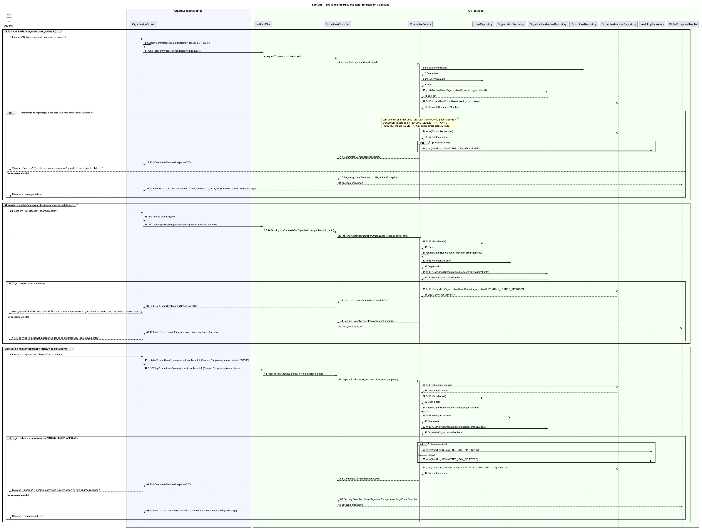

Fonte: próprio autor

#### RF13 – Manter Integrantes da Comissão

| Campo | Descrição |
|---|---|
| Função | **Pesquisa:** Consulta a situação de um integrante em cada comissão da organização.  **Exclusão:** Remove o vínculo de um integrante com uma comissão. |
| Descrição | **Pesquisa:** Consulta na tabela committees todas as comissões da organização, em ordem alfabética de nome, e na tabela committee_members o vínculo do integrante com cada uma, informando se há vínculo (linked), o status, o papel e o identificador do vínculo. As comissões sem vínculo saem com linked falso e os demais campos nulos.  **Exclusão:** Remove da tabela committee_members o vínculo do integrante com a comissão, qualquer que seja o seu status (ativo, convite pendente, solicitação pendente ou recusado). |
| Entradas | **Pesquisa:** Identificador da organização (organizationId, do tipo Long) e identificador do integrante (userId, do tipo Long), informados na rota. O usuário que consulta é identificado pelo e-mail do token JWT.  **Exclusão:** Identificador da comissão (committeeId, do tipo Long) e identificador do integrante (userId, do tipo Long), informados na rota, e a confirmação do usuário no diálogo do aplicativo. |
| Origem | **Pesquisa:** Usuário (integrante da organização; no aplicativo, o líder consulta outro integrante e a tela consulta os vínculos do próprio usuário).  **Exclusão:** Usuário (líder da organização). |
| Saída | **Pesquisa:** HTTP 200 com lista de objetos do tipo UserCommitteeLinkDTO (committeeId, committeeName, description, linked, membershipStatus, role e membershipId). Em caso de erro: HTTP 403, lançado como SecurityException pelo serviço quando quem consulta não pertence à organização ("Acesso negado. Você não pertence a esta organização."); HTTP 409, lançado como IllegalArgumentException quando o integrante não existe ("Usuário não encontrado.") ou não pertence à organização ("O usuário informado não pertence a esta organização."); HTTP 401 do SecurityConfig para token ausente, expirado ou revogado.  **Exclusão:** HTTP 200 com o texto "Acesso à comissão revogado com sucesso." no corpo. Em caso de erro: HTTP 403 para quem não é líder; HTTP 409 ("Comissão não encontrada." ou "Vínculo do usuário com esta comissão não encontrado."); HTTP 401 como na pesquisa. |
| Destino | **Pesquisa:** Usuário, por meio da janela "Comissões do integrante" da tela OrganizationScreen.  **Exclusão:** Banco de dados (tabelas committee_members e audit_logs) e usuário, por meio da janela "Comissões do integrante" da tela OrganizationScreen. |
| Ação | **Pesquisa:** Na aba "Gerenciar", o líder toca no atalho "Membros", no cartão do integrante e em "Comissões do integrante". O aplicativo abre a janela com o nome do integrante e, por loadMemberLinks, envia a requisição GET /api/organizations/{organizationId}/members/{userId}/committees. O método listUserCommitteeLinks da classe CommitteeController chama o método listUserCommitteeLinks(organizationId, targetUserId, executorEmail) da classe CommitteeService, que carrega o usuário, verifica por existsByUserIdAndOrganizationId de OrganizationMemberRepository se quem consulta pertence à organização (o SYSADMIN dispensa a verificação), localiza o integrante (findById de UserRepository), verifica se ele também pertence à organização, obtém as comissões por findByOrganizationIdOrderByNameAsc de CommitteeRepository e, para cada uma, consulta o vínculo por findByUserIdAndCommitteeId de CommitteeMemberRepository. A janela exibe, para cada comissão, o nome, a descrição e a etiqueta "Membro ativo" (ACTIVE), "Aguardando aceite" (PENDING_USER_ACCEPTANCE), "Pedido pendente" (PENDING_LEADER_APPROVAL) ou "Sem vínculo" (sem vínculo ou DECLINED). Sem comissões, exibe "Nenhuma comissão cadastrada.". Se a leitura falha, exibe "Não foi possível consultar as comissões. Tente novamente." e o botão "Tentar novamente". O aplicativo usa a mesma rota, com o identificador do próprio usuário, ao carregar cada organização (loadDetails), para exibir "Você participa" e decidir se oferece "Solicitar ingresso" (RF12). A janela só é aberta a partir da página "Membros", exclusiva do líder, embora a API aceite a consulta de qualquer integrante da organização.  **Exclusão:** Na janela "Comissões do integrante", o líder toca no botão "Remover vínculo" (rótulo "Remover vínculo com <comissão>"), exibido para vínculos ACTIVE e para convites aguardando aceite; para PENDING_LEADER_APPROVAL a janela orienta "Responda ao pedido em Solicitações.". O ConfirmationHost abre o diálogo "Remover vínculo" ("Remover o vínculo de <integrante> com <comissão>?") com os botões "Cancelar" e "Remover". Ao tocar em "Remover", o aplicativo envia a requisição DELETE /api/committees/{committeeId}/members/{userId}. O método removeUserFromCommittee da classe CommitteeController chama o método removeUserFromCommittee(committeeId, targetUserId, leaderEmail) da classe CommitteeService, que localiza a comissão (findById de CommitteeRepository), carrega o usuário, confere o líder por requireOrganizationLeader, localiza o vínculo (findByUserIdAndCommitteeId), remove-o por delete de CommitteeMemberRepository e registra a auditoria. Com a resposta 200, o aplicativo exibe o aviso "Sucesso" com "Vínculo removido." e recarrega a janela, em que a comissão passa a oferecer "Convidar para <comissão>". |
| Pré-condição | **Pesquisa:** O usuário deve estar autenticado e ser integrante da organização (organization_members), ou ter o perfil global SYSADMIN (apenas pela API). O integrante consultado deve existir e pertencer à mesma organização.  **Exclusão:** O usuário deve estar autenticado e ser dono da organização da comissão, ou ter papel ORG_OWNER, ORG_VICE_OWNER ou ORG_SUBOWNER nela, ou ser SYSADMIN (pela API). A comissão e o vínculo do integrante com ela devem existir, em qualquer status, e o usuário deve confirmar no diálogo "Remover vínculo". |
| Pós-condição | **Pesquisa:** Sucesso: o aplicativo exibe a situação do integrante em cada comissão ou o texto "Nenhuma comissão cadastrada."; nada é alterado. Falha (HTTP 403 para quem consulta e não pertence à organização; HTTP 409 para integrante não encontrado ou de outra organização): nada é alterado, o aplicativo não exibe a lista e mostra a mensagem de erro com o botão "Tentar novamente".  **Exclusão:** Sucesso: o vínculo deixa de existir em committee_members; o registro COMMITTEE_MEMBER_REMOVED está em audit_logs; o integrante deixa de constar como ativo na comissão e a contagem "N ativos" diminui, e ele pode ser convidado de novo (RF11) ou pedir entrada (RF12) como se nunca tivesse tido vínculo. Falha: nada é removido e o aplicativo exibe a mensagem recebida (HTTP 403 para quem não é líder; HTTP 409 para comissão ou vínculo não encontrado). Se o usuário toca em "Cancelar" no diálogo, nenhuma requisição é enviada. |
| Efeitos colaterais | **Pesquisa:** Nenhum.  **Exclusão:** Registro em audit_logs com a ação COMMITTEE_MEMBER_REMOVED, contendo o identificador do integrante e o nome da comissão. Eventos de sincronização ORGANIZATIONS_MUTATED, COMMITTEES_MUTATED e ADMIN_ORGS_MUTATED (syncBus). Os vínculos de um integrante também são removidos quando ele deixa a organização por remoção (RF05), nesse caso sem registro COMMITTEE_MEMBER_REMOVED.  **Incremento 2:** se o integrante removido era o presidente da comissão, o vínculo e, com ele, o papel de presidente são apagados; a comissão fica sem presidente até nova designação (RF24), as reuniões já agendadas continuam e só um novo presidente poderá editá-las ou cancelá-las. |

**Figura 23 – Diagrama de sequência do RF13**

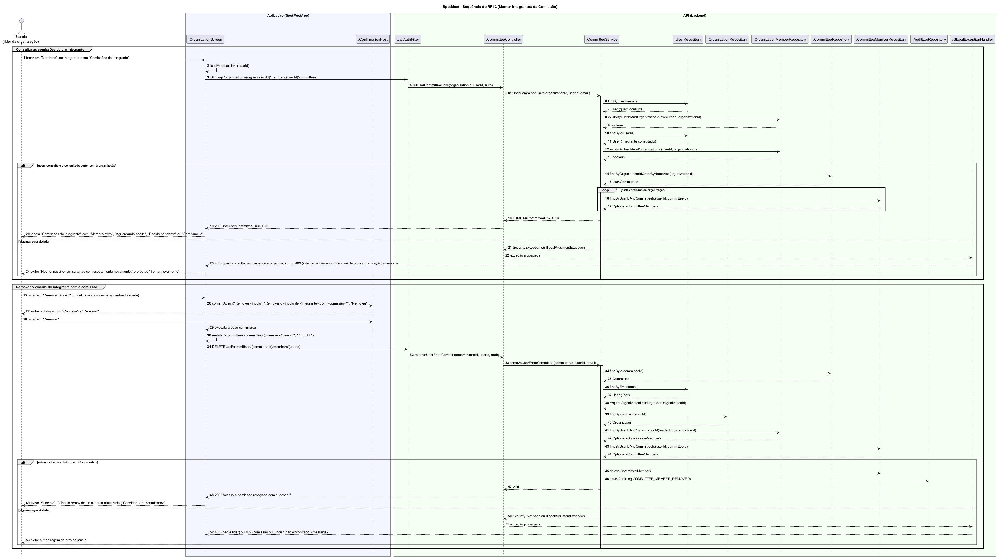

Fonte: próprio autor

#### RF14 – Alterar Senha

| Campo | Descrição |
|---|---|
| Função | Altera a senha do usuário autenticado e encerra as sessões abertas da conta. |
| Descrição | Confere a senha atual com o hash BCrypt gravado na coluna password da tabela users do banco de dados e, se estiver correta e a nova senha for diferente, grava na mesma coluna o hash BCrypt (custo 12) da nova senha. Na mesma transação grava em tokens_valid_after o instante da troca, o que invalida todos os JWT emitidos antes dele, inclusive o da requisição. A conferência da senha atual tem limite de tentativas por conta: a décima falha em 15 minutos bloqueia novas tentativas por 15 minutos. Depois da gravação, o sistema agenda um aviso por e-mail. |
| Entradas | Objeto do tipo ChangePasswordDTO contendo currentPassword (string obrigatória, @NotBlank, sem regra de formato) e newPassword (string obrigatória, @NotBlank, @Pattern `^(?=.*[a-z])(?=.*[A-Z])(?=.*\d).{6,}$`: no mínimo 6 caracteres, com pelo menos uma letra maiúscula, uma minúscula e um número; o DTO não define tamanho máximo). O e-mail do usuário não vai no corpo: é obtido do JWT do cabeçalho Authorization (objeto Authentication). O campo "Confirmar nova senha" é conferido só no aplicativo e não é enviado. |
| Origem | Usuário. |
| Saída | Respostas HTTP do método changeMyPassword da classe UserController: 200 com {success: true, message: "Senha alterada com sucesso!"}; 400 com {success: false, message} quando o UserService lança IllegalArgumentException ("A senha atual está incorreta.", "A nova senha deve ser diferente da senha atual." ou "Usuário não encontrado."); 500 com {success: false, message: "Erro ao alterar senha: " seguida da causa} em erro inesperado. Geradas por outras classes: 400 com {status, error, message, errors} do GlobalExceptionHandler quando o ChangePasswordDTO viola @NotBlank ou @Pattern (o método do controller não chega a executar); 429 do GlobalExceptionHandler, a partir da TooManyAttemptsException relançada pelo controller, com {success: false, error: "TOO_MANY_ATTEMPTS", message: "Muitas tentativas. Aguarde e tente novamente em alguns minutos.", retryAfterSeconds} e o cabeçalho Retry-After; 401 sem corpo (SecurityConfig, quando o JwtAuthFilter não autentica a requisição: JWT ausente, inválido, expirado ou emitido antes de users.tokens_valid_after). |
| Destino | Usuário (tela SettingsScreen, seção "Segurança", e depois a tela de login) e caixa de e-mail da conta (aviso de senha alterada). |
| Ação | **Alteração:** A aba "Ajustes" (SettingsScreen, título "Ajustes", subtítulo "Perfil, segurança e preferências") tem as seções "Perfil", "Segurança" e "Preferências". Em "Segurança", o usuário vê "Altere sua senha" ("Após salvar, entre novamente com a nova senha."), os campos "Senha atual", "Nova senha" e "Confirmar nova senha", cada um com botão para mostrar ou ocultar o texto, e a lista de requisitos da senha. Ao tocar em "Alterar Senha", o método handleChangePassword confere: senha atual preenchida ("Informe a sua senha atual."), nova senha conforme PASSWORD_REGEX ("Use pelo menos 6 caracteres, com maiúscula, minúscula e número."), confirmação igual ("A confirmação não coincide com a nova senha.") e nova senha diferente da atual ("A nova senha deve ser diferente da senha atual."). Em caso positivo, se o bloqueio biométrico está habilitado, pede a confirmação da biometria (confirmIdentity do BiometricContext); sem a confirmação, exibe "Confirme com a biometria para alterar a senha." e não envia nada. Confirmada (ou sem biometria habilitada), envia PUT /api/users/me/password com currentPassword e newPassword. O JwtAuthFilter valida a assinatura, a validade e a emissão posterior a tokens_valid_after e carrega a conta. O método changeMyPassword da classe UserController chama changePassword(authenticatedEmail, dto) da classe UserService, em transação: carrega o usuário com findByEmailForUpdate da interface UserRepository (bloqueio de linha); chama verify(CURRENT_PASSWORD, "user:" + id, ...) de AuthenticationAttempts, cuja verificação compara a senha atual com o hash pelo método matches do PasswordEncoder; recusa a nova senha se matches indicar que ela é igual à gravada; gera o hash com encode; grava password e tokens_valid_after pelo método save de UserRepository; chama sendPasswordChangedEmail da classe EmailService, que registra o envio para depois do commit; e grava a auditoria por AuditLogRepository. Depois do commit, o EmailService repassa o texto ao EmailDeliveryService, executado de forma assíncrona (emailExecutor), e a resposta HTTP não espera o SMTP.  **Depois da resposta 200:** o aplicativo chama keepForPasswordChange do BiometricContext, que, com a biometria habilitada, guarda no aparelho só a preferência (habilitada e prazo, sem o token, por saveBiometricRearm) para o próximo login, e depois chama endSession, que limpa os campos, chama signOut do AuthContext (limpa token, papel, nome, e-mail e id e notifica os assinantes, entre eles o BiometricContext, que remove a sessão guardada pelo bloqueio biométrico), substitui a pilha de navegação pela tela Auth no modo login e exibe o aviso "Sucesso: Senha alterada com sucesso. Entre novamente com a nova senha.". Se a API responde 400 com "A senha atual está incorreta." ou "A nova senha deve ser diferente da senha atual.", a mensagem aparece sob o campo "Senha atual" ou "Nova senha"; nos demais erros aparece no formulário, e a sessão não é encerrada. Um JWT revogado recebe 401 na próxima requisição protegida, e o SessionGuard encerra a sessão local com o aviso "Sessão encerrada: Sua sessão foi encerrada. Entre novamente.".  **Administrador:** a conta administrativa não tem caixa de e-mail real, por isso a troca usa só a senha atual. Na aba "Controles" (AdminControlsScreen), o cartão "Senha de acesso" tem o botão "Alterar senha", que abre a folha com os mesmos três campos e a lista de requisitos e envia o mesmo PUT /api/users/me/password. Com sucesso, a sessão é encerrada e o aviso é "Senha alterada: Entre novamente com a nova senha."; com a senha atual errada, a mensagem do servidor aparece na folha. |
| Pré-condição | Usuário autenticado: JWT válido (assinatura, validade de 24 horas e emissão posterior a users.tokens_valid_after) e conta com e-mail verificado. A aba "Ajustes" só é exibida para contas com perfil global USER; as abas de ADMIN e SYSADMIN não têm Ajustes, embora a rota aceite qualquer perfil autenticado. O usuário deve conhecer a senha atual, e a conta não pode estar em pausa por dez falhas de senha atual nos últimos 15 minutos (resposta 429). |
| Pós-condição | Sucesso: users.password guarda o hash da nova senha; users.tokens_valid_after guarda o instante da troca e nenhum JWT anterior (inclusive o do aparelho atual) é aceito; a ação PASSWORD_CHANGED consta em audit_logs; o aviso por e-mail está agendado; o aplicativo está na tela de login, sem sessão, e o usuário entra com a nova senha; se a biometria estava habilitada, ela é religada nesse login com uma confirmação da digital, sem o convite (RF36). Falha: nenhuma coluna é alterada (a transação é desfeita), a sessão continua aberta e o aplicativo exibe a mensagem de erro; cada senha atual incorreta conta para o limite de tentativas. |
| Efeitos colaterais | Registro em audit_logs com a ação PASSWORD_CHANGED. E-mail com o assunto "SpotMeet - Senha alterada", enviado após o commit e sem senha nem código (sem SMTP configurado, apenas um registro genérico no log do servidor). Revogação de todas as sessões da conta por tokens_valid_after. Remoção da sessão guardada pelo bloqueio biométrico no aparelho, pelo signOut, mantendo apenas a preferência de biometria (sem token) até o próximo login. Contagem de falhas de senha atual em AuthenticationAttempts, na memória da JVM. |

**Figura 24 – Diagrama de sequência do RF14**

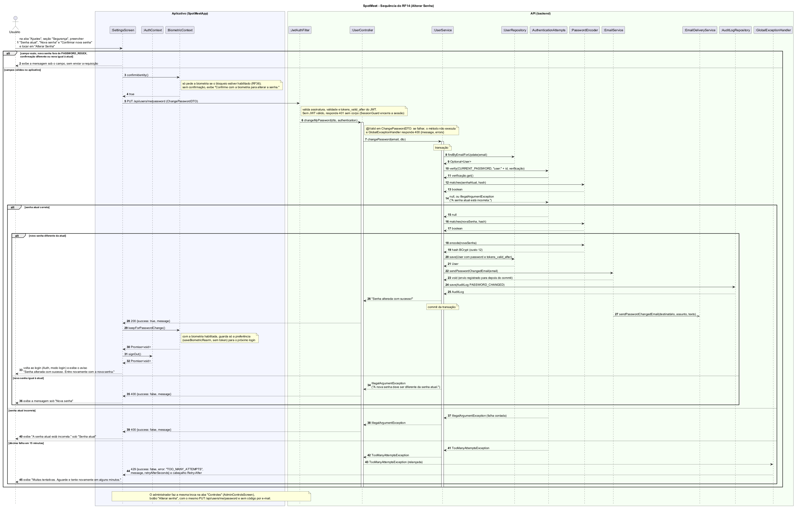

Fonte: próprio autor

#### RF15 – Recuperar Conta

| Campo | Descrição |
|---|---|
| Função | Permite ao usuário que esqueceu a senha definir uma nova senha por meio de um código de seis dígitos enviado ao e-mail cadastrado. |
| Descrição | **Solicitação:** gera, com SecureRandom, um código numérico de 6 dígitos (zeros à esquerda valem) e grava na tabela users apenas o hash BCrypt (custo 12) do código, na coluna recovery_token, e a validade de 5 minutos na coluna recovery_token_expires_at (constante CODE_EXPIRATION_MINUTES da classe UserService). O código vai por e-mail. A resposta é a mesma para e-mail cadastrado e não cadastrado, e o trabalho de hash é feito com ou sem conta. Um novo pedido substitui o código anterior.  **Validação:** confere o código informado com o hash e a validade, sem consumi-lo.  **Redefinição:** confere o código de novo, grava na coluna password o hash BCrypt da nova senha, apaga recovery_token e recovery_token_expires_at, marca email_verified como verdadeiro e grava em tokens_valid_after o instante da redefinição (os JWT anteriores deixam de valer). A Validação e a Redefinição compartilham a finalidade RECOVERY do limite de tentativas, por e-mail: a décima falha em 15 minutos bloqueia novas tentativas por 15 minutos. |
| Entradas | **Solicitação:** objeto do tipo ForgotPasswordDTO contendo email (obrigatório, @NotBlank e @Email com ValidationPatterns.EMAIL: até 255 caracteres, até 64 antes do @, domínio com ponto e rótulos de até 63 caracteres, terminação de 2 a 63 letras). O serviço usa o e-mail sem espaços nas pontas e em minúsculas.  **Validação:** objeto do tipo VerifyRecoveryCodeDTO contendo email (mesma regra) e token (obrigatório, @Pattern com ValidationPatterns.OTP: exatamente seis dígitos de 0 a 9).  **Redefinição:** objeto do tipo ResetPasswordDTO contendo email (mesma regra), token (seis dígitos) e newPassword (obrigatória, `^(?=.*[a-z])(?=.*[A-Z])(?=.*\d).{6,}$`: no mínimo 6 caracteres, com maiúscula, minúscula e número; sem tamanho máximo no DTO). O campo "Confirmar nova senha" é conferido só no aplicativo. |
| Origem | Usuário. |
| Saída | **Solicitação:** 200 com {success: true, message: "Verifique o seu e-mail."} sempre que o DTO é válido, inclusive para e-mail não cadastrado (método forgotPassword da classe AuthController); não há devCode nem outro campo de código na resposta. 400 com {status, error, message, errors} do GlobalExceptionHandler quando o DTO viola @NotBlank ou @Email.  **Validação:** 200 com {success: true, message: "Código validado. Defina a nova senha."}; 400 com {success: false, message} pelo AuthController, para IllegalArgumentException do UserService ("Código de recuperação inválido ou inexistente.", "Código de recuperação incorreto." ou "O código de recuperação expirou. Solicite um novo código no aplicativo."); 400 do GlobalExceptionHandler se o token não tem seis dígitos; 429 do GlobalExceptionHandler na décima falha (o AuthController não captura a TooManyAttemptsException), com {success: false, error: "TOO_MANY_ATTEMPTS", message, retryAfterSeconds} e o cabeçalho Retry-After.  **Redefinição:** 200 com {success: true, message: "Senha redefinida com sucesso! Você já pode acessar sua conta com a nova senha."}; 400 com {success: false, message} pelo AuthController (código incorreto, expirado ou inexistente, como na Validação); 400 e 429 do GlobalExceptionHandler, como acima. |
| Destino | Usuário (mensagens da tela AuthScreen) e caixa de e-mail cadastrada (código de recuperação e, ao final, aviso de senha alterada). |
| Ação | **Solicitação:** Na tela de login (AuthScreen, cartão "Acessar conta"), o usuário toca em "Esqueci minha senha". A tela "Esqueci minha senha" ("Etapa 1 de 3. Informe seu e-mail para receber um código.") tem o campo "E-mail cadastrado". Ao tocar em "Enviar Código por E-mail", o aplicativo confere se o e-mail foi informado e tem formato válido (isValidEmail) e envia POST /api/auth/forgot-password com o e-mail normalizado. A rota é pública (/api/auth/**), então a requisição não passa pelo JwtAuthFilter. O método forgotPassword da classe AuthController chama forgotPassword(dto) da classe UserService, em transação: findByEmailForUpdate de UserRepository (e-mail em minúsculas); generateCode (método privado) e encode do PasswordEncoder, executados com ou sem conta; se a conta existe, save de UserRepository com o hash e a validade, sendPasswordRecoveryEmail da classe EmailService e a auditoria. O e-mail sai depois do commit, de forma assíncrona (EmailDeliveryService, executor emailExecutor), e a resposta não espera o SMTP. O aplicativo exibe o aviso "Código enviado: Verifique o seu e-mail.", bloqueia o reenvio por 60 segundos e passa para a Etapa 2.  **Validação:** A tela "Confirmar código" ("Etapa 2 de 3. Digite o código recebido por e-mail.") mostra o e-mail informado e o campo "Código de verificação" (seis caixas que aceitam só dígitos, com as dicas "Digite o código recebido" e "Validade do código: até 5 minutos." abaixo das caixas). Ao completar os seis dígitos, o aplicativo envia a verificação automaticamente; o botão "Validar Código" repete a tentativa. Envia POST /api/auth/verify-recovery-code, tratada pelo método verifyRecoveryCode da classe AuthController, que chama verifyRecoveryCode(dto) da classe UserService. Esse método usa o método privado resolveRecoveryToken(email, token), que chama verify(RECOVERY, email, ...) de AuthenticationAttempts; a verificação (validateRecoveryToken) localiza a conta por findByEmailForUpdate, compara o código com o hash pelo método matches do PasswordEncoder e confere a validade, sem consumir o código. Com sucesso, o aplicativo mostra a Etapa 3; com erro, mostra a mensagem sob o campo. O link de reenvio fica desabilitado com "Reenviar código em 60s" em contagem regressiva e depois exibe "Não recebeu? Reenviar código", que repete a Solicitação (o novo código invalida o anterior). O link "E-mail errado? Alterar e-mail" volta à Etapa 1 e mantém o endereço digitado.  **Redefinição:** A tela "Criar nova senha" ("Etapa 3 de 3. Defina e confirme a nova senha.") tem os campos "Nova senha" e "Confirmar nova senha" e a lista de requisitos da senha. Ao tocar em "Atualizar Senha", o aplicativo confere o código (seis dígitos), PASSWORD_REGEX e a igualdade com a confirmação e envia POST /api/auth/reset-password com email, token e newPassword. O método resetPassword da classe AuthController chama resetPassword(dto) da classe UserService, em transação: valida o código com resolveRecoveryToken (a mesma conferência da Etapa 2), gera o hash da nova senha com encode, grava password, tokens_valid_after, recovery_token e recovery_token_expires_at nulos e email_verified verdadeiro pelo método save, chama sendPasswordChangedEmail da classe EmailService e grava a auditoria. O aplicativo exibe o aviso "Sucesso" com a mensagem recebida, limpa todos os campos e volta ao login. O link "Voltar ao código de verificação" retorna à Etapa 2 sem enviar nada e limpa as senhas digitadas. |
| Pré-condição | **Solicitação:** conhecer o e-mail de uma conta cadastrada (a recuperação vale para qualquer perfil, inclusive ADMIN e SYSADMIN) e ter acesso à caixa desse e-mail. Não é preciso estar autenticado. Sem conta com esse e-mail, a resposta é a mesma, mas nenhum código é gravado ou enviado.  **Validação:** existir um código gravado na Solicitação para a conta, com no máximo 5 minutos, e a conta não estar em pausa por dez falhas de código em 15 minutos.  **Redefinição:** o mesmo código, ainda válido (a Validação não o consome), e uma nova senha que atenda à regra de formato. |
| Pós-condição | **Solicitação:** com conta existente, recovery_token e recovery_token_expires_at estão gravados (o código anterior deixa de valer) e o e-mail está agendado; o aplicativo mostra a Etapa 2 em qualquer caso.  **Validação:** nada é gravado. Com sucesso, o aplicativo mostra a Etapa 3; com código incorreto ou expirado, mostra a mensagem e permanece na Etapa 2, e a falha conta para o limite (pausa de 15 minutos na décima, resposta 429).  **Redefinição:** com sucesso, a senha da conta é a nova, o código é apagado e não pode ser reutilizado, a conta fica com e-mail verificado, todos os JWT anteriores deixam de valer e o aplicativo volta ao login; em falha, a senha e o código permanecem como estavam e a mensagem é exibida. |
| Efeitos colaterais | **Solicitação:** e-mail com o assunto "SpotMeet - Recuperação de Senha", contendo o código e a validade de 5 minutos, e registro em audit_logs com a ação PASSWORD_RECOVERY_REQUESTED, ambos somente quando a conta existe. Sem SMTP configurado, o código aparece apenas no log local do servidor, nunca na resposta.  **Validação:** contagem de falhas em AuthenticationAttempts (memória da JVM); nenhum registro no banco.  **Redefinição:** registro em audit_logs com a ação PASSWORD_RESET; e-mail com o assunto "SpotMeet - Senha alterada"; tokens_valid_after atualizado (revoga as sessões); email_verified passa a verdadeiro. |

**Figura 25 – Diagrama de sequência do RF15**

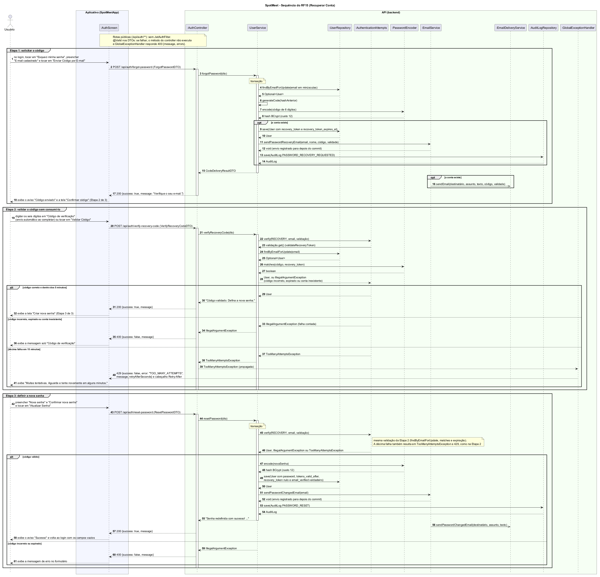

Fonte: próprio autor

#### RF16 – Alterar Dados Pessoais

| Campo | Descrição |
|---|---|
| Função | Consulta e altera os dados pessoais do usuário autenticado: nome, biografia, disponibilidade e foto de perfil. |
| Descrição | **Consulta:** lê da tabela users do banco de dados o perfil da conta autenticada (id, name, email, bio, availability_status, preferred_theme e role).  **Nome e biografia:** atualiza as colunas name e bio.  **Disponibilidade:** atualiza a coluna availability_status (PRESENT, ONLINE, BUSY ou AWAY); o aplicativo oferece Presente, Ausente e Ocupado e a grava junto com o tema (RF17), na mesma requisição.  **Foto:** mantém na tabela user_profile_photos, com no máximo um registro por usuário, a imagem em JPEG quadrada de até 512 pixels (coluna image_data, tipo bytea) e uma versão em UUID (coluna version). O e-mail é exibido só para leitura e é alterado pelo RF18; o tema é tratado no RF17. |
| Entradas | **Consulta:** nenhuma além do JWT do cabeçalho Authorization (a conta vem do token; o aplicativo não envia id nem e-mail).  **Nome e biografia:** objeto do tipo UpdateUserProfileDTO contendo name (opcional; se enviado, depois de remover os espaços das pontas, inclusive os de Unicode (NAME_WHITESPACE), deve ter de 2 a 100 caracteres, @Size) e bio (opcional, até 500 caracteres, @Size; gravada sem espaços nas pontas, e uma bio vazia apaga o texto). O aplicativo envia só name e bio nesta operação.  **Disponibilidade:** o mesmo UpdateUserProfileDTO, com availabilityStatus (string opcional, convertida para maiúsculas e aceita se for PRESENT, ONLINE, BUSY ou AWAY; valor desconhecido é ignorado sem erro).  **Foto:** requisição multipart/form-data com uma parte "photo": imagem JPEG ou PNG (o Content-Type é conferido junto do formato real do arquivo), quadrada, de 1 a 512 pixels de lado e com até 1 MB (limites também em spring.servlet.multipart: 1 MB por arquivo e 2 MB por requisição). O aplicativo escolhe a imagem na Galeria ou na Câmera (recorte quadrado 1:1; aceita imagens de até 20 MB e 40 megapixels), reduz para no máximo 512 por 512 pixels e envia JPEG. A remoção não tem corpo. |
| Origem | Usuário. |
| Saída | **Consulta:** 200 com UserProfileResponseDTO (id, name, email, bio, availabilityStatus, preferredTheme e role); 404 com o texto da mensagem se a conta não é encontrada e 500 com "Erro ao buscar perfil: " seguida da causa (ambos pelo método getMyProfile da classe UserController).  **Nome, biografia e disponibilidade:** 200 com UserProfileResponseDTO dos dados gravados; 400 com o texto da mensagem se a conta não é encontrada e 500 com "Erro ao atualizar perfil: " seguida da causa (método updateMyProfile da classe UserController); 400 com {status, error, message, errors} do GlobalExceptionHandler quando name ou bio violam @Size.  **Foto:** consulta e gravação respondem 200 com ProfilePhotoResponseDTO {userId, imageBase64, version} (imageBase64 e version nulos quando não há foto); a remoção responde 204 sem corpo, inclusive quando não havia foto. Erros do ProfilePhotoController, com {message} e Cache-Control: no-store: 400 "Envie uma foto JPEG ou PNG quadrada, com até 512 × 512 pixels e 1 MB." (InvalidProfilePhotoException) ou "Selecione uma foto para enviar." (parte ausente); 401 "Usuário não autenticado."; 503 "Não foi possível acessar a foto de perfil. Tente novamente.". Parte maior que o limite: 413 "A foto deve ter no máximo 1 MB." (MaxUploadSizeExceededException, tratada pelo GlobalExceptionHandler). JWT ausente, inválido ou revogado: 401 sem corpo (SecurityConfig). |
| Destino | Usuário (tela SettingsScreen, seções "Perfil" e "Preferências"; o nome confirmado passa a valer na sessão do aplicativo). |
| Ação | **Consulta:** Ao receber o foco, a aba "Ajustes" (SettingsScreen) exibe "Carregando perfil..." e envia GET /api/users/me. O JwtAuthFilter autentica a requisição; o método getMyProfile da classe UserController chama getMyProfile(email) da classe UserService, que usa findByEmail da interface UserRepository e devolve UserProfileResponseDTO.fromEntity. Na seção "Perfil", a tela preenche "Nome completo", "Biografia (opcional)" (com o contador "0 / 500") e "E-mail" (somente leitura) e marca, em "Preferências", a disponibilidade e o tema. Se a consulta falha, mostra a mensagem e o botão "Tentar novamente", sem liberar o formulário. A leitura acontece ao receber o foco ou ao trocar o token, sem repetição periódica, para não repor o que o usuário digita. Ao receber o foco, o ProfilePhotoEditor também pede a foto (GET /api/users/me/photo, ProfilePhotoController, ProfilePhotoService e findByUserId de UserProfilePhotoRepository); sem foto, exibe o avatar com a inicial do nome.  **Nome e biografia:** O usuário altera "Nome completo" e "Biografia (opcional)" e toca em "Salvar Alterações". O aplicativo confere nome de 2 a 100 caracteres (isValidName) e biografia de até 500 e envia PUT /api/users/me com name e bio. O método updateMyProfile da classe UserController chama updateMyProfile(email, dto) da classe UserService, que localiza o usuário (findByEmail), grava o nome sem espaços nas pontas somente se não estiver em branco, grava a biografia sempre que enviada, salva pelo método save e registra a auditoria (uma falha de auditoria não bloqueia a resposta). O aplicativo atualiza o nome na sessão (updateSession do AuthContext), emite o evento PROFILE_MUTATED e exibe o aviso "Sucesso: Perfil salvo com sucesso."; havendo prévia de foto pendente, salva também a foto (save com quiet) e exibe "Perfil e foto salvos com sucesso." ou, se a foto falhar, "Perfil salvo: Os dados do perfil foram salvos, mas a foto não. Veja o aviso abaixo da foto.". Erros do servidor aparecem sob os campos ou como "Não foi possível salvar o perfil. Confira os campos e tente novamente.". O texto "Alterações não salvas" aparece enquanto há campo modificado ou prévia de foto, e só então o botão "Salvar Alterações" fica habilitado; sem alteração, ele aparece esmaecido.  **Disponibilidade:** Na seção "Preferências", o grupo "DISPONIBILIDADE" oferece "Presente", "Ausente" e "Ocupado". Ao tocar em "Salvar preferências", o aplicativo envia PUT /api/users/me com availabilityStatus e preferredTheme (sequência do RF17); o método updateMyProfile da classe UserService aplica o status como descrito nas Entradas. O aviso é "Sucesso: Preferências salvas com sucesso.".  **Foto:** Na seção "Perfil", o ProfilePhotoEditor mostra a foto ("Foto de perfil") e os botões "Galeria" e "Câmera". Ao tocar em um deles, o método select do ProfilePhotoContext chama pickProfilePhoto (profilePhotoPicker), que abre o seletor do sistema (a câmera pede permissão ao tocar), recorta o centro em quadrado, reduz a no máximo 512 por 512 pixels e gera um JPEG no cache do aparelho; enquanto a galeria, a câmera e o recorte estão abertos, o aplicativo avisa o BiometricContext (allowExternalScreen), e o bloqueio biométrico só é aplicado se a saída passar de 5 minutos (RF02); a tela mostra a prévia ("Confira a foto antes de salvar.") com os botões "Salvar foto" e "Cancelar foto". Ao tocar em "Salvar foto", o método save envia PUT /api/users/me/photo (multipart, prazo de 15 segundos), com a prévia anexada como File do expo-file-system, o formato que o fetch do Expo SDK 57 sabe enviar. O método save da classe ProfilePhotoController chama save(email, arquivo) da classe ProfilePhotoService, em transação: carrega o usuário com findByEmailForUpdate e exige e-mail verificado; valida e regrava a imagem em normalizeImage (confere tamanho, Content-Type, formato real e dimensões antes de decodificar, e gera um novo JPEG RGB sem metadados); cria ou substitui o registro pelo método save de UserProfilePhotoRepository (nova version em UUID) e registra a auditoria. O aplicativo exibe a foto confirmada e o aviso "Sucesso: Foto de perfil salva com sucesso."; em erro, mantém a prévia e exibe o motivo: "A foto passou do limite de 1 MB. Escolha outra imagem." (HTTP 413), "O servidor não aceitou esta imagem. Escolha outra foto." (HTTP 400) ou "Não foi possível salvar a foto. Verifique a conexão e tente novamente.". A prévia continua ao trocar de seção dentro de "Ajustes" (depois do diálogo descrito abaixo) e é descartada quando "Ajustes" perde o foco. Se tocar em "Salvar Alterações" com uma prévia pendente, a foto é salva junto do perfil. Para remover, o usuário toca em "Remover foto" (exibido só quando há foto) e confirma "Remover" em "Remover foto: Deseja remover sua foto de perfil e voltar ao avatar padrão?". O aplicativo envia DELETE /api/users/me/photo; o método remove da classe ProfilePhotoService apaga o registro pelo método delete de UserProfilePhotoRepository e grava a auditoria somente se havia foto. O aplicativo volta ao avatar e exibe "Sucesso: Foto de perfil removida.". A foto só é consultada, gravada ou removida com o aplicativo desbloqueado e em primeiro plano; trocar de conta ou de servidor descarta a prévia.  **Alterações não salvas:** com nome, biografia ou foto alterados e não salvos (ou disponibilidade e tema, na seção "Preferências"), tocar em outra seção, em outra aba ou no botão voltar do Android abre o diálogo "Alterações não salvas" ("Você alterou o perfil e ainda não salvou. Deseja salvar antes de sair?") com "Continuar editando", "Descartar" e "Salvar". "Salvar" grava como o botão da seção e só então segue; se a gravação falha, a tela continua com a mensagem. "Descartar" volta aos valores gravados, descarta a prévia da foto e segue. "Continuar editando" fecha o diálogo. Ao voltar a "Ajustes", a tela abre sempre na seção "Perfil". |
| Pré-condição | **Em todas as operações:** usuário autenticado com JWT válido e e-mail verificado. A aba "Ajustes" só é exibida para contas com perfil global USER.  **Nome e biografia:** perfil carregado (a tela não libera o formulário se a consulta falhou).  **Disponibilidade:** perfil carregado e seção "Preferências" aberta.  **Foto:** para a "Câmera", permissão de câmera concedida no aparelho; para salvar, uma prévia escolhida na mesma sessão; para remover, confirmação do usuário (sem foto, o botão "Remover foto" não é exibido). |
| Pós-condição | **Consulta:** a tela exibe os dados atuais; nada é alterado.  **Nome e biografia:** com sucesso, users.name e users.bio estão atualizados, o nome da sessão do aplicativo é o confirmado pela API e a ação PROFILE_UPDATED consta em audit_logs; em falha (nome ou biografia fora dos limites, erro do servidor), nada é gravado e a mensagem é exibida sob o campo.  **Disponibilidade:** users.availability_status guarda o valor escolhido (junto do tema, RF17); em falha, nada é gravado.  **Foto:** com sucesso, user_profile_photos tem um registro da conta com a imagem JPEG normalizada e uma nova version, e a tela exibe a foto; depois da remoção não há registro e a tela exibe o avatar. Em falha, a foto anterior (ou a ausência dela) permanece e a mensagem é exibida. |
| Efeitos colaterais | **Consulta:** Nenhum.  **Nome, biografia e disponibilidade:** registro em audit_logs com a ação PROFILE_UPDATED a cada gravação de PUT /api/users/me (o detalhe traz o status e o tema); o aplicativo emite o evento PROFILE_MUTATED ao salvar o perfil ou as preferências (nenhuma tela o assina hoje).  **Foto:** registro com a ação PROFILE_PHOTO_UPDATED ao salvar e PROFILE_PHOTO_REMOVED ao remover uma foto existente. A cópia temporária da prévia no cache do aparelho é apagada ao cancelar, salvar ou sair. |

**Figura 26 – Diagrama de sequência do RF16**

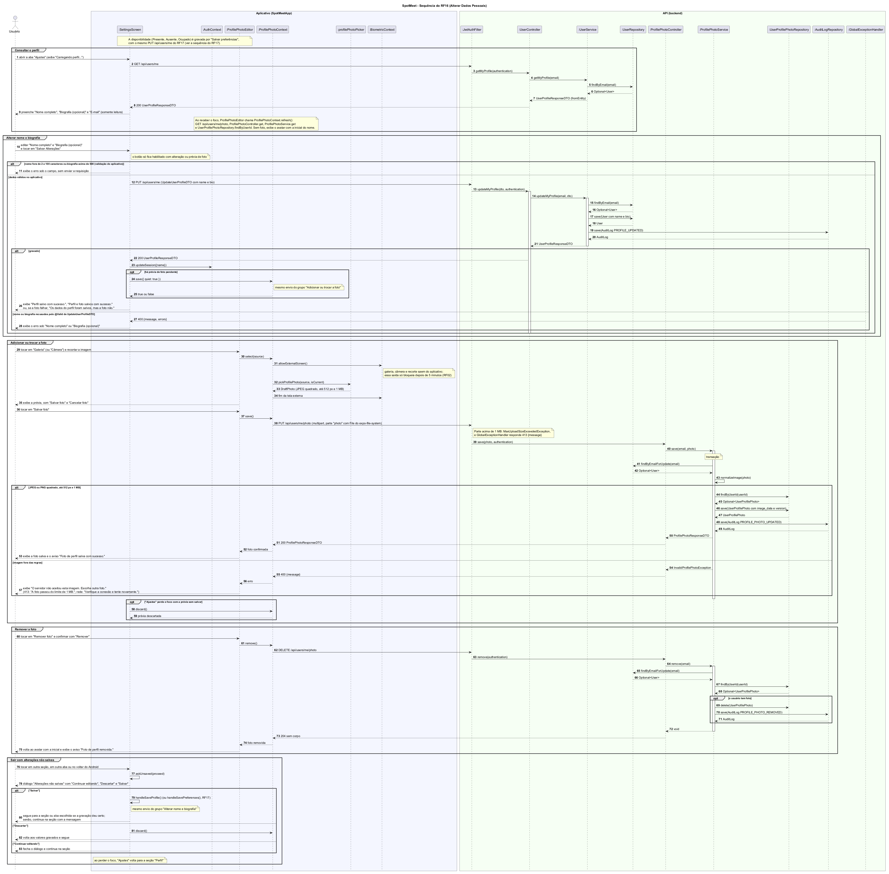

Fonte: próprio autor

#### RF17 – Definir Tema

| Campo | Descrição |
|---|---|
| Função | Define o tema visual (claro ou escuro) do aplicativo para o usuário autenticado e grava a preferência para os próximos acessos. |
| Descrição | Aplica no aplicativo o tema escolhido, com prévia imediata e sem envio ao servidor, e, ao salvar, grava a preferência na coluna preferred_theme da tabela users do banco de dados. Depois do login, o aplicativo lê o tema gravado e o aplica. Sem sessão, o tema é escuro. |
| Entradas | **Carregamento:** nenhuma além do JWT do cabeçalho Authorization.  **Seleção:** toque em "Claro" ou "Escuro" no grupo "TEMA" da seção "Preferências" (valores LIGHT ou DARK do tipo ThemeType); não gera requisição.  **Gravação:** objeto do tipo UpdateUserProfileDTO contendo preferredTheme (string opcional, convertida para maiúsculas e aceita se for LIGHT, DARK ou SYSTEM, os valores do enum PreferredTheme da classe User; valor desconhecido é ignorado sem erro). O aplicativo oferece e envia apenas LIGHT e DARK, junto com availabilityStatus (RF16). |
| Origem | Usuário. |
| Saída | **Carregamento:** 200 com UserProfileResponseDTO, cujo campo preferredTheme é DARK quando a coluna está nula (como no RF16). O aplicativo só aplica LIGHT ou DARK.  **Gravação:** 200 com UserProfileResponseDTO dos dados gravados, incluindo preferredTheme; 400 com o texto da mensagem se a conta não é encontrada e 500 com "Erro ao atualizar perfil: " seguida da causa (método updateMyProfile da classe UserController). O aplicativo só aceita a resposta se preferredTheme for LIGHT ou DARK e a disponibilidade for PRESENT, AWAY, BUSY ou ONLINE. |
| Destino | Usuário (cores do aplicativo e mensagem da tela SettingsScreen). |
| Ação | **Carregamento:** Quando há sessão, o ThemeProvider (arquivo ThemeContext) chama loadThemeFromProfile, que envia GET /api/users/me (getMyProfile de UserController e de UserService, como no RF16) e aplica preferredTheme se for LIGHT ou DARK. A resposta é descartada se a sessão ou a escolha mudou enquanto ela chegava. Sem sessão, e ao encerrar a sessão, o tema é DARK.  **Seleção:** Em "Ajustes", seção "Preferências", o grupo "TEMA" mostra "Claro" e "Escuro" com uma miniatura de cada um e o texto "O tema muda na prévia. Salve as preferências para manter a escolha; sair de Ajustes desfaz a prévia não salva.". Ao tocar numa opção, o aplicativo chama setTheme(tema, false) do ThemeContext, que troca as cores na hora, sem falar com o servidor. Toques rápidos são agrupados em intervalos de 150 ms, valendo a última seleção.  **Gravação:** Ao tocar em "Salvar preferências", o aplicativo envia PUT /api/users/me com availabilityStatus e preferredTheme. O método updateMyProfile da classe UserController chama updateMyProfile(email, dto) da classe UserService, que localiza o usuário (findByEmail), converte o valor para maiúsculas, aplica-o se corresponder ao enum PreferredTheme, grava pelo método save de UserRepository e registra a auditoria. O aplicativo guarda o tema devolvido como tema salvo, mantém as cores e exibe "Sucesso: Preferências salvas com sucesso.". Se a gravação falha, a prévia continua e a mensagem "Não foi possível salvar as preferências. Tente novamente." é exibida.  **Saída sem salvar:** com tema ou disponibilidade alterados, trocar de seção ou de aba abre o diálogo "Alterações não salvas" (RF16); "Descartar" e a perda de foco da aba "Ajustes" restauram o último tema gravado. O botão "Salvar preferências" só fica habilitado quando há alteração. |
| Pré-condição | **Carregamento:** usuário autenticado com JWT válido e e-mail verificado. Contas ADMIN e SYSADMIN também recebem o tema gravado, mas não têm a aba "Ajustes" para alterá-lo.  **Seleção e gravação:** usuário autenticado com perfil global USER, perfil carregado e seção "Preferências" aberta. |
| Pós-condição | **Seleção:** o aplicativo exibe o tema escolhido como prévia; nada é gravado.  **Gravação:** com sucesso, users.preferred_theme guarda o tema, o aplicativo o exibe e o restaura nos próximos acessos, e a ação PROFILE_UPDATED consta em audit_logs; em falha, nada é gravado e a mensagem de erro é exibida (a prévia é desfeita ao sair da aba). |
| Efeitos colaterais | Registro em audit_logs com a ação PROFILE_UPDATED, cujo detalhe traz o tema ("tema=..."); o aplicativo emite o evento PROFILE_MUTATED. A mesma requisição grava também a disponibilidade enviada (RF16). |

**Figura 27 – Diagrama de sequência do RF17**

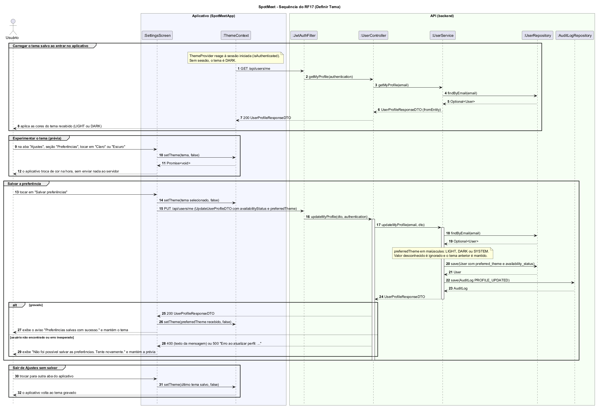

Fonte: próprio autor

#### RF18 – Alterar E-mail

| Campo | Descrição |
|---|---|
| Função | Altera o e-mail do usuário autenticado mediante dupla confirmação: um código enviado ao e-mail atual e outro enviado ao novo e-mail. |
| Descrição | Grava na tabela users o hash BCrypt do código do e-mail atual (current_email_change_token, com current_email_change_token_expires_at), o endereço pendente (pending_new_email) e o hash do código do novo e-mail (new_email_token, com new_email_token_expires_at). Cada código tem 6 dígitos, gerados com SecureRandom, e validade de 5 minutos (constante CODE_EXPIRATION_MINUTES da classe UserService). Ao final, substitui a coluna email pelo novo endereço, marca email_verified como verdadeiro, apaga as colunas temporárias e emite um novo JWT. A conferência de cada código tem limite de tentativas por conta (finalidades CURRENT_EMAIL e NEW_EMAIL): a décima falha em 15 minutos bloqueia novas tentativas por 15 minutos. A disponibilidade do novo e-mail (existsByEmail) é verificada depois da conferência do código atual e de novo na conclusão. |
| Entradas | **Etapa 1 (envio do código ao e-mail atual):** nenhuma além do JWT do cabeçalho Authorization, do qual vem o e-mail atual.  **Etapa 2 (confirmação do e-mail atual):** objeto do tipo ConfirmEmailChangeDTO contendo currentCode (obrigatório, exatamente seis dígitos, @Pattern com ValidationPatterns.OTP) e newEmail (obrigatório, @Email com ValidationPatterns.EMAIL: até 255 caracteres, até 64 antes do @, domínio com ponto e rótulos de até 63 caracteres, terminação de 2 a 63 letras). O serviço usa o endereço sem espaços nas pontas e em minúsculas, e o aplicativo o normaliza antes de enviar.  **Reenvio ao novo e-mail:** nenhuma além do JWT; o destino é o pending_new_email gravado, nunca um valor do cliente.  **Etapa 3 (conclusão):** objeto do tipo CompleteEmailChangeDTO contendo newEmailCode (obrigatório, exatamente seis dígitos). O cabeçalho Authorization com Bearer é obrigatório, pois dele se extrai a emissão original do JWT. |
| Origem | Usuário. |
| Saída | **Etapa 1:** 200 com {success: true, message: "Verifique o seu e-mail.", currentEmail}; 400 com {success: false, message} se a conta não é encontrada; 500 com {success: false, message: "Erro ao processar solicitação de troca de e-mail: " seguida da causa} (método requestEmailChange da classe UserController). Não há devCode.  **Etapa 2:** 200 com {success: true, message, newEmail}; 400 com {success: false, message} pelo UserController para "O novo e-mail não pode ser idêntico ao e-mail atual.", "Código de autorização do e-mail atual incorreto.", "O código de autorização expirou. Solicite um novo envio no aplicativo." e "O novo e-mail informado já está vinculado a outra conta no SpotMeet."; 400 com {status, error, message, errors} do GlobalExceptionHandler quando o DTO viola @NotBlank, @Pattern ou @Email; 429 do GlobalExceptionHandler, a partir da TooManyAttemptsException relançada pelo controller, com {success: false, error: "TOO_MANY_ATTEMPTS", message, retryAfterSeconds} e o cabeçalho Retry-After; 500 com {success: false, message: "Erro ao confirmar etapa 1 da troca de e-mail: " seguida da causa}.  **Reenvio:** 200 com {success: true, message, newEmail}; 400 com {success: false, message} ("Nenhuma troca de e-mail autorizada. Inicie o processo novamente." ou "O novo e-mail informado já foi cadastrado por outro usuário.").  **Etapa 3:** 200 com {success: true, message: "E-mail alterado com sucesso!", newEmail, token} (novo JWT); 400 com {success: false, message} pelo UserController para "Nenhuma solicitação de troca de e-mail pendente encontrada. Inicie o processo novamente.", "Código de ativação do novo e-mail incorreto.", "O código de ativação do novo e-mail expirou. Por favor, reinicie a solicitação." e "O novo e-mail informado já foi cadastrado por outro usuário."; 400 e 429 do GlobalExceptionHandler, como na Etapa 2; 401 com "Usuário não autenticado." (UserController, sem cabeçalho Bearer ou com JWT ilegível); 500 com {success: false, message: "Não foi possível concluir a alteração de e-mail."}.  Em todas as rotas, JWT ausente, inválido, expirado ou emitido antes de users.tokens_valid_after recebe 401 sem corpo (SecurityConfig). |
| Destino | Usuário (mensagens da folha de duas etapas e da tela SettingsScreen), caixa do e-mail atual (código de autorização) e caixa do novo e-mail (código de ativação). |
| Ação | **Etapa 1:** Em "Ajustes", seção "Perfil", o campo "E-mail" é somente leitura e traz o botão "Alterar". Ao tocar nele, o método openEmailChangeModal, se o bloqueio biométrico está habilitado, pede antes a confirmação da biometria (confirmIdentity do BiometricContext); sem a confirmação, exibe "Confirmação necessária: Confirme com a biometria para alterar o e-mail." e não abre a folha. Confirmada (ou sem biometria habilitada), abre a folha de duas etapas e envia POST /api/users/me/email-change/request. O JwtAuthFilter autentica a requisição; o método requestEmailChange da classe UserController chama requestEmailChange(authenticatedEmail) da classe UserService, em transação: carrega o usuário com findByEmailForUpdate de UserRepository, gera o código (generateCode) e o hash (encode do PasswordEncoder), grava current_email_change_token e a validade, apaga qualquer troca pendente anterior (pending_new_email, new_email_token e validade) pelo método save, chama sendCurrentEmailChangeCode da classe EmailService e registra a auditoria. O e-mail sai depois do commit, de forma assíncrona (EmailDeliveryService), e a resposta não espera o SMTP. A folha exibe "ETAPA 1 DE 2", "Confirme seu e-mail atual" e "Confira o código recebido em" seguido do e-mail atual, e o aviso "Código enviado: Verifique o seu e-mail.". O botão de reenvio fica bloqueado por 60 segundos ("Reenviar código em 60s") e depois exibe "Reenviar código para e-mail atual", que repete esta etapa.  **Etapa 2:** O usuário preenche "Novo e-mail" (exemplo "novo.email@exemplo.com") e "Código do e-mail atual" (seis dígitos). Com os seis dígitos e um novo e-mail válido e diferente do atual, o aplicativo envia a confirmação automaticamente (também ao terminar de editar o e-mail, se o código foi digitado antes); o botão "Avançar para Etapa 2" faz o mesmo manualmente. O aplicativo confere o código (isValidOtp), o formato do e-mail (isValidEmail) e se difere do atual, e envia POST /api/users/me/email-change/confirm com currentCode e newEmail. O método confirmEmailChange da classe UserController chama confirmEmailChange(authenticatedEmail, dto) da classe UserService, em transação: carrega o usuário (findByEmailForUpdate); recusa novo e-mail igual ao atual; chama verify(CURRENT_EMAIL, "user:" + id, ...) de AuthenticationAttempts, cuja verificação compara o código com o hash (matches do PasswordEncoder) e confere a validade; verifica por existsByEmail se o novo endereço pertence a outra conta; grava o hash do código de ativação (new_email_token), o endereço pendente (pending_new_email) e a validade e apaga o código do e-mail atual (uso único), tudo pelo método save; chama sendNewEmailConfirmationCode da classe EmailService (envio assíncrono após o commit) e registra a auditoria. A folha passa a "ETAPA 2 DE 2" ("Verifique o novo e-mail", "Digite o código enviado para" seguido do novo e-mail), com novo aviso "Código enviado" e nova espera de 60 segundos. Erros aparecem sob o campo do código. O botão "Reenviar código para novo e-mail" envia POST /api/users/me/email-change/resend-new, tratada por resendNewEmailCode nas classes UserController e UserService (findByEmailForUpdate, existsByEmail do endereço pendente, novo código e novo hash, save, sendNewEmailConfirmationCode e auditoria), sempre para o endereço já autorizado.  **Etapa 3:** O usuário digita o código em "Código do novo e-mail"; ao completar os seis dígitos o aplicativo confirma automaticamente, e o botão "Confirmar e Atualizar" repete a tentativa. Envia POST /api/users/me/email-change/complete com newEmailCode. O método completeEmailChange da classe UserController extrai do JWT a emissão original (extractIssuedAt da classe JwtUtil) e chama completeEmailChange(authenticatedEmail, dto) da classe UserService, em transação: carrega o usuário, exige a troca pendente (pending_new_email), chama verify(NEW_EMAIL, "user:" + id, ...) de AuthenticationAttempts com a conferência do código e da validade, confere de novo com existsByEmail que o endereço continua livre, grava o novo e-mail na coluna email, marca email_verified como verdadeiro, apaga as colunas temporárias pelo método save e registra a auditoria. O controlador gera o novo JWT por generateToken(novoEmail, papel, emissão original) da classe JwtUtil e o devolve. O aplicativo confere o e-mail e o token recebidos, chama updateSession do AuthContext para trocar o token e o e-mail da sessão (um nome ainda não salvo não é publicado), fecha a folha e exibe "Sucesso: E-mail atualizado com sucesso.". O link "Voltar" (Etapa 2) retorna à Etapa 1 com o aviso "Para alterar o endereço novamente, reenvie o código para o e-mail atual." e exige novo código do e-mail atual. |
| Pré-condição | **Etapa 1:** usuário autenticado com perfil global USER (a aba "Ajustes" não é exibida para ADMIN e SYSADMIN), JWT válido e e-mail verificado, com acesso à caixa do e-mail atual.  **Etapa 2:** o código do e-mail atual enviado na Etapa 1, ainda dentro de 5 minutos e não consumido (repetir a Etapa 1 invalida o anterior); novo e-mail diferente do atual e que não pertença a outra conta; acesso à caixa do novo e-mail; conta fora da pausa de 15 minutos por falhas do código do e-mail atual.  **Reenvio ao novo e-mail:** Etapa 2 concluída (pending_new_email e new_email_token gravados) e o novo e-mail ainda livre.  **Etapa 3:** Etapa 2 concluída, código do novo e-mail ainda dentro de 5 minutos, novo e-mail ainda livre e conta fora da pausa por falhas do código do novo e-mail. |
| Pós-condição | **Etapa 1:** o código do e-mail atual está gravado (hash e validade), o e-mail está agendado e qualquer troca pendente anterior foi apagada.  **Etapa 2:** com sucesso, o código do e-mail atual foi consumido, pending_new_email e new_email_token estão gravados, o e-mail ao novo endereço está agendado e a folha mostra a Etapa 2. Em falha, nada é gravado e a mensagem aparece sob o campo (a falha de código conta para o limite).  **Etapa 3:** com sucesso, users.email é o novo endereço, email_verified é verdadeiro, as colunas temporárias estão nulas, a sessão do aplicativo usa o novo e-mail e o novo JWT, o JWT anterior deixa de ser aceito (o e-mail faz parte do token) e a ação LGPD_EMAIL_CHANGED consta em audit_logs. Em falha, o e-mail da conta permanece o mesmo e a mensagem é exibida. |
| Efeitos colaterais | **Etapa 1:** e-mail ao endereço atual com o assunto "SpotMeet - Autorização de Alteração de E-mail (LGPD)"; registro em audit_logs com a ação LGPD_EMAIL_CHANGE_REQUESTED.  **Etapa 2:** e-mail ao novo endereço com o assunto "SpotMeet - Validação do Novo Endereço de E-mail"; registro LGPD_EMAIL_CHANGE_STEP1_CONFIRMED. Cada reenvio ao novo endereço repete o e-mail e registra LGPD_EMAIL_CHANGE_CODE_RESENT.  **Etapa 3:** registro LGPD_EMAIL_CHANGED, com o e-mail anterior e o novo no detalhe; novo JWT, que substitui o anterior na sessão do aplicativo e, se o bloqueio biométrico estiver ativo, na sessão guardada no aparelho; o endereço antigo fica livre para um novo cadastro, e o JWT antigo, que só traz o e-mail, não abre a conta nova (o cadastro grava tokens_valid_after).  Sem SMTP configurado, os códigos aparecem apenas no log local do servidor, nunca na resposta. |

**Figura 28 – Diagrama de sequência do RF18**

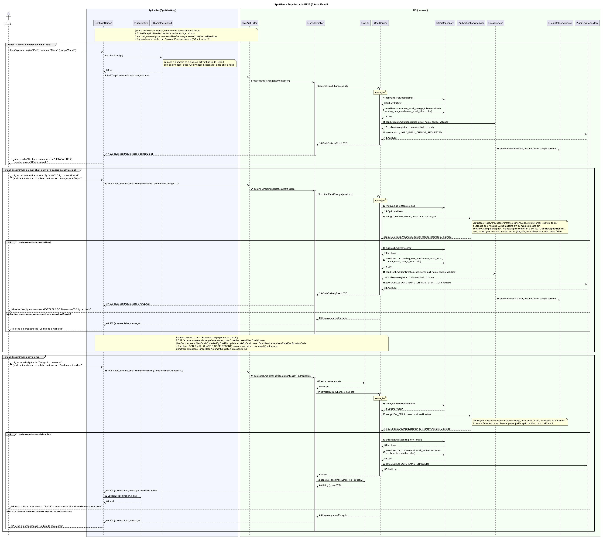

Fonte: próprio autor

#### RF19 – Inicializar Sistema

| Campo | Descrição |
|---|---|
| Função | Prepara o servidor e o aplicativo do SpotMeet para o uso: cria o banco de dados e as tabelas, provisiona a conta do administrador do sistema, define o endereço do servidor no aplicativo e informa ao usuário quando há uma versão mais nova do APK Android. |
| Descrição | **Servidor:** ao ser iniciado, o servidor cria o banco de dados configurado quando ele ainda não existe (classe DatabaseCreator), cria as tabelas ausentes e acrescenta as colunas novas das entidades sem apagar dados (Hibernate com spring.jpa.hibernate.ddl-auto=update) e, se não existir usuário com o e-mail sysadmin@spotmeet.com, insere na tabela users a conta "Administrador do Sistema", com perfil global SYSADMIN, e-mail verificado e senha padrão armazenada como hash BCrypt de custo 12. Uma conta já existente não é alterada.  **Abertura do aplicativo:** o aplicativo define o endereço do servidor na ordem: host salvo pelo usuário, variável EXPO_PUBLIC_API_HOST, servidor de desenvolvimento do Expo, host encontrado por busca na rede local e, por fim, o padrão da plataforma (10.0.2.2 no emulador Android e localhost nos demais). Em seguida exibe a tela de login.  **Endereço do servidor:** no rodapé da tela de login, o usuário informa o IP do servidor, procura o servidor na rede ou volta ao modo automático.  **Aviso de nova versão:** no APK Android de release, o aplicativo consulta ao servidor a versão publicada e, se for mais nova que a instalada, oferece abrir a página da build no Expo. O servidor só anuncia uma versão quando as três variáveis APP_ANDROID_* estão preenchidas com valores válidos. |
| Entradas | **Servidor:** nenhuma entrada do usuário. Propriedades lidas de application.properties, com valores vindos do arquivo backend/.env ou de variáveis de ambiente (que têm precedência): SERVER_PORT (padrão 8080); DB_URL (padrão jdbc:postgresql://localhost:5432/spotmeet_db), DB_USERNAME (padrão postgres) e DB_PASSWORD; JWT_SECRET (chave Base64 de pelo menos 256 bits) e JWT_EXPIRATION_MS (padrão 86400000); MAIL_HOST (padrão smtp.gmail.com), MAIL_PORT (padrão 587), MAIL_USERNAME e MAIL_PASSWORD; APP_ANDROID_VERSION, APP_ANDROID_VERSION_CODE e APP_ANDROID_DOWNLOAD_URL (opcionais, vazias por padrão). O valor ddl-auto=update é fixo em application.properties.  **Aplicativo:** nenhuma entrada na abertura. Lê o host salvo no armazenamento local sob a chave @spotmeet/api-host, as variáveis EXPO_PUBLIC_API_HOST, EXPO_PUBLIC_API_PORT (padrão 8080) e EXPO_PUBLIC_API_SCHEME (padrão http), o host do servidor de desenvolvimento do Expo e o host guardado sob a chave @spotmeet/discovered-host.  **Endereço do servidor:** campo de texto com o IP do servidor (exemplo "192.168.1.185"); o protocolo, o caminho e a porta digitados são descartados, e a porta usada é a de EXPO_PUBLIC_API_PORT. Botões "Procurar na rede", "Salvar" e "Automático".  **Aviso de nova versão:** nenhum dado; o usuário escolhe "Atualizar" ou "Agora não". |
| Origem | Administrador do sistema (quem inicia o servidor e mantém o arquivo .env), arquivos de configuração do backend, armazenamento local do dispositivo e Usuário (rodapé "Servidor" e janela de nova versão). |
| Saída | **Servidor:** banco de dados, tabelas e conta SYSADMIN disponíveis. No console: "Banco {nome} criado." quando o banco é criado; a caixa "[SpotMeet] SysAdmin Provisionado", com o e-mail e a senha padrão e o aviso para alterá-la, quando a conta é criada; "Nao foi possivel verificar o banco {nome}: {mensagem}" quando a verificação do banco falha (a inicialização continua e termina com erro se o banco seguir inacessível). Ficam públicas as rotas GET /actuator/info (200 com app.name igual a "SpotMeet") e GET /api/app/android-release.  **Aplicativo:** tela de login (card "Acessar conta") com o rodapé "Servidor: {host}:{porta} ({origem})", em que a origem é manual, Expo, encontrado na rede ou não encontrado.  **Aviso de nova versão:** GET /api/app/android-release responde 200 com AndroidReleaseDTO (applicationId, version, versionCode e downloadUrl) e o cabeçalho Cache-Control: no-store, ou 204 sem corpo quando a configuração está ausente ou inválida. Com versão mais nova, o aplicativo exibe a janela "Nova versão disponível". |
| Destino | Banco de dados PostgreSQL, console do servidor, tela de login do aplicativo (AuthScreen e ServerSettings), armazenamento local do dispositivo e navegador do aparelho (página da build no Expo). |
| Ação | **Servidor:** o Administrador do sistema inicia o servidor (mvnw spring-boot:run ou java -jar). O método main da classe BackendApplication registra um ouvinte do evento ApplicationEnvironmentPreparedEvent, que chama o método createIfMissing da classe DatabaseCreator depois da leitura do .env e antes da abertura do pool de conexões. O método ignora URLs que não começam com jdbc:postgresql://, conecta ao banco "postgres" do mesmo servidor com DB_USERNAME e DB_PASSWORD, consulta pg_database e, se o banco indicado em DB_URL não existir, cria-o e escreve "Banco {nome} criado." no console; em caso de SQLException, escreve a mensagem de falha e segue. Em seguida, SpringApplication.run abre o pool, o Hibernate atualiza o esquema e o Spring executa o ApplicationRunner sysAdminBootstrap, que chama findByEmail da UserRepository com sysadmin@spotmeet.com. Se o resultado for vazio, cria um User com nome "Administrador do Sistema", senha "Admin@123" codificada pelo método encode do PasswordEncoder (BCrypt de custo 12), perfil SYSADMIN e e-mail verificado, grava-o pelo método save da UserRepository e escreve a caixa de aviso no console. Nenhum registro é gravado em audit_logs.  **Abertura do aplicativo:** o componente App exibe o logotipo com um indicador de carregamento e chama loadPersistedApiHost (config/api.ts), que lê a chave @spotmeet/api-host. A função needsDiscovery indica a busca quando não há host salvo, nem EXPO_PUBLIC_API_HOST, nem servidor de desenvolvimento do Expo (caso do APK e do IPA). Nesse caso o aplicativo exibe "Procurando o servidor na rede..." com o progresso e chama discoverBackendHost (config/discovery.ts), que testa primeiro o host guardado em @spotmeet/discovered-host e depois os endereços da sub-rede /24 do aparelho (lido por Network.getIpAddressAsync), em lotes de 64 e com os finais .1 a .20 primeiro. O primeiro que responder a GET /actuator/info em até 1,2 segundo com app.name igual a "SpotMeet" é aceito e guardado em @spotmeet/discovered-host. O host é registrado por setDiscoveredHost, que atualiza API_BASE_URL (esquema://host:porta/api). Terminada a verificação, com ou sem host, o aplicativo monta a navegação e exibe a tela Auth (AuthScreen) no modo de login. Se houver acesso biométrico habilitado, a BiometricGate pede o desbloqueio antes (ver RF02).  **Endereço do servidor:** na tela de login, o rodapé ServerSettings mostra "Servidor: {host}:{porta} ({origem})". Ao tocar nele, abre o campo de IP. O botão "Salvar" chama setApiHost com o texto digitado e grava @spotmeet/api-host; "Automático" chama setApiHost(null), que remove o host salvo; "Procurar na rede" (oculto quando o aplicativo é servido pelo Expo) apaga o host guardado (clearDiscoveryCache), chama discoverBackendHost e, ao encontrar, registra o host com setDiscoveredHost e remove o host manual.  **Aviso de nova versão:** o componente AppUpdateNotice usa o hook useAppUpdate, que só age no APK Android de release (pacote com.anonymous.SpotMeetApp, com versão e build válidas; não em Expo Go, desenvolvimento ou iOS). Depois de resolvido o endereço, e uma vez por endereço de API a cada inicialização do processo, envia GET /api/app/android-release, sem credenciais e com limite de 6 segundos. A rota é pública e não passa pelo JwtAuthFilter. O método androidRelease da classe AppReleaseController chama getAndroidRelease da classe AppReleaseService, que devolve o Optional montado na inicialização a partir das propriedades spotmeet.app.android.*: a versão deve ter três partes numéricas, o versionCode deve ser inteiro de 1 a 2147483647 e o downloadUrl deve ser a página de uma build do projeto SpotMeetApp em https://expo.dev. Com a configuração válida, responde 200; caso contrário, 204. O aplicativo aceita uma resposta de até 4096 bytes e só oferece a atualização se o applicationId for o mesmo, o versionCode for maior que o instalado e a versão não for menor. Nesse caso exibe a janela "Nova versão disponível", com os botões "Atualizar", que abre a página da build com Linking.openURL, e "Agora não", que fecha a janela. A janela fica oculta durante o bloqueio biométrico, e qualquer falha na consulta é ignorada. |
| Pré-condição | **Servidor:** servidor PostgreSQL em execução e acessível pela URL de DB_URL, com usuário e senha (DB_USERNAME e DB_PASSWORD) que permitam conectar ao banco "postgres" e, se o banco ainda não existir, criar bancos; arquivo backend/.env (ou variáveis de ambiente) com DB_PASSWORD e JWT_SECRET (Base64 de pelo menos 256 bits), conforme o .env.example; porta SERVER_PORT livre; JDK 21.  **Abertura do aplicativo:** aplicativo instalado; servidor em execução e alcançável pelo aparelho (mesma rede Wi-Fi, no caso da busca automática, ou endereço informado em "Servidor").  **Endereço do servidor:** estar na tela de login, sem sessão ativa.  **Aviso de nova versão:** APK Android de release instalado e servidor com APP_ANDROID_VERSION, APP_ANDROID_VERSION_CODE e APP_ANDROID_DOWNLOAD_URL válidos, com versionCode maior que o do aplicativo instalado. |
| Pós-condição | **Servidor:** em caso de sucesso, o banco, as tabelas e a conta sysadmin@spotmeet.com existem, os dados anteriores foram preservados e o servidor atende na porta SERVER_PORT. Se o banco não puder ser acessado, o servidor não conclui a inicialização, nada é criado e a mensagem de erro fica no console.  **Abertura do aplicativo:** API_BASE_URL aponta para o servidor e a tela de login é exibida. Se nenhum servidor for encontrado, o login é exibido com "(não encontrado)" no rodapé e as chamadas ao servidor falham com mensagem de conexão até o usuário informar o IP ou usar "Procurar na rede".  **Endereço do servidor:** o host fica salvo (ou removido) no dispositivo e as próximas chamadas passam a usá-lo; o rodapé mostra a nova origem. Uma busca sem resultado não altera o host salvo.  **Aviso de nova versão:** sem versão mais nova, com 204, resposta inválida ou falha, nenhum aviso é exibido e o uso continua normalmente; nada é gravado no servidor. |
| Efeitos colaterais | Criação do banco de dados e criação ou alteração das tabelas e colunas pelo Hibernate. Inserção do administrador do sistema na tabela users quando ausente e escrita, no console do servidor, do e-mail e da senha padrão. Nenhuma ação é gravada em audit_logs. No dispositivo: a chave @spotmeet/discovered-host é gravada pela busca de rede (e apagada antes de "Procurar na rede"), e a chave @spotmeet/api-host é gravada por "Salvar" e removida por "Automático". O botão "Atualizar" abre o navegador do aparelho na página da build no Expo. |

**Figura 29 – Diagrama de sequência do RF19**

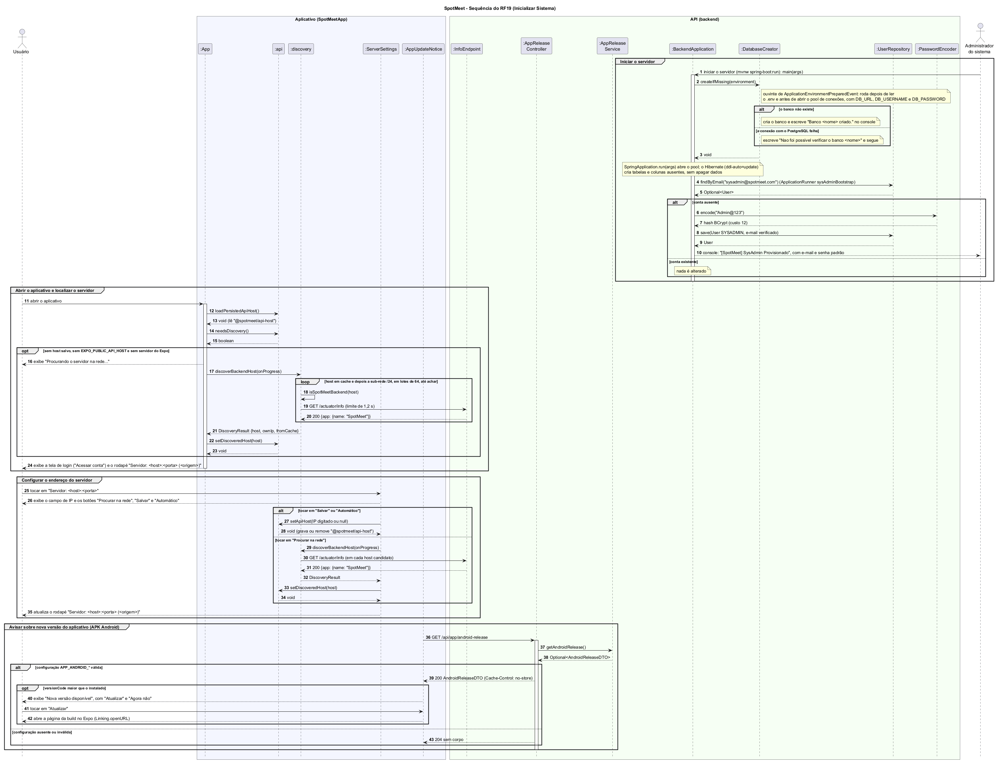

Fonte: próprio autor

#### RF20 – Consultar Status do Sistema

| Campo | Descrição |
|---|---|
| Função | Consulta o estado de funcionamento do sistema e dos seus subsistemas (Banco de dados, Rede e Recursos da JVM) e os detalhes do banco, da API e da JVM. |
| Descrição | **Status:** devolve ao administrador do sistema o estado geral (OPERATIONAL ou DEGRADED), a versão, o tempo em execução da JVM e o estado de cada subsistema. Banco de dados: validação de uma conexão do pool (ONLINE, WARNING ou FAILURE). Rede: teste de conexão à porta do servidor em 127.0.0.1, endereços IPv4 das placas de rede ativas e data do último reinício da Rede (ONLINE, WARNING quando não há placa de rede ativa ou FAILURE quando a porta recusa a conexão). Recursos: heap da JVM, percentual de uso e CPU do processo (ONLINE, ou WARNING acima de 90% do máximo ou sem limite conhecido). O estado geral é OPERATIONAL somente se os três estiverem ONLINE.  **Detalhes:** sob demanda, devolve nome, versão, tamanho, latência e contagem de linhas das oito tabelas do banco (users, organizations, organization_members, access_requests, organization_invitations, committees, committee_members e audit_logs), a situação do pool de conexões, as métricas da API (requisições, média de resposta, erros 4xx e 5xx, requisições ativas, threads e até três rotas mais usadas) e os recursos da JVM. A consulta é somente de leitura e não retorna dados pessoais. |
| Entradas | **Status:** nenhum corpo ou parâmetro; cabeçalho Authorization: Bearer {JWT}, cujo e-mail identifica o executor.  **Detalhes:** nenhum corpo ou parâmetro, com o mesmo cabeçalho. No aplicativo, a escolha do cartão "Banco de dados" ou "Recursos" ou do botão "Detalhes da API" (o cartão "Rede" não envia requisição). |
| Origem | Administrador do sistema. |
| Saída | **Status:** HTTP 200 com SystemStatusDTO contendo overallStatus ("OPERATIONAL" ou "DEGRADED"), version (versão do build, hoje "0.0.1-SNAPSHOT", ou "unknown" quando indisponível), uptimeSeconds (long), timestamp (LocalDateTime, horário do servidor, sem fuso), database e network (SubsystemInfo com name, status e details) e memory (MemoryInfo com name, status, details, totalMb, usedMb, freeMb, maxMb, usagePercent, processCpuPercent e processors). Os estados produzidos são ONLINE, WARNING e FAILURE. Erros: HTTP 401 quando o token está ausente, inválido, vencido ou revogado (SecurityConfig); HTTP 403 para conta sem perfil ADMIN ou SYSADMIN (regra hasAnyRole do SecurityConfig, ou SecurityException da AdminService convertida pela AdminController); HTTP 503, sem corpo, quando o JwtAuthFilter não consegue consultar a conta no banco; HTTP 500 com "Não foi possível consultar o status do sistema." em falha inesperada.  **Detalhes:** HTTP 200 com SystemDetailsDTO contendo timestamp (Instant, UTC), database (status, details, name, version, sizeBytes, responseTimeMs, pool com active, idle, waiting, total e maximum, e tableRows), api (version, countersSince, uptimeSeconds, requestMetricsAvailable, totalRequests, averageResponseTimeMs, clientErrors, serverErrors, activeRequests, jvmThreads, tomcatCurrentThreads, tomcatBusyThreads e topRoutes, com até três itens de method, route, requests e averageResponseTimeMs) e resources (MemoryInfo). Campos sem medição vêm nulos. Uma falha parcial na consulta ao banco devolve database.status WARNING com os valores obtidos, sem expor SQL, URL JDBC ou credenciais. Erros: os mesmos HTTP 401, 403 e 503, e HTTP 500 com "Não foi possível consultar os detalhes do sistema.". |
| Destino | Tela AdminMonitoringReportsScreen (aba "Monitoramento"), nos cartões "Banco de dados", "Rede" e "Recursos" e nas janelas "Detalhes: Banco de dados", "Detalhes: Rede", "Detalhes: Recursos" e "Detalhes: API". |
| Ação | **Status:** o Administrador do sistema, que vê as abas "Aprovações", "Organizações", "Monitoramento" e "Controles", toca na aba "Monitoramento". Ao receber o foco, a tela AdminMonitoringReportsScreen executa loadData, que envia ao mesmo tempo GET /api/admin/system/status e GET /api/admin/reports (RF21), com o cabeçalho Authorization e limite de 15 segundos. O hook useLiveSync repete a chamada de forma silenciosa a cada 4 segundos enquanto a aba está em foco e o aplicativo visível, e também ao receber os eventos MONITORING_REFRESH, VISIBILITY_RESTORED e os de alteração de organizações, integrantes e comissões; o botão "Atualizar" do cabeçalho e o gesto de puxar a lista repetem a chamada manualmente. A requisição passa pelo JwtAuthFilter, que valida a assinatura e a validade do token, o e-mail, a emissão depois de users.tokens_valid_after e a conta verificada, e pela regra hasAnyRole('ADMIN', 'SYSADMIN') do SecurityConfig para /api/admin/**. O método getSystemStatus da classe AdminController chama getSystemStatus da classe AdminService, que confirma o executor por findByEmail da UserRepository e exige o perfil ADMIN ou SYSADMIN. Em seguida, obtém a versão e o tempo em execução (getVersion e getUptimeSeconds da SystemMonitoringService); para o banco, obtém uma conexão do DataSource e chama isValid(2) (ONLINE, WARNING se inválida, FAILURE com "Não foi possível consultar o banco de dados." em caso de exceção); para a rede, buildNetworkInfo tenta conectar a 127.0.0.1 na porta do servidor com limite de 1 segundo (FAILURE se recusar) e lista os IPv4 das placas ativas (WARNING se não houver nenhuma), informando o último reinício da Rede; para os recursos, collectResources lê o heap da JVM; e getOverallStatus calcula o estado geral. A tela mostra o selo do estado geral (Operacional ou Degradado), a linha "Última leitura", os cartões "Banco de dados", "Rede" e "Recursos", cada um com o selo Online, Alerta ou Falha, e, no cartão "API", a "Versão" e o "Tempo em execução". Se a atualização falhar, mantém os últimos dados e oferece o botão "Tentar novamente".  **Detalhes:** ao tocar em "Banco de dados", "Recursos" ou "Detalhes da API", abre a janela "Detalhes: {nome}" e envia GET /api/admin/system/details, fora do ciclo de 4 segundos; o botão "Atualizar detalhes" repete a consulta. Em "Recursos", a janela explica que o heap (memória usada pelo servidor Java) sobe a cada requisição, inclusive as consultas do próprio painel, e cai quando a JVM faz a coleta de memória, sozinha ou pelo botão de coleta. O método getSystemDetails da classe AdminController chama getSystemDetails da AdminService, que confirma o executor por findByEmail e chama collect da SystemMonitoringService. Esse método abre uma conexão somente de leitura do DataSource, mede a latência, lê o nome, a versão, o tamanho e a contagem das oito tabelas em consultas fixas de até 3 segundos, lê o pool HikariCP, lê os temporizadores http.server.requests do MeterRegistry (total, média, erros 4xx e 5xx, até três rotas por modelo de endpoint, sem as rotas de monitoramento) e as threads da JVM e do Tomcat, e coleta os recursos da JVM. O cartão "Rede" abre a janela com o status já recebido e a explicação de que a Rede é o conector HTTP da API, sem nova requisição. |
| Pré-condição | **Status e detalhes:** servidor em execução com o PostgreSQL acessível (o filtro consulta a conta a cada requisição); estar autenticado (RF02) com um JWT válido (assinatura e validade corretas, e-mail igual ao da conta, emitido depois de users.tokens_valid_after) de conta com e-mail verificado e perfil global ADMIN ou SYSADMIN, com a aba "Monitoramento" aberta e o aplicativo em primeiro plano.  **Detalhes:** as mesmas, e ter tocado em um cartão (exceto "Rede") ou em "Detalhes da API". |
| Pós-condição | **Sucesso:** a tela exibe o selo do estado geral, os três cartões com seus estados, a "Última leitura", a versão e o "Tempo em execução"; ao abrir uma janela de detalhes, exibe os valores recebidos, e um campo sem medição aparece como "Indisponível". Nada é alterado no banco de dados.  **Falha:** em HTTP 403, os dados são limpos e a tela exibe "Acesso negado pelo servidor. Esta área exige permissão administrativa."; em HTTP 401, a sessão é encerrada e o aplicativo volta ao login com o aviso "Sua sessão foi encerrada. Entre novamente."; nas demais falhas (HTTP 500, HTTP 503, rede), a tela mantém os últimos dados e exibe "Não foi possível atualizar o monitoramento. Os últimos dados recebidos foram preservados.", com o botão "Tentar novamente" (nos detalhes, "Não foi possível consultar os detalhes. Tente novamente."). |
| Efeitos colaterais | Nenhum. A consulta não grava em audit_logs. |

**Figura 30 – Diagrama de sequência do RF20**

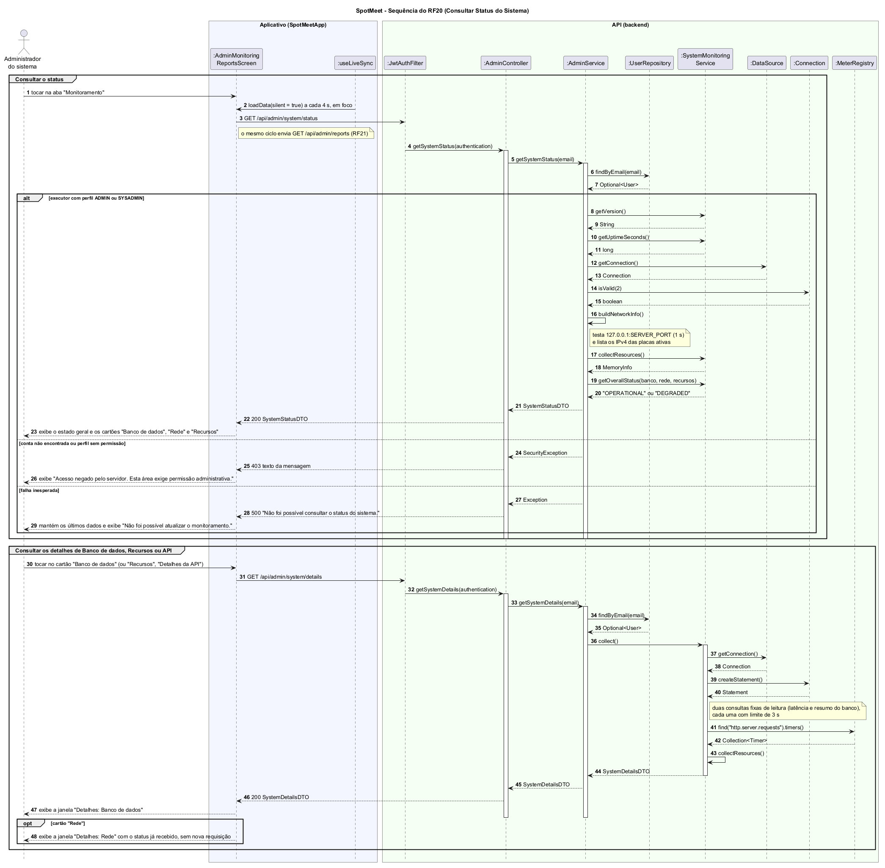

Fonte: próprio autor

#### RF21 – Consultar Relatórios

| Campo | Descrição |
|---|---|
| Função | Consulta relatórios agregados de usuários, organizações, comissões e auditoria. |
| Descrição | Gera um relatório com os totais de usuários (total, verificados e por perfil USER, ADMIN e SYSADMIN), de organizações (total, aprovadas e não aprovadas), de comissões e de registros de auditoria, além das 15 atividades de auditoria mais recentes. Nas atividades, o e-mail do autor é mascarado e senhas, segredos e tokens são removidos do texto dos detalhes pela classe LgpdMaskUtil; registros sem autor aparecem como "Sistema". A consulta não grava auditoria. |
| Entradas | Nenhum corpo ou parâmetro. Cabeçalho Authorization: Bearer {JWT}, cujo e-mail identifica o executor. |
| Origem | Administrador do sistema. |
| Saída | HTTP 200 com AdminReportDTO contendo totalUsers, verifiedUsers, usersByRole (mapa com as chaves USER, ADMIN e SYSADMIN), totalOrganizations, approvedOrganizations, pendingOrganizations (todas as organizações não aprovadas, inclusive recusadas e bloqueadas), totalCommittees, totalAuditLogs, generatedAt (LocalDateTime, horário do servidor, sem fuso) e recentActivities, lista de até 15 AuditActivityDTO com id, action, executorName, executorEmailMasked, sanitizedDetails e createdAt. Erros: HTTP 401 quando o token está ausente, inválido, vencido ou revogado; HTTP 403 para conta sem perfil ADMIN ou SYSADMIN; HTTP 503, sem corpo, quando o JwtAuthFilter não consegue consultar a conta no banco; HTTP 500 com "Erro ao gerar relatórios: {mensagem}" em falha inesperada. |
| Destino | Tela AdminMonitoringReportsScreen (aba "Monitoramento"), nos cartões "Usuários cadastrados" e "Visão geral" e na lista "Atividades recentes". |
| Ação | O Administrador do sistema toca na aba "Monitoramento". A mesma execução de loadData que consulta o status (RF20) envia GET /api/admin/reports, com limite de 15 segundos, e é repetida a cada 4 segundos pelo useLiveSync enquanto a aba está em foco. A requisição passa pelo JwtAuthFilter e pela regra hasAnyRole('ADMIN', 'SYSADMIN') do SecurityConfig. O método getReports da classe AdminController chama getReports da classe AdminService (transacional), que confirma o executor por findByEmail da UserRepository e exige o perfil ADMIN ou SYSADMIN. O serviço obtém todos os usuários por findAll da UserRepository e conta o total, os verificados e os de cada perfil; obtém todas as organizações por findAll da OrganizationRepository e conta o total, as aprovadas e as não aprovadas; obtém o total de comissões por count da CommitteeRepository e o total de registros de auditoria por count da AuditLogRepository. Em seguida, obtém os 100 registros mais recentes por findTop100ByOrderByCreatedAtDesc da AuditLogRepository, mantém os 15 primeiros e, para cada um, usa o nome do autor (ou "Sistema"), mascara o e-mail com maskEmail (dois primeiros caracteres, "***", último caractere do nome e domínio; "[NÃO INFORMADO]" quando não há autor) e remove senhas, segredos e tokens dos detalhes com sanitizeDetails, ambos da classe LgpdMaskUtil. A tela exibe o cartão "Usuários cadastrados" (total, "E-mails verificados", "Usuários comuns", "Administradores" e "Superadministradores"), o cartão "Visão geral" ("Organizações", "Aprovadas", "Pendentes", "Comissões", "Registros de auditoria" e "Relatório de {data} (servidor)") e a lista "Atividades recentes", em que cada item mostra o rótulo em português da ação (por exemplo "Reset total executado"), o autor com o e-mail mascarado, os detalhes sanitizados e a data. Sem registros, exibe "Nenhuma atividade registrada.". |
| Pré-condição | Servidor em execução com o PostgreSQL acessível; estar autenticado (RF02) com um JWT válido (assinatura e validade corretas, e-mail igual ao da conta, emitido depois de users.tokens_valid_after) de conta com e-mail verificado e perfil global ADMIN ou SYSADMIN, com a aba "Monitoramento" aberta e o aplicativo em primeiro plano. |
| Pós-condição | **Sucesso:** a tela exibe os totais e as atividades recentes recebidos, atualizados a cada 4 segundos, sem alterar nenhum registro.  **Falha:** em HTTP 403, os dados são limpos e a tela exibe "Acesso negado pelo servidor. Esta área exige permissão administrativa."; em HTTP 401, a sessão é encerrada e o aplicativo volta ao login com "Sua sessão foi encerrada. Entre novamente."; nas demais falhas, a tela mantém os últimos dados e exibe "Não foi possível atualizar o monitoramento. Os últimos dados recebidos foram preservados.", com o botão "Tentar novamente". |
| Efeitos colaterais | Nenhum. A consulta não grava em audit_logs, nem nas atualizações automáticas a cada 4 segundos. |

**Figura 31 – Diagrama de sequência do RF21**

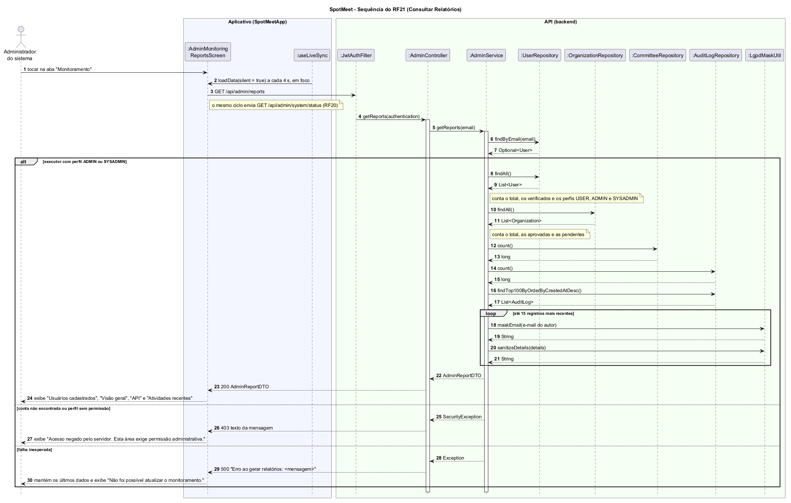

Fonte: próprio autor

#### RF22 – Reiniciar Subsistemas

| Campo | Descrição |
|---|---|
| Função | Reinicia um subsistema do servidor por vez (Banco de dados, Recursos ou Rede), a pedido do administrador do sistema, e registra o motivo na auditoria. |
| Descrição | **Banco de dados (DATABASE):** descarta as conexões do pool HikariCP (softEvictConnections), para que novas conexões sejam abertas, e testa uma conexão nova com isValid(2). Não reinicia o serviço PostgreSQL.  **Recursos (RESOURCES):** solicita a coleta de lixo da JVM (System.gc()) e informa quantos MB de memória em uso foram liberados. A JVM decide quando executar a coleta, e o processo do servidor não é reiniciado.  **Rede (NETWORK):** fecha e reabre o conector HTTP do Tomcat embutido (o componente que escuta a porta do servidor), em outra thread, cerca de 1 segundo depois de a resposta ser enviada e com até três tentativas de reabertura. Requisições em andamento nesse instante podem falhar. Não reinicia o Wi-Fi nem a rede do aparelho. O aplicativo não oferece esta opção; ela só é aceita pela API.  O reinício é por subsistema; não há reinício global. |
| Entradas | Objeto do tipo CriticalActionRequestDTO contendo subsystem ("DATABASE", "NETWORK" ou "RESOURCES"; o servidor aplica trim e converte para maiúsculas, e qualquer outro valor ou a ausência do campo é recusada), reason (opcional, sem limite no DTO; depois do trim é gravado em audit_logs.details, coluna de no máximo 1000 caracteres; ausente, o serviço usa "Rotina administrativa periódica") e confirmation (o aplicativo envia "RESTART_SYSTEM"; esta rota não usa @Valid e não confere o campo). Um corpo ausente equivale a subsistema inválido.  No aplicativo: a opção "Subsistema *" ("Banco de dados" ou "Recursos") e o campo "Motivo (opcional)", de até 500 caracteres; com o motivo vazio, o aplicativo envia "Reinicialização rotineira de subsistemas". |
| Origem | Administrador do sistema. |
| Saída | HTTP 200 com mapa contendo success (true), subsystem, message, executor (nome do administrador) e timestamp. A message é "Banco de dados reiniciado: conexões renovadas e conexão testada com sucesso.", "Recursos reiniciados: {n} MB de memória liberados (em uso: {m} MB)." ou "Rede em reinicialização: a porta {porta} será fechada e reaberta em cerca de 1 segundo. Requisições em andamento nesse instante podem falhar.". Erros: HTTP 400 com o texto "Subsistema inválido. Escolha Banco de Dados, Rede ou Recursos." (IllegalArgumentException convertida pela AdminController); HTTP 400 com {message: "Dados da moderação inválidos."} para corpo JSON malformado (tratador local da AdminController); HTTP 401 e HTTP 403, como no RF20; HTTP 500 com "Erro ao reiniciar subsistemas: {mensagem}" quando o banco não responde ou o servidor web não é o Tomcat embutido. |
| Destino | Tela AdminControlsScreen (aba "Controles"). |
| Ação | O Administrador do sistema toca na aba "Controles", que exibe a tela AdminControlsScreen. No cartão "Reiniciar subsistema", seleciona "Banco de dados" ou "Recursos" (cada opção mostra seus efeitos) e toca em "Reiniciar subsistema", que fica desabilitado enquanto nenhuma opção está selecionada. O aplicativo abre a janela "Reiniciar {subsistema}" com o campo "Motivo (opcional)", e o botão "Confirmar reinício" envia, por useAdminOperation.execute, a requisição POST /api/admin/system/restart com confirmation igual a "RESTART_SYSTEM", subsystem e o motivo informado, ou "Reinicialização rotineira de subsistemas" quando o campo está vazio. A requisição passa pelo JwtAuthFilter e pela regra hasAnyRole('ADMIN', 'SYSADMIN') do SecurityConfig. O método restartSystem da classe AdminController chama restartSystem da classe AdminService (transacional), que confirma o executor por findByEmail da UserRepository, exige o perfil ADMIN ou SYSADMIN, normaliza o subsistema e adota o motivo recebido. Para DATABASE, chama softEvictConnections no pool do DataSource e testa uma conexão nova; para RESOURCES, mede a memória em uso, chama System.gc() e mede de novo; para NETWORK, obtém os conectores do TomcatWebServer e inicia a thread "network-restart". Grava então o registro de auditoria pelo método save da AuditLogRepository e retorna o mapa. O aplicativo confere success e subsystem na resposta; em caso positivo, fecha a janela, exibe o aviso "Solicitação aceita" com o resultado (para o banco, "As conexões foram renovadas. Confira o estado do banco no Monitoramento."; para recursos, que a coleta foi solicitada e que a liberação de memória não é assegurada) e dispara o evento MONITORING_REFRESH, que atualiza a tela de Monitoramento. Em caso de erro, a mensagem aparece dentro da janela, que continua aberta. O botão de fechar a janela cancela sem enviar a requisição. |
| Pré-condição | Servidor em execução com o PostgreSQL acessível; estar autenticado (RF02) com um JWT válido de conta com e-mail verificado e perfil global ADMIN ou SYSADMIN, com a aba "Controles" aberta; ter selecionado um subsistema (o botão "Reiniciar subsistema" fica desabilitado sem seleção). Para DATABASE, o pool de conexões é o HikariCP; para NETWORK, o servidor web precisa ser o Tomcat embutido. |
| Pós-condição | **Sucesso:** o subsistema escolhido foi reiniciado (conexões do pool descartadas e uma nova conexão validada; coleta de memória solicitada; ou conector HTTP agendado para fechar e reabrir) e o registro ADMIN_SYSTEM_RESTART foi gravado. O aplicativo fecha a janela, exibe "Solicitação aceita" e atualiza o Monitoramento. Para a Rede, o aceite não comprova que a reabertura terminou: o status da Rede (RF20) informa o último reinício.  **Falha:** com subsistema inválido (HTTP 400) ou erro (HTTP 500), nenhum registro é gravado em audit_logs e a janela permanece aberta com a mensagem; em HTTP 403 ou HTTP 401, o aplicativo exibe "Acesso negado pelo servidor." ou encerra a sessão e volta ao login. |
| Efeitos colaterais | Registro em audit_logs com a ação ADMIN_SYSTEM_RESTART e os detalhes "Subsistema reiniciado: {subsistema}. Motivo: {motivo}". Conexões do pool descartadas e reabertas (DATABASE), coleta de lixo na JVM (RESOURCES) ou fechamento e reabertura do conector HTTP, com a linha "Rede reiniciada: conector HTTP reaberto na porta {porta}." no log do servidor e a data do último reinício no status da Rede (NETWORK). Atualização da tela de Monitoramento pelo evento MONITORING_REFRESH do syncBus. |

**Figura 32 – Diagrama de sequência do RF22**

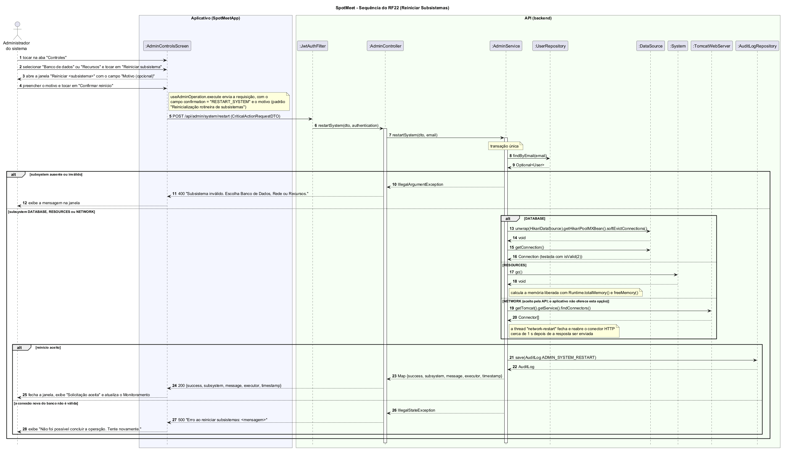

Fonte: próprio autor

#### RF23 – Resetar Sistema

| Campo | Descrição |
|---|---|
| Função | Remove todos os dados do sistema, preservando apenas a conta do administrador que executa a ação, e encerra todas as sessões. |
| Descrição | Exclui, em uma única transação, os registros de auditoria de outros usuários, os convites de organização, as solicitações de acesso, os integrantes de comissões, as comissões, os integrantes de organizações, as organizações e todos os usuários, exceto o executor. As fotos de perfil (user_profile_photos) saem junto com os usuários, pela chave estrangeira com exclusão em cascata. Grava na conta do executor o instante de corte de sessões (users.tokens_valid_after), que invalida todos os JWT emitidos antes dele; os tokens das contas excluídas deixam de ser aceitos porque a conta não existe mais. A conta preservada é a de quem executa: se o executor for ADMIN, a conta SYSADMIN também é excluída. |
| Entradas | Objeto do tipo CriticalActionRequestDTO contendo confirmation (obrigatória, anotada com @NotBlank, e igual a "CONFIRM_FULL_RESET", com distinção de maiúsculas e sem remoção de espaços), reason (opcional, sem limite no DTO; depois do trim é gravado em audit_logs.details, coluna de no máximo 1000 caracteres; ausente ou em branco, o serviço usa "Reset Total Administrativo do Sistema") e subsystem (ignorado nesta rota).  No aplicativo: o campo "Confirmação" (obrigatório, até 40 caracteres, igual a CONFIRM_FULL_RESET) e o campo "Motivo (opcional)", de até 500 caracteres; com o motivo vazio, o aplicativo envia "Manutenção administrativa de segurança". |
| Origem | Administrador do sistema. |
| Saída | HTTP 200 com mapa contendo success (true), message ("Reset Total do Sistema executado com sucesso! Todas as organizações, comissões e usuários comuns foram limpos do banco de dados, preservando exclusivamente a conta do Administrador."), adminPreserved ("{nome} ({e-mail})"), reason e timestamp. Erros: HTTP 400 com {status, error, message: "O token ou chave de confirmação é obrigatório.", errors} quando confirmation está em branco (@Valid, tratado pelo GlobalExceptionHandler); HTTP 400 com o texto "Código de confirmação inválido. Digite exatamente 'CONFIRM_FULL_RESET' para executar o Reset Total do Sistema." quando o texto é outro (IllegalArgumentException convertida pela AdminController); HTTP 401 e HTTP 403, como no RF20; HTTP 500 com "Erro ao executar reset: {mensagem}" em falha inesperada, caso em que a transação é desfeita. |
| Destino | Tela AdminControlsScreen (aba "Controles") e tela Auth (AuthScreen), para a qual o aplicativo retorna. |
| Ação | O Administrador do sistema toca na aba "Controles" e, no cartão "Reset total", no botão "Executar Reset Total do Sistema". O aplicativo abre a janela "Confirmar reset total", que informa que a ação é irreversível e pede "Digite exatamente CONFIRM_FULL_RESET para confirmar", com os campos "Confirmação" e "Motivo (opcional)". Digitar o texto não executa a ação: ao tocar em "Executar Reset", o formulário valida que o campo foi preenchido ("Informe o texto de confirmação.") e é igual a CONFIRM_FULL_RESET ("Digite exatamente CONFIRM_FULL_RESET."), sem enviar a requisição em caso de erro. Com os dados válidos, useAdminOperation.execute envia POST /api/admin/system/reset, e um toque repetido enquanto a requisição está em andamento é ignorado. A requisição passa pelo JwtAuthFilter e pela regra hasAnyRole('ADMIN', 'SYSADMIN') do SecurityConfig, e a anotação @Valid recusa um corpo com confirmation em branco. O método resetSystem da classe AdminController chama resetSystem da classe AdminService (transacional), que carrega o executor com bloqueio de linha por findByEmailForUpdate da UserRepository, exige o perfil ADMIN ou SYSADMIN e confere que confirmation é exatamente CONFIRM_FULL_RESET. Em caso positivo, executa nesta ordem deleteAllExceptAdminLogs da AuditLogRepository e deleteAllInBatch das repositories OrganizationInvitationRepository, AccessRequestRepository, CommitteeMemberRepository, CommitteeRepository, OrganizationMemberRepository e OrganizationRepository, e então deleteAllExceptAdmin da UserRepository, passando o identificador do executor. Grava tokensValidAfter do executor com o instante atual por save da UserRepository e registra a auditoria do reset por save da AuditLogRepository, em um bloco que ignora falha de gravação. Ao receber a resposta com success igual a true, o aplicativo fecha a janela, encerra a sessão por signOut do AuthContext (o que remove também o acesso biométrico guardado, ver RF02), reinicia a navegação na tela Auth em modo de login e exibe o aviso "Reset concluído" ("O sistema foi limpo. Sua sessão foi encerrada. Entre novamente."). Em caso de erro, a mensagem aparece dentro da janela, que continua aberta, e a sessão é mantida. O botão de fechar a janela cancela e limpa os campos. |
| Pré-condição | Servidor em execução com o PostgreSQL acessível; estar autenticado (RF02) com um JWT válido de conta com e-mail verificado e perfil global ADMIN ou SYSADMIN, com a aba "Controles" aberta. A conta que executa é a única que será preservada: qualquer outra conta, inclusive de outro administrador, será excluída. É preciso digitar exatamente CONFIRM_FULL_RESET. |
| Pós-condição | **Sucesso:** access_requests, organization_invitations, committee_members, committees, organization_members e organizations ficam sem registros; users contém apenas o executor (com tokens_valid_after preenchido); audit_logs contém apenas os registros do executor e os sem autor, mais o novo ADMIN_SYSTEM_FULL_RESET. Todos os JWT emitidos antes do reset são recusados com HTTP 401. O aplicativo volta ao login com o aviso "Reset concluído", e o administrador entra de novo com a mesma senha. Outros aparelhos descobrem o encerramento na próxima requisição ou na verificação periódica de sessão, a cada 15 segundos.  **Falha:** com confirmação inválida (HTTP 400), perfil sem permissão (HTTP 403) ou erro (HTTP 500), nenhum dado é alterado (a transação é desfeita), a sessão continua e a janela exibe a mensagem de erro. |
| Efeitos colaterais | Exclusão dos dados das tabelas access_requests, organization_invitations, committee_members, committees, organization_members e organizations, de todos os usuários da tabela users exceto o executor (inclusive outros administradores) e dos registros de audit_logs de outros usuários; remoção das fotos de perfil dos usuários excluídos. Registro em audit_logs com a ação ADMIN_SYSTEM_FULL_RESET, com o e-mail do administrador preservado e o motivo. Corte de sessões do executor (users.tokens_valid_after). No aplicativo, encerramento da sessão e do acesso biométrico guardado.  **Incremento 2:** as tabelas `meetings` e `meeting_participants` são esvaziadas pela exclusão em cascata das comissões. |

**Figura 33 – Diagrama de sequência do RF23**

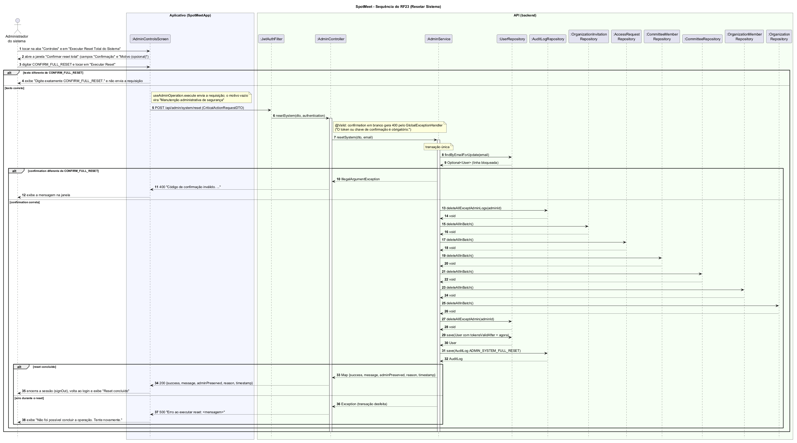

Fonte: próprio autor

#### RF24 – Designar Presidente da Comissão

| Campo | Descrição |
|---|---|
| Função | Define qual integrante ativo é o presidente de uma comissão e permite consultar os integrantes ativos. |
| Descrição | **Designação:** altera na tabela committee_members a coluna role. O integrante escolhido passa a COMMITTEE_ADMIN e o presidente anterior volta a MEMBER, de modo que a comissão tem no máximo um presidente. Se o escolhido já é o presidente, nada é alterado e o vínculo atual é devolvido. A organização é bloqueada para escrita durante a operação (OrganizationRepository.findByIdForUpdate), o que serializa designações simultâneas.  **Consulta de integrantes:** devolve os vínculos com status ACTIVE da comissão, nos quais o presidente aparece com role COMMITTEE_ADMIN. |
| Entradas | **Designação:** variáveis de rota committeeId (Long, comissão) e userId (Long, integrante a ser presidente). O executor é obtido do token JWT.  **Consulta de integrantes:** variável de rota committeeId (Long). |
| Origem | Usuário (líder da organização) e banco de dados (vínculos da comissão). |
| Saída | **Designação:** HTTP 200 com CommitteeMemberResponseDTO contendo id, userId, userName, userEmail, committeeId, committeeName, organizationId, status, role, requestedAt, respondedAt e invitedByName. Em caso de erro, HTTP 403 quando o executor não é líder da organização (SecurityException) e HTTP 409 quando a comissão ou a organização não existe ou o escolhido não é integrante ativo (IllegalArgumentException e IllegalStateException, convertidas pelo GlobalExceptionHandler).  **Consulta de integrantes:** HTTP 200 com a lista de CommitteeMemberResponseDTO; HTTP 403 quando o usuário não é integrante ativo nem líder; HTTP 409 quando a comissão não existe. |
| Destino | Usuário, por meio da folha PresidentSheet (aberta pela tela OrganizationScreen) e do cartão da comissão, que passa a exibir "Presidente: nome". |
| Ação | Na aba "Organização", na lista de comissões, o líder vê em cada cartão a linha "Presidente: nome" (ou "Sem presidente definido") e a ação "Presidente de nome da comissão". Ao tocar, o aplicativo abre a folha "Presidente da comissão", que envia GET /api/committees/{committeeId}/members. O método listActiveMembers da classe CommitteeController chama o método listActiveMembers da classe CommitteeService, que consulta a comissão (CommitteeRepository.findById), o usuário (UserRepository.findByEmail) e, se o usuário não for integrante ativo, exige a liderança da organização (requireOrganizationLeader); em seguida lista os integrantes (CommitteeMemberRepository.findByCommitteeIdAndStatus). A folha exibe cada integrante com a ação "Definir presidente" (o presidente atual exibe a etiqueta "Presidente").  Ao tocar em "Definir presidente", o aplicativo pede a confirmação "Definir presidente" (o integrante será o presidente da comissão e o presidente atual deixa o cargo) e, ao confirmar com "Definir", envia PUT /api/committees/{committeeId}/president/{userId}. O método assignPresident da classe CommitteeController chama o método assignPresident da classe CommitteeService, que carrega a comissão e o usuário, bloqueia a organização (findByIdForUpdate), confere a liderança (requireOrganizationLeader, que consulta OrganizationMemberRepository.findByUserIdAndOrganizationId), localiza o vínculo ACTIVE do escolhido (CommitteeMemberRepository.findByUserIdAndCommitteeId), rebaixa os presidentes atuais (findByCommitteeIdAndRole e save), promove o escolhido (save) e registra a auditoria (AuditLogRepository.save). Com a resposta de sucesso, o aplicativo exibe o aviso "Sucesso" com o texto "Presidente definido.", dispara o evento COMMITTEES_MUTATED e recarrega as comissões. |
| Pré-condição | **Designação:** o usuário estar autenticado e ser dono, vice-líder ou subdono da organização da comissão (a conta SYSADMIN também é aceita pela API); a comissão existir; o escolhido ser integrante da comissão com status ACTIVE.  **Consulta de integrantes:** o usuário ser integrante ativo da comissão ou líder da organização. |
| Pós-condição | **Sucesso:** a comissão passa a ter exatamente um vínculo ACTIVE com role COMMITTEE_ADMIN, o do escolhido; o presidente anterior volta a MEMBER; a auditoria fica registrada; o cartão da comissão exibe "Presidente: nome" e o escolhido passa a ver o botão "Agendar reunião" na aba "Reuniões" (RF25).  **Falha:** nenhum papel é alterado e a folha exibe a mensagem de erro. |
| Efeitos colaterais | Registro em audit_logs com a ação COMMITTEE_PRESIDENT_ASSIGNED (detalhe com o ID do usuário e o nome da comissão). Evento COMMITTEES_MUTATED, que atualiza as outras telas abertas. |

**Figura 34 – Diagrama de sequência do RF24**

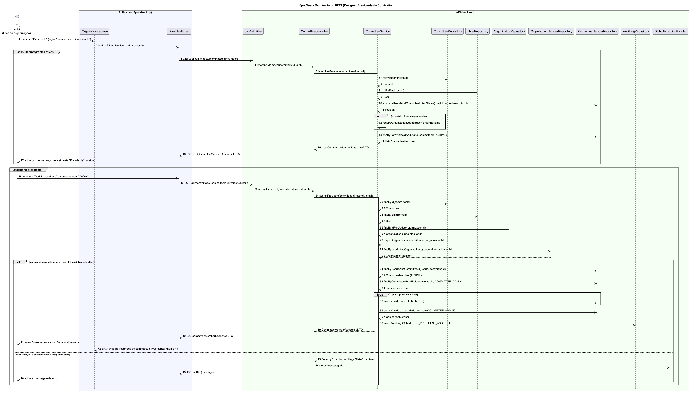

Fonte: próprio autor

#### RF25 – Agendar Reunião

| Campo | Descrição |
|---|---|
| Função | Agenda uma reunião para uma comissão e registra os convidados. |
| Descrição | Insere na tabela meetings uma reunião com título, pauta, local, link, prioridade, horário de início e de término, comissão e autor, e insere em meeting_participants uma linha para cada convidado (RF29), com resposta PENDING; o presidente já entra com resposta ACCEPTED. A situação da reunião não é gravada: é calculada pelo relógio (Meeting.statusAt), sendo "Agendada" antes do início, "Em andamento" entre o início e o término, "Encerrada" depois do término e "Cancelada" quando há data de cancelamento. |
| Entradas | Variável de rota committeeId (Long) e objeto do tipo MeetingRequestDTO contendo title (string obrigatória de 2 a 100 caracteres, com espaços repetidos normalizados), agenda (opcional, até 2000 caracteres), location (opcional, até 100 caracteres), link (opcional, até 300 caracteres, vazio ou iniciado por http:// ou https://), priority (LOW, MEDIUM ou HIGH; padrão MEDIUM), invitedUserIds (lista opcional de IDs de integrantes ativos; se ausente, todos são convidados), startsAt e endsAt (obrigatórios, texto de data e hora local sem fuso, como 2026-10-23T14:00:00; o término deve ser depois do início e a duração de, no máximo, 24 horas). No aplicativo, as datas são digitadas no formato dd/mm/aaaa hh:mm. |
| Origem | Usuário (presidente da comissão). |
| Saída | HTTP 201 com MeetingResponseDTO contendo id, committeeId, committeeName, organizationId, title, agenda, location, link, priority, startsAt, endsAt, status, createdByName, canceledAt, attendanceListGeneratedAt, myResponse, totalInvited, totalAccepted, totalDeclined, totalPending e participants. Em caso de erro, HTTP 400 quando algum campo não atende às validações; HTTP 403 quando o usuário não é presidente ativo da comissão; HTTP 409 quando a comissão não existe, a organização não está aprovada, o início não é futuro ou algum convidado não é integrante ativo. |
| Destino | Usuário, por meio da tela MeetingsScreen e do formulário MeetingForm; banco de dados (tabelas meetings e meeting_participants). |
| Ação | Na aba "Reuniões", o botão "Agendar reunião" aparece quando o usuário preside ao menos uma comissão (RF28). Ao tocá-lo, o aplicativo abre o formulário "Agendar reunião" (MeetingForm), com a escolha da comissão (quando preside mais de uma), os campos Título, Início, Término, Local (opcional), Link (opcional) e Pauta (opcional), a prioridade (Baixa, Média ou Alta) e a lista de convidados (RF29). O formulário valida, com react-hook-form, os campos obrigatórios, a data real, o início futuro, o término depois do início, a duração de até 24 horas e o formato do link. Ao tocar em "Agendar reunião", o aplicativo envia POST /api/committees/{committeeId}/meetings. O método createMeeting da classe MeetingController chama o método createMeeting da classe MeetingService, que carrega a comissão e o usuário (MeetingAccess.findCommittee e findUser), exige o papel de presidente (MeetingAccess.requirePresident, que consulta CommitteeMemberRepository.findByUserIdAndCommitteeId), confere que a organização está aprovada, exige o início futuro (requireFutureStart), escolhe os convidados (resolveInvitees), grava a reunião (MeetingRepository.save) e os participantes (MeetingParticipantRepository.saveAll) e registra a auditoria (MeetingAccess.audit). Com a resposta de sucesso, o aplicativo exibe o aviso "Sucesso" com o texto "Reunião agendada.", fecha o formulário e abre o detalhe da reunião. |
| Pré-condição | O usuário estar autenticado e ser integrante ativo da comissão com o papel de presidente (COMMITTEE_ADMIN); a organização da comissão estar aprovada; o horário de início ser posterior ao momento do envio. |
| Pós-condição | **Sucesso:** existe uma nova reunião com situação "Agendada" e uma linha em meeting_participants para cada convidado (pendente, exceto o presidente, que consta como aceito); a auditoria fica registrada; a reunião aparece em "Próximas" para o presidente e, na próxima atualização, para os convidados, com a indicação "Responda ao convite".  **Falha:** nada é gravado; o formulário continua aberto, com os dados preenchidos e a mensagem de erro. |
| Efeitos colaterais | Registro em audit_logs com a ação MEETING_CREATED (detalhe com o ID da reunião, o nome da comissão e o número de convidados). Evento MEETINGS_MUTATED, que atualiza as telas abertas. Não há envio de e-mail nem notificação push. |

**Figura 35 – Diagrama de sequência do RF25**

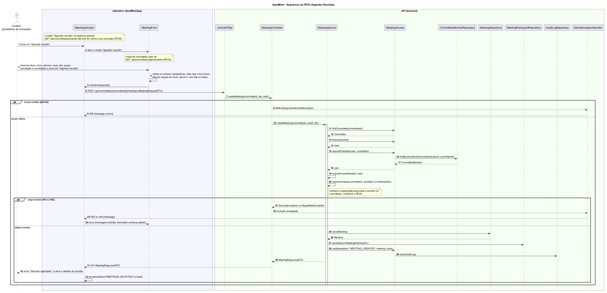

Fonte: próprio autor

#### RF26 – Editar Reunião

| Campo | Descrição |
|---|---|
| Função | Altera os dados e a lista de convidados de uma reunião agendada. |
| Descrição | Atualiza na tabela meetings os campos informados e, quando a lista de convidados é enviada, ajusta meeting_participants: quem continua convidado mantém a resposta e o comentário, quem saiu da lista é removido e quem entrou é criado com resposta PENDING. A comissão da reunião não pode ser trocada. Só é possível editar enquanto a reunião está "Agendada", ou seja, antes do início e sem cancelamento. |
| Entradas | Variável de rota meetingId (Long) e objeto do tipo MeetingRequestDTO, com os mesmos campos e restrições do RF25. Se invitedUserIds for omitido, os convidados atuais são mantidos. |
| Origem | Usuário (presidente da comissão) e banco de dados (reunião e participantes atuais). |
| Saída | HTTP 200 com MeetingResponseDTO, incluindo os participantes. Em caso de erro, HTTP 400 quando algum campo não atende às validações; HTTP 403 quando o usuário não é presidente ativo da comissão; HTTP 409 quando a reunião não existe, já começou, foi cancelada, o novo início não é futuro ou algum convidado não é integrante ativo. |
| Destino | Usuário, por meio da tela MeetingsScreen e do formulário MeetingForm. |
| Ação | No detalhe de uma reunião "Agendada", o presidente toca em "Editar reunião". O botão só fica ativo depois que o detalhe carregou a lista de participantes, porque o formulário parte dos convidados atuais e, sem eles, a gravação retiraria os demais convidados. O aplicativo abre o formulário "Editar reunião" (MeetingForm) preenchido com os dados atuais, sem a escolha de comissão. Ao tocar em "Salvar alterações", o aplicativo valida os campos como no RF25 e envia PUT /api/meetings/{meetingId}. O método updateMeeting da classe MeetingController chama o método updateMeeting da classe MeetingService, que carrega a reunião e o usuário (MeetingAccess.findMeeting e findUser), exige o papel de presidente (requirePresident), confere que a situação é "Agendada" (Meeting.statusAt), exige o início futuro, escolhe os convidados quando foram enviados (resolveInvitees), grava a reunião (MeetingRepository.save), ajusta os participantes (syncInvitees, com findByMeetingIdOrderByUserNameAsc, deleteAll e saveAll) e registra a auditoria. Com a resposta de sucesso, o aplicativo exibe o aviso "Sucesso" com o texto "Reunião atualizada." e abre o detalhe. |
| Pré-condição | O usuário estar autenticado e ser o presidente ativo da comissão; a reunião existir, não estar cancelada e ainda não ter começado; o novo horário de início ser posterior ao momento do envio. |
| Pós-condição | **Sucesso:** a reunião e os participantes refletem os dados enviados, mantendo as respostas de quem continua convidado; a auditoria fica registrada.  **Falha:** nada é alterado; o formulário continua aberto com a mensagem de erro. |
| Efeitos colaterais | Registro em audit_logs com a ação MEETING_UPDATED. Evento MEETINGS_MUTATED. |

**Figura 36 – Diagrama de sequência do RF26**

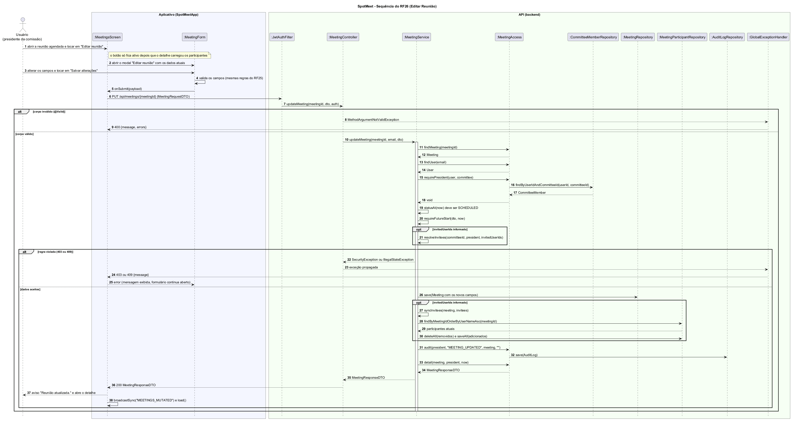

Fonte: próprio autor

#### RF27 – Cancelar Reunião

| Campo | Descrição |
|---|---|
| Função | Cancela uma reunião que ainda não terminou. |
| Descrição | Grava na coluna canceled_at da tabela meetings a data e a hora do cancelamento. Com isso, a situação calculada passa a "Cancelada", a reunião deixa de aceitar respostas, registros de presença e geração da lista, e os convites e registros existentes são mantidos. A API e o aplicativo aceitam o cancelamento de reuniões agendadas e em andamento. |
| Entradas | Variável de rota meetingId (Long). Não há corpo. |
| Origem | Usuário (presidente da comissão). |
| Saída | HTTP 200 com MeetingResponseDTO atualizado. Em caso de erro, HTTP 403 quando o usuário não é presidente ativo da comissão e HTTP 409 quando a reunião não existe, já foi cancelada ou já terminou. |
| Destino | Usuário, por meio da tela MeetingsScreen. |
| Ação | No detalhe de uma reunião "Agendada" ou "Em andamento", o presidente toca em "Cancelar reunião". O aplicativo pede a confirmação "Cancelar reunião" (os convidados verão a reunião como cancelada) e, ao confirmar, envia POST /api/meetings/{meetingId}/cancel. O método cancelMeeting da classe MeetingController chama o método cancelMeeting da classe MeetingService, que carrega a reunião e o usuário, exige o papel de presidente (requirePresident), confere a situação (Meeting.statusAt), grava canceledAt (MeetingRepository.save) e registra a auditoria. Com a resposta de sucesso, o aplicativo exibe o aviso "Sucesso" com o texto "Reunião cancelada." e o detalhe passa a exibir a situação "Cancelada". |
| Pré-condição | O usuário estar autenticado e ser o presidente ativo da comissão; a reunião existir e não estar cancelada nem encerrada. |
| Pós-condição | **Sucesso:** a reunião tem a data de cancelamento gravada e situação "Cancelada"; aparece em "Anteriores"; não aceita mais respostas, registros de presença nem lista; a auditoria fica registrada.  **Falha:** a reunião não é alterada e a mensagem de erro é exibida. |
| Efeitos colaterais | Registro em audit_logs com a ação MEETING_CANCELED. Evento MEETINGS_MUTATED. Não há envio de e-mail nem notificação push. |

**Figura 37 – Diagrama de sequência do RF27**

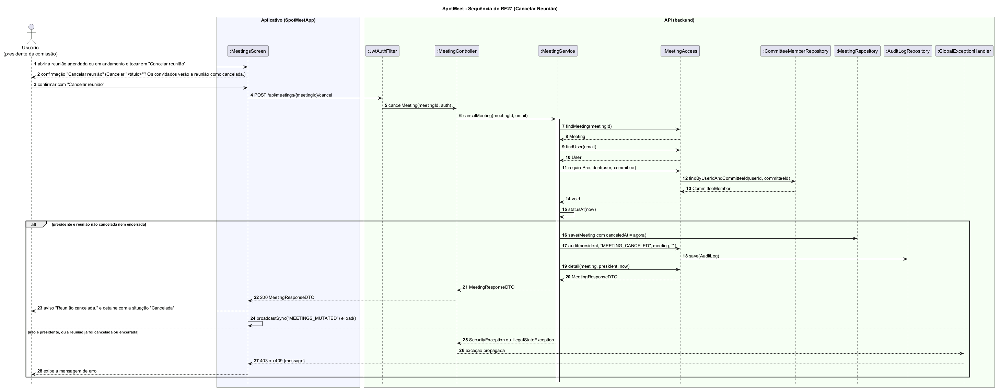

Fonte: próprio autor

#### RF28 – Consultar Reuniões

| Campo | Descrição |
|---|---|
| Função | Consulta as reuniões do usuário, as de uma comissão e o detalhe de uma reunião. |
| Descrição | **Minhas reuniões:** devolve as reuniões em que o usuário foi convidado, desde que o seu vínculo com a comissão continue ativo, e todas as reuniões das comissões em que ele é o presidente ativo (um presidente designado depois do agendamento ainda não é convidado das reuniões antigas), sem repetir, da mais recente para a mais antiga, com a resposta dele (myResponse, vazia quando não foi convidado) e os contadores de convidados.  **Reuniões da comissão:** devolve as reuniões da comissão, da mais recente para a mais antiga, sem a lista de participantes.  **Detalhe:** devolve a reunião com a lista de participantes, as respostas, os comentários de recusa e os registros de entrada e saída.  **Comissões presididas:** devolve os vínculos ACTIVE em que o usuário tem o papel COMMITTEE_ADMIN; o aplicativo usa essa lista para exibir o botão "Agendar reunião" (RF25). |
| Entradas | **Minhas reuniões e comissões presididas:** nenhuma; o usuário é obtido do token JWT.  **Reuniões da comissão:** variável de rota committeeId (Long).  **Detalhe:** variável de rota meetingId (Long). |
| Origem | Usuário e banco de dados (tabelas meetings, meeting_participants e committee_members). |
| Saída | HTTP 200 com lista de MeetingResponseDTO (minhas reuniões e reuniões da comissão), com um MeetingResponseDTO completo (detalhe) ou com lista de CommitteeMemberResponseDTO (comissões presididas). Em caso de erro, HTTP 403 quando o usuário não é integrante ativo da comissão nem líder da organização, e HTTP 409 quando a comissão ou a reunião não existe. |
| Destino | Usuário, por meio da tela MeetingsScreen. |
| Ação | Ao abrir a aba "Reuniões", o aplicativo envia GET /api/meetings/mine e GET /api/committees/presided. O método listMyMeetings da classe MeetingController chama o método listMyMeetings da classe MeetingService, que consulta MeetingParticipantRepository.findActiveByUser, acrescenta as reuniões das comissões presididas (CommitteeMemberRepository.findByUserIdAndStatus e MeetingRepository.findByCommitteeIdOrderByStartsAtDesc) e monta os resumos (MeetingAccess.summaries); o método listPresidedCommittees da classe CommitteeController chama o método de mesmo nome da classe CommitteeService. A tela exibe os cartões nos filtros "Próximas" e "Anteriores" e a seção "CONVITES PARA RESPONDER". A lista é atualizada a cada 10 segundos enquanto a aba está aberta, ao puxar a tela para atualizar e ao tocar em "Atualizar reuniões".  Ao tocar em um cartão, o aplicativo envia GET /api/meetings/{meetingId}. O método getMeeting da classe MeetingController chama o método getMeeting da classe MeetingService, que exige que o usuário seja integrante ativo ou líder (MeetingAccess.requireViewer) e monta o detalhe (MeetingAccess.detail). O modal "Reunião" exibe situação, prioridade, datas, local, link (aberto no navegador ao tocar), pauta e os contadores "convidados", "aceitaram", "recusaram" e "sem resposta".  A rota GET /api/committees/{committeeId}/meetings (listCommitteeMeetings) está disponível na API; o aplicativo usa /api/meetings/mine. |
| Pré-condição | O usuário estar autenticado. Para o detalhe e para as reuniões da comissão, ser integrante ativo da comissão ou líder da organização (a conta SYSADMIN também é aceita pela API; o aplicativo não oferece a aba "Reuniões" ao administrador do sistema). |
| Pós-condição | Nada é alterado no banco. As reuniões e os dados consultados são exibidos; em caso de erro de leitura, a tela exibe "Não foi possível carregar as reuniões. Tente novamente." com a ação "Tentar atualizar". |
| Efeitos colaterais | Nenhum. |

**Figura 38 – Diagrama de sequência do RF28**

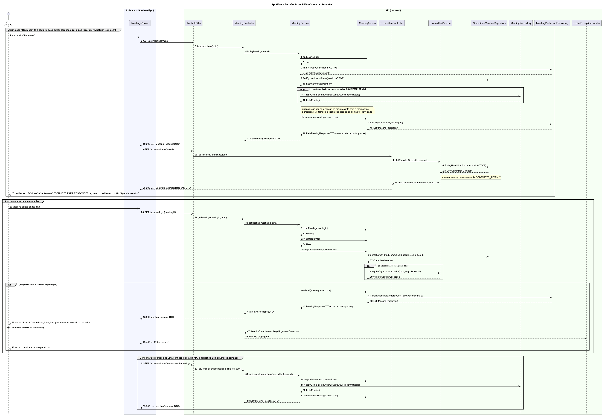

Fonte: próprio autor

#### RF29 – Convidar Integrantes para a Reunião

| Campo | Descrição |
|---|---|
| Função | Define quem é convidado para uma reunião. |
| Descrição | Cada convidado tem uma linha em meeting_participants (única por reunião e usuário), criada com resposta PENDING. Ao agendar (RF25), se invitedUserIds for omitido, todos os integrantes ativos da comissão são convidados; se for informado, só os listados, e todos precisam ser integrantes ativos. O presidente é sempre convidado e sua resposta já consta como ACCEPTED ao agendar. Ao editar (RF26), quem continua na lista mantém a resposta e o comentário, quem sai é removido e quem entra é criado como pendente. |
| Entradas | invitedUserIds: lista opcional de IDs (Long) no MeetingRequestDTO. Para a escolha na tela, variável de rota committeeId (Long) da consulta de integrantes ativos. |
| Origem | Usuário (presidente da comissão) e banco de dados (integrantes ativos da comissão). |
| Saída | A lista de participants do MeetingResponseDTO e os contadores totalInvited, totalAccepted, totalDeclined e totalPending. Em caso de erro, HTTP 409 com a mensagem "Só integrantes ativos da comissão podem ser convidados.". |
| Destino | Usuário, por meio do formulário MeetingForm. |
| Ação | Ao abrir o formulário (ou trocar de comissão), o MeetingForm envia GET /api/committees/{committeeId}/members (RF24, listActiveMembers) e exibe a seção "CONVIDADOS (n de m)", com uma caixa de seleção por integrante, todos marcados por padrão; o presidente aparece fixo, com a etiqueta "Presidente". Ao enviar o formulário, o aplicativo inclui em invitedUserIds os integrantes marcados e o presidente. No servidor, o método resolveInvitees da classe MeetingService consulta CommitteeMemberRepository.findByCommitteeIdAndStatus, valida que cada ID é de integrante ativo e acrescenta o presidente; em seguida, os participantes são gravados com MeetingParticipantRepository.saveAll (agendamento) ou ajustados por syncInvitees (edição). |
| Pré-condição | O usuário ser o presidente ativo da comissão e estar agendando uma reunião ou editando uma reunião agendada que ainda não começou. |
| Pós-condição | **Sucesso:** meeting_participants contém exatamente os convidados escolhidos mais o presidente; os convidados que já tinham respondido mantêm a resposta.  **Falha:** nenhum participante é criado, removido ou alterado. |
| Efeitos colaterais | Os mesmos do RF25 e do RF26. Não há envio de e-mail nem notificação push: o convidado vê o convite na aba "Reuniões" na próxima atualização. |

**Figura 39 – Diagrama de sequência do RF29**

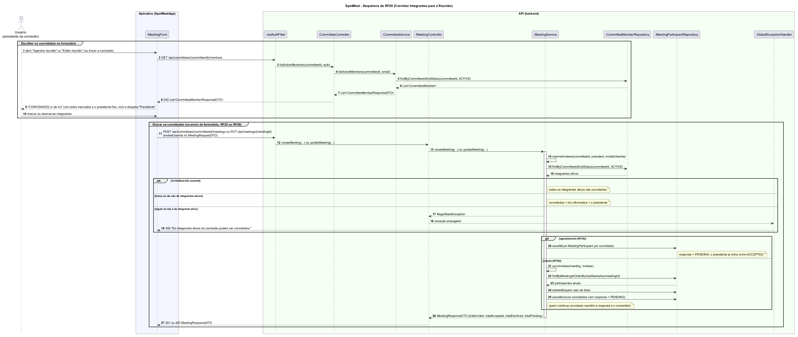

Fonte: próprio autor

#### RF30 – Responder Convite de Reunião

| Campo | Descrição |
|---|---|
| Função | Registra a resposta do convidado ao convite de uma reunião. |
| Descrição | Atualiza na tabela meeting_participants a resposta (ACCEPTED ou DECLINED), a data da resposta e o comentário. O comentário só é guardado na recusa; ao aceitar, o comentário anterior é apagado. A resposta pode ser trocada até a reunião terminar ou ser cancelada. A linha do participante é bloqueada para escrita (MeetingParticipantRepository.findForUpdate), serializando respostas, entradas e saídas simultâneas da mesma pessoa. |
| Entradas | Variável de rota meetingId (Long), parâmetro accept (boolean obrigatório) e, opcionalmente, objeto do tipo MeetingAnswerDTO contendo comment (string de, no máximo, 200 caracteres). |
| Origem | Usuário (convidado). |
| Saída | HTTP 200 com MeetingResponseDTO atualizado. Em caso de erro, HTTP 400 quando o comentário excede 200 caracteres; HTTP 403 quando o usuário não é integrante ativo da comissão; HTTP 409 quando a reunião não existe, já foi cancelada ou encerrada, ou o usuário não foi convidado. |
| Destino | Usuário, por meio da tela MeetingsScreen e do componente MeetingInvitationActions. |
| Ação | No detalhe da reunião, o cartão "Seu convite" exibe a resposta atual e as ações "Aceitar" e "Recusar". Ao tocar em "Aceitar", o aplicativo envia POST /api/meetings/{meetingId}/respond?accept=true. Ao tocar em "Recusar", exibe o campo "Motivo (opcional)" (até 200 caracteres) e, ao tocar em "Confirmar recusa", envia POST /api/meetings/{meetingId}/respond?accept=false com o comentário. O método respond da classe MeetingInvitationController chama o método respond da classe MeetingInvitationService, que carrega a reunião e o usuário, exige integrante ativo (MeetingAccess.requireActiveMember), confere que a reunião não está cancelada nem encerrada (Meeting.statusAt), bloqueia e carrega o participante (findForUpdate), grava a resposta (save) e registra a auditoria. Com a resposta de sucesso, o aplicativo exibe o aviso "Sucesso" com o texto "Presença confirmada." ou "Recusa enviada." e atualiza o detalhe. |
| Pré-condição | O usuário estar autenticado, ser integrante ativo da comissão e estar na lista de convidados; a reunião estar agendada ou em andamento. |
| Pós-condição | **Sucesso:** a linha do participante tem a nova resposta e a data; o comentário consta só na recusa; os contadores do presidente e dos demais refletem a resposta; a auditoria fica registrada.  **Falha:** a resposta anterior é mantida e a mensagem de erro é exibida. |
| Efeitos colaterais | Registro em audit_logs com a ação MEETING_INVITATION_ANSWERED (detalhe com a resposta, sem o comentário). Evento MEETINGS_MUTATED. |

**Figura 40 – Diagrama de sequência do RF30**

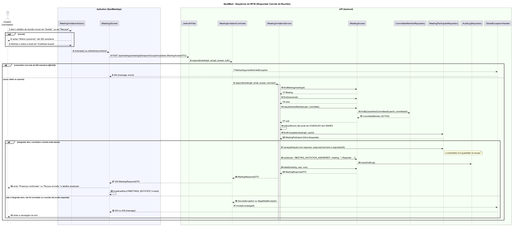

Fonte: próprio autor

#### RF31 – Registrar Entrada na Reunião

| Campo | Descrição |
|---|---|
| Função | Registra a entrada de convidados na reunião. |
| Descrição | **Individual:** grava na tabela meeting_participants o horário de entrada (entered_at) e quem fez o registro (entered_by_id). A própria pessoa registra a sua entrada; o presidente registra a de qualquer convidado, independentemente da resposta ao convite. Cada pessoa tem uma entrada.  **Em massa:** o presidente registra a entrada de todos os convidados que aceitaram o convite e ainda não têm entrada. Em ambos os casos, o registro só é aceito com a reunião em andamento e apaga o carimbo da lista de presença já gerada (RF34), que precisa ser gerada de novo. |
| Entradas | **Individual:** variáveis de rota meetingId e userId (Long).  **Em massa:** variável de rota meetingId (Long). O executor é obtido do token JWT. |
| Origem | Usuário (convidado ou presidente da comissão). |
| Saída | HTTP 200 com MeetingResponseDTO atualizado. Em caso de erro, HTTP 403 quando o usuário não é integrante ativo (registro próprio) ou presidente (registro de outra pessoa ou em massa); HTTP 409 quando a reunião não está em andamento, o usuário informado não foi convidado ou a entrada já foi registrada. |
| Destino | Usuário, por meio da tela MeetingsScreen e do painel MeetingAttendancePanel. |
| Ação | No painel "Presença" de uma reunião em andamento, o convidado toca em "Registrar minha entrada"; o presidente toca em "Registrar entrada" na linha de outra pessoa ou em "Entrada de todos que aceitaram" (com a confirmação "Registrar entrada de todos"). O aplicativo envia POST /api/meetings/{meetingId}/participants/{userId}/entry ou POST /api/meetings/{meetingId}/attendance/entries. O método registerEntry (ou registerAllEntries) da classe MeetingAttendanceController chama o método de mesmo nome da classe MeetingAttendanceService, que confere o papel (MeetingAccess.requireActiveMember para o registro próprio, requirePresident nos demais), exige a reunião em andamento, bloqueia o participante (findForUpdate), grava a entrada (save ou saveAll), apaga o carimbo da lista (MeetingAccess.invalidateList) e registra a auditoria. Com a resposta de sucesso, o aplicativo exibe o aviso "Sucesso" com o texto "Entrada registrada." ou "Entradas registradas.". Quando o registro é feito pelo presidente, o painel exibe "(registrado por nome)". |
| Pré-condição | O usuário estar autenticado; a reunião estar em andamento (entre o início e o término, sem cancelamento); o participante ser convidado e ainda não ter entrada registrada. No registro próprio, o usuário ser integrante ativo da comissão; no registro de outra pessoa e em massa, ser o presidente. |
| Pós-condição | **Sucesso:** o participante tem a entrada e o autor do registro gravados; o carimbo da lista de presença é apagado quando existia; a auditoria fica registrada.  **Falha:** nenhum registro é gravado e a mensagem de erro é exibida. |
| Efeitos colaterais | Registro em audit_logs com a ação MEETING_ENTRY_REGISTERED (individual) ou MEETING_ENTRIES_REGISTERED_BULK (em massa, com o número de pessoas). Evento MEETINGS_MUTATED. |

**Figura 41 – Diagrama de sequência do RF31**

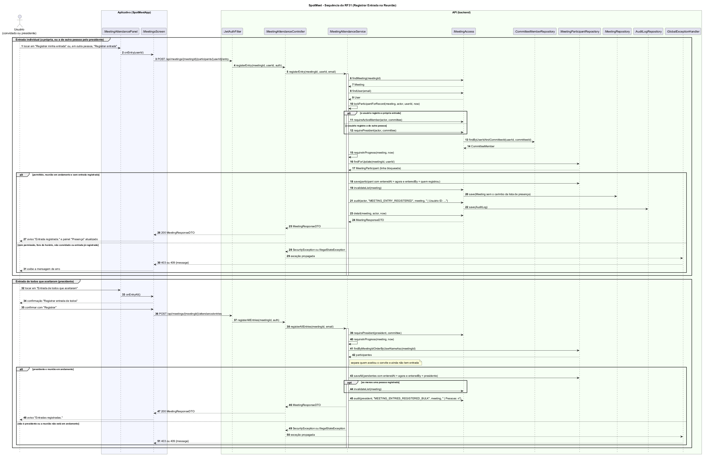

Fonte: próprio autor

#### RF32 – Registrar Saída da Reunião

| Campo | Descrição |
|---|---|
| Função | Registra a saída de convidados da reunião. |
| Descrição | **Individual:** grava na tabela meeting_participants o horário de saída (left_at) e quem fez o registro (left_by_id). A própria pessoa registra a sua saída; o presidente registra a de qualquer convidado que tenha entrada. Cada pessoa tem uma saída.  **Em massa:** o presidente registra a saída de todos os convidados que têm entrada e ainda não têm saída. Em ambos os casos, o registro só é aceito com a reunião em andamento e apaga o carimbo da lista de presença já gerada. |
| Entradas | **Individual:** variáveis de rota meetingId e userId (Long).  **Em massa:** variável de rota meetingId (Long). O executor é obtido do token JWT. |
| Origem | Usuário (convidado ou presidente da comissão). |
| Saída | HTTP 200 com MeetingResponseDTO atualizado. Em caso de erro, HTTP 403 quando o usuário não é integrante ativo (registro próprio) ou presidente (registro de outra pessoa ou em massa); HTTP 409 quando a reunião não está em andamento, o usuário informado não foi convidado, não tem entrada registrada ou a saída já foi registrada. |
| Destino | Usuário, por meio da tela MeetingsScreen e do painel MeetingAttendancePanel. |
| Ação | No painel "Presença" de uma reunião em andamento, o convidado que já entrou toca em "Registrar minha saída"; o presidente toca em "Registrar saída" na linha de outra pessoa ou em "Saída de todos que estão dentro" (com a confirmação "Registrar saída de todos"). O aplicativo envia POST /api/meetings/{meetingId}/participants/{userId}/exit ou POST /api/meetings/{meetingId}/attendance/exits. O método registerExit (ou registerAllExits) da classe MeetingAttendanceController chama o método de mesmo nome da classe MeetingAttendanceService, que confere o papel, exige a reunião em andamento, bloqueia o participante (findForUpdate), confere a entrada prévia e a ausência de saída, grava a saída (save ou saveAll), apaga o carimbo da lista (invalidateList) e registra a auditoria. Com a resposta de sucesso, o aplicativo exibe o aviso "Sucesso" com o texto "Saída registrada." ou "Saídas registradas.". |
| Pré-condição | O usuário estar autenticado; a reunião estar em andamento; o participante ser convidado, ter entrada registrada e não ter saída registrada. No registro próprio, o usuário ser integrante ativo da comissão; no registro de outra pessoa e em massa, ser o presidente. |
| Pós-condição | **Sucesso:** o participante tem a saída e o autor do registro gravados; o carimbo da lista de presença é apagado quando existia; a auditoria fica registrada.  **Falha:** nenhum registro é gravado e a mensagem de erro é exibida. |
| Efeitos colaterais | Registro em audit_logs com a ação MEETING_EXIT_REGISTERED (individual) ou MEETING_EXITS_REGISTERED_BULK (em massa, com o número de pessoas). Evento MEETINGS_MUTATED. |

**Figura 42 – Diagrama de sequência do RF32**

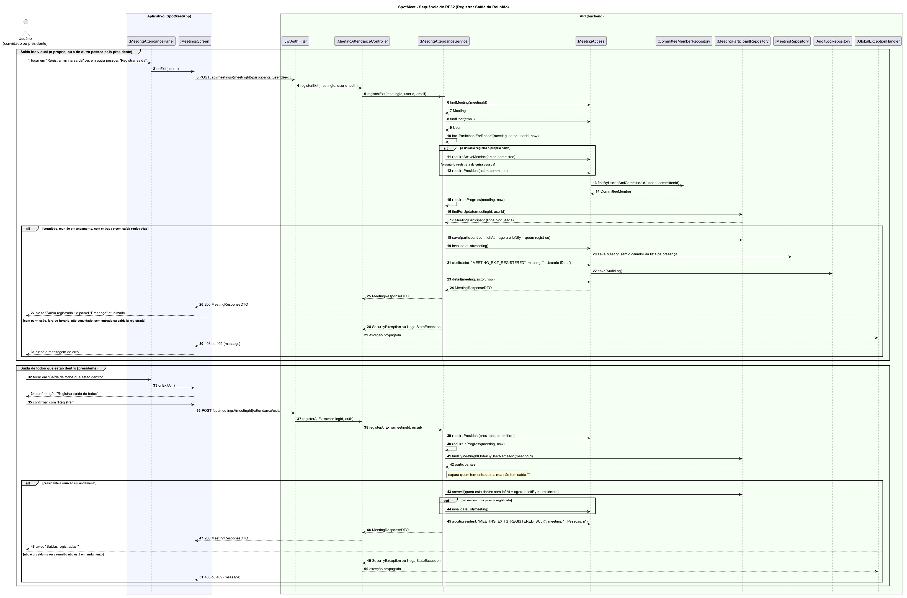

Fonte: próprio autor

#### RF33 – Corrigir Registros de Presença

| Campo | Descrição |
|---|---|
| Função | Apaga a entrada e a saída registradas de um convidado, para que possam ser registradas de novo. |
| Descrição | Limpa na tabela meeting_participants as colunas entered_at, entered_by_id, left_at e left_by_id de um convidado e apaga o carimbo da lista de presença já gerada. Só o presidente corrige, com a reunião em andamento ou encerrada. |
| Entradas | Variáveis de rota meetingId e userId (Long). |
| Origem | Usuário (presidente da comissão). |
| Saída | HTTP 200 com MeetingResponseDTO atualizado. Em caso de erro, HTTP 403 quando o usuário não é presidente ativo da comissão; HTTP 409 quando a reunião não existe, foi cancelada, ainda não começou ou o usuário informado não foi convidado. |
| Destino | Usuário, por meio da tela MeetingsScreen e do painel MeetingAttendancePanel. |
| Ação | No painel "Presença", o presidente toca em "Limpar registros" na linha de uma pessoa que tenha entrada ou saída. O aplicativo pede a confirmação "Limpar registros" (apagar a entrada e a saída da pessoa) e, ao confirmar com "Limpar", envia DELETE /api/meetings/{meetingId}/participants/{userId}/attendance. O método resetAttendance da classe MeetingAttendanceController chama o método de mesmo nome da classe MeetingAttendanceService, que carrega a reunião e o usuário, exige o papel de presidente (requirePresident), confere a situação (Meeting.statusAt), bloqueia e limpa o participante (findForUpdate e save), apaga o carimbo da lista (invalidateList) e registra a auditoria. Com a resposta de sucesso, o aplicativo exibe o aviso "Sucesso" com o texto "Registros apagados.". |
| Pré-condição | O usuário estar autenticado e ser o presidente ativo da comissão; a reunião estar em andamento ou encerrada; o usuário informado ser convidado. |
| Pós-condição | **Sucesso:** a entrada e a saída do convidado ficam em branco, com os autores apagados; o carimbo da lista de presença é apagado; a auditoria fica registrada.  **Falha:** nenhum registro é alterado e a mensagem de erro é exibida. |
| Efeitos colaterais | Registro em audit_logs com a ação MEETING_ATTENDANCE_RESET. Evento MEETINGS_MUTATED. |

**Figura 43 – Diagrama de sequência do RF33**

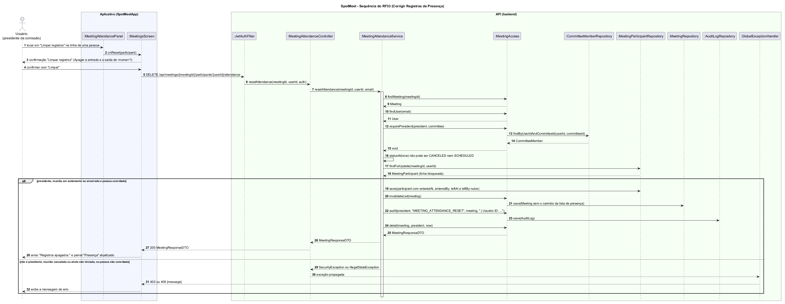

Fonte: próprio autor

#### RF34 – Gerar Lista de Presença

| Campo | Descrição |
|---|---|
| Função | Disponibiliza a lista de presença de uma reunião para consulta. |
| Descrição | Grava na tabela meetings a data (attendance_list_generated_at) e o autor (attendance_list_generated_by_id) da geração. O conteúdo da lista é montado a cada consulta a partir dos participantes: a pessoa é "Presente" quando tem entrada registrada, "Presente, saída não registrada" quando tem entrada, não tem saída e a reunião já terminou, e "Ausente" quando não tem entrada. O tempo na reunião é calculado quando há entrada e saída. Qualquer alteração posterior de presença (RF31, RF32 e RF33) apaga o carimbo, e a lista precisa ser gerada de novo. |
| Entradas | Variável de rota meetingId (Long). Não há corpo. |
| Origem | Usuário (presidente da comissão) e banco de dados (participantes). |
| Saída | HTTP 200 com AttendanceListDTO contendo meetingId, title, committeeName, startsAt, endsAt, generatedAt, generatedByName, totalInvited, totalPresent, totalAbsent e rows (userId, userName, response, responseComment, enteredAt, enteredByName, leftAt, leftByName, durationMinutes e situation). Em caso de erro, HTTP 403 quando o usuário não é presidente ativo da comissão; HTTP 409 quando a reunião não existe, foi cancelada ou ainda não começou. |
| Destino | Usuário, por meio da tela MeetingsScreen e do componente AttendanceListView. |
| Ação | No detalhe de uma reunião em andamento ou encerrada, o presidente toca em "Gerar lista" (ou "Gerar de novo", quando já existe um carimbo). O aplicativo pede a confirmação "Gerar lista de presença" (a lista usa os registros de agora e fica disponível para os integrantes) e, ao confirmar com "Gerar", envia POST /api/meetings/{meetingId}/attendance-list. O método generate da classe AttendanceListController chama o método generate da classe AttendanceListService, que carrega a reunião e o usuário, exige o papel de presidente (requirePresident), confere a situação (Meeting.statusAt), grava o carimbo (MeetingRepository.save), registra a auditoria e monta a lista (AttendanceListDTO.from, a partir de MeetingParticipantRepository.findByMeetingIdOrderByUserNameAsc). Com a resposta de sucesso, o aplicativo exibe o aviso "Sucesso" com o texto "Lista de presença gerada." e abre a lista. |
| Pré-condição | O usuário estar autenticado e ser o presidente ativo da comissão; a reunião já ter começado e não estar cancelada. |
| Pós-condição | **Sucesso:** a reunião tem o carimbo de geração gravado, o que libera a consulta aos integrantes e líderes (RF35); a auditoria fica registrada.  **Falha:** o carimbo não é alterado e a mensagem de erro é exibida. |
| Efeitos colaterais | Registro em audit_logs com a ação MEETING_ATTENDANCE_LIST_GENERATED. Evento MEETINGS_MUTATED. |

**Figura 44 – Diagrama de sequência do RF34**

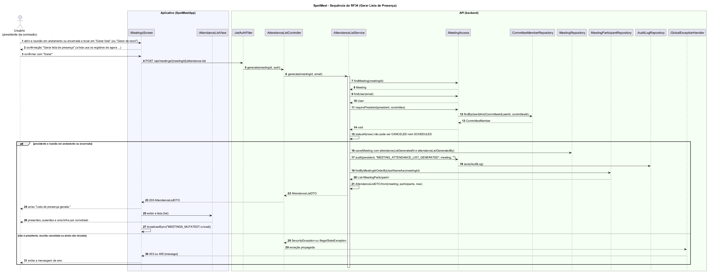

Fonte: próprio autor

#### RF35 – Consultar Lista de Presença

| Campo | Descrição |
|---|---|
| Função | Consulta a lista de presença de uma reunião, depois de gerada. |
| Descrição | Devolve o conteúdo da lista de presença montado a partir dos participantes, com os mesmos cálculos de situação e de tempo do RF34. Só está disponível quando a reunião tem o carimbo de geração. |
| Entradas | Variável de rota meetingId (Long). |
| Origem | Usuário e banco de dados (participantes da reunião). |
| Saída | HTTP 200 com AttendanceListDTO, como descrito no RF34. Em caso de erro, HTTP 403 quando o usuário não é integrante ativo da comissão nem líder da organização; HTTP 409 quando a reunião não existe ou a lista ainda não foi gerada. |
| Destino | Usuário, por meio da tela MeetingsScreen e do componente AttendanceListView. |
| Ação | No detalhe de uma reunião com lista gerada, o usuário toca em "Ver lista". O aplicativo envia GET /api/meetings/{meetingId}/attendance-list. O método get da classe AttendanceListController chama o método get da classe AttendanceListService, que carrega a reunião e o usuário, exige integrante ativo ou líder (MeetingAccess.requireViewer), confere o carimbo de geração e monta a lista. O modal "Lista de presença" exibe o título, a comissão, o período, os totais "presentes", "ausentes" e "convidados", a data e o autor da geração e, para cada convidado, a situação (Presente, Presente, saída não registrada, ou Ausente), a resposta ao convite com o comentário, a entrada e a saída com "(registrado por nome)" quando o autor é outra pessoa e o tempo na reunião. Se, com a lista aberta, a atualização automática (a cada 10 segundos) mostrar que a lista foi invalidada por uma entrada ou saída registrada depois da geração, o aplicativo volta ao detalhe com o aviso "A presença mudou depois que a lista foi gerada. A lista precisa ser gerada de novo.". |
| Pré-condição | O usuário estar autenticado e ser integrante ativo da comissão ou líder da organização; a lista de presença ter sido gerada e não ter sido invalidada por uma alteração posterior de presença. |
| Pós-condição | Nada é alterado no banco. A lista é exibida; em caso de erro, a mensagem é exibida no modal. |
| Efeitos colaterais | Nenhum. |

**Figura 45 – Diagrama de sequência do RF35**

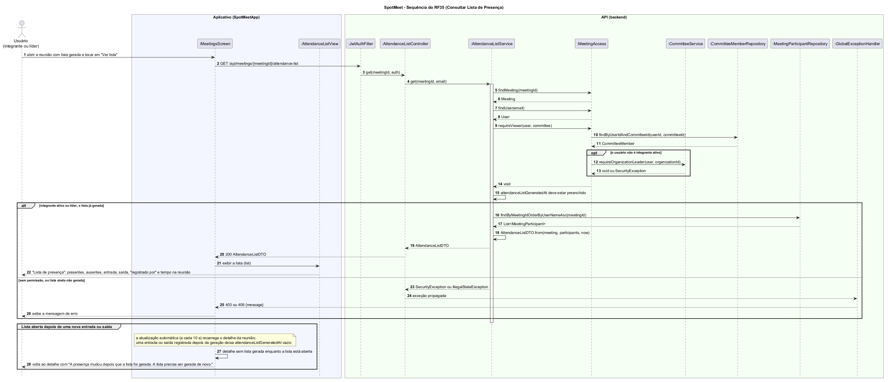

Fonte: próprio autor

#### RF36 – Configurar Bloqueio Biométrico

| Campo | Descrição |
|---|---|
| Função | Habilita, ajusta e desabilita o bloqueio do aplicativo por biometria, que protege o acesso guardado no aparelho. |
| Descrição | **Habilitar:** confere se o aparelho tem armazenamento seguro, biometria compatível e cadastrada (no Android, biometria forte), pede a confirmação da biometria, confirma a sessão no servidor e guarda no armazenamento seguro do aparelho (expo-secure-store) o token JWT, o identificador do usuário e o endereço do servidor; o prazo do bloqueio fica em armazenamento local (AsyncStorage). O token nunca vai para o armazenamento comum.  **Definir o prazo:** grava o prazo escolhido, em milissegundos: 0 (Imediatamente, padrão), 60 000 (1 minuto), 300 000 (5 minutos), 3 600 000 (1 hora), 10 800 000 (3 horas) ou 86 400 000 (24 horas). O prazo vale para o aplicativo deixado em segundo plano; se o aplicativo for fechado (pelo usuário ou pelo sistema), o desbloqueio é sempre pedido ao reabrir, porque a sessão só existe na memória e o token guardado só é lido depois da biometria.  **Religar depois da troca de senha:** a troca de senha (RF14) revoga o token guardado, mas, com a biometria habilitada, o aparelho guarda a preferência (habilitada e prazo, sem token). No login seguinte da mesma conta e no mesmo servidor, a preferência é lida e apagada, o prazo é restaurado e a habilitação é feita de novo, pedindo apenas a confirmação da biometria.  **Desabilitar:** remove a sessão guardada e a configuração. O bloqueio em si (pedir a biometria ao reabrir o aplicativo) é descrito no RF02. |
| Entradas | **Habilitar:** a confirmação da biometria do aparelho e, para a conferência da sessão, o token da sessão atual (cabeçalho Authorization da requisição GET /api/users/me).  **Definir o prazo:** uma das seis opções de prazo.  **Desabilitar:** nenhuma. |
| Origem | Usuário e aparelho (leitor de biometria). |
| Saída | **Habilitar:** chave "Habilitado" e as opções de prazo; em caso de falha, mensagem como "Cadastre uma biometria nas configurações do aparelho antes de habilitar.", "Use uma impressão digital ou biometria forte compatível com o aparelho.", "Este aparelho não possui biometria compatível.", "Armazenamento seguro indisponível neste aparelho.", "O Face ID precisa de uma build própria do SpotMeet; não está disponível no Expo Go.", "Autenticação cancelada ou não confirmada. A biometria permanece desligada." ou "Não foi possível habilitar a biometria. Tente novamente; seu login continua ativo.". Se o servidor recusar o token (HTTP 401, 403 ou 404), a sessão é encerrada com o aviso "Sessão encerrada".  **Definir o prazo e desabilitar:** a chave e a opção marcada atualizadas, ou mensagem de erro. |
| Destino | Usuário, por meio do cartão BiometricSettings da tela SettingsScreen e do contexto BiometricContext. |
| Ação | Na tela "Ajustes", seção "Segurança", o cartão "Bloqueio biométrico" (texto "Protege este acesso no aparelho. O desbloqueio também aceita o PIN do sistema.") exibe a chave "Desligado" ou "Habilitado", desenhada como um interruptor: bolinha à esquerda e trilho cinza quando desligada, bolinha à direita e trilho na cor principal quando habilitada. Ao tocar na chave desligada, o método enable da classe BiometricContext consulta a disponibilidade (getBiometricAvailability, que usa SecureStore e LocalAuthentication), pede a confirmação da biometria (authenticateBiometricDevice, sem a alternativa do PIN na habilitação) e envia GET /api/users/me. O método getMyProfile da classe UserController chama o método de mesmo nome da classe UserService, que consulta o usuário (UserRepository.findByEmail). O aplicativo confere que o identificador, o nome, o e-mail e o perfil da resposta são os da sessão e guarda a sessão (saveBiometricSession). A chave passa a "Habilitado" e exibe a opção "Bloquear após deixar o app em segundo plano", com as seis opções de prazo e a nota "Se o aplicativo for fechado, o desbloqueio é sempre solicitado, mesmo dentro do prazo. Sair da conta remove essa proteção e a sessão guardada."; ao escolher uma, o método setDelay regrava a configuração, e a chave mantém o interruptor durante a gravação (o indicador de carregamento só aparece ao habilitar ou desabilitar). Ao tocar na chave habilitada, o método disable pede a confirmação da biometria (authenticateBiometricDevice, aceitando o PIN do aparelho); sem a confirmação, exibe "Autenticação cancelada ou não confirmada. A biometria continua habilitada."; confirmada, chama clearBiometricSession, que remove os dados do armazenamento seguro e do armazenamento local. O mesmo método enable atende ao convite "Deseja habilitar a biometria?", exibido uma vez depois do login e respondido com "Sim" ou "Não". Depois de uma troca de senha com a biometria habilitada, o convite não é exibido: no login seguinte, o BiometricContext lê a preferência (takeBiometricRearm), restaura o prazo e chama enable, que pede a confirmação da biometria e guarda a nova sessão; se a confirmação falhar, o convite é exibido com a mensagem. |
| Pré-condição | Ter sessão iniciada, em "Ajustes" (perfil global USER; a aba não é exibida a ADMIN e SYSADMIN, que só podem habilitar pelo convite exibido depois do login); usar o aplicativo Android ou iOS, com armazenamento seguro, biometria compatível e cadastrada no aparelho; o servidor estar acessível para a conferência da sessão. Para desabilitar ou definir o prazo, o bloqueio estar habilitado e o aplicativo desbloqueado. |
| Pós-condição | **Sucesso:** o aparelho guarda (ou deixa de guardar) a sessão protegida por biometria e o prazo do bloqueio; ao reabrir o aplicativo depois do prazo, o desbloqueio é exigido (RF02).  **Falha:** nada é guardado, ou o estado anterior é mantido, e a mensagem de erro é exibida no cartão. |
| Efeitos colaterais | Nenhum no servidor: a consulta GET /api/users/me só lê dados e não grava auditoria. No aparelho, a sessão guardada é removida ao sair da conta (na troca de senha fica só a preferência, sem token, até o próximo login), e o token guardado é substituído quando a sessão é renovada (por exemplo, na troca de e-mail, RF18). |

**Figura 46 – Diagrama de sequência do RF36**

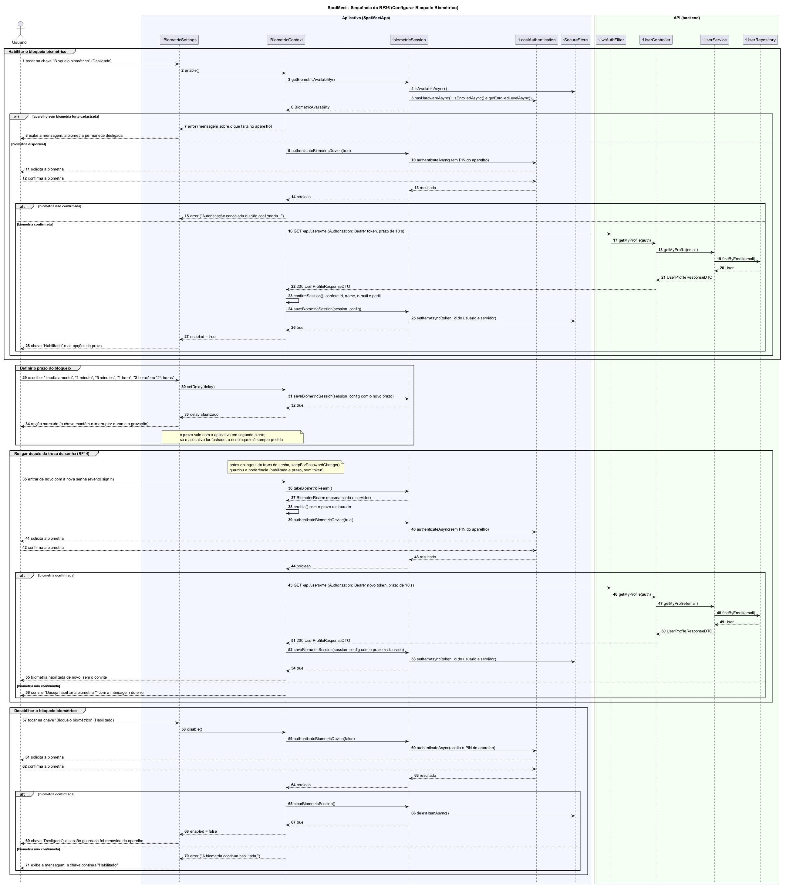

Fonte: próprio autor

## 7. Modelo do Sistema

Nesta seção descreve-se a forma de armazenamento dos dados pelo sistema. O banco de dados utilizado é o PostgreSQL 18, e as tabelas são criadas e atualizadas pelo Hibernate a partir das entidades, sem apagar os dados existentes. A Figura 47 exibe o modelo relacional implantado, com as onze tabelas do sistema.

**Figura 47 – Modelo relacional do sistema**

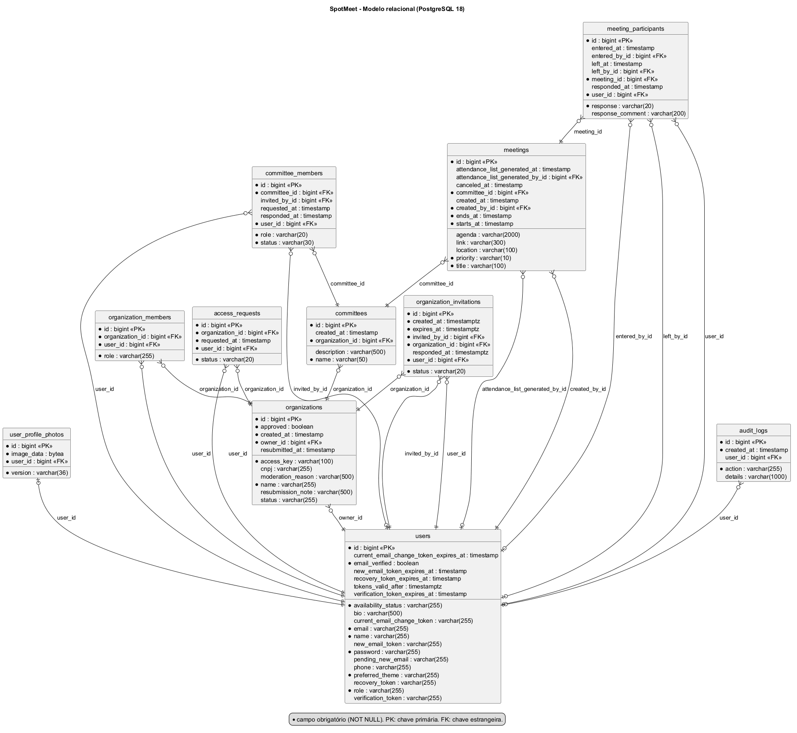

Fonte: próprio autor

O dicionário de dados descreve cada campo de cada tabela utilizada no sistema. Os tipos e as restrições foram lidos do banco criado pelo servidor atual (consulta ao `information_schema` e ao `pg_constraint` do PostgreSQL).

#### 1. users

Armazena as contas de usuário, incluindo o administrador do sistema criado na inicialização, os hashes dos códigos temporários de verificação, recuperação de senha e troca de e-mail e o instante de revogação dos tokens de acesso.

| Campo | id |
|---|---|
| Tipo de Dado | Inteiro longo (bigint) |
| Pode ser Nulo | Não |
| Chave Primária | Sim (exclusivo) |
| Chave Estrangeira | Não |
| Outros | Campo identidade (início em 1, incremento em 1) |
| Descrição | Identificador único, gerado automaticamente |

| Campo | availability_status |
|---|---|
| Tipo de Dado | String (varchar de 255 caracteres) |
| Pode ser Nulo | Não |
| Chave Primária | Não |
| Chave Estrangeira | Não |
| Outros | Valores permitidos: PRESENT, ONLINE, BUSY, AWAY |
| Descrição | `PRESENT`, `ONLINE`, `BUSY` ou `AWAY`. Padrão `PRESENT` |

| Campo | bio |
|---|---|
| Tipo de Dado | String (varchar de 500 caracteres) |
| Pode ser Nulo | Sim |
| Chave Primária | Não |
| Chave Estrangeira | Não |
| Outros | - |
| Descrição | Biografia curta do usuário |

| Campo | current_email_change_token |
|---|---|
| Tipo de Dado | String (varchar de 255 caracteres) |
| Pode ser Nulo | Sim |
| Chave Primária | Não |
| Chave Estrangeira | Não |
| Outros | - |
| Descrição | Hash BCrypt do código da etapa 1 da troca de e-mail (enviado ao e-mail atual) |

| Campo | current_email_change_token_expires_at |
|---|---|
| Tipo de Dado | Data e hora (timestamp) |
| Pode ser Nulo | Sim |
| Chave Primária | Não |
| Chave Estrangeira | Não |
| Outros | - |
| Descrição | Validade do código da etapa 1 (5 minutos) |

| Campo | email |
|---|---|
| Tipo de Dado | String (varchar de 255 caracteres) |
| Pode ser Nulo | Não |
| Chave Primária | Não |
| Chave Estrangeira | Não |
| Outros | Único |
| Descrição | E-mail, usado como identificador de login |

| Campo | email_verified |
|---|---|
| Tipo de Dado | Booleano (boolean) |
| Pode ser Nulo | Não |
| Chave Primária | Não |
| Chave Estrangeira | Não |
| Outros | - |
| Descrição | Indica se o e-mail foi confirmado por OTP. Padrão `false` |

| Campo | name |
|---|---|
| Tipo de Dado | String (varchar de 255 caracteres) |
| Pode ser Nulo | Não |
| Chave Primária | Não |
| Chave Estrangeira | Não |
| Outros | - |
| Descrição | Nome completo do usuário |

| Campo | new_email_token |
|---|---|
| Tipo de Dado | String (varchar de 255 caracteres) |
| Pode ser Nulo | Sim |
| Chave Primária | Não |
| Chave Estrangeira | Não |
| Outros | - |
| Descrição | Hash BCrypt do código da etapa 2 da troca de e-mail (enviado ao novo e-mail) |

| Campo | new_email_token_expires_at |
|---|---|
| Tipo de Dado | Data e hora (timestamp) |
| Pode ser Nulo | Sim |
| Chave Primária | Não |
| Chave Estrangeira | Não |
| Outros | - |
| Descrição | Validade do código da etapa 2 (5 minutos) |

| Campo | password |
|---|---|
| Tipo de Dado | String (varchar de 255 caracteres) |
| Pode ser Nulo | Não |
| Chave Primária | Não |
| Chave Estrangeira | Não |
| Outros | - |
| Descrição | Hash BCrypt da senha; nunca é devolvido pela API |

| Campo | pending_new_email |
|---|---|
| Tipo de Dado | String (varchar de 255 caracteres) |
| Pode ser Nulo | Sim |
| Chave Primária | Não |
| Chave Estrangeira | Não |
| Outros | - |
| Descrição | Novo e-mail aguardando confirmação na troca em duas etapas |

| Campo | phone |
|---|---|
| Tipo de Dado | String (varchar de 255 caracteres) |
| Pode ser Nulo | Sim |
| Chave Primária | Não |
| Chave Estrangeira | Não |
| Outros | - |
| Descrição | Telefone de contato |

| Campo | preferred_theme |
|---|---|
| Tipo de Dado | String (varchar de 255 caracteres) |
| Pode ser Nulo | Não |
| Chave Primária | Não |
| Chave Estrangeira | Não |
| Outros | Valores permitidos: LIGHT, DARK, SYSTEM |
| Descrição | `LIGHT`, `DARK` ou `SYSTEM`. Padrão `DARK` |

| Campo | recovery_token |
|---|---|
| Tipo de Dado | String (varchar de 255 caracteres) |
| Pode ser Nulo | Sim |
| Chave Primária | Não |
| Chave Estrangeira | Não |
| Outros | - |
| Descrição | Hash BCrypt do código de 6 dígitos de recuperação de senha; o código em si não é guardado |

| Campo | recovery_token_expires_at |
|---|---|
| Tipo de Dado | Data e hora (timestamp) |
| Pode ser Nulo | Sim |
| Chave Primária | Não |
| Chave Estrangeira | Não |
| Outros | - |
| Descrição | Validade do código de recuperação (5 minutos) |

| Campo | role |
|---|---|
| Tipo de Dado | String (varchar de 255 caracteres) |
| Pode ser Nulo | Não |
| Chave Primária | Não |
| Chave Estrangeira | Não |
| Outros | - |
| Descrição | `USER`, `ADMIN` ou `SYSADMIN`. Padrão `USER` |

| Campo | tokens_valid_after |
|---|---|
| Tipo de Dado | Data e hora com fuso (timestamptz) |
| Pode ser Nulo | Sim |
| Chave Primária | Não |
| Chave Estrangeira | Não |
| Outros | - |
| Descrição | Instante a partir do qual os tokens de acesso são aceitos; os emitidos antes dele são recusados. É atualizado quando a senha é trocada ou redefinida, quando uma conta ainda não verificada é cadastrada de novo e quando o administrador reseta o sistema. Nulo enquanto nunca foi atualizado |

| Campo | verification_token |
|---|---|
| Tipo de Dado | String (varchar de 255 caracteres) |
| Pode ser Nulo | Sim |
| Chave Primária | Não |
| Chave Estrangeira | Não |
| Outros | - |
| Descrição | Hash BCrypt do código de 6 dígitos de verificação de cadastro; o código em si não é guardado |

| Campo | verification_token_expires_at |
|---|---|
| Tipo de Dado | Data e hora (timestamp) |
| Pode ser Nulo | Sim |
| Chave Primária | Não |
| Chave Estrangeira | Não |
| Outros | - |
| Descrição | Validade do código de verificação de cadastro (5 minutos) |

#### 2. organizations

Armazena as organizações, com a chave de acesso, o dono, a situação de aprovação e o motivo da última decisão do administrador do sistema.

| Campo | id |
|---|---|
| Tipo de Dado | Inteiro longo (bigint) |
| Pode ser Nulo | Não |
| Chave Primária | Sim (exclusivo) |
| Chave Estrangeira | Não |
| Outros | Campo identidade (início em 1, incremento em 1) |
| Descrição | Identificador único |

| Campo | access_key |
|---|---|
| Tipo de Dado | String (varchar de 100 caracteres) |
| Pode ser Nulo | Não |
| Chave Primária | Não |
| Chave Estrangeira | Não |
| Outros | Único |
| Descrição | Chave de acesso, formato `#Nome`, usada para solicitar entrada |

| Campo | approved |
|---|---|
| Tipo de Dado | Booleano (boolean) |
| Pode ser Nulo | Não |
| Chave Primária | Não |
| Chave Estrangeira | Não |
| Outros | - |
| Descrição | Aprovada pelo SysAdmin. Padrão `false` |

| Campo | cnpj |
|---|---|
| Tipo de Dado | String (varchar de 255 caracteres) |
| Pode ser Nulo | Sim |
| Chave Primária | Não |
| Chave Estrangeira | Não |
| Outros | Único |
| Descrição | CNPJ, opcional; se informado, não pode repetir |

| Campo | created_at |
|---|---|
| Tipo de Dado | Data e hora (timestamp) |
| Pode ser Nulo | Não |
| Chave Primária | Não |
| Chave Estrangeira | Não |
| Outros | - |
| Descrição | Data de criação |

| Campo | moderation_reason |
|---|---|
| Tipo de Dado | String (varchar de 500 caracteres) |
| Pode ser Nulo | Sim |
| Chave Primária | Não |
| Chave Estrangeira | Não |
| Outros | - |
| Descrição | Motivo informado pelo administrador do sistema ao rejeitar ou bloquear a organização (3 a 500 caracteres); é apagado quando a organização é aprovada ou reativada |

| Campo | name |
|---|---|
| Tipo de Dado | String (varchar de 255 caracteres) |
| Pode ser Nulo | Não |
| Chave Primária | Não |
| Chave Estrangeira | Não |
| Outros | - |
| Descrição | Nome da organização |

| Campo | owner_id |
|---|---|
| Tipo de Dado | Inteiro longo (bigint) |
| Pode ser Nulo | Não |
| Chave Primária | Não |
| Chave Estrangeira | Sim (users : id) |
| Outros | - |
| Descrição | Usuário que criou a organização |

| Campo | resubmission_note |
|---|---|
| Tipo de Dado | String (varchar de 500 caracteres) |
| Pode ser Nulo | Sim |
| Chave Primária | Não |
| Chave Estrangeira | Não |
| Outros | - |
| Descrição | Justificativa escrita pelo dono ao reenviar para avaliação uma organização recusada (3 a 500 caracteres). Nula enquanto a reavaliação não foi pedida; é mantida depois da nova decisão do administrador |

| Campo | resubmitted_at |
|---|---|
| Tipo de Dado | Data e hora (timestamp) |
| Pode ser Nulo | Sim |
| Chave Primária | Não |
| Chave Estrangeira | Não |
| Outros | - |
| Descrição | Data e hora em que o dono pediu a reavaliação. Nula enquanto não foi pedida; preenchida, impede um novo reenvio, pois a reavaliação só pode ser usada uma vez |

| Campo | status |
|---|---|
| Tipo de Dado | String (varchar de 255 caracteres) |
| Pode ser Nulo | Sim |
| Chave Primária | Não |
| Chave Estrangeira | Não |
| Outros | - |
| Descrição | `PENDING`, `APPROVED`, `REJECTED` ou `BLOCKED`. Padrão `PENDING`, definido no Java (a coluna não tem `NOT NULL`) |

#### 3. organization_members

Armazena o vínculo de cada usuário com uma organização e o seu papel de liderança.

| Campo | id |
|---|---|
| Tipo de Dado | Inteiro longo (bigint) |
| Pode ser Nulo | Não |
| Chave Primária | Sim (exclusivo) |
| Chave Estrangeira | Não |
| Outros | Campo identidade (início em 1, incremento em 1) |
| Descrição | Identificador único |

| Campo | organization_id |
|---|---|
| Tipo de Dado | Inteiro longo (bigint) |
| Pode ser Nulo | Não |
| Chave Primária | Não |
| Chave Estrangeira | Sim (organizations : id) |
| Outros | Único em conjunto com user_id |
| Descrição | Organização |

| Campo | role |
|---|---|
| Tipo de Dado | String (varchar de 255 caracteres) |
| Pode ser Nulo | Não |
| Chave Primária | Não |
| Chave Estrangeira | Não |
| Outros | Valores permitidos: ORG_OWNER, ORG_VICE_OWNER, ORG_SUBOWNER, MEMBER |
| Descrição | `ORG_OWNER`, `ORG_VICE_OWNER`, `ORG_SUBOWNER` ou `MEMBER`. Padrão `MEMBER` |

| Campo | user_id |
|---|---|
| Tipo de Dado | Inteiro longo (bigint) |
| Pode ser Nulo | Não |
| Chave Primária | Não |
| Chave Estrangeira | Sim (users : id) |
| Outros | Único em conjunto com organization_id |
| Descrição | Membro |

#### 4. access_requests

Armazena as solicitações de acesso feitas por usuários a organizações, a partir da chave de acesso.

| Campo | id |
|---|---|
| Tipo de Dado | Inteiro longo (bigint) |
| Pode ser Nulo | Não |
| Chave Primária | Sim (exclusivo) |
| Chave Estrangeira | Não |
| Outros | Campo identidade (início em 1, incremento em 1) |
| Descrição | Identificador único |

| Campo | organization_id |
|---|---|
| Tipo de Dado | Inteiro longo (bigint) |
| Pode ser Nulo | Não |
| Chave Primária | Não |
| Chave Estrangeira | Sim (organizations : id) |
| Outros | Único em conjunto com user_id |
| Descrição | Organização alvo |

| Campo | requested_at |
|---|---|
| Tipo de Dado | Data e hora (timestamp) |
| Pode ser Nulo | Não |
| Chave Primária | Não |
| Chave Estrangeira | Não |
| Outros | - |
| Descrição | Data da solicitação |

| Campo | status |
|---|---|
| Tipo de Dado | String (varchar de 20 caracteres) |
| Pode ser Nulo | Não |
| Chave Primária | Não |
| Chave Estrangeira | Não |
| Outros | Valores permitidos: PENDING, APPROVED, REJECTED |
| Descrição | `PENDING`, `APPROVED` ou `REJECTED`. Padrão `PENDING` |

| Campo | user_id |
|---|---|
| Tipo de Dado | Inteiro longo (bigint) |
| Pode ser Nulo | Não |
| Chave Primária | Não |
| Chave Estrangeira | Sim (users : id) |
| Outros | Único em conjunto com organization_id |
| Descrição | Quem solicitou o acesso |

#### 5. organization_invitations

Armazena os convites enviados por líderes para que um usuário entre em uma organização, com prazo de 24 horas para a resposta.

| Campo | id |
|---|---|
| Tipo de Dado | Inteiro longo (bigint) |
| Pode ser Nulo | Não |
| Chave Primária | Sim (exclusivo) |
| Chave Estrangeira | Não |
| Outros | Campo identidade (início em 1, incremento em 1) |
| Descrição | Identificador único, gerado automaticamente |

| Campo | created_at |
|---|---|
| Tipo de Dado | Data e hora com fuso (timestamptz) |
| Pode ser Nulo | Não |
| Chave Primária | Não |
| Chave Estrangeira | Não |
| Outros | - |
| Descrição | Data e hora (com fuso) do convite |

| Campo | expires_at |
|---|---|
| Tipo de Dado | Data e hora com fuso (timestamptz) |
| Pode ser Nulo | Não |
| Chave Primária | Não |
| Chave Estrangeira | Não |
| Outros | - |
| Descrição | Data e hora (com fuso) em que o convite expira, 24 horas depois de criado |

| Campo | invited_by_id |
|---|---|
| Tipo de Dado | Inteiro longo (bigint) |
| Pode ser Nulo | Não |
| Chave Primária | Não |
| Chave Estrangeira | Sim (users : id) |
| Outros | - |
| Descrição | Líder que enviou o convite |

| Campo | organization_id |
|---|---|
| Tipo de Dado | Inteiro longo (bigint) |
| Pode ser Nulo | Não |
| Chave Primária | Não |
| Chave Estrangeira | Sim (organizations : id) |
| Outros | Único em conjunto com user_id |
| Descrição | Organização para a qual o usuário foi convidado |

| Campo | responded_at |
|---|---|
| Tipo de Dado | Data e hora com fuso (timestamptz) |
| Pode ser Nulo | Sim |
| Chave Primária | Não |
| Chave Estrangeira | Não |
| Outros | - |
| Descrição | Data e hora (com fuso) da resposta; nulo enquanto o convite está pendente |

| Campo | status |
|---|---|
| Tipo de Dado | String (varchar de 20 caracteres) |
| Pode ser Nulo | Não |
| Chave Primária | Não |
| Chave Estrangeira | Não |
| Outros | Valores permitidos: PENDING, ACCEPTED, REJECTED |
| Descrição | `PENDING`, `ACCEPTED` ou `REJECTED`. Padrão `PENDING`, definido no Java |

| Campo | user_id |
|---|---|
| Tipo de Dado | Inteiro longo (bigint) |
| Pode ser Nulo | Não |
| Chave Primária | Não |
| Chave Estrangeira | Sim (users : id) |
| Outros | Único em conjunto com organization_id |
| Descrição | Usuário convidado |

#### 6. committees

Armazena as comissões de cada organização.

| Campo | id |
|---|---|
| Tipo de Dado | Inteiro longo (bigint) |
| Pode ser Nulo | Não |
| Chave Primária | Sim (exclusivo) |
| Chave Estrangeira | Não |
| Outros | Campo identidade (início em 1, incremento em 1) |
| Descrição | Identificador único |

| Campo | created_at |
|---|---|
| Tipo de Dado | Data e hora (timestamp) |
| Pode ser Nulo | Sim |
| Chave Primária | Não |
| Chave Estrangeira | Não |
| Outros | - |
| Descrição | Data de criação, preenchida pelo Java ao salvar |

| Campo | description |
|---|---|
| Tipo de Dado | String (varchar de 500 caracteres) |
| Pode ser Nulo | Sim |
| Chave Primária | Não |
| Chave Estrangeira | Não |
| Outros | - |
| Descrição | Descrição opcional |

| Campo | name |
|---|---|
| Tipo de Dado | String (varchar de 50 caracteres) |
| Pode ser Nulo | Não |
| Chave Primária | Não |
| Chave Estrangeira | Não |
| Outros | Único em conjunto com organization_id (restrição uq_committee_org_name) |
| Descrição | Nome da comissão, único dentro da organização |

| Campo | organization_id |
|---|---|
| Tipo de Dado | Inteiro longo (bigint) |
| Pode ser Nulo | Não |
| Chave Primária | Não |
| Chave Estrangeira | Sim (organizations : id) |
| Outros | Único em conjunto com name (restrição uq_committee_org_name) |
| Descrição | Organização à qual pertence |

#### 7. committee_members

Armazena o vínculo de cada usuário com uma comissão: convite, solicitação de entrada, vínculo ativo, recusa e o papel de presidente.

| Campo | id |
|---|---|
| Tipo de Dado | Inteiro longo (bigint) |
| Pode ser Nulo | Não |
| Chave Primária | Sim (exclusivo) |
| Chave Estrangeira | Não |
| Outros | Campo identidade (início em 1, incremento em 1) |
| Descrição | Identificador único |

| Campo | committee_id |
|---|---|
| Tipo de Dado | Inteiro longo (bigint) |
| Pode ser Nulo | Não |
| Chave Primária | Não |
| Chave Estrangeira | Sim (committees : id) |
| Outros | Único em conjunto com user_id (restrição uq_committee_member) |
| Descrição | Comissão |

| Campo | invited_by_id |
|---|---|
| Tipo de Dado | Inteiro longo (bigint) |
| Pode ser Nulo | Sim |
| Chave Primária | Não |
| Chave Estrangeira | Sim (users : id) |
| Outros | - |
| Descrição | Quem convidou; nulo quando o vínculo nasceu de uma solicitação do próprio membro |

| Campo | requested_at |
|---|---|
| Tipo de Dado | Data e hora (timestamp) |
| Pode ser Nulo | Sim |
| Chave Primária | Não |
| Chave Estrangeira | Não |
| Outros | - |
| Descrição | Data do convite ou da solicitação |

| Campo | responded_at |
|---|---|
| Tipo de Dado | Data e hora (timestamp) |
| Pode ser Nulo | Sim |
| Chave Primária | Não |
| Chave Estrangeira | Não |
| Outros | - |
| Descrição | Data em que o convite/solicitação foi respondido |

| Campo | role |
|---|---|
| Tipo de Dado | String (varchar de 20 caracteres) |
| Pode ser Nulo | Não |
| Chave Primária | Não |
| Chave Estrangeira | Não |
| Outros | Valores permitidos: COMMITTEE_ADMIN, MEMBER |
| Descrição | `COMMITTEE_ADMIN` (presidente da comissão, no máximo um por comissão) ou `MEMBER`. Padrão `MEMBER`, definido no Java |

| Campo | status |
|---|---|
| Tipo de Dado | String (varchar de 30 caracteres) |
| Pode ser Nulo | Não |
| Chave Primária | Não |
| Chave Estrangeira | Não |
| Outros | Valores permitidos: PENDING_USER_ACCEPTANCE, PENDING_LEADER_APPROVAL, ACTIVE, DECLINED |
| Descrição | `PENDING_USER_ACCEPTANCE` (convite pendente), `PENDING_LEADER_APPROVAL` (solicitação pendente), `ACTIVE` ou `DECLINED`. Padrão `PENDING_USER_ACCEPTANCE` |

| Campo | user_id |
|---|---|
| Tipo de Dado | Inteiro longo (bigint) |
| Pode ser Nulo | Não |
| Chave Primária | Não |
| Chave Estrangeira | Sim (users : id) |
| Outros | Único em conjunto com committee_id (restrição uq_committee_member) |
| Descrição | Integrante |

#### 8. meetings

Armazena as reuniões agendadas pelo presidente de uma comissão. A situação da reunião (agendada, em andamento, encerrada ou cancelada) não é guardada: é calculada a partir do horário atual, dos horários de início e término e da data de cancelamento. A exclusão de uma comissão remove as suas reuniões no próprio banco.

| Campo | id |
|---|---|
| Tipo de Dado | Inteiro longo (bigint) |
| Pode ser Nulo | Não |
| Chave Primária | Sim (exclusivo) |
| Chave Estrangeira | Não |
| Outros | Campo identidade (início em 1, incremento em 1) |
| Descrição | Identificador único, gerado automaticamente |

| Campo | agenda |
|---|---|
| Tipo de Dado | String (varchar de 2000 caracteres) |
| Pode ser Nulo | Sim |
| Chave Primária | Não |
| Chave Estrangeira | Não |
| Outros | - |
| Descrição | Pauta da reunião, opcional |

| Campo | attendance_list_generated_at |
|---|---|
| Tipo de Dado | Data e hora (timestamp) |
| Pode ser Nulo | Sim |
| Chave Primária | Não |
| Chave Estrangeira | Não |
| Outros | - |
| Descrição | Data e hora em que o presidente gerou a lista de presença; nulo quando a lista não foi gerada ou foi invalidada por uma alteração de presença |

| Campo | attendance_list_generated_by_id |
|---|---|
| Tipo de Dado | Inteiro longo (bigint) |
| Pode ser Nulo | Sim |
| Chave Primária | Não |
| Chave Estrangeira | Sim (users : id) |
| Outros | - |
| Descrição | Presidente que gerou a lista de presença; nulo quando não há lista gerada |

| Campo | canceled_at |
|---|---|
| Tipo de Dado | Data e hora (timestamp) |
| Pode ser Nulo | Sim |
| Chave Primária | Não |
| Chave Estrangeira | Não |
| Outros | - |
| Descrição | Data e hora do cancelamento; nulo enquanto a reunião não foi cancelada |

| Campo | committee_id |
|---|---|
| Tipo de Dado | Inteiro longo (bigint) |
| Pode ser Nulo | Não |
| Chave Primária | Não |
| Chave Estrangeira | Sim (committees : id) |
| Outros | Exclusão em cascata: ao excluir a linha de committees, esta também é excluída |
| Descrição | Comissão da reunião |

| Campo | created_at |
|---|---|
| Tipo de Dado | Data e hora (timestamp) |
| Pode ser Nulo | Sim |
| Chave Primária | Não |
| Chave Estrangeira | Não |
| Outros | - |
| Descrição | Data e hora de criação, preenchida pelo Java ao salvar |

| Campo | created_by_id |
|---|---|
| Tipo de Dado | Inteiro longo (bigint) |
| Pode ser Nulo | Não |
| Chave Primária | Não |
| Chave Estrangeira | Sim (users : id) |
| Outros | - |
| Descrição | Presidente que agendou a reunião |

| Campo | ends_at |
|---|---|
| Tipo de Dado | Data e hora (timestamp) |
| Pode ser Nulo | Não |
| Chave Primária | Não |
| Chave Estrangeira | Não |
| Outros | - |
| Descrição | Data e hora de término, sem fuso (horário do servidor); deve ser depois do início e a duração máxima é de 24 horas |

| Campo | link |
|---|---|
| Tipo de Dado | String (varchar de 300 caracteres) |
| Pode ser Nulo | Sim |
| Chave Primária | Não |
| Chave Estrangeira | Não |
| Outros | - |
| Descrição | Link da reunião online, opcional; vazio ou iniciado por http:// ou https:// |

| Campo | location |
|---|---|
| Tipo de Dado | String (varchar de 100 caracteres) |
| Pode ser Nulo | Sim |
| Chave Primária | Não |
| Chave Estrangeira | Não |
| Outros | - |
| Descrição | Local da reunião, opcional |

| Campo | priority |
|---|---|
| Tipo de Dado | String (varchar de 10 caracteres) |
| Pode ser Nulo | Não |
| Chave Primária | Não |
| Chave Estrangeira | Não |
| Outros | Valores permitidos: LOW, MEDIUM, HIGH |
| Descrição | `LOW`, `MEDIUM` ou `HIGH`. Padrão `MEDIUM`, definido no Java |

| Campo | starts_at |
|---|---|
| Tipo de Dado | Data e hora (timestamp) |
| Pode ser Nulo | Não |
| Chave Primária | Não |
| Chave Estrangeira | Não |
| Outros | - |
| Descrição | Data e hora de início, sem fuso (horário do servidor); no agendamento deve ser futura |

| Campo | title |
|---|---|
| Tipo de Dado | String (varchar de 100 caracteres) |
| Pode ser Nulo | Não |
| Chave Primária | Não |
| Chave Estrangeira | Não |
| Outros | - |
| Descrição | Título da reunião, de 2 a 100 caracteres |

#### 9. meeting_participants

Armazena cada convidado de uma reunião, com a resposta ao convite e os registros de entrada e saída. A exclusão de uma reunião remove os seus participantes no próprio banco.

| Campo | id |
|---|---|
| Tipo de Dado | Inteiro longo (bigint) |
| Pode ser Nulo | Não |
| Chave Primária | Sim (exclusivo) |
| Chave Estrangeira | Não |
| Outros | Campo identidade (início em 1, incremento em 1) |
| Descrição | Identificador único, gerado automaticamente |

| Campo | entered_at |
|---|---|
| Tipo de Dado | Data e hora (timestamp) |
| Pode ser Nulo | Sim |
| Chave Primária | Não |
| Chave Estrangeira | Não |
| Outros | - |
| Descrição | Data e hora da entrada na reunião; nulo enquanto não registrada |

| Campo | entered_by_id |
|---|---|
| Tipo de Dado | Inteiro longo (bigint) |
| Pode ser Nulo | Sim |
| Chave Primária | Não |
| Chave Estrangeira | Sim (users : id) |
| Outros | - |
| Descrição | Quem registrou a entrada (a própria pessoa ou o presidente) |

| Campo | left_at |
|---|---|
| Tipo de Dado | Data e hora (timestamp) |
| Pode ser Nulo | Sim |
| Chave Primária | Não |
| Chave Estrangeira | Não |
| Outros | - |
| Descrição | Data e hora da saída da reunião; nulo enquanto não registrada |

| Campo | left_by_id |
|---|---|
| Tipo de Dado | Inteiro longo (bigint) |
| Pode ser Nulo | Sim |
| Chave Primária | Não |
| Chave Estrangeira | Sim (users : id) |
| Outros | - |
| Descrição | Quem registrou a saída (a própria pessoa ou o presidente) |

| Campo | meeting_id |
|---|---|
| Tipo de Dado | Inteiro longo (bigint) |
| Pode ser Nulo | Não |
| Chave Primária | Não |
| Chave Estrangeira | Sim (meetings : id) |
| Outros | Único em conjunto com user_id (restrição uq_meeting_participant); Exclusão em cascata: ao excluir a linha de meetings, esta também é excluída |
| Descrição | Reunião do convite |

| Campo | responded_at |
|---|---|
| Tipo de Dado | Data e hora (timestamp) |
| Pode ser Nulo | Sim |
| Chave Primária | Não |
| Chave Estrangeira | Não |
| Outros | - |
| Descrição | Data e hora da resposta ao convite; nulo enquanto o convite está sem resposta |

| Campo | response |
|---|---|
| Tipo de Dado | String (varchar de 20 caracteres) |
| Pode ser Nulo | Não |
| Chave Primária | Não |
| Chave Estrangeira | Não |
| Outros | Valores permitidos: PENDING, ACCEPTED, DECLINED |
| Descrição | `PENDING` (sem resposta), `ACCEPTED` ou `DECLINED`. Padrão `PENDING`, definido no Java; o presidente entra como `ACCEPTED` ao agendar |

| Campo | response_comment |
|---|---|
| Tipo de Dado | String (varchar de 200 caracteres) |
| Pode ser Nulo | Sim |
| Chave Primária | Não |
| Chave Estrangeira | Não |
| Outros | - |
| Descrição | Comentário opcional da recusa, de até 200 caracteres; apagado quando o convite é aceito |

| Campo | user_id |
|---|---|
| Tipo de Dado | Inteiro longo (bigint) |
| Pode ser Nulo | Não |
| Chave Primária | Não |
| Chave Estrangeira | Sim (users : id) |
| Outros | Único em conjunto com meeting_id (restrição uq_meeting_participant) |
| Descrição | Usuário convidado |

#### 10. user_profile_photos

Armazena a foto de perfil de cada usuário, já reduzida e convertida pelo servidor. A exclusão do usuário remove a foto no próprio banco.

| Campo | id |
|---|---|
| Tipo de Dado | Inteiro longo (bigint) |
| Pode ser Nulo | Não |
| Chave Primária | Sim (exclusivo) |
| Chave Estrangeira | Não |
| Outros | Campo identidade (início em 1, incremento em 1) |
| Descrição | Identificador único, gerado automaticamente |

| Campo | image_data |
|---|---|
| Tipo de Dado | Binário (bytea) |
| Pode ser Nulo | Não |
| Chave Primária | Não |
| Chave Estrangeira | Não |
| Outros | - |
| Descrição | Bytes da imagem JPEG, de até 512 x 512 pixels e 1 MB, gerada pelo servidor a partir do arquivo enviado |

| Campo | user_id |
|---|---|
| Tipo de Dado | Inteiro longo (bigint) |
| Pode ser Nulo | Não |
| Chave Primária | Não |
| Chave Estrangeira | Sim (users : id) |
| Outros | Único; Exclusão em cascata: ao excluir a linha de users, esta também é excluída |
| Descrição | Usuário dono da foto (uma por usuário) |

| Campo | version |
|---|---|
| Tipo de Dado | String (varchar de 36 caracteres) |
| Pode ser Nulo | Não |
| Chave Primária | Não |
| Chave Estrangeira | Não |
| Outros | - |
| Descrição | Identificador (UUID) da versão da foto, trocado a cada envio, usado para atualizar o cache do aplicativo |

#### 11. audit_logs

Armazena o registro das ações relevantes executadas no sistema, para fins de auditoria.

| Campo | id |
|---|---|
| Tipo de Dado | Inteiro longo (bigint) |
| Pode ser Nulo | Não |
| Chave Primária | Sim (exclusivo) |
| Chave Estrangeira | Não |
| Outros | Campo identidade (início em 1, incremento em 1) |
| Descrição | Identificador único |

| Campo | action |
|---|---|
| Tipo de Dado | String (varchar de 255 caracteres) |
| Pode ser Nulo | Não |
| Chave Primária | Não |
| Chave Estrangeira | Não |
| Outros | - |
| Descrição | Código da ação (ex.: `USER_REGISTERED`, `ORGANIZATION_CREATED`, `ADMIN_SYSTEM_FULL_RESET`) |

| Campo | created_at |
|---|---|
| Tipo de Dado | Data e hora (timestamp) |
| Pode ser Nulo | Não |
| Chave Primária | Não |
| Chave Estrangeira | Não |
| Outros | - |
| Descrição | Data e hora da ação |

| Campo | details |
|---|---|
| Tipo de Dado | String (varchar de 1000 caracteres) |
| Pode ser Nulo | Sim |
| Chave Primária | Não |
| Chave Estrangeira | Não |
| Outros | - |
| Descrição | Texto livre com o detalhe da ação, sem dados sensíveis |

| Campo | user_id |
|---|---|
| Tipo de Dado | Inteiro longo (bigint) |
| Pode ser Nulo | Sim |
| Chave Primária | Não |
| Chave Estrangeira | Sim (users : id) |
| Outros | - |
| Descrição | Quem executou a ação |

## 8. Planejamento de Testes

Durante o desenvolvimento, cada regra do servidor é coberta por testes automatizados de unidade e de integração, executados antes de cada envio ao repositório. Ao fim de cada requisito, a API é chamada contra um banco PostgreSQL real, separado do banco da equipe, para conferir as respostas e o que foi gravado. Ao fim de cada incremento, é feito o teste de release no aplicativo instalado em aparelho, com o roteiro da seção 8.3.

### 8.1. Ferramentas e ambiente

| Tipo de teste | Ferramenta | Como é aplicado |
|---|---|---|
| Unidade e integração (servidor) | JUnit 5, Mockito e MockMvc, do Spring Boot Test 3.3.5 | As classes de serviço são testadas com os repositórios simulados, e as rotas são chamadas pelo MockMvc com e sem token, com dados válidos e inválidos, conferindo o código HTTP, o corpo da resposta e o que foi salvo. São 25 classes em `backend/src/test`, executadas com `./mvnw test`. |
| Integração com banco real (servidor) | PostgreSQL 18 em contêiner Docker e roteiros em Node.js | Uma cópia do servidor sobe na porta 8099 com um banco criado só para o teste. O roteiro cria usuários, organizações, comissões e reuniões pela API e confere cada resposta. No fim, o banco é apagado. |
| Segurança (servidor) | Postman e Newman | Coleção com tentativas de acesso sem permissão, força bruta, XSS e dados inválidos, executada contra o servidor de teste. |
| Verificação estática (aplicativo) | TypeScript (`npx tsc --noEmit`) e exportação do Expo (`npx expo export --platform android`) | Executadas depois de cada alteração no aplicativo; o envio só é feito se as duas terminarem sem erro. O aplicativo não tem testes automatizados de tela. |
| Release (aplicativo) | APK "SpotMeet Testes" em aparelhos Android e Expo Go no iPhone | A equipe usa o aplicativo ligado ao servidor de teste e registra cada problema com gravação de tela ou áudio. Os problemas encontrados são corrigidos e testados de novo na build seguinte. |

### 8.2. Testes executados

| Data | Teste | Resultado |
|---|---|---|
| 18/10/2026 | Coleção de segurança no Postman (195 requisições, executadas pelo Newman) | Acesso entre organizações, troca de cargo, token falsificado, SQL injection e arquivos maliciosos na foto foram recusados. Foram corrigidos a tomada de conta pelo cadastro pendente, o token antigo que abria uma conta nova com o mesmo e-mail e os erros que mostravam detalhes internos; a coleção foi executada de novo depois da correção. |
| 20/10/2026 | Roteiro das reuniões contra PostgreSQL real (61 verificações) | Todas passaram: permissões do presidente, convidados, respostas, entrada e saída, lista de presença e exclusão em cascata. |
| 22/10/2026 | Release com o APK em aparelhos Android | 12 problemas relatados pelos integrantes (foto de perfil não salvava, biometria pedida ao voltar da galeria, textos da tela de código, entre outros) e dois no painel do administrador. Todos foram corrigidos. |
| 22/10/2026 | Roteiro da reavaliação de organização e da transferência de liderança contra PostgreSQL real (18 verificações) | Todas passaram. |
| 22 e 23/10/2026 | Segunda rodada de release (APK e gravações de tela) | 12 relatos, entre eles o diálogo de sair da conta que demorava a fechar e a foto escolhida que se perdia ao trocar de seção em Ajustes. Corrigidos e conferidos contra o servidor de teste; o reteste em aparelho é feito na build seguinte. |
| 23/10/2026 | Terceira rodada de release (gravações de tela) e revisão das reuniões | Cinco relatos na tela de organizações (motivo da recusa fora da visão geral, chave que continuava no campo, mensagens sem acento, falta de detalhes da organização ao digitar a chave e de busca de pessoas no convite) e quatro problemas achados na revisão das reuniões (edição antes de carregar os convidados, reuniões antigas fora da lista do novo presidente, lista de presença aberta desatualizada e cancelamento de reunião em andamento sem o botão). Corrigidos; o reteste em aparelho é feito na build seguinte. |
| 23/10/2026 | Testes automatizados do servidor | 759 testes executados, nenhuma falha. Cinco foram pulados porque dependem de um PostgreSQL configurado no ambiente de teste. |

### 8.3. Casos de teste de release

| Caso | Requisito | Procedimento | Resultado esperado |
|---|---|---|---|
| CT01 | RF01 | Cadastrar com a senha `abc123` | Cadastro recusado, com a regra de senha não atendida |
| CT02 | RF01 | Cadastrar com um e-mail já verificado | Aviso "Conta Já Cadastrada" (409) |
| CT03 | RF01 | Informar um código de verificação incorreto | Mensagem de código inválido; a conta continua não verificada |
| CT04 | RF02 | Entrar com e-mail ainda não verificado | O aplicativo leva ao formulário "Confirme seu e-mail" (403) |
| CT05 | RF02 | Entrar com a senha incorreta | Mensagem "E-mail ou senha incorretos." (401) |
| CT06 | RF02 | Depois de entrar, usar o botão voltar do Android | O aplicativo não volta à tela de acesso |
| CT07 | RF03 | Pedir acesso com uma chave que não existe | Mensagem de organização não encontrada |
| CT08 | RF03 | Pedir acesso duas vezes à mesma organização | Segundo pedido recusado (409) |
| CT09 | RF04 | Membro comum tentar aprovar um pedido | Acesso negado (403) |
| CT10 | RF06 | Criar organização com uma chave já usada | Cadastro recusado (409) |
| CT11 | RF07 | Transferir a liderança de uma organização pendente | Opção não exibida; pela API, 409 |
| CT12 | RF07 | Dono reenviar uma organização recusada para avaliação, duas vezes | O primeiro reenvio volta a organização para pendente; o segundo é recusado |
| CT13 | RF08 | Administrador aprovar uma organização pendente | O dono passa a ver a organização como aprovada |
| CT14 | RF09 | Tocar em "Comissões" numa organização pendente | Aviso "Organização não aprovada", sem abrir a página |
| CT15 | RF09 | Criar duas comissões com o mesmo nome na mesma organização | Segunda criação recusada (409) |
| CT16 | RF11 | Convidar para a comissão um usuário de outra organização | Convite recusado |
| CT17 | RF14 | Trocar a senha informando a senha atual errada | Troca recusada (400) |
| CT18 | RF14 | Trocar a senha corretamente | O aplicativo encerra a sessão e pede a nova senha |
| CT19 | RF15 | Usar o código de recuperação depois de 5 minutos | Código recusado por expiração |
| CT20 | RF16 | Escolher uma foto, não salvar e tocar em outra aba | Diálogo "Alterações não salvas" com "Continuar editando", "Descartar" e "Salvar" |
| CT21 | RF17 | Salvar o tema claro, sair da conta e entrar de novo | Tema claro mantido |
| CT22 | RF18 | Informar o código errado na segunda etapa da troca de e-mail | Troca recusada; o e-mail original é mantido |
| CT23 | RF20 | Abrir o Monitoramento como administrador | Banco de dados, Rede e Recursos com a situação de cada um |
| CT24 | RF21 | Consultar os relatórios | Nenhum e-mail aparece por completo |
| CT25 | RF24 | Designar como presidente alguém que não é integrante ativo da comissão | Designação recusada |
| CT26 | RF25 | Agendar reunião com término antes do início | Agendamento recusado |
| CT27 | RF25 | Integrante que não é presidente tentar agendar | Opção não exibida; pela API, agendamento recusado |
| CT28 | RF30 | Recusar o convite com um comentário e depois aceitar | A resposta muda para aceita e o comentário é descartado |
| CT29 | RF31 | Registrar a entrada antes do início da reunião | Registro recusado |
| CT30 | RF32 | Registrar a saída sem ter registrado a entrada | Registro recusado (409) |
| CT31 | RF34 | Gerar a lista e depois registrar uma nova entrada | A lista precisa ser gerada de novo para mostrar a mudança |
| CT32 | RF36 | Habilitar a biometria, deixar o aplicativo em segundo plano por mais tempo que o prazo escolhido e voltar | O aplicativo pede a biometria |
| CT33 | Todos | Chamar uma rota protegida sem token | Acesso negado (401) |
| CT34 | RNF11 | Parar e iniciar o servidor com dados cadastrados | Dados preservados |

## 9. Evolução do Sistema

O Incremento 1 foi modelado para receber a gestão de reuniões nos incrementos seguintes, e o Incremento 2 acrescentou as tabelas `meetings` e `meeting_participants` sem alterar as existentes e sem apagar dados (RNF11). A criação da ata da reunião e a aprovação da ata, que ficaram fora do Incremento 2, poderão ser associadas à reunião e à lista de presença já cadastradas.
